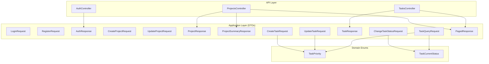
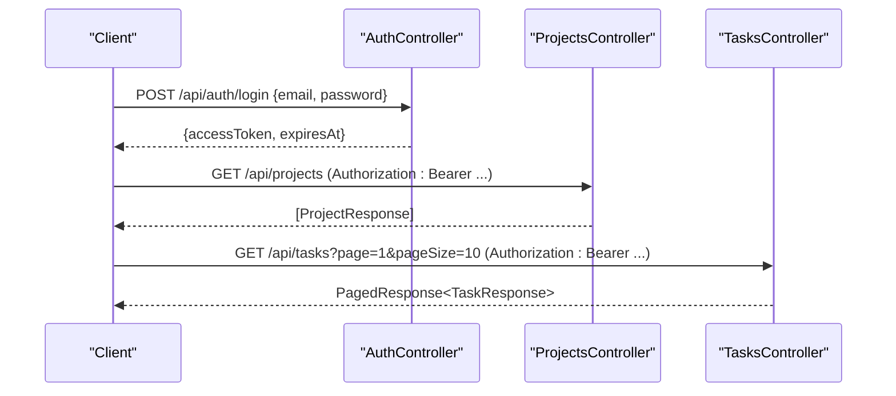
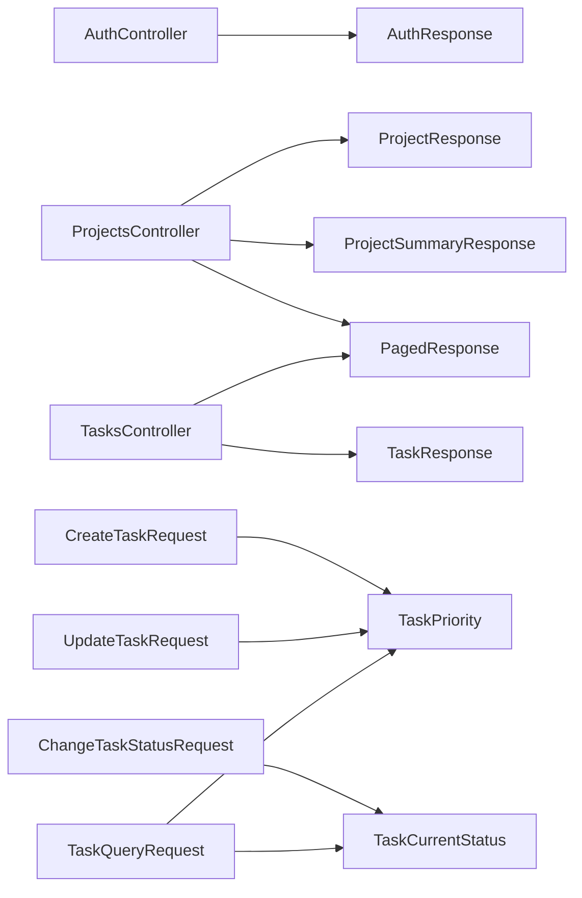

# API Documentation

<cite>
**Referenced Files in This Document**
- [AuthController.cs](file://Services/Services.Api/Controllers/AuthController.cs)
- [ProjectsController.cs](file://Services/Services.Api/Controllers/ProjectsController.cs)
- [TasksController.cs](file://Services/Services.Api/Controllers/TasksController.cs)
- [LoginRequest.cs](file://Services/Services.Application/DTOs/Auth/LoginRequest.cs)
- [RegisterRequest.cs](file://Services/Services.Application/DTOs/Auth/RegisterRequest.cs)
- [AuthResponse.cs](file://Services/Services.Application/DTOs/Auth/AuthResponse.cs)
- [CreateProjectRequest.cs](file://Services/Services.Application/DTOs/Projects/CreateProjectRequest.cs)
- [UpdateProjectRequest.cs](file://Services/Services.Application/DTOs/Projects/UpdateProjectRequest.cs)
- [ProjectResponse.cs](file://Services/Services.Application/DTOs/Projects/ProjectResponse.cs)
- [ProjectSummaryResponse.cs](file://Services/Services.Application/DTOs/Projects/ProjectSummaryResponse.cs)
- [CreateTaskRequest.cs](file://Services/Services.Application/DTOs/Tasks/CreateTaskRequest.cs)
- [UpdateTaskRequest.cs](file://Services/Services.Application/DTOs/Tasks/UpdateTaskRequest.cs)
- [TaskResponse.cs](file://Services/Services.Application/DTOs/Tasks/TaskResponse.cs)
- [ChangeTaskStatusRequest.cs](file://Services/Services.Application/DTOs/Tasks/ChangeTaskStatusRequest.cs)
- [TaskQueryRequest.cs](file://Services/Services.Application/DTOs/Tasks/TaskQueryRequest.cs)
- [PagedResponse.cs](file://Services/Services.Application/DTOs/PagedResponse.cs)
- [TaskPriority.cs](file://Services/Services.Domain/Enums/TaskPriority.cs)
- [TaskCurrentStatus.cs](file://Services/Services.Domain/Enums/TaskCurrentStatus.cs)
</cite>

## Table of Contents
1. Introduction
2. Project Structure
3. Core Components
4. Architecture Overview
5. Detailed Component Analysis
6. Dependency Analysis
7. Performance Considerations
8. Troubleshooting Guide
9. Conclusion

## Introduction
This document provides comprehensive API documentation for TaskFlow’s RESTful endpoints, focusing on authentication, project management, and task management. It includes HTTP methods, URL patterns, request/response schemas, status codes, error responses, authentication requirements, and practical client integration guidance.

## Project Structure
The API is implemented as an ASP.NET Core Web API with controllers under Services.Api and DTOs/enums under Services.Application and Services.Domain. The main entry points are:
- Authentication: /api/auth/*
- Projects: /api/projects/*
- Tasks: /api/tasks/*

**Diagram sources**
- [AuthController.cs:9-11](file://Services/Services.Api/Controllers/AuthController.cs#L9-L11)
- [ProjectsController.cs:12-18](file://Services/Services.Api/Controllers/ProjectsController.cs#L12-L18)
- [TasksController.cs:11-16](file://Services/Services.Api/Controllers/TasksController.cs#L11-L16)
- [LoginRequest.cs:3-5](file://Services/Services.Application/DTOs/Auth/LoginRequest.cs#L3-L5)
- [RegisterRequest.cs:3-5](file://Services/Services.Application/DTOs/Auth/RegisterRequest.cs#L3-L5)
- [AuthResponse.cs:3-5](file://Services/Services.Application/DTOs/Auth/AuthResponse.cs#L3-L5)
- [CreateProjectRequest.cs:3-7](file://Services/Services.Application/DTOs/Projects/CreateProjectRequest.cs#L3-L7)
- [UpdateProjectRequest.cs:3-7](file://Services/Services.Application/DTOs/Projects/UpdateProjectRequest.cs#L3-L7)
- [ProjectResponse.cs:3-10](file://Services/Services.Application/DTOs/Projects/ProjectResponse.cs#L3-L10)
- [ProjectSummaryResponse.cs:3-9](file://Services/Services.Application/DTOs/Projects/ProjectSummaryResponse.cs#L3-L9)
- [CreateTaskRequest.cs:5-10](file://Services/Services.Application/DTOs/Tasks/CreateTaskRequest.cs#L5-L10)
- [UpdateTaskRequest.cs:5-10](file://Services/Services.Application/DTOs/Tasks/UpdateTaskRequest.cs#L5-L10)
- [TaskResponse.cs:5-16](file://Services/Services.Application/DTOs/Tasks/TaskResponse.cs#L5-L16)
- [ChangeTaskStatusRequest.cs:5-6](file://Services/Services.Application/DTOs/Tasks/ChangeTaskStatusRequest.cs#L5-L6)
- [TaskQueryRequest.cs:5-20](file://Services/Services.Application/DTOs/Tasks/TaskQueryRequest.cs#L5-L20)
- [PagedResponse.cs:3-8](file://Services/Services.Application/DTOs/PagedResponse.cs#L3-L8)
- [TaskPriority.cs:3-9](file://Services/Services.Domain/Enums/TaskPriority.cs#L3-L9)
- [TaskCurrentStatus.cs:3-8](file://Services/Services.Domain/Enums/TaskCurrentStatus.cs#L3-L8)

**Section sources**
- [AuthController.cs:9-11](file://Services/Services.Api/Controllers/AuthController.cs#L9-L11)
- [ProjectsController.cs:12-18](file://Services/Services.Api/Controllers/ProjectsController.cs#L12-L18)
- [TasksController.cs:11-16](file://Services/Services.Api/Controllers/TasksController.cs#L11-L16)

## Core Components
- Authentication Controller: Provides register, login, and logout endpoints.
- Projects Controller: Manages projects with CRUD operations, summary retrieval, and per-project task listing.
- Tasks Controller: Manages tasks with CRUD operations, status changes, and query/filter/sort/pagination support.

Key response types:
- AuthResponse: AccessToken and ExpiresAt.
- PagedResponse<T>: Paginated results with Items, Page, PageSize, TotalCount, TotalPages.
- ProjectResponse, ProjectSummaryResponse, TaskResponse: Domain-specific payloads.

**Section sources**
- [AuthController.cs:14-76](file://Services/Services.Api/Controllers/AuthController.cs#L14-L76)
- [ProjectsController.cs:20-197](file://Services/Services.Api/Controllers/ProjectsController.cs#L20-L197)
- [TasksController.cs:18-182](file://Services/Services.Api/Controllers/TasksController.cs#L18-L182)
- [AuthResponse.cs:3-5](file://Services/Services.Application/DTOs/Auth/AuthResponse.cs#L3-L5)
- [PagedResponse.cs:3-8](file://Services/Services.Application/DTOs/PagedResponse.cs#L3-L8)
- [ProjectResponse.cs:3-10](file://Services/Services.Application/DTOs/Projects/ProjectResponse.cs#L3-L10)
- [ProjectSummaryResponse.cs:3-9](file://Services/Services.Application/DTOs/Projects/ProjectSummaryResponse.cs#L3-L9)
- [TaskResponse.cs:5-16](file://Services/Services.Application/DTOs/Tasks/TaskResponse.cs#L5-L16)

## Architecture Overview
Authentication uses JWT tokens. Protected endpoints require a valid Bearer token. The flow:
- Client registers or logs in to receive AccessToken and ExpiresAt.
- Client includes Authorization: Bearer <AccessToken> in subsequent requests.
- Server validates the token and extracts user identity from the JWT subject claim.

**Diagram sources**
- [AuthController.cs:35-62](file://Services/Services.Api/Controllers/AuthController.cs#L35-L62)
- [ProjectsController.cs:12-18](file://Services/Services.Api/Controllers/ProjectsController.cs#L12-L18)
- [TasksController.cs:11-16](file://Services/Services.Api/Controllers/TasksController.cs#L11-L16)

## Detailed Component Analysis

### Authentication Endpoints (/api/auth/*)
- Register
  - Method: POST
  - URL: /api/auth/register
  - Request body: LoginRequest fields plus password; see schema below.
  - Response: 200 OK with AuthResponse.
  - Errors: 400 Bad Request on validation failure.
- Login
  - Method: POST
  - URL: /api/auth/login
  - Request body: Email, Password.
  - Response: 200 OK with AuthResponse.
  - Errors: 400 Bad Request on validation failure; 401 Unauthorized on invalid credentials.
- Logout
  - Method: POST
  - URL: /api/auth/logout
  - Authentication: Required (Bearer token).
  - Response: 200 OK with message.
  - Errors: 401 Unauthorized if not authenticated.

Request/Response Schemas
- LoginRequest
  - email: string (required)
  - password: string (required)
- RegisterRequest
  - email: string (required)
  - password: string (required)
- AuthResponse
  - accessToken: string
  - expiresAt: string (ISO 8601 DateTimeOffset)

Example curl
- Register
  - curl -X POST https://your-api-host/api/auth/register -H "Content-Type: application/json" -d '{"email":"user@example.com","password":"SecurePass123"}'
- Login
  - curl -X POST https://your-api-host/api/auth/login -H "Content-Type: application/json" -d '{"email":"user@example.com","password":"SecurePass123"}'
- Logout
  - curl -X POST https://your-api-host/api/auth/logout -H "Authorization: Bearer YOUR_JWT_TOKEN"

Security notes
- All protected endpoints require a valid JWT Bearer token.
- Tokens include an expiration time; refresh strategy should be implemented by clients.

**Section sources**
- [AuthController.cs:14-33](file://Services/Services.Api/Controllers/AuthController.cs#L14-L33)
- [AuthController.cs:35-62](file://Services/Services.Api/Controllers/AuthController.cs#L35-L62)
- [AuthController.cs:64-76](file://Services/Services.Api/Controllers/AuthController.cs#L64-L76)
- [LoginRequest.cs:3-5](file://Services/Services.Application/DTOs/Auth/LoginRequest.cs#L3-L5)
- [RegisterRequest.cs:3-5](file://Services/Services.Application/DTOs/Auth/RegisterRequest.cs#L3-L5)
- [AuthResponse.cs:3-5](file://Services/Services.Application/DTOs/Auth/AuthResponse.cs#L3-L5)

### Project Management Endpoints (/api/projects/*)
All endpoints under /api/projects require authentication.

- Create Project
  - Method: POST
  - URL: /api/projects
  - Request body: CreateProjectRequest
  - Response: 201 Created with ProjectResponse
  - Errors: 400 Bad Request on validation failure
- Get All Projects
  - Method: GET
  - URL: /api/projects
  - Response: 200 OK with array of ProjectResponse
- Get Project By Id
  - Method: GET
  - URL: /api/projects/{id}
  - Path parameter: id (GUID)
  - Response: 200 OK with ProjectResponse
  - Errors: 404 Not Found if project does not exist; 400 Bad Request on validation failure
- Update Project
  - Method: PUT
  - URL: /api/projects/{id}
  - Path parameter: id (GUID)
  - Request body: UpdateProjectRequest
  - Response: 200 OK with ProjectResponse
  - Errors: 404 Not Found; 400 Bad Request
- Delete Project
  - Method: DELETE
  - URL: /api/projects/{id}
  - Path parameter: id (GUID)
  - Response: 204 No Content
  - Errors: 404 Not Found; 400 Bad Request; 409 Conflict on invalid operation
- Get Project Summary
  - Method: GET
  - URL: /api/projects/{id}/summary
  - Path parameter: id (GUID)
  - Response: 200 OK with ProjectSummaryResponse
  - Errors: 404 Not Found; 400 Bad Request
- Get Project Tasks (paginated)
  - Method: GET
  - URL: /api/projects/{id}/tasks
  - Query parameters: TaskQueryRequest fields (page, pageSize, status, priority, search, sortBy, sortDirection)
  - Response: 200 OK with PagedResponse<TaskResponse>
  - Errors: 404 Not Found; 400 Bad Request

Request/Response Schemas
- CreateProjectRequest
  - name: string (required)
  - description: string? (optional)
  - color: string (default "#6366F1")
- UpdateProjectRequest
  - name: string (required)
  - description: string? (optional)
  - color: string (default "#6366F1")
- ProjectResponse
  - id: GUID
  - name: string
  - description: string?
  - color: string
  - createdAt: string (DateTimeOffset)
  - updatedAt: string (DateTimeOffset)
- ProjectSummaryResponse
  - projectId: GUID
  - projectName: string
  - totalTasks: int
  - completedTasks: int
  - pendingTasks: int
  - progressPercentage: decimal

Example curl
- Create
  - curl -X POST https://your-api-host/api/projects -H "Authorization: Bearer YOUR_JWT_TOKEN" -H "Content-Type: application/json" -d '{"name":"My Project","description":"A sample project","color":"#6366F1"}'
- Get All
  - curl -X GET https://your-api-host/api/projects -H "Authorization: Bearer YOUR_JWT_TOKEN"
- Get By Id
  - curl -X GET https://your-api-host/api/projects/{id} -H "Authorization: Bearer YOUR_JWT_TOKEN"
- Update
  - curl -X PUT https://your-api-host/api/projects/{id} -H "Authorization: Bearer YOUR_JWT_TOKEN" -H "Content-Type: application/json" -d '{"name":"Updated Name","description":"Updated desc","color":"#FF5722"}'
- Delete
  - curl -X DELETE https://your-api-host/api/projects/{id} -H "Authorization: Bearer YOUR_JWT_TOKEN"
- Summary
  - curl -X GET https://your-api-host/api/projects/{id}/summary -H "Authorization: Bearer YOUR_JWT_TOKEN"
- Tasks (paginated)
  - curl -X GET "https://your-api-host/api/projects/{id}/tasks?page=1&pageSize=10&status=Todo&priority=High&search=task+keyword&sortBy=createdAt&sortDirection=desc" -H "Authorization: Bearer YOUR_JWT_TOKEN"

**Section sources**
- [ProjectsController.cs:20-43](file://Services/Services.Api/Controllers/ProjectsController.cs#L20-L43)
- [ProjectsController.cs:45-53](file://Services/Services.Api/Controllers/ProjectsController.cs#L45-L53)
- [ProjectsController.cs:55-76](file://Services/Services.Api/Controllers/ProjectsController.cs#L55-L76)
- [ProjectsController.cs:78-103](file://Services/Services.Api/Controllers/ProjectsController.cs#L78-L103)
- [ProjectsController.cs:105-128](file://Services/Services.Api/Controllers/ProjectsController.cs#L105-L128)
- [ProjectsController.cs:130-157](file://Services/Services.Api/Controllers/ProjectsController.cs#L130-L157)
- [ProjectsController.cs:175-197](file://Services/Services.Api/Controllers/ProjectsController.cs#L175-L197)
- [CreateProjectRequest.cs:3-7](file://Services/Services.Application/DTOs/Projects/CreateProjectRequest.cs#L3-L7)
- [UpdateProjectRequest.cs:3-7](file://Services/Services.Application/DTOs/Projects/UpdateProjectRequest.cs#L3-L7)
- [ProjectResponse.cs:3-10](file://Services/Services.Application/DTOs/Projects/ProjectResponse.cs#L3-L10)
- [ProjectSummaryResponse.cs:3-9](file://Services/Services.Application/DTOs/Projects/ProjectSummaryResponse.cs#L3-L9)
- [TaskQueryRequest.cs:5-20](file://Services/Services.Application/DTOs/Tasks/TaskQueryRequest.cs#L5-L20)

### Task Management Endpoints (/api/tasks/*)
All endpoints under /api/tasks require authentication.

- Create Task
  - Method: POST
  - URL: /api/tasks
  - Request body: CreateTaskRequest
  - Response: 201 Created with TaskResponse
  - Errors: 404 Not Found (e.g., referenced project missing); 400 Bad Request on validation failure
- Get All Tasks (paginated)
  - Method: GET
  - URL: /api/tasks
  - Query parameters: TaskQueryRequest fields
  - Response: 200 OK with PagedResponse<TaskResponse>
  - Errors: 400 Bad Request on validation failure
- Get Task By Id
  - Method: GET
  - URL: /api/tasks/{id}
  - Path parameter: id (GUID)
  - Response: 200 OK with TaskResponse
  - Errors: 404 Not Found; 400 Bad Request
- Update Task
  - Method: PUT
  - URL: /api/tasks/{id}
  - Path parameter: id (GUID)
  - Request body: UpdateTaskRequest
  - Response: 200 OK with TaskResponse
  - Errors: 404 Not Found; 400 Bad Request
- Change Task Status
  - Method: PATCH
  - URL: /api/tasks/{id}/status
  - Path parameter: id (GUID)
  - Request body: ChangeTaskStatusRequest
  - Response: 200 OK with TaskResponse
  - Errors: 404 Not Found; 400 Bad Request
- Delete Task
  - Method: DELETE
  - URL: /api/tasks/{id}
  - Path parameter: id (GUID)
  - Response: 204 No Content
  - Errors: 404 Not Found; 400 Bad Request

Request/Response Schemas
- CreateTaskRequest
  - title: string (required)
  - description: string? (optional)
  - priority: enum TaskPriority (Low, Medium, High, Urgent)
  - dueDate: string (DateTimeOffset?) (optional)
  - projectId: GUID? (optional)
- UpdateTaskRequest
  - title: string (required)
  - description: string? (optional)
  - priority: enum TaskPriority
  - dueDate: string (DateTimeOffset?) (optional)
  - projectId: GUID? (optional)
- ChangeTaskStatusRequest
  - status: enum TaskCurrentStatus (Todo, InProgress, Done)
- TaskResponse
  - id: GUID
  - title: string
  - description: string?
  - status: enum TaskCurrentStatus
  - priority: enum TaskPriority
  - dueDate: string (DateTimeOffset?)
  - projectId: GUID?
  - projectName: string?
  - projectColor: string?
  - createdAt: string (DateTimeOffset)
  - updatedAt: string (DateTimeOffset)
- TaskQueryRequest
  - page: int (default 1)
  - pageSize: int (default 10)
  - status: enum TaskCurrentStatus? (optional)
  - priority: enum TaskPriority? (optional)
  - search: string? (optional)
  - sortBy: string (default "createdAt")
  - sortDirection: string (default "desc")

Example curl
- Create
  - curl -X POST https://your-api-host/api/tasks -H "Authorization: Bearer YOUR_JWT_TOKEN" -H "Content-Type: application/json" -d '{"title":"Implement feature","description":"Do it","priority":3,"dueDate":"2026-12-31T23:59:59Z","projectId":"{project-id}"}'
- Get All
  - curl -X GET "https://your-api-host/api/tasks?page=1&pageSize=10&status=InProgress&priority=High&search=feature&sortBy=createdAt&sortDirection=desc" -H "Authorization: Bearer YOUR_JWT_TOKEN"
- Get By Id
  - curl -X GET https://your-api-host/api/tasks/{id} -H "Authorization: Bearer YOUR_JWT_TOKEN"
- Update
  - curl -X PUT https://your-api-host/api/tasks/{id} -H "Authorization: Bearer YOUR_JWT_TOKEN" -H "Content-Type: application/json" -d '{"title":"Updated title","description":"Updated desc","priority":2,"dueDate":"2026-11-01T12:00:00Z","projectId":"{project-id}"}'
- Change Status
  - curl -X PATCH https://your-api-host/api/tasks/{id}/status -H "Authorization: Bearer YOUR_JWT_TOKEN" -H "Content-Type: application/json" -d '{"status":3}'
- Delete
  - curl -X DELETE https://your-api-host/api/tasks/{id} -H "Authorization: Bearer YOUR_JWT_TOKEN"

**Section sources**
- [TasksController.cs:18-47](file://Services/Services.Api/Controllers/TasksController.cs#L18-L47)
- [TasksController.cs:49-70](file://Services/Services.Api/Controllers/TasksController.cs#L49-L70)
- [TasksController.cs:72-97](file://Services/Services.Api/Controllers/TasksController.cs#L72-L97)
- [TasksController.cs:99-126](file://Services/Services.Api/Controllers/TasksController.cs#L99-L126)
- [TasksController.cs:128-155](file://Services/Services.Api/Controllers/TasksController.cs#L128-L155)
- [TasksController.cs:157-182](file://Services/Services.Api/Controllers/TasksController.cs#L157-L182)
- [CreateTaskRequest.cs:5-10](file://Services/Services.Application/DTOs/Tasks/CreateTaskRequest.cs#L5-L10)
- [UpdateTaskRequest.cs:5-10](file://Services/Services.Application/DTOs/Tasks/UpdateTaskRequest.cs#L5-L10)
- [ChangeTaskStatusRequest.cs:5-6](file://Services/Services.Application/DTOs/Tasks/ChangeTaskStatusRequest.cs#L5-L6)
- [TaskResponse.cs:5-16](file://Services/Services.Application/DTOs/Tasks/TaskResponse.cs#L5-L16)
- [TaskQueryRequest.cs:5-20](file://Services/Services.Application/DTOs/Tasks/TaskQueryRequest.cs#L5-L20)
- [TaskPriority.cs:3-9](file://Services/Services.Domain/Enums/TaskPriority.cs#L3-L9)
- [TaskCurrentStatus.cs:3-8](file://Services/Services.Domain/Enums/TaskCurrentStatus.cs#L3-L8)

## Dependency Analysis
The controllers depend on application services and domain enums. DTOs define the contract between API layer and consumers.

**Diagram sources**
- [AuthController.cs:9-11](file://Services/Services.Api/Controllers/AuthController.cs#L9-L11)
- [ProjectsController.cs:12-18](file://Services/Services.Api/Controllers/ProjectsController.cs#L12-L18)
- [TasksController.cs:11-16](file://Services/Services.Api/Controllers/TasksController.cs#L11-L16)
- [AuthResponse.cs:3-5](file://Services/Services.Application/DTOs/Auth/AuthResponse.cs#L3-L5)
- [ProjectResponse.cs:3-10](file://Services/Services.Application/DTOs/Projects/ProjectResponse.cs#L3-L10)
- [ProjectSummaryResponse.cs:3-9](file://Services/Services.Application/DTOs/Projects/ProjectSummaryResponse.cs#L3-L9)
- [TaskResponse.cs:5-16](file://Services/Services.Application/DTOs/Tasks/TaskResponse.cs#L5-L16)
- [PagedResponse.cs:3-8](file://Services/Services.Application/DTOs/PagedResponse.cs#L3-L8)
- [CreateTaskRequest.cs:5-10](file://Services/Services.Application/DTOs/Tasks/CreateTaskRequest.cs#L5-L10)
- [UpdateTaskRequest.cs:5-10](file://Services/Services.Application/DTOs/Tasks/UpdateTaskRequest.cs#L5-L10)
- [ChangeTaskStatusRequest.cs:5-6](file://Services/Services.Application/DTOs/Tasks/ChangeTaskStatusRequest.cs#L5-L6)
- [TaskQueryRequest.cs:5-20](file://Services/Services.Application/DTOs/Tasks/TaskQueryRequest.cs#L5-L20)
- [TaskPriority.cs:3-9](file://Services/Services.Domain/Enums/TaskPriority.cs#L3-L9)
- [TaskCurrentStatus.cs:3-8](file://Services/Services.Domain/Enums/TaskCurrentStatus.cs#L3-L8)

**Section sources**
- [AuthController.cs:9-11](file://Services/Services.Api/Controllers/AuthController.cs#L9-L11)
- [ProjectsController.cs:12-18](file://Services/Services.Api/Controllers/ProjectsController.cs#L12-L18)
- [TasksController.cs:11-16](file://Services/Services.Api/Controllers/TasksController.cs#L11-L16)

## Performance Considerations
- Pagination: Use page and pageSize to limit payload sizes. Defaults are provided in TaskQueryRequest.
- Filtering and Sorting: Leverage status, priority, search, sortBy, and sortDirection to reduce data transfer and improve responsiveness.
- ETags/Conditional Requests: Not implemented in controllers; consider adding at service/repository layers for caching efficiency.
- Database Indexing: Ensure indexes on frequently filtered columns (e.g., status, priority, projectId, createdAt).

[No sources needed since this section provides general guidance]

## Troubleshooting Guide
Common errors and handling:
- Validation failures: Return 400 Bad Request with an error message. Occurs across auth, projects, and tasks when input is invalid.
- Not found: Return 404 Not Found when resources do not exist.
- Unauthorized: Return 401 Unauthorized when JWT is missing or invalid.
- Conflict: Return 409 Conflict for invalid state transitions (e.g., project deletion constraints).

Client integration guidelines:
- Always attach Authorization: Bearer <token> for protected endpoints.
- Handle 401 by refreshing or re-authenticating.
- Parse pagination metadata (Items, Page, PageSize, TotalCount, TotalPages) to implement UI paging controls.
- Validate enum values for status and priority before sending requests.

**Section sources**
- [AuthController.cs:29-32](file://Services/Services.Api/Controllers/AuthController.cs#L29-L32)
- [AuthController.cs:51-61](file://Services/Services.Api/Controllers/AuthController.cs#L51-L61)
- [ProjectsController.cs:39-42](file://Services/Services.Api/Controllers/ProjectsController.cs#L39-L42)
- [ProjectsController.cs:68-75](file://Services/Services.Api/Controllers/ProjectsController.cs#L68-L75)
- [ProjectsController.cs:120-156](file://Services/Services.Api/Controllers/ProjectsController.cs#L120-L156)
- [TasksController.cs:39-46](file://Services/Services.Api/Controllers/TasksController.cs#L39-L46)
- [TasksController.cs:89-96](file://Services/Services.Api/Controllers/TasksController.cs#L89-L96)
- [TasksController.cs:118-125](file://Services/Services.Api/Controllers/TasksController.cs#L118-L125)
- [TasksController.cs:147-154](file://Services/Services.Api/Controllers/TasksController.cs#L147-L154)
- [TasksController.cs:174-181](file://Services/Services.Api/Controllers/TasksController.cs#L174-L181)

## Conclusion
TaskFlow’s API provides a clear, secure, and extensible set of endpoints for authentication, project management, and task management. Clients should manage JWT tokens securely, use pagination and filtering to optimize performance, and handle standard error responses gracefully.

[No sources needed since this section summarizes without analyzing specific files]