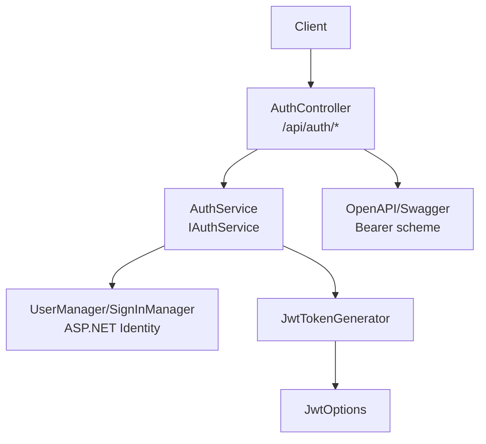
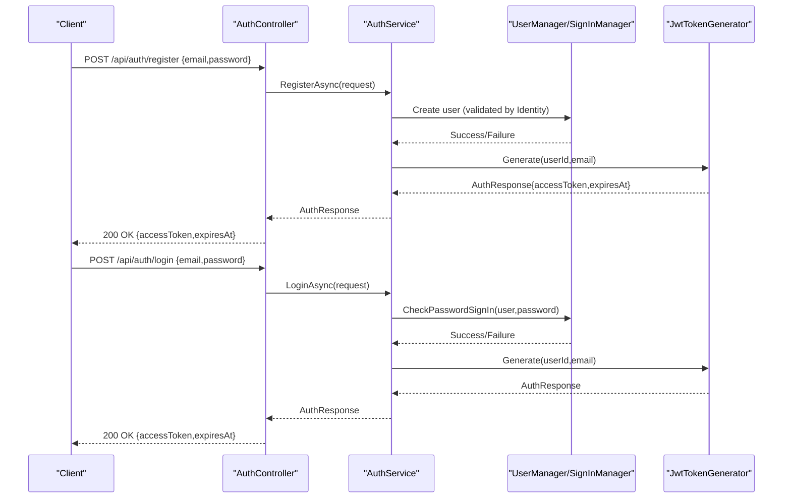
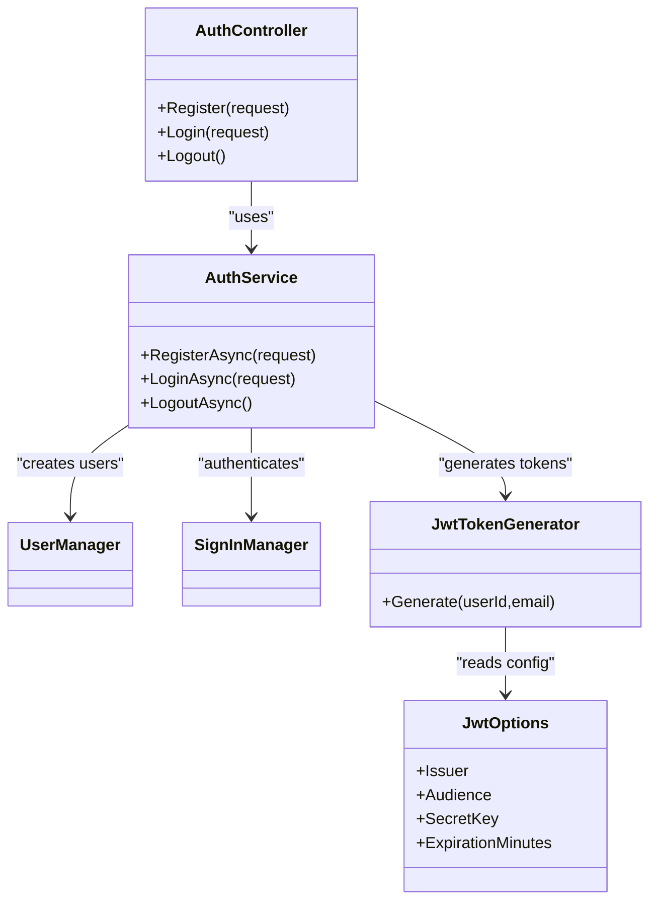

# Authentication API

<cite>
**Referenced Files in This Document**
- [AuthController.cs](file://Services/Services.Api/Controllers/AuthController.cs)
- [Program.cs](file://Services/Services.Api/Program.cs)
- [BearerSecuritySchemeTransformer.cs](file://Services/Services.Api/OpenApi/BearerSecuritySchemeTransformer.cs)
- [RegisterRequest.cs](file://Services/Services.Application/DTOs/Auth/RegisterRequest.cs)
- [LoginRequest.cs](file://Services/Services.Application/DTOs/Auth/LoginRequest.cs)
- [AuthResponse.cs](file://Services/Services.Application/DTOs/Auth/AuthResponse.cs)
- [AuthService.cs](file://Services/Services.Infrastructure/Identity/AuthService.cs)
- [JwtTokenGenerator.cs](file://Services/Services.Infrastructure/Identity/JwtTokenGenerator.cs)
- [JwtOptions.cs](file://Services/Services.Infrastructure/Identity/JwtOptions.cs)
- [DependencyInjection.cs](file://Services/Services.Infrastructure/DependencyInjection.cs)
</cite>

## Table of Contents
1. [Introduction](#introduction)
2. [Project Structure](#project-structure)
3. [Core Components](#core-components)
4. [Architecture Overview](#architecture-overview)
5. [Detailed Component Analysis](#detailed-component-analysis)
6. [Dependency Analysis](#dependency-analysis)
7. [Performance Considerations](#performance-considerations)
8. [Troubleshooting Guide](#troubleshooting-guide)
9. [Conclusion](#conclusion)
10. [Appendices](#appendices)

## Introduction
This document provides detailed API documentation for TaskFlow’s authentication endpoints. It covers user registration and login, request/response schemas, error handling, security considerations (password hashing, token expiration, CSRF), JWT structure, refresh strategy, and frontend integration patterns. The backend is an ASP.NET Core API that uses ASP.NET Identity for user management and JWT Bearer tokens for authorization.

## Project Structure
The authentication feature spans the API layer, application services, and infrastructure components:
- API layer exposes HTTP endpoints under /api/auth.
- Application layer defines DTOs and orchestrates business logic via IAuthService.
- Infrastructure layer implements identity operations, JWT generation, and configuration.

**Diagram sources**
- [AuthController.cs:9-77](file://Services/Services.Api/Controllers/AuthController.cs#L9-L77)
- [AuthService.cs:8-91](file://Services/Services.Infrastructure/Identity/AuthService.cs#L8-L91)
- [JwtTokenGenerator.cs:9-49](file://Services/Services.Infrastructure/Identity/JwtTokenGenerator.cs#L9-L49)
- [JwtOptions.cs:3-14](file://Services/Services.Infrastructure/Identity/JwtOptions.cs#L3-L14)
- [BearerSecuritySchemeTransformer.cs:7-57](file://Services/Services.Api/OpenApi/BearerSecuritySchemeTransformer.cs#L7-L57)

**Section sources**
- [AuthController.cs:9-77](file://Services/Services.Api/Controllers/AuthController.cs#L9-L77)
- [Program.cs:6-37](file://Services/Services.Api/Program.cs#L6-L37)

## Core Components
- AuthController: Exposes POST /api/auth/register, POST /api/auth/login, and POST /api/auth/logout.
- AuthService: Validates inputs, interacts with ASP.NET Identity, and generates JWTs.
- JwtTokenGenerator: Builds signed JWTs using configured issuer, audience, secret key, and expiration.
- DTOs: RegisterRequest, LoginRequest, AuthResponse define request/response shapes.
- Configuration: JwtOptions and dependency injection set up JWT validation and signing.

Key responsibilities:
- Registration: Create user via Identity, return access token and expiry.
- Login: Authenticate user via Identity, return access token and expiry.
- Logout: Sign out current session.

**Section sources**
- [AuthController.cs:14-76](file://Services/Services.Api/Controllers/AuthController.cs#L14-L76)
- [AuthService.cs:13-90](file://Services/Services.Infrastructure/Identity/AuthService.cs#L13-L90)
- [JwtTokenGenerator.cs:13-48](file://Services/Services.Infrastructure/Identity/JwtTokenGenerator.cs#L13-L48)
- [RegisterRequest.cs:3-5](file://Services/Services.Application/DTOs/Auth/RegisterRequest.cs#L3-L5)
- [LoginRequest.cs:3-5](file://Services/Services.Application/DTOs/Auth/LoginRequest.cs#L3-L5)
- [AuthResponse.cs:3-5](file://Services/Services.Application/DTOs/Auth/AuthResponse.cs#L3-L5)

## Architecture Overview
Authentication flow overview:
- Clients call register or login to obtain a JWT access token.
- Subsequent requests include the token in the Authorization header as Bearer.
- The API validates the token using configured parameters and grants access accordingly.

**Diagram sources**
- [AuthController.cs:14-62](file://Services/Services.Api/Controllers/AuthController.cs#L14-L62)
- [AuthService.cs:13-85](file://Services/Services.Infrastructure/Identity/AuthService.cs#L13-L85)
- [JwtTokenGenerator.cs:13-48](file://Services/Services.Infrastructure/Identity/JwtTokenGenerator.cs#L13-L48)

## Detailed Component Analysis

### Endpoint: POST /api/auth/register
Purpose: Create a new user account and return a JWT access token.

Request
- Method: POST
- URL: /api/auth/register
- Content-Type: application/json
- Body schema:
  - email: string (required)
  - password: string (required)

Validation rules
- Email must be present and non-empty; trimmed before processing.
- Password must be present and non-empty.
- Additional password complexity enforced by ASP.NET Identity:
  - Minimum length: 8 characters
  - Requires digit, uppercase, lowercase, and non-alphanumeric character
- Duplicate email detection: If a user with the same email already exists, registration fails.

Response
- 200 OK:
  - accessToken: string (JWT)
  - expiresAt: string (ISO 8601 UTC timestamp)

Error responses
- 400 Bad Request: Validation errors (e.g., missing fields, duplicate email).
- 401 Unauthorized: Not applicable for this endpoint.

Example curl
- Register a new user:
  - curl -X POST https://localhost:5001/api/auth/register -H "Content-Type: application/json" -d '{"email":"user@example.com","password":"Str0ng!Pass"}'

Expected response
- 200 OK:
  - { "accessToken": "<JWT>", "expiresAt": "2026-10-20T12:00:00Z" }

Common errors
- Duplicate email:
  - 400 Bad Request: { "error": "Duplicate email message" }
- Invalid input:
  - 400 Bad Request: { "error": "Email or password required" }

Notes
- No cookies are set by this endpoint.
- Session state is not used; authentication relies on JWT.

**Section sources**
- [AuthController.cs:14-33](file://Services/Services.Api/Controllers/AuthController.cs#L14-L33)
- [AuthService.cs:13-56](file://Services/Services.Infrastructure/Identity/AuthService.cs#L13-L56)
- [DependencyInjection.cs:31-48](file://Services/Services.Infrastructure/DependencyInjection.cs#L31-L48)
- [RegisterRequest.cs:3-5](file://Services/Services.Application/DTOs/Auth/RegisterRequest.cs#L3-L5)
- [AuthResponse.cs:3-5](file://Services/Services.Application/DTOs/Auth/AuthResponse.cs#L3-L5)

### Endpoint: POST /api/auth/login
Purpose: Authenticate a user and return a JWT access token.

Request
- Method: POST
- URL: /api/auth/login
- Content-Type: application/json
- Body schema:
  - email: string (required)
  - password: string (required)

Validation rules
- Email must be present and non-empty; trimmed before processing.
- Password must be present and non-empty.
- Credentials verified via ASP.NET Identity with lockout policy enabled.

Response
- 200 OK:
  - accessToken: string (JWT)
  - expiresAt: string (ISO 8601 UTC timestamp)

Error responses
- 400 Bad Request: Validation errors (e.g., missing fields).
- 401 Unauthorized: Invalid credentials.

Example curl
- Login:
  - curl -X POST https://localhost:5001/api/auth/login -H "Content-Type: application/json" -d '{"email":"user@example.com","password":"Str0ng!Pass"}'

Expected response
- 200 OK:
  - { "accessToken": "<JWT>", "expiresAt": "2026-10-20T12:00:00Z" }

Common errors
- Invalid credentials:
  - 401 Unauthorized: { "error": "Invalid email or password" }
- Missing fields:
  - 400 Bad Request: { "error": "Email or password required" }

Notes
- No cookies are set by this endpoint.
- Session state is not used; authentication relies on JWT.

**Section sources**
- [AuthController.cs:35-62](file://Services/Services.Api/Controllers/AuthController.cs#L35-L62)
- [AuthService.cs:58-85](file://Services/Services.Infrastructure/Identity/AuthService.cs#L58-L85)
- [LoginRequest.cs:3-5](file://Services/Services.Application/DTOs/Auth/LoginRequest.cs#L3-L5)
- [AuthResponse.cs:3-5](file://Services/Services.Application/DTOs/Auth/AuthResponse.cs#L3-L5)

### Endpoint: POST /api/auth/logout
Purpose: Sign out the current authenticated user.

Authorization
- Requires a valid JWT Bearer token.

Request
- Method: POST
- URL: /api/auth/logout

Response
- 200 OK:
  - message: string indicating successful logout.

Error responses
- 401 Unauthorized: Missing or invalid token.

Example curl
- Logout:
  - curl -X POST https://localhost:5001/api/auth/logout -H "Authorization: Bearer <your-jwt>"

Expected response
- 200 OK:
  - { "message": "Session closed successfully." }

Notes
- Logout clears server-side sign-in state but does not invalidate the JWT immediately. Clients should discard stored tokens.

**Section sources**
- [AuthController.cs:64-76](file://Services/Services.Api/Controllers/AuthController.cs#L64-L76)
- [AuthService.cs:87-90](file://Services/Services.Infrastructure/Identity/AuthService.cs#L87-L90)

### Security Considerations
- Password hashing: Handled by ASP.NET Identity; passwords are never stored in plaintext.
- Token expiration: JWTs expire after the configured number of minutes (default 10080 minutes).
- Secret key strength: Must be a Base64-encoded value with at least 32 bytes.
- Token validation:
  - Issuer and audience are validated.
  - Lifetime validation is enabled with a small clock skew.
- CSRF protection:
  - Since the API uses stateless JWTs and no cookies for auth, CSRF is not applicable for these endpoints.
- Lockout policy:
  - Account lockout after multiple failed attempts is enabled.

Configuration
- JWT settings are loaded from configuration section "Jwt".
- Required fields: Issuer, Audience, SecretKey, ExpirationMinutes.

**Section sources**
- [DependencyInjection.cs:50-112](file://Services/Services.Infrastructure/DependencyInjection.cs#L50-L112)
- [JwtOptions.cs:3-14](file://Services/Services.Infrastructure/Identity/JwtOptions.cs#L3-L14)
- [JwtTokenGenerator.cs:13-48](file://Services/Services.Infrastructure/Identity/JwtTokenGenerator.cs#L13-L48)

### JWT Token Structure
Claims included in the access token:
- sub: User ID (GUID)
- email: User email
- jti: Unique token identifier (GUID)

Metadata:
- iss: Configured issuer
- aud: Configured audience
- nbf: Not before time
- exp: Expiration time

Signing:
- HMAC-SHA256 with a symmetric key derived from the configured Base64 secret.

Expiration:
- Determined by JwtOptions.ExpirationMinutes.

Refresh mechanism
- Not implemented. There is no refresh token endpoint or rotation strategy. Clients must re-authenticate when the token expires.

Frontend integration patterns
- Store the returned accessToken securely (e.g., memory or secure storage).
- Include the token in subsequent requests:
  - Header: Authorization: Bearer <accessToken>
- On 401 Unauthorized, prompt the user to log in again.
- Handle token expiry gracefully by refreshing the UI or prompting re-login.

**Section sources**
- [JwtTokenGenerator.cs:23-47](file://Services/Services.Infrastructure/Identity/JwtTokenGenerator.cs#L23-L47)
- [AuthResponse.cs:3-5](file://Services/Services.Application/DTOs/Auth/AuthResponse.cs#L3-L5)

## Dependency Analysis
The authentication pipeline depends on several layers:

**Diagram sources**
- [AuthController.cs:9-77](file://Services/Services.Api/Controllers/AuthController.cs#L9-L77)
- [AuthService.cs:8-91](file://Services/Services.Infrastructure/Identity/AuthService.cs#L8-L91)
- [JwtTokenGenerator.cs:9-49](file://Services/Services.Infrastructure/Identity/JwtTokenGenerator.cs#L9-L49)
- [JwtOptions.cs:3-14](file://Services/Services.Infrastructure/Identity/JwtOptions.cs#L3-L14)

**Section sources**
- [DependencyInjection.cs:84-120](file://Services/Services.Infrastructure/DependencyInjection.cs#L84-L120)

## Performance Considerations
- Registration and login involve database operations via Entity Framework and Identity stores; ensure proper indexing on user emails.
- JWT generation is lightweight; avoid unnecessary recomputation by caching tokens client-side until expiry.
- Configure appropriate connection strings and database performance tuning for high-throughput environments.

[No sources needed since this section provides general guidance]

## Troubleshooting Guide
Common issues and resolutions:
- Duplicate email during registration:
  - Cause: User already exists.
  - Resolution: Use a different email or handle the 400 error in the client.
- Invalid credentials during login:
  - Cause: Wrong email/password or account locked due to repeated failures.
  - Resolution: Verify credentials and wait for lockout period to expire.
- Missing or malformed JWT configuration:
  - Cause: Missing or invalid Jwt options (issuer, audience, secret key, expiration).
  - Resolution: Ensure configuration section "Jwt" is complete and SecretKey is a valid Base64 string with at least 32 bytes.
- Token validation failures:
  - Cause: Mismatched issuer/audience or expired token.
  - Resolution: Align client expectations with server configuration and refresh/re-authenticate as needed.

**Section sources**
- [AuthService.cs:13-85](file://Services/Services.Infrastructure/Identity/AuthService.cs#L13-L85)
- [DependencyInjection.cs:50-112](file://Services/Services.Infrastructure/DependencyInjection.cs#L50-L112)

## Conclusion
TaskFlow’s authentication API provides secure, stateless access via JWTs. Registration and login validate inputs, leverage ASP.NET Identity for password hashing and lockout policies, and return short-lived access tokens. Clients should manage tokens responsibly, handle 401 errors, and re-authenticate upon expiration. CSRF is not applicable due to the absence of cookie-based sessions.

[No sources needed since this section summarizes without analyzing specific files]

## Appendices

### API Summary Table
- POST /api/auth/register
  - Request: { email: string, password: string }
  - Response: 200 OK { accessToken: string, expiresAt: string }
  - Errors: 400 Bad Request (validation/duplicate), 401 N/A
- POST /api/auth/login
  - Request: { email: string, password: string }
  - Response: 200 OK { accessToken: string, expiresAt: string }
  - Errors: 400 Bad Request (validation), 401 Unauthorized (invalid credentials)
- POST /api/auth/logout
  - Authorization: Bearer token required
  - Response: 200 OK { message: string }
  - Errors: 401 Unauthorized (missing/invalid token)

**Section sources**
- [AuthController.cs:14-76](file://Services/Services.Api/Controllers/AuthController.cs#L14-L76)
- [AuthResponse.cs:3-5](file://Services/Services.Application/DTOs/Auth/AuthResponse.cs#L3-L5)