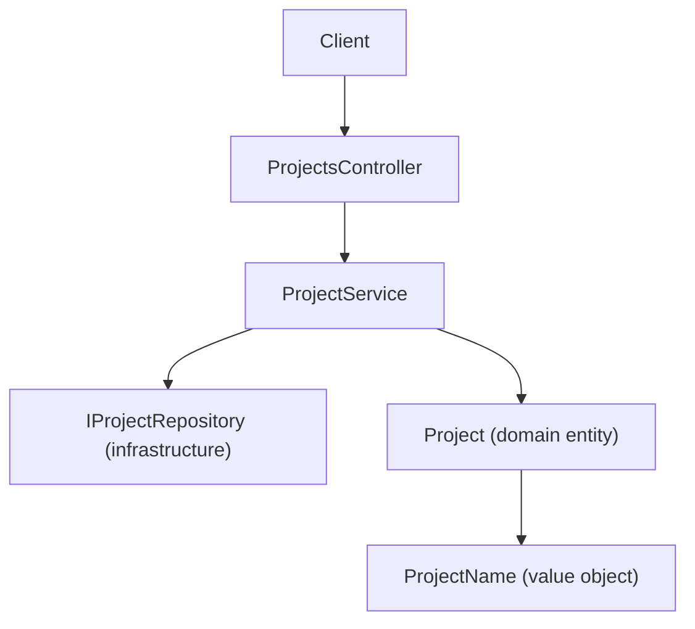
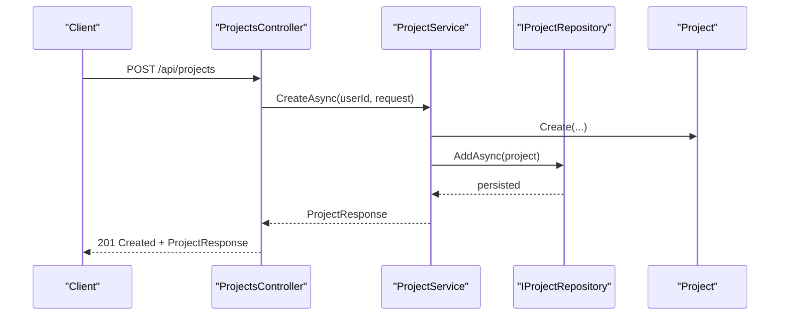
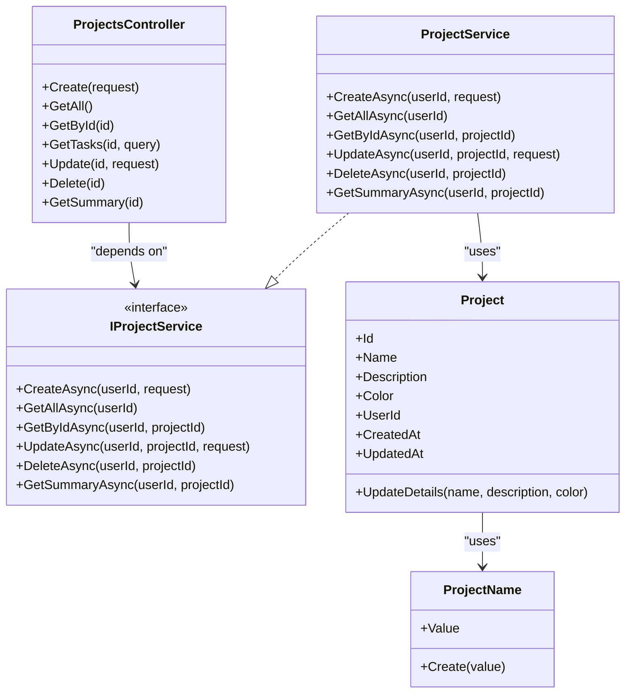

# Projects API

<cite>
**Referenced Files in This Document**
- [ProjectsController.cs](file://Services/Services.Api/Controllers/ProjectsController.cs)
- [ProjectService.cs](file://Services/Services.Application/Services/ProjectService.cs)
- [IProjectService.cs](file://Services/Services.Application/Interfaces/Services/IProjectService.cs)
- [CreateProjectRequest.cs](file://Services/Services.Application/DTOs/Projects/CreateProjectRequest.cs)
- [UpdateProjectRequest.cs](file://Services/Services.Application/DTOs/Projects/UpdateProjectRequest.cs)
- [ProjectResponse.cs](file://Services/Services.Application/DTOs/Projects/ProjectResponse.cs)
- [ProjectSummaryResponse.cs](file://Services/Services.Application/DTOs/Projects/ProjectSummaryResponse.cs)
- [Project.cs](file://Services/Services.Domain/Entities/Project.cs)
- [ProjectName.cs](file://Services/Services.Domain/ValueObjects/ProjectName.cs)
</cite>

## Table of Contents
1. [Introduction](#introduction)
2. [Project Structure](#project-structure)
3. [Core Components](#core-components)
4. [Architecture Overview](#architecture-overview)
5. [Detailed Component Analysis](#detailed-component-analysis)
6. [Dependency Analysis](#dependency-analysis)
7. [Performance Considerations](#performance-considerations)
8. [Troubleshooting Guide](#troubleshooting-guide)
9. [Conclusion](#conclusion)

## Introduction
This document provides comprehensive API documentation for TaskFlow’s project management endpoints. It covers creating, retrieving, updating, and deleting projects, including request/response schemas, status codes, validation rules, authorization requirements, and practical curl examples.

## Project Structure
The Projects API is implemented as an ASP.NET Core controller that delegates business logic to a service layer. Data models are defined as domain entities and value objects, with DTOs used for API contracts.

**Diagram sources**
- [ProjectsController.cs:12-18](file://Services/Services.Api/Controllers/ProjectsController.cs#L12-L18)
- [ProjectService.cs:11-13](file://Services/Services.Application/Services/ProjectService.cs#L11-L13)
- [Project.cs:5-22](file://Services/Services.Domain/Entities/Project.cs#L5-L22)
- [ProjectName.cs:3-36](file://Services/Services.Domain/ValueObjects/ProjectName.cs#L3-L36)

**Section sources**
- [ProjectsController.cs:12-18](file://Services/Services.Api/Controllers/ProjectsController.cs#L12-L18)
- [ProjectService.cs:11-13](file://Services/Services.Application/Services/ProjectService.cs#L11-L13)

## Core Components
- ProjectsController: Exposes REST endpoints under /api/projects with authorization enforced at the controller level.
- ProjectService: Implements business rules for project creation, retrieval, updates, deletion, and summary computation.
- DTOs: Define request and response contracts for clients.
- Domain Models: Enforce validation and normalization for project data.

Key responsibilities:
- Authorization: All endpoints require authentication; user identity is extracted from the JWT token.
- Validation: Name length, description length, and color format are validated.
- Ownership checks: Operations are scoped to the authenticated user’s projects.

**Section sources**
- [ProjectsController.cs:12-18](file://Services/Services.Api/Controllers/ProjectsController.cs#L12-L18)
- [ProjectService.cs:15-38](file://Services/Services.Application/Services/ProjectService.cs#L15-L38)
- [Project.cs:51-78](file://Services/Services.Domain/Entities/Project.cs#L51-L78)
- [ProjectName.cs:14-33](file://Services/Services.Domain/ValueObjects/ProjectName.cs#L14-L33)

## Architecture Overview
The API follows a layered architecture:
- Presentation layer (controller) handles HTTP requests and maps them to service calls.
- Application layer (service) orchestrates business logic and validation.
- Domain layer enforces invariants via entities and value objects.
- Infrastructure layer (not detailed here) provides persistence through repositories.

**Diagram sources**
- [ProjectsController.cs:20-43](file://Services/Services.Api/Controllers/ProjectsController.cs#L20-L43)
- [ProjectService.cs:15-38](file://Services/Services.Application/Services/ProjectService.cs#L15-L38)
- [Project.cs:51-64](file://Services/Services.Domain/Entities/Project.cs#L51-L64)

## Detailed Component Analysis

### POST /api/projects — Create Project
- Method: POST
- URL: /api/projects
- Authorization: Required (JWT bearer token)
- Request body schema:
  - name: string, required, trimmed, max 150 characters
  - description: string, optional, trimmed, max 1000 characters
  - color: string, default "#6366F1", must be a valid 6-digit hex color (#RRGGBB), normalized to uppercase
- Response:
  - 201 Created with ProjectResponse
  - 400 Bad Request on validation errors
- Error handling:
  - ValidationException mapped to 400
  - Missing or invalid user context handled by controller/service validation

Practical curl example:
- curl -X POST https://your-api-host/api/projects \
  -H "Authorization: Bearer YOUR_JWT_TOKEN" \
  -H "Content-Type: application/json" \
  -d '{"name":"My Project","description":"A sample project","color":"#FF5733"}'

Notes:
- The endpoint returns the created project details, including generated Id and timestamps.

**Section sources**
- [ProjectsController.cs:20-43](file://Services/Services.Api/Controllers/ProjectsController.cs#L20-L43)
- [CreateProjectRequest.cs:3-7](file://Services/Services.Application/DTOs/Projects/CreateProjectRequest.cs#L3-L7)
- [ProjectService.cs:15-38](file://Services/Services.Application/Services/ProjectService.cs#L15-L38)
- [Project.cs:79-120](file://Services/Services.Domain/Entities/Project.cs#L79-L120)
- [ProjectName.cs:14-33](file://Services/Services.Domain/ValueObjects/ProjectName.cs#L14-L33)

### GET /api/projects — List Projects
- Method: GET
- URL: /api/projects
- Authorization: Required (JWT bearer token)
- Query parameters: None currently exposed by the controller
- Response:
  - 200 OK with array of ProjectResponse items
- Notes:
  - No filtering or pagination parameters are implemented in this endpoint.
  - Results are limited to projects owned by the authenticated user.

Practical curl example:
- curl -X GET https://your-api-host/api/projects \
  -H "Authorization: Bearer YOUR_JWT_TOKEN"

**Section sources**
- [ProjectsController.cs:45-53](file://Services/Services.Api/Controllers/ProjectsController.cs#L45-L53)
- [ProjectService.cs:40-52](file://Services/Services.Application/Services/ProjectService.cs#L40-L52)

### PUT /api/projects/{id} — Update Project
- Method: PUT
- URL: /api/projects/{id}
- Path parameter: id (GUID)
- Authorization: Required (JWT bearer token)
- Request body schema:
  - name: string, required, trimmed, max 150 characters
  - description: string, optional, trimmed, max 1000 characters
  - color: string, default "#6366F1", must be a valid 6-digit hex color (#RRGGBB), normalized to uppercase
- Response:
  - 200 OK with updated ProjectResponse
  - 400 Bad Request on validation errors
  - 404 Not Found if project does not exist or is not owned by the user
- Behavior:
  - Partial updates are supported by providing only the fields you want to change.
  - Validation rules are applied during update.

Practical curl example:
- curl -X PUT https://your-api-host/api/projects/PROJECT_ID \
  -H "Authorization: Bearer YOUR_JWT_TOKEN" \
  -H "Content-Type: application/json" \
  -d '{"name":"Updated Project","color":"#00BCD4"}'

**Section sources**
- [ProjectsController.cs:105-128](file://Services/Services.Api/Controllers/ProjectsController.cs#L105-L128)
- [UpdateProjectRequest.cs:3-7](file://Services/Services.Application/DTOs/Projects/UpdateProjectRequest.cs#L3-L7)
- [ProjectService.cs:70-99](file://Services/Services.Application/Services/ProjectService.cs#L70-L99)
- [Project.cs:66-78](file://Services/Services.Domain/Entities/Project.cs#L66-L78)

### DELETE /api/projects/{id} — Delete Project
- Method: DELETE
- URL: /api/projects/{id}
- Path parameter: id (GUID)
- Authorization: Required (JWT bearer token)
- Response:
  - 204 No Content on successful deletion
  - 400 Bad Request on validation errors
  - 404 Not Found if project does not exist or is not owned by the user
  - 409 Conflict if the project has associated tasks
- Business rule:
  - Deletion is blocked when the project contains tasks.

Practical curl example:
- curl -X DELETE https://your-api-host/api/projects/PROJECT_ID \
  -H "Authorization: Bearer YOUR_JWT_TOKEN"

**Section sources**
- [ProjectsController.cs:130-157](file://Services/Services.Api/Controllers/ProjectsController.cs#L130-L157)
- [ProjectService.cs:101-127](file://Services/Services.Application/Services/ProjectService.cs#L101-L127)

### Additional Endpoints

#### GET /api/projects/{id}/tasks — List Tasks for a Project
- Method: GET
- URL: /api/projects/{id}/tasks
- Path parameter: id (GUID)
- Query parameters: TaskQueryRequest fields (as defined in the task domain)
- Authorization: Required (JWT bearer token)
- Response:
  - 200 OK with PagedResponse<TaskResponse>
  - 400 Bad Request on validation errors
  - 404 Not Found if project does not exist or is not owned by the user

Practical curl example:
- curl -X GET "https://your-api-host/api/projects/PROJECT_ID/tasks?status=In%20Progress&page=1&pageSize=10" \
  -H "Authorization: Bearer YOUR_JWT_TOKEN"

**Section sources**
- [ProjectsController.cs:78-103](file://Services/Services.Api/Controllers/ProjectsController.cs#L78-L103)

#### GET /api/projects/{id}/summary — Get Project Summary
- Method: GET
- URL: /api/projects/{id}/summary
- Path parameter: id (GUID)
- Authorization: Required (JWT bearer token)
- Response:
  - 200 OK with ProjectSummaryResponse
  - 400 Bad Request on invalid arguments
  - 404 Not Found if project does not exist or is not owned by the user

Practical curl example:
- curl -X GET https://your-api-host/api/projects/PROJECT_ID/summary \
  -H "Authorization: Bearer YOUR_JWT_TOKEN"

**Section sources**
- [ProjectsController.cs:175-197](file://Services/Services.Api/Controllers/ProjectsController.cs#L175-L197)
- [ProjectService.cs:181-231](file://Services/Services.Application/Services/ProjectService.cs#L181-L231)

## Dependency Analysis
The following diagram shows how the controller depends on the service and how the service interacts with domain models and repositories.

**Diagram sources**
- [ProjectsController.cs:12-18](file://Services/Services.Api/Controllers/ProjectsController.cs#L12-L18)
- [IProjectService.cs:5-35](file://Services/Services.Application/Interfaces/Services/IProjectService.cs#L5-L35)
- [ProjectService.cs:11-13](file://Services/Services.Application/Services/ProjectService.cs#L11-L13)
- [Project.cs:5-22](file://Services/Services.Domain/Entities/Project.cs#L5-L22)
- [ProjectName.cs:3-36](file://Services/Services.Domain/ValueObjects/ProjectName.cs#L3-L36)

**Section sources**
- [ProjectsController.cs:12-18](file://Services/Services.Api/Controllers/ProjectsController.cs#L12-L18)
- [IProjectService.cs:5-35](file://Services/Services.Application/Interfaces/Services/IProjectService.cs#L5-L35)
- [ProjectService.cs:11-13](file://Services/Services.Application/Services/ProjectService.cs#L11-L13)
- [Project.cs:5-22](file://Services/Services.Domain/Entities/Project.cs#L5-L22)
- [ProjectName.cs:3-36](file://Services/Services.Domain/ValueObjects/ProjectName.cs#L3-L36)

## Performance Considerations
- Listing all projects returns a full list without server-side pagination; consider implementing pagination and filtering if the dataset grows large.
- The summary endpoint computes progress percentage based on task counts; ensure underlying repository queries are efficient.
- Color normalization and name trimming occur per request; these operations are lightweight but should be considered in high-throughput scenarios.

[No sources needed since this section provides general guidance]

## Troubleshooting Guide
Common issues and resolutions:
- 401 Unauthorized: Ensure the Authorization header includes a valid JWT bearer token.
- 400 Bad Request: Validate request payloads:
  - name must be non-empty and within 150 characters.
  - description must not exceed 1000 characters.
  - color must be a valid #RRGGBB hex string.
- 404 Not Found: Verify the project exists and belongs to the authenticated user.
- 409 Conflict: Attempting to delete a project with associated tasks will fail; remove tasks first.

Error mapping in the controller:
- ValidationException → 400
- KeyNotFoundException → 404
- InvalidOperationException → 409 (for deletion with tasks)

**Section sources**
- [ProjectsController.cs:20-43](file://Services/Services.Api/Controllers/ProjectsController.cs#L20-L43)
- [ProjectsController.cs:105-157](file://Services/Services.Api/Controllers/ProjectsController.cs#L105-L157)
- [ProjectService.cs:101-127](file://Services/Services.Application/Services/ProjectService.cs#L101-L127)

## Conclusion
TaskFlow’s Projects API provides a secure, validated set of endpoints for managing projects. Requests are authenticated via JWT, and business rules enforce ownership, data integrity, and safe deletion. Clients should adhere to the documented request/response schemas and handle error responses accordingly. For large datasets, consider extending the listing endpoint with filtering and pagination.

[No sources needed since this section summarizes without analyzing specific files]