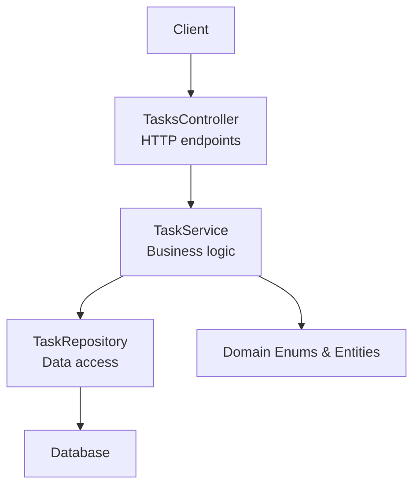
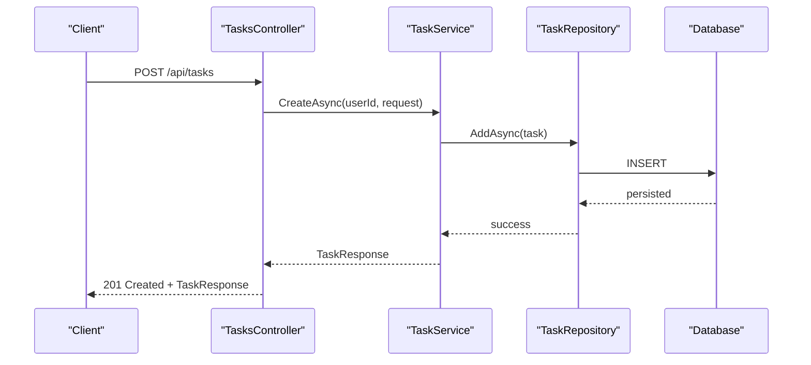
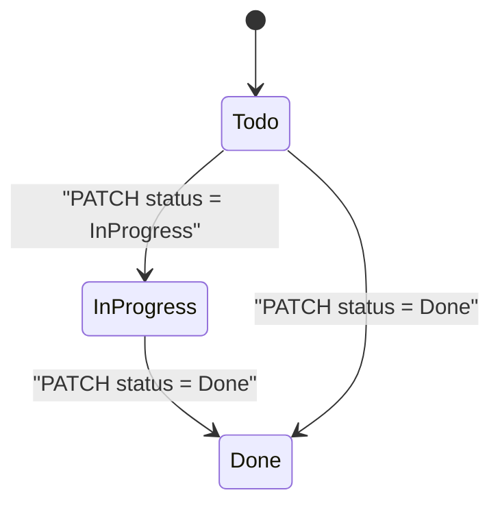
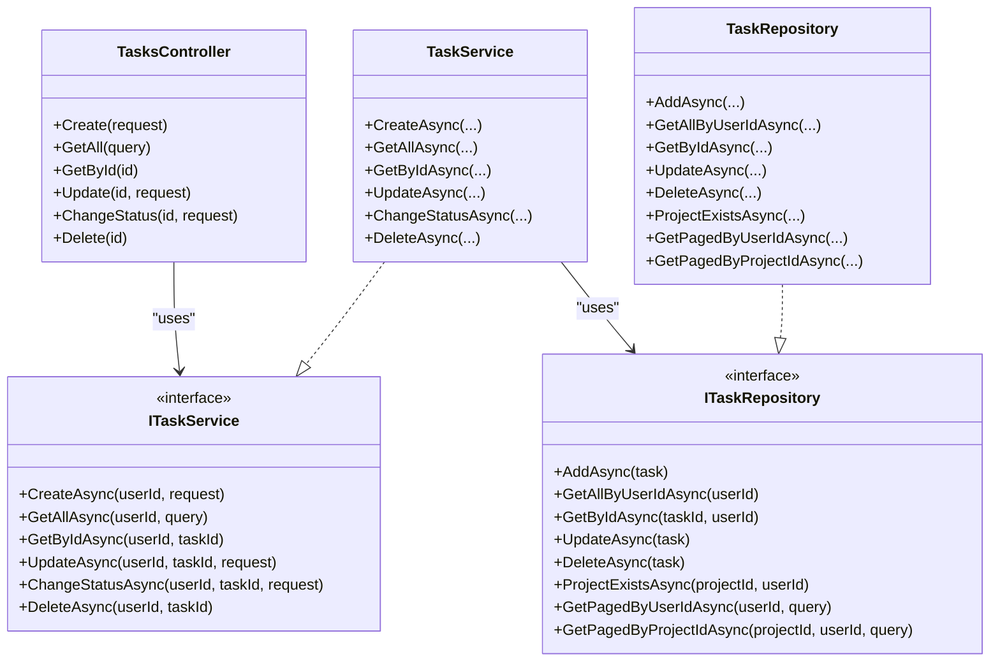

# Tasks API

<cite>
**Referenced Files in This Document**
- [TasksController.cs](file://Services/Services.Api/Controllers/TasksController.cs)
- [TaskService.cs](file://Services/Services.Application/Services/TaskService.cs)
- [ITaskService.cs](file://Services/Services.Application/Interfaces/Services/ITaskService.cs)
- [TaskRepository.cs](file://Services/Services.Infrastructure/Repositories/TaskRepository.cs)
- [ITaskRepository.cs](file://Services/Services.Application/Interfaces/Repositories/ITaskRepository.cs)
- [CreateTaskRequest.cs](file://Services/Services.Application/DTOs/Tasks/CreateTaskRequest.cs)
- [UpdateTaskRequest.cs](file://Services/Services.Application/DTOs/Tasks/UpdateTaskRequest.cs)
- [TaskQueryRequest.cs](file://Services/Services.Application/DTOs/Tasks/TaskQueryRequest.cs)
- [ChangeTaskStatusRequest.cs](file://Services/Services.Application/DTOs/Tasks/ChangeTaskStatusRequest.cs)
- [TaskResponse.cs](file://Services/Services.Application/DTOs/Tasks/TaskResponse.cs)
- [TaskItem.cs](file://Services/Services.Domain/Entities/TaskItem.cs)
- [TaskCurrentStatus.cs](file://Services/Services.Domain/Enums/TaskCurrentStatus.cs)
- [TaskPriority.cs](file://Services/Services.Domain/Enums/TaskPriority.cs)
</cite>

## Table of Contents
1. [Introduction](#introduction)
2. [Project Structure](#project-structure)
3. [Core Components](#core-components)
4. [Architecture Overview](#architecture-overview)
5. [Detailed Component Analysis](#detailed-component-analysis)
6. [Dependency Analysis](#dependency-analysis)
7. [Performance Considerations](#performance-considerations)
8. [Troubleshooting Guide](#troubleshooting-guide)
9. [Conclusion](#conclusion)

## Introduction
This document provides detailed API documentation for TaskFlow’s task management endpoints. It covers creating, retrieving, updating, changing status, and deleting tasks. Each endpoint includes HTTP methods, URL patterns, query parameters, request/response schemas, status codes, error handling, and practical curl examples.

The API is secured with authentication and enforces authorization so that users can only access their own tasks.

## Project Structure
TaskFlow exposes a REST API through an ASP.NET Core controller layer, application services, domain entities, and infrastructure repositories. The Tasks API is implemented in the following layers:
- API Layer: Controller handles HTTP requests, extracts user identity, and maps to service calls.
- Application Layer: Service validates business rules, coordinates operations, and returns DTOs.
- Domain Layer: Entities and enums define core business concepts and constraints.
- Infrastructure Layer: Repository implements data access using Entity Framework Core.

**Diagram sources**
- [TasksController.cs:11-199](file://Services/Services.Api/Controllers/TasksController.cs#L11-L199)
- [TaskService.cs:12-412](file://Services/Services.Application/Services/TaskService.cs#L12-L412)
- [TaskRepository.cs:9-239](file://Services/Services.Infrastructure/Repositories/TaskRepository.cs#L9-L239)

**Section sources**
- [TasksController.cs:11-199](file://Services/Services.Api/Controllers/TasksController.cs#L11-L199)
- [TaskService.cs:12-412](file://Services/Services.Application/Services/TaskService.cs#L12-L412)
- [TaskRepository.cs:9-239](file://Services/Services.Infrastructure/Repositories/TaskRepository.cs#L9-L239)

## Core Components
- TasksController: Exposes REST endpoints under /api/tasks with authorization.
- TaskService: Implements validation, project association checks, pagination normalization, and mapping to response DTOs.
- TaskRepository: Provides EF Core queries for CRUD and advanced filtering/sorting/pagination.
- DTOs: CreateTaskRequest, UpdateTaskRequest, TaskQueryRequest, ChangeTaskStatusRequest, TaskResponse.
- Domain: TaskItem entity and enums TaskCurrentStatus, TaskPriority.

Key responsibilities:
- Authentication: Extracts current user ID from JWT claims.
- Authorization: Ensures operations are scoped to the authenticated user.
- Validation: Enforces required fields, allowed enum values, page size limits, and sort field allowlist.
- Pagination: Returns paged results with total count and computed total pages.

**Section sources**
- [TasksController.cs:11-199](file://Services/Services.Api/Controllers/TasksController.cs#L11-L199)
- [TaskService.cs:16-412](file://Services/Services.Application/Services/TaskService.cs#L16-L412)
- [TaskRepository.cs:13-239](file://Services/Services.Infrastructure/Repositories/TaskRepository.cs#L13-L239)
- [CreateTaskRequest.cs:5-10](file://Services/Services.Application/DTOs/Tasks/CreateTaskRequest.cs#L5-L10)
- [UpdateTaskRequest.cs:5-10](file://Services/Services.Application/DTOs/Tasks/UpdateTaskRequest.cs#L5-L10)
- [TaskQueryRequest.cs:5-20](file://Services/Services.Application/DTOs/Tasks/TaskQueryRequest.cs#L5-L20)
- [ChangeTaskStatusRequest.cs:5-6](file://Services/Services.Application/DTOs/Tasks/ChangeTaskStatusRequest.cs#L5-L6)
- [TaskResponse.cs:5-16](file://Services/Services.Application/DTOs/Tasks/TaskResponse.cs#L5-L16)
- [TaskItem.cs:6-128](file://Services/Services.Domain/Entities/TaskItem.cs#L6-L128)
- [TaskCurrentStatus.cs:3-9](file://Services/Services.Domain/Enums/TaskCurrentStatus.cs#L3-L9)
- [TaskPriority.cs:3-9](file://Services/Services.Domain/Enums/TaskPriority.cs#L3-L9)

## Architecture Overview
The Tasks API follows a layered architecture:
- Controller receives HTTP requests, extracts user context, and delegates to service.
- Service performs validation, business checks (e.g., project ownership), and orchestrates repository calls.
- Repository executes EF Core queries with filtering, sorting, and pagination.
- Domain models and enums enforce business invariants.

**Diagram sources**
- [TasksController.cs:18-47](file://Services/Services.Api/Controllers/TasksController.cs#L18-L47)
- [TaskService.cs:16-48](file://Services/Services.Application/Services/TaskService.cs#L16-L48)
- [TaskRepository.cs:13-23](file://Services/Services.Infrastructure/Repositories/TaskRepository.cs#L13-L23)

## Detailed Component Analysis

### POST /api/tasks — Create Task
- Method: POST
- URL: /api/tasks
- Authorization: Required (JWT bearer token)
- Request Body Schema:
  - title: string, required
  - description: string, optional
  - priority: enum, required; allowed values: Low, Medium, High, Urgent
  - dueDate: date-time string or null, optional
  - projectId: GUID or null, optional; must belong to the authenticated user if provided
- Response:
  - 201 Created with TaskResponse body
  - 400 Bad Request on validation errors
  - 404 Not Found if associated project does not exist or does not belong to the user
- Error Handling:
  - ValidationException mapped to 400 with error message
  - KeyNotFoundException mapped to 404 with error message
- Practical curl Examples:
  - Basic creation:
    - curl -X POST https://your-api/api/tasks -H "Authorization: Bearer YOUR_TOKEN" -H "Content-Type: application/json" -d '{"title":"Design UI","priority":"High","dueDate":"2026-12-31T23:59:59Z"}'
  - With project association:
    - curl -X POST https://your-api/api/tasks -H "Authorization: Bearer YOUR_TOKEN" -H "Content-Type: application/json" -d '{"title":"Implement login","description":"Add OAuth flow","priority":"Urgent","projectId":"00000000-0000-0000-0000-000000000001"}'
  - Invalid project (not owned):
    - curl -X POST https://your-api/api/tasks -H "Authorization: Bearer YOUR_TOKEN" -H "Content-Type: application/json" -d '{"title":"Invalid project","projectId":"00000000-0000-0000-0000-000000000099"}'

**Section sources**
- [TasksController.cs:18-47](file://Services/Services.Api/Controllers/TasksController.cs#L18-L47)
- [TaskService.cs:16-48](file://Services/Services.Application/Services/TaskService.cs#L16-L48)
- [TaskService.cs:250-274](file://Services/Services.Application/Services/TaskService.cs#L250-L274)
- [CreateTaskRequest.cs:5-10](file://Services/Services.Application/DTOs/Tasks/CreateTaskRequest.cs#L5-L10)
- [TaskPriority.cs:3-9](file://Services/Services.Domain/Enums/TaskPriority.cs#L3-L9)

### GET /api/tasks — List Tasks with Filtering, Sorting, and Pagination
- Method: GET
- URL: /api/tasks
- Query Parameters:
  - page: integer, default 1
  - pageSize: integer, default 10, range 1..100
  - status: enum, optional; allowed values: Todo, InProgress, Done
  - priority: enum, optional; allowed values: Low, Medium, High, Urgent
  - search: string, optional; searches task titles (case-insensitive)
  - sortBy: string, default "createdAt"; allowed values: createdAt, title, dueDate, priority, status
  - sortDirection: string, default "desc"; allowed values: asc, desc
- Response:
  - 200 OK with PagedResponse<TaskResponse> containing items array and pagination metadata
  - 400 Bad Request on invalid query parameters
- Error Handling:
  - ValidationException mapped to 400 with error message
- Practical curl Examples:
  - Filter by status and priority:
    - curl -G "https://your-api/api/tasks?status=InProgress&priority=High&page=1&pageSize=20" -H "Authorization: Bearer YOUR_TOKEN"
  - Search and sort:
    - curl -G "https://your-api/api/tasks?search=login&sortBy=title&sortDirection=asc" -H "Authorization: Bearer YOUR_TOKEN"
  - Complex query:
    - curl -G "https://your-api/api/tasks?status=Todo&priority=Urgent&search=auth&sortBy=dueDate&sortDirection=asc&page=2&pageSize=10" -H "Authorization: Bearer YOUR_TOKEN"

Notes:
- The server normalizes and validates query parameters, including allowed sort fields and direction.
- Results include project details when available (projectName, projectColor).

**Section sources**
- [TasksController.cs:49-70](file://Services/Services.Api/Controllers/TasksController.cs#L49-L70)
- [TaskService.cs:160-187](file://Services/Services.Application/Services/TaskService.cs#L160-L187)
- [TaskService.cs:318-393](file://Services/Services.Application/Services/TaskService.cs#L318-L393)
- [TaskRepository.cs:82-157](file://Services/Services.Infrastructure/Repositories/TaskRepository.cs#L82-L157)
- [TaskQueryRequest.cs:5-20](file://Services/Services.Application/DTOs/Tasks/TaskQueryRequest.cs#L5-L20)
- [TaskCurrentStatus.cs:3-9](file://Services/Services.Domain/Enums/TaskCurrentStatus.cs#L3-L9)
- [TaskPriority.cs:3-9](file://Services/Services.Domain/Enums/TaskPriority.cs#L3-L9)

### PUT /api/tasks/{id} — Update Task
- Method: PUT
- URL: /api/tasks/{id}
- Path Parameter:
  - id: GUID
- Request Body Schema:
  - title: string, required
  - description: string, optional
  - priority: enum, required; allowed values: Low, Medium, High, Urgent
  - dueDate: date-time string or null, optional
  - projectId: GUID or null, optional; must belong to the authenticated user if provided
- Response:
  - 200 OK with updated TaskResponse
  - 400 Bad Request on validation errors
  - 404 Not Found if task does not exist or does not belong to the user
- Error Handling:
  - ValidationException mapped to 400 with error message
  - KeyNotFoundException mapped to 404 with error message
- Practical curl Examples:
  - Update title and priority:
    - curl -X PUT https://your-api/api/tasks/00000000-0000-0000-0000-000000000001 -H "Authorization: Bearer YOUR_TOKEN" -H "Content-Type: application/json" -d '{"title":"Refactor login","priority":"Medium"}'
  - Assign to project:
    - curl -X PUT https://your-api/api/tasks/00000000-0000-0000-0000-000000000001 -H "Authorization: Bearer YOUR_TOKEN" -H "Content-Type: application/json" -d '{"title":"Refactor login","projectId":"00000000-0000-0000-0000-000000000001"}'

Validation Rules:
- Title is required and validated via domain value object.
- Priority must be a defined enum value.
- ProjectId, if provided, must exist and belong to the authenticated user.

**Section sources**
- [TasksController.cs:99-126](file://Services/Services.Api/Controllers/TasksController.cs#L99-L126)
- [TaskService.cs:80-119](file://Services/Services.Application/Services/TaskService.cs#L80-L119)
- [TaskService.cs:250-274](file://Services/Services.Application/Services/TaskService.cs#L250-L274)
- [UpdateTaskRequest.cs:5-10](file://Services/Services.Application/DTOs/Tasks/UpdateTaskRequest.cs#L5-L10)
- [TaskItem.cs:80-101](file://Services/Services.Domain/Entities/TaskItem.cs#L80-L101)

### PATCH /api/tasks/{id}/status — Change Task Status
- Method: PATCH
- URL: /api/tasks/{id}/status
- Path Parameter:
  - id: GUID
- Request Body Schema:
  - status: enum, required; allowed values: Todo, InProgress, Done
- Response:
  - 200 OK with updated TaskResponse
  - 400 Bad Request on validation errors
  - 404 Not Found if task does not exist or does not belong to the user
- Error Handling:
  - ValidationException mapped to 400 with error message
  - KeyNotFoundException mapped to 404 with error message
- Practical curl Examples:
  - Move to InProgress:
    - curl -X PATCH https://your-api/api/tasks/00000000-0000-0000-0000-000000000001/status -H "Authorization: Bearer YOUR_TOKEN" -H "Content-Type: application/json" -d '{"status":"InProgress"}'
  - Mark as Done:
    - curl -X PATCH https://your-api/api/tasks/00000000-0000-0000-0000-000000000001/status -H "Authorization: Bearer YOUR_TOKEN" -H "Content-Type: application/json" -d '{"status":"Done"}'

State Transitions:
- Allowed states: Todo, InProgress, Done. Any valid state can be set via this endpoint.

**Diagram sources**
- [TaskCurrentStatus.cs:3-9](file://Services/Services.Domain/Enums/TaskCurrentStatus.cs#L3-L9)

**Section sources**
- [TasksController.cs:128-155](file://Services/Services.Api/Controllers/TasksController.cs#L128-L155)
- [TaskService.cs:121-142](file://Services/Services.Application/Services/TaskService.cs#L121-L142)
- [ChangeTaskStatusRequest.cs:5-6](file://Services/Services.Application/DTOs/Tasks/ChangeTaskStatusRequest.cs#L5-L6)
- [TaskItem.cs:103-115](file://Services/Services.Domain/Entities/TaskItem.cs#L103-L115)
- [TaskCurrentStatus.cs:3-9](file://Services/Services.Domain/Enums/TaskCurrentStatus.cs#L3-L9)

### DELETE /api/tasks/{id} — Delete Task
- Method: DELETE
- URL: /api/tasks/{id}
- Path Parameter:
  - id: GUID
- Response:
  - 204 No Content on successful deletion
  - 400 Bad Request on validation errors
  - 404 Not Found if task does not exist or does not belong to the user
- Error Handling:
  - ValidationException mapped to 400 with error message
  - KeyNotFoundException mapped to 404 with error message
- Practical curl Examples:
  - Delete a task:
    - curl -X DELETE https://your-api/api/tasks/00000000-0000-0000-0000-000000000001 -H "Authorization: Bearer YOUR_TOKEN"

Authorization Checks:
- Deletion is scoped to the authenticated user; attempting to delete another user’s task returns 404.

**Section sources**
- [TasksController.cs:157-182](file://Services/Services.Api/Controllers/TasksController.cs#L157-L182)
- [TaskService.cs:144-158](file://Services/Services.Application/Services/TaskService.cs#L144-L158)

### Data Models and Schemas

#### TaskResponse
Fields:
- id: GUID
- title: string
- description: string or null
- status: enum (Todo, InProgress, Done)
- priority: enum (Low, Medium, High, Urgent)
- dueDate: date-time or null
- projectId: GUID or null
- projectName: string or null
- projectColor: string or null
- createdAt: date-time
- updatedAt: date-time

**Section sources**
- [TaskResponse.cs:5-16](file://Services/Services.Application/DTOs/Tasks/TaskResponse.cs#L5-L16)

#### CreateTaskRequest
Fields:
- title: string
- description: string or null
- priority: enum (Low, Medium, High, Urgent)
- dueDate: date-time or null
- projectId: GUID or null

**Section sources**
- [CreateTaskRequest.cs:5-10](file://Services/Services.Application/DTOs/Tasks/CreateTaskRequest.cs#L5-L10)

#### UpdateTaskRequest
Fields:
- title: string
- description: string or null
- priority: enum (Low, Medium, High, Urgent)
- dueDate: date-time or null
- projectId: GUID or null

**Section sources**
- [UpdateTaskRequest.cs:5-10](file://Services/Services.Application/DTOs/Tasks/UpdateTaskRequest.cs#L5-L10)

#### TaskQueryRequest
Fields:
- page: integer, default 1
- pageSize: integer, default 10
- status: enum or null
- priority: enum or null
- search: string or null
- sortBy: string, default "createdAt"
- sortDirection: string, default "desc"

**Section sources**
- [TaskQueryRequest.cs:5-20](file://Services/Services.Application/DTOs/Tasks/TaskQueryRequest.cs#L5-L20)

#### ChangeTaskStatusRequest
Fields:
- status: enum (Todo, InProgress, Done)

**Section sources**
- [ChangeTaskStatusRequest.cs:5-6](file://Services/Services.Application/DTOs/Tasks/ChangeTaskStatusRequest.cs#L5-L6)

## Dependency Analysis
The Tasks API components have clear dependencies:
- Controller depends on ITaskService.
- Service depends on ITaskRepository and domain types.
- Repository depends on EF Core DbContext and domain entities.

**Diagram sources**
- [TasksController.cs:11-199](file://Services/Services.Api/Controllers/TasksController.cs#L11-L199)
- [ITaskService.cs:6-49](file://Services/Services.Application/Interfaces/Services/ITaskService.cs#L6-L49)
- [TaskService.cs:12-412](file://Services/Services.Application/Services/TaskService.cs#L12-L412)
- [ITaskRepository.cs:6-44](file://Services/Services.Application/Interfaces/Repositories/ITaskRepository.cs#L6-L44)
- [TaskRepository.cs:9-239](file://Services/Services.Infrastructure/Repositories/TaskRepository.cs#L9-L239)

**Section sources**
- [TasksController.cs:11-199](file://Services/Services.Api/Controllers/TasksController.cs#L11-L199)
- [ITaskService.cs:6-49](file://Services/Services.Application/Interfaces/Services/ITaskService.cs#L6-L49)
- [TaskService.cs:12-412](file://Services/Services.Application/Services/TaskService.cs#L12-L412)
- [ITaskRepository.cs:6-44](file://Services/Services.Application/Interfaces/Repositories/ITaskRepository.cs#L6-L44)
- [TaskRepository.cs:9-239](file://Services/Services.Infrastructure/Repositories/TaskRepository.cs#L9-L239)

## Performance Considerations
- Pagination: Use reasonable pageSize (up to 100) to avoid heavy payloads.
- Sorting: Prefer sorting by createdAt, title, dueDate, priority, or status to leverage indexed queries.
- Filtering: Combine status and priority filters to reduce result sets before pagination.
- Eager Loading: Project details are included in queries; ensure you do not over-fetch unnecessary data.
- Asynchronous Operations: All endpoints use async patterns to improve throughput.

[No sources needed since this section provides general guidance]

## Troubleshooting Guide
Common issues and resolutions:
- 401 Unauthorized: Ensure the Authorization header contains a valid Bearer token.
- 400 Bad Request: Check payload schema and enum values; verify query parameters like page, pageSize, sortBy, and sortDirection.
- 404 Not Found: Verify task/project IDs exist and belong to the authenticated user.
- Validation Errors: Review error messages returned in the response body for specifics about invalid inputs.

Error Mapping:
- ValidationException -> 400 with error message
- KeyNotFoundException -> 404 with error message

**Section sources**
- [TasksController.cs:23-47](file://Services/Services.Api/Controllers/TasksController.cs#L23-L47)
- [TasksController.cs:54-70](file://Services/Services.Api/Controllers/TasksController.cs#L54-L70)
- [TasksController.cs:77-97](file://Services/Services.Api/Controllers/TasksController.cs#L77-L97)
- [TasksController.cs:105-126](file://Services/Services.Api/Controllers/TasksController.cs#L105-L126)
- [TasksController.cs:134-155](file://Services/Services.Api/Controllers/TasksController.cs#L134-L155)
- [TasksController.cs:162-182](file://Services/Services.Api/Controllers/TasksController.cs#L162-L182)

## Conclusion
The Tasks API provides a secure, validated, and efficient interface for managing tasks within TaskFlow. It supports comprehensive filtering, sorting, and pagination, while enforcing user-scoped authorization. Use the provided schemas and curl examples to integrate frontend components and automate workflows.

[No sources needed since this section summarizes without analyzing specific files]