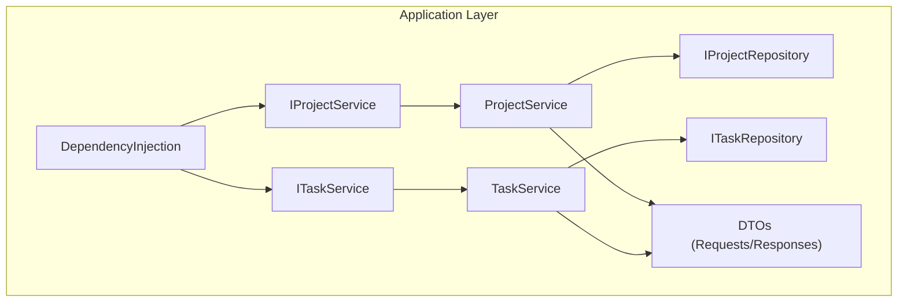
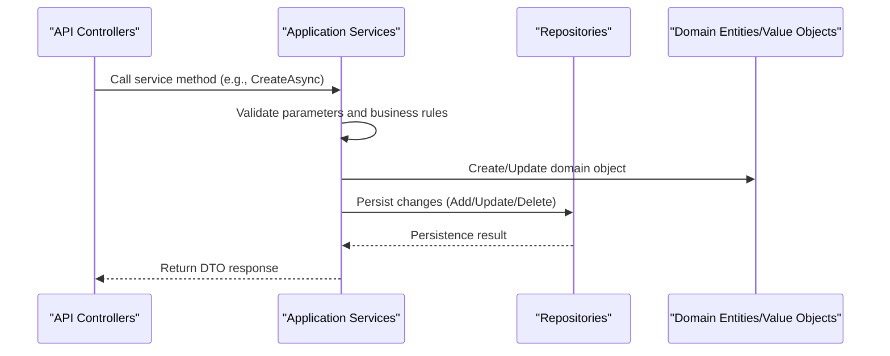
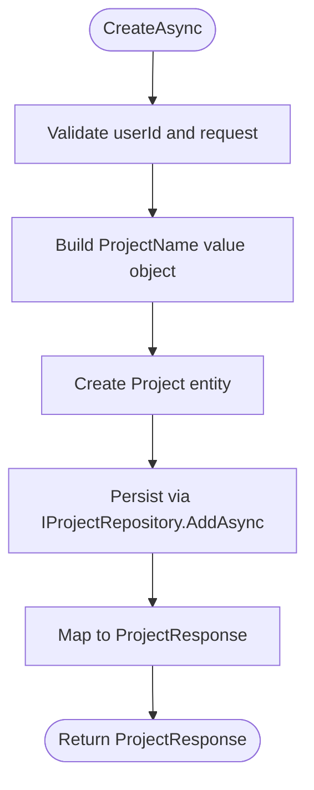
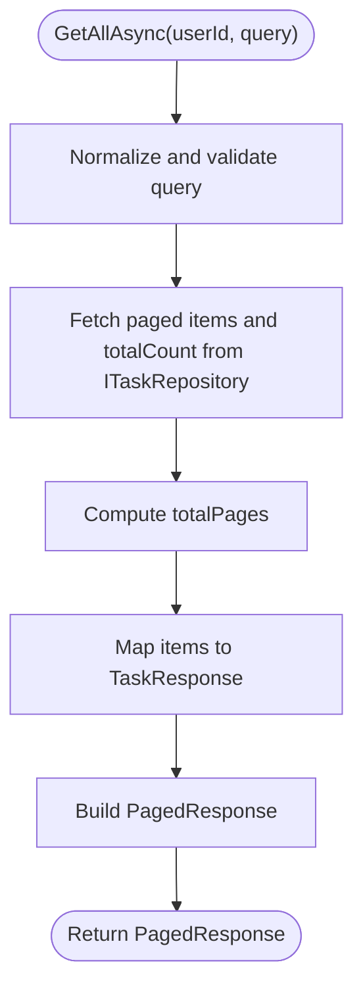
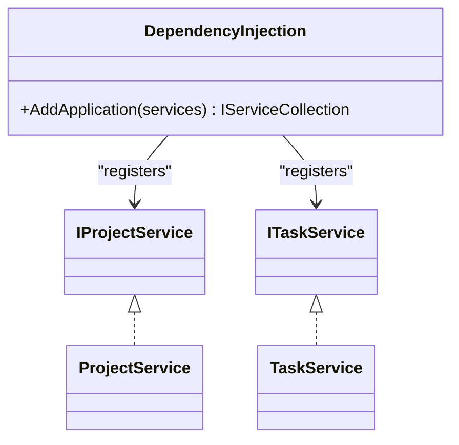

# Application Layer

<cite>
**Referenced Files in This Document**
- [ProjectService.cs](file://Services/Services.Application/Services/ProjectService.cs)
- [TaskService.cs](file://Services/Services.Application/Services/TaskService.cs)
- [IProjectService.cs](file://Services/Services.Application/Interfaces/Services/IProjectService.cs)
- [ITaskService.cs](file://Services/Services.Application/Interfaces/Services/ITaskService.cs)
- [IProjectRepository.cs](file://Services/Services.Application/Interfaces/Repositories/IProjectRepository.cs)
- [ITaskRepository.cs](file://Services/Services.Application/Interfaces/Repositories/ITaskRepository.cs)
- [DependencyInjection.cs](file://Services/Services.Application/DependencyInjection.cs)
- [CreateProjectRequest.cs](file://Services/Services.Application/DTOs/Projects/CreateProjectRequest.cs)
- [UpdateProjectRequest.cs](file://Services/Services.Application/DTOs/Projects/UpdateProjectRequest.cs)
- [ProjectResponse.cs](file://Services/Services.Application/DTOs/Projects/ProjectResponse.cs)
- [ProjectSummaryResponse.cs](file://Services/Services.Application/DTOs/Projects/ProjectSummaryResponse.cs)
- [CreateTaskRequest.cs](file://Services/Services.Application/DTOs/Tasks/CreateTaskRequest.cs)
- [UpdateTaskRequest.cs](file://Services/Services.Application/DTOs/Tasks/UpdateTaskRequest.cs)
- [ChangeTaskStatusRequest.cs](file://Services/Services.Application/DTOs/Tasks/ChangeTaskStatusRequest.cs)
- [TaskQueryRequest.cs](file://Services/Services.Application/DTOs/Tasks/TaskQueryRequest.cs)
- [TaskResponse.cs](file://Services/Services.Application/DTOs/Tasks/TaskResponse.cs)
- [PagedResponse.cs](file://Services/Services.Application/DTOs/PagedResponse.cs)
</cite>

## Table of Contents
1. Introduction
2. Project Structure
3. Core Components
4. Architecture Overview
5. Detailed Component Analysis
6. Dependency Analysis
7. Performance Considerations
8. Troubleshooting Guide
9. Conclusion

## Introduction
This document explains the Application Layer implementation, focusing on service orchestration patterns, business logic coordination, and interface definitions. It covers ProjectService and TaskService implementations, repository interfaces that abstract data access, dependency injection setup, transaction management considerations, and practical usage examples for common operations such as project creation, task assignment, and status updates.

## Project Structure
The Application Layer is organized around:
- Service interfaces defining contracts for business capabilities
- Concrete service implementations orchestrating domain entities and repositories
- Repository interfaces abstracting persistence details
- DTOs for request/response shaping
- A DI registration module to wire services into the container

**Diagram sources**
- [IProjectService.cs:5-36](file://Services/Services.Application/Interfaces/Services/IProjectService.cs#L5-L36)
- [ITaskService.cs:6-49](file://Services/Services.Application/Interfaces/Services/ITaskService.cs#L6-L49)
- [ProjectService.cs:11-14](file://Services/Services.Application/Services/ProjectService.cs#L11-L14)
- [TaskService.cs:12-14](file://Services/Services.Application/Services/TaskService.cs#LL12-L14)
- [IProjectRepository.cs:6-37](file://Services/Services.Application/Interfaces/Repositories/IProjectRepository.cs#L6-L37)
- [ITaskRepository.cs:6-44](file://Services/Services.Application/Interfaces/Repositories/ITaskRepository.cs#L6-L44)
- [DependencyInjection.cs:7-19](file://Services/Services.Application/DependencyInjection.cs#L7-L19)

**Section sources**
- [ProjectService.cs:11-233](file://Services/Services.Application/Services/ProjectService.cs#L11-L233)
- [TaskService.cs:12-412](file://Services/Services.Application/Services/TaskService.cs#L12-L412)
- [DependencyInjection.cs:7-19](file://Services/Services.Application/DependencyInjection.cs#L7-L19)

## Core Components
- Service Interfaces
  - IProjectService: defines CRUD and summary operations for projects
  - ITaskService: defines CRUD, status change, and paged queries for tasks
- Repository Interfaces
  - IProjectRepository: abstracts project persistence and auxiliary queries (e.g., has tasks, counts by status)
  - ITaskRepository: abstracts task persistence, ownership checks, and paged queries
- DTOs
  - Projects: CreateProjectRequest, UpdateProjectRequest, ProjectResponse, ProjectSummaryResponse
  - Tasks: CreateTaskRequest, UpdateTaskRequest, ChangeTaskStatusRequest, TaskQueryRequest, TaskResponse, PagedResponse<T>

Key responsibilities:
- Validate inputs and enforce business rules at the application boundary
- Coordinate domain entity creation/updates via value objects and entities
- Map between domain models and DTOs
- Enforce authorization boundaries through userId-scoped repository methods

**Section sources**
- [IProjectService.cs:5-36](file://Services/Services.Application/Interfaces/Services/IProjectService.cs#L5-L36)
- [ITaskService.cs:6-49](file://Services/Services.Application/Interfaces/Services/ITaskService.cs#L6-L49)
- [IProjectRepository.cs:6-37](file://Services/Services.Application/Interfaces/Repositories/IProjectRepository.cs#L6-L37)
- [ITaskRepository.cs:6-44](file://Services/Services.Application/Interfaces/Repositories/ITaskRepository.cs#L6-L44)
- [CreateProjectRequest.cs:3-7](file://Services/Services.Application/DTOs/Projects/CreateProjectRequest.cs#L3-L7)
- [UpdateProjectRequest.cs:3-7](file://Services/Services.Application/DTOs/Projects/UpdateProjectRequest.cs#L3-L7)
- [ProjectResponse.cs:3-10](file://Services/Services.Application/DTOs/Projects/ProjectResponse.cs#L3-L10)
- [ProjectSummaryResponse.cs:3-9](file://Services/Services.Application/DTOs/Projects/ProjectSummaryResponse.cs#L3-L9)
- [CreateTaskRequest.cs:5-10](file://Services/Services.Application/DTOs/Tasks/CreateTaskRequest.cs#L5-L10)
- [UpdateTaskRequest.cs:5-10](file://Services/Services.Application/DTOs/Tasks/UpdateTaskRequest.cs#L5-L10)
- [ChangeTaskStatusRequest.cs:5-6](file://Services/Services.Application/DTOs/Tasks/ChangeTaskStatusRequest.cs#L5-L6)
- [TaskQueryRequest.cs:5-20](file://Services/Services.Application/DTOs/Tasks/TaskQueryRequest.cs#L5-L20)
- [TaskResponse.cs:5-16](file://Services/Services.Application/DTOs/Tasks/TaskResponse.cs#L5-L16)
- [PagedResponse.cs:3-8](file://Services/Services.Application/DTOs/PagedResponse.cs#L3-L8)

## Architecture Overview
The Application Layer coordinates use cases by validating inputs, enforcing business rules, invoking domain entities/value objects, and delegating persistence to repositories. Services are registered with scoped lifetime to align with request lifecycles.

**Diagram sources**
- [ProjectService.cs:15-38](file://Services/Services.Application/Services/ProjectService.cs#L15-L38)
- [TaskService.cs:16-48](file://Services/Services.Application/Services/TaskService.cs#L16-L48)
- [DependencyInjection.cs:13-16](file://Services/Services.Application/DependencyInjection.cs#L13-L16)

## Detailed Component Analysis

### ProjectService
Responsibilities:
- Create, read, update, delete projects
- Enforce ownership and validation
- Compute project summary including task progress

Key methods and behavior:
- CreateAsync(userId, request): Validates input, constructs domain values/entities, persists, returns ProjectResponse
- GetAllAsync(userId): Returns all projects owned by user
- GetByIdAsync(userId, projectId): Enforces ownership; throws if not found
- UpdateAsync(userId, projectId, request): Loads owned project, updates via domain method, persists, returns updated DTO
- DeleteAsync(userId, projectId): Prevents deletion if associated tasks exist; otherwise deletes
- GetSummaryAsync(userId, projectId): Computes total/completed/pending tasks and progress percentage

Validation and error handling:
- UserId/projectId validation using dedicated helpers
- Throws ValidationException for invalid identifiers
- Throws KeyNotFoundException when resource not found or not owned
- Throws InvalidOperationException when business rule violated (e.g., deleting project with tasks)

Mapping:
- Maps domain Project to ProjectResponse and ProjectSummaryResponse

**Diagram sources**
- [ProjectService.cs:15-38](file://Services/Services.Application/Services/ProjectService.cs#L15-L38)

**Section sources**
- [ProjectService.cs:15-179](file://Services/Services.Application/Services/ProjectService.cs#L15-L179)
- [ProjectService.cs:181-231](file://Services/Services.Application/Services/ProjectService.cs#L181-L231)
- [IProjectService.cs:5-36](file://Services/Services.Application/Interfaces/Services/IProjectService.cs#L5-L36)
- [IProjectRepository.cs:6-37](file://Services/Services.Application/Interfaces/Repositories/IProjectRepository.cs#L6-L37)
- [CreateProjectRequest.cs:3-7](file://Services/Services.Application/DTOs/Projects/CreateProjectRequest.cs#L3-L7)
- [ProjectResponse.cs:3-10](file://Services/Services.Application/DTOs/Projects/ProjectResponse.cs#L3-L10)
- [ProjectSummaryResponse.cs:3-9](file://Services/Services.Application/DTOs/Projects/ProjectSummaryResponse.cs#L3-L9)

### TaskService
Responsibilities:
- Create, read, update, delete tasks
- Change task status
- Provide paged and filtered queries
- Enforce ownership and project association rules

Key methods and behavior:
- CreateAsync(userId, request): Validates inputs, builds value objects, validates priority, verifies project ownership, creates TaskItem, persists, returns TaskResponse
- GetAllAsync(userId): Returns all tasks owned by user
- GetByIdAsync(userId, taskId): Enforces ownership; throws if not found
- UpdateAsync(userId, taskId, request): Loads owned task, updates details and project assignment, persists, returns updated DTO
- ChangeStatusAsync(userId, taskId, request): Changes status via domain method, persists, returns updated DTO
- DeleteAsync(userId, taskId): Deletes owned task
- GetAllAsync(userId, query): Normalizes and validates query, fetches paged results, computes total pages, returns PagedResponse<TaskResponse>
- GetByProjectIdAsync(userId, projectId, query): Validates project ownership, normalizes query, fetches paged results, returns PagedResponse<TaskResponse>

Validation and error handling:
- UserId/taskId/projectId validation
- Priority/status enum validation
- Query normalization enforces allowed sort fields and directions, page size bounds, search length limits
- Throws ValidationException for invalid inputs
- Throws KeyNotFoundException for missing resources or unauthorized access

**Diagram sources**
- [TaskService.cs:160-187](file://Services/Services.Application/Services/TaskService.cs#L160-L187)
- [TaskService.cs:318-393](file://Services/Services.Application/Services/TaskService.cs#L318-L393)

**Section sources**
- [TaskService.cs:16-187](file://Services/Services.Application/Services/TaskService.cs#L16-L187)
- [TaskService.cs:189-232](file://Services/Services.Application/Services/TaskService.cs#L189-L232)
- [TaskService.cs:234-410](file://Services/Services.Application/Services/TaskService.cs#L234-L410)
- [ITaskService.cs:6-49](file://Services/Services.Application/Interfaces/Services/ITaskService.cs#L6-L49)
- [ITaskRepository.cs:6-44](file://Services/Services.Application/Interfaces/Repositories/ITaskRepository.cs#L6-L44)
- [CreateTaskRequest.cs:5-10](file://Services/Services.Application/DTOs/Tasks/CreateTaskRequest.cs#L5-L10)
- [UpdateTaskRequest.cs:5-10](file://Services/Services.Application/DTOs/Tasks/UpdateTaskRequest.cs#L5-L10)
- [ChangeTaskStatusRequest.cs:5-6](file://Services/Services.Application/DTOs/Tasks/ChangeTaskStatusRequest.cs#L5-L6)
- [TaskQueryRequest.cs:5-20](file://Services/Services.Application/DTOs/Tasks/TaskQueryRequest.cs#L5-L20)
- [TaskResponse.cs:5-16](file://Services/Services.Application/DTOs/Tasks/TaskResponse.cs#L5-L16)
- [PagedResponse.cs:3-8](file://Services/Services.Application/DTOs/PagedResponse.cs#L3-L8)

### Interface Definitions
- IProjectService
  - Methods: CreateAsync, GetAllAsync, GetByIdAsync, UpdateAsync, DeleteAsync, GetSummaryAsync
  - Parameters include userId and request DTOs; return types are DTOs or lists of DTOs
- ITaskService
  - Methods: CreateAsync, GetAllAsync (list), GetByIdAsync, UpdateAsync, ChangeStatusAsync, DeleteAsync, GetAllAsync (paged), GetByProjectIdAsync (paged)
  - Paged methods accept TaskQueryRequest and return PagedResponse<TaskResponse>

**Section sources**
- [IProjectService.cs:5-36](file://Services/Services.Application/Interfaces/Services/IProjectService.cs#L5-L36)
- [ITaskService.cs:6-49](file://Services/Services.Application/Interfaces/Services/ITaskService.cs#L6-L49)

### Repository Interfaces
- IProjectRepository
  - AddAsync, GetAllByUserIdAsync, GetByIdAsync(projectId, userId), HasTasksAsync, UpdateAsync, DeleteAsync, GetTaskCountsByProjectAsync
  - Ownership-aware reads via userId parameter
- ITaskRepository
  - AddAsync, GetAllByUserIdAsync, GetByIdAsync(taskId, userId), UpdateAsync, DeleteAsync, ProjectExistsAsync(projectId, userId), GetPagedByUserIdAsync, GetPagedByProjectIdAsync

These interfaces encapsulate persistence details and provide a stable contract for the Application Layer.

**Section sources**
- [IProjectRepository.cs:6-37](file://Services/Services.Application/Interfaces/Repositories/IProjectRepository.cs#L6-L37)
- [ITaskRepository.cs:6-44](file://Services/Services.Application/Interfaces/Repositories/ITaskRepository.cs#L6-L44)

## Dependency Analysis
Service registration uses scoped lifetime to align with HTTP request lifetimes.

**Diagram sources**
- [DependencyInjection.cs:7-19](file://Services/Services.Application/DependencyInjection.cs#L7-L19)
- [IProjectService.cs:5-36](file://Services/Services.Application/Interfaces/Services/IProjectService.cs#L5-L36)
- [ITaskService.cs:6-49](file://Services/Services.Application/Interfaces/Services/ITaskService.cs#L6-L49)

**Section sources**
- [DependencyInjection.cs:7-19](file://Services/Services.Application/DependencyInjection.cs#L7-L19)

## Performance Considerations
- Use paged queries for large datasets to avoid loading entire collections into memory
- Normalize and constrain query parameters (page size, search length) to prevent expensive operations
- Prefer repository methods that filter by userId to reduce unnecessary data retrieval
- Avoid N+1 queries by leveraging repository methods that return aggregated data (e.g., task counts by status)

[No sources needed since this section provides general guidance]

## Troubleshooting Guide
Common errors and their causes:
- ValidationException
  - Invalid userId, projectId, taskId
  - Invalid priority or status enums
  - Invalid query parameters (page/pageSize/sort/search)
- KeyNotFoundException
  - Resource not found or not owned by the requesting user
- InvalidOperationException
  - Business rule violation (e.g., attempting to delete a project that has associated tasks)

Resolution steps:
- Ensure userId is provided and valid
- Verify resource IDs exist and belong to the user
- Check enum values for priority/status
- Validate pagination and sorting parameters against allowed ranges and fields
- For deletions, ensure no dependent records exist or handle them appropriately

**Section sources**
- [ProjectService.cs:101-127](file://Services/Services.Application/Services/ProjectService.cs#L101-L127)
- [ProjectService.cs:145-167](file://Services/Services.Application/Services/ProjectService.cs#L145-L167)
- [TaskService.cs:250-274](file://Services/Services.Application/Services/TaskService.cs#L250-L274)
- [TaskService.cs:307-393](file://Services/Services.Application/Services/TaskService.cs#L307-L393)

## Conclusion
The Application Layer implements clear service contracts, robust validation, and consistent error handling while coordinating domain logic and persistence through well-defined repository interfaces. Dependency injection wires services with appropriate lifetimes. The design supports scalable operations via paged queries and aggregates, and it enforces business rules at the application boundary to maintain data integrity and security.

[No sources needed since this section summarizes without analyzing specific files]