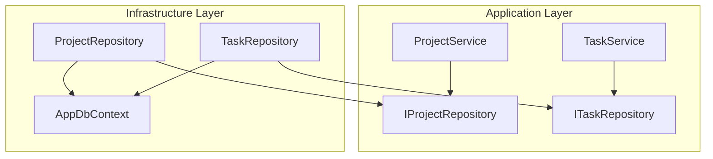
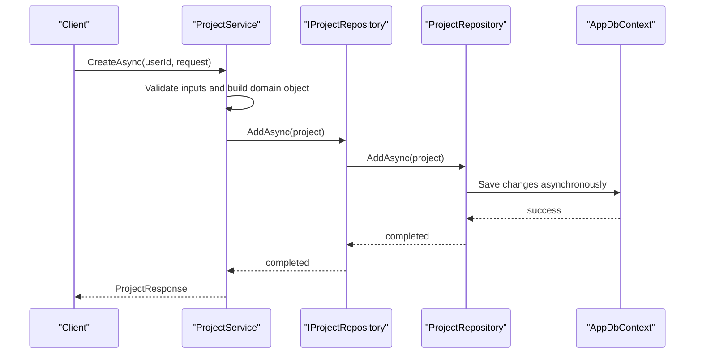
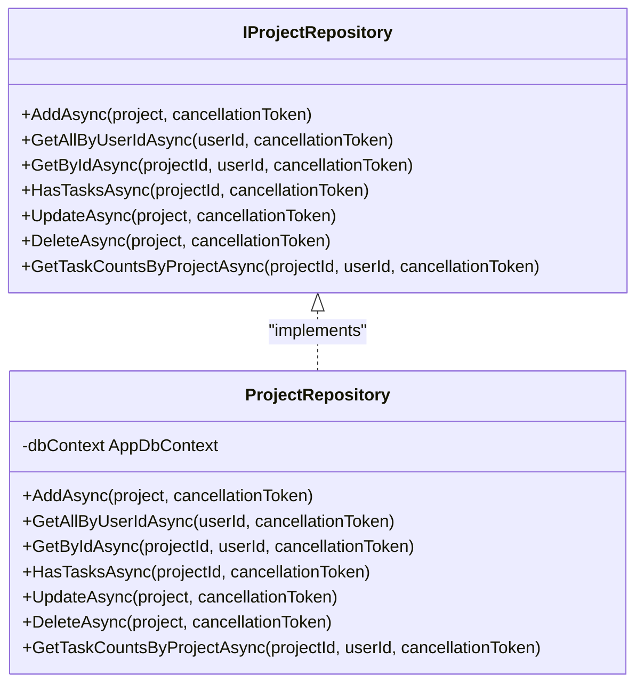
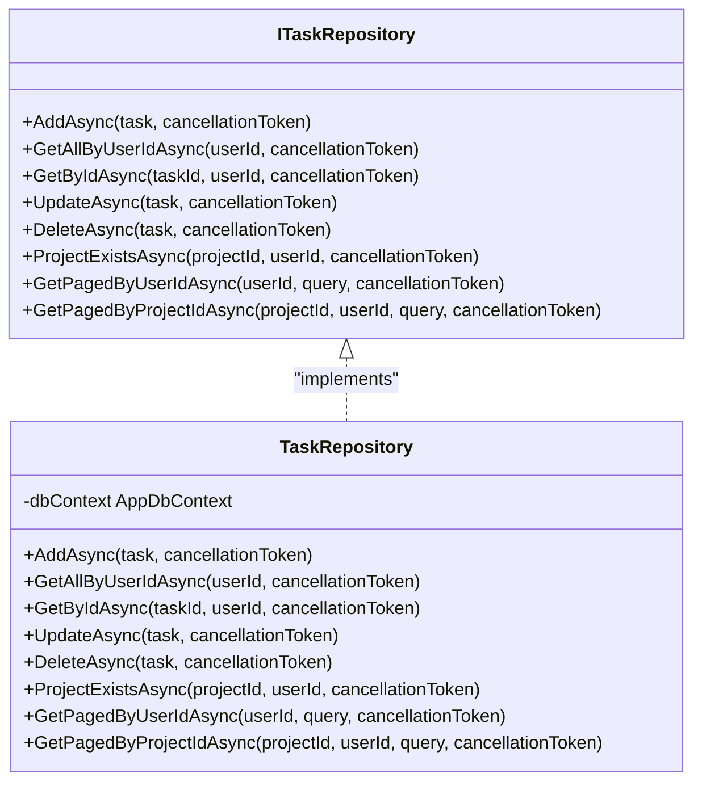
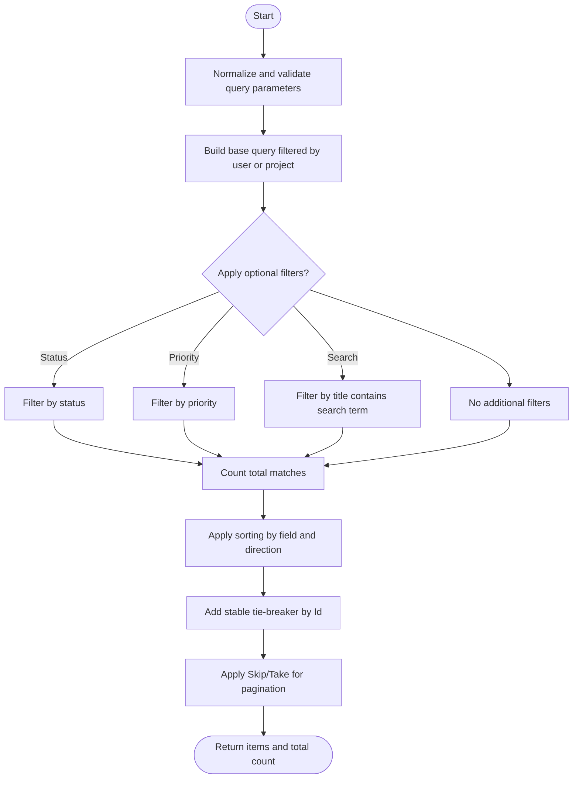
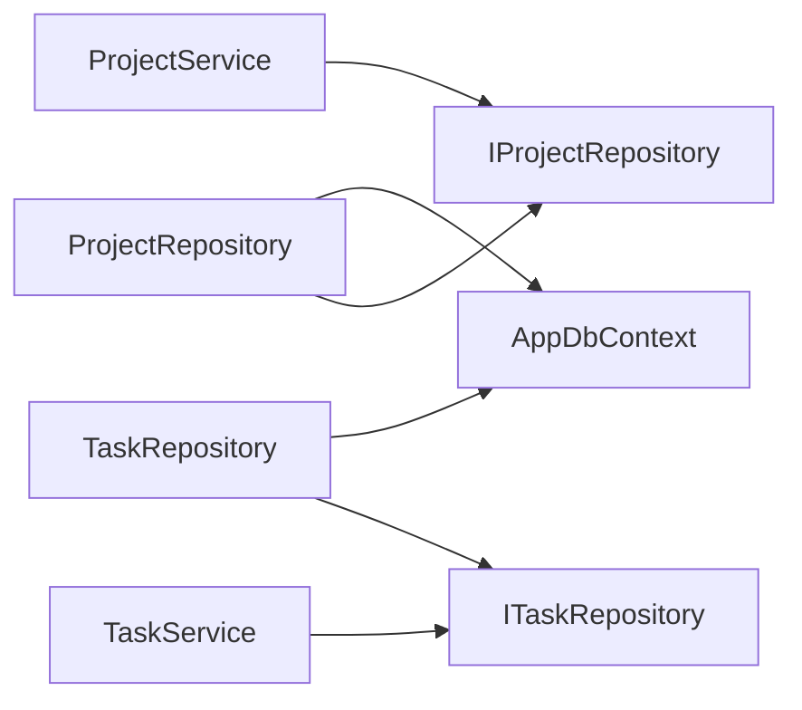

# Repository Interfaces

<cite>
**Referenced Files in This Document**
- [IProjectRepository.cs](file://Services/Application/Interfaces/Repositories/IProjectRepository.cs)
- [ITaskRepository.cs](file://Services/Application/Interfaces/Repositories/ITaskRepository.cs)
- [ProjectRepository.cs](file://Services/Infrastructure/Repositories/ProjectRepository.cs)
- [TaskRepository.cs](file://Services/Infrastructure/Repositories/TaskRepository.cs)
- [ProjectService.cs](file://Services/Application/Services/ProjectService.cs)
- [TaskService.cs](file://Services/Application/Services/TaskService.cs)
</cite>

## Table of Contents
1. [Introduction](#introduction)
2. [Project Structure](#project-structure)
3. [Core Components](#core-components)
4. [Architecture Overview](#architecture-overview)
5. [Detailed Component Analysis](#detailed-component-analysis)
6. [Dependency Analysis](#dependency-analysis)
7. [Performance Considerations](#performance-considerations)
8. [Troubleshooting Guide](#troubleshooting-guide)
9. [Conclusion](#conclusion)

## Introduction
This document explains the repository interfaces that abstract data access operations for projects and tasks. These interfaces define the contract between the application layer and infrastructure layer, enabling Clean Architecture principles such as separation of concerns, testability, and maintainability. The focus is on IProjectRepository and ITaskRepository: their responsibilities, method contracts, filtering and pagination capabilities, exception handling patterns, and how services consume them.

## Project Structure
The relevant parts of the codebase are organized by layers:
- Application layer: defines repository interfaces and orchestrates business logic through services.
- Infrastructure layer: implements repositories using Entity Framework Core over a database context.
- Domain layer: provides entities, enums, and value objects used across layers.

**Diagram sources**
- [IProjectRepository.cs:6-37](file://Services/Application/Interfaces/Repositories/IProjectRepository.cs#L6-L37)
- [ITaskRepository.cs:6-44](file://Services/Application/Interfaces/Repositories/ITaskRepository.cs#L6-L44)
- [ProjectRepository.cs:9-11](file://Services/Infrastructure/Repositories/ProjectRepository.cs#L9-L11)
- [TaskRepository.cs:9-11](file://Services/Infrastructure/Repositories/TaskRepository.cs#L9-L11)
- [ProjectService.cs:11-13](file://Services/Application/Services/ProjectService.cs#L11-L13)
- [TaskService.cs:12-14](file://Services/Application/Services/TaskService.cs#L12-L14)

**Section sources**
- [IProjectRepository.cs:1-37](file://Services/Application/Interfaces/Repositories/IProjectRepository.cs#L1-L37)
- [ITaskRepository.cs:1-44](file://Services/Application/Interfaces/Repositories/ITaskRepository.cs#L1-L44)
- [ProjectRepository.cs:1-97](file://Services/Infrastructure/Repositories/ProjectRepository.cs#L1-L97)
- [TaskRepository.cs:1-239](file://Services/Infrastructure/Repositories/TaskRepository.cs#L1-L239)
- [ProjectService.cs:1-233](file://Services/Application/Services/ProjectService.cs#L1-L233)
- [TaskService.cs:1-412](file://Services/Application/Services/TaskService.cs#L1-L412)

## Core Components
- IProjectRepository: Defines project persistence operations including create, read by user, read by id with ownership check, update, delete, existence checks, and aggregated task counts per status.
- ITaskRepository: Defines task persistence operations including create, read by user, read by id with ownership check, update, delete, project existence validation, and two paginated query methods (by user and by project).

These interfaces encapsulate data access details so that services can remain focused on business rules and orchestration. They also enable unit testing by allowing mock implementations to be injected into services.

**Section sources**
- [IProjectRepository.cs:6-37](file://Services/Application/Interfaces/Repositories/IProjectRepository.cs#L6-L37)
- [ITaskRepository.cs:6-44](file://Services/Application/Interfaces/Repositories/ITaskRepository.cs#L6-L44)

## Architecture Overview
The repository pattern here separates domain and application logic from persistence technology. Services depend only on interface abstractions; infrastructure provides concrete implementations backed by Entity Framework Core. This design supports:
- Testability: services can be tested with in-memory or fake repositories.
- Maintainability: changes to storage mechanisms do not affect service code.
- Clear contracts: method signatures define expected parameters, return types, and asynchronous behavior.

**Diagram sources**
- [ProjectService.cs:15-38](file://Services/Application/Services/ProjectService.cs#L15-L38)
- [ProjectRepository.cs:13-23](file://Services/Infrastructure/Repositories/ProjectRepository.cs#L13-L23)

## Detailed Component Analysis

### IProjectRepository
Responsibilities:
- CRUD operations for projects scoped by user ownership where applicable.
- Aggregation queries for task counts grouped by status.

Method summary:
- AddAsync(project, cancellationToken): Creates a new project record.
- GetAllByUserIdAsync(userId, cancellationToken): Returns all projects owned by a user.
- GetByIdAsync(projectId, userId, cancellationToken): Returns a single project if it belongs to the user.
- HasTasksAsync(projectId, cancellationToken): Checks whether any tasks exist for a project.
- UpdateAsync(project, cancellationToken): Persists updates to an existing project.
- DeleteAsync(project, cancellationToken): Removes a project record.
- GetTaskCountsByProjectAsync(projectId, userId, cancellationToken): Returns a dictionary mapping task statuses to counts for a given project and user.

Key points:
- All methods are asynchronous and accept cancellation tokens.
- Ownership checks are enforced at the repository level for reads by id.
- Aggregations are performed in the database via LINQ-to-Entities.

Usage by services:
- ProjectService uses these methods to implement business workflows such as creating, reading, updating, deleting, and summarizing project progress.

**Section sources**
- [IProjectRepository.cs:6-37](file://Services/Application/Interfaces/Repositories/IProjectRepository.cs#L6-L37)
- [ProjectService.cs:15-231](file://Services/Application/Services/ProjectService.cs#L15-L231)

#### IProjectRepository Class Diagram

**Diagram sources**
- [IProjectRepository.cs:6-37](file://Services/Application/Interfaces/Repositories/IProjectRepository.cs#L6-L37)
- [ProjectRepository.cs:9-97](file://Services/Infrastructure/Repositories/ProjectRepository.cs#L9-L97)

### ITaskRepository
Responsibilities:
- CRUD operations for tasks scoped by user ownership where applicable.
- Validation helpers for project existence.
- Advanced querying with filtering, sorting, and pagination.

Method summary:
- AddAsync(task, cancellationToken): Creates a new task and loads related project reference.
- GetAllByUserIdAsync(userId, cancellationToken): Returns all tasks owned by a user, including project details.
- GetByIdAsync(taskId, userId, cancellationToken): Returns a single task if it belongs to the user.
- UpdateAsync(task, cancellationToken): Persists updates to an existing task.
- DeleteAsync(task, cancellationToken): Removes a task record.
- ProjectExistsAsync(projectId, userId, cancellationToken): Validates that a project exists and belongs to the user.
- GetPagedByUserIdAsync(userId, query, cancellationToken): Paginates tasks by user with filters and sorting.
- GetPagedByProjectIdAsync(projectId, userId, query, cancellationToken): Paginates tasks by project with filters and sorting.

Filtering and pagination:
- Filters include status, priority, and search by title.
- Sorting supports multiple fields with ascending or descending direction.
- Pagination returns both items and total count to support client-side paging UIs.

Usage by services:
- TaskService validates input, normalizes query parameters, enforces business rules, and delegates persistence to ITaskRepository. It also maps domain entities to DTOs and computes page totals.

**Section sources**
- [ITaskRepository.cs:6-44](file://Services/Application/Interfaces/Repositories/ITaskRepository.cs#L6-L44)
- [TaskService.cs:16-232](file://Services/Application/Services/TaskService.cs#L16-L232)

#### ITaskRepository Class Diagram

**Diagram sources**
- [ITaskRepository.cs:6-44](file://Services/Application/Interfaces/Repositories/ITaskRepository.cs#L6-L44)
- [TaskRepository.cs:9-239](file://Services/Infrastructure/Repositories/TaskRepository.cs#L9-L239)

#### Task Query Flowchart

**Diagram sources**
- [TaskRepository.cs:82-157](file://Services/Infrastructure/Repositories/TaskRepository.cs#L82-L157)
- [TaskRepository.cs:159-237](file://Services/Infrastructure/Repositories/TaskRepository.cs#L159-L237)
- [TaskService.cs:318-393](file://Services/Application/Services/TaskService.cs#L318-L393)

## Dependency Analysis
- Application layer depends on repository interfaces defined in the same layer.
- Infrastructure layer implements those interfaces and depends on the database context.
- Services depend only on repository interfaces, not on infrastructure specifics.

**Diagram sources**
- [ProjectService.cs:11-13](file://Services/Application/Services/ProjectService.cs#L11-L13)
- [TaskService.cs:12-14](file://Services/Application/Services/TaskService.cs#L12-L14)
- [ProjectRepository.cs:9-11](file://Services/Infrastructure/Repositories/ProjectRepository.cs#L9-L11)
- [TaskRepository.cs:9-11](file://Services/Infrastructure/Repositories/TaskRepository.cs#L9-L11)

**Section sources**
- [ProjectService.cs:1-233](file://Services/Application/Services/ProjectService.cs#L1-L233)
- [TaskService.cs:1-412](file://Services/Application/Services/TaskService.cs#L1-L412)
- [ProjectRepository.cs:1-97](file://Services/Infrastructure/Repositories/ProjectRepository.cs#L1-L97)
- [TaskRepository.cs:1-239](file://Services/Infrastructure/Repositories/TaskRepository.cs#L1-L239)

## Performance Considerations
- Asynchronous operations: All repository methods are async and accept cancellation tokens to avoid blocking threads and support responsive APIs.
- Read-only queries use no-tracking where appropriate to reduce change tracking overhead.
- Efficient aggregations: Task counts are computed in the database using group-by and select projections.
- Pagination: Large result sets are handled efficiently by applying skip/take after filtering and sorting.
- Eager loading: Related project data is included when needed to avoid N+1 queries.

[No sources needed since this section provides general guidance]

## Troubleshooting Guide
Common issues and resolution strategies:
- Invalid identifiers: Services throw validation exceptions when user or entity identifiers are empty or malformed. Ensure callers pass valid GUIDs.
- Missing resources: KeyNotFoundException is thrown when requested entities do not exist or do not belong to the current user. Verify ownership checks and correct IDs.
- Business rule violations: For example, attempting to delete a project with associated tasks throws an operation-invalid exception. Remove dependent tasks first.
- Query parameter validation: Invalid sort fields, directions, or out-of-range page sizes cause validation exceptions. Normalize and constrain inputs before calling repository methods.

Exception patterns observed:
- ValidationException for invalid input values.
- KeyNotFoundException for missing or unauthorized resources.
- InvalidOperationException for business rule violations.

**Section sources**
- [ProjectService.cs:101-143](file://Services/Application/Services/ProjectService.cs#L101-L143)
- [TaskService.cs:160-232](file://Services/Application/Services/TaskService.cs#L160-L232)
- [TaskService.cs:285-393](file://Services/Application/Services/TaskService.cs#L285-L393)

## Conclusion
IProjectRepository and ITaskRepository provide clear, testable contracts for data access in the application layer. By isolating persistence logic behind interfaces, the system achieves Clean Architecture benefits: decoupling, testability, and maintainability. Services rely solely on these interfaces, while infrastructure implementations handle database interactions. Filtering, sorting, and pagination are implemented consistently in the task repository, and services enforce robust validation and error handling around repository calls.