# Project Service

<cite>
**Referenced Files in This Document**
- [ProjectService.cs](file://Services.Services.Application.Services.ProjectService.cs)
- [IProjectRepository.cs](file://Services.Services.Application.Interfaces.Repositories.IProjectRepository.cs)
- [ProjectRepository.cs](file://Services.Services.Infrastructure.Repositories.ProjectRepository.cs)
- [Project.cs](file://Services.Services.Domain.Entities.Project.cs)
- [ProjectName.cs](file://Services.Services.Domain.ValueObjects.ProjectName.cs)
- [TaskItem.cs](file://Services.Services.Domain.Entities.TaskItem.cs)
- [AppDbContext.cs](file://Services.Services.Infrastructure.Persistence.AppDbContext.cs)
- [ProjectsController.cs](file://Services.Services.Api.Controllers.ProjectsController.cs)
- [CreateProjectRequest.cs](file://Services.Services.Application.DTOs.Projects.CreateProjectRequest.cs)
- [UpdateProjectRequest.cs](file://Services.Services.Application.DTOs.Projects.UpdateProjectRequest.cs)
- [ProjectResponse.cs](file://Services.Services.Application.DTOs.Projects.ProjectResponse.cs)
- [ProjectSummaryResponse.cs](file://Services.Services.Application.DTOs.Projects.ProjectSummaryResponse.cs)
</cite>

## Table of Contents
1. [Introduction](#introduction)
2. [Project Structure](#project-structure)
3. [Core Components](#core-components)
4. [Architecture Overview](#architecture-overview)
5. [Detailed Component Analysis](#detailed-component-analysis)
6. [Dependency Analysis](#dependency-analysis)
7. [Performance Considerations](#performance-considerations)
8. [Troubleshooting Guide](#troubleshooting-guide)
9. [Conclusion](#conclusion)

## Introduction
This document provides detailed documentation for the ProjectService class implementation and its surrounding project management business logic. It explains how projects are created, updated, deleted, retrieved, summarized, and searched or filtered through repository operations. It also documents parameter validation using the ProjectName value object, ownership and permission enforcement, error handling strategies with specific exception types, transaction patterns via Entity Framework Core, and performance considerations for large project collections.

## Project Structure
The project follows a layered architecture:
- API layer exposes HTTP endpoints for project operations.
- Application layer contains service orchestration and business rules.
- Domain layer defines entities, value objects, and enums.
- Infrastructure layer implements persistence and dependency injection.

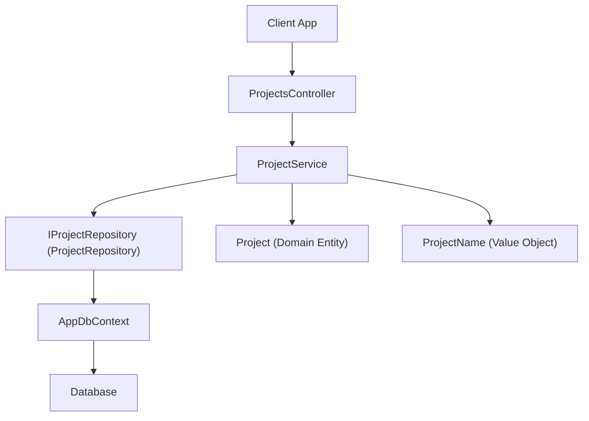

**Diagram sources**
- [ProjectsController.cs:12-19](file://Services.Services.Api.Controllers.ProjectsController.cs#L12-L19)
- [ProjectService.cs:11-13](file://Services.Services.Application.Services.ProjectService.cs#L11-L13)
- [IProjectRepository.cs:6-37](file://Services.Services.Application.Interfaces.Repositories.IProjectRepository.cs#L6-L37)
- [ProjectRepository.cs:9-11](file://Services.Services.Infrastructure.Repositories.ProjectRepository.cs#L9-L11)
- [AppDbContext.cs:10-23](file://Services.Services.Infrastructure.Persistence.AppDbContext.cs#L10-L23)
- [Project.cs:5-22](file://Services.Services.Domain.Entities.Project.cs#L5-L22)
- [ProjectName.cs:3-36](file://Services.Services.Domain.ValueObjects.ProjectName.cs#L3-L36)

**Section sources**
- [ProjectsController.cs:12-19](file://Services.Services.Api.Controllers.ProjectsController.cs#L12-L19)
- [ProjectService.cs:11-13](file://Services.Services.Application.Services.ProjectService.cs#L11-L13)
- [IProjectRepository.cs:6-37](file://Services.Services.Application.Interfaces.Repositories.IProjectRepository.cs#L6-L37)
- [ProjectRepository.cs:9-11](file://Services.Services.Infrastructure.Repositories.ProjectRepository.cs#L9-L11)
- [AppDbContext.cs:10-23](file://Services.Services.Infrastructure.Persistence.AppDbContext.cs#L10-L23)
- [Project.cs:5-22](file://Services.Services.Domain.Entities.Project.cs#L5-L22)
- [ProjectName.cs:3-36](file://Services.Services.Domain.ValueObjects.ProjectName.cs#L3-L36)

## Core Components
- ProjectService: Implements IProjectService and encapsulates project management business logic including creation, retrieval, updates, deletion, and summary calculations.
- IProjectRepository: Defines repository operations for project CRUD and task count aggregation.
- ProjectRepository: Implements EF Core-based persistence for projects and tasks.
- Project domain entity: Encapsulates project state, validation, and update behavior.
- ProjectName value object: Enforces name constraints and normalization.
- DTOs: CreateProjectRequest, UpdateProjectRequest, ProjectResponse, ProjectSummaryResponse define input/output contracts.

Key responsibilities:
- Validate inputs and enforce business rules.
- Ensure user owns the project before read/write operations.
- Map domain entities to DTOs.
- Compute project summaries based on task counts.

**Section sources**
- [ProjectService.cs:11-233](file://Services.Services.Application.Services.ProjectService.cs#L11-L233)
- [IProjectRepository.cs:6-37](file://Services.Services.Application.Interfaces.Repositories.IProjectRepository.cs#L6-L37)
- [ProjectRepository.cs:9-97](file://Services.Services.Infrastructure.Repositories.ProjectRepository.cs#L9-L97)
- [Project.cs:5-121](file://Services.Services.Domain.Entities.Project.cs#L5-L121)
- [ProjectName.cs:3-36](file://Services.Services.Domain.ValueObjects.ProjectName.cs#L3-L36)
- [CreateProjectRequest.cs:3-7](file://Services.Services.Application.DTOs.Projects.CreateProjectRequest.cs#L3-L7)
- [UpdateProjectRequest.cs:3-7](file://Services.Services.Application.DTOs.Projects.UpdateProjectRequest.cs#L3-L7)
- [ProjectResponse.cs:3-10](file://Services.Services.Application.DTOs.Projects.ProjectResponse.cs#L3-L10)
- [ProjectSummaryResponse.cs:3-9](file://Services.Services.Application.DTOs.Projects.ProjectSummaryResponse.cs#L3-L9)

## Architecture Overview
The ProjectService coordinates between the API controller and repository while enforcing domain rules. Ownership checks ensure users can only access their own projects. Validation is performed early using value objects and explicit checks. Persistence is handled by EF Core within repository methods.

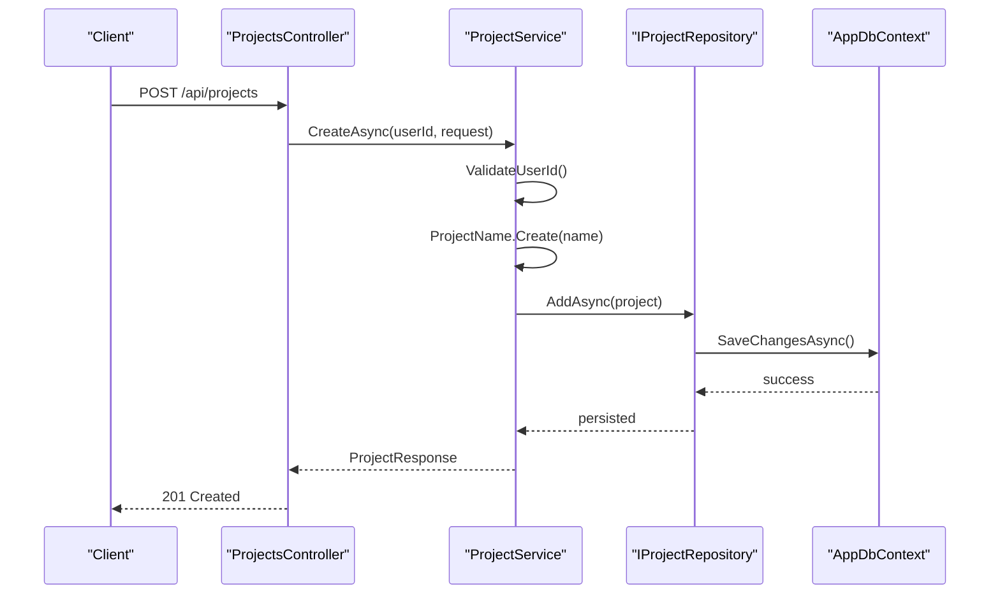

**Diagram sources**
- [ProjectsController.cs:20-43](file://Services.Services.Api.Controllers.ProjectsController.cs#L20-L43)
- [ProjectService.cs:15-38](file://Services.Services.Application.Services.ProjectService.cs#L15-L38)
- [ProjectRepository.cs:13-23](file://Services.Services.Infrastructure.Repositories.ProjectRepository.cs#L13-L23)
- [AppDbContext.cs:10-23](file://Services.Services.Infrastructure.Persistence.AppDbContext.cs#L10-L23)

## Detailed Component Analysis

### ProjectService Business Logic
ProjectService implements the following operations:
- CreateAsync: Validates user ID, constructs ProjectName, creates Project, persists via repository, maps to response.
- GetAllAsync: Validates user ID, retrieves all projects owned by user, maps to responses.
- GetByIdAsync: Validates identifiers, ensures ownership, returns mapped response.
- UpdateAsync: Validates identifiers, ensures ownership, validates and applies ProjectName, updates details, persists, maps to response.
- DeleteAsync: Validates identifiers, ensures ownership, prevents deletion if tasks exist, deletes project.
- GetSummaryAsync: Validates identifiers, ensures ownership, aggregates task counts, computes totals and progress percentage.

Validation and error handling:
- User ID validation throws ValidationException when empty.
- Identifier validation throws ValidationException for invalid IDs.
- Missing project throws KeyNotFoundException.
- Deletion with associated tasks throws InvalidOperationException.
- Summary method uses ArgumentException for missing required parameters.

Ownership and permissions:
- All read/write operations require the project to belong to the authenticated user.
- Repository queries filter by both projectId and userId to enforce ownership at the data layer.

Transaction management:
- Each repository method calls SaveChangesAsync, ensuring unit-of-work per operation.
- For multi-step operations, consider wrapping in a single transaction scope at the application layer.

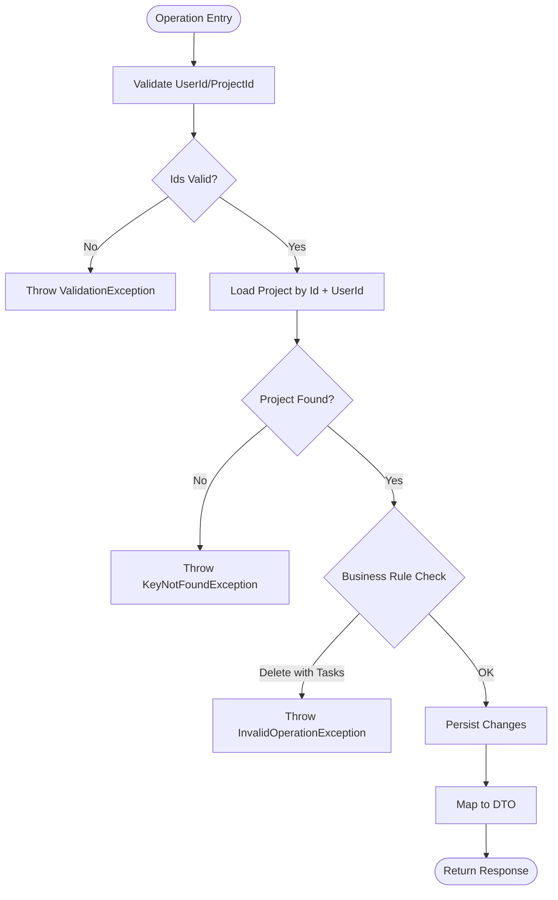

**Diagram sources**
- [ProjectService.cs:145-167](file://Services.Services.Application.Services.ProjectService.cs#L145-L167)
- [ProjectService.cs:129-143](file://Services.Services.Application.Services.ProjectService.cs#L129-L143)
- [ProjectService.cs:101-127](file://Services.Services.Application.Services.ProjectService.cs#L101-L127)

**Section sources**
- [ProjectService.cs:15-38](file://Services.Services.Application.Services.ProjectService.cs#L15-L38)
- [ProjectService.cs:40-52](file://Services.Services.Application.Services.ProjectService.cs#L40-L52)
- [ProjectService.cs:54-68](file://Services.Services.Application.Services.ProjectService.cs#L54-L68)
- [ProjectService.cs:70-99](file://Services.Services.Application.Services.ProjectService.cs#L70-L99)
- [ProjectService.cs:101-127](file://Services.Services.Application.Services.ProjectService.cs#L101-L127)
- [ProjectService.cs:181-231](file://Services.Services.Application.Services.ProjectService.cs#L181-L231)

### Parameter Validation Using ProjectName
ProjectName enforces:
- Non-empty and non-whitespace values.
- Maximum length constraint.
- Normalization by trimming.

Usage in ProjectService:
- CreateAsync and UpdateAsync construct ProjectName from request fields.
- Invalid names result in ArgumentException thrown by ProjectName.Create.

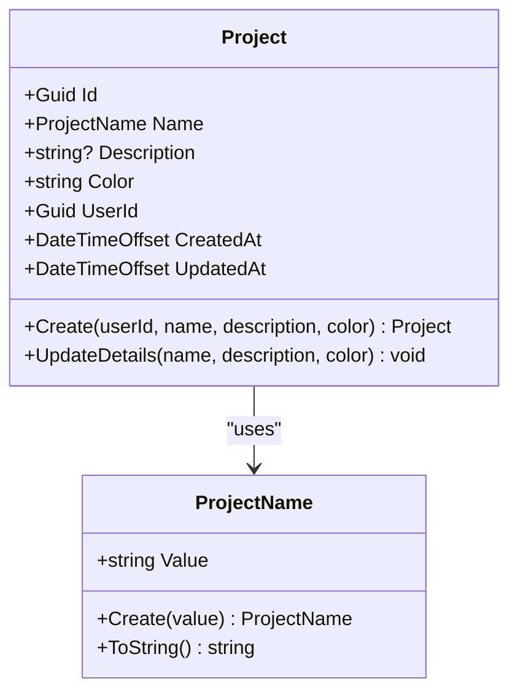

**Diagram sources**
- [ProjectName.cs:3-36](file://Services.Services.Domain.ValueObjects.ProjectName.cs#L3-L36)
- [Project.cs:5-78](file://Services.Services.Domain.Entities.Project.cs#L5-L78)

**Section sources**
- [ProjectName.cs:3-36](file://Services.Services.Domain.ValueObjects.ProjectName.cs#L3-L36)
- [ProjectService.cs:23-30](file://Services.Services.Application.Services.ProjectService.cs#L23-L30)
- [ProjectService.cs:85-91](file://Services.Services.Application.Services.ProjectService.cs#L85-L91)

### Error Handling Strategies
Exceptions used:
- ValidationException: Invalid user/project identifiers.
- KeyNotFoundException: Project not found or does not belong to user.
- InvalidOperationException: Attempting to delete a project with associated tasks.
- ArgumentException: Missing required parameters in summary; invalid color/description in domain entity.

API mapping:
- Controller catches exceptions and returns appropriate HTTP status codes:
  - BadRequest for ValidationException and ArgumentException.
  - NotFound for KeyNotFoundException.
  - Conflict for InvalidOperationException.

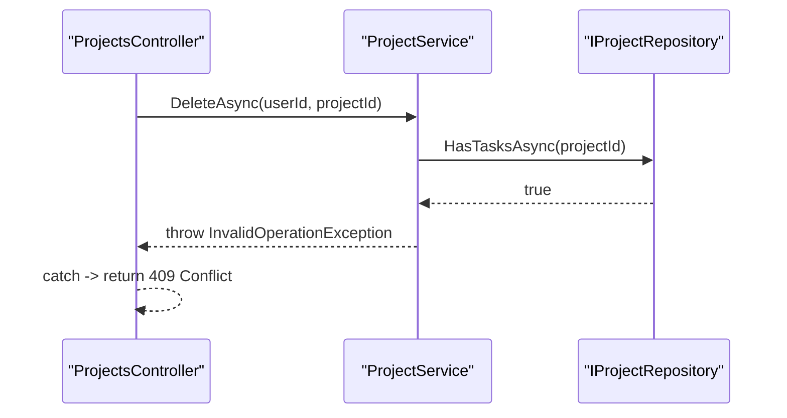

**Diagram sources**
- [ProjectService.cs:101-127](file://Services.Services.Application.Services.ProjectService.cs#L101-L127)
- [ProjectsController.cs:130-157](file://Services.Services.Api.Controllers.ProjectsController.cs#L130-L157)

**Section sources**
- [ProjectService.cs:145-167](file://Services.Services.Application.Services.ProjectService.cs#L145-L167)
- [ProjectService.cs:181-231](file://Services.Services.Application.Services.ProjectService.cs#L181-L231)
- [ProjectsController.cs:20-43](file://Services.Services.Api.Controllers.ProjectsController.cs#L20-L43)
- [ProjectsController.cs:55-76](file://Services.Services.Api.Controllers.ProjectsController.cs#L55-L76)
- [ProjectsController.cs:105-128](file://Services.Services.Api.Controllers.ProjectsController.cs#L105-L128)
- [ProjectsController.cs:130-157](file://Services.Services.Api.Controllers.ProjectsController.cs#L130-L157)
- [ProjectsController.cs:175-198](file://Services.Services.Api.Controllers.ProjectsController.cs#L175-L198)

### Transaction Management Patterns
Persistence transactions:
- ProjectRepository.AddAsync and DeleteAsync call SaveChangesAsync after adding/removing entities.
- ProjectRepository.UpdateAsync relies on EF Core change tracking to persist modifications.
- Each repository method represents a unit-of-work; for complex workflows involving multiple repositories, wrap operations in a shared database transaction at the application layer.

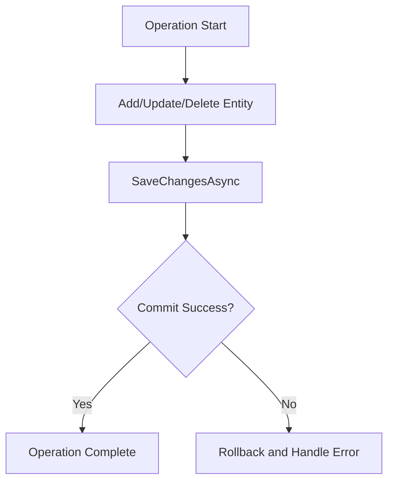

**Diagram sources**
- [ProjectRepository.cs:13-23](file://Services.Services.Infrastructure.Repositories.ProjectRepository.cs#L13-L23)
- [ProjectRepository.cs:60-74](file://Services.Services.Infrastructure.Repositories.ProjectRepository.cs#L60-L74)

**Section sources**
- [ProjectRepository.cs:13-23](file://Services.Services.Infrastructure.Repositories.ProjectRepository.cs#L13-L23)
- [ProjectRepository.cs:60-74](file://Services.Services.Infrastructure.Repositories.ProjectRepository.cs#L60-L74)

### Dependency Injection Configuration
- ProjectService depends on IProjectRepository.
- ProjectRepository depends on AppDbContext.
- Controllers depend on IProjectService and ITaskService.
- The infrastructure layer registers these dependencies (registration code is outside the analyzed files).

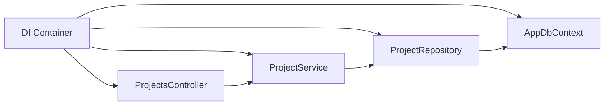

**Diagram sources**
- [ProjectsController.cs:15-18](file://Services.Services.Api.Controllers.ProjectsController.cs#L15-L18)
- [ProjectService.cs:11-13](file://Services.Services.Application.Services.ProjectService.cs#L11-L13)
- [ProjectRepository.cs:9-11](file://Services.Services.Infrastructure.Repositories.ProjectRepository.cs#L9-L11)
- [AppDbContext.cs:10-23](file://Services.Services.Infrastructure.Persistence.AppDbContext.cs#L10-L23)

**Section sources**
- [ProjectsController.cs:15-18](file://Services.Services.Api.Controllers.ProjectsController.cs#L15-L18)
- [ProjectService.cs:11-13](file://Services.Services.Application.Services.ProjectService.cs#L11-L13)
- [ProjectRepository.cs:9-11](file://Services.Services.Infrastructure.Repositories.ProjectRepository.cs#L9-L11)
- [AppDbContext.cs:10-23](file://Services.Services.Infrastructure.Persistence.AppDbContext.cs#L10-L23)

### Project Creation Workflow with Validation
Steps:
1. Controller receives CreateProjectRequest.
2. Extracts current user ID from JWT claims.
3. Calls ProjectService.CreateAsync.
4. Service validates user ID and constructs ProjectName.
5. Creates Project domain entity.
6. Persists via repository.
7. Maps to ProjectResponse and returns 201 Created.

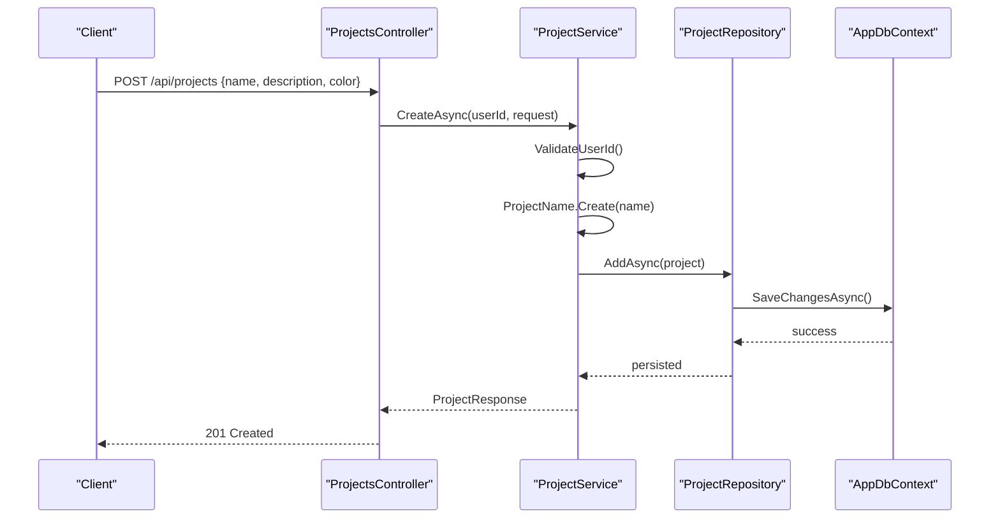

**Diagram sources**
- [ProjectsController.cs:20-43](file://Services.Services.Api.Controllers.ProjectsController.cs#L20-L43)
- [ProjectService.cs:15-38](file://Services.Services.Application.Services.ProjectService.cs#L15-L38)
- [ProjectRepository.cs:13-23](file://Services.Services.Infrastructure.Repositories.ProjectRepository.cs#L13-L23)
- [AppDbContext.cs:10-23](file://Services.Services.Infrastructure.Persistence.AppDbContext.cs#L10-L23)

**Section sources**
- [ProjectsController.cs:20-43](file://Services.Services.Api.Controllers.ProjectsController.cs#L20-L43)
- [ProjectService.cs:15-38](file://Services.Services.Application.Services.ProjectService.cs#L15-L38)
- [CreateProjectRequest.cs:3-7](file://Services.Services.Application.DTOs.Projects.CreateProjectRequest.cs#L3-L7)

### Project Updates with Partial Data
Behavior:
- UpdateAsync requires valid identifiers and ownership.
- ProjectName is validated and normalized.
- Project.UpdateDetails applies new name, description, and color.
- Repository persists changes via SaveChangesAsync.

Notes:
- The current implementation always expects a name field in UpdateProjectRequest; partial updates without a name will fail validation.
- Color and description are optional in terms of being nullable but still undergo validation.

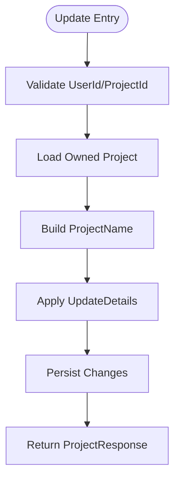

**Diagram sources**
- [ProjectService.cs:70-99](file://Services.Services.Application.Services.ProjectService.cs#L70-L99)
- [ProjectRepository.cs:60-65](file://Services.Services.Infrastructure.Repositories.ProjectRepository.cs#L60-L65)

**Section sources**
- [ProjectService.cs:70-99](file://Services.Services.Application.Services.ProjectService.cs#L70-L99)
- [UpdateProjectRequest.cs:3-7](file://Services.Services.Application.DTOs.Projects.UpdateProjectRequest.cs#L3-L7)

### Project Deletion with Cascade Effects
Behavior:
- DeleteAsync validates identifiers and ensures ownership.
- Checks if project has associated tasks; if yes, throws InvalidOperationException.
- Deletes project only if no tasks exist.

Cascade effects:
- No automatic cascade deletion is implemented in the service; it explicitly prevents deletion when tasks exist.
- Database-level cascade policies are not shown in the analyzed files; the service enforces this rule.

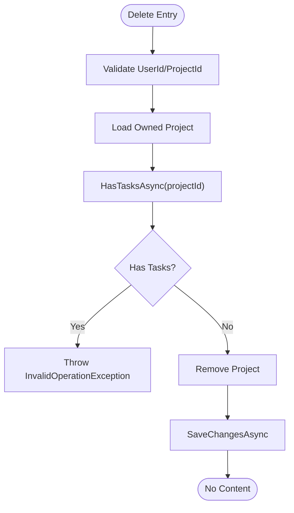

**Diagram sources**
- [ProjectService.cs:101-127](file://Services.Services.Application.Services.ProjectService.cs#L101-L127)
- [ProjectRepository.cs:49-58](file://Services.Services.Infrastructure.Repositories.ProjectRepository.cs#L49-L58)

**Section sources**
- [ProjectService.cs:101-127](file://Services.Services.Application.Services.ProjectService.cs#L101-L127)
- [ProjectRepository.cs:49-58](file://Services.Services.Infrastructure.Repositories.ProjectRepository.cs#L49-L58)

### Project Summary Calculations
Behavior:
- GetSummaryAsync validates identifiers and ensures ownership.
- Retrieves task counts grouped by status for the given project and user.
- Computes total tasks, completed tasks (status Done), pending tasks, and progress percentage rounded to two decimals.

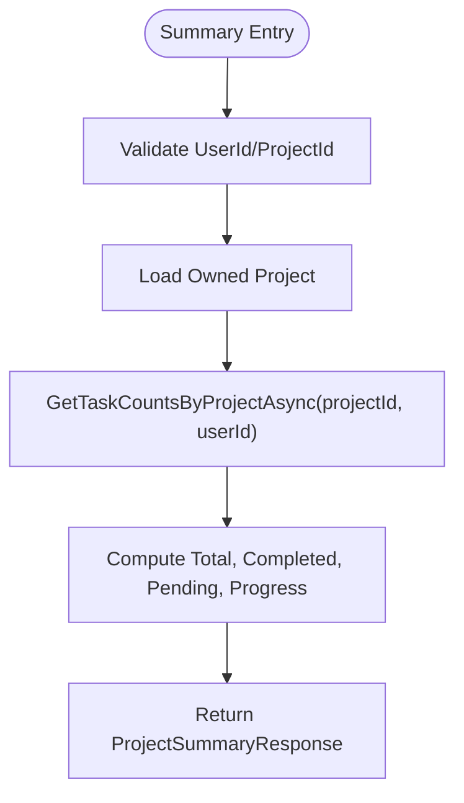

**Diagram sources**
- [ProjectService.cs:181-231](file://Services.Services.Application.Services.ProjectService.cs#L181-L231)
- [ProjectRepository.cs:76-96](file://Services.Services.Infrastructure.Repositories.ProjectRepository.cs#L76-L96)

**Section sources**
- [ProjectService.cs:181-231](file://Services.Services.Application.Services.ProjectService.cs#L181-L231)
- [ProjectRepository.cs:76-96](file://Services.Services.Infrastructure.Repositories.ProjectRepository.cs#L76-L96)

### Search and Filter Operations
- GetAllAsync retrieves all projects owned by the user, ordered by name.
- Task filtering is delegated to TaskService via controller endpoint GET /api/projects/{id}/tasks.
- ProjectService itself does not implement search/filter beyond listing by owner.

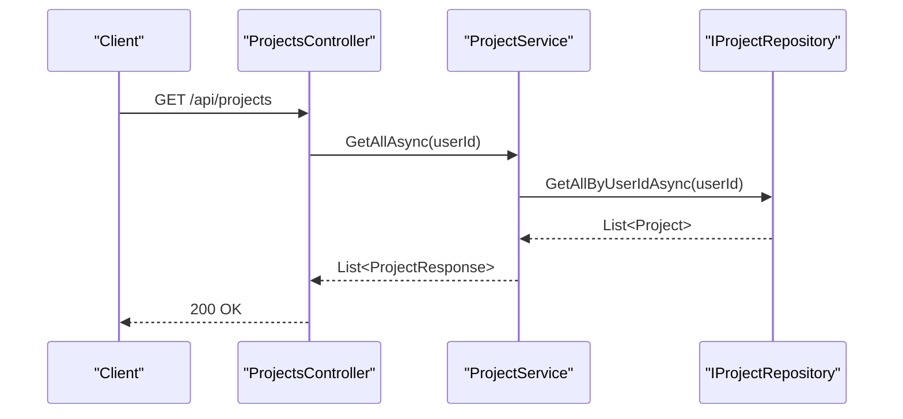

**Diagram sources**
- [ProjectsController.cs:45-53](file://Services.Services.Api.Controllers.ProjectsController.cs#L45-L53)
- [ProjectService.cs:40-52](file://Services.Services.Application.Services.ProjectService.cs#L40-L52)
- [ProjectRepository.cs:25-34](file://Services.Services.Infrastructure.Repositories.ProjectRepository.cs#L25-L34)

**Section sources**
- [ProjectService.cs:40-52](file://Services.Services.Application.Services.ProjectService.cs#L40-L52)
- [ProjectRepository.cs:25-34](file://Services.Services.Infrastructure.Repositories.ProjectRepository.cs#L25-L34)
- [ProjectsController.cs:45-53](file://Services.Services.Api.Controllers.ProjectsController.cs#L45-L53)

## Dependency Analysis
Relationships:
- ProjectsController depends on IProjectService and ITaskService.
- ProjectService depends on IProjectRepository.
- ProjectRepository depends on AppDbContext.
- Domain entities and value objects are consumed by services and repositories.

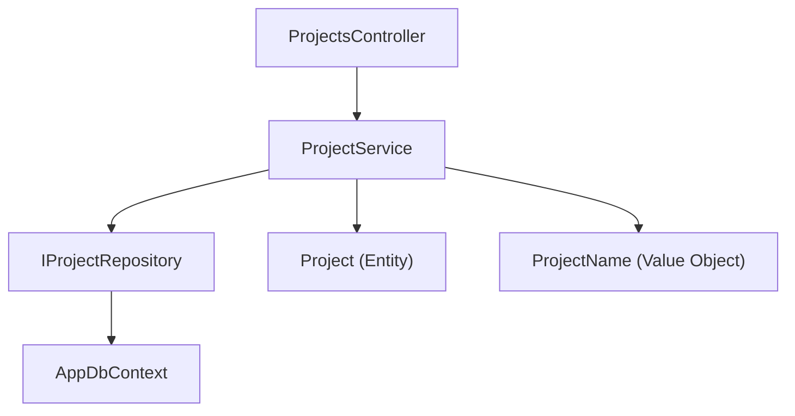

**Diagram sources**
- [ProjectsController.cs:15-18](file://Services.Services.Api.Controllers.ProjectsController.cs#L15-L18)
- [ProjectService.cs:11-13](file://Services.Services.Application.Services.ProjectService.cs#L11-L13)
- [IProjectRepository.cs:6-37](file://Services.Services.Application.Interfaces.Repositories.IProjectRepository.cs#L6-L37)
- [ProjectRepository.cs:9-11](file://Services.Services.Infrastructure.Repositories.ProjectRepository.cs#L9-L11)
- [AppDbContext.cs:10-23](file://Services.Services.Infrastructure.Persistence.AppDbContext.cs#L10-L23)
- [Project.cs:5-22](file://Services.Services.Domain.Entities.Project.cs#L5-L22)
- [ProjectName.cs:3-36](file://Services.Services.Domain.ValueObjects.ProjectName.cs#L3-L36)

**Section sources**
- [ProjectsController.cs:15-18](file://Services.Services.Api.Controllers.ProjectsController.cs#L15-L18)
- [ProjectService.cs:11-13](file://Services.Services.Application.Services.ProjectService.cs#L11-L13)
- [IProjectRepository.cs:6-37](file://Services.Services.Application.Interfaces.Repositories.IProjectRepository.cs#L6-L37)
- [ProjectRepository.cs:9-11](file://Services.Services.Infrastructure.Repositories.ProjectRepository.cs#L9-L11)
- [AppDbContext.cs:10-23](file://Services.Services.Infrastructure.Persistence.AppDbContext.cs#L10-L23)
- [Project.cs:5-22](file://Services.Services.Domain.Entities.Project.cs#L5-L22)
- [ProjectName.cs:3-36](file://Services.Services.Domain.ValueObjects.ProjectName.cs#L3-L36)

## Performance Considerations
- Use AsNoTracking for read-only queries to improve performance (already applied in GetAllByUserIdAsync and GetTaskCountsByProjectAsync).
- Avoid loading unnecessary navigation properties; repository queries select only needed fields.
- For large project collections:
  - Consider pagination at the repository level.
  - Cache frequently accessed summaries using an in-memory cache or distributed cache.
  - Precompute and store summary metrics if real-time calculation becomes a bottleneck.
- Indexing:
  - Ensure database indexes on UserId and ProjectId columns to optimize ownership checks and task existence queries.
- Concurrency:
  - Use optimistic concurrency tokens if concurrent updates are expected.
- Caching strategies:
  - Cache project summaries keyed by projectId and userId.
  - Invalidate cache on project/task mutations.

[No sources needed since this section provides general guidance]

## Troubleshooting Guide
Common issues and resolutions:
- Validation errors:
  - Empty or invalid user/project identifiers result in ValidationException. Ensure GUIDs are correctly provided.
  - Invalid project names exceed maximum length or are empty; normalize and trim names.
- Not found errors:
  - KeyNotFoundException indicates project does not exist or does not belong to the user. Verify ownership and correct IDs.
- Deletion conflicts:
  - InvalidOperationException occurs when attempting to delete a project with associated tasks. Remove or reassign tasks first.
- Summary calculation errors:
  - ArgumentException indicates missing required parameters. Provide both userId and projectId.

API error mappings:
- BadRequest for ValidationException and ArgumentException.
- NotFound for KeyNotFoundException.
- Conflict for InvalidOperationException.

**Section sources**
- [ProjectService.cs:145-167](file://Services.Services.Application.Services.ProjectService.cs#L145-L167)
- [ProjectService.cs:181-231](file://Services.Services.Application.Services.ProjectService.cs#L181-L231)
- [ProjectsController.cs:20-43](file://Services.Services.Api.Controllers.ProjectsController.cs#L20-L43)
- [ProjectsController.cs:55-76](file://Services.Services.Api.Controllers.ProjectsController.cs#L55-L76)
- [ProjectsController.cs:105-128](file://Services.Services.Api.Controllers.ProjectsController.cs#L105-L128)
- [ProjectsController.cs:130-157](file://Services.Services.Api.Controllers.ProjectsController.cs#L130-L157)
- [ProjectsController.cs:175-198](file://Services.Services.Api.Controllers.ProjectsController.cs#L175-L198)

## Conclusion
ProjectService encapsulates robust project management logic with clear separation of concerns across layers. It enforces strong validation via value objects, ensures ownership and permissions, handles errors consistently, and leverages EF Core for persistence. For scalability, adopt pagination, caching, and indexing strategies. The API controller maps exceptions to appropriate HTTP responses, providing a predictable client experience.

[No sources needed since this section summarizes without analyzing specific files]