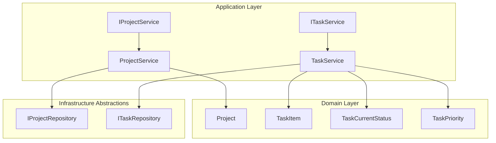
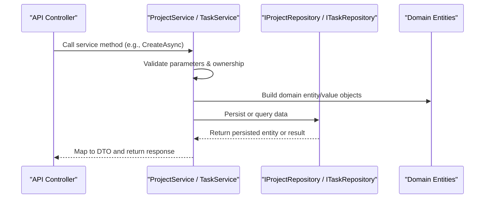
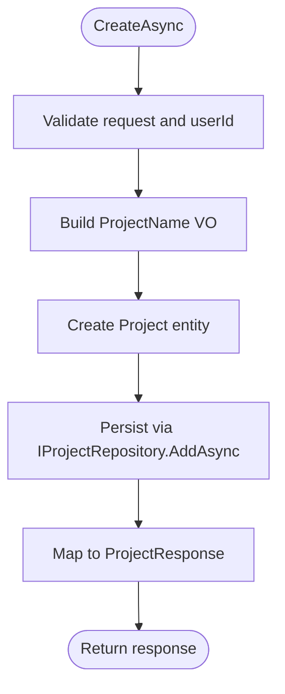
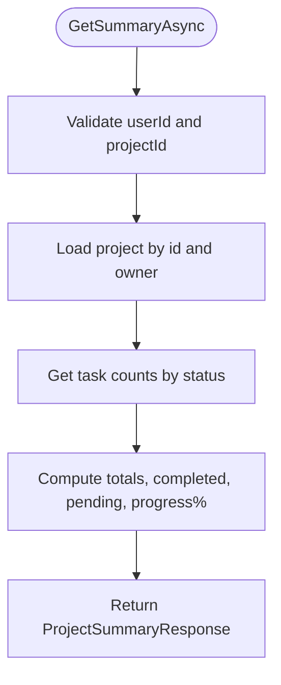
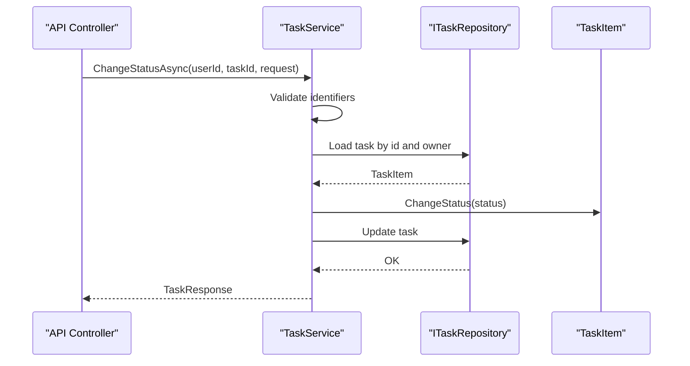
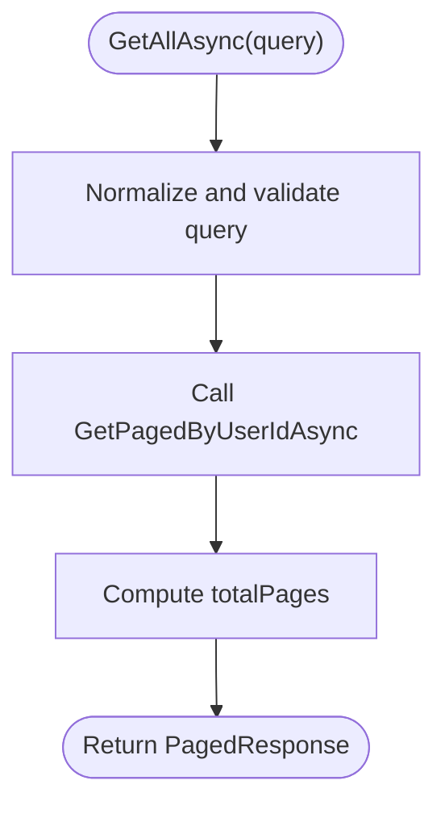
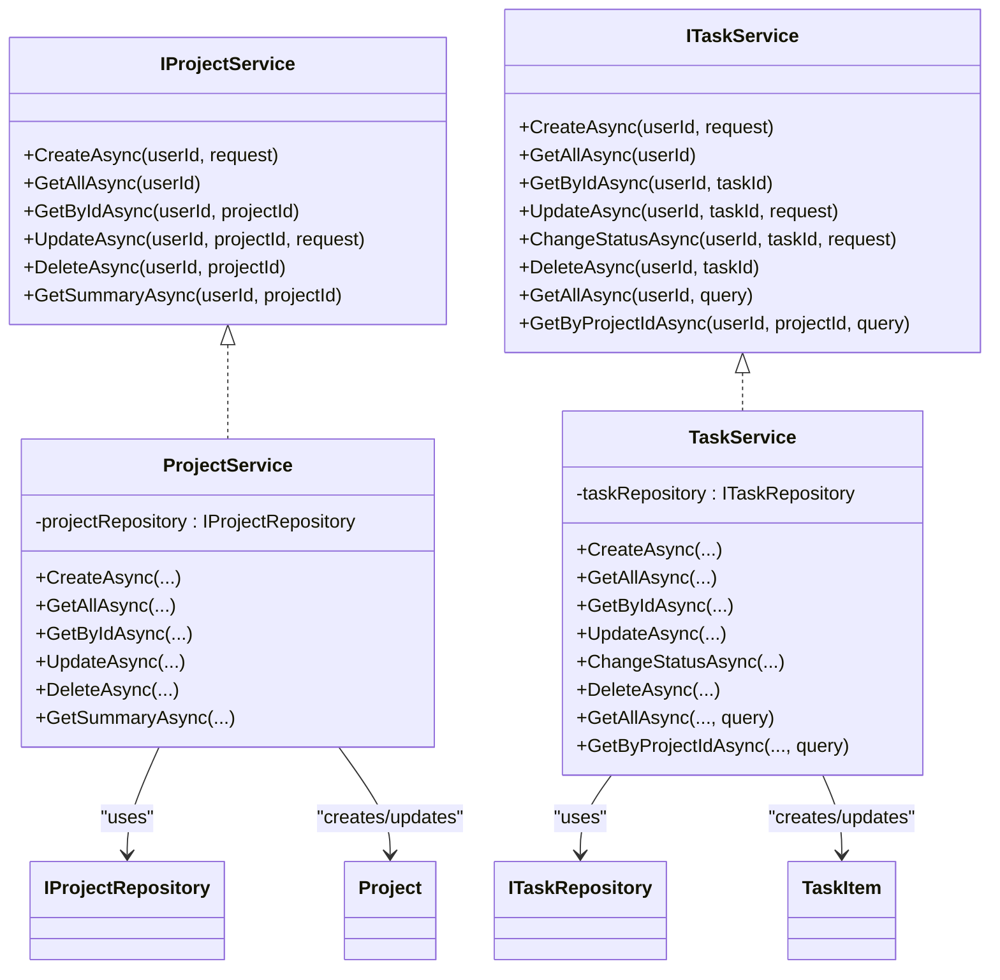

# Services

<cite>
**Referenced Files in This Document**
- [ProjectService.cs](file://Services/Services.Application/Services/ProjectService.cs)
- [TaskService.cs](file://Services/Services.Application/Services/TaskService.cs)
- [IProjectService.cs](file://Services/Services.Application/Interfaces/Services/IProjectService.cs)
- [ITaskService.cs](file://Services/Services.Application/Interfaces/Services/ITaskService.cs)
- [IProjectRepository.cs](file://Services/Services.Application/Interfaces/Repositories/IProjectRepository.cs)
- [ITaskRepository.cs](file://Services/Services.Application/Interfaces/Repositories/ITaskRepository.cs)
- [Project.cs](file://Services/Services.Domain/Entities/Project.cs)
- [TaskItem.cs](file://Services/Services.Domain/Entities/TaskItem.cs)
- [TaskCurrentStatus.cs](file://Services/Services.Domain/Enums/TaskCurrentStatus.cs)
- [TaskPriority.cs](file://Services/Services.Domain/Enums/TaskPriority.cs)
- [CreateProjectRequest.cs](file://Services/Services.Application/DTOs/Projects/CreateProjectRequest.cs)
- [UpdateProjectRequest.cs](file://Services/Services.Application/DTOs/Projects/UpdateProjectRequest.cs)
- [CreateTaskRequest.cs](file://Services/Services.Application/DTOs/Tasks/CreateTaskRequest.cs)
- [UpdateTaskRequest.cs](file://Services/Services.Application/DTOs/Tasks/UpdateTaskRequest.cs)
- [ChangeTaskStatusRequest.cs](file://Services/Services.Application/DTOs/Tasks/ChangeTaskStatusRequest.cs)
- [TaskQueryRequest.cs](file://Services/Services.Application/DTOs/Tasks/TaskQueryRequest.cs)
</cite>

## Table of Contents
1. [Introduction](#introduction)
2. [Project Structure](#project-structure)
3. [Core Components](#core-components)
4. [Architecture Overview](#architecture-overview)
5. [Detailed Component Analysis](#detailed-component-analysis)
6. [Dependency Analysis](#dependency-analysis)
7. [Performance Considerations](#performance-considerations)
8. [Troubleshooting Guide](#troubleshooting-guide)
9. [Conclusion](#conclusion)

## Introduction
This document explains the Application Layer services implementation for Projects and Tasks. It focuses on the ProjectService and TaskService classes, their business logic orchestration, method implementations, validation rules, error handling, and interaction patterns with repositories. It also documents public APIs, parameter validation, transactional considerations, and common workflows such as creating a project with tasks, transitioning task statuses, and computing project summaries.

## Project Structure
The Application Layer defines service interfaces and implementations that coordinate domain entities and repository abstractions:
- Interfaces define contracts for services and repositories.
- Implementations encapsulate business rules, validation, and mapping to DTOs.
- Domain entities enforce value object constraints and state transitions.

**Diagram sources**
- [IProjectService.cs:5-36](file://Services/Services.Application/Interfaces/Services/IProjectService.cs#L5-L36)
- [ProjectService.cs:11-233](file://Services/Services.Application/Services/ProjectService.cs#L11-L233)
- [ITaskService.cs:6-49](file://Services/Services.Application/Interfaces/Services/ITaskService.cs#L6-L49)
- [TaskService.cs:12-412](file://Services/Services.Application/Services/TaskService.cs#L12-L412)
- [Project.cs:5-121](file://Services/Services.Domain/Entities/Project.cs#L5-L121)
- [TaskItem.cs:6-128](file://Services/Services.Domain/Entities/TaskItem.cs#L6-L128)
- [TaskCurrentStatus.cs:3-8](file://Services/Services.Domain/Enums/TaskCurrentStatus.cs#L3-L8)
- [TaskPriority.cs:3-9](file://Services/Services.Domain/Enums/TaskPriority.cs#L3-L9)
- [IProjectRepository.cs:6-37](file://Services/Services.Application/Interfaces/Repositories/IProjectRepository.cs#L6-L37)
- [ITaskRepository.cs:6-44](file://Services/Services.Application/Interfaces/Repositories/ITaskRepository.cs#L6-L44)

**Section sources**
- [ProjectService.cs:11-233](file://Services/Services.Application/Services/ProjectService.cs#L11-L233)
- [TaskService.cs:12-412](file://Services/Services.Application/Services/TaskService.cs#L12-L412)

## Core Components
- ProjectService implements IProjectService and orchestrates project lifecycle operations (create, read, update, delete, summary).
- TaskService implements ITaskService and orchestrates task lifecycle operations (create, read, update, delete, status change, search/filter/pagination).
- Both services validate inputs, enforce business rules via domain entities/value objects, and delegate persistence to repositories.

Key responsibilities:
- Parameter validation and normalization.
- Ownership checks (userId-based scoping).
- Business rule enforcement through domain entities.
- Mapping between domain models and DTOs.
- Error signaling via exceptions.

**Section sources**
- [IProjectService.cs:5-36](file://Services/Services.Application/Interfaces/Services/IProjectService.cs#L5-L36)
- [ITaskService.cs:6-49](file://Services/Services.Application/Interfaces/Services/ITaskService.cs#L6-L49)
- [ProjectService.cs:11-233](file://Services/Services.Application/Services/ProjectService.cs#L11-L233)
- [TaskService.cs:12-412](file://Services/Services.Application/Services/TaskService.cs#L12-L412)

## Architecture Overview
The services layer sits between controllers and repositories, enforcing business rules and coordinating data flow.

**Diagram sources**
- [ProjectService.cs:15-38](file://Services/Services.Application/Services/ProjectService.cs#L15-L38)
- [TaskService.cs:16-48](file://Services/Services.Application/Services/TaskService.cs#L16-L48)
- [IProjectRepository.cs:8-37](file://Services/Services.Application/Interfaces/Repositories/IProjectRepository.cs#L8-L37)
- [ITaskRepository.cs:8-44](file://Services/Services.Application/Interfaces/Repositories/ITaskRepository.cs#L8-L44)

## Detailed Component Analysis

### ProjectService
Public methods:
- CreateAsync(userId, request): Validates userId and request; constructs ProjectName and Project; persists via repository; returns ProjectResponse.
- GetAllAsync(userId): Returns all projects owned by userId.
- GetByIdAsync(userId, projectId): Enforces ownership and returns project details.
- UpdateAsync(userId, projectId, request): Loads owned project, updates name/description/color via domain method, persists, and returns updated response.
- DeleteAsync(userId, projectId): Ensures no associated tasks exist before deletion; otherwise throws an error.
- GetSummaryAsync(userId, projectId): Computes total/completed/pending tasks and progress percentage using repository counts.

Validation and business rules:
- UserId must be non-empty.
- ProjectId must be non-empty where required.
- Project creation/update uses ProjectName value object and Project.UpdateDetails.
- Deletion is blocked if the project has tasks.

Error handling:
- ValidationException for invalid identifiers.
- KeyNotFoundException when project not found or not owned.
- InvalidOperationException when attempting to delete a project with tasks.

Transaction management:
- No explicit transactions are managed within the service; each repository call is independent. If atomicity across multiple writes is needed, consider wrapping calls at the infrastructure or use case boundary.

**Diagram sources**
- [ProjectService.cs:15-38](file://Services/Services.Application/Services/ProjectService.cs#L15-L38)
- [Project.cs:51-64](file://Services/Services.Domain/Entities/Project.cs#L51-L64)

**Section sources**
- [ProjectService.cs:15-233](file://Services/Services.Application/Services/ProjectService.cs#L15-L233)
- [IProjectService.cs:5-36](file://Services/Services.Application/Interfaces/Services/IProjectService.cs#L5-L36)
- [IProjectRepository.cs:6-37](file://Services/Services.Application/Interfaces/Repositories/IProjectRepository.cs#L6-L37)
- [Project.cs:5-121](file://Services/Services.Domain/Entities/Project.cs#L5-L121)
- [CreateProjectRequest.cs:3-7](file://Services/Services.Application/DTOs/Projects/CreateProjectRequest.cs#L3-L7)
- [UpdateProjectRequest.cs:3-7](file://Services/Services.Application/DTOs/Projects/UpdateProjectRequest.cs#L3-L7)

#### Project Summary Calculation Flow

**Diagram sources**
- [ProjectService.cs:181-231](file://Services/Services.Application/Services/ProjectService.cs#L181-L231)
- [IProjectRepository.cs:33-36](file://Services/Services.Application/Interfaces/Repositories/IProjectRepository.cs#L33-L36)
- [TaskCurrentStatus.cs:3-8](file://Services/Services.Domain/Enums/TaskCurrentStatus.cs#L3-L8)

### TaskService
Public methods:
- CreateAsync(userId, request): Validates userId and request; builds TaskTitle and optional TaskDescription; validates priority; ensures project ownership if provided; creates TaskItem; persists; returns TaskResponse.
- GetAllAsync(userId): Returns all tasks owned by userId.
- GetByIdAsync(userId, taskId): Enforces ownership and returns task details.
- UpdateAsync(userId, taskId, request): Loads owned task, updates title/description/priority/due date; reassigns project if changed; persists; returns updated response.
- ChangeStatusAsync(userId, taskId, request): Loads owned task, changes status via domain method, persists, and returns updated response.
- DeleteAsync(userId, taskId): Deletes owned task.
- GetAllAsync(userId, query): Paginated, filtered, and sorted list of tasks for userId.
- GetByProjectIdAsync(userId, projectId, query): Paginated, filtered, and sorted tasks for a specific project owned by userId.

Validation and business rules:
- UserId must be non-empty.
- Title is mandatory; description is optional but normalized.
- Priority must be valid enum.
- Project existence and ownership are validated when provided.
- Query normalization enforces page/pageSize bounds, allowed sort fields, and direction.

Error handling:
- ValidationException for invalid inputs and query parameters.
- KeyNotFoundException when task/project not found or not owned.

Transaction management:
- No explicit transactions; each repository operation is independent.

**Diagram sources**
- [TaskService.cs:121-142](file://Services/Services.Application/Services/TaskService.cs#L121-L142)
- [TaskItem.cs:103-115](file://Services/Services.Domain/Entities/TaskItem.cs#L103-L115)
- [ITaskRepository.cs:16-23](file://Services/Services.Application/Interfaces/Repositories/ITaskRepository.cs#L16-L23)

**Section sources**
- [TaskService.cs:16-412](file://Services/Services.Application/Services/TaskService.cs#L16-L412)
- [ITaskService.cs:6-49](file://Services/Services.Application/Interfaces/Services/ITaskService.cs#L6-L49)
- [ITaskRepository.cs:6-44](file://Services/Services.Application/Interfaces/Repositories/ITaskRepository.cs#L6-L44)
- [TaskItem.cs:6-128](file://Services/Services.Domain/Entities/TaskItem.cs#L6-L128)
- [TaskPriority.cs:3-9](file://Services/Services.Domain/Enums/TaskPriority.cs#L3-L9)
- [CreateTaskRequest.cs:5-10](file://Services/Services.Application/DTOs/Tasks/CreateTaskRequest.cs#L5-L10)
- [UpdateTaskRequest.cs:5-10](file://Services/Services.Application/DTOs/Tasks/UpdateTaskRequest.cs#L5-L10)
- [ChangeTaskStatusRequest.cs:5-6](file://Services/Services.Application/DTOs/Tasks/ChangeTaskStatusRequest.cs#L5-L6)
- [TaskQueryRequest.cs:5-20](file://Services/Services.Application/DTOs/Tasks/TaskQueryRequest.cs#L5-L20)

#### Task Search and Pagination Flow

**Diagram sources**
- [TaskService.cs:160-187](file://Services/Services.Application/Services/TaskService.cs#L160-L187)
- [TaskService.cs:318-393](file://Services/Services.Application/Services/TaskService.cs#L318-L393)

## Dependency Analysis
Service-to-repository and service-to-domain relationships:

**Diagram sources**
- [IProjectService.cs:5-36](file://Services/Services.Application/Interfaces/Services/IProjectService.cs#L5-L36)
- [ProjectService.cs:11-233](file://Services/Services.Application/Services/ProjectService.cs#L11-L233)
- [ITaskService.cs:6-49](file://Services/Services.Application/Interfaces/Services/ITaskService.cs#L6-L49)
- [TaskService.cs:12-412](file://Services/Services.Application/Services/TaskService.cs#L12-L412)
- [IProjectRepository.cs:6-37](file://Services/Services.Application/Interfaces/Repositories/IProjectRepository.cs#L6-L37)
- [ITaskRepository.cs:6-44](file://Services/Services.Application/Interfaces/Repositories/ITaskRepository.cs#L6-L44)
- [Project.cs:5-121](file://Services/Services.Domain/Entities/Project.cs#L5-L121)
- [TaskItem.cs:6-128](file://Services/Services.Domain/Entities/TaskItem.cs#L6-L128)

**Section sources**
- [ProjectService.cs:11-233](file://Services/Services.Application/Services/ProjectService.cs#L11-L233)
- [TaskService.cs:12-412](file://Services/Services.Application/Services/TaskService.cs#L12-L412)
- [IProjectRepository.cs:6-37](file://Services/Services.Application/Interfaces/Repositories/IProjectRepository.cs#L6-L37)
- [ITaskRepository.cs:6-44](file://Services/Services.Application/Interfaces/Repositories/ITaskRepository.cs#L6-L44)

## Performance Considerations
- Use pagination for large task sets to avoid loading entire collections into memory.
- Prefer repository methods that filter by userId to minimize unnecessary data transfer.
- Avoid repeated lookups; cache derived values only if appropriate and consistent with ownership rules.
- Keep DTO mappings lightweight; avoid heavy transformations inside hot paths.

[No sources needed since this section provides general guidance]

## Troubleshooting Guide
Common errors and resolutions:
- Invalid user identifier: Ensure userId is a valid GUID and corresponds to the authenticated user.
- Invalid project/task identifiers: Verify IDs are non-empty and belong to the requesting user.
- Attempting to delete a project with tasks: Remove or reassign tasks first.
- Invalid priority/status: Confirm enum values match defined options.
- Query validation failures: Ensure page >= 1, pageSize in [1, 100], sortBy in allowed set, and SortDirection is asc/desc.

Where these are enforced:
- ProjectService: identifier validation, project existence, deletion guard.
- TaskService: identifier validation, project existence, priority/status validation, query normalization.

**Section sources**
- [ProjectService.cs:145-167](file://Services/Services.Application/Services/ProjectService.cs#L145-L167)
- [ProjectService.cs:101-127](file://Services/Services.Application/Services/ProjectService.cs#L101-L127)
- [TaskService.cs:285-316](file://Services/Services.Application/Services/TaskService.cs#L285-L316)
- [TaskService.cs:318-393](file://Services/Services.Application/Services/TaskService.cs#L318-L393)

## Conclusion
ProjectService and TaskService provide clear, validated, and testable orchestration of business operations over domain entities and repository abstractions. They enforce ownership, validate inputs, apply domain rules, and map results to DTOs. For complex multi-step operations requiring atomicity, consider introducing transaction boundaries at the application or infrastructure layer. The documented workflows and error strategies should guide correct usage and troubleshooting.