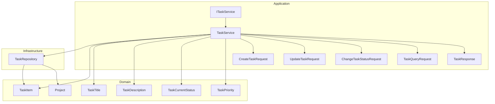
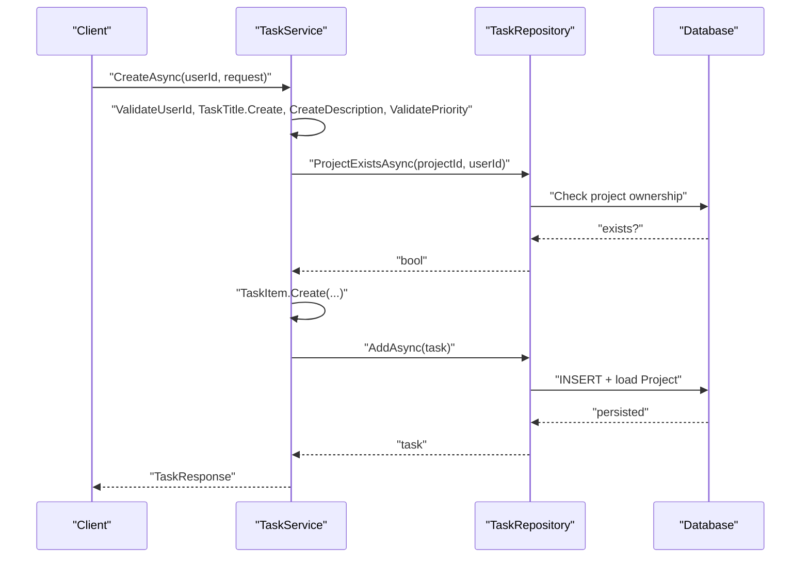
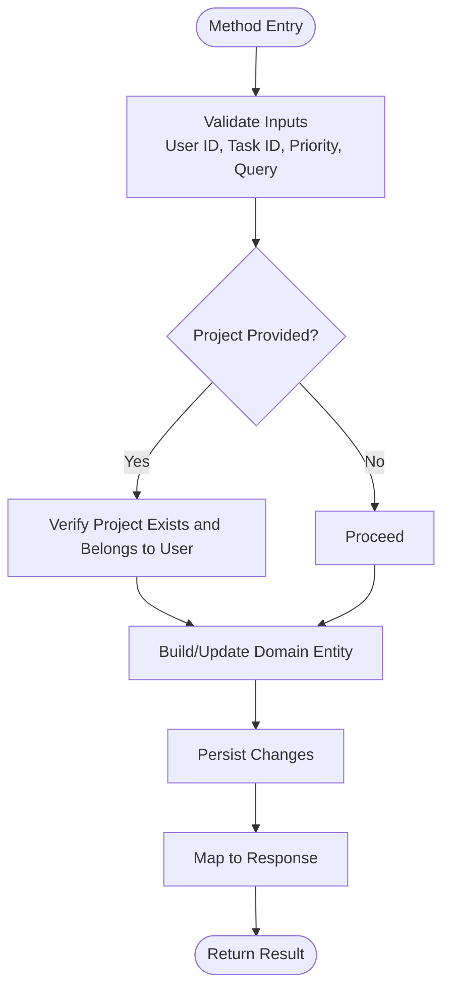
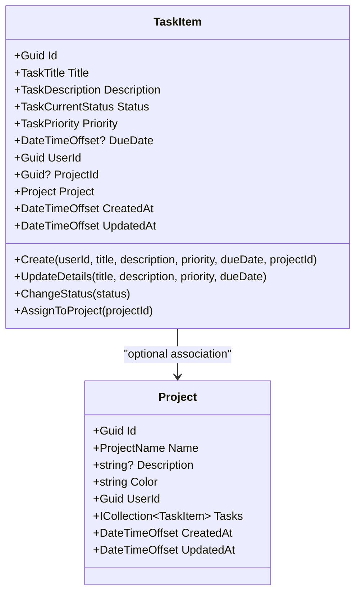
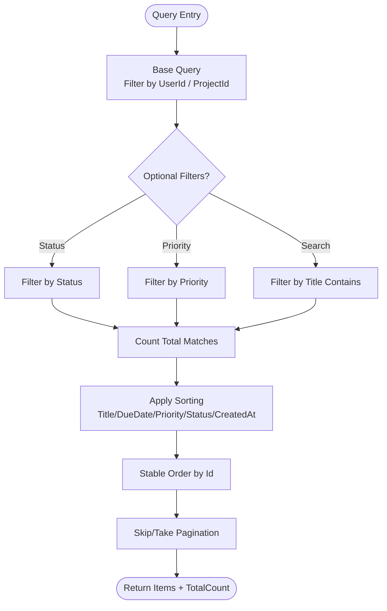
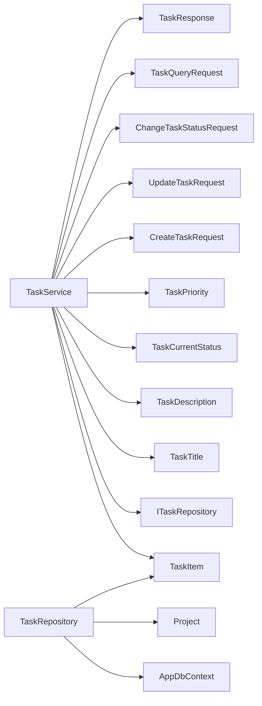

# Task Service

<cite>
**Referenced Files in This Document**
- [TaskService.cs](file://Services.Services.Application/Services/TaskService.cs)
- [ITaskService.cs](file://Services.Services.Application/Interfaces/Services/ITaskService.cs)
- [TaskItem.cs](file://Services.Services.Domain/Entities/TaskItem.cs)
- [Project.cs](file://Services.Services.Domain/Entities/Project.cs)
- [TaskTitle.cs](file://Services.Services.Domain/ValueObjects/TaskTitle.cs)
- [TaskDescription.cs](file://Services.Services.Domain/ValueObjects/TaskDescription.cs)
- [TaskCurrentStatus.cs](file://Services.Services.Domain/Enums/TaskCurrentStatus.cs)
- [TaskPriority.cs](file://Services.Services.Domain/Enums/TaskPriority.cs)
- [CreateTaskRequest.cs](file://Services.Services.Application/DTOs/Tasks/CreateTaskRequest.cs)
- [UpdateTaskRequest.cs](file://Services.Services.Application/DTOs/Tasks/UpdateTaskRequest.cs)
- [ChangeTaskStatusRequest.cs](file://Services.Services.Application/DTOs/Tasks/ChangeTaskStatusRequest.cs)
- [TaskQueryRequest.cs](file://Services.Services.Application/DTOs/Tasks/TaskQueryRequest.cs)
- [TaskResponse.cs](file://Services.Services.Application/DTOs/Tasks/TaskResponse.cs)
- [TaskRepository.cs](file://Services.Services.Infrastructure/Repositories/TaskRepository.cs)
</cite>

## Table of Contents
1. [Introduction](#introduction)
2. [Project Structure](#project-structure)
3. [Core Components](#core-components)
4. [Architecture Overview](#architecture-overview)
5. [Detailed Component Analysis](#detailed-component-analysis)
6. [Dependency Analysis](#dependency-analysis)
7. [Performance Considerations](#performance-considerations)
8. [Troubleshooting Guide](#troubleshooting-guide)
9. [Conclusion](#conclusion)

## Introduction
This document provides a comprehensive guide to the TaskService implementation for task management. It explains how tasks are created, updated, deleted, and filtered; how business rules such as status transitions, priority validation, due date constraints, and project ownership verification are enforced; and how errors are handled. It also covers transactional behavior, performance optimizations for filtered queries, and practical usage scenarios including assignment to projects, deadline management, and bulk status updates.

## Project Structure
The TaskService lives in the application layer and orchestrates domain logic using value objects, entities, enums, DTOs, and repositories:
- Application layer: service interface and implementation, DTOs
- Domain layer: entities (TaskItem, Project), value objects (TaskTitle, TaskDescription), enums (TaskCurrentStatus, TaskPriority)
- Infrastructure layer: repository implementing data access with Entity Framework Core

**Diagram sources**
- [ITaskService.cs:6-49](file://Services.Services.Application/Interfaces/Services/ITaskService.cs#L6-L49)
- [TaskService.cs:12-410](file://Services.Services.Application/Services/TaskService.cs#L12-L410)
- [TaskItem.cs:6-128](file://Services.Services.Domain/Entities/TaskItem.cs#L6-L128)
- [Project.cs:5-121](file://Services.Services.Domain/Entities/Project.cs#L5-L121)
- [TaskTitle.cs:3-36](file://Services.Services.Domain/ValueObjects/TaskTitle.cs#L3-L36)
- [TaskDescription.cs:3-30](file://Services.Services.Domain/ValueObjects/TaskDescription.cs#L3-L30)
- [TaskCurrentStatus.cs:3-9](file://Services.Services.Domain/Enums/TaskCurrentStatus.cs#L3-L9)
- [TaskPriority.cs:3-10](file://Services.Services.Domain/Enums/TaskPriority.cs#L3-L10)
- [CreateTaskRequest.cs:5-10](file://Services.Services.Application/DTOs/Tasks/CreateTaskRequest.cs#L5-L10)
- [UpdateTaskRequest.cs:5-10](file://Services.Services.Application/DTOs/Tasks/UpdateTaskRequest.cs#L5-L10)
- [ChangeTaskStatusRequest.cs:5-6](file://Services.Services.Application/DTOs/Tasks/ChangeTaskStatusRequest.cs#L5-L6)
- [TaskQueryRequest.cs:5-20](file://Services.Services.Application/DTOs/Tasks/TaskQueryRequest.cs#L5-L20)
- [TaskResponse.cs:5-16](file://Services.Services.Application/DTOs/Tasks/TaskResponse.cs#L5-L16)
- [TaskRepository.cs:9-239](file://Services.Services.Infrastructure/Repositories/TaskRepository.cs#L9-L239)

**Section sources**
- [TaskService.cs:12-410](file://Services.Services.Application/Services/TaskService.cs#L12-L410)
- [TaskRepository.cs:9-239](file://Services.Services.Infrastructure/Repositories/TaskRepository.cs#L9-L239)

## Core Components
- TaskService: Implements ITaskService and encapsulates task creation, retrieval, update, deletion, status change, and filtering workflows.
- TaskItem: Domain entity representing a task with title, description, status, priority, due date, user/project ownership, and timestamps.
- Value Objects: TaskTitle and TaskDescription enforce normalization and length constraints.
- Enums: TaskCurrentStatus defines allowed statuses; TaskPriority defines allowed priorities.
- DTOs: Request/response types for API boundaries.
- TaskRepository: Data access abstraction over EF Core, providing CRUD and filtered/paged queries.

Key responsibilities:
- Validate inputs via value objects and explicit checks.
- Enforce business rules (e.g., project ownership).
- Coordinate persistence through the repository.
- Map domain models to response DTOs.

**Section sources**
- [TaskService.cs:12-410](file://Services.Services.Application/Services/TaskService.cs#L12-L410)
- [TaskItem.cs:6-128](file://Services.Services.Domain/Entities/TaskItem.cs#L6-L128)
- [TaskTitle.cs:3-36](file://Services.Services.Domain/ValueObjects/TaskTitle.cs#L3-L36)
- [TaskDescription.cs:3-30](file://Services.Services.Domain/ValueObjects/TaskDescription.cs#L3-L30)
- [TaskCurrentStatus.cs:3-9](file://Services.Services.Domain/Enums/TaskCurrentStatus.cs#L3-L9)
- [TaskPriority.cs:3-10](file://Services.Services.Domain/Enums/TaskPriority.cs#L3-L10)
- [TaskRepository.cs:9-239](file://Services.Services.Infrastructure/Repositories/TaskRepository.cs#L9-L239)

## Architecture Overview
The TaskService coordinates request handling, validation, and persistence. It uses value objects to ensure valid titles and descriptions, validates priorities and project ownership, and delegates data operations to TaskRepository.

**Diagram sources**
- [TaskService.cs:16-48](file://Services.Services.Application/Services/TaskService.cs#L16-L48)
- [TaskRepository.cs:13-23](file://Services.Services.Infrastructure/Repositories/TaskRepository.cs#L13-L23)

## Detailed Component Analysis

### TaskService: Business Logic and Workflows
- CreateAsync: Validates user ID, constructs TaskTitle and optional TaskDescription, validates priority, verifies project ownership, creates TaskItem, persists it, and returns a response.
- GetAllAsync: Retrieves all tasks for a user and maps them to responses.
- GetByIdAsync: Ensures identifiers are valid, loads the owned task, and returns a response.
- UpdateAsync: Loads the owned task, validates new title/description/priority, verifies project ownership, updates details and project assignment, persists changes, and returns a response.
- ChangeStatusAsync: Loads the owned task, applies the requested status, persists changes, and returns a response.
- DeleteAsync: Loads the owned task and deletes it.
- GetAllAsync (paged): Normalizes query parameters, filters by status/priority/search, sorts, paginates, and returns a paged response.
- GetByProjectIdAsync: Validates project ownership, normalizes query, filters tasks by project and user, and returns a paged response.

Validation helpers:
- ValidateUserId: Rejects empty GUIDs.
- ValidateIdentifiers: Validates both user and task IDs.
- ValidatePriority: Ensures enum values are defined.
- ValidateAndNormalizeQuery: Validates page/pageSize bounds, search length, status/priority enums, allowed sort fields, and direction; trims and normalizes inputs.

Project ownership verification:
- ValidateProjectAsync: If a project ID is provided, ensures it exists and belongs to the user; otherwise throws appropriate exceptions.

Mapping:
- MapToResponse: Converts TaskItem to TaskResponse, including project name and color when available.

Error handling:
- ValidationException for invalid input or business rule violations.
- KeyNotFoundException for missing resources (task or project).

Transaction management:
- Each operation performs a single database write via repository methods. Complex multi-step transactions are not explicitly wrapped at the service level; atomicity relies on repository-level SaveChanges calls.

**Diagram sources**
- [TaskService.cs:16-48](file://Services.Services.Application/Services/TaskService.cs#L16-L48)
- [TaskService.cs:80-118](file://Services.Services.Application/Services/TaskService.cs#L80-L118)
- [TaskService.cs:121-142](file://Services.Services.Application/Services/TaskService.cs#L121-L142)
- [TaskService.cs:160-187](file://Services.Services.Application/Services/TaskService.cs#L160-L187)
- [TaskService.cs:189-232](file://Services.Services.Application/Services/TaskService.cs#L189-L232)
- [TaskService.cs:250-274](file://Services.Services.Application/Services/TaskService.cs#L250-L274)

**Section sources**
- [TaskService.cs:16-410](file://Services.Services.Application/Services/TaskService.cs#L16-L410)

### TaskItem: Domain Rules and State Management
- Creation: Requires non-empty user ID, valid priority, and a TaskTitle; sets default status Todo and timestamps.
- UpdateDetails: Validates title and priority, updates fields, and refreshes UpdatedAt.
- ChangeStatus: Validates status enum and updates state; refreshes UpdatedAt.
- AssignToProject: Updates project association; refreshes UpdatedAt.

Note: The current implementation does not enforce strict workflow transitions (e.g., Todo → InProgress → Done); any valid status can be assigned.

**Diagram sources**
- [TaskItem.cs:6-128](file://Services.Services.Domain/Entities/TaskItem.cs#L6-L128)
- [Project.cs:5-121](file://Services.Services.Domain/Entities/Project.cs#L5-L121)

**Section sources**
- [TaskItem.cs:6-128](file://Services.Services.Domain/Entities/TaskItem.cs#L6-L128)

### Value Objects: TaskTitle and TaskDescription
- TaskTitle:
  - MaxLength: 200 characters.
  - Create: Trims input, enforces non-null/non-whitespace, and rejects exceeding length.
- TaskDescription:
  - MaxLength: 2000 characters.
  - Create: Trims input and rejects exceeding length.

These value objects centralize validation and normalization, ensuring consistent data integrity across the system.

**Section sources**
- [TaskTitle.cs:3-36](file://Services.Services.Domain/ValueObjects/TaskTitle.cs#L3-L36)
- [TaskDescription.cs:3-30](file://Services.Services.Domain/ValueObjects/TaskDescription.cs#L3-L30)

### Enums: TaskCurrentStatus and TaskPriority
- TaskCurrentStatus: Todo, InProgress, Done.
- TaskPriority: Low, Medium, High, Urgent.

The service validates these enums during creation/update and query normalization.

**Section sources**
- [TaskCurrentStatus.cs:3-9](file://Services.Services.Domain/Enums/TaskCurrentStatus.cs#L3-L9)
- [TaskPriority.cs:3-10](file://Services.Services.Domain/Enums/TaskPriority.cs#L3-L10)

### DTOs: Requests and Responses
- CreateTaskRequest: Contains Title, Description, Priority, DueDate, ProjectId.
- UpdateTaskRequest: Same fields as CreateTaskRequest for updates.
- ChangeTaskStatusRequest: Contains Status.
- TaskQueryRequest: Supports Page, PageSize, Status, Priority, Search, SortBy, SortDirection.
- TaskResponse: Exposes task fields plus project metadata.

These DTOs define the contract between the service and callers.

**Section sources**
- [CreateTaskRequest.cs:5-10](file://Services.Services.Application/DTOs/Tasks/CreateTaskRequest.cs#L5-L10)
- [UpdateTaskRequest.cs:5-10](file://Services.Services.Application/DTOs/Tasks/UpdateTaskRequest.cs#L5-L10)
- [ChangeTaskStatusRequest.cs:5-6](file://Services.Services.Application/DTOs/Tasks/ChangeTaskStatusRequest.cs#L5-L6)
- [TaskQueryRequest.cs:5-20](file://Services.Services.Application/DTOs/Tasks/TaskQueryRequest.cs#L5-L20)
- [TaskResponse.cs:5-16](file://Services.Services.Application/DTOs/Tasks/TaskResponse.cs#L5-L16)

### Repository: Data Access and Filtering
TaskRepository implements efficient querying:
- AddAsync: Inserts task and eagerly loads Project reference.
- GetAllByUserIdAsync: Returns tasks ordered by due date and creation time.
- GetByIdAsync: Returns a task if it belongs to the user.
- UpdateAsync/DeleteAsync: Persists changes or removes entities.
- ProjectExistsAsync: Verifies project ownership.
- GetPagedByUserIdAsync/GetPagedByProjectIdAsync: Applies filters (status, priority, search), sorting (title, dueDate, priority, status, createdAt), stable ordering by Id, and pagination.

**Diagram sources**
- [TaskRepository.cs:82-157](file://Services.Services.Infrastructure/Repositories/TaskRepository.cs#L82-L157)
- [TaskRepository.cs:159-237](file://Services.Services.Infrastructure/Repositories/TaskRepository.cs#L159-L237)

**Section sources**
- [TaskRepository.cs:9-239](file://Services.Services.Infrastructure/Repositories/TaskRepository.cs#L9-L239)

## Dependency Analysis
- TaskService depends on:
  - ITaskRepository for data operations.
  - Domain entities and value objects for business logic.
  - DTOs for input/output contracts.
- TaskRepository depends on:
  - AppDbContext (EF Core) for persistence.
  - Domain entities for mapping and querying.

Coupling and cohesion:
- TaskService has high cohesion around task lifecycle operations.
- Coupling to infrastructure is minimized via repository abstraction.

Potential circular dependencies:
- None observed; layers are clearly separated.

External dependencies:
- Entity Framework Core for database interactions.

Interface contracts:
- ITaskService defines method signatures and return types.
- TaskRepository implements data access patterns expected by the service.

**Diagram sources**
- [ITaskService.cs:6-49](file://Services.Services.Application/Interfaces/Services/ITaskService.cs#L6-L49)
- [TaskService.cs:12-410](file://Services.Services.Application/Services/TaskService.cs#L12-L410)
- [TaskRepository.cs:9-239](file://Services.Services.Infrastructure/Repositories/TaskRepository.cs#L9-L239)

**Section sources**
- [TaskService.cs:12-410](file://Services.Services.Application/Services/TaskService.cs#L12-L410)
- [TaskRepository.cs:9-239](file://Services.Services.Infrastructure/Repositories/TaskRepository.cs#L9-L239)

## Performance Considerations
- AsNoTracking: Read-only queries use AsNoTracking to avoid change tracking overhead.
- Selective Includes: Project is included where needed to avoid N+1 issues while minimizing payload size.
- Efficient Filtering: Filters are applied server-side before pagination to reduce memory usage.
- Stable Ordering: A final ThenBy(Id) ensures deterministic pagination results.
- Query Normalization: Allowed sort fields and directions prevent dynamic SQL injection risks and optimize execution plans.
- Pagination Bounds: PageSize is constrained to 1–100 to prevent excessive data transfer.

[No sources needed since this section provides general guidance]

## Troubleshooting Guide
Common errors and their causes:
- Invalid user ID: Occurs when an empty GUID is passed; validated by ValidateUserId.
- Invalid task ID: Occurs when updating/deleting/changing status with an empty task ID; validated by ValidateIdentifiers.
- Invalid priority: Occurs when an undefined TaskPriority is used; validated by ValidatePriority and domain constructors.
- Invalid status: Occurs when an undefined TaskCurrentStatus is used; validated by domain ChangeStatus.
- Project not found or unauthorized: Occurs when project ID is invalid or does not belong to the user; validated by ValidateProjectAsync and ProjectExistsAsync.
- Query parameter violations: Occurs when page/pageSize out of range, search exceeds limit, or unsupported sort field/direction is provided; validated by ValidateAndNormalizeQuery.

Resolution steps:
- Ensure user and task IDs are valid GUIDs.
- Use only defined enum values for priority and status.
- Confirm project ownership before assigning tasks.
- Normalize and constrain query parameters according to service rules.

**Section sources**
- [TaskService.cs:285-393](file://Services.Services.Application/Services/TaskService.cs#L285-L393)
- [TaskRepository.cs:69-80](file://Services.Services.Infrastructure/Repositories/TaskRepository.cs#L69-L80)

## Conclusion
The TaskService provides robust task management functionality with clear separation of concerns, strong validation via value objects, and efficient data access through the repository. While it enforces input validation and project ownership, it does not currently implement strict workflow transitions for task statuses. For advanced scenarios like strict status transitions, additional domain rules should be added to TaskItem.ChangeStatus. The repository’s filtering and sorting mechanisms offer scalable performance for large datasets, and error handling strategies provide clear feedback for invalid inputs and authorization failures.

[No sources needed since this section summarizes without analyzing specific files]