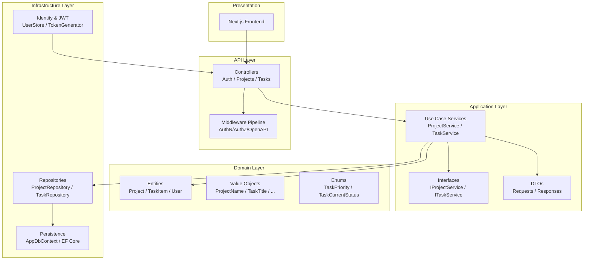
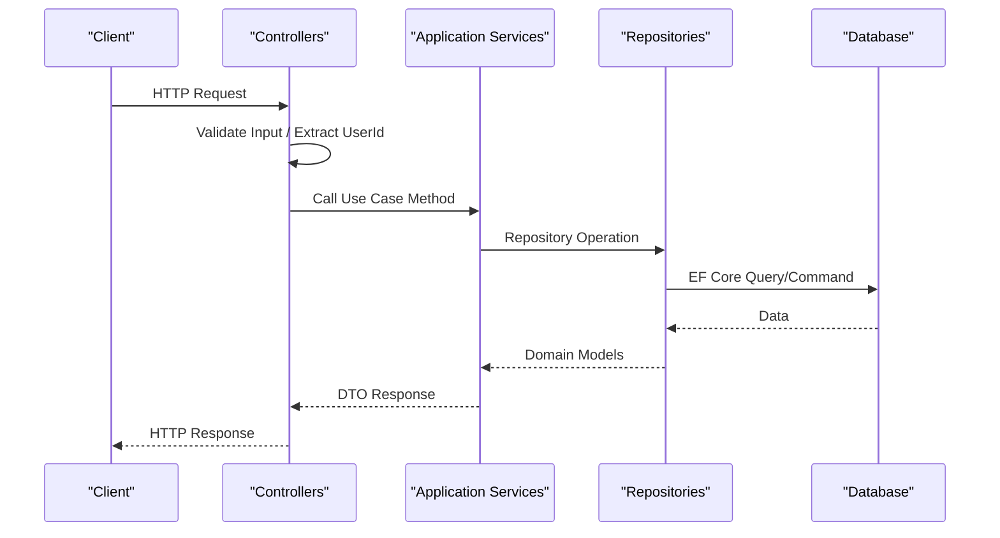
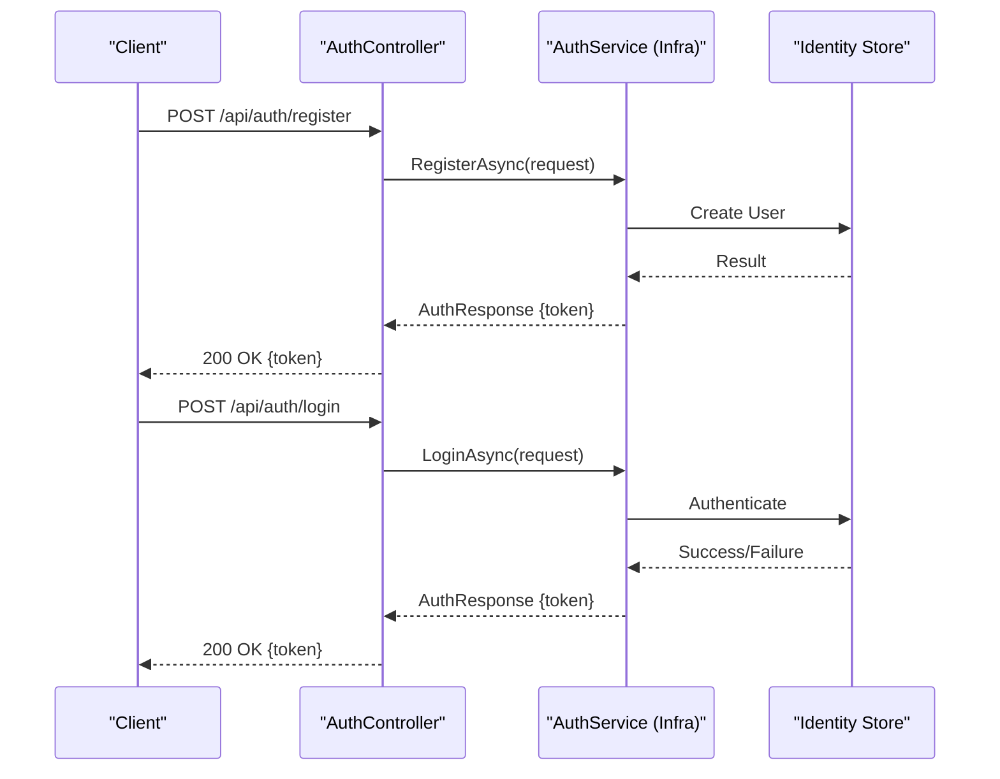
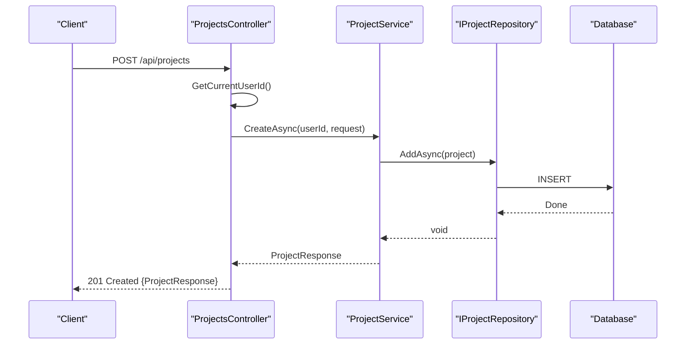
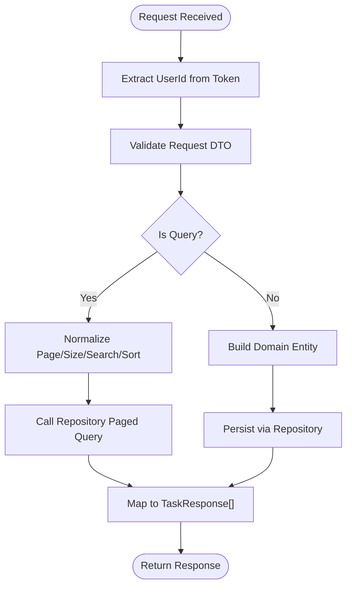
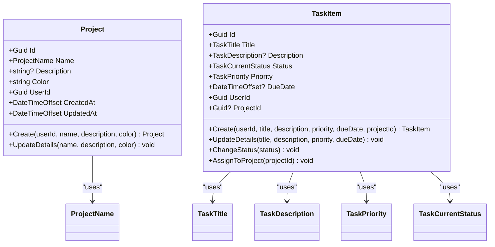
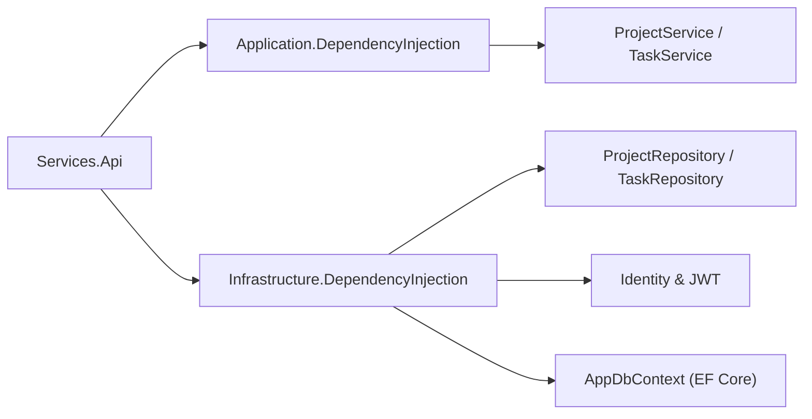

# Architecture Overview

<cite>
**Referenced Files in This Document**
- [Program.cs](file://Services/Services.Api/Program.cs)
- [DependencyInjection.cs (Application)](file://Services/Services.Application/DependencyInjection.cs)
- [DependencyInjection.cs (Infrastructure)](file://Services/Services.Infrastructure/DependencyInjection.cs)
- [AuthController.cs](file://Services/Services.Api/Controllers/AuthController.cs)
- [ProjectsController.cs](file://Services/Services.Api/Controllers/ProjectsController.cs)
- [TasksController.cs](file://Services/Services.Api/Controllers/TasksController.cs)
- [ProjectService.cs](file://Services/Services.Application/Services/ProjectService.cs)
- [TaskService.cs](file://Services/Services.Application/Services/TaskService.cs)
- [ProjectRepository.cs](file://Services/Services.Infrastructure/Repositories/ProjectRepository.cs)
- [Project.cs](file://Services/Services.Domain/Entities/Project.cs)
- [TaskItem.cs](file://Services/Services.Domain/Entities/TaskItem.cs)
</cite>

## Table of Contents
1. Introduction
2. Project Structure
3. Core Components
4. Architecture Overview
5. Detailed Component Analysis
6. Dependency Analysis
7. Performance Considerations
8. Troubleshooting Guide
9. Conclusion

## Introduction
This document explains TaskFlow’s Clean Architecture implementation across four layers: Presentation (Next.js frontend), Application (.NET services and use cases), Domain (business entities and value objects), and Infrastructure (data access, identity, and configuration). It describes architectural patterns (Repository, DTO, Value Object, Factory), component interactions, data flows from client requests to database operations, cross-cutting concerns (authentication, authorization, error handling), and technical decisions for layer separation and dependency injection.

## Project Structure
The backend is organized into distinct projects by layer:
- Services.Api: HTTP controllers, OpenAPI setup, middleware pipeline, and application startup.
- Services.Application: Use case services, interfaces, DTOs, and service registration.
- Services.Domain: Entities, enums, and value objects with business rules.
- Services.Infrastructure: Persistence (EF Core), Identity/JWT, repository implementations, and infrastructure DI.

**Diagram sources**
- [Program.cs:6-37](file://Services/Services.Api/Program.cs#L6-L37)
- [DependencyInjection.cs (Application):7-18](file://Services/Services.Application/DependencyInjection.cs#L7-L18)
- [DependencyInjection.cs (Infrastructure):17-127](file://Services/Services.Infrastructure/DependencyInjection.cs#L17-L127)

**Section sources**
- [Program.cs:6-37](file://Services/Services.Api/Program.cs#L6-L37)
- [DependencyInjection.cs (Application):7-18](file://Services/Services.Application/DependencyInjection.cs#L7-L18)
- [DependencyInjection.cs (Infrastructure):17-127](file://Services/Services.Infrastructure/DependencyInjection.cs#L17-L127)

## Core Components
- API Controllers: Thin endpoints that validate input, extract the authenticated user ID, delegate to application services, and map results to DTOs.
- Application Services: Encapsulate business workflows, enforce invariants via domain entities/value objects, coordinate repositories, and project domain models to DTOs.
- Domain Entities and Value Objects: Represent core business concepts with encapsulated behavior and validation; factories create valid instances.
- Infrastructure Repositories: Implement persistence using EF Core against a PostgreSQL database, exposing domain-centric queries.
- Identity and JWT: Configure ASP.NET Identity and JWT Bearer authentication; tokens carry the user identifier claim used throughout the app.

Key responsibilities:
- Presentation: Route requests, apply authorization, return standardized responses.
- Application: Orchestrate use cases, validate inputs, enforce business rules, transform between DTOs and domain models.
- Domain: Maintain invariants, encapsulate state transitions, expose factory methods.
- Infrastructure: Provide concrete data access and external integrations (DB, Identity).

**Section sources**
- [AuthController.cs:9-77](file://Services/Services.Api/Controllers/AuthController.cs#L9-L77)
- [ProjectsController.cs:12-198](file://Services/Services.Api/Controllers/ProjectsController.cs#L12-L198)
- [TasksController.cs:11-199](file://Services/Services.Api/Controllers/TasksController.cs#L11-L199)
- [ProjectService.cs:11-233](file://Services/Services.Application/Services/ProjectService.cs#L11-L233)
- [TaskService.cs:12-412](file://Services/Services.Application/Services/TaskService.cs#L12-L412)
- [ProjectRepository.cs:9-97](file://Services/Services.Infrastructure/Repositories/ProjectRepository.cs#L9-L97)
- [Project.cs:5-121](file://Services/Services.Domain/Entities/Project.cs#L5-L121)
- [TaskItem.cs:6-128](file://Services/Services.Domain/Entities/TaskItem.cs#L6-L128)

## Architecture Overview
The system follows Clean Architecture principles:
- Controllers depend only on application interfaces.
- Application services depend on domain entities and repository interfaces.
- Infrastructure implements repository interfaces and persists data via EF Core.
- Domain remains free of framework dependencies.

**Diagram sources**
- [ProjectsController.cs:20-43](file://Services/Services.Api/Controllers/ProjectsController.cs#L20-L43)
- [ProjectService.cs:15-38](file://Services/Services.Application/Services/ProjectService.cs#L15-L38)
- [ProjectRepository.cs:13-23](file://Services/Services.Infrastructure/Repositories/ProjectRepository.cs#L13-L23)

## Detailed Component Analysis

### Authentication Flow
Authentication uses ASP.NET Identity with JWT Bearer tokens. The pipeline enables authentication and authorization, and controllers protect endpoints with [Authorize]. Login registers or authenticates users and returns a token; subsequent requests include the token to access protected resources.

**Diagram sources**
- [AuthController.cs:14-62](file://Services/Services.Api/Controllers/AuthController.cs#L14-L62)
- [DependencyInjection.cs (Infrastructure):31-48](file://Services/Services.Infrastructure/DependencyInjection.cs#L31-L48)
- [DependencyInjection.cs (Infrastructure):84-112](file://Services/Services.Infrastructure/DependencyInjection.cs#L84-L112)

**Section sources**
- [Program.cs:20-35](file://Services/Services.Api/Program.cs#L20-L35)
- [AuthController.cs:14-77](file://Services/Services.Api/Controllers/AuthController.cs#L14-L77)
- [DependencyInjection.cs (Infrastructure):31-112](file://Services/Services.Infrastructure/DependencyInjection.cs#L31-L112)

### Projects API Workflow
The Projects controller exposes CRUD endpoints and task listing per project. Each endpoint extracts the authenticated user ID, delegates to ProjectService, and maps domain results to DTOs.

**Diagram sources**
- [ProjectsController.cs:20-43](file://Services/Services.Api/Controllers/ProjectsController.cs#L20-L43)
- [ProjectService.cs:15-38](file://Services/Services.Application/Services/ProjectService.cs#L15-L38)
- [ProjectRepository.cs:13-23](file://Services/Services.Infrastructure/Repositories/ProjectRepository.cs#L13-L23)

**Section sources**
- [ProjectsController.cs:20-198](file://Services/Services.Api/Controllers/ProjectsController.cs#L20-L198)
- [ProjectService.cs:15-233](file://Services/Services.Application/Services/ProjectService.cs#L15-L233)
- [ProjectRepository.cs:13-97](file://Services/Services.Infrastructure/Repositories/ProjectRepository.cs#L13-L97)

### Tasks API Workflow
The Tasks controller provides full CRUD and status change operations, including pagination and filtering. Queries are normalized and validated before being passed to the repository.

**Diagram sources**
- [TasksController.cs:18-47](file://Services/Services.Api/Controllers/TasksController.cs#L18-L47)
- [TaskService.cs:16-48](file://Services/Services.Application/Services/TaskService.cs#L16-L48)
- [TaskService.cs:318-393](file://Services/Services.Application/Services/TaskService.cs#L318-L393)

**Section sources**
- [TasksController.cs:18-199](file://Services/Services.Api/Controllers/TasksController.cs#L18-L199)
- [TaskService.cs:16-412](file://Services/Services.Application/Services/TaskService.cs#L16-L412)

### Domain Model and Patterns
- Factory Pattern: Entities expose static Create methods to ensure valid construction and invariant enforcement.
- Value Object Pattern: Immutable, validated types like ProjectName and TaskTitle encapsulate formatting and constraints.
- Repository Pattern: Application services interact with IProjectRepository/ITaskRepository, decoupled from EF Core.
- DTO Pattern: Requests and responses are separate from domain models to stabilize APIs and reduce coupling.

**Diagram sources**
- [Project.cs:5-121](file://Services/Services.Domain/Entities/Project.cs#L5-L121)
- [TaskItem.cs:6-128](file://Services/Services.Domain/Entities/TaskItem.cs#L6-L128)

**Section sources**
- [Project.cs:5-121](file://Services/Services.Domain/Entities/Project.cs#L5-L121)
- [TaskItem.cs:6-128](file://Services/Services.Domain/Entities/TaskItem.cs#L6-L128)

## Dependency Analysis
Layered dependencies and DI registrations:
- Program.cs wires up controllers, infrastructure, and application layers.
- Application DI registers service interfaces to implementations.
- Infrastructure DI registers DbContext, Identity/JWT, repository interfaces to implementations, and auth services.

**Diagram sources**
- [Program.cs:6-18](file://Services/Services.Api/Program.cs#L6-L18)
- [DependencyInjection.cs (Application):7-18](file://Services/Services.Application/DependencyInjection.cs#L7-L18)
- [DependencyInjection.cs (Infrastructure):17-127](file://Services/Services.Infrastructure/DependencyInjection.cs#L17-L127)

**Section sources**
- [Program.cs:6-37](file://Services/Services.Api/Program.cs#L6-L37)
- [DependencyInjection.cs (Application):7-18](file://Services/Services.Application/DependencyInjection.cs#L7-L18)
- [DependencyInjection.cs (Infrastructure):17-127](file://Services/Services.Infrastructure/DependencyInjection.cs#L17-L127)

## Performance Considerations
- Read-only queries use AsNoTracking to avoid change tracking overhead.
- Pagination and normalization prevent excessive payloads and invalid sorting/filtering.
- Group-by aggregations compute summary metrics efficiently at the database level.
- Avoid unnecessary entity materialization by projecting to DTOs where appropriate.

[No sources needed since this section provides general guidance]

## Troubleshooting Guide
Common issues and resolutions:
- Missing connection string or incomplete JWT configuration: Startup throws explicit errors when required settings are absent or malformed. Ensure DefaultConnection and Jwt sections are correctly configured.
- Invalid or missing user claims: Controllers expect a specific claim for the user ID; if parsing fails, an exception is thrown. Verify token generation includes the expected claim type.
- Validation failures: DTOs and services throw validation exceptions for invalid inputs; clients should handle 400 responses and display messages.
- Not found scenarios: KeyNotFoundExceptions result in 404 responses for missing projects/tasks.

**Section sources**
- [DependencyInjection.cs (Infrastructure):23-29](file://Services/Services.Infrastructure/DependencyInjection.cs#L23-L29)
- [DependencyInjection.cs (Infrastructure):50-82](file://Services/Services.Infrastructure/DependencyInjection.cs#L50-L82)
- [ProjectsController.cs:159-173](file://Services/Services.Api/Controllers/ProjectsController.cs#L159-L173)
- [TasksController.cs:184-198](file://Services/Services.Api/Controllers/TasksController.cs#L184-L198)

## Conclusion
TaskFlow’s architecture cleanly separates concerns across Presentation, Application, Domain, and Infrastructure layers. It leverages established patterns—Repository, DTO, Value Object, and Factory—to maintain testability, clarity, and robustness. Authentication and authorization are integrated via ASP.NET Identity and JWT, while dependency injection ensures loose coupling. The design supports scalable evolution of features and straightforward maintenance.