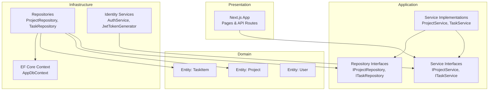
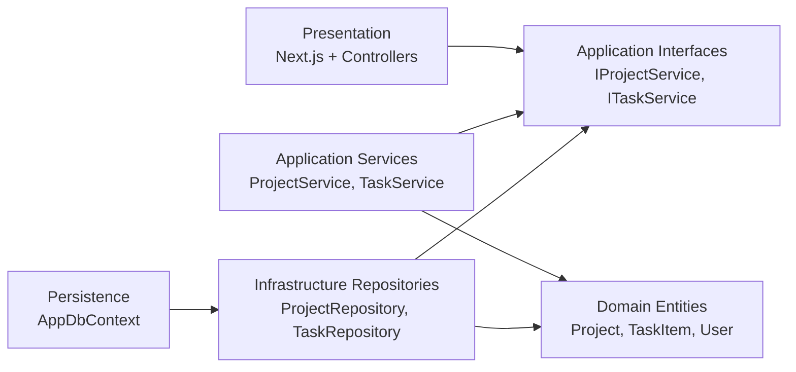
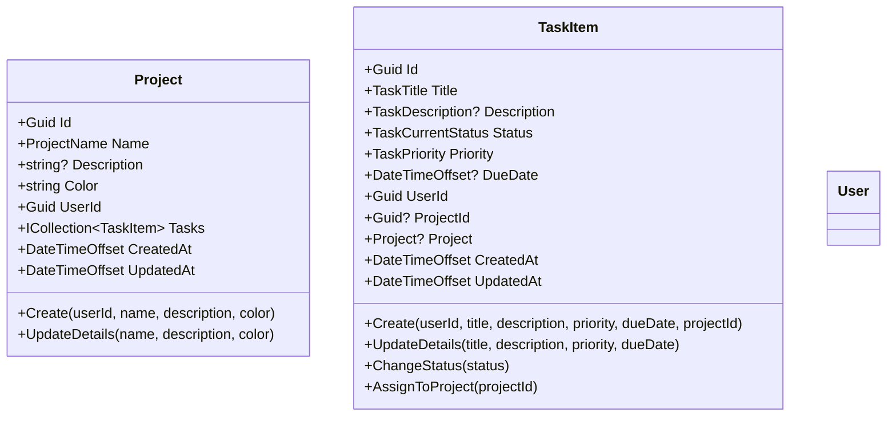
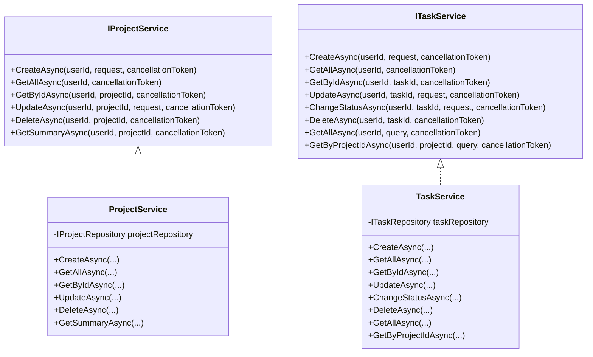
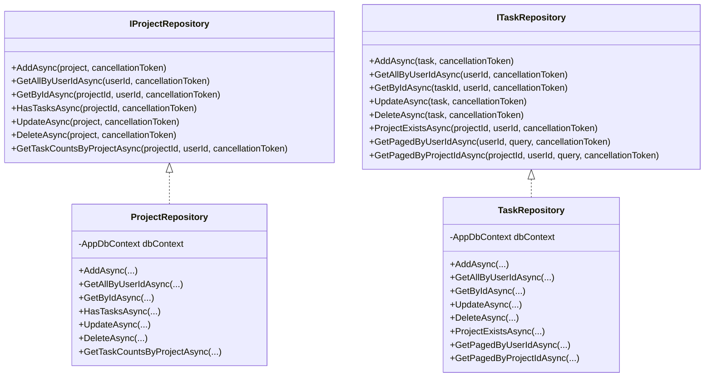
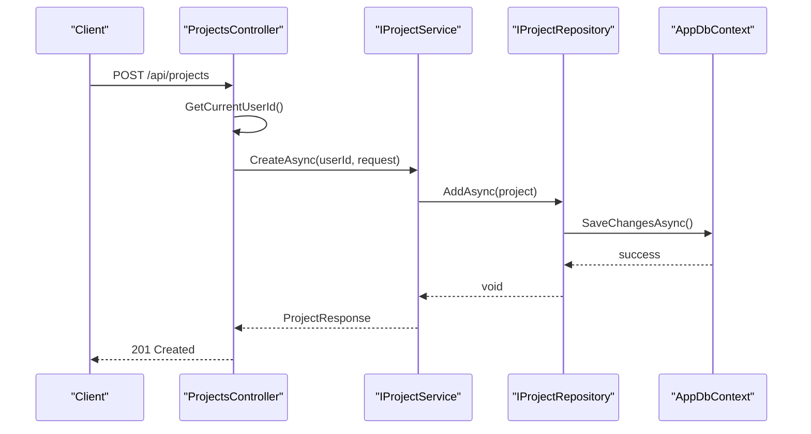
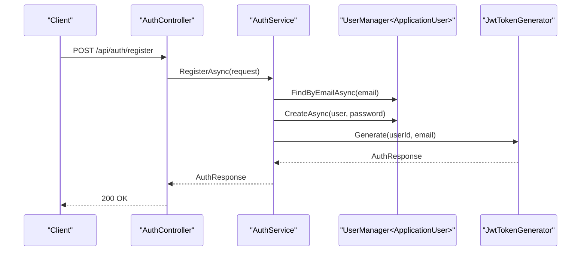
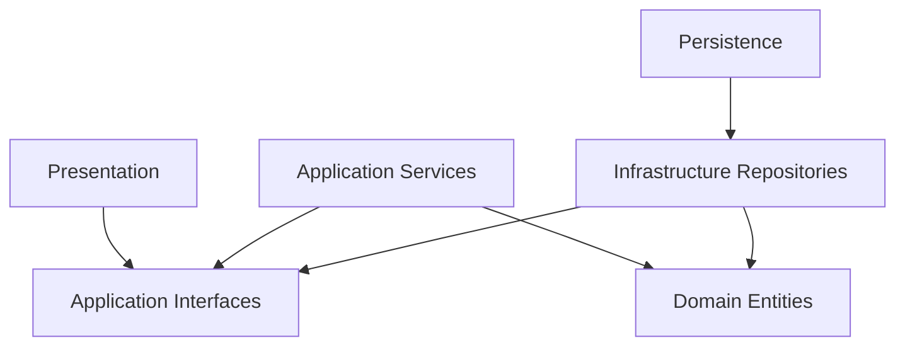
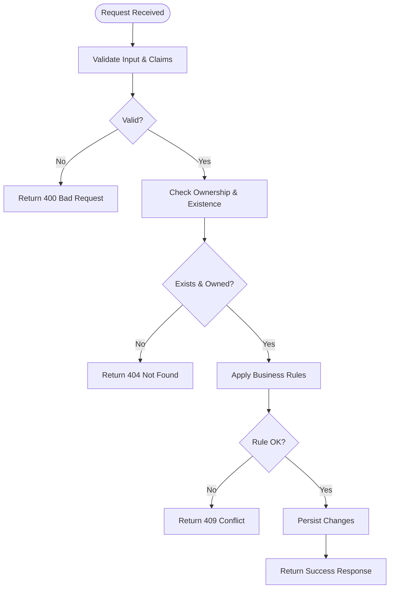

# Clean Architecture Patterns

<cite>
**Referenced Files in This Document**
- [Project.cs](file://Services/Services.Domain/Entities/Project.cs)
- [TaskItem.cs](file://Services/Services.Domain/Entities/TaskItem.cs)
- [User.cs](file://Services/Services.Domain/Entities/User.cs)
- [IProjectService.cs](file://Services/Services.Application/Interfaces/Services/IProjectService.cs)
- [ITaskService.cs](file://Services/Services.Application/Interfaces/Services/ITaskService.cs)
- [IProjectRepository.cs](file://Services/Services.Application/Interfaces/Repositories/IProjectRepository.cs)
- [ITaskRepository.cs](file://Services/Services.Application/Interfaces/Repositories/ITaskRepository.cs)
- [ProjectService.cs](file://Services/Services.Application/Services/ProjectService.cs)
- [TaskService.cs](file://Services/Services.Application/Services/TaskService.cs)
- [ProjectRepository.cs](file://Services/Services.Infrastructure/Repositories/ProjectRepository.cs)
- [TaskRepository.cs](file://Services/Services.Infrastructure/Repositories/TaskRepository.cs)
- [AppDbContext.cs](file://Services/Services.Infrastructure/Persistence/AppDbContext.cs)
- [ProjectsController.cs](file://Services/Services.Api/Controllers/ProjectsController.cs)
- [TasksController.cs](file://Services/Services.Api/Controllers/TasksController.cs)
- [AuthController.cs](file://Services/Services.Api/Controllers/AuthController.cs)
- [AuthService.cs](file://Services/Services.Infrastructure/Identity/AuthService.cs)
- [JwtTokenGenerator.cs](file://Services/Services.Infrastructure/Identity/JwtTokenGenerator.cs)
</cite>

## Table of Contents
1. [Introduction](#introduction)
2. [Project Structure](#project-structure)
3. [Core Components](#core-components)
4. [Architecture Overview](#architecture-overview)
5. [Detailed Component Analysis](#detailed-component-analysis)
6. [Dependency Analysis](#dependency-analysis)
7. [Performance Considerations](#performance-considerations)
8. [Troubleshooting Guide](#troubleshooting-guide)
9. [Conclusion](#conclusion)

## Introduction
This document explains TaskFlow’s Clean Architecture implementation across four layers: Presentation (Next.js frontend), Application (.NET services), Domain (business entities and value objects), and Infrastructure (data access and identity). It focuses on how dependencies flow inward only, ensuring that outer layers depend on inner layers but never the reverse. The architecture separates concerns between UI, business orchestration, domain rules, and persistence, enabling testability, maintainability, and scalability.

## Project Structure
The solution is organized into clear layers:
- Presentation Layer: Next.js application with API routes and pages.
- Application Layer: Use cases and service interfaces; orchestrates domain operations and maps to DTOs.
- Domain Layer: Entities, enums, and value objects encapsulating business rules.
- Infrastructure Layer: Repositories, EF Core context, migrations, and identity components.

**Diagram sources**
- [ProjectsController.cs:15-18](file://Services/Services.Api/Controllers/ProjectsController.cs#L15-L18)
- [TasksController.cs:14-16](file://Services/Services.Api/Controllers/TasksController.cs#L14-L16)
- [IProjectService.cs:5-36](file://Services/Services.Application/Interfaces/Services/IProjectService.cs#L5-L36)
- [ITaskService.cs:6-49](file://Services/Services.Application/Interfaces/Services/ITaskService.cs#L6-L49)
- [IProjectRepository.cs:6-37](file://Services/Services.Application/Interfaces/Repositories/IProjectRepository.cs#L6-L37)
- [ITaskRepository.cs:6-44](file://Services/Services.Application/Interfaces/Repositories/ITaskRepository.cs#L6-L44)
- [ProjectService.cs:11-14](file://Services/Services.Application/Services/ProjectService.cs#L11-L14)
- [TaskService.cs:12-14](file://Services/Services.Application/Services/TaskService.cs#L12-L14)
- [ProjectRepository.cs:9-12](file://Services/Services.Infrastructure/Repositories/ProjectRepository.cs#L9-L12)
- [TaskRepository.cs:9-12](file://Services/Services.Infrastructure/Repositories/TaskRepository.cs#L9-L12)
- [AppDbContext.cs:10-24](file://Services/Services.Infrastructure/Persistence/AppDbContext.cs#L10-L24)
- [AuthService.cs:8-12](file://Services/Services.Infrastructure/Identity/AuthService.cs#L8-L12)

**Section sources**
- [ProjectsController.cs:15-18](file://Services/Services.Api/Controllers/ProjectsController.cs#L15-L18)
- [TasksController.cs:14-16](file://Services/Services.Api/Controllers/TasksController.cs#L14-L16)
- [IProjectService.cs:5-36](file://Services/Services.Application/Interfaces/Services/IProjectService.cs#L5-L36)
- [ITaskService.cs:6-49](file://Services/Services.Application/Interfaces/Services/ITaskService.cs#L6-L49)
- [IProjectRepository.cs:6-37](file://Services/Services.Application/Interfaces/Repositories/IProjectRepository.cs#L6-L37)
- [ITaskRepository.cs:6-44](file://Services/Services.Application/Interfaces/Repositories/ITaskRepository.cs#L6-L44)
- [ProjectService.cs:11-14](file://Services/Services.Application/Services/ProjectService.cs#L11-L14)
- [TaskService.cs:12-14](file://Services/Services.Application/Services/TaskService.cs#L12-L14)
- [ProjectRepository.cs:9-12](file://Services/Services.Infrastructure/Repositories/ProjectRepository.cs#L9-L12)
- [TaskRepository.cs:9-12](file://Services/Services.Infrastructure/Repositories/TaskRepository.cs#L9-L12)
- [AppDbContext.cs:10-24](file://Services/Services.Infrastructure/Persistence/AppDbContext.cs#L10-L24)
- [AuthService.cs:8-12](file://Services/Services.Infrastructure/Identity/AuthService.cs#L8-L12)

## Core Components
- Domain layer defines core business entities and value objects:
  - Project: enforces validation for name, description length, and color format; exposes factory and update methods.
  - TaskItem: encapsulates title, description, priority, status, due date, ownership, project assignment, and lifecycle updates.
  - User: placeholder entity for domain modeling.
- Application layer defines use-case interfaces and implementations:
  - IProjectService and ProjectService: orchestrate project CRUD, summary computation, and authorization checks via repository abstractions.
  - ITaskService and TaskService: orchestrate task CRUD, status changes, pagination, filtering, sorting, and project association checks.
- Infrastructure layer implements repositories and persistence:
  - ProjectRepository and TaskRepository implement repository interfaces using EF Core.
  - AppDbContext configures entity mappings and integrates Identity.
  - AuthService and JwtTokenGenerator handle authentication flows and token issuance.

**Section sources**
- [Project.cs:5-121](file://Services/Services.Domain/Entities/Project.cs#L5-L121)
- [TaskItem.cs:6-128](file://Services/Services.Domain/Entities/TaskItem.cs#L6-L128)
- [User.cs:7-10](file://Services/Services.Domain/Entities/User.cs#L7-L10)
- [IProjectService.cs:5-36](file://Services/Services.Application/Interfaces/Services/IProjectService.cs#L5-L36)
- [ITaskService.cs:6-49](file://Services/Services.Application/Interfaces/Services/ITaskService.cs#L6-L49)
- [ProjectService.cs:11-233](file://Services/Services.Application/Services/ProjectService.cs#L11-L233)
- [TaskService.cs:12-412](file://Services/Services.Application/Services/TaskService.cs#L12-L412)
- [ProjectRepository.cs:9-97](file://Services/Services.Infrastructure/Repositories/ProjectRepository.cs#L9-L97)
- [TaskRepository.cs:9-239](file://Services/Services.Infrastructure/Repositories/TaskRepository.cs#L9-L239)
- [AppDbContext.cs:10-24](file://Services/Services.Infrastructure/Persistence/AppDbContext.cs#L10-L24)
- [AuthService.cs:8-91](file://Services/Services.Infrastructure/Identity/AuthService.cs#L8-L91)
- [JwtTokenGenerator.cs:9-49](file://Services/Services.Infrastructure/Identity/JwtTokenGenerator.cs#L9-L49)

## Architecture Overview
Clean Architecture enforces inward-only dependencies:
- Presentation depends on Application interfaces.
- Application depends on Domain entities and Repository interfaces.
- Infrastructure implements Repository interfaces and persists Domain entities.
- Domain has no dependencies on outer layers.

**Diagram sources**
- [ProjectsController.cs:15-18](file://Services/Services.Api/Controllers/ProjectsController.cs#L15-L18)
- [TasksController.cs:14-16](file://Services/Services.Api/Controllers/TasksController.cs#L14-L16)
- [IProjectService.cs:5-36](file://Services/Services.Application/Interfaces/Services/IProjectService.cs#L5-L36)
- [ITaskService.cs:6-49](file://Services/Services.Application/Interfaces/Services/ITaskService.cs#L6-L49)
- [ProjectService.cs:11-14](file://Services/Services.Application/Services/ProjectService.cs#L11-L14)
- [TaskService.cs:12-14](file://Services/Services.Application/Services/TaskService.cs#L12-L14)
- [ProjectRepository.cs:9-12](file://Services/Services.Infrastructure/Repositories/ProjectRepository.cs#L9-L12)
- [TaskRepository.cs:9-12](file://Services/Services.Infrastructure/Repositories/TaskRepository.cs#L9-L12)
- [AppDbContext.cs:10-24](file://Services/Services.Infrastructure/Persistence/AppDbContext.cs#L10-L24)

## Detailed Component Analysis

### Domain Layer: Entities and Value Objects
- Project encapsulates creation and update logic, including normalization and validation for name, description, and color.
- TaskItem encapsulates creation, updates, status transitions, and project assignment, with timestamp management.
- User is a minimal domain entity placeholder.

**Diagram sources**
- [Project.cs:5-121](file://Services/Services.Domain/Entities/Project.cs#L5-L121)
- [TaskItem.cs:6-128](file://Services/Services.Domain/Entities/TaskItem.cs#L6-L128)
- [User.cs:7-10](file://Services/Services.Domain/Entities/User.cs#L7-L10)

**Section sources**
- [Project.cs:5-121](file://Services/Services.Domain/Entities/Project.cs#L5-L121)
- [TaskItem.cs:6-128](file://Services/Services.Domain/Entities/TaskItem.cs#L6-L128)
- [User.cs:7-10](file://Services/Services.Domain/Entities/User.cs#L7-L10)

### Application Layer: Service Interfaces and Implementations
- IProjectService and ProjectService coordinate project operations, validate inputs, enforce ownership, and map domain entities to DTOs.
- ITaskService and TaskService coordinate task operations, including pagination, filtering, sorting, status changes, and project association validation.

**Diagram sources**
- [IProjectService.cs:5-36](file://Services/Services.Application/Interfaces/Services/IProjectService.cs#L5-L36)
- [ProjectService.cs:11-233](file://Services/Services.Application/Services/ProjectService.cs#L11-L233)
- [ITaskService.cs:6-49](file://Services/Services.Application/Interfaces/Services/ITaskService.cs#L6-L49)
- [TaskService.cs:12-412](file://Services/Services.Application/Services/TaskService.cs#L12-L412)

**Section sources**
- [IProjectService.cs:5-36](file://Services/Services.Application/Interfaces/Services/IProjectService.cs#L5-L36)
- [ProjectService.cs:11-233](file://Services/Services.Application/Services/ProjectService.cs#L11-L233)
- [ITaskService.cs:6-49](file://Services/Services.Application/Interfaces/Services/ITaskService.cs#L6-L49)
- [TaskService.cs:12-412](file://Services/Services.Application/Services/TaskService.cs#L12-L412)

### Infrastructure Layer: Repositories and Persistence
- ProjectRepository and TaskRepository implement repository interfaces using EF Core, providing read/write operations, queries, and aggregations.
- AppDbContext registers entity sets and applies configurations.

**Diagram sources**
- [IProjectRepository.cs:6-37](file://Services/Services.Application/Interfaces/Repositories/IProjectRepository.cs#L6-L37)
- [ITaskRepository.cs:6-44](file://Services/Services.Application/Interfaces/Repositories/ITaskRepository.cs#L6-L44)
- [ProjectRepository.cs:9-97](file://Services/Services.Infrastructure/Repositories/ProjectRepository.cs#L9-L97)
- [TaskRepository.cs:9-239](file://Services/Services.Infrastructure/Repositories/TaskRepository.cs#L9-L239)
- [AppDbContext.cs:10-24](file://Services/Services.Infrastructure/Persistence/AppDbContext.cs#L10-L24)

**Section sources**
- [IProjectRepository.cs:6-37](file://Services/Services.Application/Interfaces/Repositories/IProjectRepository.cs#L6-L37)
- [ITaskRepository.cs:6-44](file://Services/Services.Application/Interfaces/Repositories/ITaskRepository.cs#L6-L44)
- [ProjectRepository.cs:9-97](file://Services/Services.Infrastructure/Repositories/ProjectRepository.cs#L9-L97)
- [TaskRepository.cs:9-239](file://Services/Services.Infrastructure/Repositories/TaskRepository.cs#L9-L239)
- [AppDbContext.cs:10-24](file://Services/Services.Infrastructure/Persistence/AppDbContext.cs#L10-L24)

### Presentation Layer: API Controllers
- ProjectsController and TasksController expose REST endpoints, extract authenticated user IDs from JWT claims, and delegate to Application services.
- AuthController handles registration, login, and logout by delegating to AuthService.

**Diagram sources**
- [ProjectsController.cs:20-43](file://Services/Services.Api/Controllers/ProjectsController.cs#L20-L43)
- [ProjectService.cs:15-38](file://Services/Services.Application/Services/ProjectService.cs#L15-L38)
- [ProjectRepository.cs:13-23](file://Services/Services.Infrastructure/Repositories/ProjectRepository.cs#L13-L23)
- [AppDbContext.cs:10-24](file://Services/Services.Infrastructure/Persistence/AppDbContext.cs#L10-L24)

**Section sources**
- [ProjectsController.cs:15-198](file://Services/Services.Api/Controllers/ProjectsController.cs#L15-L198)
- [TasksController.cs:14-199](file://Services/Services.Api/Controllers/TasksController.cs#L14-L199)
- [AuthController.cs:11-77](file://Services/Services.Api/Controllers/AuthController.cs#L11-L77)

### Authentication Flow

**Diagram sources**
- [AuthController.cs:14-33](file://Services/Services.Api/Controllers/AuthController.cs#L14-L33)
- [AuthService.cs:13-56](file://Services/Services.Infrastructure/Identity/AuthService.cs#L13-L56)
- [JwtTokenGenerator.cs:13-49](file://Services/Services.Infrastructure/Identity/JwtTokenGenerator.cs#L13-L49)

**Section sources**
- [AuthController.cs:11-77](file://Services/Services.Api/Controllers/AuthController.cs#L11-L77)
- [AuthService.cs:8-91](file://Services/Services.Infrastructure/Identity/AuthService.cs#L8-L91)
- [JwtTokenGenerator.cs:9-49](file://Services/Services.Infrastructure/Identity/JwtTokenGenerator.cs#L9-L49)

## Dependency Analysis
Inward-only dependency rule:
- Presentation depends on Application interfaces.
- Application depends on Domain entities and Repository interfaces.
- Infrastructure implements Repository interfaces and persists Domain entities.
- Domain has no dependencies on outer layers.

**Diagram sources**
- [ProjectsController.cs:15-18](file://Services/Services.Api/Controllers/ProjectsController.cs#L15-L18)
- [TasksController.cs:14-16](file://Services/Services.Api/Controllers/TasksController.cs#L14-L16)
- [IProjectService.cs:5-36](file://Services/Services.Application/Interfaces/Services/IProjectService.cs#L5-L36)
- [ITaskService.cs:6-49](file://Services/Services.Application/Interfaces/Services/ITaskService.cs#L6-L49)
- [ProjectService.cs:11-14](file://Services/Services.Application/Services/ProjectService.cs#L11-L14)
- [TaskService.cs:12-14](file://Services/Services.Application/Services/TaskService.cs#L12-L14)
- [ProjectRepository.cs:9-12](file://Services/Services.Infrastructure/Repositories/ProjectRepository.cs#L9-L12)
- [TaskRepository.cs:9-12](file://Services/Services.Infrastructure/Repositories/TaskRepository.cs#L9-L12)
- [AppDbContext.cs:10-24](file://Services/Services.Infrastructure/Persistence/AppDbContext.cs#L10-L24)

**Section sources**
- [ProjectsController.cs:15-18](file://Services/Services.Api/Controllers/ProjectsController.cs#L15-L18)
- [TasksController.cs:14-16](file://Services/Services.Api/Controllers/TasksController.cs#L14-L16)
- [IProjectService.cs:5-36](file://Services/Services.Application/Interfaces/Services/IProjectService.cs#L5-L36)
- [ITaskService.cs:6-49](file://Services/Services.Application/Interfaces/Services/ITaskService.cs#L6-L49)
- [ProjectService.cs:11-14](file://Services/Services.Application/Services/ProjectService.cs#L11-L14)
- [TaskService.cs:12-14](file://Services/Services.Application/Services/TaskService.cs#L12-L14)
- [ProjectRepository.cs:9-12](file://Services/Services.Infrastructure/Repositories/ProjectRepository.cs#L9-L12)
- [TaskRepository.cs:9-12](file://Services/Services.Infrastructure/Repositories/TaskRepository.cs#L9-L12)
- [AppDbContext.cs:10-24](file://Services/Services.Infrastructure/Persistence/AppDbContext.cs#L10-L24)

## Performance Considerations
- Read-heavy queries use AsNoTracking to avoid change tracking overhead.
- Pagination and stable ordering reduce memory pressure and improve response times.
- Aggregations are performed server-side to minimize payload sizes.
- Include statements are used judiciously to avoid N+1 queries.

[No sources needed since this section provides general guidance]

## Troubleshooting Guide
Common error handling patterns:
- Validation exceptions result in BadRequest responses.
- Not found scenarios return NotFound responses.
- Business rule violations (e.g., deleting projects with tasks) return Conflict responses.
- Authentication failures return Unauthorized responses.

**Section sources**
- [ProjectsController.cs:20-157](file://Services/Services.Api/Controllers/ProjectsController.cs#L20-L157)
- [TasksController.cs:18-182](file://Services/Services.Api/Controllers/TasksController.cs#L18-L182)
- [AuthController.cs:14-77](file://Services/Services.Api/Controllers/AuthController.cs#L14-L77)
- [ProjectService.cs:101-127](file://Services/Services.Application/Services/ProjectService.cs#L101-L127)
- [TaskService.cs:121-158](file://Services/Services.Application/Services/TaskService.cs#L121-L158)

## Conclusion
TaskFlow’s Clean Architecture cleanly separates concerns across Presentation, Application, Domain, and Infrastructure layers. Dependencies flow inward only, enabling robust testability through interface-based mocking, maintainability via isolated responsibilities, and scalability by allowing independent evolution of each layer. The domain encapsulates business rules, application orchestrates workflows, infrastructure abstracts persistence and identity, and presentation focuses on user interaction and HTTP contracts.