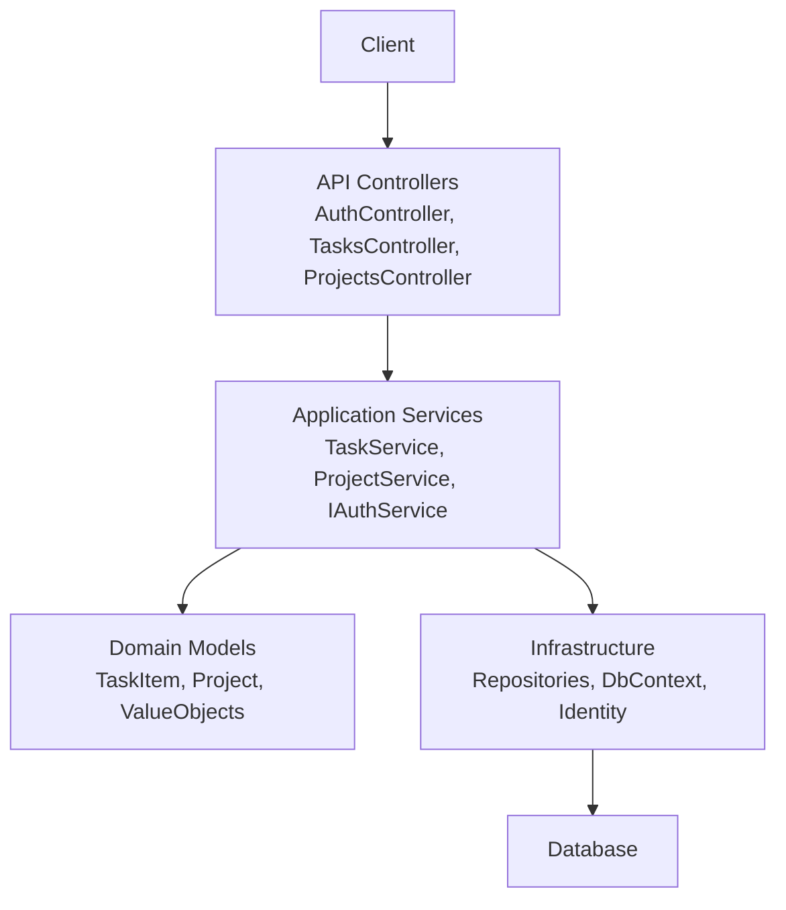
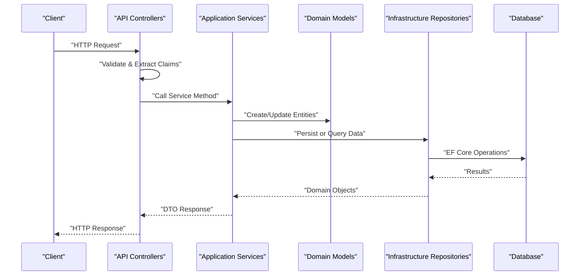
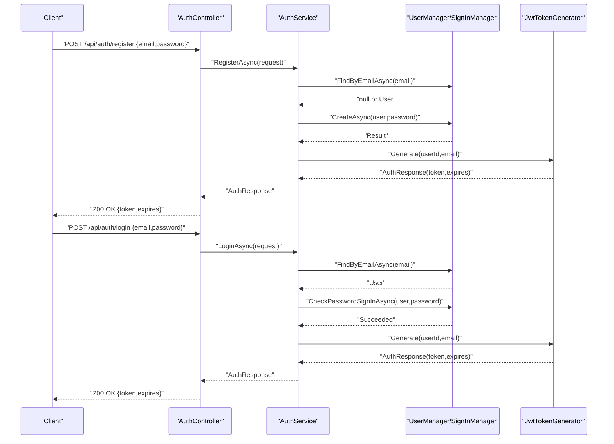
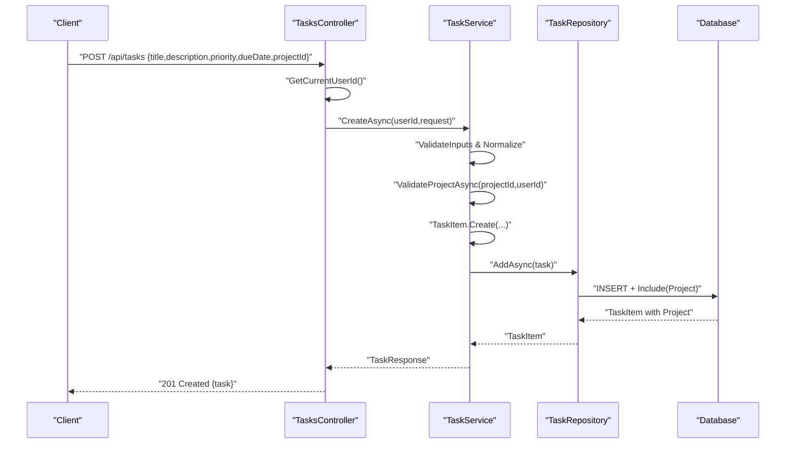
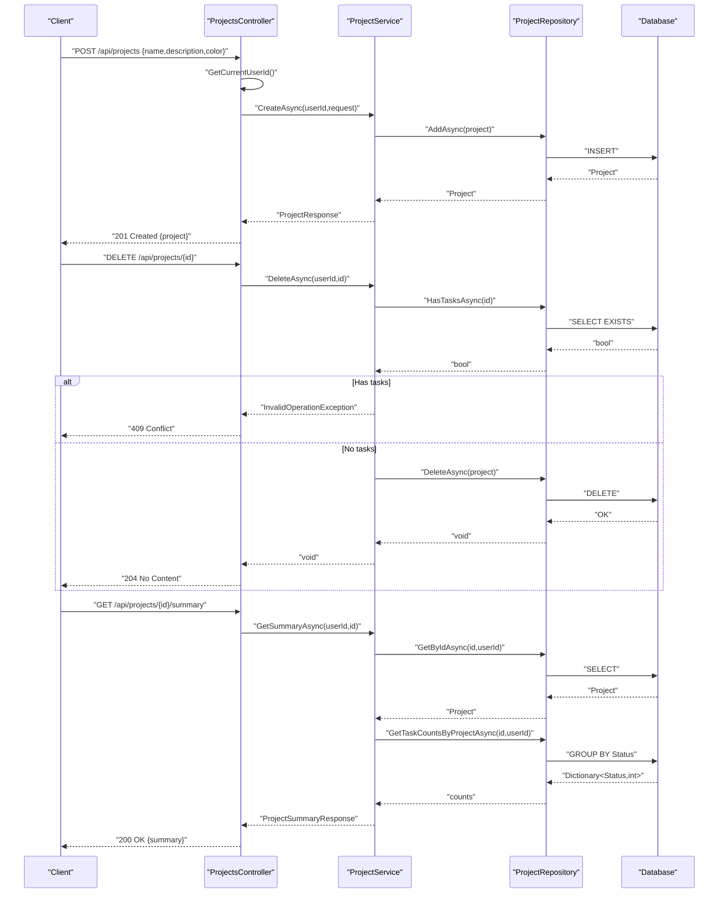
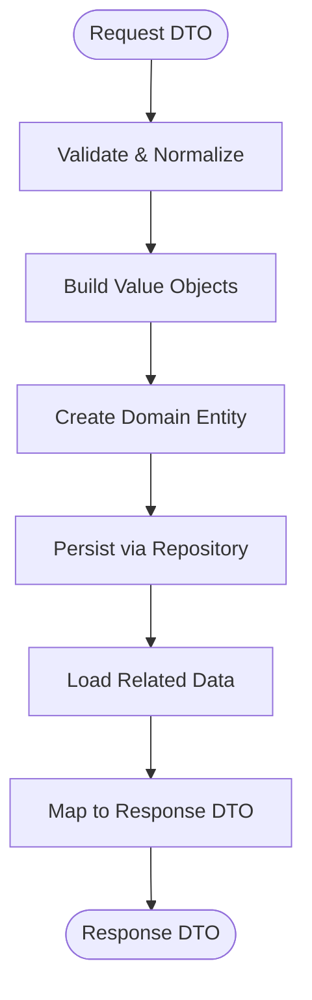
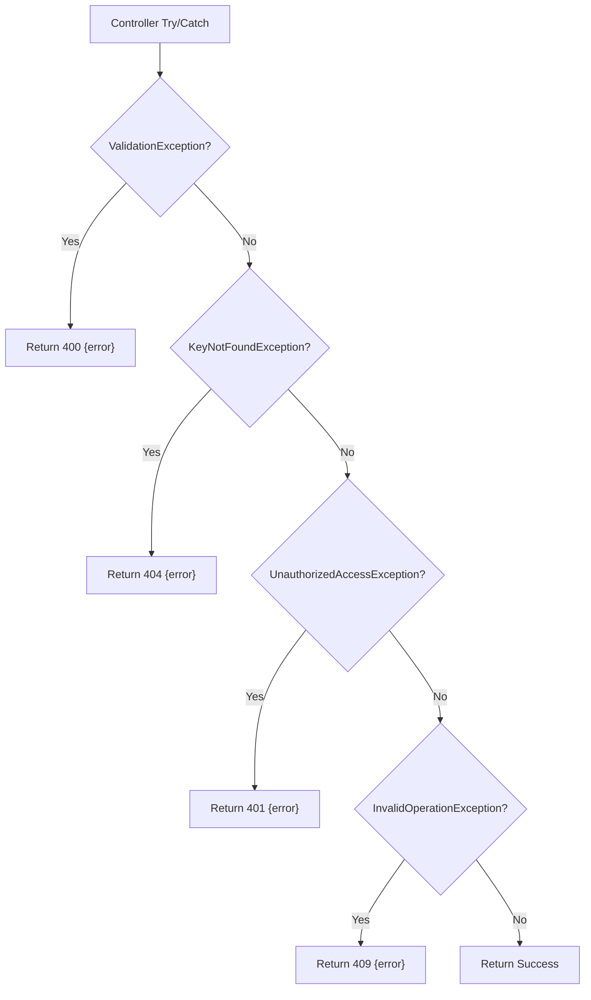
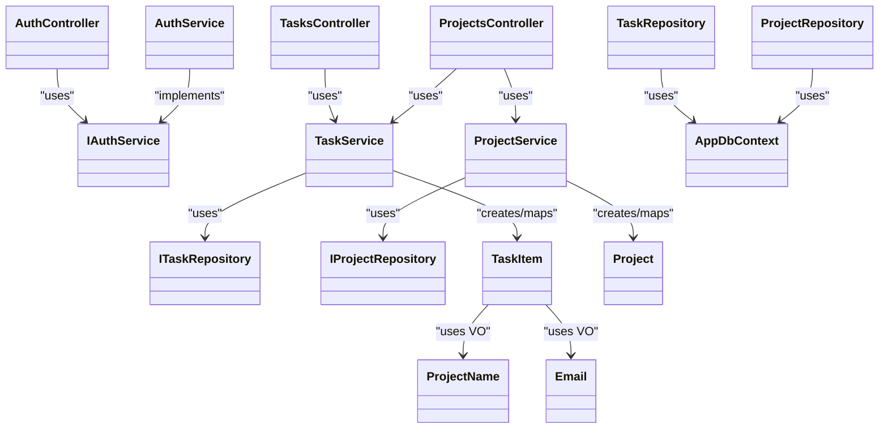

# Data Flow Architecture

<cite>
**Referenced Files in This Document**
- [AuthController.cs](file://Services/Services.Api/Controllers/AuthController.cs)
- [TasksController.cs](file://Services/Services.Api/Controllers/TasksController.cs)
- [ProjectsController.cs](file://Services/Services.Api/Controllers/ProjectsController.cs)
- [TaskService.cs](file://Services/Services.Application/Services/TaskService.cs)
- [ProjectService.cs](file://Services/Services.Application/Services/ProjectService.cs)
- [IAuthService.cs](file://Services/Services.Application/Interfaces/Services/IAuthService.cs)
- [AppDbContext.cs](file://Services/Services.Infrastructure/Persistence/AppDbContext.cs)
- [TaskRepository.cs](file://Services/Services.Infrastructure/Repositories/TaskRepository.cs)
- [ProjectRepository.cs](file://Services/Services.Infrastructure/Repositories/ProjectRepository.cs)
- [AuthService.cs](file://Services/Services.Infrastructure/Identity/AuthService.cs)
- [JwtTokenGenerator.cs](file://Services/Services.Infrastructure/Identity/JwtTokenGenerator.cs)
- [Project.cs](file://Services/Services.Domain/Entities/Project.cs)
- [TaskItem.cs](file://Services/Services.Domain/Entities/TaskItem.cs)
- [Email.cs](file://Services/Services.Domain/ValueObjects/Email.cs)
- [ProjectName.cs](file://Services/Services.Domain/ValueObjects/ProjectName.cs)
</cite>

## Table of Contents
1. [Introduction](#introduction)
2. [Project Structure](#project-structure)
3. [Core Components](#core-components)
4. [Architecture Overview](#architecture-overview)
5. [Detailed Component Analysis](#detailed-component-analysis)
6. [Dependency Analysis](#dependency-analysis)
7. [Performance Considerations](#performance-considerations)
8. [Troubleshooting Guide](#troubleshooting-guide)
9. [Conclusion](#conclusion)

## Introduction
This document explains the complete data flow architecture in TaskFlow from client requests to database operations. It traces the request lifecycle through the API controllers, application services, domain logic, and infrastructure layer. It also documents how data transforms across layers using DTOs and value objects, and includes sequence diagrams for authentication, task creation, and project management flows. Error propagation and response formatting are addressed at each layer.

## Project Structure
The backend is organized into clear layers:
- API layer (controllers): HTTP endpoints, input validation, error mapping, and response formatting.
- Application layer (services and DTOs): orchestration, business rules, authorization checks, and DTO mapping.
- Domain layer (entities and value objects): core business models with invariants and behavior.
- Infrastructure layer (repositories, persistence, identity): EF Core context, repositories, JWT token generation, and user management.

[No sources needed since this diagram shows conceptual workflow, not actual code structure]

## Core Components
- API Controllers:
  - AuthController handles register, login, logout; maps exceptions to HTTP responses.
  - TasksController exposes CRUD and status change endpoints; enforces authorization via JWT claims.
  - ProjectsController exposes CRUD and summary endpoints; integrates with tasks for project-scoped queries.
- Application Services:
  - TaskService orchestrates task operations, validates inputs, constructs domain entities, and maps to DTOs.
  - ProjectService orchestrates project operations, enforces business rules (e.g., cannot delete if tasks exist), and computes summaries.
  - IAuthService defines contract for authentication operations implemented by AuthService.
- Domain Entities and Value Objects:
  - TaskItem and Project encapsulate business logic and invariants.
  - ValueObjects like ProjectName and Email enforce constraints and normalization.
- Infrastructure:
  - AppDbContext configures EF Core mappings for TaskItem and Project.
  - TaskRepository and ProjectRepository implement data access with filtering, sorting, pagination, and ownership checks.
  - AuthService uses ASP.NET Identity and JwtTokenGenerator to manage users and issue JWT tokens.

**Section sources**
- [AuthController.cs:14-76](file://Services/Services.Api/Controllers/AuthController.cs#L14-L76)
- [TasksController.cs:18-198](file://Services/Services.Api/Controllers/TasksController.cs#L18-L198)
- [ProjectsController.cs:20-197](file://Services/Services.Api/Controllers/ProjectsController.cs#L20-L197)
- [TaskService.cs:16-410](file://Services/Services.Application/Services/TaskService.cs#L16-L410)
- [ProjectService.cs:15-231](file://Services/Services.Application/Services/ProjectService.cs#L15-L231)
- [IAuthService.cs:5-16](file://Services/Services.Application/Interfaces/Services/IAuthService.cs#L5-L16)
- [AppDbContext.cs:10-23](file://Services/Services.Infrastructure/Persistence/AppDbContext.cs#L10-L23)
- [TaskRepository.cs:9-237](file://Services/Services.Infrastructure/Repositories/TaskRepository.cs#L9-L237)
- [ProjectRepository.cs:9-96](file://Services/Services.Infrastructure/Repositories/ProjectRepository.cs#L9-L96)
- [AuthService.cs:8-90](file://Services/Services.Infrastructure/Identity/AuthService.cs#L8-L90)
- [JwtTokenGenerator.cs:9-48](file://Services/Services.Infrastructure/Identity/JwtTokenGenerator.cs#L9-L48)
- [Project.cs:5-120](file://Services/Services.Domain/Entities/Project.cs#L5-L120)
- [TaskItem.cs:6-127](file://Services/Services.Domain/Entities/TaskItem.cs#L6-L127)
- [Email.cs:5-48](file://Services/Services.Domain/ValueObjects/Email.cs#L5-L48)
- [ProjectName.cs:3-36](file://Services/Services.Domain/ValueObjects/ProjectName.cs#L3-L36)

## Architecture Overview
The system follows a layered architecture with clear separation of concerns:
- Controllers receive HTTP requests, extract user identity from JWT, validate inputs, and delegate to services.
- Services perform orchestration, validation, and map between DTOs and domain entities/value objects.
- Repositories implement data access patterns with EF Core, including ownership checks and complex queries.
- Domain entities encapsulate business rules and state transitions.

**Diagram sources**
- [AuthController.cs:14-76](file://Services/Services.Api/Controllers/AuthController.cs#L14-L76)
- [TasksController.cs:18-198](file://Services/Services.Api/Controllers/TasksController.cs#L18-L198)
- [ProjectsController.cs:20-197](file://Services/Services.Api/Controllers/ProjectsController.cs#L20-L197)
- [TaskService.cs:16-410](file://Services/Services.Application/Services/TaskService.cs#L16-L410)
- [ProjectService.cs:15-231](file://Services/Services.Application/Services/ProjectService.cs#L15-L231)
- [TaskRepository.cs:9-237](file://Services/Services.Infrastructure/Repositories/TaskRepository.cs#L9-L237)
- [ProjectRepository.cs:9-96](file://Services/Services.Infrastructure/Repositories/ProjectRepository.cs#L9-L96)

## Detailed Component Analysis

### Authentication Flow
Authentication is handled by AuthController and AuthService. Register creates a user via UserManager and returns a JWT. Login authenticates via SignInManager and returns a JWT. Logout signs out the current session. The controller maps ValidationException to 400 and UnauthorizedAccessException to 401.

**Diagram sources**
- [AuthController.cs:14-76](file://Services/Services.Api/Controllers/AuthController.cs#L14-L76)
- [AuthService.cs:13-84](file://Services/Services.Infrastructure/Identity/AuthService.cs#L13-L84)
- [JwtTokenGenerator.cs:13-48](file://Services/Services.Infrastructure/Identity/JwtTokenGenerator.cs#L13-L48)

**Section sources**
- [AuthController.cs:14-76](file://Services/Services.Api/Controllers/AuthController.cs#L14-L76)
- [AuthService.cs:13-84](file://Services/Services.Infrastructure/Identity/AuthService.cs#L13-L84)
- [JwtTokenGenerator.cs:13-48](file://Services/Services.Infrastructure/Identity/JwtTokenGenerator.cs#L13-L48)

### Task Creation Flow
Task creation involves validating the request, constructing domain entities with value objects, verifying project ownership, persisting via repository, and returning a DTO.

**Diagram sources**
- [TasksController.cs:18-47](file://Services/Services.Api/Controllers/TasksController.cs#L18-L47)
- [TaskService.cs:16-47](file://Services/Services.Application/Services/TaskService.cs#L16-L47)
- [TaskRepository.cs:13-23](file://Services/Services.Infrastructure/Repositories/TaskRepository.cs#L13-L23)

**Section sources**
- [TasksController.cs:18-47](file://Services/Services.Api/Controllers/TasksController.cs#L18-L47)
- [TaskService.cs:16-47](file://Services/Services.Application/Services/TaskService.cs#L16-L47)
- [TaskRepository.cs:13-23](file://Services/Services.Infrastructure/Repositories/TaskRepository.cs#L13-L23)

### Project Management Flows
Project management includes create, get all, get by id, update, delete, and summary. Delete enforces that projects without associated tasks can be removed. Summary aggregates task counts by status and calculates progress percentage.

**Diagram sources**
- [ProjectsController.cs:20-197](file://Services/Services.Api/Controllers/ProjectsController.cs#L20-L197)
- [ProjectService.cs:15-231](file://Services/Services.Application/Services/ProjectService.cs#L15-L231)
- [ProjectRepository.cs:13-96](file://Services/Services.Infrastructure/Repositories/ProjectRepository.cs#L13-L96)

**Section sources**
- [ProjectsController.cs:20-197](file://Services/Services.Api/Controllers/ProjectsController.cs#L20-L197)
- [ProjectService.cs:15-231](file://Services/Services.Application/Services/ProjectService.cs#L15-L231)
- [ProjectRepository.cs:13-96](file://Services/Services.Infrastructure/Repositories/ProjectRepository.cs#L13-L96)

### Data Transformation Across Layers
- DTOs:
  - Auth DTOs: RegisterRequest, LoginRequest, AuthResponse.
  - Task DTOs: CreateTaskRequest, UpdateTaskRequest, ChangeTaskStatusRequest, TaskQueryRequest, TaskResponse.
  - Project DTOs: CreateProjectRequest, UpdateProjectRequest, ProjectResponse, ProjectSummaryResponse.
  - PagedResponse<T>: generic paginated result wrapper.
- Value Objects:
  - ProjectName: enforces max length and normalization.
  - Email: validates format and normalizes case.
  - TaskTitle, TaskDescription: encapsulate title/description constraints.
- Mapping:
  - Services map DTOs to domain entities/value objects on input.
  - Services map domain entities back to DTOs on output.

**Diagram sources**
- [TaskService.cs:25-47](file://Services/Services.Application/Services/TaskService.cs#L25-L47)
- [ProjectService.cs:23-37](file://Services/Services.Application/Services/ProjectService.cs#L23-L37)
- [TaskRepository.cs:13-23](file://Services/Services.Infrastructure/Repositories/TaskRepository.cs#L13-L23)

**Section sources**
- [TaskService.cs:25-47](file://Services/Services.Application/Services/TaskService.cs#L25-L47)
- [ProjectService.cs:23-37](file://Services/Services.Application/Services/ProjectService.cs#L23-L37)
- [TaskRepository.cs:13-23](file://Services/Services.Infrastructure/Repositories/TaskRepository.cs#L13-L23)

### Error Propagation and Response Formatting
- Controllers catch ValidationException and return 400 with an error object.
- Controllers catch KeyNotFoundException and return 404 with localized messages.
- AuthController catches UnauthorizedAccessException and returns 401.
- ProjectsController.Delete maps InvalidOperationException to 409 Conflict.
- Services throw domain-specific exceptions (ValidationException, KeyNotFoundException, ArgumentException, InvalidOperationException) to signal invalid inputs, missing resources, or business rule violations.

**Diagram sources**
- [AuthController.cs:21-61](file://Services/Services.Api/Controllers/AuthController.cs#L21-L61)
- [TasksController.cs:23-46](file://Services/Services.Api/Controllers/TasksController.cs#L23-L46)
- [ProjectsController.cs:25-43](file://Services/Services.Api/Controllers/ProjectsController.cs#L25-L43)
- [ProjectsController.cs:130-157](file://Services/Services.Api/Controllers/ProjectsController.cs#L130-L157)

**Section sources**
- [AuthController.cs:21-61](file://Services/Services.Api/Controllers/AuthController.cs#L21-L61)
- [TasksController.cs:23-46](file://Services/Services.Api/Controllers/TasksController.cs#L23-L46)
- [ProjectsController.cs:25-43](file://Services/Services.Api/Controllers/ProjectsController.cs#L25-L43)
- [ProjectsController.cs:130-157](file://Services/Services.Api/Controllers/ProjectsController.cs#L130-L157)

## Dependency Analysis
The following diagram illustrates dependencies among key components:

**Diagram sources**
- [AuthController.cs:9-12](file://Services/Services.Api/Controllers/AuthController.cs#L9-L12)
- [TasksController.cs:11-16](file://Services/Services.Api/Controllers/TasksController.cs#L11-L16)
- [ProjectsController.cs:12-18](file://Services/Services.Api/Controllers/ProjectsController.cs#L12-L18)
- [IAuthService.cs:5-16](file://Services/Services.Application/Interfaces/Services/IAuthService.cs#L5-L16)
- [AuthService.cs:8-11](file://Services/Services.Infrastructure/Identity/AuthService.cs#L8-L11)
- [TaskService.cs:12-14](file://Services/Services.Application/Services/TaskService.cs#L12-L14)
- [ProjectService.cs:11-13](file://Services/Services.Application/Services/ProjectService.cs#L11-L13)
- [TaskRepository.cs:9-11](file://Services/Services.Infrastructure/Repositories/TaskRepository.cs#L9-L11)
- [ProjectRepository.cs:9-11](file://Services/Services.Infrastructure/Repositories/ProjectRepository.cs#L9-L11)
- [AppDbContext.cs:10-23](file://Services/Services.Infrastructure/Persistence/AppDbContext.cs#L10-L23)
- [TaskItem.cs:6-127](file://Services/Services.Domain/Entities/TaskItem.cs#L6-L127)
- [Project.cs:5-120](file://Services/Services.Domain/Entities/Project.cs#L5-L120)
- [Email.cs:5-48](file://Services/Services.Domain/ValueObjects/Email.cs#L5-L48)
- [ProjectName.cs:3-36](file://Services/Services.Domain/ValueObjects/ProjectName.cs#L3-L36)

**Section sources**
- [AuthController.cs:9-12](file://Services/Services.Api/Controllers/AuthController.cs#L9-L12)
- [TasksController.cs:11-16](file://Services/Services.Api/Controllers/TasksController.cs#L11-L16)
- [ProjectsController.cs:12-18](file://Services/Services.Api/Controllers/ProjectsController.cs#L12-L18)
- [IAuthService.cs:5-16](file://Services/Services.Application/Interfaces/Services/IAuthService.cs#L5-L16)
- [AuthService.cs:8-11](file://Services/Services.Infrastructure/Identity/AuthService.cs#L8-L11)
- [TaskService.cs:12-14](file://Services/Services.Application/Services/TaskService.cs#L12-L14)
- [ProjectService.cs:11-13](file://Services/Services.Application/Services/ProjectService.cs#L11-L13)
- [TaskRepository.cs:9-11](file://Services/Services.Infrastructure/Repositories/TaskRepository.cs#L9-L11)
- [ProjectRepository.cs:9-11](file://Services/Services.Infrastructure/Repositories/ProjectRepository.cs#L9-L11)
- [AppDbContext.cs:10-23](file://Services/Services.Infrastructure/Persistence/AppDbContext.cs#L10-L23)
- [TaskItem.cs:6-127](file://Services/Services.Domain/Entities/TaskItem.cs#L6-L127)
- [Project.cs:5-120](file://Services/Services.Domain/Entities/Project.cs#L5-L120)
- [Email.cs:5-48](file://Services/Services.Domain/ValueObjects/Email.cs#L5-L48)
- [ProjectName.cs:3-36](file://Services/Services.Domain/ValueObjects/ProjectName.cs#L3-L36)

## Performance Considerations
- Use AsNoTracking for read-only queries to reduce tracking overhead.
- Prefer projection where possible to minimize payload size.
- Ensure indexes on frequently filtered columns (UserId, ProjectId, Status, Priority).
- Normalize query parameters server-side to prevent excessive search strings and invalid sort fields.
- Avoid N+1 queries by including related entities when necessary (e.g., Project when loading Tasks).

[No sources needed since this section provides general guidance]

## Troubleshooting Guide
- Authentication failures:
  - Check email/password correctness and account existence.
  - Verify JWT configuration (issuer, audience, secret key length).
- Validation errors:
  - Inspect ValidationException messages returned by services/controllers.
  - Ensure DTOs conform to expected formats (e.g., color hex, priority enum).
- Resource not found:
  - Confirm resource IDs and ownership (UserId matches resource owner).
- Business rule violations:
  - Deleting projects with tasks will fail; remove tasks first.
  - Invalid status or priority values will raise validation errors.

**Section sources**
- [AuthService.cs:13-84](file://Services/Services.Infrastructure/Identity/AuthService.cs#L13-L84)
- [JwtTokenGenerator.cs:13-48](file://Services/Services.Infrastructure/Identity/JwtTokenGenerator.cs#L13-L48)
- [TaskService.cs:285-393](file://Services/Services.Application/Services/TaskService.cs#L285-L393)
- [ProjectService.cs:101-127](file://Services/Services.Application/Services/ProjectService.cs#L101-L127)

## Conclusion
TaskFlow’s data flow architecture cleanly separates concerns across API, application, domain, and infrastructure layers. DTOs and value objects ensure robust input validation and consistent data representation. Controllers focus on HTTP concerns, services orchestrate business logic, repositories handle data access, and domain models enforce invariants. Error handling is explicit and consistent, enabling predictable client interactions. The provided sequence and class diagrams illustrate the end-to-end request lifecycle and component relationships.