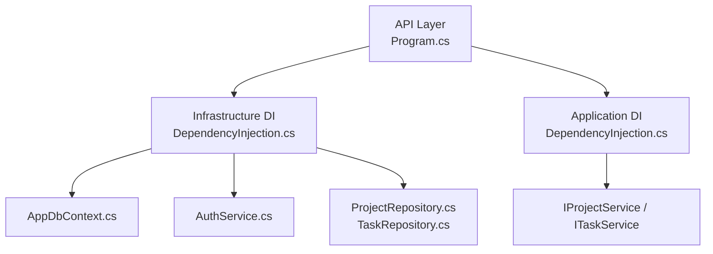
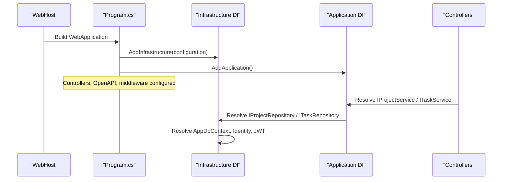
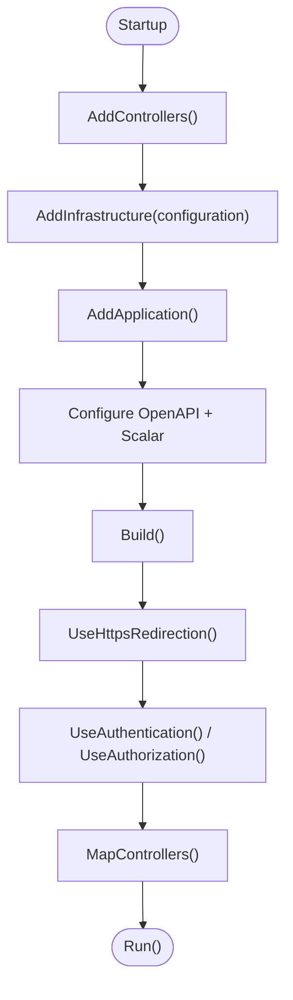
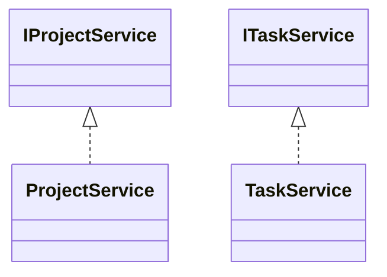
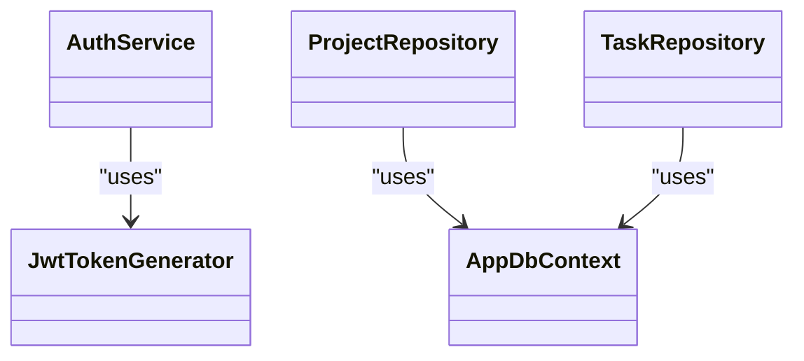
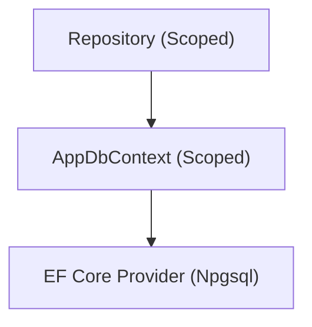
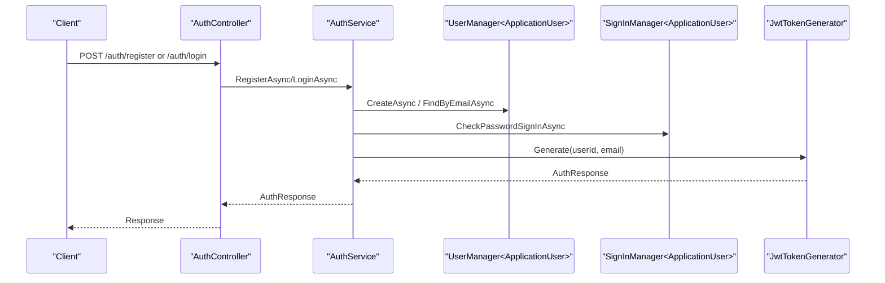
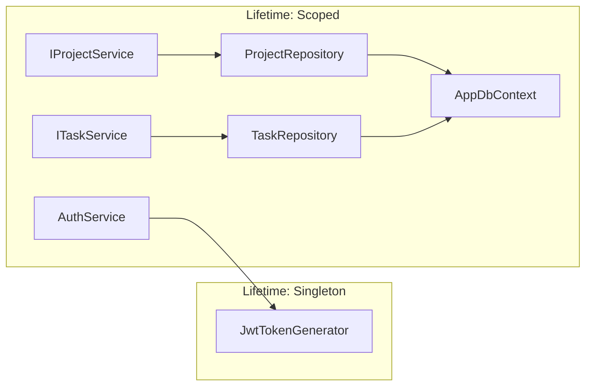

# Dependency Injection Setup

<cite>
**Referenced Files in This Document**
- [Program.cs](file://Services/Services.Api/Program.cs)
- [DependencyInjection.cs (Application)](file://Services/Services.Application/DependencyInjection.cs)
- [DependencyInjection.cs (Infrastructure)](file://Services/Services.Infrastructure/DependencyInjection.cs)
- [AppDbContext.cs](file://Services/Services.Infrastructure/Persistence/AppDbContext.cs)
- [AuthService.cs](file://Services/Services.Infrastructure/Identity/AuthService.cs)
- [JwtOptions.cs](file://Services/Services.Infrastructure/Identity/JwtOptions.cs)
- [ProjectRepository.cs](file://Services/Services.Infrastructure/Repositories/ProjectRepository.cs)
- [TaskRepository.cs](file://Services/Services.Infrastructure/Repositories/TaskRepository.cs)
</cite>

## Table of Contents
1. [Introduction](#introduction)
2. [Project Structure](#project-structure)
3. [Core Components](#core-components)
4. [Architecture Overview](#architecture-overview)
5. [Detailed Component Analysis](#detailed-component-analysis)
6. [Dependency Analysis](#dependency-analysis)
7. [Performance Considerations](#performance-considerations)
8. [Troubleshooting Guide](#troubleshooting-guide)
9. [Conclusion](#conclusion)

## Introduction
This document explains how TaskFlow configures dependency injection using .NET’s built-in DI container across the API, Application, and Infrastructure layers. It covers service registration patterns, lifetimes (Singleton, Scoped, Transient), interface-to-implementation mappings, and integration points for authentication, authorization, persistence, and configuration. It also provides guidance on adding custom services and configuration options.

## Project Structure
The DI setup is split into three main areas:
- API layer bootstraps the application and wires infrastructure and application registrations.
- Application layer registers business services.
- Infrastructure layer registers persistence, identity, JWT, repositories, and shared utilities.

**Diagram sources**
- [Program.cs:6-11](file://Services/Services.Api/Program.cs#L6-L11)
- [DependencyInjection.cs (Application):7-18](file://Services/Services.Application/DependencyInjection.cs#L7-L18)
- [DependencyInjection.cs (Infrastructure):17-126](file://Services/Services.Infrastructure/DependencyInjection.cs#L17-L126)
- [AppDbContext.cs:10-23](file://Services/Services.Infrastructure/Persistence/AppDbContext.cs#L10-L23)
- [AuthService.cs:8-11](file://Services/Services.Infrastructure/Identity/AuthService.cs#L8-L11)
- [ProjectRepository.cs:9-11](file://Services/Services.Infrastructure/Repositories/ProjectRepository.cs#L9-L11)
- [TaskRepository.cs:9-11](file://Services/Services.Infrastructure/Repositories/TaskRepository.cs#L9-L11)

**Section sources**
- [Program.cs:6-11](file://Services/Services.Api/Program.cs#L6-L11)
- [DependencyInjection.cs (Application):7-18](file://Services/Services.Application/DependencyInjection.cs#L7-L18)
- [DependencyInjection.cs (Infrastructure):17-126](file://Services/Services.Infrastructure/DependencyInjection.cs#L17-L126)

## Core Components
- API bootstrap: Adds controllers, then calls infrastructure and application DI extensions.
- Application DI: Registers business services with Scoped lifetime.
- Infrastructure DI: Configures EF Core, ASP.NET Identity, JWT authentication/authorization, configuration binding, and repository/service registrations.

Key responsibilities:
- Program.cs orchestrates service registration order.
- Services.Application.DependencyInjection maps service interfaces to implementations.
- Services.Infrastructure.DependencyInjection wires data access, identity, and security.

**Section sources**
- [Program.cs:8-11](file://Services/Services.Api/Program.cs#L8-L11)
- [DependencyInjection.cs (Application):13-16](file://Services/Services.Application/DependencyInjection.cs#L13-L16)
- [DependencyInjection.cs (Infrastructure):23-126](file://Services/Services.Infrastructure/DependencyInjection.cs#L23-L126)

## Architecture Overview
The DI architecture follows a layered approach:
- API depends on Application and Infrastructure abstractions.
- Application defines service interfaces consumed by controllers.
- Infrastructure implements repositories and integrates with EF Core and Identity.

**Diagram sources**
- [Program.cs:6-11](file://Services/Services.Api/Program.cs#L6-L11)
- [DependencyInjection.cs (Infrastructure):28-126](file://Services/Services.Infrastructure/DependencyInjection.cs#L28-L126)
- [DependencyInjection.cs (Application):13-16](file://Services/Services.Application/DependencyInjection.cs#L13-L16)

## Detailed Component Analysis

### API Bootstrap and Pipeline
- Adds MVC controllers.
- Calls infrastructure and application DI extensions.
- Configures OpenAPI and Scalar UI in development.
- Enables HTTPS redirection, authentication, authorization, and controller routing.

**Diagram sources**
- [Program.cs:8-37](file://Services/Services.Api/Program.cs#L8-L37)

**Section sources**
- [Program.cs:8-37](file://Services/Services.Api/Program.cs#L8-L37)

### Application Layer Service Registration
- Registers IProjectService and ITaskService as Scoped.
- Scoped lifetime aligns with per-request lifecycle for stateless services that may hold request-scoped dependencies.

**Diagram sources**
- [DependencyInjection.cs (Application):13-16](file://Services/Services.Application/DependencyInjection.cs#L13-L16)

**Section sources**
- [DependencyInjection.cs (Application):7-18](file://Services/Services.Application/DependencyInjection.cs#L7-L18)

### Infrastructure Layer Registrations
- Database context: Registered with EF Core provider (Npgsql).
- Identity: Configured with user store, password policy, lockout, and token providers.
- JWT: Reads JwtOptions from configuration, validates required fields, and configures JwtBearer authentication.
- Authorization: Enabled.
- Configuration binding: Binds JwtOptions section.
- Token generator: Singleton.
- Authentication service: Scoped.
- Repositories: Scoped.

**Diagram sources**
- [DependencyInjection.cs (Infrastructure):28-126](file://Services/Services.Infrastructure/DependencyInjection.cs#L28-L126)
- [AppDbContext.cs:10-23](file://Services/Services.Infrastructure/Persistence/AppDbContext.cs#L10-L23)
- [AuthService.cs:8-11](file://Services/Services.Infrastructure/Identity/AuthService.cs#L8-L11)

**Section sources**
- [DependencyInjection.cs (Infrastructure):23-126](file://Services/Services.Infrastructure/DependencyInjection.cs#L23-L126)

### Data Access and Persistence
- AppDbContext exposes DbSets for Tasks and Projects and applies EF Core configurations.
- Repositories encapsulate CRUD and query logic against AppDbContext.

**Diagram sources**
- [AppDbContext.cs:10-23](file://Services/Services.Infrastructure/Persistence/AppDbContext.cs#L10-L23)
- [ProjectRepository.cs:9-11](file://Services/Services.Infrastructure/Repositories/ProjectRepository.cs#L9-L11)
- [TaskRepository.cs:9-11](file://Services/Services.Infrastructure/Repositories/TaskRepository.cs#L9-L11)

**Section sources**
- [AppDbContext.cs:10-23](file://Services/Services.Infrastructure/Persistence/AppDbContext.cs#L10-L23)
- [ProjectRepository.cs:9-97](file://Services/Services.Infrastructure/Repositories/ProjectRepository.cs#L9-L97)
- [TaskRepository.cs:9-239](file://Services/Services.Infrastructure/Repositories/TaskRepository.cs#L9-L239)

### Authentication and Authorization Flow
- AuthService uses UserManager, SignInManager, and JwtTokenGenerator to register/login users and issue tokens.
- JwtOptions are validated and bound from configuration; SecretKey must be a valid Base64 string with sufficient length.

**Diagram sources**
- [AuthService.cs:8-91](file://Services/Services.Infrastructure/Identity/AuthService.cs#L8-L91)
- [DependencyInjection.cs (Infrastructure):84-120](file://Services/Services.Infrastructure/DependencyInjection.cs#L84-L120)

**Section sources**
- [AuthService.cs:8-91](file://Services/Services.Infrastructure/Identity/AuthService.cs#L8-L91)
- [DependencyInjection.cs (Infrastructure):50-120](file://Services/Services.Infrastructure/DependencyInjection.cs#L50-L120)

## Dependency Analysis
The following diagram shows key DI relationships and lifetimes:

**Diagram sources**
- [DependencyInjection.cs (Infrastructure):119-124](file://Services/Services.Infrastructure/DependencyInjection.cs#L119-L124)
- [DependencyInjection.cs (Application):13-16](file://Services/Services.Application/DependencyInjection.cs#L13-L16)

**Section sources**
- [DependencyInjection.cs (Infrastructure):119-124](file://Services/Services.Infrastructure/DependencyInjection.cs#L119-L124)
- [DependencyInjection.cs (Application):13-16](file://Services/Services.Application/DependencyInjection.cs#L13-L16)

## Performance Considerations
- Scoped lifetimes for DbContext and repositories ensure one database connection per request, reducing contention and memory pressure.
- Singleton JwtTokenGenerator avoids recreating cryptographic objects per request.
- Avoid registering heavy services as Singleton unless they are thread-safe and stateless.
- Prefer Scoped for services that depend on DbContext or HttpContext-related services.
- Keep configuration validation at startup to fail fast on misconfiguration.

[No sources needed since this section provides general guidance]

## Troubleshooting Guide
Common issues and resolutions:
- Missing DefaultConnection: Ensure the connection string exists in configuration.
- Incomplete JWT configuration: Validate Issuer, Audience, SecretKey, and ExpirationMinutes.
- Invalid SecretKey format: Must be a valid Base64 string and at least 32 bytes after decoding.
- Identity not configured: Verify AddIdentity and AddEntityFrameworkStores are present.

Relevant checks:
- Connection string retrieval and validation.
- JWT section binding and validation.
- SecretKey parsing and length check.

**Section sources**
- [DependencyInjection.cs (Infrastructure):23-26](file://Services/Services.Infrastructure/DependencyInjection.cs#L23-L26)
- [DependencyInjection.cs (Infrastructure):50-82](file://Services/Services.Infrastructure/DependencyInjection.cs#L50-L82)

## Conclusion
TaskFlow’s DI setup cleanly separates concerns across layers:
- API orchestrates pipeline and wiring.
- Application registers business services with Scoped lifetime.
- Infrastructure wires persistence, identity, JWT, and repositories, using appropriate lifetimes.
This structure promotes testability, maintainability, and clear boundaries between layers while leveraging .NET’s built-in DI container effectively.

[No sources needed since this section summarizes without analyzing specific files]