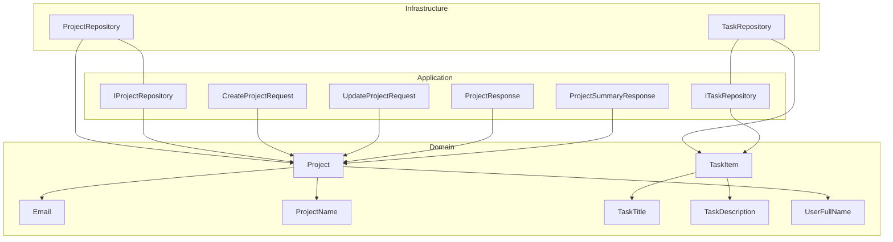
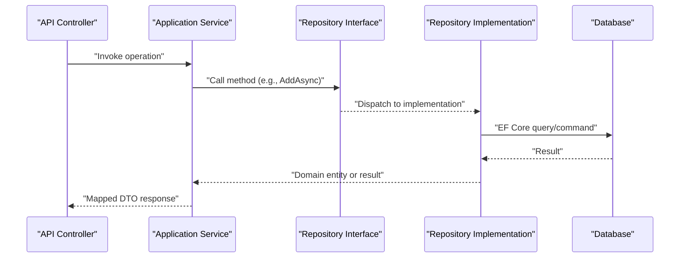
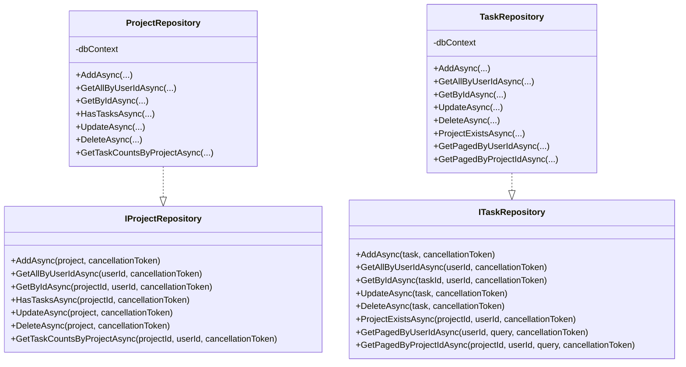
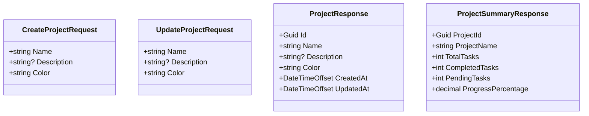
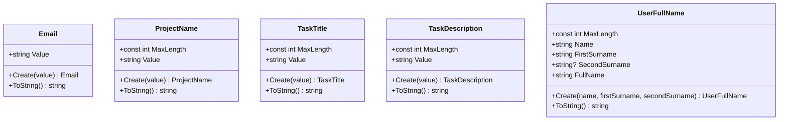
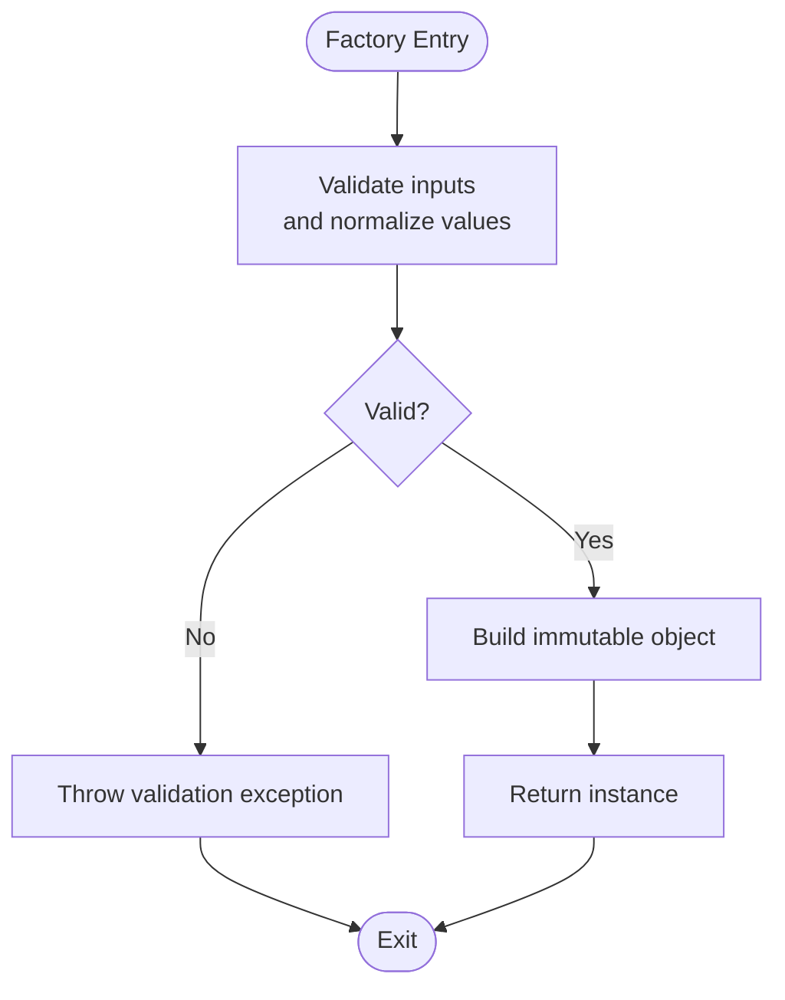
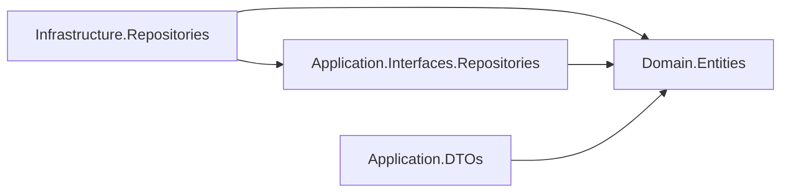

# Design Patterns Implementation

<cite>
**Referenced Files in This Document**
- [Project.cs](file://Services/Services.Domain/Entities/Project.cs)
- [TaskItem.cs](file://Services/Services.Domain/Entities/TaskItem.cs)
- [Email.cs](file://Services/Services.Domain/ValueObjects/Email.cs)
- [ProjectName.cs](file://Services/Services.Domain/ValueObjects/ProjectName.cs)
- [TaskDescription.cs](file://Services/Services.Domain/ValueObjects/TaskDescription.cs)
- [TaskTitle.cs](file://Services/Services.Domain/ValueObjects/TaskTitle.cs)
- [UserFullName.cs](file://Services/Services.Domain/ValueObjects/UserFullName.cs)
- [IProjectRepository.cs](file://Services/Services.Application/Interfaces/Repositories/IProjectRepository.cs)
- [ITaskRepository.cs](file://Services/Services.Application/Interfaces/Repositories/ITaskRepository.cs)
- [ProjectRepository.cs](file://Services/Services.Infrastructure/Repositories/ProjectRepository.cs)
- [TaskRepository.cs](file://Services/Services.Infrastructure/Repositories/TaskRepository.cs)
- [CreateProjectRequest.cs](file://Services/Services.Application/DTOs/Projects/CreateProjectRequest.cs)
- [UpdateProjectRequest.cs](file://Services/Services.Application/DTOs/Projects/UpdateProjectRequest.cs)
- [ProjectResponse.cs](file://Services/Services.Application/DTOs/Projects/ProjectResponse.cs)
- [ProjectSummaryResponse.cs](file://Services/Services.Application/DTOs/Projects/ProjectSummaryResponse.cs)
</cite>

## Table of Contents
1. [Introduction](#introduction)
2. [Project Structure](#project-structure)
3. [Core Components](#core-components)
4. [Architecture Overview](#architecture-overview)
5. [Detailed Component Analysis](#detailed-component-analysis)
6. [Dependency Analysis](#dependency-analysis)
7. [Performance Considerations](#performance-considerations)
8. [Troubleshooting Guide](#troubleshooting-guide)
9. [Conclusion](#conclusion)

## Introduction
This document explains the design patterns implemented in TaskFlow, focusing on:
- Repository Pattern for data access abstraction
- DTO Pattern for API contracts
- Value Object Pattern for domain constraints
- Factory Pattern for object creation with validation

It provides concrete examples from the codebase and highlights how each pattern improves maintainability, testability, and separation of concerns.

## Project Structure
TaskFlow is organized into layered projects:
- Domain layer: entities and value objects encapsulating business rules
- Application layer: interfaces (repositories), DTOs, and services
- Infrastructure layer: repository implementations using Entity Framework Core
- Web/API layer: controllers and routes that consume application services

**Diagram sources**
- [Project.cs:1-121](file://Services/Services.Domain/Entities/Project.cs#L1-L121)
- [TaskItem.cs:1-128](file://Services/Services.Domain/Entities/TaskItem.cs#L1-L128)
- [Email.cs:1-49](file://Services/Services.Domain/ValueObjects/Email.cs#L1-L49)
- [ProjectName.cs:1-37](file://Services/Services.Domain/ValueObjects/ProjectName.cs#L1-L37)
- [TaskTitle.cs:1-36](file://Services/Services.Domain/ValueObjects/TaskTitle.cs#L1-L36)
- [TaskDescription.cs:1-30](file://Services/Services.Domain/ValueObjects/TaskDescription.cs#L1-L30)
- [UserFullName.cs:1-66](file://Services/Services.Domain/ValueObjects/UserFullName.cs#L1-L66)
- [IProjectRepository.cs:1-37](file://Services/Services.Application/Interfaces/Repositories/IProjectRepository.cs#L1-L37)
- [ITaskRepository.cs:1-44](file://Services/Services.Application/Interfaces/Repositories/ITaskRepository.cs#L1-L44)
- [ProjectRepository.cs:1-97](file://Services/Services.Infrastructure/Repositories/ProjectRepository.cs#L1-L97)
- [TaskRepository.cs:1-239](file://Services/Services.Infrastructure/Repositories/TaskRepository.cs#L1-L239)
- [CreateProjectRequest.cs:1-7](file://Services/Services.Application/DTOs/Projects/CreateProjectRequest.cs#L1-L7)
- [UpdateProjectRequest.cs:1-7](file://Services/Services.Application/DTOs/Projects/UpdateProjectRequest.cs#L1-L7)
- [ProjectResponse.cs:1-10](file://Services/Services.Application/DTOs/Projects/ProjectResponse.cs#L1-L10)
- [ProjectSummaryResponse.cs:1-9](file://Services/Services.Application/DTOs/Projects/ProjectSummaryResponse.cs#L1-L9)

**Section sources**
- [Project.cs:1-121](file://Services/Services.Domain/Entities/Project.cs#L1-L121)
- [TaskItem.cs:1-128](file://Services/Services.Domain/Entities/TaskItem.cs#L1-L128)
- [IProjectRepository.cs:1-37](file://Services/Services.Application/Interfaces/Repositories/IProjectRepository.cs#L1-L37)
- [ITaskRepository.cs:1-44](file://Services/Services.Application/Interfaces/Repositories/ITaskRepository.cs#L1-L44)
- [ProjectRepository.cs:1-97](file://Services/Services.Infrastructure/Repositories/ProjectRepository.cs#L1-L97)
- [TaskRepository.cs:1-239](file://Services/Services.Infrastructure/Repositories/TaskRepository.cs#L1-L239)
- [CreateProjectRequest.cs:1-7](file://Services/Services.Application/DTOs/Projects/CreateProjectRequest.cs#L1-L7)
- [UpdateProjectRequest.cs:1-7](file://Services/Services.Application/DTOs/Projects/UpdateProjectRequest.cs#L1-L7)
- [ProjectResponse.cs:1-10](file://Services/Services.Application/DTOs/Projects/ProjectResponse.cs#L1-L10)
- [ProjectSummaryResponse.cs:1-9](file://Services/Services.Application/DTOs/Projects/ProjectSummaryResponse.cs#L1-L9)

## Core Components
- Repository Pattern: Interfaces define stable contracts; infrastructure implements persistence details.
- DTO Pattern: Request/response records decouple API payloads from domain models.
- Value Object Pattern: Immutable types enforce invariants at construction time.
- Factory Pattern: Static Create methods on entities and value objects centralize validation and normalization.

Benefits:
- Maintainability: Clear boundaries between layers and responsibilities.
- Testability: Repositories can be mocked; factories validate inputs deterministically.
- Separation of Concerns: Validation lives close to the data it protects; persistence logic stays out of domain.

**Section sources**
- [IProjectRepository.cs:1-37](file://Services/Services.Application/Interfaces/Repositories/IProjectRepository.cs#L1-L37)
- [ITaskRepository.cs:1-44](file://Services/Services.Application/Interfaces/Repositories/ITaskRepository.cs#L1-L44)
- [ProjectRepository.cs:1-97](file://Services/Services.Infrastructure/Repositories/ProjectRepository.cs#L1-L97)
- [TaskRepository.cs:1-239](file://Services/Services.Infrastructure/Repositories/TaskRepository.cs#L1-L239)
- [Project.cs:1-121](file://Services/Services.Domain/Entities/Project.cs#L1-L121)
- [TaskItem.cs:1-128](file://Services/Services.Domain/Entities/TaskItem.cs#L1-L128)
- [Email.cs:1-49](file://Services/Services.Domain/ValueObjects/Email.cs#L1-L49)
- [ProjectName.cs:1-37](file://Services/Services.Domain/ValueObjects/ProjectName.cs#L1-L37)
- [TaskTitle.cs:1-36](file://Services/Services.Domain/ValueObjects/TaskTitle.cs#L1-L36)
- [TaskDescription.cs:1-30](file://Services/Services.Domain/ValueObjects/TaskDescription.cs#L1-L30)
- [UserFullName.cs:1-66](file://Services/Services.Domain/ValueObjects/UserFullName.cs#L1-L66)
- [CreateProjectRequest.cs:1-7](file://Services/Services.Application/DTOs/Projects/CreateProjectRequest.cs#L1-L7)
- [UpdateProjectRequest.cs:1-7](file://Services/Services.Application/DTOs/Projects/UpdateProjectRequest.cs#L1-L7)
- [ProjectResponse.cs:1-10](file://Services/Services.Application/DTOs/Projects/ProjectResponse.cs#L1-L10)
- [ProjectSummaryResponse.cs:1-9](file://Services/Services.Application/DTOs/Projects/ProjectSummaryResponse.cs#L1-L9)

## Architecture Overview
The system follows a layered architecture:
- Controllers call application services (not shown here).
- Services use repository interfaces.
- Infrastructure repositories implement EF Core queries against AppDbContext.
- Domain entities and value objects encapsulate business rules.

**Diagram sources**
- [IProjectRepository.cs:1-37](file://Services/Services.Application/Interfaces/Repositories/IProjectRepository.cs#L1-L37)
- [ITaskRepository.cs:1-44](file://Services/Services.Application/Interfaces/Repositories/ITaskRepository.cs#L1-L44)
- [ProjectRepository.cs:1-97](file://Services/Services.Infrastructure/Repositories/ProjectRepository.cs#L1-L97)
- [TaskRepository.cs:1-239](file://Services/Services.Infrastructure/Repositories/TaskRepository.cs#L1-L239)

## Detailed Component Analysis

### Repository Pattern
Purpose:
- Abstract data access behind stable interfaces so services remain independent of storage technology.
- Encapsulate queries, pagination, filtering, and projections.

Key elements:
- Interfaces: IProjectRepository, ITaskRepository
- Implementations: ProjectRepository, TaskRepository
- Usage: Services depend only on interfaces; tests can inject mocks.

**Diagram sources**
- [IProjectRepository.cs:1-37](file://Services/Services.Application/Interfaces/Repositories/IProjectRepository.cs#L1-L37)
- [ITaskRepository.cs:1-44](file://Services/Services.Application/Interfaces/Repositories/ITaskRepository.cs#L1-L44)
- [ProjectRepository.cs:1-97](file://Services/Services.Infrastructure/Repositories/ProjectRepository.cs#L1-L97)
- [TaskRepository.cs:1-239](file://Services/Services.Infrastructure/Repositories/TaskRepository.cs#L1-L239)

Before/After example (conceptual):
- Before: Controllers or services directly instantiate DbContext and write LINQ/SQL scattered across layers.
- After: Controllers/services call repository interfaces; implementations encapsulate EF Core usage.

Benefits:
- Maintainability: Changes to persistence affect only repository implementations.
- Testability: Inject mock repositories to verify service behavior without a database.
- Separation of Concerns: Query composition and projection are isolated from business logic.

**Section sources**
- [IProjectRepository.cs:1-37](file://Services/Services.Application/Interfaces/Repositories/IProjectRepository.cs#L1-L37)
- [ITaskRepository.cs:1-44](file://Services/Services.Application/Interfaces/Repositories/ITaskRepository.cs#L1-L44)
- [ProjectRepository.cs:1-97](file://Services/Services.Infrastructure/Repositories/ProjectRepository.cs#L1-L97)
- [TaskRepository.cs:1-239](file://Services/Services.Infrastructure/Repositories/TaskRepository.cs#L1-L239)

### DTO Pattern
Purpose:
- Define explicit request and response contracts for APIs, decoupling them from domain models.

Key elements:
- Requests: CreateProjectRequest, UpdateProjectRequest
- Responses: ProjectResponse, ProjectSummaryResponse

**Diagram sources**
- [CreateProjectRequest.cs:1-7](file://Services/Services.Application/DTOs/Projects/CreateProjectRequest.cs#L1-L7)
- [UpdateProjectRequest.cs:1-7](file://Services/Services.Application/DTOs/Projects/UpdateProjectRequest.cs#L1-L7)
- [ProjectResponse.cs:1-10](file://Services/Services.Application/DTOs/Projects/ProjectResponse.cs#L1-L10)
- [ProjectSummaryResponse.cs:1-9](file://Services/Services.Application/DTOs/Projects/ProjectSummaryResponse.cs#L1-L9)

Before/After example (conceptual):
- Before: Expose domain entities directly as API payloads, leaking internal structure and making evolution risky.
- After: Map to/from DTOs at the boundary; domain models evolve independently of API contracts.

Benefits:
- Maintainability: Stable API surface even when domain changes.
- Testability: Validate DTOs separately from domain logic.
- Separation of Concerns: Presentation concerns stay at the edge; domain remains pure.

**Section sources**
- [CreateProjectRequest.cs:1-7](file://Services/Services.Application/DTOs/Projects/CreateProjectRequest.cs#L1-L7)
- [UpdateProjectRequest.cs:1-7](file://Services/Services.Application/DTOs/Projects/UpdateProjectRequest.cs#L1-L7)
- [ProjectResponse.cs:1-10](file://Services/Services.Application/DTOs/Projects/ProjectResponse.cs#L1-L10)
- [ProjectSummaryResponse.cs:1-9](file://Services/Services.Application/DTOs/Projects/ProjectSummaryResponse.cs#L1-L9)

### Value Object Pattern
Purpose:
- Encapsulate domain concepts with built-in validation and normalization.

Key elements:
- Email, ProjectName, TaskTitle, TaskDescription, UserFullName

**Diagram sources**
- [Email.cs:1-49](file://Services/Services.Domain/ValueObjects/Email.cs#L1-L49)
- [ProjectName.cs:1-37](file://Services/Services.Domain/ValueObjects/ProjectName.cs#L1-L37)
- [TaskTitle.cs:1-36](file://Services/Services.Domain/ValueObjects/TaskTitle.cs#L1-L36)
- [TaskDescription.cs:1-30](file://Services/Services.Domain/ValueObjects/TaskDescription.cs#L1-L30)
- [UserFullName.cs:1-66](file://Services/Services.Domain/ValueObjects/UserFullName.cs#L1-L66)

Before/After example (conceptual):
- Before: Strings passed around with ad-hoc checks everywhere.
- After: Strongly typed value objects guarantee valid state by construction.

Benefits:
- Maintainability: Centralized validation rules.
- Testability: Unit-testable invariants per value object.
- Separation of Concerns: Business rules live with the data they protect.

**Section sources**
- [Email.cs:1-49](file://Services/Services.Domain/ValueObjects/Email.cs#L1-L49)
- [ProjectName.cs:1-37](file://Services/Services.Domain/ValueObjects/ProjectName.cs#L1-L37)
- [TaskTitle.cs:1-36](file://Services/Services.Domain/ValueObjects/TaskTitle.cs#L1-L36)
- [TaskDescription.cs:1-30](file://Services/Services.Domain/ValueObjects/TaskDescription.cs#L1-L30)
- [UserFullName.cs:1-66](file://Services/Services.Domain/ValueObjects/UserFullName.cs#L1-L66)

### Factory Pattern
Purpose:
- Provide controlled creation points with validation and normalization.

Key elements:
- Entities: Project.Create, TaskItem.Create
- Value Objects: Email.Create, ProjectName.Create, TaskTitle.Create, TaskDescription.Create, UserFullName.Create

**Diagram sources**
- [Project.cs:51-64](file://Services/Services.Domain/Entities/Project.cs#L51-L64)
- [TaskItem.cs:54-78](file://Services/Services.Domain/Entities/TaskItem.cs#L54-L78)
- [Email.cs:14-46](file://Services/Services.Domain/ValueObjects/Email.cs#L14-L46)
- [ProjectName.cs:14-33](file://Services/Services.Domain/ValueObjects/ProjectName.cs#L14-L33)
- [TaskTitle.cs:14-33](file://Services/Services.Domain/ValueObjects/TaskTitle.cs#L14-L33)
- [TaskDescription.cs:14-26](file://Services/Services.Domain/ValueObjects/TaskDescription.cs#L14-L26)
- [UserFullName.cs:23-62](file://Services/Services.Domain/ValueObjects/UserFullName.cs#L23-L62)

Before/After example (conceptual):
- Before: New Project(...) called with raw strings and manual checks scattered.
- After: Project.Create(...) enforces invariants consistently.

Benefits:
- Maintainability: Single place to update validation rules.
- Testability: Deterministic creation with clear error paths.
- Separation of Concerns: Creation logic is cohesive and focused.

**Section sources**
- [Project.cs:51-64](file://Services/Services.Domain/Entities/Project.cs#L51-L64)
- [TaskItem.cs:54-78](file://Services/Services.Domain/Entities/TaskItem.cs#L54-L78)
- [Email.cs:14-46](file://Services/Services.Domain/ValueObjects/Email.cs#L14-L46)
- [ProjectName.cs:14-33](file://Services/Services.Domain/ValueObjects/ProjectName.cs#L14-L33)
- [TaskTitle.cs:14-33](file://Services/Services.Domain/ValueObjects/TaskTitle.cs#L14-L33)
- [TaskDescription.cs:14-26](file://Services/Services.Domain/ValueObjects/TaskDescription.cs#L14-L26)
- [UserFullName.cs:23-62](file://Services/Services.Domain/ValueObjects/UserFullName.cs#L23-L62)

## Dependency Analysis
Layered dependencies ensure stability and testability:
- Infrastructure depends on Application interfaces and Domain entities.
- Application depends only on Domain.
- Domain has no external framework dependencies.

**Diagram sources**
- [ProjectRepository.cs:1-97](file://Services/Services.Infrastructure/Repositories/ProjectRepository.cs#L1-L97)
- [TaskRepository.cs:1-239](file://Services/Services.Infrastructure/Repositories/TaskRepository.cs#L1-L239)
- [IProjectRepository.cs:1-37](file://Services/Services.Application/Interfaces/Repositories/IProjectRepository.cs#L1-L37)
- [ITaskRepository.cs:1-44](file://Services/Services.Application/Interfaces/Repositories/ITaskRepository.cs#L1-L44)
- [Project.cs:1-121](file://Services/Services.Domain/Entities/Project.cs#L1-L121)
- [TaskItem.cs:1-128](file://Services/Services.Domain/Entities/TaskItem.cs#L1-L128)

**Section sources**
- [ProjectRepository.cs:1-97](file://Services/Services.Infrastructure/Repositories/ProjectRepository.cs#L1-L97)
- [TaskRepository.cs:1-239](file://Services/Services.Infrastructure/Repositories/TaskRepository.cs#L1-L239)
- [IProjectRepository.cs:1-37](file://Services/Services.Application/Interfaces/Repositories/IProjectRepository.cs#L1-L37)
- [ITaskRepository.cs:1-44](file://Services/Services.Application/Interfaces/Repositories/ITaskRepository.cs#L1-L44)
- [Project.cs:1-121](file://Services/Services.Domain/Entities/Project.cs#L1-L121)
- [TaskItem.cs:1-128](file://Services/Services.Domain/Entities/TaskItem.cs#L1-L128)

## Performance Considerations
- Use AsNoTracking for read-only queries to avoid change tracking overhead.
- Include only necessary relationships to reduce payload size.
- Prefer server-side paging and sorting to limit memory and network usage.
- Keep DTOs minimal to reduce serialization cost.

[No sources needed since this section provides general guidance]

## Troubleshooting Guide
Common issues and resolutions:
- Validation exceptions from factories/value objects indicate invalid input; inspect parameter names and messages.
- Repository query mismatches often stem from missing filters (e.g., UserId scoping); ensure user context is applied.
- Pagination instability can occur without deterministic ordering; add tie-breakers like Id.

**Section sources**
- [Project.cs:80-120](file://Services/Services.Domain/Entities/Project.cs#L80-L120)
- [TaskItem.cs:80-115](file://Services/Services.Domain/Entities/TaskItem.cs#L80-L115)
- [Email.cs:14-46](file://Services/Services.Domain/ValueObjects/Email.cs#L14-L46)
- [ProjectName.cs:14-33](file://Services/Services.Domain/ValueObjects/ProjectName.cs#L14-L33)
- [TaskTitle.cs:14-33](file://Services/Services.Domain/ValueObjects/TaskTitle.cs#L14-L33)
- [TaskDescription.cs:14-26](file://Services/Services.Domain/ValueObjects/TaskDescription.cs#L14-L26)
- [UserFullName.cs:23-62](file://Services/Services.Domain/ValueObjects/UserFullName.cs#L23-L62)
- [TaskRepository.cs:82-157](file://Services/Services.Infrastructure/Repositories/TaskRepository.cs#L82-L157)
- [TaskRepository.cs:159-237](file://Services/Services.Infrastructure/Repositories/TaskRepository.cs#L159-L237)

## Conclusion
TaskFlow’s layered design leverages the Repository, DTO, Value Object, and Factory patterns to achieve:
- Clear separation of concerns across layers
- Robust validation and normalization at the domain boundary
- Stable API contracts independent of domain evolution
- High testability through interface-based abstractions and deterministic factories

These patterns collectively improve maintainability, scalability, and reliability of the system.

[No sources needed since this section summarizes without analyzing specific files]