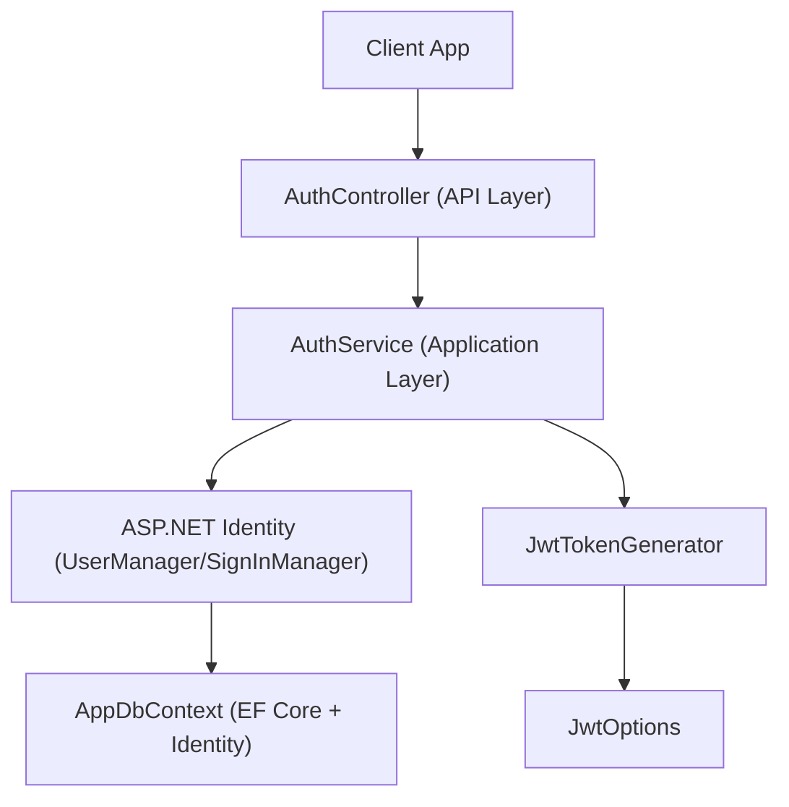
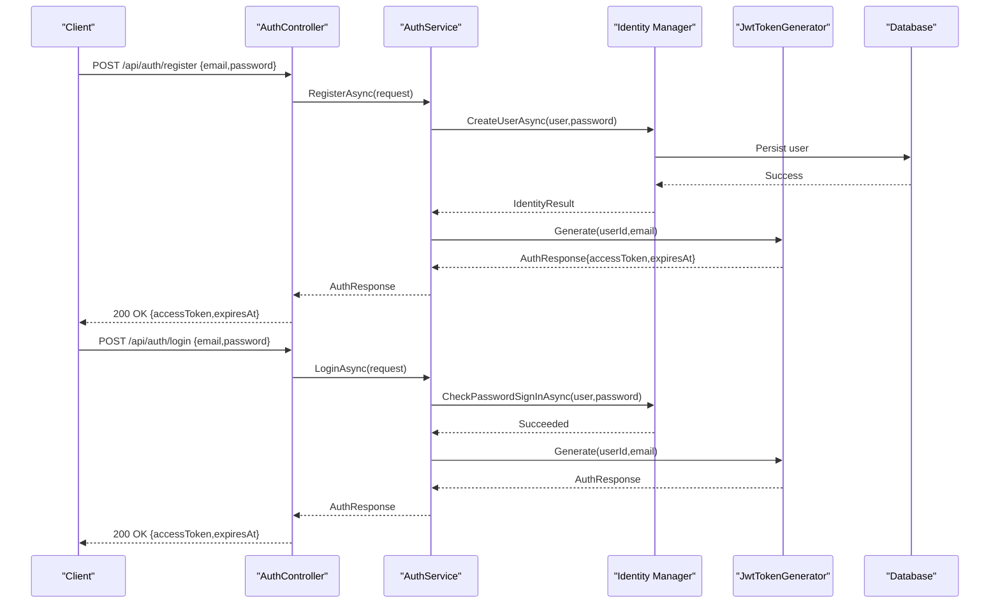
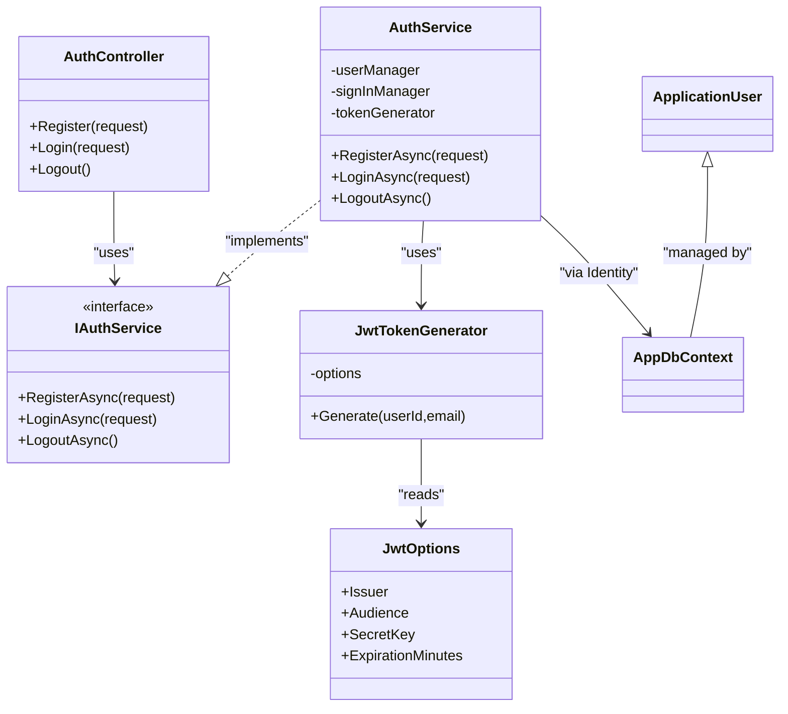

# Authentication System

<cite>
**Referenced Files in This Document**
- [AuthController.cs](file://Services/Services.Api/Controllers/AuthController.cs)
- [AuthService.cs](file://Services/Services.Infrastructure/Identity/AuthService.cs)
- [JwtTokenGenerator.cs](file://Services/Services.Infrastructure/Identity/JwtTokenGenerator.cs)
- [JwtOptions.cs](file://Services/Services.Infrastructure/Identity/JwtOptions.cs)
- [IAuthService.cs](file://Services/Services.Application/Interfaces/Services/IAuthService.cs)
- [ApplicationUser.cs](file://Services/Services.Infrastructure/Identity/ApplicationUser.cs)
- [AppDbContext.cs](file://Services/Services.Infrastructure/Persistence/AppDbContext.cs)
- [Program.cs](file://Services/Services.Api/Program.cs)
- [DependencyInjection.cs](file://Services/Services.Infrastructure/DependencyInjection.cs)
- [BearerSecuritySchemeTransformer.cs](file://Services/Services.Api/OpenApi/BearerSecuritySchemeTransformer.cs)
- [AuthResponse.cs](file://Services/Services.Application/DTOs/Auth/AuthResponse.cs)
- [LoginRequest.cs](file://Services/Services.Application/DTOs/Auth/LoginRequest.cs)
- [RegisterRequest.cs](file://Services/Services.Application/DTOs/Auth/RegisterRequest.cs)
</cite>

## Table of Contents
1. [Introduction](#introduction)
2. [Project Structure](#project-structure)
3. [Core Components](#core-components)
4. [Architecture Overview](#architecture-overview)
5. [Detailed Component Analysis](#detailed-component-analysis)
6. [Dependency Analysis](#dependency-analysis)
7. [Performance Considerations](#performance-considerations)
8. [Troubleshooting Guide](#troubleshooting-guide)
9. [Conclusion](#conclusion)
10. [Appendices](#appendices)

## Introduction
This document explains the complete authentication system implemented in the project, focusing on JWT token generation, validation, and lifecycle management. It covers the end-to-end flow from user registration and login to protected route access, including middleware configuration, authorization checks, and security measures such as token expiration and lockout policies. The backend is an ASP.NET Core API that uses ASP.NET Identity for user management and JWT Bearer tokens for stateless authentication.

## Project Structure
The authentication implementation spans multiple layers:
- API layer exposes REST endpoints for register, login, and logout.
- Application layer defines service interfaces and DTOs.
- Infrastructure layer implements identity services, JWT generation, and dependency injection.
- Persistence layer integrates ASP.NET Identity with Entity Framework.

**Diagram sources**
- [AuthController.cs:9-77](file://Services/Services.Api/Controllers/AuthController.cs#L9-L77)
- [AuthService.cs:8-91](file://Services/Services.Infrastructure/Identity/AuthService.cs#L8-L91)
- [JwtTokenGenerator.cs:9-49](file://Services/Services.Infrastructure/Identity/JwtTokenGenerator.cs#L9-L49)
- [JwtOptions.cs:3-14](file://Services/Services.Infrastructure/Identity/JwtOptions.cs#L3-L14)
- [AppDbContext.cs:10-24](file://Services/Services.Infrastructure/Persistence/AppDbContext.cs#L10-L24)

**Section sources**
- [AuthController.cs:9-77](file://Services/Services.Api/Controllers/AuthController.cs#L9-L77)
- [AuthService.cs:8-91](file://Services/Services.Infrastructure/Identity/AuthService.cs#L8-L91)
- [JwtTokenGenerator.cs:9-49](file://Services/Services.Infrastructure/Identity/JwtTokenGenerator.cs#L9-L49)
- [JwtOptions.cs:3-14](file://Services/Services.Infrastructure/Identity/JwtOptions.cs#L3-L14)
- [AppDbContext.cs:10-24](file://Services/Services.Infrastructure/Persistence/AppDbContext.cs#L10-L24)

## Core Components
- AuthController: Exposes HTTP endpoints for register, login, and logout. Validates inputs and delegates to AuthService.
- AuthService: Orchestrates user registration and login using ASP.NET Identity and issues JWT tokens via JwtTokenGenerator.
- JwtTokenGenerator: Builds and signs JWTs with configured issuer, audience, claims, and expiration.
- DependencyInjection: Configures ASP.NET Identity, EF Core, JWT bearer authentication, and authorization.
- Program: Registers OpenAPI/Swagger, enables HTTPS redirection, and applies authentication/authorization middleware.
- BearerSecuritySchemeTransformer: Adds a Bearer-JWT scheme to OpenAPI documentation for protected endpoints.

Key responsibilities:
- Registration: Create user, validate uniqueness, hash password via Identity, return JWT.
- Login: Validate credentials via SignInManager, return JWT.
- Logout: Sign out via SignInManager.
- Token issuance: Generate signed JWT with Sub, Email, Jti, issuer, audience, and expiration.
- Token validation: Configure JwtBearer options with issuer, audience, signing key, lifetime validation, and clock skew.

**Section sources**
- [AuthController.cs:9-77](file://Services/Services.Api/Controllers/AuthController.cs#L9-L77)
- [AuthService.cs:8-91](file://Services/Services.Infrastructure/Identity/AuthService.cs#L8-L91)
- [JwtTokenGenerator.cs:9-49](file://Services/Services.Infrastructure/Identity/JwtTokenGenerator.cs#L9-L49)
- [DependencyInjection.cs:19-128](file://Services/Services.Infrastructure/DependencyInjection.cs#L19-L128)
- [Program.cs:6-38](file://Services/Services.Api/Program.cs#L6-L38)
- [BearerSecuritySchemeTransformer.cs:7-57](file://Services/Services.Api/OpenApi/BearerSecuritySchemeTransformer.cs#L7-L57)

## Architecture Overview
The authentication architecture follows a layered approach:
- API Controllers handle HTTP requests and map them to application services.
- Application Services encapsulate business logic and coordinate Identity operations and token generation.
- Infrastructure provides persistence via EF Core and configures authentication/authorization.
- OpenAPI integration documents protected routes requiring Bearer tokens.

**Diagram sources**
- [AuthController.cs:14-62](file://Services/Services.Api/Controllers/AuthController.cs#L14-L62)
- [AuthService.cs:13-85](file://Services/Services.Infrastructure/Identity/AuthService.cs#L13-L85)
- [JwtTokenGenerator.cs:13-47](file://Services/Services.Infrastructure/Identity/JwtTokenGenerator.cs#L13-L47)

## Detailed Component Analysis

### Authentication Endpoints (AuthController)
Responsibilities:
- Register: Accepts email/password, validates input, calls AuthService.RegisterAsync, returns AuthResponse or validation error.
- Login: Accepts email/password, calls AuthService.LoginAsync, handles UnauthorizedAccessException, returns AuthResponse or error.
- Logout: Requires authorization, calls AuthService.LogoutAsync, returns success message.

Error handling:
- ValidationException mapped to 400 Bad Request.
- UnauthorizedAccessException mapped to 401 Unauthorized.

Authorization:
- Logout endpoint is protected by [Authorize].

**Section sources**
- [AuthController.cs:9-77](file://Services/Services.Api/Controllers/AuthController.cs#L9-L77)

### User Registration and Login (AuthService)
Registration flow:
- Validates request parameters.
- Checks for duplicate email.
- Creates user via UserManager and hashes password through Identity.
- Returns JWT via JwtTokenGenerator.

Login flow:
- Finds user by email.
- Verifies password via SignInManager.CheckPasswordSignInAsync with lockout enabled.
- Returns JWT via JwtTokenGenerator.

Logout flow:
- Signs out via SignInManager.SignOutAsync.

Security considerations:
- Password policy enforced by Identity configuration.
- Lockout policy prevents brute-force attacks.

**Section sources**
- [AuthService.cs:8-91](file://Services/Services.Infrastructure/Identity/AuthService.cs#L8-L91)
- [DependencyInjection.cs:31-48](file://Services/Services.Infrastructure/DependencyInjection.cs#L31-L48)

### JWT Token Generation (JwtTokenGenerator)
Token construction:
- Reads JwtOptions (issuer, audience, secret key, expiration).
- Validates secret key length.
- Sets claims: sub (userId), email, jti (unique token id).
- Signs token with HMAC-SHA256 using symmetric key.
- Returns AccessToken and ExpiresAt.

Expiration and rotation:
- Tokens include expiration time; each token has a unique JTI.
- No refresh token mechanism is implemented in this codebase.

**Section sources**
- [JwtTokenGenerator.cs:9-49](file://Services/Services.Infrastructure/Identity/JwtTokenGenerator.cs#L9-L49)
- [JwtOptions.cs:3-14](file://Services/Services.Infrastructure/Identity/JwtOptions.cs#L3-L14)

### Configuration and Middleware (DependencyInjection and Program)
Authentication setup:
- Configures ASP.NET Identity with EF Core stores.
- Enforces password complexity and lockout settings.
- Configures JWT Bearer authentication with issuer, audience, signing key, lifetime validation, and clock skew.
- Enables authorization.

Pipeline:
- HTTPS redirection.
- Authentication and authorization middleware applied before controllers.
- Controllers mapped last.

OpenAPI integration:
- Adds Bearer-JWT security scheme to OpenAPI docs.
- Automatically marks endpoints with [Authorize] as requiring authentication.

**Section sources**
- [DependencyInjection.cs:19-128](file://Services/Services.Infrastructure/DependencyInjection.cs#L19-L128)
- [Program.cs:6-38](file://Services/Services.Api/Program.cs#L6-L38)
- [BearerSecuritySchemeTransformer.cs:7-57](file://Services/Services.Api/OpenApi/BearerSecuritySchemeTransformer.cs#L7-L57)

### Protected Routes and Authorization
Protected route example:
- Any controller action decorated with [Authorize] requires a valid JWT Bearer token.
- The pipeline validates the token using configured JwtBearer options.

Authorization checks:
- Claims-based authorization can be added by configuring policies and using [Authorize(Policy = "...")].
- Current implementation sets NameClaimType to sub, enabling user identity resolution from the token.

**Section sources**
- [AuthController.cs:64-76](file://Services/Services.Api/Controllers/AuthController.cs#L64-L76)
- [DependencyInjection.cs:84-112](file://Services/Services.Infrastructure/DependencyInjection.cs#L84-L112)

### Data Models and DTOs
- AuthResponse: Contains AccessToken and ExpiresAt.
- LoginRequest: Contains Email and Password.
- RegisterRequest: Contains Email and Password.
- ApplicationUser: Extends IdentityUser<Guid>.
- AppDbContext: Integrates Identity and domain entities.

**Section sources**
- [AuthResponse.cs:1-5](file://Services/Services.Application/DTOs/Auth/AuthResponse.cs#L1-L5)
- [LoginRequest.cs:1-5](file://Services/Services.Application/DTOs/Auth/LoginRequest.cs#L1-L5)
- [RegisterRequest.cs:1-5](file://Services/Services.Application/DTOs/Auth/RegisterRequest.cs#L1-L5)
- [ApplicationUser.cs:1-7](file://Services/Services.Infrastructure/Identity/ApplicationUser.cs#L1-L7)
- [AppDbContext.cs:10-24](file://Services/Services.Infrastructure/Persistence/AppDbContext.cs#L10-L24)

## Dependency Analysis
The following diagram shows core dependencies among authentication components:

**Diagram sources**
- [AuthController.cs:9-77](file://Services/Services.Api/Controllers/AuthController.cs#L9-L77)
- [IAuthService.cs:1-17](file://Services/Services.Application/Interfaces/Services/IAuthService.cs#L1-L17)
- [AuthService.cs:8-91](file://Services/Services.Infrastructure/Identity/AuthService.cs#L8-L91)
- [JwtTokenGenerator.cs:9-49](file://Services/Services.Infrastructure/Identity/JwtTokenGenerator.cs#L9-L49)
- [JwtOptions.cs:3-14](file://Services/Services.Infrastructure/Identity/JwtOptions.cs#L3-L14)
- [AppDbContext.cs:10-24](file://Services/Services.Infrastructure/Persistence/AppDbContext.cs#L10-L24)
- [ApplicationUser.cs:1-7](file://Services/Services.Infrastructure/Identity/ApplicationUser.cs#L1-L7)

**Section sources**
- [AuthController.cs:9-77](file://Services/Services.Api/Controllers/AuthController.cs#L9-L77)
- [AuthService.cs:8-91](file://Services/Services.Infrastructure/Identity/AuthService.cs#L8-L91)
- [JwtTokenGenerator.cs:9-49](file://Services/Services.Infrastructure/Identity/JwtTokenGenerator.cs#L9-L49)
- [DependencyInjection.cs:19-128](file://Services/Services.Infrastructure/DependencyInjection.cs#L19-L128)

## Performance Considerations
- Stateless JWT reduces server-side session storage overhead.
- Token validation includes clock skew tolerance to avoid minor time drift issues.
- Avoid storing sensitive data in JWT claims; keep payloads minimal.
- Use short-lived access tokens if implementing refresh tokens later.
- Ensure database queries for user lookup are efficient (indexed email column by default in Identity).

[No sources needed since this section provides general guidance]

## Troubleshooting Guide
Common issues and resolutions:
- Invalid JWT configuration:
  - Symptom: Startup throws InvalidOperationException about missing or incomplete JWT configuration.
  - Resolution: Ensure JwtOptions contains valid Issuer, Audience, SecretKey (Base64, at least 32 bytes), and positive ExpirationMinutes.
- Base64 decoding errors:
  - Symptom: FormatException when parsing SecretKey.
  - Resolution: Provide a properly encoded Base64 string.
- Token validation failures:
  - Symptom: 401 Unauthorized on protected endpoints.
  - Resolution: Verify client sends Authorization: Bearer <token>, ensure issuer/audience/signing key match server configuration, and check token expiration.
- Duplicate email during registration:
  - Symptom: ValidationException indicating email already exists.
  - Resolution: Use a different email or remove existing account.
- Incorrect credentials:
  - Symptom: 401 Unauthorized on login.
  - Resolution: Confirm email/password; note lockout policy after repeated failures.

**Section sources**
- [DependencyInjection.cs:50-82](file://Services/Services.Infrastructure/DependencyInjection.cs#L50-L82)
- [AuthService.cs:13-85](file://Services/Services.Infrastructure/Identity/AuthService.cs#L13-L85)
- [AuthController.cs:14-62](file://Services/Services.Api/Controllers/AuthController.cs#L14-L62)

## Conclusion
The authentication system leverages ASP.NET Identity for secure user management and JWT Bearer tokens for stateless authentication. It provides clear endpoints for registration, login, and logout, with robust configuration for token validation and authorization. While it does not implement refresh tokens or cookie-based sessions, it offers a solid foundation for extending with additional security features such as CSRF protection, role-based authorization, and token rotation strategies.

[No sources needed since this section summarizes without analyzing specific files]

## Appendices

### Security Best Practices and Recommendations
- Enforce strong passwords and consider adding multi-factor authentication.
- Implement refresh tokens with short-lived access tokens and token rotation.
- Add CSRF protection for any cookie-based flows; currently, the system relies on Bearer tokens.
- Restrict sensitive claims in JWTs and rotate signing keys periodically.
- Enable rate limiting and monitoring around auth endpoints.

[No sources needed since this section provides general guidance]