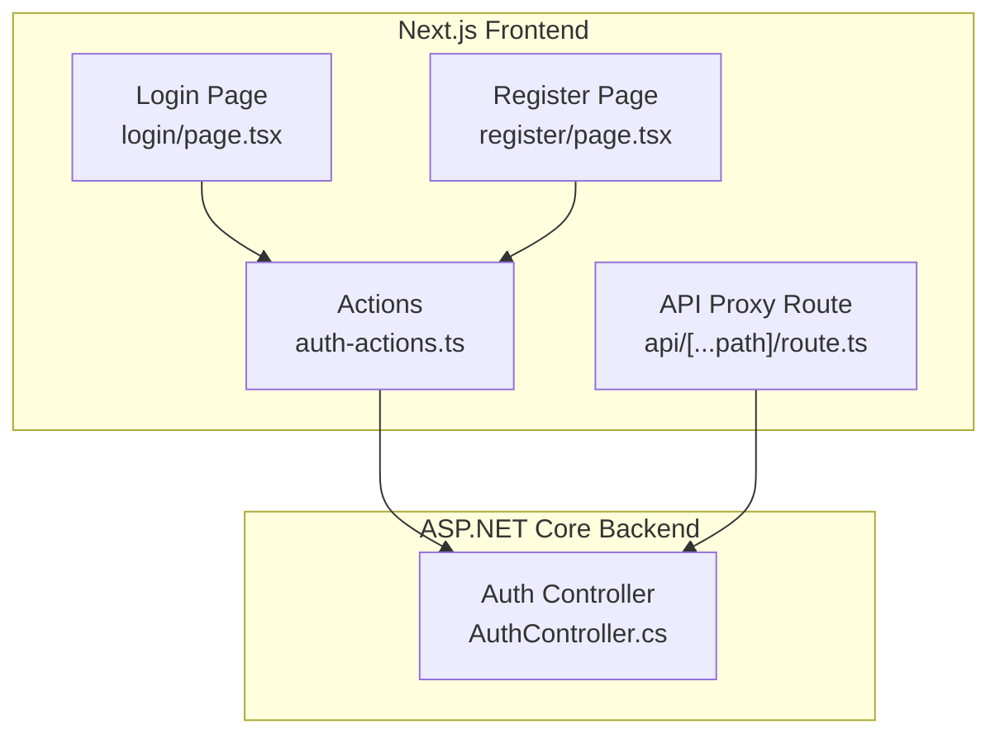
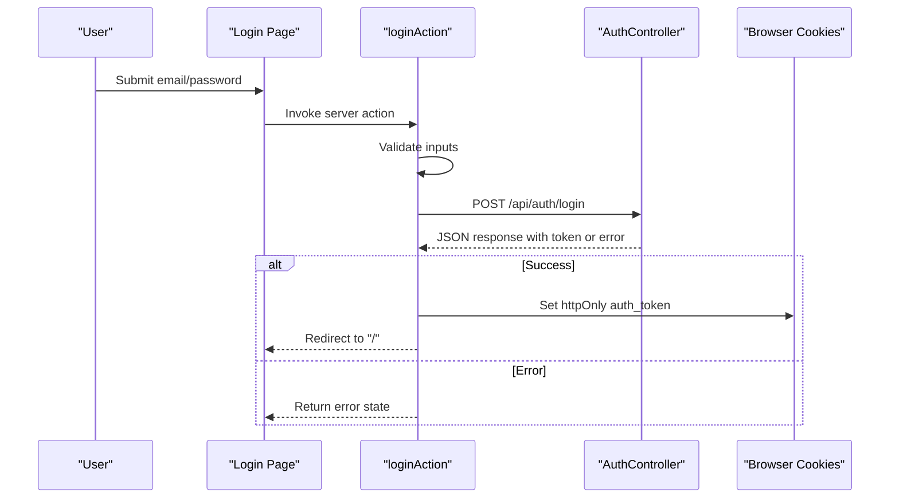
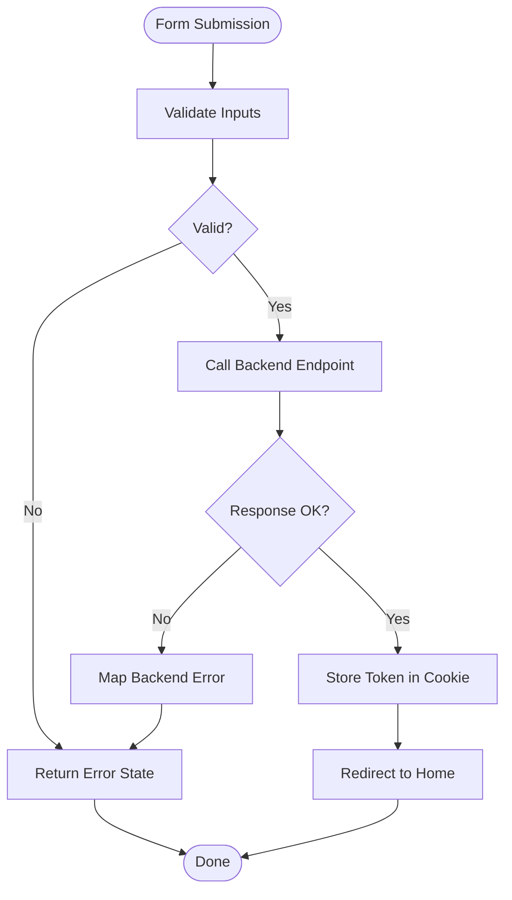

# Authentication Actions Module

<cite>
**Referenced Files in This Document**
- [auth-actions.ts](file://Apps/Web/src/actions/auth-actions.ts)
- [AuthController.cs](file://Services/Services.Api/Controllers/AuthController.cs)
- [route.ts](file://Apps/Web/src/app/api/[...path]/route.ts)
- [login page.tsx](file://Apps/Web/src/app/(auth)/login/page.tsx)
- [register page.tsx](file://Apps/Web/src/app/(auth)/register/page.tsx)
</cite>

## Table of Contents
1. [Introduction](#introduction)
2. [Project Structure](#project-structure)
3. [Core Components](#core-components)
4. [Architecture Overview](#architecture-overview)
5. [Detailed Component Analysis](#detailed-component-analysis)
6. [Dependency Analysis](#dependency-analysis)
7. [Performance Considerations](#performance-considerations)
8. [Troubleshooting Guide](#troubleshooting-guide)
9. [Conclusion](#conclusion)

## Introduction
This document explains the server-side authentication actions module for the Next.js frontend and how it integrates with the ASP.NET Core API. It covers:
- Server actions for login, signup, and logout
- The AuthActionState type and error handling patterns
- Cookie management and token storage
- API endpoint configuration and environment variables
- Form data processing, validation logic, and redirect behavior
- Security considerations such as HTTP-only cookies, secure flags, and development TLS settings

## Project Structure
The authentication flow spans the Next.js app (server actions and pages) and the ASP.NET Core API controller.

**Diagram sources**
- [auth-actions.ts:1-209](file://Apps/Web/src/actions/auth-actions.ts#L1-L209)
- [login page.tsx:1-119](file://Apps/Web/src/app/(auth)/login/page.tsx#L1-L119)
- [register page.tsx:1-140](file://Apps/Web/src/app/(auth)/register/page.tsx#L1-L140)
- [route.ts:1-47](file://Apps/Web/src/app/api/[...path]/route.ts#L1-L47)
- [AuthController.cs:1-77](file://Services/Services.Api/Controllers/AuthController.cs#L1-L77)

**Section sources**
- [auth-actions.ts:1-209](file://Apps/Web/src/actions/auth-actions.ts#L1-L209)
- [AuthController.cs:1-77](file://Services/Services.Api/Controllers/AuthController.cs#L1-L77)
- [route.ts:1-47](file://Apps/Web/src/app/api/[...path]/route.ts#L1-L47)
- [login page.tsx:1-119](file://Apps/Web/src/app/(auth)/login/page.tsx#L1-L119)
- [register page.tsx:1-140](file://Apps/Web/src/app/(auth)/register/page.tsx#L1-L140)

## Core Components
- Server actions:
  - loginAction: Validates form data, calls the backend login endpoint, stores tokens in cookies, and redirects on success.
  - signupAction: Validates form data, calls the backend register endpoint, stores tokens in cookies, and redirects on success.
  - logoutAction: Deletes the auth cookie and redirects to the login page.
  - getAuthToken: Reads the stored auth token from cookies.
- Types:
  - AuthActionState: Standardized return shape for action state, including success flag, error message, and optional field errors.
- Utilities:
  - getApiEndpoint: Builds the full backend URL based on API_BASE_URL and the requested endpoint.
  - setAuthCookies: Sets an HTTP-only, secure-aware cookie with a configurable expiration.

Key responsibilities:
- Input normalization and validation before network calls
- Robust error mapping from backend responses
- Secure cookie handling for tokens
- Redirects after successful authentication

**Section sources**
- [auth-actions.ts:11-19](file://Apps/Web/src/actions/auth-actions.ts#L11-L19)
- [auth-actions.ts:21-43](file://Apps/Web/src/actions/auth-actions.ts#L21-L43)
- [auth-actions.ts:45-116](file://Apps/Web/src/actions/auth-actions.ts#L45-L116)
- [auth-actions.ts:118-198](file://Apps/Web/src/actions/auth-actions.ts#L118-L198)
- [auth-actions.ts:200-209](file://Apps/Web/src/actions/auth-actions.ts#L200-L209)

## Architecture Overview
The authentication architecture uses Next.js server actions to perform secure operations on the server side while keeping sensitive tokens out of client-side code.

**Diagram sources**
- [auth-actions.ts:45-116](file://Apps/Web/src/actions/auth-actions.ts#L45-L116)
- [AuthController.cs:35-62](file://Services/Services.Api/Controllers/AuthController.cs#L35-L62)
- [login page.tsx:21-119](file://Apps/Web/src/app/(auth)/login/page.tsx#L21-L119)

## Detailed Component Analysis

### AuthActionState Type
AuthActionState defines the standardized result shape returned by server actions:
- success: Optional boolean indicating operation outcome
- error: Optional string or null for user-facing messages
- fieldErrors: Optional map for per-field validation feedback (email, password, confirmPassword)

Usage:
- Returned directly when validation fails or network errors occur
- Used by UI components to display errors via React’s useActionState

Security note:
- Avoid exposing internal stack traces; surface concise, user-friendly messages.

**Section sources**
- [auth-actions.ts:11-19](file://Apps/Web/src/actions/auth-actions.ts#L11-L19)

### API Endpoint Configuration
getApiEndpoint constructs the backend URL:
- Base URL comes from API_BASE_URL, defaulting to a local HTTPS address
- Ensures the base ends with /api and appends /auth/{endpoint}
- Endpoints supported: login, register, logout

Environment variable:
- API_BASE_URL: Controls the target backend service URL

Development TLS setting:
- Disables TLS certificate verification in non-production environments to support self-signed certificates during local development.

Recommendation:
- Prefer using the Next.js proxy route (/api/*) for authenticated requests to avoid CORS issues and centralize Authorization header injection.

**Section sources**
- [auth-actions.ts:21-26](file://Apps/Web/src/actions/auth-actions.ts#L21-L26)
- [auth-actions.ts:6-9](file://Apps/Web/src/actions/auth-actions.ts#L6-L9)
- [route.ts:1-47](file://Apps/Web/src/app/api/[...path]/route.ts#L1-L47)

### Cookie Management and Token Storage
setAuthCookies sets the authentication cookie:
- Name: auth_token
- Options:
  - httpOnly: true (prevents client-side JS access)
  - secure: true only in production (enforced by NODE_ENV check)
  - sameSite: lax (balances CSRF protection with typical navigation flows)
  - path: / (available across the app)
  - expires: derived from server-provided timestamp or defaults to 7 days

Token extraction:
- Accepts multiple possible property names from the backend response (e.g., accessToken, AccessToken, token, jwt).

Expiration handling:
- Uses server-provided expiresAt/ExpiresAt if present; otherwise falls back to a 7-day window.

Reading tokens:
- getAuthToken retrieves the current auth_token value from cookies for downstream usage.

Security considerations:
- Tokens are not exposed to client scripts due to httpOnly.
- In production, secure flag ensures cookies are sent over HTTPS only.
- sameSite lax is appropriate for top-level navigations but may require adjustment for cross-site scenarios.

**Section sources**
- [auth-actions.ts:28-43](file://Apps/Web/src/actions/auth-actions.ts#L28-L43)
- [auth-actions.ts:206-209](file://Apps/Web/src/actions/auth-actions.ts#L206-L209)

### loginAction
Responsibilities:
- Accepts either FormData or previous action state
- Normalizes input and trims email
- Validates presence of email and password
- Sends a POST request to /api/auth/login with JSON body containing email and password
- Parses response safely even if JSON parsing fails
- Maps backend errors to user-friendly messages
- Extracts token from various possible response fields
- Stores token via setAuthCookies
- Redirects to root on success

Error handling:
- Invalid form data returns a clear error
- Non-OK responses extract error/title/status-specific messages
- Network exceptions log details and return a generic connection error

Redirect behavior:
- Performs a server-side redirect to "/" upon successful authentication

Frontend integration:
- Login page uses useActionState to bind the form to loginAction and displays error messages.

**Section sources**
- [auth-actions.ts:45-116](file://Apps/Web/src/actions/auth-actions.ts#L45-L116)
- [login page.tsx:21-119](file://Apps/Web/src/app/(auth)/login/page.tsx#L21-L119)

### signupAction
Responsibilities:
- Accepts either FormData or previous action state
- Normalizes input and trims email
- Validates required fields (email, password)
- Validates that confirmPassword matches password
- Sends a POST request to /api/auth/register with JSON body containing email and password
- Parses response safely even if JSON parsing fails
- Maps backend errors, including nested validation errors
- Extracts token from various possible response fields
- Stores token via setAuthCookies
- Redirects to root on success

Error handling:
- Missing required fields return a clear error
- Mismatched passwords return a specific mismatch error
- Non-OK responses aggregate validation errors into a single message
- Network exceptions log details and return a generic connection error

Frontend integration:
- Register page performs additional client-side confirmation match check and surfaces combined client/server errors.

**Section sources**
- [auth-actions.ts:118-198](file://Apps/Web/src/actions/auth-actions.ts#L118-L198)
- [register page.tsx:21-140](file://Apps/Web/src/app/(auth)/register/page.tsx#L21-L140)

### logoutAction
Responsibilities:
- Deletes the auth_token cookie
- Redirects to /login

Behavior:
- Immediate client-visible effect after redirect
- Does not call the backend logout endpoint

Note:
- If server-side session invalidation is required, add a backend call before deleting the cookie.

**Section sources**
- [auth-actions.ts:200-204](file://Apps/Web/src/actions/auth-actions.ts#L200-L204)

### Backend Integration (AuthController)
Endpoints:
- POST /api/auth/register
  - Returns AuthResponse on success
  - Returns 400 Bad Request with error message on validation failures
- POST /api/auth/login
  - Returns AuthResponse on success
  - Returns 400 Bad Request on validation failures
  - Returns 401 Unauthorized with a Spanish error message on invalid credentials
- POST /api/auth/logout
  - Requires authorization
  - Returns success message

Integration notes:
- The frontend accepts flexible token field names to accommodate different backend response shapes.
- The backend uses ASP.NET Identity and JWT infrastructure for authentication.

**Section sources**
- [AuthController.cs:14-33](file://Services/Services.Api/Controllers/AuthController.cs#L14-L33)
- [AuthController.cs:35-62](file://Services/Services.Api/Controllers/AuthController.cs#L35-L62)
- [AuthController.cs:64-76](file://Services/Services.Api/Controllers/AuthController.cs#L64-L76)

### Form Data Processing and Validation Logic
Patterns:
- Server actions accept prevStateOrFormData or formDataMaybe to support both direct invocation and React form submissions
- Email trimming and required field checks prevent empty submissions
- Confirm password matching enforced server-side for signup
- Client-side validation complements server-side checks for better UX

Redirect handling:
- Successful actions trigger server-side redirects to "/"
- Errors are returned as state and rendered by the UI

**Section sources**
- [auth-actions.ts:45-116](file://Apps/Web/src/actions/auth-actions.ts#L45-L116)
- [auth-actions.ts:118-198](file://Apps/Web/src/actions/auth-actions.ts#L118-L198)
- [login page.tsx:21-119](file://Apps/Web/src/app/(auth)/login/page.tsx#L21-L119)
- [register page.tsx:21-140](file://Apps/Web/src/app/(auth)/register/page.tsx#L21-L140)

## Dependency Analysis
The authentication module depends on:
- Next.js runtime APIs:
  - cookies for server-side cookie access
  - redirect for server-side navigation
- Environment configuration:
  - API_BASE_URL for backend routing
  - NODE_ENV for security flags and dev TLS behavior
- Backend API:
  - AuthController endpoints for login, register, logout

**Diagram sources**
- [auth-actions.ts:45-116](file://Apps/Web/src/actions/auth-actions.ts#L45-L116)
- [auth-actions.ts:118-198](file://Apps/Web/src/actions/auth-actions.ts#L118-L198)

**Section sources**
- [auth-actions.ts:1-209](file://Apps/Web/src/actions/auth-actions.ts#L1-L209)
- [AuthController.cs:1-77](file://Services/Services.Api/Controllers/AuthController.cs#L1-L77)

## Performance Considerations
- Minimal payload: Only email and password are sent to the backend, reducing bandwidth.
- Efficient cookie handling: Single cookie write per successful authentication.
- Safe JSON parsing: Uses fallback to avoid crashes on malformed responses.
- Redirects: Server-side redirects avoid unnecessary client-side state updates.

[No sources needed since this section provides general guidance]

## Troubleshooting Guide
Common issues and resolutions:
- Invalid credentials:
  - Backend returns 401 with a descriptive error; frontend maps it to a user-friendly message.
- Malformed backend response:
  - JSON parsing failure is handled gracefully; a generic error is shown.
- Network connectivity:
  - Exceptions are caught and logged; users see a connection error message.
- Development TLS errors:
  - Self-signed certificates are allowed in non-production by disabling TLS rejection.
- Cookie not set:
  - Verify API_BASE_URL points to the correct backend and that the response includes a recognized token field.
- Logout not working:
  - Ensure the cookie name matches auth_token and that the browser allows cookie deletion.

**Section sources**
- [auth-actions.ts:81-108](file://Apps/Web/src/actions/auth-actions.ts#L81-L108)
- [auth-actions.ts:162-190](file://Apps/Web/src/actions/auth-actions.ts#L162-L190)
- [auth-actions.ts:6-9](file://Apps/Web/src/actions/auth-actions.ts#L6-L9)

## Conclusion
The authentication actions module provides a secure, maintainable foundation for user authentication in the Next.js application. It enforces server-side validation, handles errors robustly, manages tokens securely via HTTP-only cookies, and integrates cleanly with the ASP.NET Core API. For enhanced security and reliability:
- Centralize authenticated API calls through the Next.js proxy route to inject Authorization headers automatically
- Align backend response token field names to reduce ambiguity
- Enforce strict cookie policies (secure, sameSite) aligned with deployment environment
- Add server-side logout invalidation if sessions must be invalidated on the backend

[No sources needed since this section summarizes without analyzing specific files]