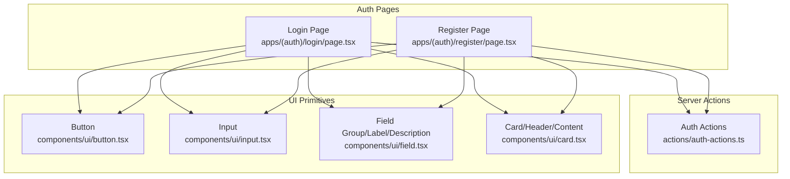
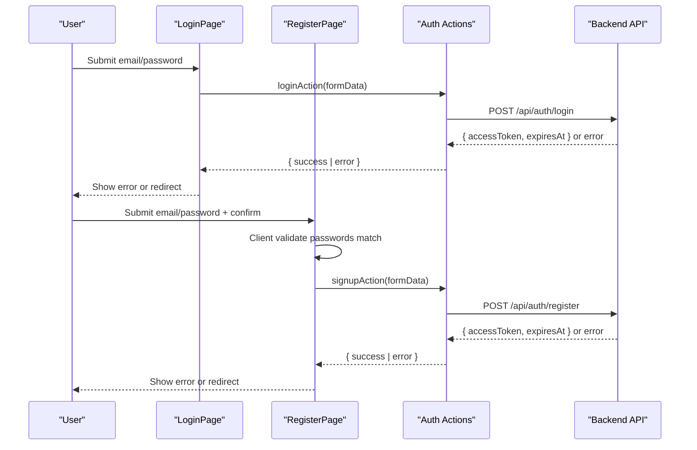
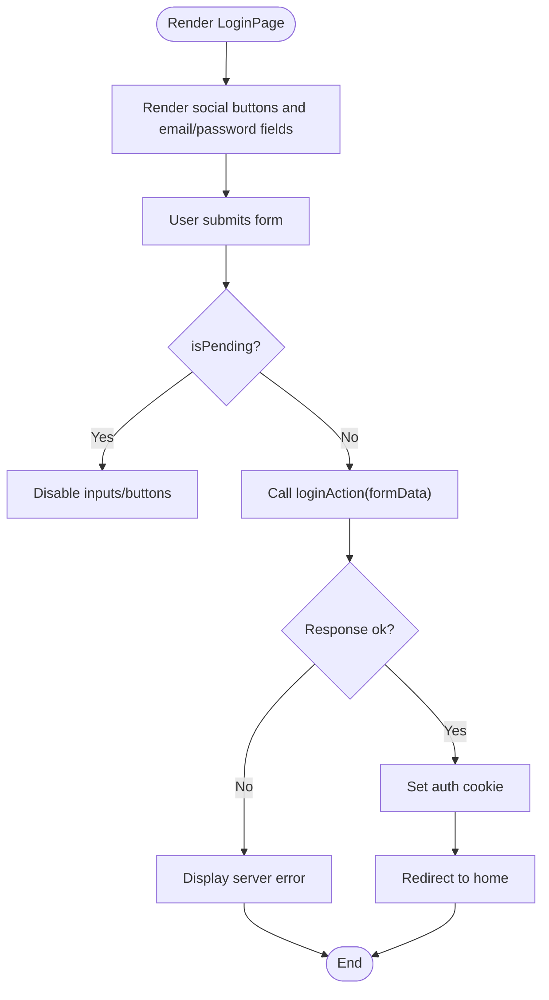
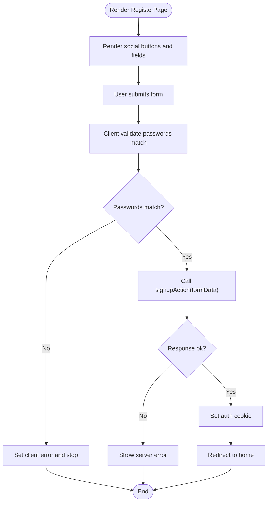
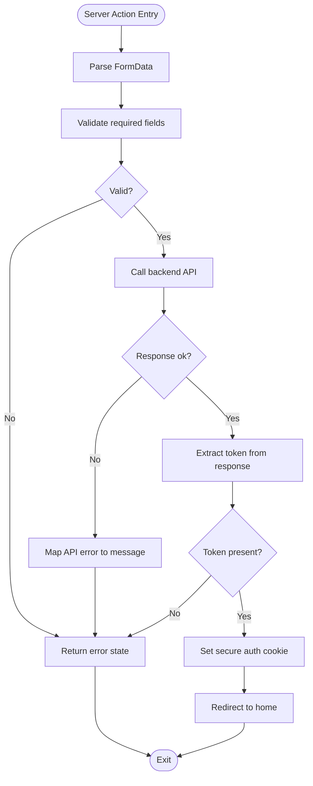
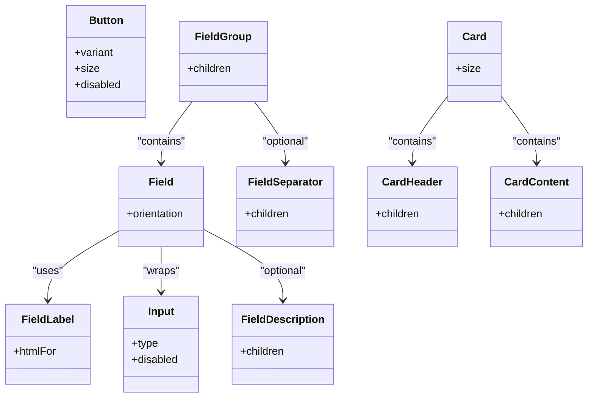
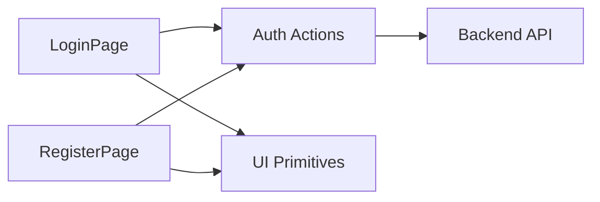

# Authentication Pages

<cite>
**Referenced Files in This Document**
- [login page](file://Apps/Web/src/app/(auth)/login/page.tsx)
- [register page](file://Apps/Web/src/app/(auth)/register/page.tsx)
- [auth actions](file://Apps/Web/src/actions/auth-actions.ts)
- [button component](file://Apps/Web/src/components/ui/button.tsx)
- [input component](file://Apps/Web/src/components/ui/input.tsx)
- [field components](file://Apps/Web/src/components/ui/field.tsx)
- [card components](file://Apps/Web/src/components/ui/card.tsx)
</cite>

## Table of Contents
1. [Introduction](#introduction)
2. [Project Structure](#project-structure)
3. [Core Components](#core-components)
4. [Architecture Overview](#architecture-overview)
5. [Detailed Component Analysis](#detailed-component-analysis)
6. [Dependency Analysis](#dependency-analysis)
7. [Performance Considerations](#performance-considerations)
8. [Troubleshooting Guide](#troubleshooting-guide)
9. [Conclusion](#conclusion)

## Introduction
This document explains the authentication pages for login and registration. It covers form structure, validation rules, user input handling, integration with server actions, error display patterns, loading states, and the UI components used to build the forms. The goal is to help developers understand how the client-side forms submit data, how errors are surfaced, and how the application maintains a consistent user experience during authentication flows.

## Project Structure
The authentication feature is implemented as two Next.js App Router pages under the (auth) route group:
- Login page: handles email/password login and social login buttons.
- Register page: handles account creation with email/password and password confirmation.

Both pages use:
- React Server Actions for form submission.
- Shared UI primitives for inputs, labels, fields, cards, and buttons.
- A centralized auth actions module that calls the backend API, manages cookies, and redirects on success.

**Diagram sources**
- [login page:1-119](file://Apps/Web/src/app/(auth)/login/page.tsx#L1-L119)
- [register page:1-140](file://Apps/Web/src/app/(auth)/register/page.tsx#L1-L140)
- [auth actions:1-210](file://Apps/Web/src/actions/auth-actions.ts#L1-L210)
- [button component:1-58](file://Apps/Web/src/components/ui/button.tsx#L1-L58)
- [input component:1-20](file://Apps/Web/src/components/ui/input.tsx#L1-L20)
- [field components:1-239](file://Apps/Web/src/components/ui/field.tsx#L1-L239)
- [card components:1-88](file://Apps/Web/src/components/ui/card.tsx#L1-L88)

**Section sources**
- [login page:1-119](file://Apps/Web/src/app/(auth)/login/page.tsx#L1-L119)
- [register page:1-140](file://Apps/Web/src/app/(auth)/register/page.tsx#L1-L140)
- [auth actions:1-210](file://Apps/Web/src/actions/auth-actions.ts#L1-L210)

## Core Components
- Login Page
  - Uses a server action to submit credentials.
  - Displays social login buttons and an email/password form.
  - Shows global error messages when server actions return an error.
  - Disables inputs and buttons while pending.

- Register Page
  - Uses a server action to create an account.
  - Includes client-side validation to ensure passwords match before submission.
  - Merges client-side and server-side errors into a single message area.
  - Disables inputs and buttons while pending.

- Auth Actions
  - Provides loginAction and signupAction.
  - Validates required fields server-side.
  - Calls the backend API endpoints for login and register.
  - Sets secure cookies with the token and optional expiration.
  - Redirects to the home page on success.

- UI Components
  - Button: supports variants and sizes; used for primary actions and social login.
  - Input: accessible input with focus and invalid states.
  - Field: composes labels, descriptions, separators, and grouping for forms.
  - Card: provides layout containers for headers, content, and footers.

**Section sources**
- [login page:21-119](file://Apps/Web/src/app/(auth)/login/page.tsx#L21-L119)
- [register page:21-140](file://Apps/Web/src/app/(auth)/register/page.tsx#L21-L140)
- [auth actions:45-116](file://Apps/Web/src/actions/auth-actions.ts#L45-L116)
- [auth actions:118-198](file://Apps/Web/src/actions/auth-actions.ts#L118-L198)
- [button component:42-55](file://Apps/Web/src/components/ui/button.tsx#L42-L55)
- [input component:5-16](file://Apps/Web/src/components/ui/input.tsx#L5-L16)
- [field components:41-86](file://Apps/Web/src/components/ui/field.tsx#L41-L86)
- [card components:4-20](file://Apps/Web/src/components/ui/card.tsx#L4-L20)

## Architecture Overview
The authentication flow uses React Server Actions to handle form submissions. The pages render forms using shared UI components. On submit, the server action validates input, calls the backend API, sets cookies, and redirects on success. Errors are returned to the client and displayed inline.

**Diagram sources**
- [login page:21-119](file://Apps/Web/src/app/(auth)/login/page.tsx#L21-L119)
- [register page:21-140](file://Apps/Web/src/app/(auth)/register/page.tsx#L21-L140)
- [auth actions:45-116](file://Apps/Web/src/actions/auth-actions.ts#L45-L116)
- [auth actions:118-198](file://Apps/Web/src/actions/auth-actions.ts#L118-L198)

## Detailed Component Analysis

### Login Page
- Form structure
  - Social login buttons for Apple and Google.
  - Email and password fields wrapped in field components.
  - Submit button triggers the server action.

- Validation and input handling
  - Browser-level required attributes enforce non-empty values.
  - Server action performs additional validation and returns user-friendly errors.

- Error display
  - Global error block renders when server action returns an error.
  - Accessible alert role is used for screen readers.

- Loading state
  - Inputs and buttons are disabled while pending.
  - Submit button text changes to indicate ongoing operation.

**Diagram sources**
- [login page:21-119](file://Apps/Web/src/app/(auth)/login/page.tsx#L21-L119)
- [auth actions:45-116](file://Apps/Web/src/actions/auth-actions.ts#L45-L116)

**Section sources**
- [login page:21-119](file://Apps/Web/src/app/(auth)/login/page.tsx#L21-L119)
- [auth actions:45-116](file://Apps/Web/src/actions/auth-actions.ts#L45-L116)

### Register Page
- Form structure
  - Social login buttons for Apple and Google.
  - Email, password, and confirm password fields.
  - Submit button triggers the server action.

- Client-side validation
  - Prevents submission if passwords do not match.
  - Clears previous client errors on new submission attempts.

- Error display
  - Combines client-side and server-side errors into a single message area.
  - Uses accessible alert role for error feedback.

- Loading state
  - Inputs and buttons are disabled while pending.
  - Submit button text indicates ongoing registration.

**Diagram sources**
- [register page:21-140](file://Apps/Web/src/app/(auth)/register/page.tsx#L21-L140)
- [auth actions:118-198](file://Apps/Web/src/actions/auth-actions.ts#L118-L198)

**Section sources**
- [register page:21-140](file://Apps/Web/src/app/(auth)/register/page.tsx#L21-L140)
- [auth actions:118-198](file://Apps/Web/src/actions/auth-actions.ts#L118-L198)

### Auth Actions
- loginAction
  - Extracts email and password from FormData.
  - Validates presence of required fields.
  - Calls the backend login endpoint.
  - Handles non-OK responses and maps API errors to user-facing messages.
  - Sets secure cookies with token and expiration.
  - Redirects to home on success.

- signupAction
  - Extracts email, password, and confirmPassword from FormData.
  - Validates presence of required fields and password equality.
  - Calls the backend register endpoint.
  - Handles non-OK responses and aggregates validation errors.
  - Sets secure cookies with token and expiration.
  - Redirects to home on success.

- Cookie management
  - Secure, httpOnly cookies with sameSite lax and path root.
  - Expiration defaults to seven days if not provided by the API.

**Diagram sources**
- [auth actions:45-116](file://Apps/Web/src/actions/auth-actions.ts#L45-L116)
- [auth actions:118-198](file://Apps/Web/src/actions/auth-actions.ts#L118-L198)

**Section sources**
- [auth actions:11-43](file://Apps/Web/src/actions/auth-actions.ts#L11-L43)
- [auth actions:45-116](file://Apps/Web/src/actions/auth-actions.ts#L45-L116)
- [auth actions:118-198](file://Apps/Web/src/actions/auth-actions.ts#L118-L198)

### UI Components Used in Forms
- Button
  - Variants include default, outline, secondary, ghost, destructive, link.
  - Sizes include default, xs, sm, lg, icon variants.
  - Disabled state prevents interaction during pending operations.

- Input
  - Accessible input with focus ring and invalid state styling.
  - Disabled state prevents editing during pending operations.

- Field
  - FieldGroup organizes form sections.
  - Field wraps label and input pairs.
  - FieldLabel associates with inputs via htmlFor.
  - FieldDescription provides helper text and links.
  - FieldSeparator visually separates sections.

- Card
  - CardHeader contains title and description.
  - CardContent holds the form body.
  - CardFooter can be used for additional actions.

**Diagram sources**
- [button component:42-55](file://Apps/Web/src/components/ui/button.tsx#L42-L55)
- [input component:5-16](file://Apps/Web/src/components/ui/input.tsx#L5-L16)
- [field components:41-86](file://Apps/Web/src/components/ui/field.tsx#L41-L86)
- [field components:101-144](file://Apps/Web/src/components/ui/field.tsx#L101-L144)
- [field components:146-174](file://Apps/Web/src/components/ui/field.tsx#L146-L174)
- [card components:4-20](file://Apps/Web/src/components/ui/card.tsx#L4-L20)
- [card components:22-33](file://Apps/Web/src/components/ui/card.tsx#L22-L33)
- [card components:68-72](file://Apps/Web/src/components/ui/card.tsx#L68-L72)

**Section sources**
- [button component:42-55](file://Apps/Web/src/components/ui/button.tsx#L42-L55)
- [input component:5-16](file://Apps/Web/src/components/ui/input.tsx#L5-L16)
- [field components:41-86](file://Apps/Web/src/components/ui/field.tsx#L41-L86)
- [field components:101-144](file://Apps/Web/src/components/ui/field.tsx#L101-L144)
- [field components:146-174](file://Apps/Web/src/components/ui/field.tsx#L146-L174)
- [card components:4-20](file://Apps/Web/src/components/ui/card.tsx#L4-L20)
- [card components:22-33](file://Apps/Web/src/components/ui/card.tsx#L22-L33)
- [card components:68-72](file://Apps/Web/src/components/ui/card.tsx#L68-L72)

## Dependency Analysis
- Pages depend on server actions for all authentication logic.
- Pages compose UI primitives for consistent design and accessibility.
- Server actions encapsulate API communication, cookie management, and redirection.

**Diagram sources**
- [login page:1-119](file://Apps/Web/src/app/(auth)/login/page.tsx#L1-L119)
- [register page:1-140](file://Apps/Web/src/app/(auth)/register/page.tsx#L1-L140)
- [auth actions:1-210](file://Apps/Web/src/actions/auth-actions.ts#L1-L210)

**Section sources**
- [login page:1-119](file://Apps/Web/src/app/(auth)/login/page.tsx#L1-L119)
- [register page:1-140](file://Apps/Web/src/app/(auth)/register/page.tsx#L1-L140)
- [auth actions:1-210](file://Apps/Web/src/actions/auth-actions.ts#L1-L210)

## Performance Considerations
- Use browser-native validation where possible to reduce unnecessary server calls.
- Keep server actions minimal and focused on validation and API calls.
- Avoid re-rendering heavy components during pending states; disable inputs instead.
- Prefer stable UI primitives to minimize layout shifts and improve perceived performance.

[No sources needed since this section provides general guidance]

## Troubleshooting Guide
- Common issues
  - Missing or malformed FormData: server actions return a generic invalid data error.
  - Empty email or password: server actions return a clear message prompting completion.
  - Password mismatch on register: both client-side and server-side validations prevent submission or return an error.
  - Backend errors: server actions map API errors to user-friendly messages and display them inline.
  - Network failures: server actions catch exceptions and show a connection error message.

- Debugging tips
  - Check the API base URL configuration and environment variables.
  - Verify that the backend returns a token in the expected fields.
  - Inspect cookie settings to ensure tokens are set correctly.
  - Confirm that the UI disables inputs and buttons during pending states to prevent duplicate submissions.

**Section sources**
- [auth actions:45-116](file://Apps/Web/src/actions/auth-actions.ts#L45-L116)
- [auth actions:118-198](file://Apps/Web/src/actions/auth-actions.ts#L118-L198)
- [login page:65-72](file://Apps/Web/src/app/(auth)/login/page.tsx#L65-L72)
- [register page:25-37](file://Apps/Web/src/app/(auth)/register/page.tsx#L25-L37)

## Conclusion
The authentication pages provide a consistent, accessible, and robust user experience. They leverage React Server Actions for secure and predictable form handling, integrate cleanly with shared UI components, and offer clear error feedback and loading states. The server actions centralize API communication and cookie management, ensuring a maintainable and scalable authentication flow.

[No sources needed since this section summarizes without analyzing specific files]