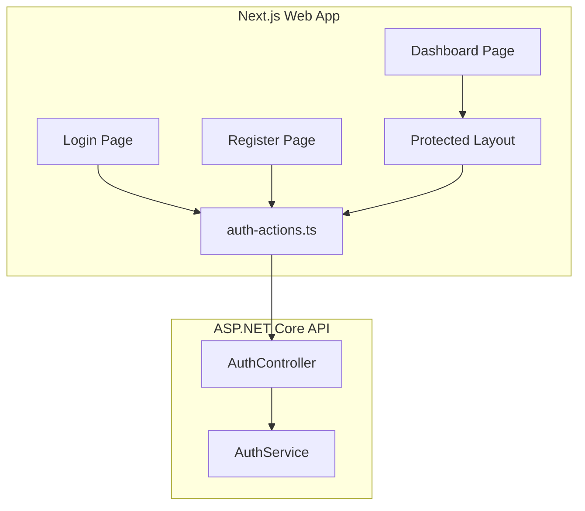
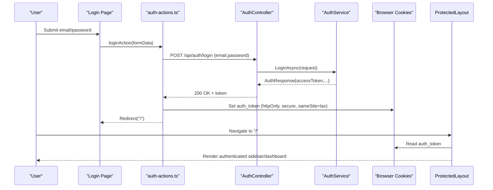
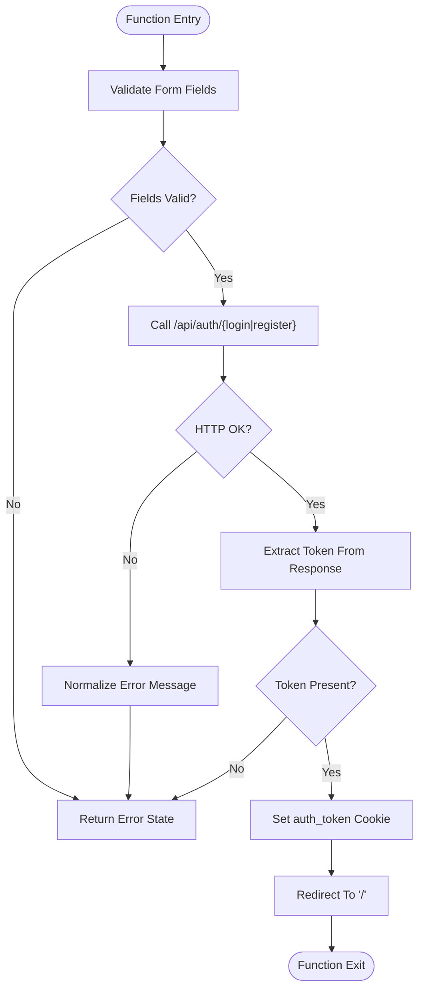
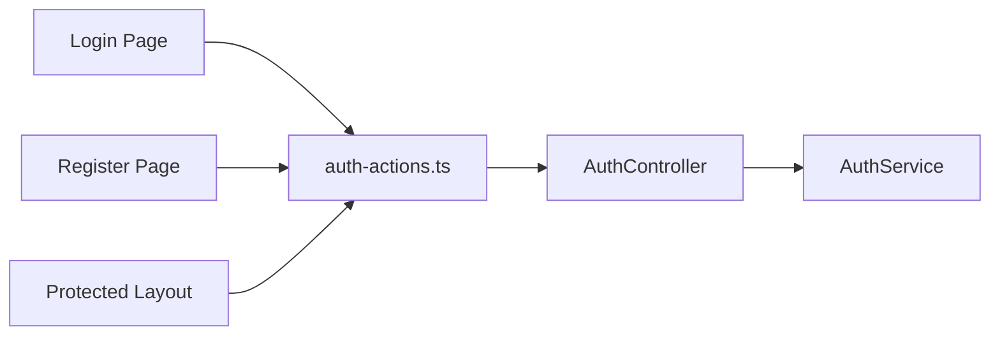

# Client-side Authentication Flow

<cite>
**Referenced Files in This Document**
- [auth-actions.ts](file://Apps/Web/src/actions/auth-actions.ts)
- [login page.tsx](file://Apps/Web/src/app/(auth)/login/page.tsx)
- [register page.tsx](file://Apps/Web/src/app/(auth)/register/page.tsx)
- [protected layout.tsx](file://Apps/Web/src/app/(protected)/layout.tsx)
- [protected dashboard page.tsx](file://Apps/Web/src/app/(protected)/page.tsx)
- [AuthController.cs](file://Services/Services.Api/Controllers/AuthController.cs)
- [AuthService.cs](file://Services/Services.Infrastructure/Identity/AuthService.cs)
</cite>

## Table of Contents
1. [Introduction](#introduction)
2. [Project Structure](#project-structure)
3. [Core Components](#core-components)
4. [Architecture Overview](#architecture-overview)
5. [Detailed Component Analysis](#detailed-component-analysis)
6. [Dependency Analysis](#dependency-analysis)
7. [Performance Considerations](#performance-considerations)
8. [Troubleshooting Guide](#troubleshooting-guide)
9. [Conclusion](#conclusion)

## Introduction
This document explains the client-side authentication flow for the TaskFlow web application. It covers server actions for login, registration, and logout; cookie-based token persistence; protected route behavior; error handling; loading states; and user feedback patterns. The backend endpoints are implemented in ASP.NET Core and return JSON responses that the Next.js client consumes to set cookies and redirect authenticated users.

## Project Structure
The authentication implementation spans:
- Server actions for auth operations and cookie management
- Auth pages (login/register) with form handling and validation
- Protected layout that reads the token from cookies and renders the sidebar
- Backend controllers and services that issue tokens and validate credentials

**Diagram sources**
- [auth-actions.ts:1-210](file://Apps/Web/src/actions/auth-actions.ts#L1-L210)
- [login page.tsx:1-119](file://Apps/Web/src/app/(auth)/login/page.tsx#L1-L119)
- [register page.tsx:1-140](file://Apps/Web/src/app/(auth)/register/page.tsx#L1-L140)
- [protected layout.tsx:1-49](file://Apps/Web/src/app/(protected)/layout.tsx#L1-L49)
- [AuthController.cs:1-77](file://Services/Services.Api/Controllers/AuthController.cs#L1-L77)
- [AuthService.cs:1-91](file://Services/Services.Infrastructure/Identity/AuthService.cs#L1-L91)

**Section sources**
- [auth-actions.ts:1-210](file://Apps/Web/src/actions/auth-actions.ts#L1-L210)
- [login page.tsx:1-119](file://Apps/Web/src/app/(auth)/login/page.tsx#L1-L119)
- [register page.tsx:1-140](file://Apps/Web/src/app/(auth)/register/page.tsx#L1-L140)
- [protected layout.tsx:1-49](file://Apps/Web/src/app/(protected)/layout.tsx#L1-L49)

## Core Components
- Server actions module:
  - loginAction: validates input, calls /api/auth/login, sets auth_token cookie, redirects on success
  - signupAction: validates input, calls /api/auth/register, sets auth_token cookie, redirects on success
  - logoutAction: deletes auth_token cookie and redirects to /login
  - getAuthToken: reads current auth_token cookie value
- Auth pages:
  - Login page: uses useActionState to integrate with loginAction, shows errors and pending state
  - Register page: integrates with signupAction, includes client-side password confirmation check
- Protected layout:
  - Reads auth_token cookie, decodes JWT payload to extract email/name for sidebar display
- Backend:
  - AuthController exposes register, login, logout endpoints
  - AuthService handles user creation, credential verification, and token generation

**Section sources**
- [auth-actions.ts:21-209](file://Apps/Web/src/actions/auth-actions.ts#L21-L209)
- [login page.tsx:21-118](file://Apps/Web/src/app/(auth)/login/page.tsx#L21-L118)
- [register page.tsx:21-139](file://Apps/Web/src/app/(auth)/register/page.tsx#L21-L139)
- [protected layout.tsx:7-26](file://Apps/Web/src/app/(protected)/layout.tsx#L7-L26)
- [AuthController.cs:14-76](file://Services/Services.Api/Controllers/AuthController.cs#L14-L76)
- [AuthService.cs:13-90](file://Services/Services.Infrastructure/Identity/AuthService.cs#L13-L90)

## Architecture Overview
The authentication flow is a hybrid server-client pattern:
- Forms submit via Next.js server actions
- Server actions call the API, persist tokens in httpOnly cookies, and perform server-side redirects
- Protected routes read cookies server-side to render authenticated UI and derive user info from JWT claims

**Diagram sources**
- [auth-actions.ts:45-116](file://Apps/Web/src/actions/auth-actions.ts#L45-L116)
- [AuthController.cs:35-62](file://Services/Services.Api/Controllers/AuthController.cs#L35-L62)
- [AuthService.cs:58-85](file://Services/Services.Infrastructure/Identity/AuthService.cs#L58-L85)
- [protected layout.tsx:7-26](file://Apps/Web/src/app/(protected)/layout.tsx#L7-L26)

## Detailed Component Analysis

### Server Actions Module (auth-actions.ts)
Responsibilities:
- Build API base URL and endpoint paths
- Persist tokens securely using httpOnly cookies
- Validate inputs and normalize error messages
- Provide logout and token retrieval helpers

Key behaviors:
- Endpoint resolution:
  - Uses environment variable API_BASE_URL or defaults to https://localhost:7120/api
  - Ensures trailing slash normalization and appends /api/auth/{endpoint}
- Cookie storage:
  - Sets auth_token with httpOnly=true, secure based on NODE_ENV, sameSite=lax, path="/", and expiration derived from response or defaulting to 7 days
- loginAction:
  - Validates presence of email and password
  - Sends JSON body with email and password
  - Accepts multiple token field names (accessToken, AccessToken, token, jwt)
  - On success, sets cookie and redirects to "/"
  - On failure, returns structured error message suitable for UI
- signupAction:
  - Validates required fields and optional confirmPassword match
  - Sends JSON body with email and password
  - Handles server validation errors by flattening nested error objects
  - On success, sets cookie and redirects to "/"
- logoutAction:
  - Deletes auth_token cookie and redirects to "/login"
- getAuthToken:
  - Returns the current auth_token cookie value for server-side usage

Security notes:
- Tokens are stored in httpOnly cookies to prevent client-side script access
- Secure flag is enabled in production
- SameSite lax mitigates CSRF risks for top-level navigations

Error handling:
- Network errors and non-OK responses are caught and converted into user-friendly messages
- Field-level validation occurs before network calls

**Diagram sources**
- [auth-actions.ts:21-43](file://Apps/Web/src/actions/auth-actions.ts#L21-L43)
- [auth-actions.ts:45-116](file://Apps/Web/src/actions/auth-actions.ts#L45-L116)
- [auth-actions.ts:118-198](file://Apps/Web/src/actions/auth-actions.ts#L118-L198)

**Section sources**
- [auth-actions.ts:21-209](file://Apps/Web/src/actions/auth-actions.ts#L21-L209)

### Login Page (login page.tsx)
Features:
- Integrates with loginAction using useActionState
- Displays global error messages returned by the server action
- Disables inputs and submit button during pending state
- Provides links to register and home

Form handling:
- Native HTML form submission triggers server action
- Required attributes ensure basic browser-side validation
- Pending state prevents duplicate submissions

User feedback:
- Shows an alert box when server returns an error
- Button text changes while submitting

Navigation:
- Links to register page and home

**Section sources**
- [login page.tsx:21-118](file://Apps/Web/src/app/(auth)/login/page.tsx#L21-L118)

### Register Page (register page.tsx)
Features:
- Integrates with signupAction using useActionState
- Adds client-side password confirmation validation before submission
- Merges client and server errors into a single message area
- Disables controls during pending state

Form handling:
- onSubmit handler checks password equality and prevents submission if mismatched
- Required attributes enforce basic validation
- Server action performs additional validation and error mapping

User feedback:
- Displays combined error message (client or server)
- Button text changes while creating account

Navigation:
- Links to login page

**Section sources**
- [register page.tsx:21-139](file://Apps/Web/src/app/(auth)/register/page.tsx#L21-L139)

### Protected Layout (protected layout.tsx)
Behavior:
- Runs on the server to read the auth_token cookie
- Decodes the JWT payload to extract email and name for sidebar display
- Falls back to a generic user identity if claims are missing or invalid
- Wraps children in SidebarProvider and displays header/sidebar structure

Authentication state:
- Derives user identity from the token without making extra API calls
- Uses Suspense to handle async cookie reading gracefully

Note:
- This layout does not enforce authentication at the route level; it assumes callers navigate here only after successful login.

**Section sources**
- [protected layout.tsx:7-26](file://Apps/Web/src/app/(protected)/layout.tsx#L7-L26)

### Dashboard Page (protected dashboard page.tsx)
Behavior:
- Loads tasks and projects data using API clients
- Manages loading and error states
- Renders summary and task/project sections

Authentication integration:
- Relies on protected layout to provide authenticated context
- Errors are displayed using Alert components

**Section sources**
- [protected dashboard page.tsx:13-76](file://Apps/Web/src/app/(protected)/page.tsx#L13-L76)

### Backend Authentication Endpoints (AuthController.cs)
Endpoints:
- POST /api/auth/register: accepts RegisterRequest, returns AuthResponse or 400 with validation error
- POST /api/auth/login: accepts LoginRequest, returns AuthResponse or 401 with unauthorized error
- POST /api/auth/logout: requires authorization, signs out and returns success message

Error handling:
- ValidationException mapped to 400 with error message
- UnauthorizedAccessException mapped to 401 with specific message

**Section sources**
- [AuthController.cs:14-76](file://Services/Services.Api/Controllers/AuthController.cs#L14-L76)

### Backend Authentication Service (AuthService.cs)
Responsibilities:
- RegisterAsync: validates request, creates user, generates token
- LoginAsync: finds user by email, verifies password, generates token
- LogoutAsync: signs out the user

Token generation:
- Delegates to JwtTokenGenerator to produce tokens containing user identity

Validation:
- Throws ValidationException for invalid inputs or duplicate emails
- Throws UnauthorizedAccessException for invalid credentials

**Section sources**
- [AuthService.cs:13-90](file://Services/Services.Infrastructure/Identity/AuthService.cs#L13-L90)

## Dependency Analysis
Client-to-server dependencies:
- Login and Register pages depend on server actions
- Server actions depend on Next.js cookies and navigation APIs
- Server actions call ASP.NET Core endpoints
- Controllers depend on service layer for business logic and identity management

**Diagram sources**
- [login page.tsx:21-118](file://Apps/Web/src/app/(auth)/login/page.tsx#L21-L118)
- [register page.tsx:21-139](file://Apps/Web/src/app/(auth)/register/page.tsx#L21-L139)
- [protected layout.tsx:7-26](file://Apps/Web/src/app/(protected)/layout.tsx#L7-L26)
- [auth-actions.ts:45-116](file://Apps/Web/src/actions/auth-actions.ts#L45-L116)
- [AuthController.cs:35-62](file://Services/Services.Api/Controllers/AuthController.cs#L35-L62)
- [AuthService.cs:58-85](file://Services/Services.Infrastructure/Identity/AuthService.cs#L58-L85)

**Section sources**
- [auth-actions.ts:45-116](file://Apps/Web/src/actions/auth-actions.ts#L45-L116)
- [AuthController.cs:35-62](file://Services/Services.Api/Controllers/AuthController.cs#L35-L62)
- [AuthService.cs:58-85](file://Services/Services.Infrastructure/Identity/AuthService.cs#L58-L85)

## Performance Considerations
- Server actions minimize client-side state by performing validation and redirection on the server
- Cookies are httpOnly and secure, reducing client-side overhead and risk
- JWT decoding in protected layout avoids extra API calls for user info
- Avoid redundant network requests by relying on cookie presence for authenticated UI

[No sources needed since this section provides general guidance]

## Troubleshooting Guide
Common issues and resolutions:
- Invalid credentials:
  - Server returns 401 with a clear error message; login page displays the message
- Missing or malformed token:
  - Server actions check for token presence; if absent, they return an error state
- Network connectivity problems:
  - Server actions catch fetch errors and show a friendly message
- Password mismatch on registration:
  - Client-side validation prevents submission; server also validates and returns an error
- Cookie not set:
  - Verify API_BASE_URL configuration and CORS settings; ensure server responds with token and expiresAt
- Protected UI not rendering:
  - Ensure auth_token cookie exists; protected layout reads it to derive user info

**Section sources**
- [auth-actions.ts:83-116](file://Apps/Web/src/actions/auth-actions.ts#L83-L116)
- [auth-actions.ts:164-198](file://Apps/Web/src/actions/auth-actions.ts#L164-L198)
- [login page.tsx:65-72](file://Apps/Web/src/app/(auth)/login/page.tsx#L65-L72)
- [register page.tsx:25-37](file://Apps/Web/src/app/(auth)/register/page.tsx#L25-L37)
- [protected layout.tsx:7-26](file://Apps/Web/src/app/(protected)/layout.tsx#L7-L26)

## Conclusion
The TaskFlow client-side authentication flow leverages Next.js server actions for secure, server-driven validation and redirection, with tokens persisted in httpOnly cookies. The protected layout derives user identity from the JWT payload to render authenticated UI. Error handling is consistent across forms and pages, providing clear feedback to users. While automatic token refresh is not implemented in the current codebase, the architecture supports future enhancements such as refresh token rotation and route guards.

[No sources needed since this section summarizes without analyzing specific files]