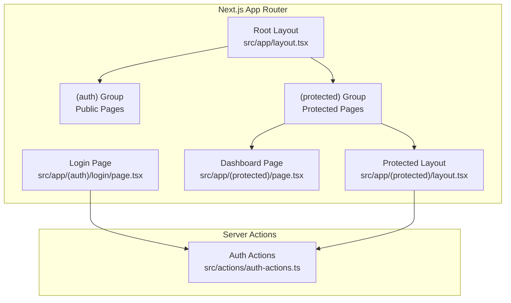
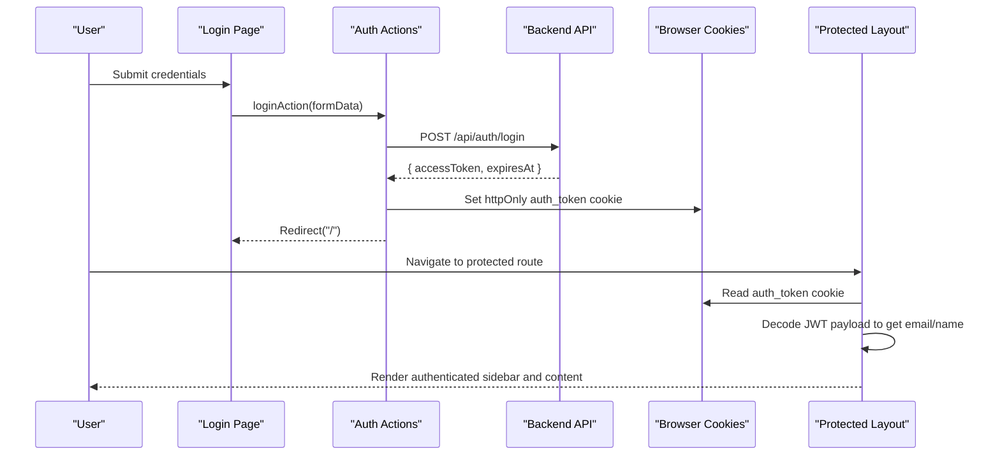
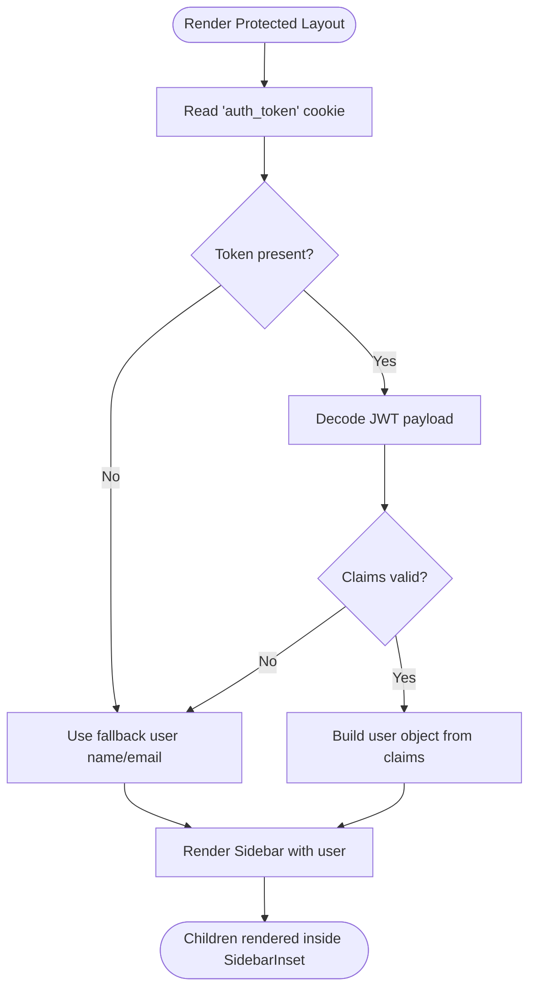
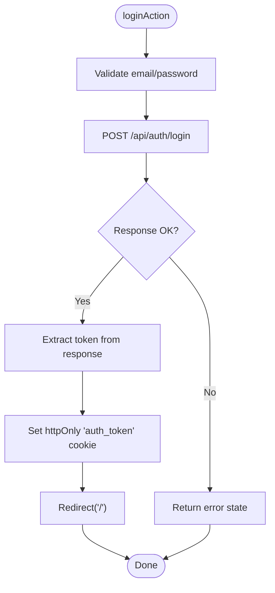
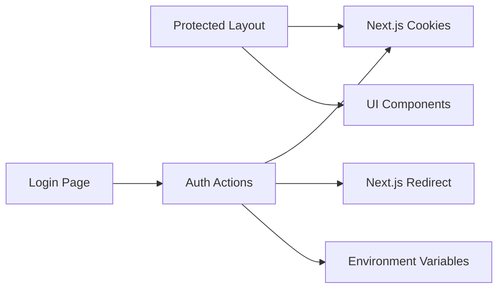

# Protected Routes and Guards

<cite>
**Referenced Files in This Document**
- [layout.tsx](file://Apps/Web/src/app/(protected)/layout.tsx)
- [auth-actions.ts](file://Apps/Web/src/actions/auth-actions.ts)
- [page.tsx](file://Apps/Web/src/app/(protected)/page.tsx)
- [login page.tsx](file://Apps/Web/src/app/(auth)/login/page.tsx)
- [root layout.tsx](file://Apps/Web/src/app/layout.tsx)
- [next.config.ts](file://Apps/Web/next.config.ts)
</cite>

## Table of Contents
1. [Introduction](#introduction)
2. [Project Structure](#project-structure)
3. [Core Components](#core-components)
4. [Architecture Overview](#architecture-overview)
5. [Detailed Component Analysis](#detailed-component-analysis)
6. [Dependency Analysis](#dependency-analysis)
7. [Performance Considerations](#performance-considerations)
8. [Troubleshooting Guide](#troubleshooting-guide)
9. [Conclusion](#conclusion)

## Introduction
This document explains how protected routes and authentication guards are implemented in the Next.js App Router for this project. It focuses on:
- The (protected) route group and its layout.tsx role
- How server-side cookies store and validate the authentication token
- How unauthenticated access is handled
- Redirect logic after login and logout
- Maintaining user session state across protected areas

The implementation uses Next.js Server Actions to authenticate users, set an httpOnly cookie with a JWT, and read that cookie within the protected layout to render authenticated UI. There is no middleware file present; protection is enforced at the layout level by reading the auth cookie and deriving user information from it.

## Project Structure
The relevant parts of the application structure for protected routes and authentication are:
- Root layout sets up global HTML/body and toasts
- (auth) route group contains public pages like login and register
- (protected) route group contains authenticated pages and a layout that reads the auth cookie
- Server actions handle login, signup, logout, and token retrieval

**Diagram sources**
- [root layout.tsx:1-45](file://Apps/Web/src/app/layout.tsx#L1-L45)
- [layout.tsx:1-49](file://Apps/Web/src/app/(protected)/layout.tsx#L1-L49)
- [page.tsx:1-77](file://Apps/Web/src/app/(protected)/page.tsx#L1-L77)
- [login page.tsx:1-119](file://Apps/Web/src/app/(auth)/login/page.tsx#L1-L119)
- [auth-actions.ts:1-210](file://Apps/Web/src/actions/auth-actions.ts#L1-L210)

**Section sources**
- [root layout.tsx:1-45](file://Apps/Web/src/app/layout.tsx#L1-L45)
- [layout.tsx:1-49](file://Apps/Web/src/app/(protected)/layout.tsx#L1-L49)
- [page.tsx:1-77](file://Apps/Web/src/app/(protected)/page.tsx#L1-L77)
- [login page.tsx:1-119](file://Apps/Web/src/app/(auth)/login/page.tsx#L1-L119)
- [auth-actions.ts:1-210](file://Apps/Web/src/actions/auth-actions.ts#L1-L210)

## Core Components
- Protected layout: Reads the auth_token cookie, decodes the JWT payload to extract email/name, and renders the authenticated sidebar with user info.
- Auth server actions: Provide loginAction, signupAction, logoutAction, and getAuthToken. They set or delete the auth_token cookie and redirect as needed.
- Login page: Uses useActionState to call loginAction and display errors.
- Dashboard page: A sample protected page that loads data using client-side API calls.

Key responsibilities:
- Authentication flow: Client form → Server Action → API → Cookie set → Redirect
- Session validation: Protected layout reads the cookie and derives user context
- Unauthenticated handling: If no valid token exists, the protected area cannot derive user info and should not grant access to protected content

**Section sources**
- [layout.tsx:1-49](file://Apps/Web/src/app/(protected)/layout.tsx#L1-L49)
- [auth-actions.ts:1-210](file://Apps/Web/src/actions/auth-actions.ts#L1-L210)
- [login page.tsx:1-119](file://Apps/Web/src/app/(auth)/login/page.tsx#L1-L119)
- [page.tsx:1-77](file://Apps/Web/src/app/(protected)/page.tsx#L1-L77)

## Architecture Overview
The authentication and protection architecture centers around:
- Cookies-based JWT storage via httpOnly cookies
- Server Actions for secure credential handling and cookie management
- Layout-level checks in the (protected) group to ensure only authenticated users can see protected UI

**Diagram sources**
- [login page.tsx:1-119](file://Apps/Web/src/app/(auth)/login/page.tsx#L1-L119)
- [auth-actions.ts:21-43](file://Apps/Web/src/actions/auth-actions.ts#L21-L43)
- [auth-actions.ts:45-116](file://Apps/Web/src/actions/auth-actions.ts#L45-L116)
- [layout.tsx:7-26](file://Apps/Web/src/app/(protected)/layout.tsx#L7-L26)

## Detailed Component Analysis

### Protected Route Group and Layout
The (protected) route group encapsulates authenticated pages. Its layout.tsx performs:
- Reading the auth_token cookie
- Decoding the JWT middle segment to extract claims (email, name)
- Rendering the authenticated sidebar with user details
- Using Suspense to avoid blocking the initial render while fetching cookie data

Important behaviors:
- If the cookie is missing or malformed, the layout falls back to a default user name and empty email
- The layout does not explicitly block navigation when the token is invalid; instead, it renders a minimal sidebar without user-specific data

**Diagram sources**
- [layout.tsx:7-26](file://Apps/Web/src/app/(protected)/layout.tsx#L7-L26)
- [layout.tsx:28-48](file://Apps/Web/src/app/(protected)/layout.tsx#L28-L48)

**Section sources**
- [layout.tsx:1-49](file://Apps/Web/src/app/(protected)/layout.tsx#L1-L49)

### Authentication Server Actions
The auth-actions module provides:
- loginAction: Validates input, calls backend login endpoint, sets httpOnly cookie, redirects to "/"
- signupAction: Similar to login but for registration
- logoutAction: Deletes the auth_token cookie and redirects to "/login"
- getAuthToken: Utility to retrieve the current token from cookies

Security considerations:
- Token is stored in an httpOnly cookie, reducing XSS exposure
- Secure flag is enabled in production
- SameSite lax helps mitigate CSRF risks for top-level navigations

**Diagram sources**
- [auth-actions.ts:45-116](file://Apps/Web/src/actions/auth-actions.ts#L45-L116)

**Section sources**
- [auth-actions.ts:1-210](file://Apps/Web/src/actions/auth-actions.ts#L1-L210)

### Login Page
The login page:
- Uses React's useActionState to integrate with loginAction
- Displays error messages returned by the server action
- Submits email and password to the server action

After successful login, the server action redirects to the root path, which is under the (protected) group.

**Section sources**
- [login page.tsx:1-119](file://Apps/Web/src/app/(auth)/login/page.tsx#L1-L119)
- [auth-actions.ts:45-116](file://Apps/Web/src/actions/auth-actions.ts#L45-L116)

### Dashboard Page (Protected Area Example)
The dashboard page demonstrates a typical protected route:
- Client component that fetches tasks and projects
- Shows loading states and error alerts
- Relies on the presence of a valid session (cookie) to access protected endpoints

Note: The page itself does not enforce authentication; protection is expected to be provided by the parent layout or middleware. In this codebase, the layout currently renders based on cookie presence but does not redirect unauthenticated users.

**Section sources**
- [page.tsx:1-77](file://Apps/Web/src/app/(protected)/page.tsx#L1-L77)

## Dependency Analysis
- Protected layout depends on:
  - Next.js headers for cookies
  - React Suspense for non-blocking rendering
  - UI components for sidebar and header
- Auth actions depend on:
  - Next.js headers for cookies
  - Next.js navigation for redirects
  - Environment variables for API base URL
- Login page depends on:
  - Auth actions for server-side authentication
  - UI components for form fields and buttons

**Diagram sources**
- [layout.tsx:1-49](file://Apps/Web/src/app/(protected)/layout.tsx#L1-L49)
- [auth-actions.ts:1-210](file://Apps/Web/src/actions/auth-actions.ts#L1-L210)
- [login page.tsx:1-119](file://Apps/Web/src/app/(auth)/login/page.tsx#L1-L119)

**Section sources**
- [layout.tsx:1-49](file://Apps/Web/src/app/(protected)/layout.tsx#L1-L49)
- [auth-actions.ts:1-210](file://Apps/Web/src/actions/auth-actions.ts#L1-L210)
- [login page.tsx:1-119](file://Apps/Web/src/app/(auth)/login/page.tsx#L1-L119)

## Performance Considerations
- The protected layout uses Suspense to avoid blocking the initial render while decoding the JWT and building the user object.
- The auth actions perform network requests on the server side, keeping sensitive operations out of the browser.
- Avoid heavy computations in the layout; keep cookie reading and JWT decoding lightweight.

[No sources needed since this section provides general guidance]

## Troubleshooting Guide
Common issues and resolutions:
- Missing or invalid token:
  - Ensure loginAction successfully sets the auth_token cookie
  - Verify the backend returns a valid token and expiration
- Redirects not working:
  - Confirm that loginAction redirects to "/" after setting the cookie
  - Check that the protected route group is correctly configured
- Session not persisting:
  - Verify cookie options: httpOnly, secure (production), sameSite, path
  - Ensure the browser accepts cookies for the domain

Relevant implementation references:
- Cookie setting and options
- Redirect behavior after login/logout
- JWT decoding and fallback behavior in protected layout

**Section sources**
- [auth-actions.ts:28-43](file://Apps/Web/src/actions/auth-actions.ts#L28-L43)
- [auth-actions.ts:101-116](file://Apps/Web/src/actions/auth-actions.ts#L101-L116)
- [auth-actions.ts:200-204](file://Apps/Web/src/actions/auth-actions.ts#L200-L204)
- [layout.tsx:7-26](file://Apps/Web/src/app/(protected)/layout.tsx#L7-L26)

## Conclusion
The protected routes in this project rely on:
- A (protected) route group with a layout that reads the auth_token cookie and renders authenticated UI
- Server Actions to securely authenticate users and manage cookies
- Redirects to guide users between public and protected areas

While the current protected layout does not explicitly block unauthenticated navigation, it ensures that only when a valid token exists can user-specific data be derived and displayed. For stricter enforcement, consider adding a middleware-based guard that redirects unauthenticated users before rendering protected layouts.

[No sources needed since this section summarizes without analyzing specific files]