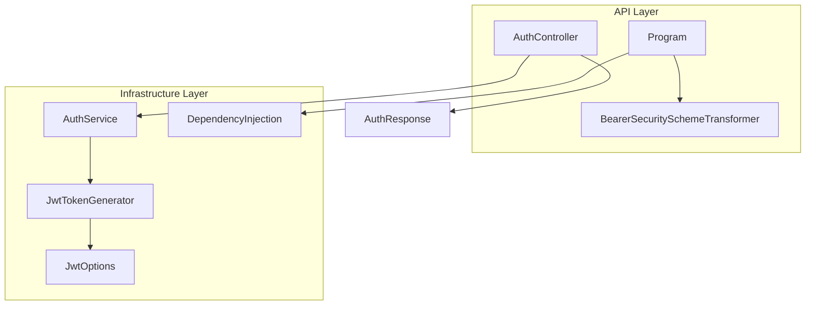
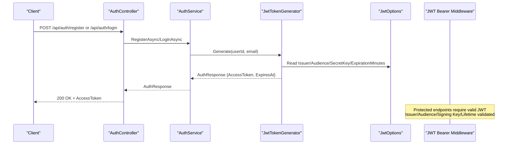
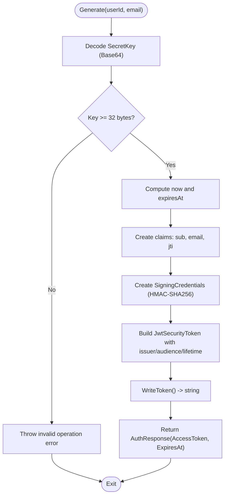
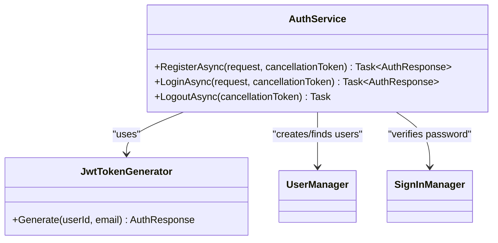
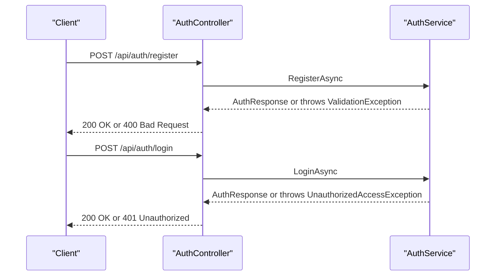
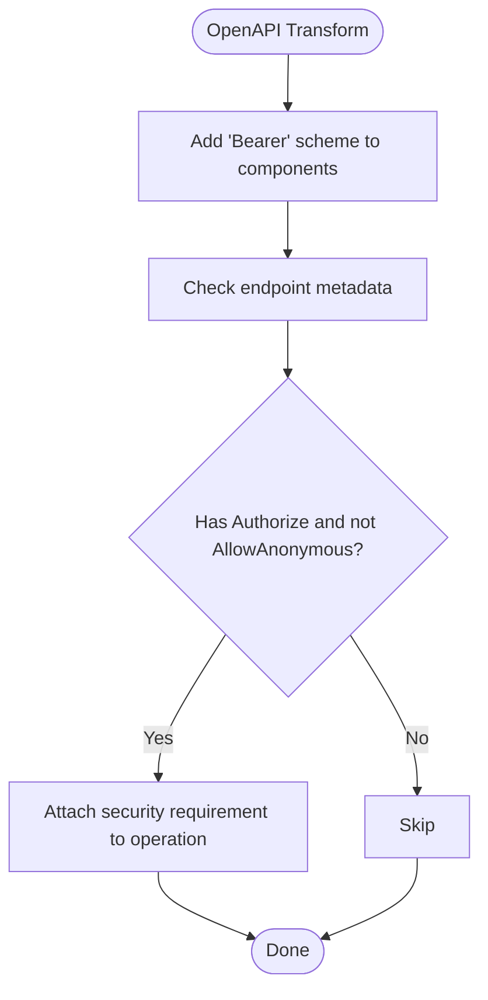
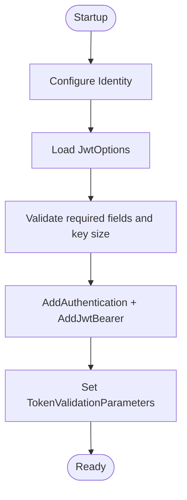
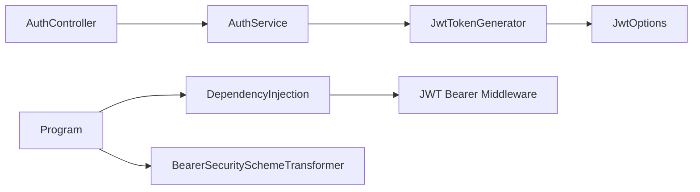
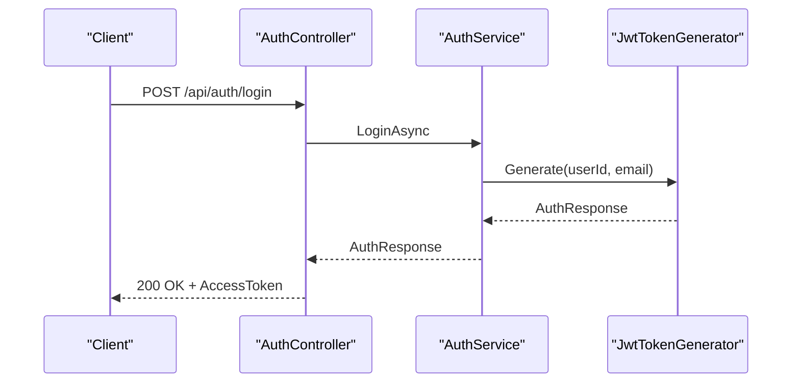

# JWT Token Management

<cite>
**Referenced Files in This Document**
- [JwtTokenGenerator.cs](file://Services/Services.Infrastructure/Identity/JwtTokenGenerator.cs)
- [JwtOptions.cs](file://Services/Services.Infrastructure/Identity/JwtOptions.cs)
- [DependencyInjection.cs](file://Services/Services.Infrastructure/DependencyInjection.cs)
- [AuthService.cs](file://Services/Services.Infrastructure/Identity/AuthService.cs)
- [AuthController.cs](file://Services/Services.Api/Controllers/AuthController.cs)
- [BearerSecuritySchemeTransformer.cs](file://Services/Services.Api/OpenApi/BearerSecuritySchemeTransformer.cs)
- [Program.cs](file://Services/Services.Api/Program.cs)
- [AuthResponse.cs](file://Services/services.Application/DTOs/Auth/AuthResponse.cs)
</cite>

## Table of Contents
1. [Introduction](#introduction)
2. [Project Structure](#project-structure)
3. [Core Components](#core-components)
4. [Architecture Overview](#architecture-overview)
5. [Detailed Component Analysis](#detailed-component-analysis)
6. [Dependency Analysis](#dependency-analysis)
7. [Performance Considerations](#performance-considerations)
8. [Troubleshooting Guide](#troubleshooting-guide)
9. [Conclusion](#conclusion)
10. [Appendices](#appendices)

## Introduction
This document explains the JWT token management implementation in the project, focusing on token generation, configuration, validation, and API documentation integration. It covers how tokens are created with JwtTokenGenerator, configured via JwtOptions, validated by ASP.NET Core’s JWT Bearer authentication, and documented using a Bearer security scheme for OpenAPI. It also provides guidance on token refresh strategies, rotation mechanisms, and production security considerations.

## Project Structure
The JWT-related functionality spans the infrastructure and API layers:
- Infrastructure layer defines identity services, options, and token generation.
- API layer exposes authentication endpoints and configures OpenAPI to document bearer authentication.

**Diagram sources**
- [AuthController.cs:1-77](file://Services/Services.Api/Controllers/AuthController.cs#L1-L77)
- [Program.cs:1-38](file://Services/Services.Api/Program.cs#L1-L38)
- [BearerSecuritySchemeTransformer.cs:1-57](file://Services/Services.Api/OpenApi/BearerSecuritySchemeTransformer.cs#L1-L57)
- [AuthService.cs:1-91](file://Services/Services.Infrastructure/Identity/AuthService.cs#L1-L91)
- [JwtTokenGenerator.cs:1-49](file://Services/Services.Infrastructure/Identity/JwtTokenGenerator.cs#L1-L49)
- [JwtOptions.cs:1-14](file://Services/Services.Infrastructure/Identity/JwtOptions.cs#L1-L14)
- [DependencyInjection.cs:1-128](file://Services/Services.Infrastructure/DependencyInjection.cs#L1-L128)
- [AuthResponse.cs:1-5](file://Services/services.Application/DTOs/Auth/AuthResponse.cs#L1-L5)

**Section sources**
- [AuthController.cs:1-77](file://Services/Services.Api/Controllers/AuthController.cs#L1-L77)
- [Program.cs:1-38](file://Services/Services.Api/Program.cs#L1-L38)
- [AuthService.cs:1-91](file://Services/Services.Infrastructure/Identity/AuthService.cs#L1-L91)
- [JwtTokenGenerator.cs:1-49](file://Services/Services.Infrastructure/Identity/JwtTokenGenerator.cs#L1-L49)
- [JwtOptions.cs:1-14](file://Services/Services.Infrastructure/Identity/JwtOptions.cs#L1-L14)
- [DependencyInjection.cs:1-128](file://Services/Services.Infrastructure/DependencyInjection.cs#L1-L128)
- [BearerSecuritySchemeTransformer.cs:1-57](file://Services/Services.Api/OpenApi/BearerSecuritySchemeTransformer.cs#L1-L57)
- [AuthResponse.cs:1-5](file://Services/services.Application/DTOs/Auth/AuthResponse.cs#L1-L5)

## Core Components
- JwtTokenGenerator: Creates signed JWTs with claims, issuer, audience, expiration, and HMAC-SHA256 signing.
- JwtOptions: Configuration model for issuer, audience, secret key (Base64), and expiration minutes.
- AuthService: Orchestrates user registration/login and delegates token creation to JwtTokenGenerator.
- AuthController: Exposes HTTP endpoints for register, login, and logout; maps exceptions to appropriate HTTP responses.
- DependencyInjection: Configures ASP.NET Core Identity, JWT Bearer authentication, validates JwtOptions, and registers services.
- BearerSecuritySchemeTransformer: Adds a Bearer/JWT security scheme to OpenAPI and applies it to protected endpoints.
- Program: Wires OpenAPI transformers and middleware pipeline.

Key responsibilities:
- Token generation: payload construction, signing algorithm selection, expiration handling.
- Token validation: issuer, audience, signing key, lifetime checks, clock skew.
- API documentation: Bearer scheme definition and automatic application to secured endpoints.

**Section sources**
- [JwtTokenGenerator.cs:1-49](file://Services/Services.Infrastructure/Identity/JwtTokenGenerator.cs#L1-L49)
- [JwtOptions.cs:1-14](file://Services/Services.Infrastructure/Identity/JwtOptions.cs#L1-L14)
- [AuthService.cs:1-91](file://Services/Services.Infrastructure/Identity/AuthService.cs#L1-L91)
- [AuthController.cs:1-77](file://Services/Services.Api/Controllers/AuthController.cs#L1-L77)
- [DependencyInjection.cs:1-128](file://Services/Services.Infrastructure/DependencyInjection.cs#L1-L128)
- [BearerSecuritySchemeTransformer.cs:1-57](file://Services/Services.Api/OpenApi/BearerSecuritySchemeTransformer.cs#L1-L57)
- [Program.cs:1-38](file://Services/Services.Api/Program.cs#L1-L38)

## Architecture Overview
The authentication flow integrates ASP.NET Core Identity, JWT Bearer authentication, and OpenAPI documentation.

**Diagram sources**
- [AuthController.cs:14-62](file://Services/Services.Api/Controllers/AuthController.cs#L14-L62)
- [AuthService.cs:13-85](file://Services/Services.Infrastructure/Identity/AuthService.cs#L13-L85)
- [JwtTokenGenerator.cs:13-47](file://Services/Services.Infrastructure/Identity/JwtTokenGenerator.cs#L13-L47)
- [JwtOptions.cs:3-14](file://Services/Services.Infrastructure/Identity/JwtOptions.cs#L3-L14)
- [DependencyInjection.cs:84-112](file://Services/Services.Infrastructure/DependencyInjection.cs#L84-L112)

## Detailed Component Analysis

### JwtTokenGenerator
Responsibilities:
- Validates the secret key length.
- Builds claims: subject (user ID), email, unique token ID.
- Signs tokens using HMAC-SHA256 with a symmetric key derived from Base64-encoded secret.
- Sets issuer, audience, not-before, and expiration based on JwtOptions.
- Returns an AuthResponse containing the serialized token and expiration time.

**Diagram sources**
- [JwtTokenGenerator.cs:13-47](file://Services/Services.Infrastructure/Identity/JwtTokenGenerator.cs#L13-L47)

**Section sources**
- [JwtTokenGenerator.cs:1-49](file://Services/Services.Infrastructure/Identity/JwtTokenGenerator.cs#L1-L49)

### JwtOptions
Configuration fields:
- Issuer: Expected issuer claim value.
- Audience: Expected audience claim value.
- SecretKey: Base64-encoded symmetric key used for HMAC-SHA256 signing.
- ExpirationMinutes: Token lifetime in minutes.

Validation occurs during dependency injection setup to ensure required values are present and the secret meets minimum entropy requirements.

**Section sources**
- [JwtOptions.cs:1-14](file://Services/Services.Infrastructure/Identity/JwtOptions.cs#L1-L14)
- [DependencyInjection.cs:50-82](file://Services/Services.Infrastructure/DependencyInjection.cs#L50-L82)

### AuthService
Responsibilities:
- Validates input and enforces business rules for registration and login.
- Uses ASP.NET Core Identity to create users and verify credentials.
- Delegates token creation to JwtTokenGenerator upon successful operations.
- Throws domain-specific exceptions that the controller maps to HTTP status codes.

**Diagram sources**
- [AuthService.cs:8-91](file://Services/Services.Infrastructure/Identity/AuthService.cs#L8-L91)
- [JwtTokenGenerator.cs:9-49](file://Services/Services.Infrastructure/Identity/JwtTokenGenerator.cs#L9-L49)

**Section sources**
- [AuthService.cs:1-91](file://Services/Services.Infrastructure/Identity/AuthService.cs#L1-L91)

### AuthController
Endpoints:
- POST /api/auth/register: Registers a user and returns a JWT.
- POST /api/auth/login: Authenticates a user and returns a JWT.
- POST /api/auth/logout: Requires authorization; signs out the current session.

Error handling:
- ValidationException mapped to 400 Bad Request.
- UnauthorizedAccessException mapped to 401 Unauthorized.

**Diagram sources**
- [AuthController.cs:14-62](file://Services/Services.Api/Controllers/AuthController.cs#L14-L62)
- [AuthService.cs:13-85](file://Services/Services.Infrastructure/Identity/AuthService.cs#L13-L85)

**Section sources**
- [AuthController.cs:1-77](file://Services/Services.Api/Controllers/AuthController.cs#L1-L77)

### Bearer Security Scheme for API Documentation
The transformer adds a Bearer/JWT security scheme to OpenAPI components and automatically attaches it to endpoints marked with authorization attributes.

Key behaviors:
- Defines a scheme named "Bearer" with type Http, scheme "bearer", format "JWT".
- Applies the scheme to any endpoint that has authorization metadata but is not anonymous.

**Diagram sources**
- [BearerSecuritySchemeTransformer.cs:7-55](file://Services/Services.Api/OpenApi/BearerSecuritySchemeTransformer.cs#L7-L55)

**Section sources**
- [BearerSecuritySchemeTransformer.cs:1-57](file://Services/Services.Api/OpenApi/BearerSecuritySchemeTransformer.cs#L1-L57)
- [Program.cs:14-18](file://Services/Services.Api/Program.cs#L14-L18)

### Authentication Pipeline and Token Validation
DependencyInjection configures:
- ASP.NET Core Identity with Entity Framework stores.
- JWT Bearer authentication with strict validation parameters:
  - ValidateIssuer, ValidIssuer
  - ValidateAudience, ValidAudience
  - ValidateIssuerSigningKey, IssuerSigningKey
  - ValidateLifetime, ClockSkew
  - NameClaimType set to subject claim

**Diagram sources**
- [DependencyInjection.cs:31-112](file://Services/Services.Infrastructure/DependencyInjection.cs#L31-L112)

**Section sources**
- [DependencyInjection.cs:1-128](file://Services/Services.Infrastructure/DependencyInjection.cs#L1-L128)

## Dependency Analysis
High-level dependencies among core components:

**Diagram sources**
- [AuthController.cs:1-77](file://Services/Services.Api/Controllers/AuthController.cs#L1-L77)
- [AuthService.cs:1-91](file://Services/Services.Infrastructure/Identity/AuthService.cs#L1-L91)
- [JwtTokenGenerator.cs:1-49](file://Services/Services.Infrastructure/Identity/JwtTokenGenerator.cs#L1-L49)
- [JwtOptions.cs:1-14](file://Services/Services.Infrastructure/Identity/JwtOptions.cs#L1-L14)
- [DependencyInjection.cs:1-128](file://Services/Services.Infrastructure/DependencyInjection.cs#L1-L128)
- [Program.cs:1-38](file://Services/Services.Api/Program.cs#L1-L38)
- [BearerSecuritySchemeTransformer.cs:1-57](file://Services/Services.Api/OpenApi/BearerSecuritySchemeTransformer.cs#L1-L57)

**Section sources**
- [AuthController.cs:1-77](file://Services/Services.Api/Controllers/AuthController.cs#L1-L77)
- [AuthService.cs:1-91](file://Services/Services.Infrastructure/Identity/AuthService.cs#L1-L91)
- [JwtTokenGenerator.cs:1-49](file://Services/Services.Infrastructure/Identity/JwtTokenGenerator.cs#L1-L49)
- [JwtOptions.cs:1-14](file://Services/Services.Infrastructure/Identity/JwtOptions.cs#L1-L14)
- [DependencyInjection.cs:1-128](file://Services/Services.Infrastructure/DependencyInjection.cs#L1-L128)
- [Program.cs:1-38](file://Services/Services.Api/Program.cs#L1-L38)
- [BearerSecuritySchemeTransformer.cs:1-57](file://Services/Services.Api/OpenApi/BearerSecuritySchemeTransformer.cs#L1-L57)

## Performance Considerations
- Symmetric signing (HMAC-SHA256) is fast and suitable for single-service deployments.
- Keep ExpirationMinutes reasonable to balance usability and security; shorter lifetimes reduce exposure windows.
- Avoid storing sensitive data in JWT claims; prefer minimal payloads.
- Use HTTPS everywhere to protect tokens in transit.
- Consider caching strategies for external resources if needed, but do not cache tokens client-side beyond their expiration.

[No sources needed since this section provides general guidance]

## Troubleshooting Guide
Common issues and resolutions:
- Missing or incomplete JWT configuration:
  - Ensure JwtOptions contains non-empty Issuer, Audience, SecretKey, and positive ExpirationMinutes.
  - The dependency injection setup will throw if these are missing or invalid.
- Invalid secret key:
  - SecretKey must be a valid Base64 string and decode to at least 32 bytes.
  - If not, startup will fail with an explicit error message.
- Authentication failures:
  - Verify that the token’s issuer, audience, and signature match server expectations.
  - Check clock skew settings; excessive skew can cause premature expiry or acceptance of expired tokens.
- API documentation not showing Bearer scheme:
  - Confirm that BearerSecuritySchemeTransformer is registered as both document and operation transformer.
  - Ensure protected endpoints have authorization metadata.

**Section sources**
- [DependencyInjection.cs:50-82](file://Services/Services.Infrastructure/DependencyInjection.cs#L50-L82)
- [DependencyInjection.cs:84-112](file://Services/Services.Infrastructure/DependencyInjection.cs#L84-L112)
- [Program.cs:14-18](file://Services/Services.Api/Program.cs#L14-L18)
- [BearerSecuritySchemeTransformer.cs:12-55](file://Services/Services.Api/OpenApi/BearerSecuritySchemeTransformer.cs#L12-L55)

## Conclusion
The JWT implementation uses a clear separation of concerns: JwtOptions centralizes configuration, JwtTokenGenerator handles secure token creation, AuthService orchestrates identity flows, and the API layer exposes endpoints and documents them with a Bearer security scheme. ASP.NET Core’s JWT Bearer middleware performs robust validation. For production, enforce strong secrets, short-lived tokens, HTTPS, and consider refresh and rotation strategies outlined below.

[No sources needed since this section summarizes without analyzing specific files]

## Appendices

### Token Creation Example Flow
- Client calls register or login.
- Server validates inputs and credentials.
- Server generates a JWT with subject, email, and jti claims.
- Server returns AccessToken and ExpiresAt.

**Diagram sources**
- [AuthController.cs:35-62](file://Services/Services.Api/Controllers/AuthController.cs#L35-L62)
- [AuthService.cs:58-85](file://Services/Services.Infrastructure/Identity/AuthService.cs#L58-L85)
- [JwtTokenGenerator.cs:13-47](file://Services/Services.Infrastructure/Identity/JwtTokenGenerator.cs#L13-L47)

### Token Refresh Strategies
- Short-lived access tokens with long-lived refresh tokens:
  - Issue a separate refresh token stored securely (e.g., database-backed).
  - On access token expiry, exchange refresh token for a new access token.
- Rotation mechanism:
  - Revoke old refresh tokens after use to prevent replay attacks.
  - Implement token versioning or blacklists for revoked tokens.
- Security considerations:
  - Store refresh tokens securely (HTTP-only cookies or secure storage).
  - Bind refresh tokens to user/session context.
  - Enforce HTTPS and short lifetimes.

[No sources needed since this section provides general guidance]

### Security Considerations for Production
- Use a strong, randomly generated SecretKey (Base64-encoded) with sufficient entropy.
- Restrict allowed issuers and audiences to your service(s).
- Enable HTTPS and HSTS.
- Monitor and log authentication events without logging sensitive data.
- Rotate keys periodically and support graceful migration.
- Limit claims to essential information; avoid PII in tokens.

[No sources needed since this section provides general guidance]