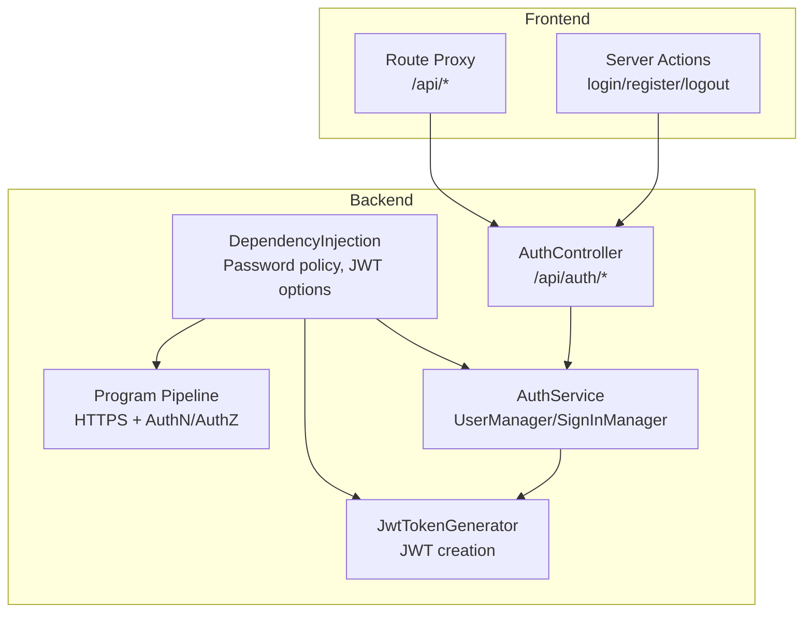
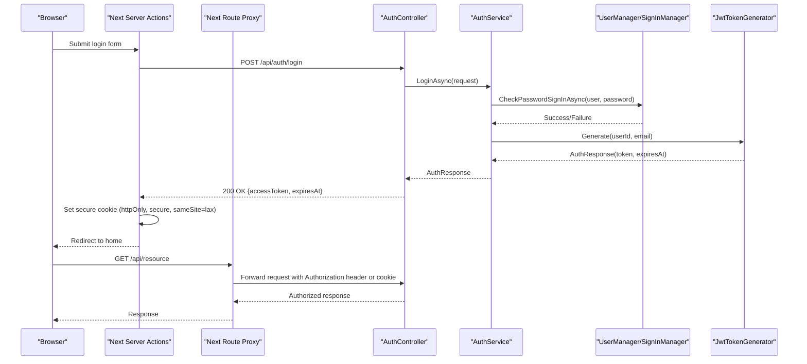
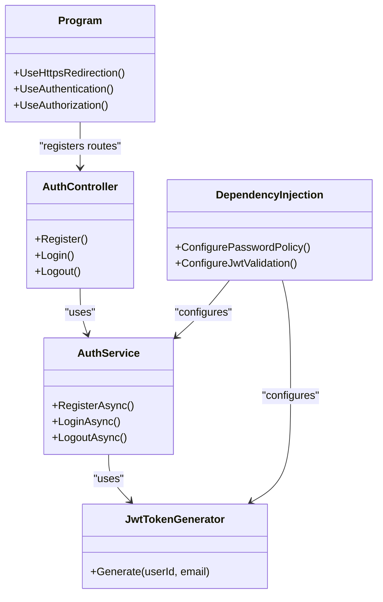

# Security Measures

<cite>
**Referenced Files in This Document**
- [AuthController.cs](file://Services/Services.Api/Controllers/AuthController.cs)
- [AuthService.cs](file://Services/Services.Infrastructure/Identity/AuthService.cs)
- [JwtTokenGenerator.cs](file://Services/Services.Infrastructure/Identity/JwtTokenGenerator.cs)
- [JwtOptions.cs](file://Services/Services.Infrastructure/Identity/JwtOptions.cs)
- [Program.cs](file://Services/Services.Api/Program.cs)
- [DependencyInjection.cs](file://Services/Services.Infrastructure/DependencyInjection.cs)
- [appsettings.Example.json](file://Services/Services.Api/appsettings.Example.json)
- [launchSettings.json](file://Services/Services.Api/Properties/launchSettings.json)
- [auth-actions.ts](file://Apps/Web/src/actions/auth-actions.ts)
- [route.ts](file://Apps/Web/src/app/api/[...path]/route.ts)
- [BearerSecuritySchemeTransformer.cs](file://Services/Services.Api/OpenApi/BearerSecuritySchemeTransformer.cs)
</cite>

## Table of Contents
1. [Introduction](#introduction)
2. [Project Structure](#project-structure)
3. [Core Components](#core-components)
4. [Architecture Overview](#architecture-overview)
5. [Detailed Component Analysis](#detailed-component-analysis)
6. [Dependency Analysis](#dependency-analysis)
7. [Performance Considerations](#performance-considerations)
8. [Troubleshooting Guide](#troubleshooting-guide)
9. [Conclusion](#conclusion)
10. [Appendices](#appendices)

## Introduction
This document explains the security measures implemented across the authentication system, covering CSRF protection strategies, XSS prevention, input sanitization, secure cookie configuration, HTTPS enforcement, security headers, password hashing and validation, token generation and validation, expiration policies, and revocation approaches. It also provides best practices and compliance considerations for production environments.

## Project Structure
The project is a full-stack application:
- Frontend (Next.js): Server actions handle login/register/logout, set secure cookies, and call backend APIs. A route handler proxies authenticated requests to the backend.
- Backend (ASP.NET Core): Controllers expose auth endpoints; Identity handles user management and password hashing; JWT bearer authentication validates tokens; HTTPS redirection is enforced.

**Diagram sources**
- [Program.cs:20-37](file://Services/Services.Api/Program.cs#L20-L37)
- [AuthController.cs:9-77](file://Services/Services.Api/Controllers/AuthController.cs#L9-L77)
- [AuthService.cs:8-91](file://Services/Services.Infrastructure/Identity/AuthService.cs#L8-L91)
- [JwtTokenGenerator.cs:9-49](file://Services/Services.Infrastructure/Identity/JwtTokenGenerator.cs#L9-L49)
- [DependencyInjection.cs:36-115](file://Services/Services.Infrastructure/DependencyInjection.cs#L36-L115)
- [auth-actions.ts:21-43](file://Apps/Web/src/actions/auth-actions.ts#L21-L43)
- [route.ts:9-76](file://Apps/Web/src/app/api/[...path]/route.ts#L9-L76)

**Section sources**
- [Program.cs:20-37](file://Services/Services.Api/Program.cs#L20-L37)
- [auth-actions.ts:21-43](file://Apps/Web/src/actions/auth-actions.ts#L21-L43)
- [route.ts:9-76](file://Apps/Web/src/app/api/[...path]/route.ts#L9-L76)

## Core Components
- Authentication controller exposes register, login, and logout endpoints with consistent error handling.
- Application service orchestrates user registration and login using ASP.NET Core Identity and returns JWTs.
- JWT generator creates signed tokens with issuer, audience, claims, and expiration.
- Dependency injection configures Identity password policy, lockout, and JWT bearer validation parameters.
- Program pipeline enables HTTPS redirection, authentication, and authorization middleware.
- Frontend server actions set secure cookies and call backend endpoints; proxy route forwards authenticated requests.

**Section sources**
- [AuthController.cs:14-77](file://Services/Services.Api/Controllers/AuthController.cs#L14-L77)
- [AuthService.cs:13-91](file://Services/Services.Infrastructure/Identity/AuthService.cs#L13-L91)
- [JwtTokenGenerator.cs:13-49](file://Services/Services.Infrastructure/Identity/JwtTokenGenerator.cs#L13-L49)
- [DependencyInjection.cs:36-115](file://Services/Services.Infrastructure/DependencyInjection.cs#L36-L115)
- [Program.cs:30-35](file://Services/Services.Api/Program.cs#L30-L35)
- [auth-actions.ts:28-43](file://Apps/Web/src/actions/auth-actions.ts#L28-L43)

## Architecture Overview
The authentication flow uses stateless JWTs while leveraging Identity for credential verification and password hashing. Cookies are used only on the frontend to store the access token for subsequent requests.

**Diagram sources**
- [AuthController.cs:35-62](file://Services/Services.Api/Controllers/AuthController.cs#L35-L62)
- [AuthService.cs:58-85](file://Services/Services.Infrastructure/Identity/AuthService.cs#L58-L85)
- [JwtTokenGenerator.cs:13-49](file://Services/Services.Infrastructure/Identity/JwtTokenGenerator.cs#L13-L49)
- [auth-actions.ts:45-116](file://Apps/Web/src/actions/auth-actions.ts#L45-L116)
- [route.ts:23-31](file://Apps/Web/src/app/api/[...path]/route.ts#L23-L31)

## Detailed Component Analysis

### CSRF Protection Strategies
- The backend does not implement explicit CSRF middleware. Since the frontend primarily uses JSON APIs and stores the token in httpOnly cookies, CSRF risk is mitigated by:
  - Using httpOnly cookies so client-side scripts cannot read them.
  - Using sameSite=lax for cookies, which limits cross-site request behavior.
  - Using Bearer tokens in Authorization headers for API calls from the proxy route.
- Recommendations:
  - Add an anti-CSRF token for state-changing operations if switching to cookie-based session patterns.
  - Enforce strict CORS policies and validate Origin/Referer where appropriate.
  - Consider implementing double-submit cookie pattern if needed for additional CSRF defense.

**Section sources**
- [auth-actions.ts:34-43](file://Apps/Web/src/actions/auth-actions.ts#L34-L43)
- [route.ts:23-31](file://Apps/Web/src/app/api/[...path]/route.ts#L23-L31)

### XSS Prevention and Input Sanitization
- The frontend renders data through React components, which inherently escape content by default, reducing XSS risk.
- No explicit input sanitization library is used; inputs are trimmed and validated before sending to the backend.
- Recommendations:
  - Avoid rendering untrusted HTML directly; use safe APIs like dangerouslySetInnerHTML only when necessary.
  - Implement server-side input validation and output encoding for any user-generated content stored and displayed.
  - Use Content-Security-Policy headers to restrict script execution and resource loading.

**Section sources**
- [auth-actions.ts:58-66](file://Apps/Web/src/actions/auth-actions.ts#L58-L66)
- [auth-actions.ts:131-147](file://Apps/Web/src/actions/auth-actions.ts#L131-L147)

### Secure Cookie Configuration
- The frontend sets the authentication cookie with:
  - httpOnly: true
  - secure: enabled in production
  - sameSite: lax
  - path: "/"
  - expires: derived from server-provided expiration or defaulting to 7 days
- Recommendations:
  - Ensure secure flag is always true in production and that all traffic is over HTTPS.
  - Consider setting shorter lifetimes and rotating tokens regularly.
  - Validate token presence and expiration on the server side for each protected endpoint.

**Section sources**
- [auth-actions.ts:28-43](file://Apps/Web/src/actions/auth-actions.ts#L28-L43)

### HTTPS Enforcement
- The backend enforces HTTPS redirection via middleware.
- Development settings include both HTTP and HTTPS URLs; production should rely solely on HTTPS.
- Recommendations:
  - Configure HSTS headers to enforce HTTPS at the browser level.
  - Ensure TLS termination is properly configured at the reverse proxy or load balancer.

**Section sources**
- [Program.cs:30-30](file://Services/Services.Api/Program.cs#L30-L30)
- [launchSettings.json:13-21](file://Services/Services.Api/Properties/launchSettings.json#L13-L21)

### Security Headers
- No explicit security headers are added in the current pipeline.
- Recommendations:
  - Add Content-Security-Policy, X-Content-Type-Options, X-Frame-Options, Referrer-Policy, Permissions-Policy, and Strict-Transport-Security.
  - Centralize header configuration in middleware for consistency.

[No sources needed since this section provides general guidance]

### Password Security Practices
- ASP.NET Core Identity is used for user management and password hashing.
- Password policy requires digits, uppercase, lowercase, and non-alphanumeric characters.
- Lockout is enabled with a maximum failed attempts threshold and lockout duration.
- Recommendations:
  - Evaluate whether to require email confirmation for new accounts.
  - Consider adding rate limiting on login endpoints to mitigate brute-force attacks.
  - Monitor and log failed login attempts securely without exposing sensitive details.

**Section sources**
- [DependencyInjection.cs:36-46](file://Services/Services.Infrastructure/DependencyInjection.cs#L36-L46)
- [AuthService.cs:73-82](file://Services/Services.Infrastructure/Identity/AuthService.cs#L73-L82)

### Token Security Measures
- JWTs are created with:
  - Symmetric signing using HMAC-SHA256
  - Issuer and audience validation
  - Expiration time based on configuration
  - Unique JTI claim per token
- Validation parameters include:
  - ValidateIssuer, ValidIssuer
  - ValidateAudience, ValidAudience
  - ValidateIssuerSigningKey, IssuerSigningKey
  - ValidateLifetime, ClockSkew
- Recommendations:
  - Rotate signing keys periodically and support key versioning.
  - Store minimal claims in JWTs; avoid sensitive data.
  - Implement token revocation strategy (e.g., blacklist or short-lived tokens with refresh tokens).
  - Enforce strict clock skew and consider using NTP synchronization.

**Section sources**
- [JwtTokenGenerator.cs:13-49](file://Services/Services.Infrastructure/Identity/JwtTokenGenerator.cs#L13-L49)
- [DependencyInjection.cs:91-112](file://Services/Services.Infrastructure/DependencyInjection.cs#L91-L112)
- [JwtOptions.cs:3-14](file://Services/Services.Infrastructure/Identity/JwtOptions.cs#L3-L14)

### Token Expiration Policies
- Default expiration is configurable via JwtOptions.ExpirationMinutes.
- Example configuration shows a short expiration window suitable for development.
- Recommendations:
  - Align expiration with organizational security policies.
  - Implement refresh token flows for longer sessions with short-lived access tokens.
  - Invalidate tokens on logout or account compromise.

**Section sources**
- [JwtOptions.cs:13-13](file://Services/Services.Infrastructure/Identity/JwtOptions.cs#L13-L13)
- [appsettings.Example.json:12-16](file://Services/Services.Api/appsettings.Example.json#L12-L16)

### Token Revocation Strategies
- Logout clears the frontend cookie but does not invalidate the JWT on the server.
- Recommendations:
  - Maintain a token blacklist or allowlist for active sessions.
  - Use short-lived tokens and refresh tokens with rotation.
  - Provide an endpoint to revoke specific tokens or entire user sessions.

**Section sources**
- [auth-actions.ts:200-204](file://Apps/Web/src/actions/auth-actions.ts#L200-L204)

### OpenAPI Security Scheme
- OpenAPI documentation includes a Bearer JWT security scheme for endpoints requiring authorization.
- Transformers automatically apply security requirements to endpoints marked with authorization attributes.
- Recommendations:
  - Restrict OpenAPI exposure in production or protect it with authentication.
  - Ensure no sensitive information is exposed in generated docs.

**Section sources**
- [BearerSecuritySchemeTransformer.cs:7-56](file://Services/Services.Api/OpenApi/BearerSecuritySchemeTransformer.cs#L7-L56)
- [Program.cs:14-18](file://Services/Services.Api/Program.cs#L14-L18)

## Dependency Analysis
The following diagram illustrates how authentication-related components depend on each other:

**Diagram sources**
- [AuthController.cs:9-77](file://Services/Services.Api/Controllers/AuthController.cs#L9-L77)
- [AuthService.cs:8-91](file://Services/Services.Infrastructure/Identity/AuthService.cs#L8-L91)
- [JwtTokenGenerator.cs:9-49](file://Services/Services.Infrastructure/Identity/JwtTokenGenerator.cs#L9-L49)
- [DependencyInjection.cs:36-115](file://Services/Services.Infrastructure/DependencyInjection.cs#L36-L115)
- [Program.cs:20-37](file://Services/Services.Api/Program.cs#L20-L37)

**Section sources**
- [AuthController.cs:9-77](file://Services/Services.Api/Controllers/AuthController.cs#L9-L77)
- [AuthService.cs:8-91](file://Services/Services.Infrastructure/Identity/AuthService.cs#L8-L91)
- [JwtTokenGenerator.cs:9-49](file://Services/Services.Infrastructure/Identity/JwtTokenGenerator.cs#L9-L49)
- [DependencyInjection.cs:36-115](file://Services/Services.Infrastructure/DependencyInjection.cs#L36-L115)
- [Program.cs:20-37](file://Services/Services.Api/Program.cs#L20-L37)

## Performance Considerations
- JWT validation overhead is minimal; ensure symmetric key size meets minimum requirements to avoid unnecessary rejections.
- Avoid storing large payloads in JWTs; keep claims small to reduce bandwidth and parsing costs.
- Rate-limit authentication endpoints to prevent abuse and reduce load during brute-force attempts.
- Cache identity lookups judiciously if applicable, ensuring cache invalidation aligns with security policies.

[No sources needed since this section provides general guidance]

## Troubleshooting Guide
- Invalid JWT secret or missing configuration:
  - Ensure JwtOptions contains valid Base64-encoded SecretKey with at least 32 bytes.
  - Verify Issuer and Audience match validation parameters.
- HTTPS issues:
  - Confirm UseHttpsRedirection is enabled and certificates are correctly configured.
- Authentication failures:
  - Check that TokenValidationParameters are correctly set and clock skew is acceptable.
  - Validate that Authorization headers or cookies are present and correctly formatted.
- OpenAPI security scheme not applied:
  - Ensure transformers are registered and endpoints have authorization metadata.

**Section sources**
- [DependencyInjection.cs:50-82](file://Services/Services.Infrastructure/DependencyInjection.cs#L50-L82)
- [Program.cs:30-35](file://Services/Services.Api/Program.cs#L30-L35)
- [BearerSecuritySchemeTransformer.cs:12-56](file://Services/Services.Api/OpenApi/BearerSecuritySchemeTransformer.cs#L12-L56)

## Conclusion
The authentication system leverages ASP.NET Core Identity for secure password handling and JWT bearer tokens for stateless authorization. Cookies are configured securely on the frontend, and HTTPS redirection is enforced on the backend. While core security controls are present, additional hardening such as explicit CSRF protections, comprehensive security headers, token revocation, and CSP policies should be implemented for production readiness.

[No sources needed since this section summarizes without analyzing specific files]

## Appendices

### Security Best Practices Checklist
- Enforce HTTPS everywhere and configure HSTS.
- Apply strong password policies and lockout mechanisms.
- Validate and sanitize all inputs server-side.
- Use httpOnly, secure, and sameSite cookies appropriately.
- Sign and validate JWTs with robust secrets and short expirations.
- Implement token revocation and refresh token rotation.
- Add security headers (CSP, X-Content-Type-Options, etc.).
- Protect OpenAPI documentation and limit exposure.
- Monitor and log authentication events securely.

[No sources needed since this section provides general guidance]