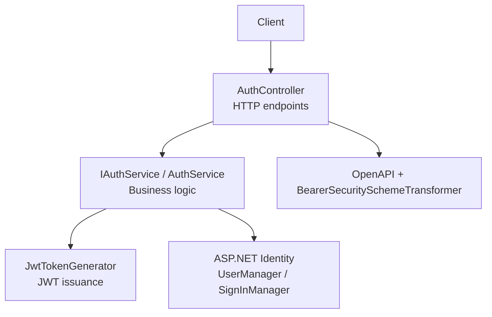
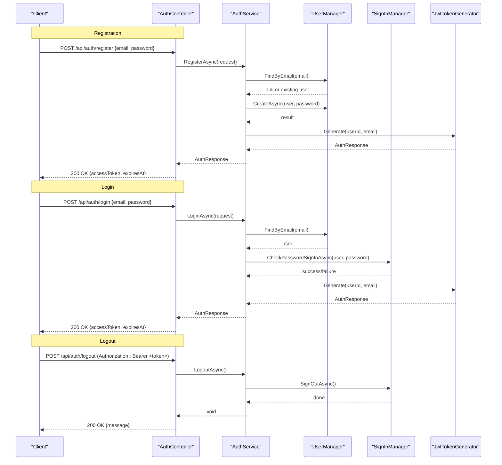
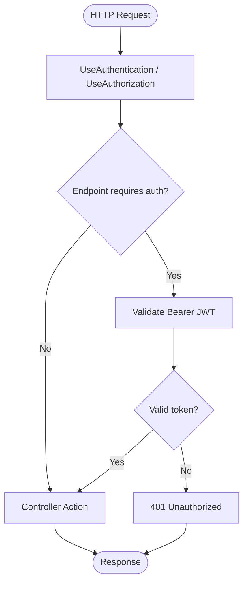
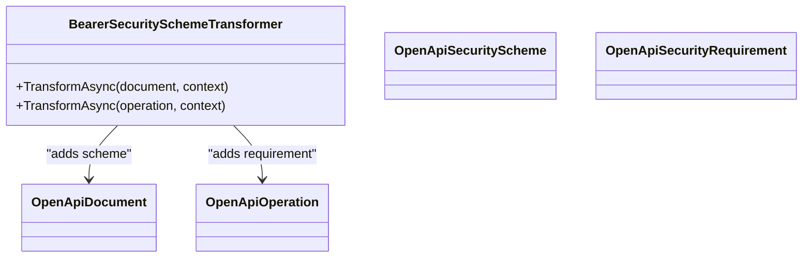
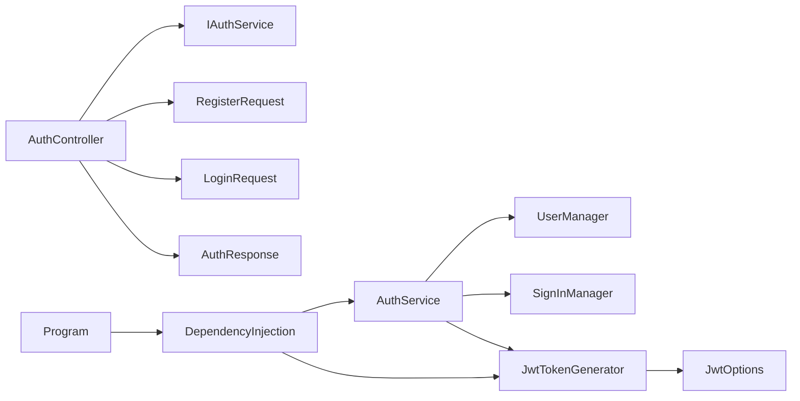

# Auth Controller Endpoints

<cite>
**Referenced Files in This Document**
- [AuthController.cs](file://Services/Services.Api/Controllers/AuthController.cs)
- [Program.cs](file://Services/Services.Api/Program.cs)
- [BearerSecuritySchemeTransformer.cs](file://Services/Services.Api/OpenApi/BearerSecuritySchemeTransformer.cs)
- [IAuthService.cs](file://Services.Services.Application/Interfaces/Services/IAuthService.cs)
- [RegisterRequest.cs](file://Services.Services.Application/DTOs/Auth/RegisterRequest.cs)
- [LoginRequest.cs](file://Services.Services.Application/DTOs/Auth/LoginRequest.cs)
- [AuthResponse.cs](file://Services.Services.Application/DTOs/Auth/AuthResponse.cs)
- [AuthService.cs](file://Services.Services.Infrastructure/Identity/AuthService.cs)
- [JwtTokenGenerator.cs](file://Services.Services.Infrastructure/Identity/JwtTokenGenerator.cs)
- [JwtOptions.cs](file://Services.Services.Infrastructure/Identity/JwtOptions.cs)
- [DependencyInjection.cs](file://Services.Services.Infrastructure/DependencyInjection.cs)
</cite>

## Table of Contents
1. [Introduction](#introduction)
2. [Project Structure](#project-structure)
3. [Core Components](#core-components)
4. [Architecture Overview](#architecture-overview)
5. [Detailed Component Analysis](#detailed-component-analysis)
6. [Dependency Analysis](#dependency-analysis)
7. [Performance Considerations](#performance-considerations)
8. [Troubleshooting Guide](#troubleshooting-guide)
9. [Conclusion](#conclusion)

## Introduction
This document describes the authentication REST endpoints exposed by the AuthController, including request schemas, validation rules, response formats, HTTP status codes, and error behavior. It also explains how authentication middleware integrates with these endpoints, how model binding works for requests, and how API documentation is versioned using OpenAPI with a Bearer JWT security scheme.

## Project Structure
The authentication feature spans multiple layers:
- API layer: Controllers define HTTP endpoints and map them to application services.
- Application layer: DTOs define request/response contracts; IAuthService defines the service contract.
- Infrastructure layer: AuthService implements business logic for registration/login/logout, JwtTokenGenerator issues JWT tokens, and DependencyInjection configures authentication and authorization.

**Diagram sources**
- [AuthController.cs:9-77](file://Services/Services.Api/Controllers/AuthController.cs#L9-L77)
- [IAuthService.cs:5-17](file://Services.Services.Application/Interfaces/Services/IAuthService.cs#L5-L17)
- [AuthService.cs:8-91](file://Services.Services.Infrastructure/Identity/AuthService.cs#L8-L91)
- [JwtTokenGenerator.cs:9-49](file://Services.Services.Infrastructure/Identity/JwtTokenGenerator.cs#L9-L49)
- [BearerSecuritySchemeTransformer.cs:7-56](file://Services/Services.Api/OpenApi/BearerSecuritySchemeTransformer.cs#L7-L56)

**Section sources**
- [AuthController.cs:9-77](file://Services/Services.Api/Controllers/AuthController.cs#L9-L77)
- [Program.cs:6-37](file://Services/Services.Api/Program.cs#L6-L37)

## Core Components
- AuthController: Defines POST /api/auth/register, POST /api/auth/login, and POST /api/auth/logout.
- DTOs: RegisterRequest, LoginRequest, and AuthResponse define request and response shapes.
- AuthService: Implements user creation, credential verification, and token issuance via ASP.NET Identity and JwtTokenGenerator.
- JwtTokenGenerator: Builds and signs JWT tokens using configured options.
- Authentication pipeline: Configured in DependencyInjection and enabled in Program.

Key responsibilities:
- Request validation: Model binding plus explicit checks in AuthService.
- Response shaping: AuthResponse contains access token and expiration.
- Security: Bearer JWT required for logout; OpenAPI documents bearer scheme.

**Section sources**
- [AuthController.cs:9-77](file://Services/Services.Api/Controllers/AuthController.cs#L9-L77)
- [RegisterRequest.cs:1-5](file://Services.Services.Application/DTOs/Auth/RegisterRequest.cs#L1-L5)
- [LoginRequest.cs:1-5](file://Services.Services.Application/DTOs/Auth/LoginRequest.cs#L1-L5)
- [AuthResponse.cs:1-5](file://Services.Services.Application/DTOs/Auth/AuthResponse.cs#L1-L5)
- [AuthService.cs:8-91](file://Services.Services.Infrastructure/Identity/AuthService.cs#L8-L91)
- [JwtTokenGenerator.cs:9-49](file://Services.Services.Infrastructure/Identity/JwtTokenGenerator.cs#L9-L49)

## Architecture Overview
The authentication flow uses ASP.NET Identity for user management and JWT for stateless client sessions. The controller delegates to AuthService, which interacts with UserManager/SignInManager and JwtTokenGenerator.

**Diagram sources**
- [AuthController.cs:14-76](file://Services/Services.Api/Controllers/AuthController.cs#L14-L76)
- [AuthService.cs:13-90](file://Services.Services.Infrastructure/Identity/AuthService.cs#L13-L90)
- [JwtTokenGenerator.cs:13-47](file://Services.Services.Infrastructure/Identity/JwtTokenGenerator.cs#L13-L47)

## Detailed Component Analysis

### POST /api/auth/register
Purpose:
- Creates a new user account and returns an access token and expiration time.

Request schema:
- Content-Type: application/json
- Body fields:
  - email: string (required)
  - password: string (required)

Validation rules:
- Email must be present and not whitespace-only.
- Password must be present and not whitespace-only.
- Email must not already exist in the system.
- Additional constraints may be enforced by ASP.NET Identity password policy.

Response format:
- Success: 200 OK
  - accessToken: string (JWT)
  - expiresAt: string (ISO 8601 UTC timestamp)

Error responses:
- 400 Bad Request: Validation errors (e.g., missing fields, duplicate email).
- 401 Unauthorized: Not applicable for registration.

Example request:
- Method: POST
- URL: /api/auth/register
- Headers: Content-Type: application/json
- Body: {"email":"user@example.com","password":"StrongPass1!"}

Example successful response:
- Status: 200 OK
- Body: {"accessToken":"...","expiresAt":"2026-10-20T12:00:00Z"}

Example validation error response:
- Status: 400 Bad Request
- Body: {"error":"..."}

Notes:
- The endpoint does not require authentication.
- The controller maps ModelState validation and service-level ValidationException into 400 responses.

**Section sources**
- [AuthController.cs:14-33](file://Services/Services.Api/Controllers/AuthController.cs#L14-L33)
- [RegisterRequest.cs:1-5](file://Services.Services.Application/DTOs/Auth/RegisterRequest.cs#L1-L5)
- [AuthService.cs:13-56](file://Services.Services.Infrastructure/Identity/AuthService.cs#L13-L56)
- [AuthResponse.cs:1-5](file://Services.Services.Application/DTOs/Auth/AuthResponse.cs#L1-L5)

### POST /api/auth/login
Purpose:
- Authenticates a user by email and password and returns an access token and expiration time.

Request schema:
- Content-Type: application/json
- Body fields:
  - email: string (required)
  - password: string (required)

Credential validation:
- Email must exist in the system.
- Password must match the stored hash.
- Lockout policies are applied by SignInManager.

Response format:
- Success: 200 OK
  - accessToken: string (JWT)
  - expiresAt: string (ISO 8601 UTC timestamp)

Error responses:
- 400 Bad Request: Validation errors (e.g., missing fields).
- 401 Unauthorized: Invalid credentials.

Example request:
- Method: POST
- URL: /api/auth/login
- Headers: Content-Type: application/json
- Body: {"email":"user@example.com","password":"StrongPass1!"}

Example successful response:
- Status: 200 OK
- Body: {"accessToken":"...","expiresAt":"2026-10-20T12:00:00Z"}

Example unauthorized response:
- Status: 401 Unauthorized
- Body: {"error":"Correo electrónico o contraseña incorrectos."}

Notes:
- The endpoint does not require authentication.
- Successful login triggers SignInManager password check and lockout handling.

**Section sources**
- [AuthController.cs:35-62](file://Services/Services.Api/Controllers/AuthController.cs#L35-L62)
- [LoginRequest.cs:1-5](file://Services.Services.Application/DTOs/Auth/LoginRequest.cs#L1-L5)
- [AuthService.cs:58-85](file://Services.Services.Infrastructure/Identity/AuthService.cs#L58-L85)
- [AuthResponse.cs:1-5](file://Services.Services.Application/DTOs/Auth/AuthResponse.cs#L1-L5)

### POST /api/auth/logout
Purpose:
- Terminates the current session for the authenticated user.

Authentication requirement:
- Requires a valid Bearer JWT in the Authorization header.

Request schema:
- No body required.

Response format:
- Success: 200 OK
  - message: string indicating successful logout.

Error responses:
- 401 Unauthorized: Missing or invalid token.

Example request:
- Method: POST
- URL: /api/auth/logout
- Headers: Authorization: Bearer <accessToken>

Example successful response:
- Status: 200 OK
- Body: {"message":"Sesión cerrada exitosamente."}

Example unauthorized response:
- Status: 401 Unauthorized
- Body: Standard ASP.NET Core unauthorized response.

Notes:
- The endpoint uses the Authorize attribute to enforce authentication.
- Logout calls SignInManager.SignOutAsync to clear the sign-in session.

**Section sources**
- [AuthController.cs:64-76](file://Services/Services.Api/Controllers/AuthController.cs#L64-L76)
- [AuthService.cs:87-90](file://Services.Services.Infrastructure/Identity/AuthService.cs#L87-L90)

### Authentication Middleware Integration
- Authentication and authorization pipelines are enabled globally.
- JWT Bearer scheme is configured with issuer, audience, signing key, lifetime validation, and clock skew.
- Only endpoints marked with Authorize require a valid token; register and login are public.

Configuration highlights:
- AddAuthentication with JwtBearerDefaults.AuthenticationScheme.
- AddJwtBearer with TokenValidationParameters.
- UseAuthentication and UseAuthorization in the request pipeline.
- OpenAPI documents the Bearer scheme for protected endpoints.

**Diagram sources**
- [Program.cs:30-35](file://Services/Services.Api/Program.cs#L30-L35)
- [DependencyInjection.cs:84-112](file://Services.Services.Infrastructure/DependencyInjection.cs#L84-L112)

**Section sources**
- [Program.cs:6-37](file://Services/Services.Api/Program.cs#L6-L37)
- [DependencyInjection.cs:84-112](file://Services.Services.Infrastructure/DependencyInjection.cs#L84-L112)

### Model Binding and Validation
- Requests are bound from JSON bodies to strongly-typed records.
- Required fields are validated at the service layer, throwing ValidationException on failure.
- Controller catches ValidationException and returns 400 Bad Request with an error message.

Binding details:
- RegisterRequest: email, password.
- LoginRequest: email, password.

Validation outcomes:
- Missing or empty email/password results in 400.
- Duplicate email during registration results in 400.
- Invalid credentials during login results in 401.

**Section sources**
- [AuthController.cs:14-62](file://Services/Services.Api/Controllers/AuthController.cs#L14-L62)
- [RegisterRequest.cs:1-5](file://Services.Services.Application/DTOs/Auth/RegisterRequest.cs#L1-L5)
- [LoginRequest.cs:1-5](file://Services.Services.Application/DTOs/Auth/LoginRequest.cs#L1-L5)
- [AuthService.cs:13-85](file://Services.Services.Infrastructure/Identity/AuthService.cs#L13-L85)

### API Versioning Considerations
- Base route prefix is api/auth.
- There is no explicit version segment (for example, v1) in the routes.
- If versioning is required, consider adding a version segment such as api/v1/auth and updating route attributes accordingly.
- OpenAPI currently documents the Bearer scheme but does not include a version field.

Recommendations:
- Introduce a stable version path segment to support backward-compatible changes.
- Update route attributes and OpenAPI configuration if needed.

[No sources needed since this section provides general guidance]

### OpenAPI and Bearer Security Scheme
- OpenAPI is enabled in development and enhanced with a custom transformer that adds a Bearer security scheme.
- Protected endpoints automatically receive a security requirement referencing the Bearer scheme.

**Diagram sources**
- [BearerSecuritySchemeTransformer.cs:7-56](file://Services/Services.Api/OpenApi/BearerSecuritySchemeTransformer.cs#L7-L56)
- [Program.cs:14-18](file://Services/Services.Api/Program.cs#L14-L18)

**Section sources**
- [BearerSecuritySchemeTransformer.cs:7-56](file://Services/Services.Api/OpenApi/BearerSecuritySchemeTransformer.cs#L7-L56)
- [Program.cs:14-18](file://Services/Services.Api/Program.cs#L14-L18)

## Dependency Analysis
The following diagram shows how components depend on each other across layers.

**Diagram sources**
- [AuthController.cs:9-77](file://Services/Services.Api/Controllers/AuthController.cs#L9-L77)
- [IAuthService.cs:5-17](file://Services.Services.Application/Interfaces/Services/IAuthService.cs#L5-L17)
- [AuthService.cs:8-91](file://Services.Services.Infrastructure/Identity/AuthService.cs#L8-L91)
- [JwtTokenGenerator.cs:9-49](file://Services.Services.Infrastructure/Identity/JwtTokenGenerator.cs#L9-L49)
- [JwtOptions.cs:1-14](file://Services.Services.Infrastructure/Identity/JwtOptions.cs#L1-L14)
- [DependencyInjection.cs:84-120](file://Services.Services.Infrastructure/DependencyInjection.cs#L84-L120)
- [Program.cs:6-37](file://Services/Services.Api/Program.cs#L6-L37)

**Section sources**
- [AuthController.cs:9-77](file://Services/Services.Api/Controllers/AuthController.cs#L9-L77)
- [AuthService.cs:8-91](file://Services.Services.Infrastructure/Identity/AuthService.cs#L8-L91)
- [DependencyInjection.cs:84-120](file://Services.Services.Infrastructure/DependencyInjection.cs#L84-L120)

## Performance Considerations
- Registration performs database operations for user lookup and creation; ensure efficient indexing on email.
- Login performs password hashing and potential lockout checks; avoid excessive retries to reduce load.
- JWT generation is CPU-bound due to signing; keep secret keys properly sized and reuse generator instances as configured.
- Consider caching strategies only if you introduce additional identity lookups beyond what Identity provides.

[No sources needed since this section provides general guidance]

## Troubleshooting Guide
Common issues and resolutions:
- 400 Bad Request on register/login:
  - Ensure email and password are provided and meet requirements.
  - For registration, verify the email is unique.
- 401 Unauthorized on login:
  - Verify credentials and account lockout status.
- 401 Unauthorized on logout:
  - Ensure Authorization header includes a valid Bearer token.
- JWT configuration errors:
  - Validate Issuer, Audience, SecretKey, and ExpirationMinutes in configuration.
  - Confirm SecretKey is a valid Base64 string with at least 32 bytes.

Operational tips:
- Enable detailed logging in development to inspect validation exceptions and Identity errors.
- Use OpenAPI UI to test endpoints and confirm Bearer scheme is documented.

**Section sources**
- [AuthController.cs:14-76](file://Services/Services.Api/Controllers/AuthController.cs#L14-L76)
- [AuthService.cs:13-90](file://Services.Services.Infrastructure/Identity/AuthService.cs#L13-L90)
- [DependencyInjection.cs:50-82](file://Services.Services.Infrastructure/DependencyInjection.cs#L50-L82)

## Conclusion
The AuthController exposes three endpoints for user registration, login, and logout. Requests are validated through model binding and service-layer checks, returning appropriate HTTP status codes and structured error messages. Authentication is enforced via JWT Bearer tokens, with OpenAPI documenting the security scheme. To evolve the API, consider introducing explicit versioning in routes and maintaining consistent error payloads across endpoints.