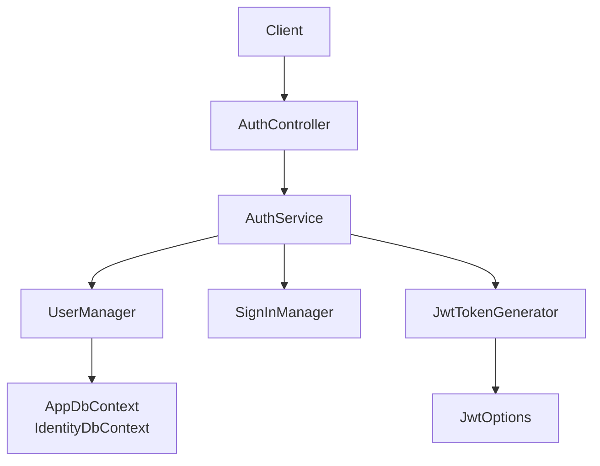
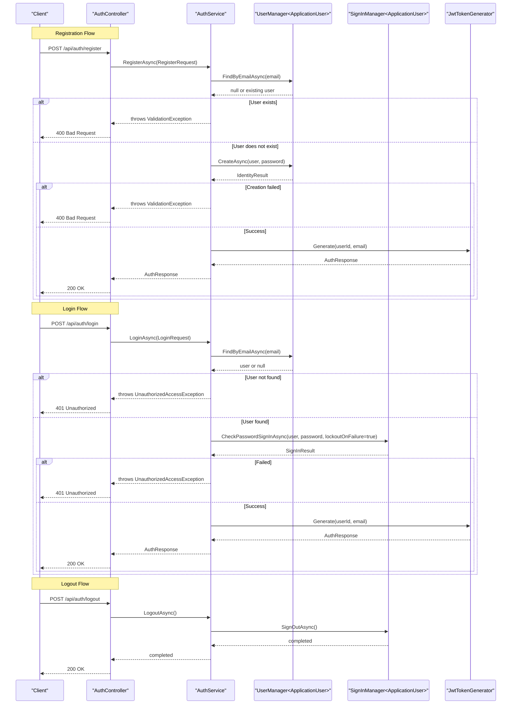
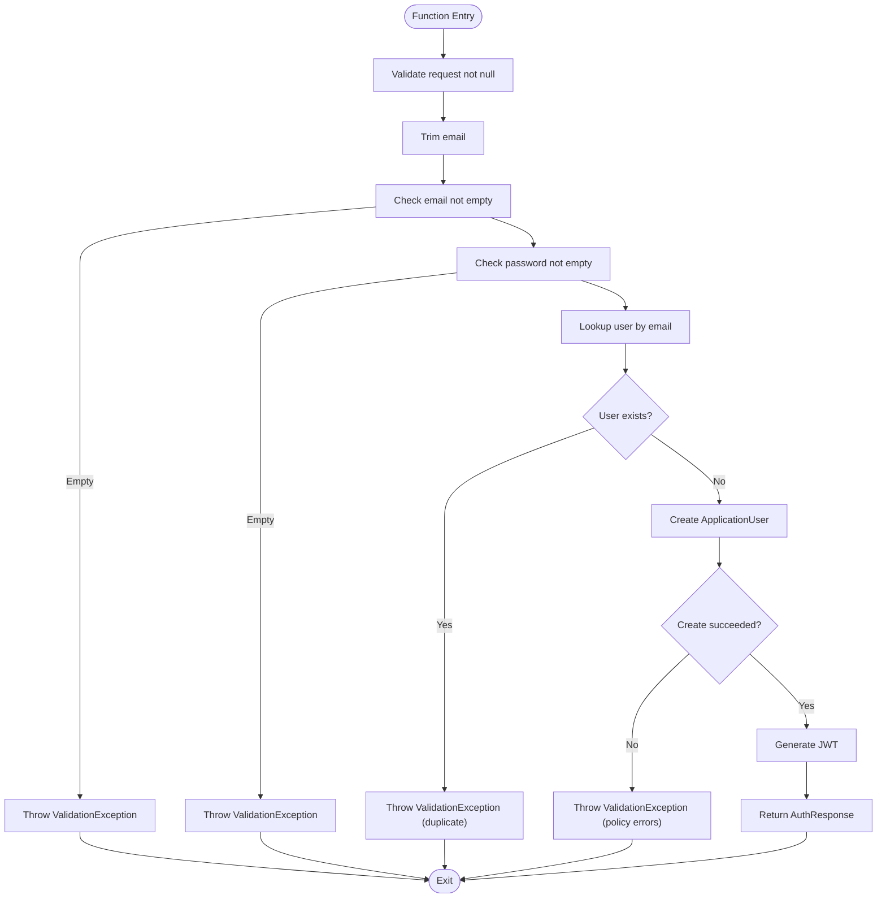
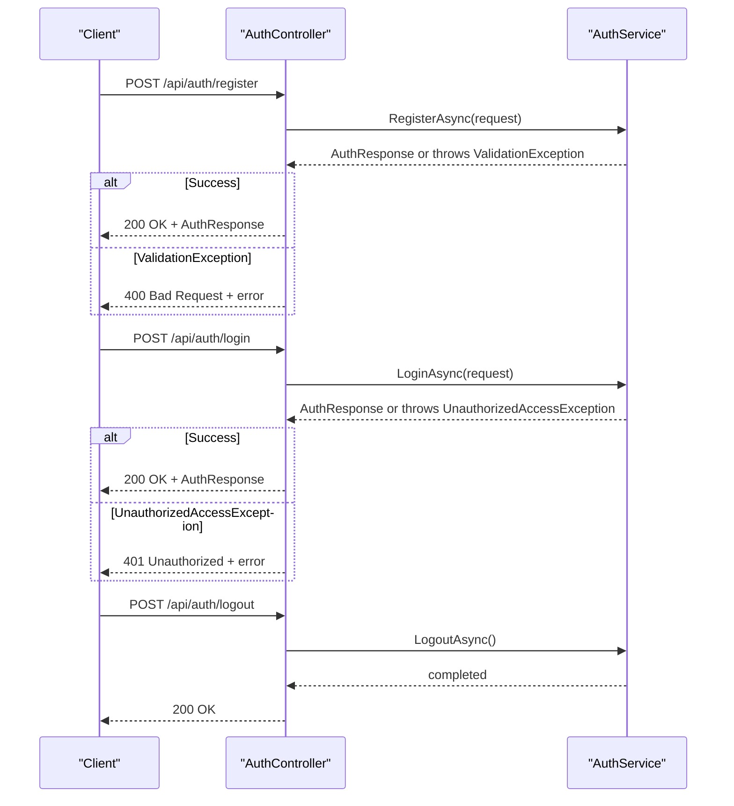
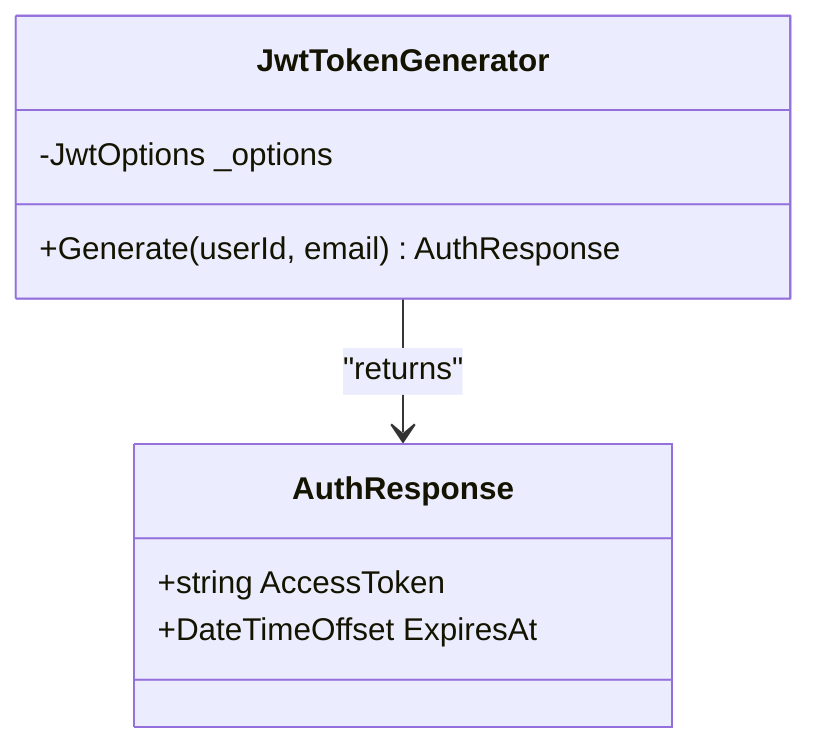
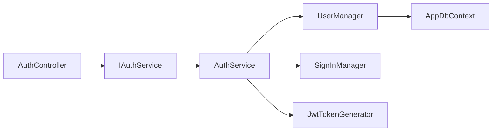

# AuthService Implementation

<cite>
**Referenced Files in This Document**
- [AuthService.cs](file://Services.Services.Infrastructure.Identity.AuthService.cs)
- [IAuthService.cs](file://Services.Services.Application.Interfaces.Services.IAuthService.cs)
- [AuthController.cs](file://Services.Services.Api.Controllers.AuthController.cs)
- [ApplicationUser.cs](file://Services.Services.Infrastructure.Identity.ApplicationUser.cs)
- [JwtTokenGenerator.cs](file://Services.Services.Infrastructure.Identity.JwtTokenGenerator.cs)
- [RegisterRequest.cs](file://Services.Services.Application.DTOs.Auth.RegisterRequest.cs)
- [LoginRequest.cs](file://Services.Services.Application.DTOs.Auth.LoginRequest.cs)
- [AuthResponse.cs](file://Services.Services.Application.DTOs.Auth.AuthResponse.cs)
- [AppDbContext.cs](file://Services.Services.Infrastructure.Persistence.AppDbContext.cs)
</cite>

## Table of Contents
1. [Introduction](#introduction)
2. [Project Structure](#project-structure)
3. [Core Components](#core-components)
4. [Architecture Overview](#architecture-overview)
5. [Detailed Component Analysis](#detailed-component-analysis)
6. [Dependency Analysis](#dependency-analysis)
7. [Performance Considerations](#performance-considerations)
8. [Troubleshooting Guide](#troubleshooting-guide)
9. [Conclusion](#conclusion)

## Introduction
This document explains the AuthService implementation for user registration, login, and logout. It covers validation rules, duplicate account detection, password verification with lockout handling, token generation, exception handling, integration with ASP.NET Identity (UserManager and SignInManager), security considerations, error propagation patterns, and business rule enforcement.

## Project Structure
The authentication flow spans multiple layers:
- API layer exposes HTTP endpoints for register, login, and logout.
- Application layer defines service contracts and DTOs.
- Infrastructure layer implements AuthService using UserManager, SignInManager, and a JWT token generator.
- Persistence layer integrates ASP.NET Identity with Entity Framework Core.

**Diagram sources**
- [AuthController.cs:9-77](file://Services.Services.Api.Controllers.AuthController.cs#L9-L77)
- [AuthService.cs:8-90](file://Services.Services.Infrastructure.Identity.AuthService.cs#L8-L90)
- [ApplicationUser.cs:5-6](file://Services.Services.Infrastructure.Identity.ApplicationUser.cs#L5-L6)
- [JwtTokenGenerator.cs:9-48](file://Services.Services.Infrastructure.Identity.JwtTokenGenerator.cs#L9-L48)
- [AppDbContext.cs:10-23](file://Services.Services.Infrastructure.Persistence.AppDbContext.cs#L10-L23)

**Section sources**
- [AuthController.cs:9-77](file://Services.Services.Api.Controllers.AuthController.cs#L9-L77)
- [AuthService.cs:8-90](file://Services.Services.Infrastructure.Identity.AuthService.cs#L8-L90)
- [AppDbContext.cs:10-23](file://Services.Services.Infrastructure.Persistence.AppDbContext.cs#L10-L23)

## Core Components
- AuthService: Implements IAuthService and orchestrates registration, login, and logout.
- AuthController: Exposes REST endpoints and maps exceptions to HTTP responses.
- JwtTokenGenerator: Creates signed JWT tokens based on configured options.
- ApplicationUser: Extends IdentityUser for ASP.NET Identity.
- DTOs: RegisterRequest, LoginRequest, AuthResponse define input/output contracts.

Key responsibilities:
- Registration validates inputs, prevents duplicates, creates users via UserManager, and returns a JWT.
- Login verifies credentials via SignInManager, enforces lockout, and returns a JWT.
- Logout signs out the current session via SignInManager.

**Section sources**
- [AuthService.cs:8-90](file://Services.Services.Infrastructure.Identity.AuthService.cs#L8-L90)
- [AuthController.cs:9-77](file://Services.Services.Api.Controllers.AuthController.cs#L9-L77)
- [JwtTokenGenerator.cs:9-48](file://Services.Services.Infrastructure.Identity.JwtTokenGenerator.cs#L9-L48)
- [ApplicationUser.cs:5-6](file://Services.Services.Infrastructure.Identity.ApplicationUser.cs#L5-L6)
- [RegisterRequest.cs:3-5](file://Services.Services.Application.DTOs.Auth.RegisterRequest.cs#L3-L5)
- [LoginRequest.cs:3-5](file://Services.Services.Application.DTOs.Auth.LoginRequest.cs#L3-L5)
- [AuthResponse.cs:3-5](file://Services.Services.Application.DTOs.Auth.AuthResponse.cs#L3-L5)

## Architecture Overview
The authentication architecture follows a layered approach:
- Controllers handle HTTP requests and translate exceptions into appropriate status codes.
- Services encapsulate business logic and coordinate identity operations.
- Identity infrastructure provides user management and sign-in capabilities.
- JWT generator produces secure access tokens.

**Diagram sources**
- [AuthController.cs:14-76](file://Services.Services.Api.Controllers.AuthController.cs#L14-L76)
- [AuthService.cs:13-90](file://Services.Services.Infrastructure.Identity.AuthService.cs#L13-L90)
- [JwtTokenGenerator.cs:13-48](file://Services.Services.Infrastructure.Identity.JwtTokenGenerator.cs#L13-L48)

## Detailed Component Analysis

### AuthService
AuthService implements IAuthService and coordinates user registration, login, and logout.

- RegisterAsync
  - Validates request presence and trims email.
  - Enforces non-empty email and password.
  - Detects duplicate accounts by checking if an email already exists.
  - Creates a new ApplicationUser with generated Id, UserName, and Email.
  - Uses UserManager.CreateAsync to persist the user and validate password policy.
  - Aggregates IdentityResult errors into a single message when creation fails.
  - Returns a JWT via JwtTokenGenerator upon success.

- LoginAsync
  - Validates request presence and trims email.
  - Looks up the user by email; throws unauthorized if not found.
  - Verifies password via SignInManager.CheckPasswordSignInAsync with lockout enabled.
  - Throws unauthorized on failed sign-in attempts.
  - Returns a JWT upon successful authentication.

- LogoutAsync
  - Signs out the current session via SignInManager.SignOutAsync.

Validation and error handling:
- Input validation uses ValidationException for invalid or missing fields.
- Authentication failures use UnauthorizedAccessException.
- Controller maps these exceptions to 400 Bad Request and 401 Unauthorized respectively.

Integration points:
- UserManager<ApplicationUser>: user lookup and creation.
- SignInManager<ApplicationUser>: password verification and sign-out.
- JwtTokenGenerator: token issuance.

Security considerations:
- Password policy is enforced by Identity during user creation.
- Lockout is enabled on login failures to mitigate brute-force attacks.
- JWT signing uses HMAC-SHA256 with a minimum key length check.

**Diagram sources**
- [AuthService.cs:13-56](file://Services.Services.Infrastructure.Identity.AuthService.cs#L13-L56)

**Section sources**
- [AuthService.cs:13-56](file://Services.Services.Infrastructure.Identity.AuthService.cs#L13-L56)
- [AuthService.cs:58-85](file://Services.Services.Infrastructure.Identity.AuthService.cs#L58-L85)
- [AuthService.cs:87-90](file://Services.Services.Infrastructure.Identity.AuthService.cs#L87-L90)

### AuthController
AuthController exposes HTTP endpoints and translates service exceptions into HTTP responses.

- POST /api/auth/register
  - Calls AuthService.RegisterAsync.
  - Returns 200 OK with AuthResponse on success.
  - Returns 400 Bad Request with error details on ValidationException.

- POST /api/auth/login
  - Calls AuthService.LoginAsync.
  - Returns 200 OK with AuthResponse on success.
  - Returns 400 Bad Request on ValidationException.
  - Returns 401 Unauthorized on UnauthorizedAccessException.

- POST /api/auth/logout
  - Requires authorization.
  - Calls AuthService.LogoutAsync.
  - Returns 200 OK on success.

**Diagram sources**
- [AuthController.cs:14-76](file://Services.Services.Api.Controllers.AuthController.cs#L14-L76)
- [AuthService.cs:13-90](file://Services.Services.Infrastructure.Identity.AuthService.cs#L13-L90)

**Section sources**
- [AuthController.cs:14-76](file://Services.Services.Api.Controllers.AuthController.cs#L14-L76)

### JwtTokenGenerator
JwtTokenGenerator issues JWT access tokens with claims for user id and email.

- Generates a symmetric signing key from a Base64 secret and enforces a minimum key length.
- Sets issuer, audience, subject, email, jti, not-before, and expiration.
- Signs tokens using HMAC-SHA256.
- Returns AuthResponse containing AccessToken and ExpiresAt.

Security considerations:
- Secret key must be at least 32 bytes.
- Use strong secrets and rotate keys periodically.
- Ensure issuer and audience are correctly configured per environment.

**Diagram sources**
- [JwtTokenGenerator.cs:9-48](file://Services.Services.Infrastructure.Identity.JwtTokenGenerator.cs#L9-L48)
- [AuthResponse.cs:3-5](file://Services.Services.Application.DTOs.Auth.AuthResponse.cs#L3-L5)

**Section sources**
- [JwtTokenGenerator.cs:9-48](file://Services.Services.Infrastructure.Identity.JwtTokenGenerator.cs#L9-L48)

### Data Models and Contracts
- RegisterRequest: Contains Email and Password.
- LoginRequest: Contains Email and Password.
- AuthResponse: Contains AccessToken and ExpiresAt.
- ApplicationUser: Extends IdentityUser<Guid>.

These models define the boundaries between layers and ensure consistent data exchange.

**Section sources**
- [RegisterRequest.cs:3-5](file://Services.Services.Application.DTOs.Auth.RegisterRequest.cs#L3-L5)
- [LoginRequest.cs:3-5](file://Services.Services.Application.DTOs.Auth.LoginRequest.cs#L3-L5)
- [AuthResponse.cs:3-5](file://Services.Services.Application.DTOs.Auth.AuthResponse.cs#L3-L5)
- [ApplicationUser.cs:5-6](file://Services.Services.Infrastructure.Identity.ApplicationUser.cs#L5-L6)

## Dependency Analysis
AuthService depends on:
- UserManager<ApplicationUser>: user persistence and validation.
- SignInManager<ApplicationUser>: authentication and sign-out.
- JwtTokenGenerator: token issuance.

AuthController depends on:
- IAuthService: service contract abstraction.

Persistence layer integrates Identity with EF Core through AppDbContext.

**Diagram sources**
- [AuthController.cs:9-12](file://Services.Services.Api.Controllers.AuthController.cs#L9-L12)
- [AuthService.cs:8-11](file://Services.Services.Infrastructure.Identity.AuthService.cs#L8-L11)
- [AppDbContext.cs:10-11](file://Services.Services.Infrastructure.Persistence.AppDbContext.cs#L10-L11)

**Section sources**
- [AuthService.cs:8-11](file://Services.Services.Infrastructure.Identity.AuthService.cs#L8-L11)
- [AuthController.cs:9-12](file://Services.Services.Api.Controllers.AuthController.cs#L9-L12)
- [AppDbContext.cs:10-11](file://Services.Services.Infrastructure.Persistence.AppDbContext.cs#L10-L11)

## Performance Considerations
- Avoid unnecessary string allocations by trimming once and reusing values.
- Prefer asynchronous operations throughout to avoid blocking threads.
- Cache configuration options where appropriate to reduce repeated reads.
- Ensure database indexes on email columns for faster lookups.
- Tune JWT expiration to balance security and performance.

[No sources needed since this section provides general guidance]

## Troubleshooting Guide
Common issues and resolutions:
- Duplicate email registration
  - Symptom: 400 Bad Request with duplicate email message.
  - Cause: Email already exists in the database.
  - Resolution: Prompt user to use a different email or recover their account.

- Invalid input
  - Symptom: 400 Bad Request with validation messages.
  - Cause: Missing or empty email/password.
  - Resolution: Enforce client-side validation and server-side checks.

- Incorrect credentials
  - Symptom: 401 Unauthorized.
  - Cause: Wrong email or password; lockout may be triggered.
  - Resolution: Verify credentials; implement account recovery; monitor lockout policies.

- JWT configuration errors
  - Symptom: Token generation fails due to invalid secret key.
  - Cause: Secret key too short or improperly encoded.
  - Resolution: Provide a valid Base64-encoded secret with at least 32 bytes.

- Session not terminating
  - Symptom: Logout endpoint returns success but subsequent requests remain authenticated.
  - Cause: Stateless JWT requires client to discard token; server-side sign-out clears cookies if used.
  - Resolution: Ensure clients remove stored tokens and clear any cookies.

**Section sources**
- [AuthController.cs:29-61](file://Services.Services.Api.Controllers.AuthController.cs#L29-L61)
- [AuthService.cs:17-56](file://Services.Services.Infrastructure.Identity.AuthService.cs#L17-L56)
- [AuthService.cs:62-85](file://Services.Services.Infrastructure.Identity.AuthService.cs#L62-L85)
- [JwtTokenGenerator.cs:15-21](file://Services.Services.Infrastructure.Identity.JwtTokenGenerator.cs#L15-L21)

## Conclusion
AuthService centralizes authentication and registration workflows, enforcing validation, duplicate detection, password policy, and lockout handling. The controller layer ensures robust error mapping to HTTP status codes. Integration with ASP.NET Identity and JWT guarantees secure user management and stateless authentication. Proper configuration of JWT secrets and identity settings is essential for security and reliability.

[No sources needed since this section summarizes without analyzing specific files]