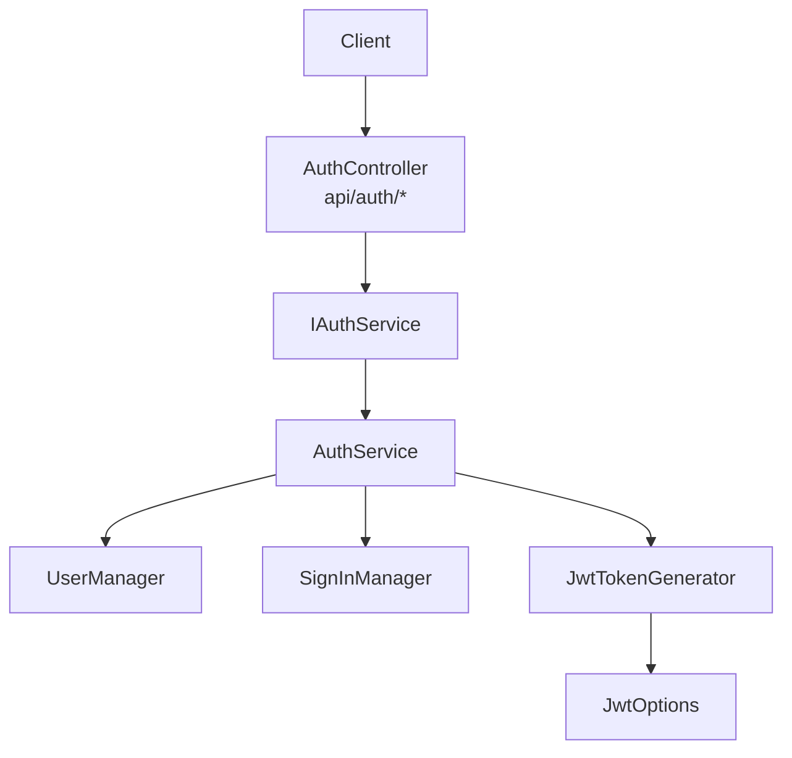
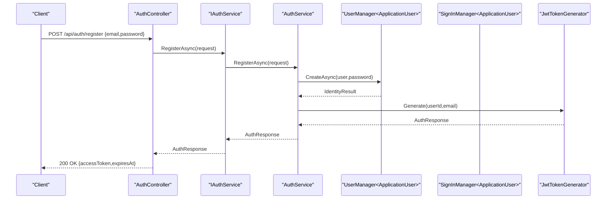
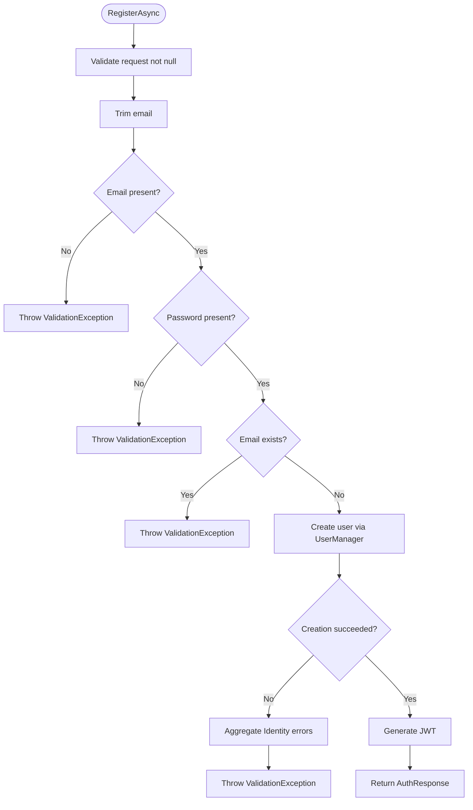
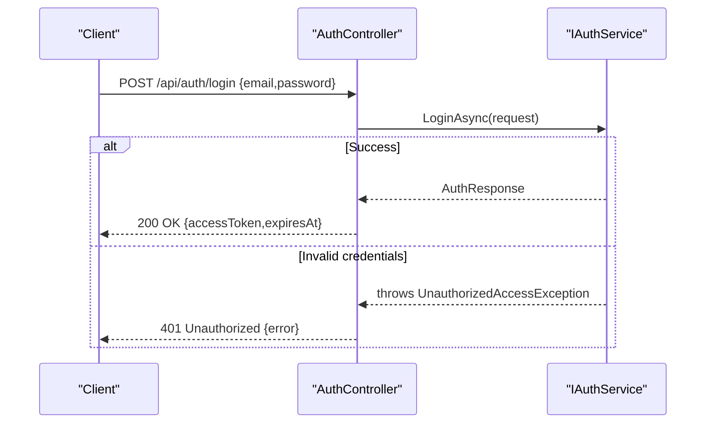
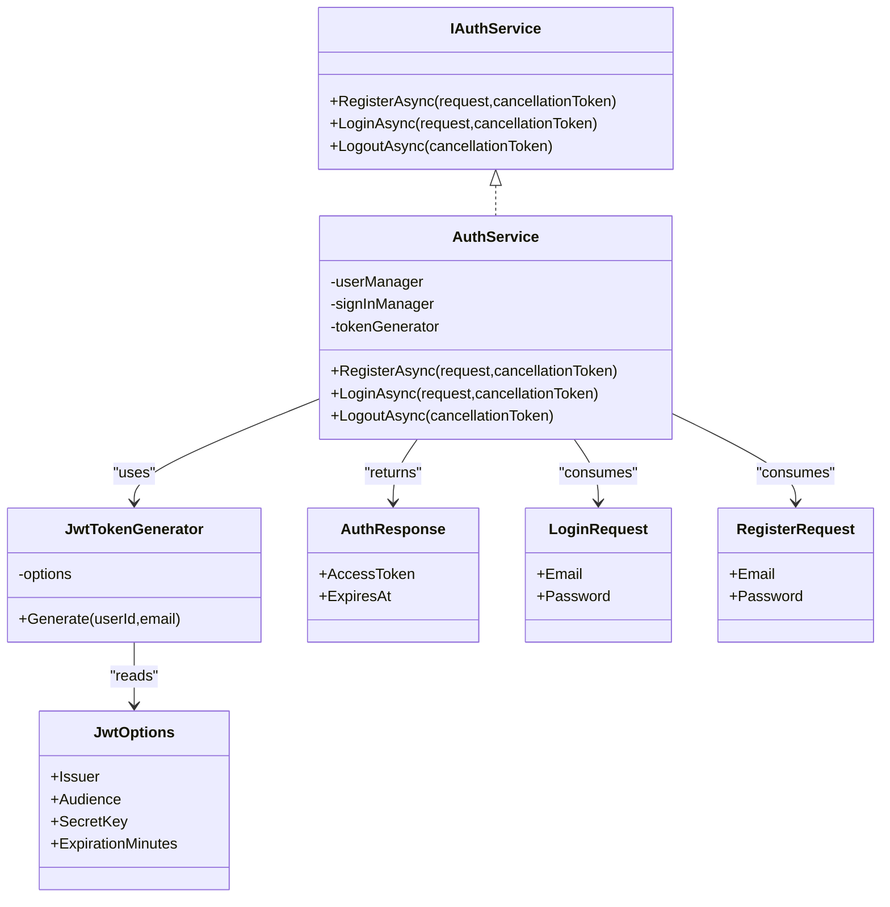
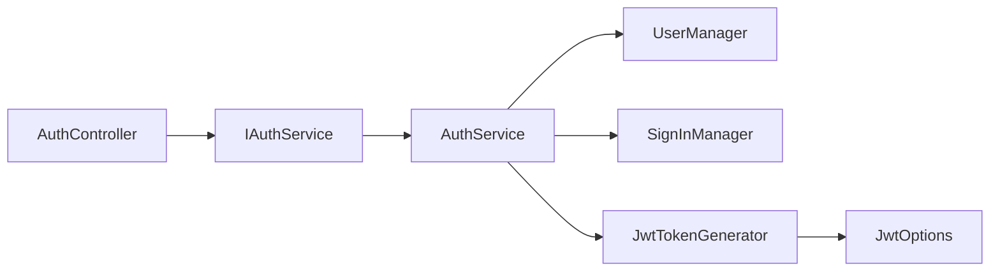

# Server-side Authentication Logic

<cite>
**Referenced Files in This Document**
- [AuthController.cs](file://Services/Services.Api/Controllers/AuthController.cs)
- [IAuthService.cs](file://Services/Services.Application/Interfaces/Services/IAuthService.cs)
- [AuthService.cs](file://Services/Services.Infrastructure/Identity/AuthService.cs)
- [ApplicationUser.cs](file://Services/Services.Infrastructure/Identity/ApplicationUser.cs)
- [JwtTokenGenerator.cs](file://Services/Services.Infrastructure/Identity/JwtTokenGenerator.cs)
- [JwtOptions.cs](file://Services/Services.Infrastructure/Identity/JwtOptions.cs)
- [LoginRequest.cs](file://Services/Services.Application/DTOs/Auth/LoginRequest.cs)
- [RegisterRequest.cs](file://Services/Services.Application/DTOs/Auth/RegisterRequest.cs)
- [AuthResponse.cs](file://Services/Services.Application/DTOs/Auth/AuthResponse.cs)
</cite>

## Table of Contents
1. [Introduction](#introduction)
2. [Project Structure](#project-structure)
3. [Core Components](#core-components)
4. [Architecture Overview](#architecture-overview)
5. [Detailed Component Analysis](#detailed-component-analysis)
6. [Dependency Analysis](#dependency-analysis)
7. [Performance Considerations](#performance-considerations)
8. [Troubleshooting Guide](#troubleshooting-guide)
9. [Conclusion](#conclusion)

## Introduction
This document explains the server-side authentication logic for the TaskFlow service. It focuses on:
- The IAuthService interface contract and its implementation in AuthService.
- The AuthController endpoints for registration, login, and logout.
- User registration workflow, password hashing via ASP.NET Core Identity, JWT token issuance, and account lifecycle management.
- Request/response handling, business rule validation, and error propagation across layers.

## Project Structure
The authentication feature spans three layers:
- API layer: AuthController exposes HTTP endpoints.
- Application layer: IAuthService defines the service contract; DTOs define request/response shapes.
- Infrastructure layer: AuthService implements IAuthService using ASP.NET Core Identity and a JWT token generator.

**Diagram sources**
- [AuthController.cs:9-11](file://Services/Services.Api/Controllers/AuthController.cs#L9-L11)
- [IAuthService.cs:5-16](file://Services/Services.Application/Interfaces/Services/IAuthService.cs#L5-L16)
- [AuthService.cs:8-11](file://Services/Services.Infrastructure/Identity/AuthService.cs#L8-L11)
- [JwtTokenGenerator.cs:9-11](file://Services/Services.Infrastructure/Identity/JwtTokenGenerator.cs#L9-L11)
- [JwtOptions.cs:3-13](file://Services/Services.Infrastructure/Identity/JwtOptions.cs#L3-L13)

**Section sources**
- [AuthController.cs:9-11](file://Services/Services.Api/Controllers/AuthController.cs#L9-L11)
- [IAuthService.cs:5-16](file://Services/Services.Application/Interfaces/Services/IAuthService.cs#L5-L16)
- [AuthService.cs:8-11](file://Services/Services.Infrastructure/Identity/AuthService.cs#L8-L11)
- [JwtTokenGenerator.cs:9-11](file://Services/Services.Infrastructure/Identity/JwtTokenGenerator.cs#L9-L11)
- [JwtOptions.cs:3-13](file://Services/Services.Infrastructure/Identity/JwtOptions.cs#L3-L13)

## Core Components
- IAuthService: Defines RegisterAsync, LoginAsync, LogoutAsync with CancellationToken support.
- AuthService: Implements IAuthService, orchestrating user creation, sign-in, sign-out, and JWT generation.
- AuthController: Exposes POST /api/auth/register, POST /api/auth/login, POST /api/auth/logout.
- DTOs: LoginRequest, RegisterRequest, AuthResponse define input/output contracts.
- ApplicationUser: ASP.NET Core Identity user entity.
- JwtTokenGenerator: Creates signed JWT tokens using configured options.

Key responsibilities:
- Validation and business rules are enforced in AuthService before persistence or token issuance.
- Password hashing is delegated to UserManager (ASP.NET Core Identity).
- Token signing and expiration are handled by JwtTokenGenerator based on JwtOptions.

**Section sources**
- [IAuthService.cs:5-16](file://Services/Services.Application/Interfaces/Services/IAuthService.cs#L5-L16)
- [AuthService.cs:13-90](file://Services/Services.Infrastructure/Identity/AuthService.cs#L13-L90)
- [AuthController.cs:14-76](file://Services/Services.Api/Controllers/AuthController.cs#L14-L76)
- [LoginRequest.cs:3-5](file://Services/Services.Application/DTOs/Auth/LoginRequest.cs#L3-L5)
- [RegisterRequest.cs:3-5](file://Services/Services.Application/DTOs/Auth/RegisterRequest.cs#L3-L5)
- [AuthResponse.cs:3-5](file://Services/Services.Application/DTOs/Auth/AuthResponse.cs#L3-L5)
- [ApplicationUser.cs:5-6](file://Services/Services.Infrastructure/Identity/ApplicationUser.cs#L5-L6)
- [JwtTokenGenerator.cs:13-47](file://Services/Services.Infrastructure/Identity/JwtTokenGenerator.cs#L13-L47)
- [JwtOptions.cs:3-13](file://Services/Services.Infrastructure/Identity/JwtOptions.cs#L3-L13)

## Architecture Overview
The authentication flow follows a layered architecture:
- Controller receives requests, validates inputs at the framework level, and delegates to the service.
- Service enforces domain/business rules, interacts with Identity stores, and returns DTOs.
- JWT token generation is isolated in a dedicated component.

**Diagram sources**
- [AuthController.cs:14-33](file://Services/Services.Api/Controllers/AuthController.cs#L14-L33)
- [AuthService.cs:13-56](file://Services/Services.Infrastructure/Identity/AuthService.cs#L13-L56)
- [JwtTokenGenerator.cs:13-47](file://Services/Services.Infrastructure/Identity/JwtTokenGenerator.cs#L13-L47)

## Detailed Component Analysis

### IAuthService Contract
Defines the service operations:
- RegisterAsync(RegisterRequest, CancellationToken): Returns an AuthResponse containing access token and expiry.
- LoginAsync(LoginRequest, CancellationToken): Returns an AuthResponse upon successful authentication.
- LogoutAsync(CancellationToken): Signs out the current session.

Design notes:
- All methods accept CancellationToken for cooperative cancellation.
- Errors are propagated as exceptions from the implementation; controllers translate them into appropriate HTTP responses.

**Section sources**
- [IAuthService.cs:5-16](file://Services/Services.Application/Interfaces/Services/IAuthService.cs#L5-L16)

### AuthService Implementation
Responsibilities:
- Registration: Validates email/password presence, ensures uniqueness, creates user via UserManager, and generates JWT.
- Login: Finds user by email, verifies password via SignInManager, and generates JWT.
- Logout: Signs out the current session.

Validation and business rules:
- Null checks on request objects.
- Email trimming and non-empty checks.
- Duplicate email detection.
- Aggregation of Identity result errors into a single message.

Password handling:
- Password hashing is performed by UserManager during user creation.
- Password verification is performed by SignInManager during login.

JWT issuance:
- Delegates to JwtTokenGenerator.Generate(userId, email), which signs tokens using symmetric key and sets issuer/audience/expiry.

Error propagation:
- Throws ValidationException for client input issues (e.g., missing fields, duplicate email).
- Throws UnauthorizedAccessException for invalid credentials.

**Diagram sources**
- [AuthService.cs:13-56](file://Services/Services.Infrastructure/Identity/AuthService.cs#L13-L56)

**Section sources**
- [AuthService.cs:13-90](file://Services/Services.Infrastructure/Identity/AuthService.cs#L13-L90)

### AuthController Endpoints
Endpoints:
- POST /api/auth/register
  - Accepts RegisterRequest.
  - Returns 200 OK with AuthResponse on success.
  - Returns 400 Bad Request for ValidationException.
- POST /api/auth/login
  - Accepts LoginRequest.
  - Returns 200 OK with AuthResponse on success.
  - Returns 400 Bad Request for ValidationException.
  - Returns 401 Unauthorized for invalid credentials.
- POST /api/auth/logout
  - Requires authorization (Authorize attribute).
  - Returns 200 OK with a confirmation message.
  - Returns 401 Unauthorized if not authenticated.

Error mapping:
- ValidationException -> 400 Bad Request with error message.
- UnauthorizedAccessException -> 401 Unauthorized with a generic credential error message.

**Diagram sources**
- [AuthController.cs:35-62](file://Services/Services.Api/Controllers/AuthController.cs#L35-L62)
- [AuthService.cs:58-85](file://Services/Services.Infrastructure/Identity/AuthService.cs#L58-L85)

**Section sources**
- [AuthController.cs:14-76](file://Services/Services.Api/Controllers/AuthController.cs#L14-L76)

### DTOs and Data Contracts
- LoginRequest: Contains Email and Password.
- RegisterRequest: Contains Email and Password.
- AuthResponse: Contains AccessToken and ExpiresAt.

These records define the shape of data exchanged between the controller and service layers.

**Section sources**
- [LoginRequest.cs:3-5](file://Services/Services.Application/DTOs/Auth/LoginRequest.cs#L3-L5)
- [RegisterRequest.cs:3-5](file://Services/Services.Application/DTOs/Auth/RegisterRequest.cs#L3-L5)
- [AuthResponse.cs:3-5](file://Services/Services.Application/DTOs/Auth/AuthResponse.cs#L3-L5)

### Identity and JWT Details
- ApplicationUser extends IdentityUser<Guid>, enabling GUID-based user identifiers.
- JwtTokenGenerator:
  - Reads JwtOptions (issuer, audience, secret key, expiration minutes).
  - Validates secret key length.
  - Builds claims (subject/userId, email, jti).
  - Signs token with HMAC-SHA256 using a symmetric key derived from the base64-encoded secret.
  - Returns AuthResponse with serialized token and expiry.

**Diagram sources**
- [IAuthService.cs:5-16](file://Services/Services.Application/Interfaces/Services/IAuthService.cs#L5-L16)
- [AuthService.cs:8-11](file://Services/Services.Infrastructure/Identity/AuthService.cs#L8-L11)
- [JwtTokenGenerator.cs:9-11](file://Services/Services.Infrastructure/Identity/JwtTokenGenerator.cs#L9-L11)
- [JwtOptions.cs:3-13](file://Services/Services.Infrastructure/Identity/JwtOptions.cs#L3-L13)
- [AuthResponse.cs:3-5](file://Services/Services.Application/DTOs/Auth/AuthResponse.cs#L3-L5)
- [LoginRequest.cs:3-5](file://Services/Services.Application/DTOs/Auth/LoginRequest.cs#L3-L5)
- [RegisterRequest.cs:3-5](file://Services/Services.Application/DTOs/Auth/RegisterRequest.cs#L3-L5)

## Dependency Analysis
- AuthController depends on IAuthService (injected via constructor).
- AuthService depends on:
  - UserManager<ApplicationUser> for user CRUD and password hashing.
  - SignInManager<ApplicationUser> for sign-in/sign-out flows.
  - JwtTokenGenerator for token issuance.
- JwtTokenGenerator depends on JwtOptions for configuration.

Coupling and cohesion:
- Controllers are thin and delegate to services, improving separation of concerns.
- AuthService encapsulates authentication business logic and coordinates infrastructure dependencies.
- JwtTokenGenerator isolates tokenization details, making it testable and configurable.

Potential circular dependencies:
- None observed among these components; dependencies are one-directional.

External integrations:
- ASP.NET Core Identity for user store and password hashing.
- System.IdentityModel.Tokens.Jwt for token creation.

**Diagram sources**
- [AuthController.cs:9-11](file://Services/Services.Api/Controllers/AuthController.cs#L9-L11)
- [AuthService.cs:8-11](file://Services/Services.Infrastructure/Identity/AuthService.cs#L8-L11)
- [JwtTokenGenerator.cs:9-11](file://Services/Services.Infrastructure/Identity/JwtTokenGenerator.cs#L9-L11)
- [JwtOptions.cs:3-13](file://Services/Services.Infrastructure/Identity/JwtOptions.cs#L3-L13)

**Section sources**
- [AuthController.cs:9-11](file://Services/Services.Api/Controllers/AuthController.cs#L9-L11)
- [AuthService.cs:8-11](file://Services/Services.Infrastructure/Identity/AuthService.cs#L8-L11)
- [JwtTokenGenerator.cs:9-11](file://Services/Services.Infrastructure/Identity/JwtTokenGenerator.cs#L9-L11)
- [JwtOptions.cs:3-13](file://Services/Services.Infrastructure/Identity/JwtOptions.cs#L3-L13)

## Performance Considerations
- UserManager and SignInManager operations are asynchronous and should be awaited to avoid blocking threads.
- JWT generation is CPU-bound due to cryptographic signing; ensure adequate resources and consider caching strategies if needed.
- Secret key validation occurs per token generation; keep JwtOptions stable to avoid repeated parsing overhead.
- Avoid excessive logging of sensitive data such as passwords or tokens.

[No sources needed since this section provides general guidance]

## Troubleshooting Guide
Common issues and resolutions:
- Duplicate email during registration:
  - Cause: Attempting to register with an existing email.
  - Symptom: 400 Bad Request with a validation error message.
  - Resolution: Use a unique email or handle the error in the client.
- Missing or empty email/password:
  - Cause: Client sends incomplete payload.
  - Symptom: 400 Bad Request with validation error.
  - Resolution: Enforce required fields on the client side and validate inputs.
- Invalid credentials:
  - Cause: Wrong email or password.
  - Symptom: 401 Unauthorized.
  - Resolution: Verify credentials and consider lockout policies.
- JWT secret too short:
  - Cause: JwtOptions.SecretKey has fewer than 32 bytes after decoding.
  - Symptom: InvalidOperationException during token generation.
  - Resolution: Configure a sufficiently long and secure secret key.

**Section sources**
- [AuthService.cs:13-56](file://Services/Services.Infrastructure/Identity/AuthService.cs#L13-L56)
- [AuthService.cs:58-85](file://Services/Services.Infrastructure/Identity/AuthService.cs#L58-L85)
- [JwtTokenGenerator.cs:13-21](file://Services/Services.Infrastructure/Identity/JwtTokenGenerator.cs#L13-L21)
- [AuthController.cs:21-32](file://Services/Services.Api/Controllers/AuthController.cs#L21-L32)
- [AuthController.cs:43-61](file://Services/Services.Api/Controllers/AuthController.cs#L43-L61)

## Conclusion
The authentication subsystem cleanly separates concerns across controller, service, and infrastructure layers. AuthService centralizes business rules for registration and login, leveraging ASP.NET Core Identity for secure password handling and user management. AuthController maps HTTP requests to service calls and translates exceptions into appropriate HTTP responses. JwtTokenGenerator encapsulates token creation, ensuring consistent security posture through configurable options. Together, these components provide a robust foundation for user authentication and session management.

[No sources needed since this section summarizes without analyzing specific files]