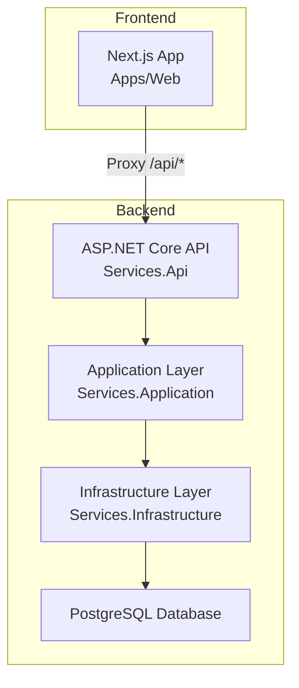
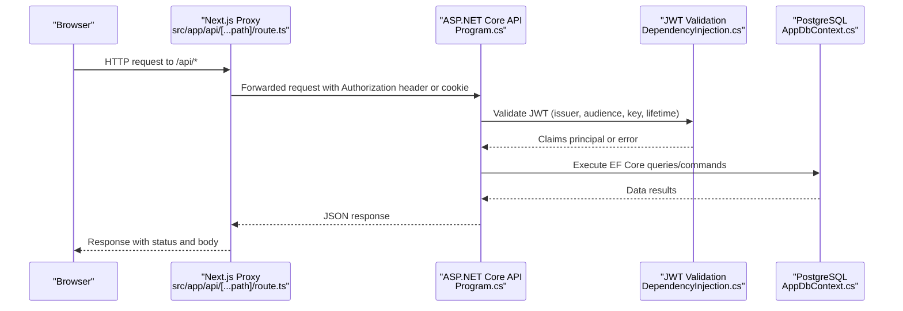
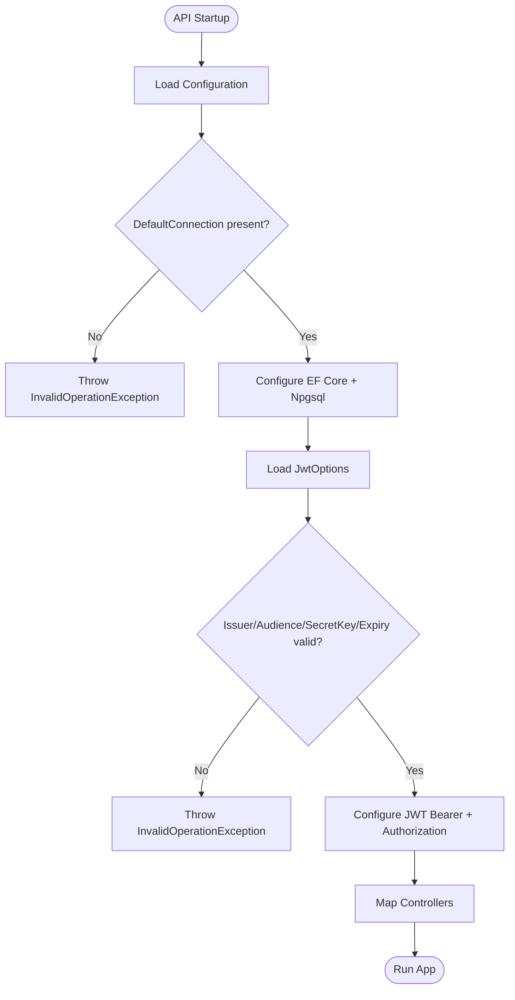
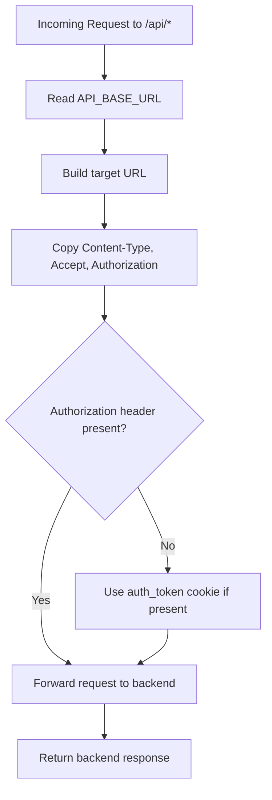
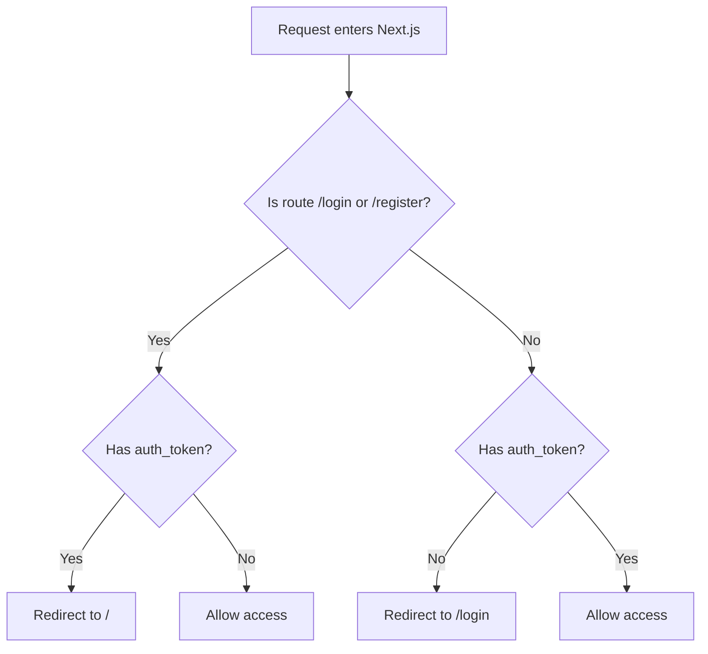
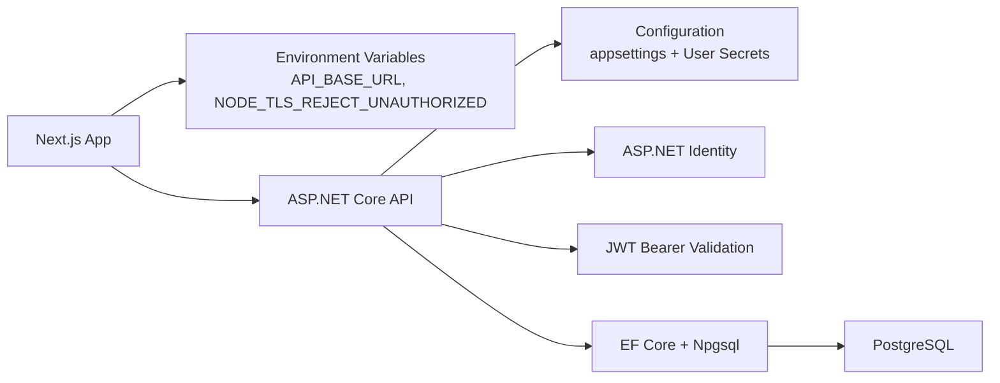

# Configuration & Deployment

<cite>
**Referenced Files in This Document**
- [README.md](file://README.md)
- [appsettings.Example.json](file://Services/Services.Api/appsettings.Example.json)
- [Program.cs](file://Services/Services.Api/Program.cs)
- [DependencyInjection.cs](file://Services/Services.Infrastructure/DependencyInjection.cs)
- [AppDbContext.cs](file://Services/Services.Infrastructure/Persistence/AppDbContext.cs)
- [JwtOptions.cs](file://Services/Services.Infrastructure/Identity/JwtOptions.cs)
- [JwtTokenGenerator.cs](file://Services/Services.Infrastructure/Identity/JwtTokenGenerator.cs)
- [package.json](file://Apps/Web/package.json)
- [next.config.ts](file://Apps/Web/next.config.ts)
- [route.ts](file://Apps/Web/src/app/api/[...path]/route.ts)
- [proxy.ts](file://Apps/Web/src/proxy.ts)
</cite>

## Table of Contents
1. [Introduction](#introduction)
2. [Project Structure](#project-structure)
3. [Core Components](#core-components)
4. [Architecture Overview](#architecture-overview)
5. [Detailed Component Analysis](#detailed-component-analysis)
6. [Dependency Analysis](#dependency-analysis)
7. [Performance Considerations](#performance-considerations)
8. [Troubleshooting Guide](#troubleshooting-guide)
9. [Conclusion](#conclusion)

## Introduction
This document provides configuration and deployment guidance for TaskFlow, covering both the ASP.NET Core API and the Next.js web application. It explains environment configuration (development and production), build processes, containerization strategies, monitoring/logging/error tracking, scaling considerations, and troubleshooting steps.

## Project Structure
TaskFlow consists of:
- Backend API: ASP.NET Core with layered architecture (API, Application, Domain, Infrastructure).
- Frontend Web: Next.js application that proxies requests to the backend API.

**Diagram sources**
- [Program.cs:6-37](file://Services/Services.Api/Program.cs#L6-L37)
- [DependencyInjection.cs:19-127](file://Services/Services.Infrastructure/DependencyInjection.cs#L19-L127)
- [AppDbContext.cs:10-24](file://Services/Services.Infrastructure/Persistence/AppDbContext.cs#L10-L24)
- [route.ts:1-77](file://Apps/Web/src/app/api/[...path]/route.ts#L1-L77)

**Section sources**
- [README.md:13-28](file://README.md#L13-L28)

## Core Components
- API entrypoint and middleware pipeline: configures controllers, OpenAPI/Scalar, HTTPS redirection, authentication, authorization, and routes.
- Infrastructure DI: configures PostgreSQL via EF Core, ASP.NET Identity, JWT validation, repositories, and services.
- JWT options and token generation: strongly typed configuration and token issuance.
- Frontend proxy: forwards client requests to the backend API, handling headers and cookies.
- Build scripts and tooling: pnpm scripts for dev/build/lint/format; Next.js Turbopack rules.

Key responsibilities:
- Environment configuration is loaded from appsettings files and user secrets (development).
- Database connection string and JWT settings are validated at startup.
- Frontend uses an environment variable to point to the backend API URL.

**Section sources**
- [Program.cs:6-37](file://Services/Services.Api/Program.cs#L6-L37)
- [DependencyInjection.cs:19-127](file://Services/Services.Infrastructure/DependencyInjection.cs#L19-L127)
- [JwtOptions.cs:1-14](file://Services/Services.Infrastructure/Identity/JwtOptions.cs#L1-L14)
- [JwtTokenGenerator.cs:9-49](file://Services/Services.Infrastructure/Identity/JwtTokenGenerator.cs#L9-L49)
- [route.ts:1-77](file://Apps/Web/src/app/api/[...path]/route.ts#L1-L77)
- [package.json:5-13](file://Apps/Web/package.json#L5-L13)

## Architecture Overview
The frontend proxies API calls through a Next.js route handler to the backend API. The backend validates JWTs, enforces authorization, and persists data using Entity Framework Core against PostgreSQL.

**Diagram sources**
- [route.ts:9-69](file://Apps/Web/src/app/api/[...path]/route.ts#L9-L69)
- [Program.cs:20-37](file://Services/Services.Api/Program.cs#L20-L37)
- [DependencyInjection.cs:84-112](file://Services/Services.Infrastructure/DependencyInjection.cs#L84-L112)
- [AppDbContext.cs:10-24](file://Services/Services.Infrastructure/Persistence/AppDbContext.cs#L10-L24)

## Detailed Component Analysis

### Backend Configuration and Startup
- Program.cs wires up controllers, infrastructure, application layers, OpenAPI/Scalar, HTTPS redirection, authentication, authorization, and maps controllers.
- DependencyInjection.cs loads configuration, sets up EF Core with Npgsql, Identity, JWT bearer validation, and registers services and repositories.
- JwtOptions.cs defines the strongly typed configuration section for JWT settings.
- JwtTokenGenerator.cs issues tokens using the configured secret and expiration.

Configuration keys and behavior:
- ConnectionStrings:DefaultConnection: required for EF Core.
- Jwt:Issuer, Jwt:Audience, Jwt:SecretKey (Base64, ≥32 bytes), Jwt:ExpirationMinutes: required for JWT validation and token generation.
- Logging: LogLevel defaults provided in example file.

Startup validations:
- Missing DefaultConnection throws an exception.
- Missing or invalid JWT configuration throws an exception.
- SecretKey must be valid Base64 and at least 32 bytes.

**Diagram sources**
- [DependencyInjection.cs:23-82](file://Services/Services.Infrastructure/DependencyInjection.cs#L23-L82)
- [DependencyInjection.cs:84-112](file://Services/Services.Infrastructure/DependencyInjection.cs#L84-L112)
- [Program.cs:6-37](file://Services/Services.Api/Program.cs#L6-L37)

**Section sources**
- [Program.cs:6-37](file://Services/Services.Api/Program.cs#L6-L37)
- [DependencyInjection.cs:19-127](file://Services/Services.Infrastructure/DependencyInjection.cs#L19-L127)
- [JwtOptions.cs:1-14](file://Services/Services.Infrastructure/Identity/JwtOptions.cs#L1-L14)
- [JwtTokenGenerator.cs:9-49](file://Services/Services.Infrastructure/Identity/JwtTokenGenerator.cs#L9-L49)
- [appsettings.Example.json:1-17](file://Services/Services.Api/appsettings.Example.json#L1-L17)

### Frontend Proxy and Routing
- src/app/api/[...path]/route.ts proxies all HTTP methods to the backend API, forwarding content-type, accept, and Authorization headers. If no Authorization header is present, it reads the auth_token cookie and injects it.
- In non-production environments, TLS verification is disabled for local development convenience.
- API_BASE_URL defaults to https://localhost:7120/api and can be overridden via environment variables.

**Diagram sources**
- [route.ts:9-69](file://Apps/Web/src/app/api/[...path]/route.ts#L9-L69)

**Section sources**
- [route.ts:1-77](file://Apps/Web/src/app/api/[...path]/route.ts#L1-L77)

### Authentication Middleware and Route Protection
- Next.js server-side proxy guard redirects unauthenticated users away from protected routes and authenticated users away from login/register routes based on the presence of the auth_token cookie.

**Diagram sources**
- [proxy.ts:6-26](file://Apps/Web/src/proxy.ts#L6-L26)

**Section sources**
- [proxy.ts:1-42](file://Apps/Web/src/proxy.ts#L1-L42)

## Dependency Analysis
- The API depends on:
  - PostgreSQL via EF Core (Npgsql).
  - ASP.NET Identity for user management.
  - JWT Bearer for authentication.
- The frontend depends on:
  - Next.js runtime and environment variables.
  - Optional Node process flag for disabling TLS verification in non-production.

**Diagram sources**
- [DependencyInjection.cs:23-112](file://Services/Services.Infrastructure/DependencyInjection.cs#L23-L112)
- [route.ts:1-77](file://Apps/Web/src/app/api/[...path]/route.ts#L1-L77)

**Section sources**
- [DependencyInjection.cs:19-127](file://Services/Services.Infrastructure/DependencyInjection.cs#L19-L127)
- [route.ts:1-77](file://Apps/Web/src/app/api/[...path]/route.ts#L1-L77)

## Performance Considerations
- Frontend:
  - Next.js Turbopack is enabled with Tailwind CSS loader rules to improve build performance.
  - Component caching and partial prefetching are enabled.
- Backend:
  - Ensure proper indexing on frequently queried columns in PostgreSQL.
  - Tune EF Core query patterns and avoid N+1 queries by using appropriate includes.
  - Keep JWT ExpirationMinutes reasonable to balance security and session longevity.
- Networking:
  - Prefer HTTPS between frontend and backend in production with trusted certificates.
  - Avoid disabling TLS verification outside of local development.

[No sources needed since this section provides general guidance]

## Troubleshooting Guide

Common issues and resolutions:
- Missing database connection string:
  - Symptom: Startup fails with an exception indicating DefaultConnection not found.
  - Resolution: Provide ConnectionStrings:DefaultConnection via user secrets or appsettings.
- Invalid or missing JWT configuration:
  - Symptom: Startup fails due to incomplete JWT settings or invalid Base64 secret.
  - Resolution: Set Jwt:Issuer, Jwt:Audience, Jwt:SecretKey (Base64, ≥32 bytes), and Jwt:ExpirationMinutes.
- Frontend cannot reach backend:
  - Symptom: Network errors or CORS-like failures when calling /api/*.
  - Resolution: Set API_BASE_URL to the correct backend URL including /api. Verify HTTPS/TLS trust chain in production.
- Development TLS warnings:
  - Symptom: Local development disables TLS verification.
  - Resolution: Only use in development; configure trusted certificates for production.

Operational checks:
- Build and run the API:
  - Restore dependencies, apply migrations, and run the API project.
- Build and run the web:
  - Install dependencies and start the dev server or build for production.

**Section sources**
- [DependencyInjection.cs:23-82](file://Services/Services.Infrastructure/DependencyInjection.cs#L23-L82)
- [README.md:38-62](file://README.md#L38-L62)
- [README.md:64-75](file://README.md#L64-L75)

## Conclusion
TaskFlow’s configuration centers around a secure JWT-based API backed by PostgreSQL and a Next.js frontend that proxies API calls. Properly configuring environment variables, secrets, and database connections is essential for both development and production. Follow the build and deployment steps outlined here to ensure reliable operation across environments. For production, enforce HTTPS, secure secrets management, and robust logging and monitoring practices.

[No sources needed since this section summarizes without analyzing specific files]