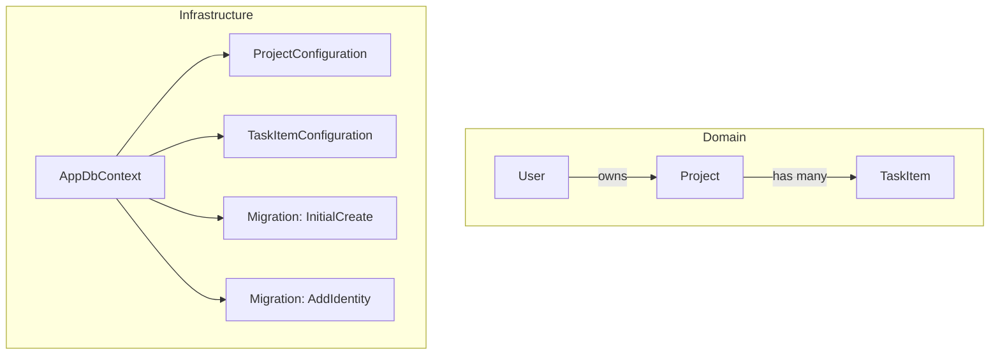
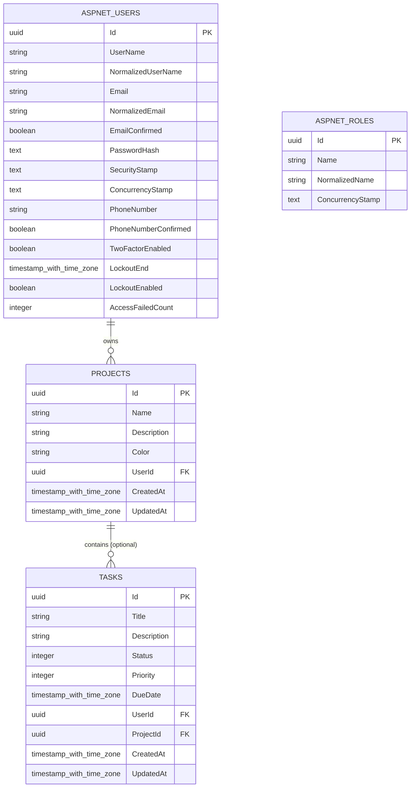
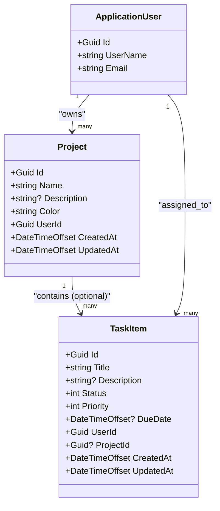
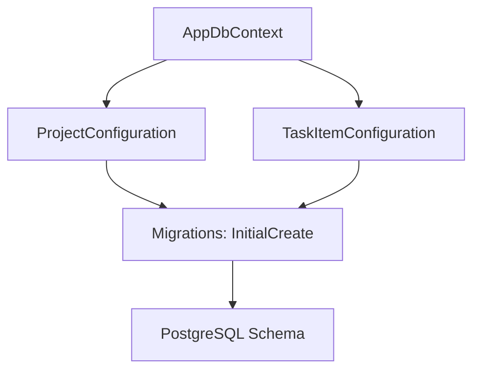

# Database Schema

<cite>
**Referenced Files in This Document**
- [AppDbContext.cs](file://Services/Services.Infrastructure/Persistence/AppDbContext.cs)
- [ProjectConfiguration.cs](file://Services/Services.Infrastructure/Persistence/Configurations/ProjectConfiguration.cs)
- [TaskItemConfiguration.cs](file://Services/Services.Infrastructure/Persistence/Configurations/TaskItemConfiguration.cs)
- [20261013023021_InitialCreate.cs](file://Services/Services.Infrastructure/Persistence/Migrations/20261013023021_InitialCreate.cs)
- [20261013031549_AddIdentity.cs](file://Services/Services.Infrastructure/Persistence/Migrations/20261013031549_AddIdentity.cs)
- [Project.cs](file://Services/Services.Domain/Entities/Project.cs)
- [TaskItem.cs](file://Services/Services.Domain/Entities/TaskItem.cs)
- [User.cs](file://Services/Services.Domain/Entities/User.cs)
- [TaskCurrentStatus.cs](file://Services/Services.Domain/Enums/TaskCurrentStatus.cs)
- [TaskPriority.cs](file://Services/Services.Domain/Enums/TaskPriority.cs)
</cite>

## Table of Contents
1. [Introduction](#introduction)
2. [Project Structure](#project-structure)
3. [Core Components](#core-components)
4. [Architecture Overview](#architecture-overview)
5. [Detailed Component Analysis](#detailed-component-analysis)
6. [Dependency Analysis](#dependency-analysis)
7. [Performance Considerations](#performance-considerations)
8. [Troubleshooting Guide](#troubleshooting-guide)
9. [Conclusion](#conclusion)
10. [Appendices](#appendices)

## Introduction
This document describes the PostgreSQL database schema for TaskFlow, including entity relationships, table structures, field definitions, data types, constraints, indexes, and referential integrity rules. It also covers migration history, version management, performance considerations (indexing, query optimization, connection pooling), sample queries, data access patterns, and ORM mapping configurations.

The application uses Entity Framework Core with a code-first approach. The domain model includes Project and TaskItem entities, while user identity is provided by ASP.NET Core Identity.

## Project Structure
The database-related code is organized under Services.Infrastructure.Persistence:
- DbContext and EF configuration
- Entity type configurations
- Migrations that generate the actual PostgreSQL schema

**Diagram sources**
- [AppDbContext.cs:10-23](file://Services/Services.Infrastructure/Persistence/AppDbContext.cs#L10-L23)
- [ProjectConfiguration.cs:10-43](file://Services/Services.Infrastructure/Persistence/Configurations/ProjectConfiguration.cs#L10-L43)
- [TaskItemConfiguration.cs:11-70](file://Services/Services.Infrastructure/Persistence/Configurations/TaskItemConfiguration.cs#L11-L70)
- [20261013023021_InitialCreate.cs:12-76](file://Services/Services.Infrastructure/Persistence/Migrations/20261013023021_InitialCreate.cs#L12-L76)
- [20261013031549_AddIdentity.cs:13-196](file://Services/Services.Infrastructure/Persistence/Migrations/20261013031549_AddIdentity.cs#L13-L196)

**Section sources**
- [AppDbContext.cs:1-24](file://Services/Services.Infrastructure/Persistence/AppDbContext.cs#L1-L24)

## Core Components
- AppDbContext: Central EF context that exposes Tasks and Projects DbSet collections and applies entity configurations.
- ProjectConfiguration: Maps Project to the Projects table, defines primary key, column constraints, and an index on UserId.
- TaskItemConfiguration: Maps TaskItem to the Tasks table, maps complex properties (Title), enums as integers, and configures the relationship to Project with SetNull delete behavior. Also defines indexes on UserId and composite (UserId, Status).

Key behaviors:
- Primary keys are Guids generated at the application level (ValueGeneratedNever).
- Enums are stored as integers.
- Project deletion cascades to tasks by setting ProjectId to null (SetNull).

**Section sources**
- [AppDbContext.cs:10-23](file://Services/Services.Infrastructure/Persistence/AppDbContext.cs#L10-L23)
- [ProjectConfiguration.cs:10-43](file://Services/Services.Infrastructure/Persistence/Configurations/ProjectConfiguration.cs#L10-L43)
- [TaskItemConfiguration.cs:11-70](file://Services/Services.Infrastructure/Persistence/Configurations/TaskItemConfiguration.cs#L11-L70)

## Architecture Overview
The database schema consists of three main areas:
- Identity tables from ASP.NET Core Identity (AspNetUsers, AspNetRoles, and related tables)
- Projects table linked to users via UserId
- Tasks table linked to both Users (UserId) and optionally to Projects (ProjectId)

**Diagram sources**
- [20261013031549_AddIdentity.cs:15-196](file://Services/Services.Infrastructure/Persistence/Migrations/20261013031549_AddIdentity.cs#L15-L196)
- [20261013023021_InitialCreate.cs:14-76](file://Services/Services.Infrastructure/Persistence/Migrations/20261013023021_InitialCreate.cs#L14-L76)

## Detailed Component Analysis

### Entities and Relationships
- User (Identity): Provided by ASP.NET Core Identity; represented by AspNetUsers.
- Project: Owned by a user (one-to-many).
- TaskItem: Belongs to a user and optionally to a project (many-to-one optional).

**Diagram sources**
- [Project.cs:5-23](file://Services/Services.Domain/Entities/Project.cs#L5-L23)
- [TaskItem.cs:6-20](file://Services/Services.Domain/Entities/TaskItem.cs#L6-L20)
- [20261013031549_AddIdentity.cs:29-52](file://Services/Services.Infrastructure/Persistence/Migrations/20261013031549_AddIdentity.cs#L29-L52)

#### Relationship Details
- One-to-Many: User to Project
  - Foreign Key: Projects.UserId references AspNetUsers.Id
  - No explicit cascade defined in migrations for this relationship; typical default behavior applies unless configured elsewhere.
- One-to-Many: Project to Task (optional)
  - Foreign Key: Tasks.ProjectId references Projects.Id
  - Delete Behavior: SetNull (when a project is deleted, task ProjectId becomes null)

**Section sources**
- [TaskItemConfiguration.cs:66-69](file://Services/Services.Infrastructure/Persistence/Configurations/TaskItemConfiguration.cs#L66-L69)
- [20261013023021_InitialCreate.cs:49-55](file://Services/Services.Infrastructure/Persistence/Migrations/20261013023021_InitialCreate.cs#L49-L55)

### Table Structures and Field Definitions

#### Projects
- Purpose: Stores project metadata and ownership.
- Columns:
  - Id: uuid, primary key, application-generated
  - Name: varchar(150), required
  - Description: varchar(1000), optional
  - Color: varchar(7), required (hex color)
  - UserId: uuid, required (foreign key to AspNetUsers.Id)
  - CreatedAt: timestamp with time zone, required
  - UpdatedAt: timestamp with time zone, required
- Indexes:
  - IX_Projects_UserId on UserId

Constraints:
- Primary Key: PK_Projects(Id)
- Required fields enforced by EF configuration and domain logic

**Section sources**
- [20261013023021_InitialCreate.cs:14-29](file://Services/Services.Infrastructure/Persistence/Migrations/20261013023021_InitialCreate.cs#L14-L29)
- [20261013023021_InitialCreate.cs:57-60](file://Services/Services.Infrastructure/Persistence/Migrations/20261013023021_InitialCreate.cs#L57-L60)
- [ProjectConfiguration.cs:16-42](file://Services/Services.Infrastructure/Persistence/Configurations/ProjectConfiguration.cs#L16-L42)

#### Tasks
- Purpose: Stores individual tasks with status, priority, due date, and associations.
- Columns:
  - Id: uuid, primary key, application-generated
  - Title: varchar(200), required
  - Description: varchar(2000), optional
  - Status: integer, required (enum mapped to int)
  - Priority: integer, required (enum mapped to int)
  - DueDate: timestamp with time zone, optional
  - UserId: uuid, required (foreign key to AspNetUsers.Id)
  - ProjectId: uuid, optional (foreign key to Projects.Id)
  - CreatedAt: timestamp with time zone, required
  - UpdatedAt: timestamp with time zone, required
- Indexes:
  - IX_Tasks_ProjectId on ProjectId
  - IX_Tasks_UserId on UserId
  - IX_Tasks_UserId_Status on (UserId, Status)

Constraints:
- Primary Key: PK_Tasks(Id)
- Foreign Key: FK_Tasks_Projects_ProjectId(ProjectId -> Projects.Id) with SetNull delete behavior

**Section sources**
- [20261013023021_InitialCreate.cs:31-55](file://Services/Services.Infrastructure/Persistence/Migrations/20261013023021_InitialCreate.cs#L31-L55)
- [20261013023021_InitialCreate.cs:62-75](file://Services/Services.Infrastructure/Persistence/Migrations/20261013023021_InitialCreate.cs#L62-L75)
- [TaskItemConfiguration.cs:15-69](file://Services/Services.Infrastructure/Persistence/Configurations/TaskItemConfiguration.cs#L15-L69)

#### Identity Tables (AspNetUsers, AspNetRoles, etc.)
- Purpose: Provide authentication and authorization capabilities.
- Key tables:
  - AspNetUsers: user accounts and profile data
  - AspNetRoles: roles
  - AspNetUserClaims, AspNetRoleClaims: claims
  - AspNetUserLogins: external login info
  - AspNetUserRoles: role membership
  - AspNetUserTokens: tokens
- Indexes include normalized username/email lookups and foreign key indexes for claims and roles.

**Section sources**
- [20261013031549_AddIdentity.cs:15-196](file://Services/Services.Infrastructure/Persistence/Migrations/20261013031549_AddIdentity.cs#L15-L196)

### Data Types and Enum Mapping
- Enums:
  - TaskCurrentStatus: Todo=1, InProgress=2, Done=3
  - TaskPriority: Low=1, Medium=2, High=3, Urgent=4
- Mapping: Stored as integers in the database.

**Section sources**
- [TaskCurrentStatus.cs:3-8](file://Services/Services.Domain/Enums/TaskCurrentStatus.cs#L3-L8)
- [TaskPriority.cs:3-9](file://Services/Services.Domain/Enums/TaskPriority.cs#L3-L9)
- [TaskItemConfiguration.cs:38-44](file://Services/Services.Infrastructure/Persistence/Configurations/TaskItemConfiguration.cs#L38-L44)

### Referential Integrity and Cascading Behaviors
- Tasks.ProjectId -> Projects.Id: On delete SetNull (tasks remain but become unassigned)
- Identity relationships use Cascade deletes where applicable (e.g., claims and roles)

**Section sources**
- [TaskItemConfiguration.cs:66-69](file://Services/Services.Infrastructure/Persistence/Configurations/TaskItemConfiguration.cs#L66-L69)
- [20261013031549_AddIdentity.cs:67-158](file://Services/Services.Infrastructure/Persistence/Migrations/20261013031549_AddIdentity.cs#L67-L158)

## Dependency Analysis
EF Core configuration drives the schema generation:
- AppDbContext registers entity configurations
- Configurations define table names, columns, constraints, and indexes
- Migrations materialize these into PostgreSQL DDL

**Diagram sources**
- [AppDbContext.cs:17-23](file://Services/Services.Infrastructure/Persistence/AppDbContext.cs#L17-L23)
- [ProjectConfiguration.cs:10-43](file://Services/Services.Infrastructure/Persistence/Configurations/ProjectConfiguration.cs#L10-L43)
- [TaskItemConfiguration.cs:11-70](file://Services/Services.Infrastructure/Persistence/Configurations/TaskItemConfiguration.cs#L11-L70)
- [20261013023021_InitialCreate.cs:12-76](file://Services/Services.Infrastructure/Persistence/Migrations/20261013023021_InitialCreate.cs#L12-L76)

**Section sources**
- [AppDbContext.cs:10-23](file://Services/Services.Infrastructure/Persistence/AppDbContext.cs#L10-L23)

## Performance Considerations

### Indexing Strategy
- Single-column indexes:
  - Projects.UserId
  - Tasks.UserId
  - Tasks.ProjectId
- Composite index:
  - Tasks(UserId, Status) to optimize common filtering by owner and status

Recommendations:
- Keep composite index (UserId, Status) for frequent queries like “list my tasks by status.”
- If querying by ProjectId frequently, consider adding a filtered or covering index if needed.

**Section sources**
- [20261013023021_InitialCreate.cs:57-75](file://Services/Services.Infrastructure/Persistence/Migrations/20261013023021_InitialCreate.cs#L57-L75)
- [ProjectConfiguration.cs:42](file://Services/Services.Infrastructure/Persistence/Configurations/ProjectConfiguration.cs#L42)
- [TaskItemConfiguration.cs:59-64](file://Services/Services.Infrastructure/Persistence/Configurations/TaskItemConfiguration.cs#L59-L64)

### Query Optimization
- Use eager loading when retrieving projects with their tasks to avoid N+1 queries.
- Filter early using indexed columns (UserId, Status, ProjectId).
- Avoid selecting large text fields (Description) unless necessary.

### Connection Pooling
- Ensure EF Core is configured with appropriate connection pool settings for high-throughput scenarios.
- Reuse DbContext instances per request and avoid long-lived contexts.

[No sources needed since this section provides general guidance]

## Troubleshooting Guide

Common issues and resolutions:
- Deleting a project does not remove tasks:
  - Expected behavior: Tasks remain with ProjectId set to null due to SetNull delete behavior.
  - Action: Clean up orphaned tasks explicitly if needed.
- Missing indexes causing slow queries:
  - Verify existence of IX_Tasks_UserId_Status and IX_Projects_UserId.
  - Add additional indexes based on query patterns.
- Identity-related constraint violations:
  - Ensure AspNetUsers rows exist before assigning UserId to Projects/Tasks.

**Section sources**
- [TaskItemConfiguration.cs:66-69](file://Services/Services.Infrastructure/Persistence/Configurations/TaskItemConfiguration.cs#L66-L69)
- [20261013023021_InitialCreate.cs:62-75](file://Services/Services.Infrastructure/Persistence/Migrations/20261013023021_InitialCreate.cs#L62-L75)

## Conclusion
TaskFlow’s PostgreSQL schema centers around Projects and Tasks with clear ownership and optional assignment to projects. Identity is managed via ASP.NET Core Identity. The schema leverages EF Core configurations and migrations to enforce constraints and provide useful indexes. Careful attention to indexing and query patterns will ensure good performance as data grows.

[No sources needed since this section summarizes without analyzing specific files]

## Appendices

### Migration History and Version Management
- InitialCreate: Creates Projects and Tasks tables, primary keys, foreign keys, and indexes.
- AddIdentity: Adds ASP.NET Core Identity tables and indexes.

Version management strategy:
- Use EF Core migrations to evolve the schema over time.
- Apply migrations in CI/CD pipelines against target databases.
- Maintain backward compatibility when altering columns or adding constraints.

**Section sources**
- [20261013023021_InitialCreate.cs:12-86](file://Services/Services.Infrastructure/Persistence/Migrations/20261013023021_InitialCreate.cs#L12-L86)
- [20261013031549_AddIdentity.cs:13-221](file://Services/Services.Infrastructure/Persistence/Migrations/20261013031549_AddIdentity.cs#L13-L221)

### Sample Queries

- List all tasks for a user:
  - SELECT * FROM Tasks WHERE UserId = @userId;

- List tasks by user and status:
  - SELECT * FROM Tasks WHERE UserId = @userId AND Status = @status;

- Get tasks belonging to a project:
  - SELECT * FROM Tasks WHERE ProjectId = @projectId;

- Count tasks by status for a user:
  - SELECT Status, COUNT(*) FROM Tasks WHERE UserId = @userId GROUP BY Status;

- Find overdue tasks for a user:
  - SELECT * FROM Tasks WHERE UserId = @userId AND DueDate < NOW() AND Status != 3;

[No sources needed since this section provides general guidance]

### Data Access Patterns and ORM Mapping

- DbContext usage:
  - Expose Tasks and Projects via DbSet in AppDbContext.
  - Apply configurations through ModelBuilder in OnModelCreating.

- Entity mappings:
  - ProjectConfiguration sets table name, primary key, column constraints, and index on UserId.
  - TaskItemConfiguration sets table name, primary key, complex property mapping for Title, enum mappings, and relationship to Project with SetNull delete behavior.

- Best practices:
  - Use repository/service layers to encapsulate data access.
  - Prefer projection (select only needed fields) for read-heavy endpoints.
  - Use async methods for I/O-bound operations.

**Section sources**
- [AppDbContext.cs:10-23](file://Services/Services.Infrastructure/Persistence/AppDbContext.cs#L10-L23)
- [ProjectConfiguration.cs:10-43](file://Services/Services.Infrastructure/Persistence/Configurations/ProjectConfiguration.cs#L10-L43)
- [TaskItemConfiguration.cs:11-70](file://Services/Services.Infrastructure/Persistence/Configurations/TaskItemConfiguration.cs#L11-L70)