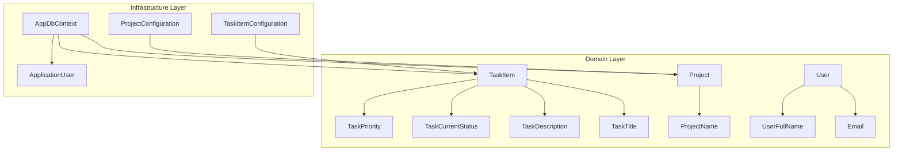
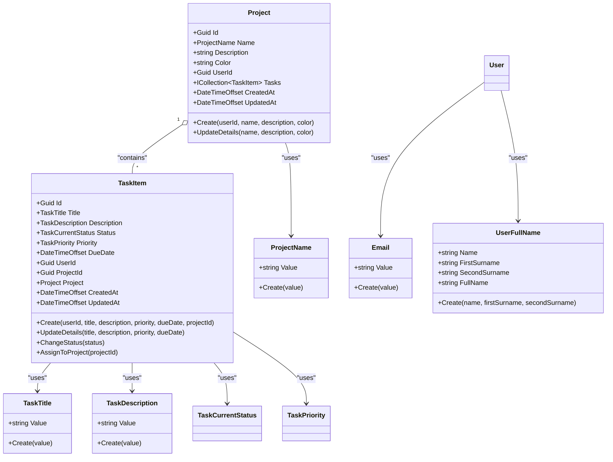
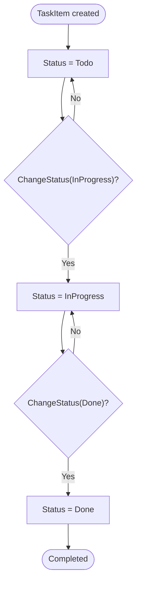
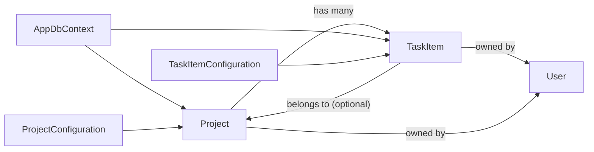

# Domain Entities

<cite>
**Referenced Files in This Document**
- [Project.cs](file://Services/Services.Domain/Entities/Project.cs)
- [TaskItem.cs](file://Services/Services.Domain/Entities/TaskItem.cs)
- [User.cs](file://Services/Services.Domain/Entities/User.cs)
- [TaskCurrentStatus.cs](file://Services/Services.Domain/Enums/TaskCurrentStatus.cs)
- [TaskPriority.cs](file://Services/Services.Domain/Enums/TaskPriority.cs)
- [Email.cs](file://Services/Services.Domain/ValueObjects/Email.cs)
- [ProjectName.cs](file://Services/Services.Domain/ValueObjects/ProjectName.cs)
- [TaskDescription.cs](file://Services/Services.Domain/ValueObjects/TaskDescription.cs)
- [TaskTitle.cs](file://Services/Services.Domain/ValueObjects/TaskTitle.cs)
- [UserFullName.cs](file://Services/Services.Domain/ValueObjects/UserFullName.cs)
- [AppDbContext.cs](file://Services/Services.Infrastructure/Persistence/AppDbContext.cs)
- [ProjectConfiguration.cs](file://Services/Services.Infrastructure/Persistence/Configurations/ProjectConfiguration.cs)
- [TaskItemConfiguration.cs](file://Services/Services.Infrastructure/Persistence/Configurations/TaskItemConfiguration.cs)
- [ApplicationUser.cs](file://Services/Services.Infrastructure/Identity/ApplicationUser.cs)
</cite>

## Table of Contents
1. [Introduction](#introduction)
2. [Project Structure](#project-structure)
3. [Core Components](#core-components)
4. [Architecture Overview](#architecture-overview)
5. [Detailed Component Analysis](#detailed-component-analysis)
6. [Dependency Analysis](#dependency-analysis)
7. [Performance Considerations](#performance-considerations)
8. [Troubleshooting Guide](#troubleshooting-guide)
9. [Conclusion](#conclusion)

## Introduction
This document describes the core domain entities for TaskFlow: Project, TaskItem, and User. It explains their properties, relationships, business rules, validation constraints, lifecycle states, and persistence configuration. It also provides entity relationship diagrams, examples of instantiation patterns, and guidance on maintaining business invariants across operations.

## Project Structure
The domain layer defines entities and value objects that encapsulate business logic and invariants. The infrastructure layer configures Entity Framework mappings and integrates with ASP.NET Core Identity for authentication.

**Diagram sources**
- [Project.cs:5-22](file://Services/Services.Domain/Entities/Project.cs#L5-L22)
- [TaskItem.cs:6-20](file://Services/Services.Domain/Entities/TaskItem.cs#L6-L20)
- [User.cs:7-9](file://Services/Services.Domain/Entities/User.cs#L7-L9)
- [ProjectName.cs:3-36](file://Services/Services.Domain/ValueObjects/ProjectName.cs#L3-L36)
- [TaskTitle.cs:3-36](file://Services/Services.Domain/ValueObjects/TaskTitle.cs#L3-L36)
- [TaskDescription.cs:3-30](file://Services/Services.Domain/ValueObjects/TaskDescription.cs#L3-L30)
- [Email.cs:5-49](file://Services/Services.Domain/ValueObjects/Email.cs#L5-L49)
- [UserFullName.cs:3-66](file://Services/Services.Domain/ValueObjects/UserFullName.cs#L3-L66)
- [TaskCurrentStatus.cs:3-9](file://Services/Services.Domain/Enums/TaskCurrentStatus.cs#L3-L9)
- [TaskPriority.cs:3-10](file://Services/Services.Domain/Enums/TaskPriority.cs#L3-L10)
- [AppDbContext.cs:10-23](file://Services/Services.Infrastructure/Persistence/AppDbContext.cs#L10-L23)
- [ProjectConfiguration.cs:7-44](file://Services/Services.Infrastructure/Persistence/Configurations/ProjectConfiguration.cs#L7-L44)
- [TaskItemConfiguration.cs:8-71](file://Services/Services.Infrastructure/Persistence/Configurations/TaskItemConfiguration.cs#L8-L71)
- [ApplicationUser.cs:5-7](file://Services/Services.Infrastructure/Identity/ApplicationUser.cs#L5-L7)

**Section sources**
- [Project.cs:5-121](file://Services/Services.Domain/Entities/Project.cs#L5-L121)
- [TaskItem.cs:6-128](file://Services/Services.Domain/Entities/TaskItem.cs#L6-L128)
- [User.cs:7-9](file://Services/Services.Domain/Entities/User.cs#L7-L9)
- [AppDbContext.cs:10-23](file://Services/Services.Infrastructure/Persistence/AppDbContext.cs#L10-L23)

## Core Components
- Project: Represents a project owned by a user, containing multiple tasks. Enforces name, description, color, and ownership invariants.
- TaskItem: Represents a task with title, optional description, status, priority, due date, owner, and optional project assignment.
- User: Domain placeholder for user identity; actual authentication is handled via ASP.NET Core Identity through ApplicationUser.

Key responsibilities:
- Encapsulate validation and normalization within entities and value objects.
- Provide factory methods (Create) and update methods (UpdateDetails, ChangeStatus, AssignToProject).
- Maintain timestamps (CreatedAt, UpdatedAt) to track creation and modifications.

**Section sources**
- [Project.cs:5-121](file://Services/Services.Domain/Entities/Project.cs#L5-L121)
- [TaskItem.cs:6-128](file://Services/Services.Domain/Entities/TaskItem.cs#L6-L128)
- [User.cs:7-9](file://Services/Services.Domain/Entities/User.cs#L7-L9)

## Architecture Overview
The domain model is persisted using Entity Framework Core. AppDbContext exposes DbSet collections for Project and TaskItem and applies EF configurations. Relationships are configured so that a Project has many Tasks, and a Task optionally belongs to a Project.

**Diagram sources**
- [Project.cs:5-121](file://Services/Services.Domain/Entities/Project.cs#L5-L121)
- [TaskItem.cs:6-128](file://Services/Services.Domain/Entities/TaskItem.cs#L6-L128)
- [ProjectName.cs:3-36](file://Services/Services.Domain/ValueObjects/ProjectName.cs#L3-L36)
- [TaskTitle.cs:3-36](file://Services/Services.Domain/ValueObjects/TaskTitle.cs#L3-L36)
- [TaskDescription.cs:3-30](file://Services/Services.Domain/ValueObjects/TaskDescription.cs#L3-L30)
- [Email.cs:5-49](file://Services/Services.Domain/ValueObjects/Email.cs#L5-L49)
- [UserFullName.cs:3-66](file://Services/Services.Domain/ValueObjects/UserFullName.cs#L3-L66)
- [TaskCurrentStatus.cs:3-9](file://Services/Services.Domain/Enums/TaskCurrentStatus.cs#L3-L9)
- [TaskPriority.cs:3-10](file://Services/Services.Domain/Enums/TaskPriority.cs#L3-L10)

## Detailed Component Analysis

### Project Entity
Purpose:
- Models a project with a validated name, optional description, color, owner, and timestamped metadata.
- Owns a collection of TaskItem instances.

Properties and invariants:
- Id: Unique identifier generated at creation.
- Name: Strongly typed ProjectName with max length validation.
- Description: Optional, normalized, and limited to 1000 characters.
- Color: Required, must be a valid hexadecimal color string (e.g., #6366F1), normalized to uppercase.
- UserId: Required owner reference.
- Tasks: Collection of associated tasks.
- CreatedAt, UpdatedAt: Timestamps updated on creation and updates.

Business rules:
- A project cannot be created without a valid ProjectName.
- Description must not exceed 1000 characters after trimming.
- Color must be provided and match a hex pattern; otherwise, an exception is thrown.
- Updating details refreshes UpdatedAt.

Usage patterns:
- Creation: Use Project.Create with userId, ProjectName, optional description, and color.
- Update: Use UpdateDetails to change name, description, or color; UpdatedAt is refreshed.

Validation summary:
- Name: Non-empty, trimmed, max length enforced by ProjectName.
- Description: Null allowed; if present, trimmed and length-checked.
- Color: Non-empty, hex format validated, normalized to uppercase.

Example instantiation references:
- [Project.Create:51-64](file://Services/Services.Domain/Entities/Project.cs#L51-L64)
- [Project.UpdateDetails:66-78](file://Services/Services.Domain/Entities/Project.cs#L66-L78)
- [Project description normalization:80-97](file://Services/Services.Domain/Entities/Project.cs#L80-L97)
- [Project color normalization:99-120](file://Services/Services.Domain/Entities/Project.cs#L99-L120)

Persistence mapping:
- Table: Projects
- Columns: Id (never auto-generated), Name (max 150), Description (max 1000), Color (max 7), UserId (required), CreatedAt, UpdatedAt
- Index: UserId

**Section sources**
- [Project.cs:5-121](file://Services/Services.Domain/Entities/Project.cs#L5-L121)
- [ProjectConfiguration.cs:7-44](file://Services/Services.Infrastructure/Persistence/Configurations/ProjectConfiguration.cs#L7-L44)

### TaskItem Entity
Purpose:
- Models a task with title, optional description, status, priority, due date, owner, and optional project association.

Properties and invariants:
- Id: Unique identifier generated at creation.
- Title: Strongly typed TaskTitle with max length validation.
- Description: Optional, strongly typed TaskDescription with max length validation.
- Status: Enumerated state from TaskCurrentStatus.
- Priority: Enumerated level from TaskPriority.
- DueDate: Nullable datetime offset.
- UserId: Required owner reference.
- ProjectId: Nullable foreign key to Project.
- Project: Navigation property to Project.
- CreatedAt, UpdatedAt: Timestamps updated on creation and changes.

Lifecycle and transitions:
- Initial status: Todo upon creation.
- Allowed statuses: Todo, InProgress, Done.
- Status changes: Use ChangeStatus to transition; UpdatedAt is refreshed.

Business rules:
- Title must be non-empty and trimmed; length constrained by TaskTitle.
- Description, if provided, must not exceed TaskDescription’s max length.
- Priority must be a defined enum value.
- DueDate is optional.
- Assigning to a project sets ProjectId and refreshes UpdatedAt.

Usage patterns:
- Creation: Use TaskItem.Create with userId, TaskTitle, optional description, priority (default Medium), optional dueDate, and optional projectId.
- Updates: Use UpdateDetails to modify title, description, priority, and due date; UpdatedAt is refreshed.
- Status transitions: Use ChangeStatus with a valid TaskCurrentStatus.
- Project assignment: Use AssignToProject with a nullable projectId.

Validation summary:
- Title: Non-empty, trimmed, max length enforced by TaskTitle.
- Description: Null allowed; if present, trimmed and length-checked.
- Priority: Must be a defined enum value.
- Status: Must be a defined enum value.

Example instantiation references:
- [TaskItem.Create:54-78](file://Services/Services.Domain/Entities/TaskItem.cs#L54-L78)
- [TaskItem.UpdateDetails:80-101](file://Services/Services.Domain/Entities/TaskItem.cs#L80-L101)
- [TaskItem.ChangeStatus:103-115](file://Services/Services.Domain/Entities/TaskItem.cs#L103-L115)
- [TaskItem.AssignToProject:117-122](file://Services/Services.Domain/Entities/TaskItem.cs#L117-L122)

Status flow diagram:

**Diagram sources**
- [TaskItem.cs:103-115](file://Services/Services.Domain/Entities/TaskItem.cs#L103-L115)
- [TaskCurrentStatus.cs:3-9](file://Services/Services.Domain/Enums/TaskCurrentStatus.cs#L3-L9)

Persistence mapping:
- Table: Tasks
- Columns: Id (never auto-generated), Title (from TaskTitle.Value, max 200), Description (from TaskDescription.Value, max 2000), Status (int), Priority (int), DueDate, UserId (required), ProjectId (nullable), CreatedAt, UpdatedAt
- Indexes: UserId; composite index on (UserId, Status)
- Relationship: One Project to Many Tasks; deleting a Project sets Task.ProjectId to null.

**Section sources**
- [TaskItem.cs:6-128](file://Services/Services.Domain/Entities/TaskItem.cs#L6-L128)
- [TaskItemConfiguration.cs:8-71](file://Services/Services.Infrastructure/Persistence/Configurations/TaskItemConfiguration.cs#L8-L71)
- [TaskCurrentStatus.cs:3-9](file://Services/Services.Domain/Enums/TaskCurrentStatus.cs#L3-L9)
- [TaskPriority.cs:3-10](file://Services/Services.Domain/Enums/TaskPriority.cs#L3-L10)

### User Entity
Purpose:
- Placeholder domain entity representing a user. Actual authentication and identity management are implemented via ASP.NET Core Identity.

Authentication-related integration:
- ApplicationUser extends IdentityUser<Guid>, providing standard identity fields and capabilities.
- AppDbContext inherits IdentityDbContext<ApplicationUser, IdentityRole<Guid>, Guid>, enabling identity features alongside domain entities.

Notes:
- The domain User entity is intentionally minimal; business logic related to users should leverage the identity system where needed.

**Section sources**
- [User.cs:7-9](file://Services/Services.Domain/Entities/User.cs#L7-L9)
- [ApplicationUser.cs:5-7](file://Services/Services.Infrastructure/Identity/ApplicationUser.cs#L5-L7)
- [AppDbContext.cs:10-23](file://Services/Services.Infrastructure/Persistence/AppDbContext.cs#L10-L23)

### Value Objects
These immutable types encapsulate validation and normalization for common data:

- ProjectName: Max length 150; throws on empty or too long values.
- TaskTitle: Max length 200; throws on empty or too long values.
- TaskDescription: Max length 2000; trims input and validates length.
- Email: Validates email format and length up to 254 characters; normalizes to lowercase.
- UserFullName: Composes full name with validations for each part.

Usage patterns:
- Always create via static Create methods to ensure validity.
- Convert to string when needed using ToString().

**Section sources**
- [ProjectName.cs:3-36](file://Services/Services.Domain/ValueObjects/ProjectName.cs#L3-L36)
- [TaskTitle.cs:3-36](file://Services/Services.Domain/ValueObjects/TaskTitle.cs#L3-L36)
- [TaskDescription.cs:3-30](file://Services/Services.Domain/ValueObjects/TaskDescription.cs#L3-L30)
- [Email.cs:5-49](file://Services/Services.Domain/ValueObjects/Email.cs#L5-L49)
- [UserFullName.cs:3-66](file://Services/Services.Domain/ValueObjects/UserFullName.cs#L3-L66)

## Dependency Analysis
Entity relationships and persistence dependencies:

**Diagram sources**
- [Project.cs:17-18](file://Services/Services.Domain/Entities/Project.cs#L17-L18)
- [TaskItem.cs:14-17](file://Services/Services.Domain/Entities/TaskItem.cs#L14-L17)
- [AppDbContext.cs:13-15](file://Services/Services.Infrastructure/Persistence/AppDbContext.cs#L13-L15)
- [ProjectConfiguration.cs:7-44](file://Services/Services.Infrastructure/Persistence/Configurations/ProjectConfiguration.cs#L7-L44)
- [TaskItemConfiguration.cs:8-71](file://Services/Services.Infrastructure/Persistence/Configurations/TaskItemConfiguration.cs#L8-L71)

Coupling and cohesion:
- Project and TaskItem are cohesive domain models with clear responsibilities.
- Dependencies on value objects reduce duplication and centralize validation.
- Persistence configuration is isolated in dedicated classes, keeping domain clean.

Potential circular dependencies:
- None observed between domain entities; navigation properties are one-directional in terms of configuration.

External dependencies:
- ASP.NET Core Identity for authentication (ApplicationUser).
- Entity Framework Core for persistence and mapping.

**Section sources**
- [Project.cs:5-121](file://Services/Services.Domain/Entities/Project.cs#L5-L121)
- [TaskItem.cs:6-128](file://Services/Services.Domain/Entities/TaskItem.cs#L6-L128)
- [AppDbContext.cs:10-23](file://Services/Services.Infrastructure/Persistence/AppDbContext.cs#L10-L23)
- [ProjectConfiguration.cs:7-44](file://Services/Services.Infrastructure/Persistence/Configurations/ProjectConfiguration.cs#L7-L44)
- [TaskItemConfiguration.cs:8-71](file://Services/Services.Infrastructure/Persistence/Configurations/TaskItemConfiguration.cs#L8-L71)

## Performance Considerations
- Indexing: UserId indexes on both Project and TaskItem improve lookup performance for user-scoped queries.
- Composite indexing: (UserId, Status) on TaskItem supports efficient filtering by user and status.
- Avoid unnecessary object graph traversal: When loading projects, consider selecting only required fields to reduce payload size.
- Validation overhead: Value object creation performs trimming and checks; batch operations should minimize repeated validations where appropriate.

[No sources needed since this section provides general guidance]

## Troubleshooting Guide
Common issues and resolutions:
- Invalid project color: Ensure color is a valid hex string (e.g., #6366F1); normalization rejects invalid formats.
- Excessive description length: Keep project descriptions under 1000 characters; trim whitespace before saving.
- Invalid task priority or status: Only use defined enum values; passing undefined values will throw exceptions.
- Missing required fields: Project requires a valid ProjectName and color; TaskItem requires a non-empty title and valid priority.
- Project deletion behavior: Deleting a project sets associated tasks’ ProjectId to null; handle UI accordingly.

Validation entry points:
- Project creation/update: [Project.Create:51-64](file://Services/Services.Domain/Entities/Project.cs#L51-L64), [Project.UpdateDetails:66-78](file://Services/Services.Domain/Entities/Project.cs#L66-L78)
- Task creation/update/status: [TaskItem.Create:54-78](file://Services/Services.Domain/Entities/TaskItem.cs#L54-L78), [TaskItem.UpdateDetails:80-101](file://Services/Services.Domain/Entities/TaskItem.cs#L80-L101), [TaskItem.ChangeStatus:103-115](file://Services/Services.Domain/Entities/TaskItem.cs#L103-L115)
- Value object creation: [ProjectName.Create:14-33](file://Services/Services.Domain/ValueObjects/ProjectName.cs#L14-L33), [TaskTitle.Create:14-33](file://Services/Services.Domain/ValueObjects/TaskTitle.cs#L14-L33), [TaskDescription.Create:14-26](file://Services/Services.Domain/ValueObjects/TaskDescription.cs#L14-L26), [Email.Create:14-46](file://Services/Services.Domain/ValueObjects/Email.cs#L14-L46), [UserFullName.Create:23-62](file://Services/Services.Domain/ValueObjects/UserFullName.cs#L23-L62)

**Section sources**
- [Project.cs:80-120](file://Services/Services.Domain/Entities/Project.cs#L80-L120)
- [TaskItem.cs:62-115](file://Services/Services.Domain/Entities/TaskItem.cs#L62-L115)
- [ProjectConfiguration.cs:19-31](file://Services/Services.Infrastructure/Persistence/Configurations/ProjectConfiguration.cs#L19-L31)
- [TaskItemConfiguration.cs:20-46](file://Services/Services.Infrastructure/Persistence/Configurations/TaskItemConfiguration.cs#L20-L46)

## Conclusion
TaskFlow’s domain model centers around Project and TaskItem, with strong validation enforced through value objects and enums. Project owns multiple tasks, while tasks may optionally belong to a project. User identity is integrated via ASP.NET Core Identity. The design emphasizes immutability, explicit validation, and clear separation between domain logic and persistence concerns. Following the documented business rules and usage patterns ensures consistent behavior and maintainable code.

[No sources needed since this section summarizes without analyzing specific files]