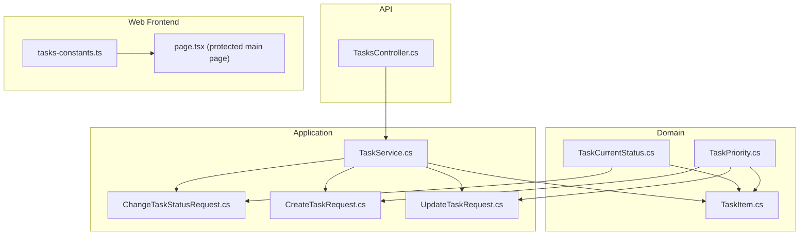
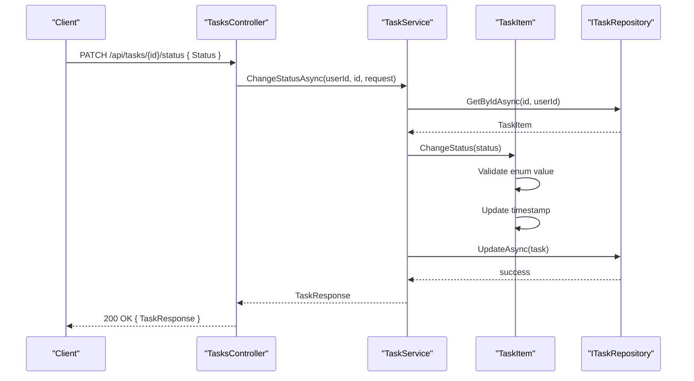
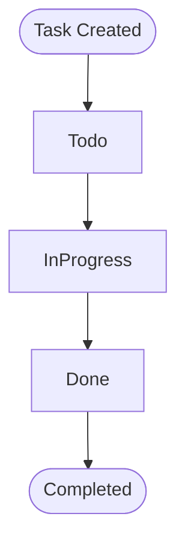
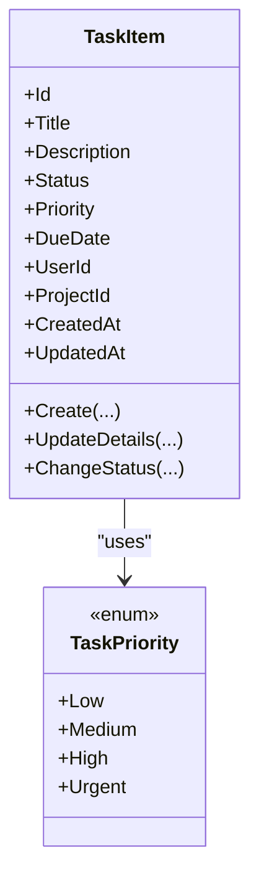
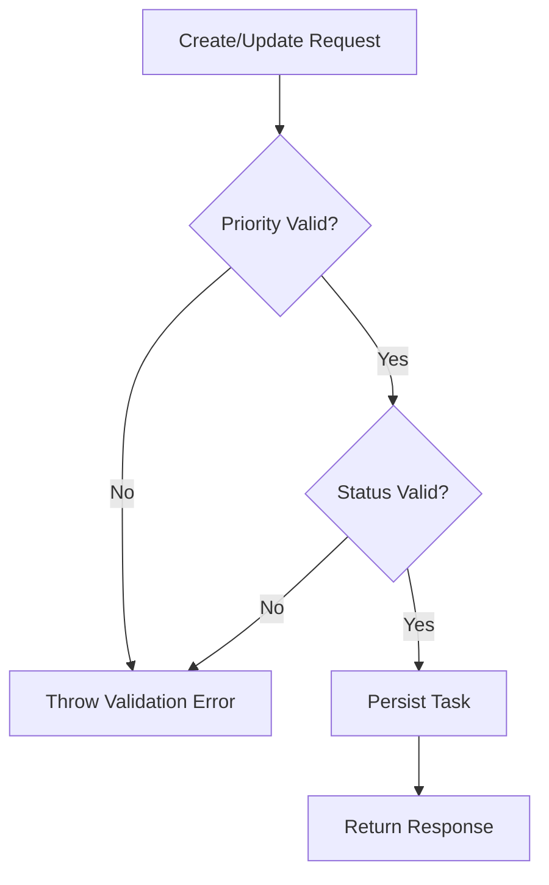
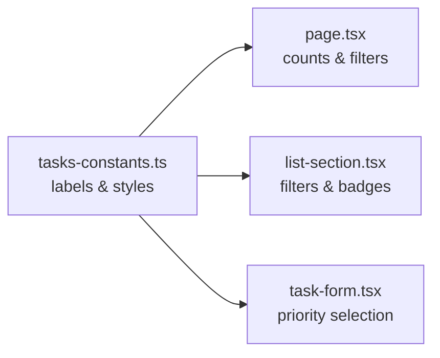
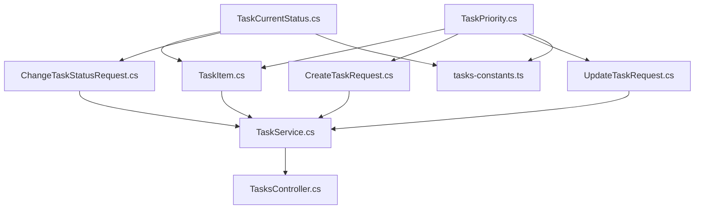

# Domain Enums

<cite>
**Referenced Files in This Document**
- [TaskCurrentStatus.cs](file://Services/Services.Domain/Enums/TaskCurrentStatus.cs)
- [TaskPriority.cs](file://Services/Services.Domain/Enums/TaskPriority.cs)
- [TaskItem.cs](file://Services/Services.Domain/Entities/TaskItem.cs)
- [TaskService.cs](file://Services/Services.Application/Services/TaskService.cs)
- [TasksController.cs](file://Services/Services.Api/Controllers/TasksController.cs)
- [ChangeTaskStatusRequest.cs](file://Services/Services.Application/DTOs/Tasks/ChangeTaskStatusRequest.cs)
- [CreateTaskRequest.cs](file://Services/Services.Application/DTOs/Tasks/CreateTaskRequest.cs)
- [UpdateTaskRequest.cs](file://Services/Services.Application/DTOs/Tasks/UpdateTaskRequest.cs)
- [tasks-constants.ts](file://Apps/Web/src/lib/util-constants/tasks-constants.ts)
- [page.tsx (protected main page)](file://Apps/Web/src/app/(protected)/page.tsx)
</cite>

## Table of Contents
1. [Introduction](#introduction)
2. [Project Structure](#project-structure)
3. [Core Components](#core-components)
4. [Architecture Overview](#architecture-overview)
5. [Detailed Component Analysis](#detailed-component-analysis)
6. [Dependency Analysis](#dependency-analysis)
7. [Performance Considerations](#performance-considerations)
8. [Troubleshooting Guide](#troubleshooting-guide)
9. [Conclusion](#conclusion)
10. [Appendices](#appendices)

## Introduction
This document explains TaskFlow’s domain enums that define task categorization and business state:
- TaskCurrentStatus: the lifecycle states of a task (Todo, InProgress, Done).
- TaskPriority: the urgency levels used to prioritize work (Low, Medium, High, Urgent).

It covers their business meaning, validation rules, usage in domain logic, API integration points, UI rendering, and guidance for extending them safely while maintaining backward compatibility.

## Project Structure
The enums live in the Domain layer and are consumed by Application services, API controllers, and the Web frontend. The following diagram shows where these enums are defined and how they flow through the system.

**Diagram sources**
- [TaskCurrentStatus.cs:1-9](file://Services/Services.Domain/Enums/TaskCurrentStatus.cs#L1-L9)
- [TaskPriority.cs:1-10](file://Services/Services.Domain/Enums/TaskPriority.cs#L1-L10)
- [TaskItem.cs:1-128](file://Services/Services.Domain/Entities/TaskItem.cs#L1-L128)
- [TaskService.cs:1-412](file://Services/Services.Application/Services/TaskService.cs#L1-L412)
- [ChangeTaskStatusRequest.cs:1-6](file://Services/Services.Application/DTOs/Tasks/ChangeTaskStatusRequest.cs#L1-L6)
- [CreateTaskRequest.cs:1-10](file://Services/Services.Application/DTOs/Tasks/CreateTaskRequest.cs#L1-L10)
- [UpdateTaskRequest.cs:1-10](file://Services/Services.Application/DTOs/Tasks/UpdateTaskRequest.cs#L1-L10)
- [TasksController.cs:1-199](file://Services/Services.Api/Controllers/TasksController.cs#L1-L199)
- [tasks-constants.ts:1-36](file://Apps/Web/src/lib/util-constants/tasks-constants.ts#L1-L36)
- [page.tsx (protected main page):1-31](file://Apps/Web/src/app/(protected)/page.tsx#L1-L31)

**Section sources**
- [TaskCurrentStatus.cs:1-9](file://Services/Services.Domain/Enums/TaskCurrentStatus.cs#L1-L9)
- [TaskPriority.cs:1-10](file://Services/Services.Domain/Enums/TaskPriority.cs#L1-L10)
- [TaskItem.cs:1-128](file://Services/Services.Domain/Entities/TaskItem.cs#L1-L128)
- [TaskService.cs:1-412](file://Services/Services.Application/Services/TaskService.cs#L1-L412)
- [TasksController.cs:1-199](file://Services/Services.Api/Controllers/TasksController.cs#L1-L199)
- [ChangeTaskStatusRequest.cs:1-6](file://Services/Services.Application/DTOs/Tasks/ChangeTaskStatusRequest.cs#L1-L6)
- [CreateTaskRequest.cs:1-10](file://Services/Services.Application/DTOs/Tasks/CreateTaskRequest.cs#L1-L10)
- [UpdateTaskRequest.cs:1-10](file://Services/Services.Application/DTOs/Tasks/UpdateTaskRequest.cs#L1-L10)
- [tasks-constants.ts:1-36](file://Apps/Web/src/lib/util-constants/tasks-constants.ts#L1-L36)
- [page.tsx (protected main page):1-31](file://Apps/Web/src/app/(protected)/page.tsx#L1-L31)

## Core Components
- TaskCurrentStatus: Defines the lifecycle of a task with values Todo, InProgress, and Done. It is stored on the TaskItem entity and exposed via API responses and queries.
- TaskPriority: Defines urgency levels Low, Medium, High, and Urgent. It influences sorting, filtering, and visual emphasis in the UI.

Key integration points:
- Domain entity TaskItem uses both enums for state and priority.
- Application service validates enum inputs and maps them to domain operations.
- API controller exposes endpoints that accept and return these enums.
- Frontend constants map numeric enum values to labels and styles.

**Section sources**
- [TaskCurrentStatus.cs:1-9](file://Services/Services.Domain/Enums/TaskCurrentStatus.cs#L1-L9)
- [TaskPriority.cs:1-10](file://Services/Services.Domain/Enums/TaskPriority.cs#L1-L10)
- [TaskItem.cs:1-128](file://Services/Services.Domain/Entities/TaskItem.cs#L1-L128)
- [TaskService.cs:1-412](file://Services/Services.Application/Services/TaskService.cs#L1-L412)
- [TasksController.cs:1-199](file://Services/Services.Api/Controllers/TasksController.cs#L1-L199)
- [tasks-constants.ts:1-36](file://Apps/Web/src/lib/util-constants/tasks-constants.ts#L1-L36)

## Architecture Overview
The enums are part of the Domain model and propagate through the application layers. The sequence below shows how status changes flow from the API to the domain and back.

**Diagram sources**
- [TasksController.cs:128-155](file://Services/Services.Api/Controllers/TasksController.cs#L128-L155)
- [TaskService.cs:121-142](file://Services/Services.Application/Services/TaskService.cs#L121-L142)
- [TaskItem.cs:103-115](file://Services/Services.Domain/Entities/TaskItem.cs#L103-L115)

## Detailed Component Analysis

### TaskCurrentStatus Enum
Definition and values:
- Todo: Initial state when a task is created.
- InProgress: Active work on the task.
- Done: Completed state.

Business significance:
- New tasks default to Todo at creation time.
- Status is persisted on the TaskItem entity and included in API responses.
- Queries can filter by status; the service normalizes and validates query filters.

Validation and transitions:
- The domain entity validates any provided status value using an enum check before assignment.
- The current implementation allows setting any valid enum value directly via ChangeStatus without enforcing explicit transition rules.

Allowed transitions (current behavior vs recommended rule):
- Current behavior: Any valid status can be assigned to a task.
- Recommended business rule: Enforce a linear progression:
  - Todo → InProgress
  - InProgress → Done
  - No transitions into or out of Done except completion.

[No sources needed since this diagram shows conceptual workflow, not actual code structure]

Integration examples:
- Domain: TaskItem stores and updates Status.
- Application: TaskService.ChangeStatusAsync delegates to TaskItem.ChangeStatus and persists changes.
- API: TasksController exposes PATCH /api/tasks/{id}/status accepting a status value.
- Frontend: tasks-constants.ts maps numeric status values to labels and styles; protected main page filters lists by status.

**Section sources**
- [TaskCurrentStatus.cs:1-9](file://Services/Services.Domain/Enums/TaskCurrentStatus.cs#L1-L9)
- [TaskItem.cs:103-115](file://Services/Services.Domain/Entities/TaskItem.cs#L103-L115)
- [TaskService.cs:121-142](file://Services/Services.Application/Services/TaskService.cs#L121-L142)
- [TasksController.cs:128-155](file://Services/Services.Api/Controllers/TasksController.cs#L128-L155)
- [tasks-constants.ts:1-36](file://Apps/Web/src/lib/util-constants/tasks-constants.ts#L1-L36)
- [page.tsx (protected main page):1-31](file://Apps/Web/src/app/(protected)/page.tsx#L1-L31)

### TaskPriority Enum
Definition and values:
- Low: Lowest urgency.
- Medium: Default priority for new tasks.
- High: Important tasks requiring attention.
- Urgent: Highest urgency, often time-sensitive.

Impact on workflows:
- Creation defaults to Medium if unspecified.
- Priority is validated during create/update operations.
- Sorting and filtering support priority across the API.
- UI displays priority labels and color-coded badges based on numeric values.

Validation and defaults:
- Domain entity validates priority values during creation and update.
- Application service validates priority values in DTOs and queries.
- Frontend constants provide label and style mappings for each priority level.

**Diagram sources**
- [TaskPriority.cs:1-10](file://Services/Services.Domain/Enums/TaskPriority.cs#L1-L10)
- [TaskItem.cs:1-128](file://Services/Services.Domain/Entities/TaskItem.cs#L1-L128)

Integration examples:
- Domain: TaskItem.Create and UpdateDetails validate and store Priority.
- Application: TaskService.ValidatePriority enforces allowed values; query normalization validates optional priority filters.
- API: Create and Update endpoints accept priority in requests; responses include priority.
- Frontend: tasks-constants.ts maps numeric priorities to labels and styles; list and form components use these mappings.

**Section sources**
- [TaskPriority.cs:1-10](file://Services/Services.Domain/Enums/TaskPriority.cs#L1-L10)
- [TaskItem.cs:54-78](file://Services/Services.Domain/Entities/TaskItem.cs#L54-L78)
- [TaskItem.cs:80-101](file://Services/Services.Domain/Entities/TaskItem.cs#L80-L101)
- [TaskService.cs:307-316](file://Services/Services.Application/Services/TaskService.cs#L307-L316)
- [TaskService.cs:318-354](file://Services/Services.Application/Services/TaskService.cs#L318-L354)
- [CreateTaskRequest.cs:1-10](file://Services/Services.Application/DTOs/Tasks/CreateTaskRequest.cs#L1-L10)
- [UpdateTaskRequest.cs:1-10](file://Services/Services.Application/DTOs/Tasks/UpdateTaskRequest.cs#L1-L10)
- [tasks-constants.ts:1-36](file://Apps/Web/src/lib/util-constants/tasks-constants.ts#L1-L36)

### Usage in Domain Logic and Validation Scenarios
- Creating a task:
  - Title is required; priority is validated; default priority is Medium.
  - Status is initialized to Todo.
- Updating a task:
  - Title is required; priority is validated; due date and description are optional.
- Changing status:
  - Status must be a defined enum value; otherwise, an argument exception is thrown.
- Querying tasks:
  - Optional status and priority filters are validated against defined enum values.

**Diagram sources**
- [TaskItem.cs:54-78](file://Services/Services.Domain/Entities/TaskItem.cs#L54-L78)
- [TaskItem.cs:80-101](file://Services/Services.Domain/Entities/TaskItem.cs#L80-L101)
- [TaskItem.cs:103-115](file://Services/Services.Domain/Entities/TaskItem.cs#L103-L115)
- [TaskService.cs:307-316](file://Services/Services.Application/Services/TaskService.cs#L307-L316)
- [TaskService.cs:318-354](file://Services/Services.Application/Services/TaskService.cs#L318-L354)

**Section sources**
- [TaskItem.cs:54-78](file://Services/Services.Domain/Entities/TaskItem.cs#L54-L78)
- [TaskItem.cs:80-101](file://Services/Services.Domain/Entities/TaskItem.cs#L80-L101)
- [TaskItem.cs:103-115](file://Services/Services.Domain/Entities/TaskItem.cs#L103-L115)
- [TaskService.cs:307-316](file://Services/Services.Application/Services/TaskService.cs#L307-L316)
- [TaskService.cs:318-354](file://Services/Services.Application/Services/TaskService.cs#L318-L354)

### Integration with UI Components
- Frontend constants:
  - Map numeric enum values to human-readable labels and CSS classes for badges.
  - Provide consistent display across lists, filters, and forms.
- Protected main page:
  - Uses TaskCurrentStatus values to fetch counts for completed and pending tasks.
- List and form components:
  - Render dropdowns and badges using mapped labels and styles.

**Diagram sources**
- [tasks-constants.ts:1-36](file://Apps/Web/src/lib/util-constants/tasks-constants.ts#L1-L36)
- [page.tsx (protected main page):1-31](file://Apps/Web/src/app/(protected)/page.tsx#L1-L31)

**Section sources**
- [tasks-constants.ts:1-36](file://Apps/Web/src/lib/util-constants/tasks-constants.ts#L1-L36)
- [page.tsx (protected main page):1-31](file://Apps/Web/src/app/(protected)/page.tsx#L1-L31)

## Dependency Analysis
The following diagram highlights dependencies between domain enums and consuming layers.

**Diagram sources**
- [TaskCurrentStatus.cs:1-9](file://Services/Services.Domain/Enums/TaskCurrentStatus.cs#L1-L9)
- [TaskPriority.cs:1-10](file://Services/Services.Domain/Enums/TaskPriority.cs#L1-L10)
- [TaskItem.cs:1-128](file://Services/Services.Domain/Entities/TaskItem.cs#L1-L128)
- [CreateTaskRequest.cs:1-10](file://Services/Services.Application/DTOs/Tasks/CreateTaskRequest.cs#L1-L10)
- [UpdateTaskRequest.cs:1-10](file://Services/Services.Application/DTOs/Tasks/UpdateTaskRequest.cs#L1-L10)
- [ChangeTaskStatusRequest.cs:1-6](file://Services/Services.Application/DTOs/Tasks/ChangeTaskStatusRequest.cs#L1-L6)
- [TaskService.cs:1-412](file://Services/Services.Application/Services/TaskService.cs#L1-L412)
- [TasksController.cs:1-199](file://Services/Services.Api/Controllers/TasksController.cs#L1-L199)
- [tasks-constants.ts:1-36](file://Apps/Web/src/lib/util-constants/tasks-constants.ts#L1-L36)

**Section sources**
- [TaskCurrentStatus.cs:1-9](file://Services/Services.Domain/Enums/TaskCurrentStatus.cs#L1-L9)
- [TaskPriority.cs:1-10](file://Services/Services.Domain/Enums/TaskPriority.cs#L1-L10)
- [TaskItem.cs:1-128](file://Services/Services.Domain/Entities/TaskItem.cs#L1-L128)
- [CreateTaskRequest.cs:1-10](file://Services/Services.Application/DTOs/Tasks/CreateTaskRequest.cs#L1-L10)
- [UpdateTaskRequest.cs:1-10](file://Services/Services.Application/DTOs/Tasks/UpdateTaskRequest.cs#L1-L10)
- [ChangeTaskStatusRequest.cs:1-6](file://Services/Services.Application/DTOs/Tasks/ChangeTaskStatusRequest.cs#L1-L6)
- [TaskService.cs:1-412](file://Services/Services.Application/Services/TaskService.cs#L1-L412)
- [TasksController.cs:1-199](file://Services/Services.Api/Controllers/TasksController.cs#L1-L199)
- [tasks-constants.ts:1-36](file://Apps/Web/src/lib/util-constants/tasks-constants.ts#L1-L36)

## Performance Considerations
- Enum comparisons are O(1) and inexpensive; no performance concerns in validation or mapping.
- UI label/style mappings are constant-time lookups using numeric keys.
- Avoid unnecessary conversions between numeric and string representations in hot paths; prefer typed enums throughout the stack.

[No sources needed since this section provides general guidance]

## Troubleshooting Guide
Common issues and resolutions:
- Invalid priority or status values:
  - Cause: Passing undefined or unsupported enum values.
  - Resolution: Ensure values match defined enums; add client-side validation using frontend constants.
- Unexpected status transitions:
  - Cause: Current domain does not enforce strict transitions.
  - Resolution: Implement explicit transition checks in TaskItem.ChangeStatus or TaskService.ChangeStatusAsync to enforce Todo → InProgress → Done.
- UI mismatch between backend and frontend:
  - Cause: Missing or outdated label/style mappings.
  - Resolution: Update tasks-constants.ts whenever adding new enum values.

**Section sources**
- [TaskItem.cs:103-115](file://Services/Services.Domain/Entities/TaskItem.cs#L103-L115)
- [TaskService.cs:307-316](file://Services/Services.Application/Services/TaskService.cs#L307-L316)
- [TaskService.cs:318-354](file://Services/Services.Application/Services/TaskService.cs#L318-L354)
- [tasks-constants.ts:1-36](file://Apps/Web/src/lib/util-constants/tasks-constants.ts#L1-L36)

## Conclusion
TaskCurrentStatus and TaskPriority are foundational domain enums that shape task lifecycle and prioritization across TaskFlow. They are consistently validated in the domain and application layers, exposed via the API, and rendered in the UI through centralized constants. While the current implementation accepts any valid enum value for status, adopting explicit transition rules will strengthen business integrity. Extending these enums requires coordinated updates across domain, application, API, and frontend layers to maintain consistency and backward compatibility.

[No sources needed since this section summarizes without analyzing specific files]

## Appendices

### Business Rules Summary
- Status:
  - New tasks start as Todo.
  - Recommended transitions: Todo → InProgress → Done.
  - Current implementation allows any valid status assignment; consider enforcing transitions.
- Priority:
  - Defaults to Medium on creation.
  - Must be one of Low, Medium, High, Urgent.
  - Used for sorting, filtering, and visual emphasis.

[No sources needed since this section summarizes without analyzing specific files]

### Guidance for Extending Enums Safely
- Add new values to the enum definitions in the Domain layer.
- Update domain validation and default behaviors if necessary.
- Extend API DTOs and services to handle new values.
- Update frontend constants with labels and styles.
- Maintain backward compatibility:
  - Preserve existing numeric values.
  - Handle unknown values gracefully in clients.
  - Provide migration steps for persisted data if needed.

[No sources needed since this section provides general guidance]