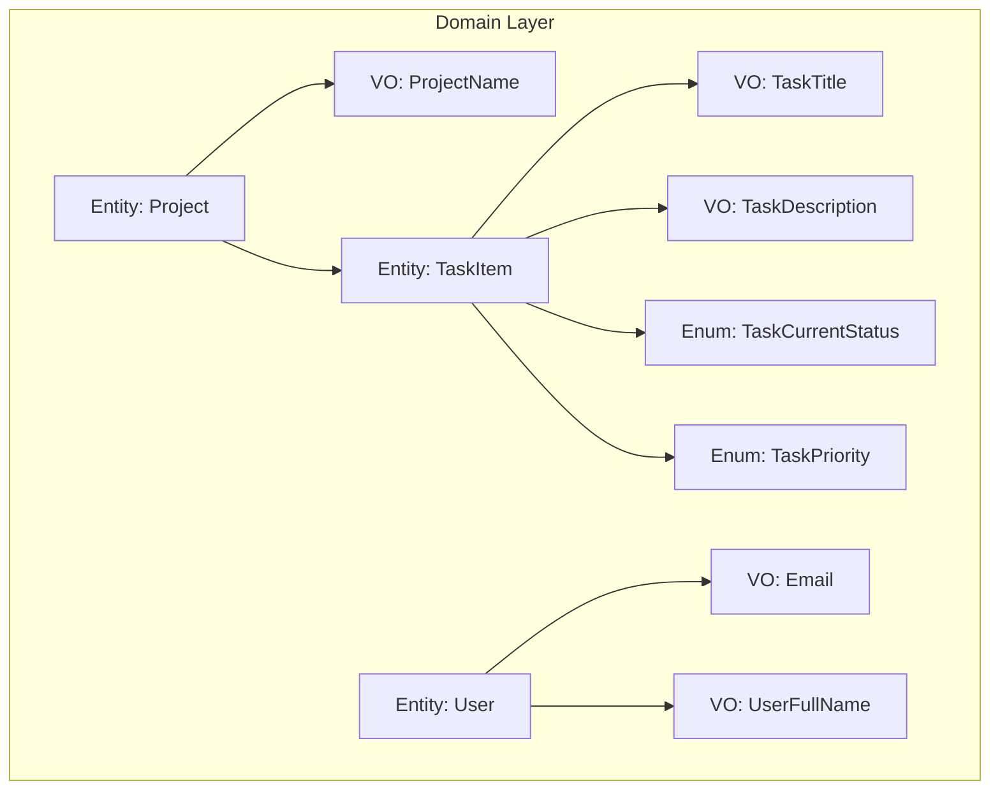
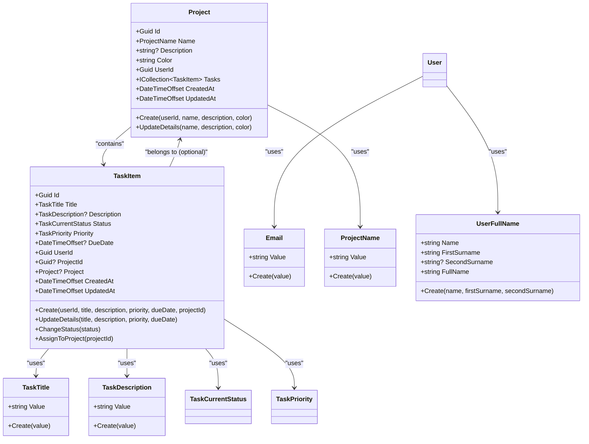
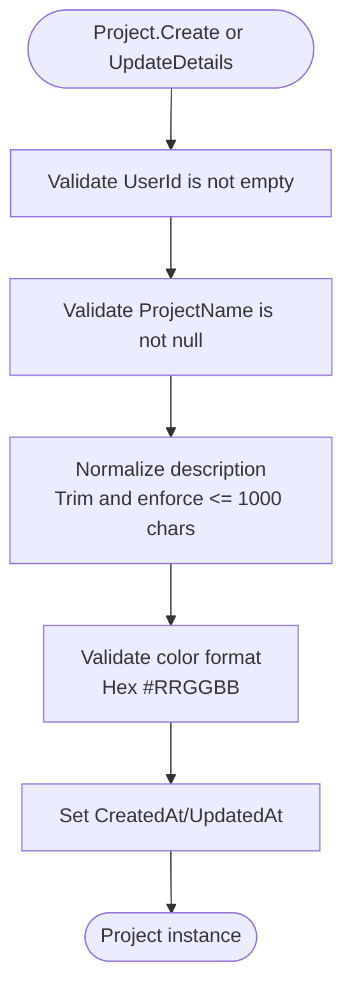
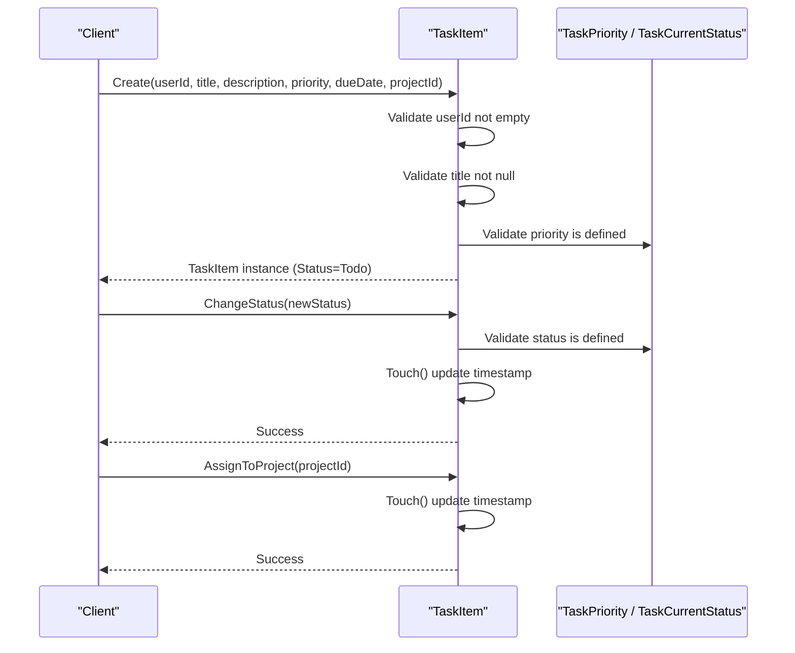
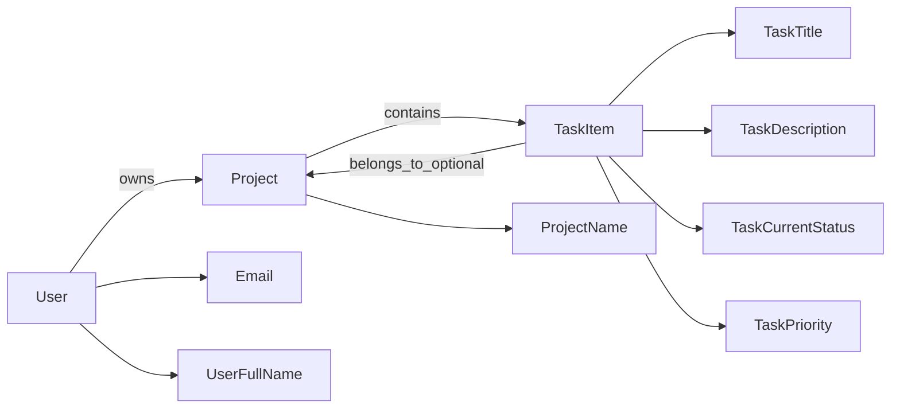

# Domain Layer

<cite>
**Referenced Files in This Document**
- [Project.cs](file://Services/Services.Domain/Entities/Project.cs)
- [TaskItem.cs](file://Services/Services.Domain/Entities/TaskItem.cs)
- [User.cs](file://Services/Services.Domain/Entities/User.cs)
- [Email.cs](file://Services/Services.Domain/ValueObjects/Email.cs)
- [ProjectName.cs](file://Services/Services.Domain/ValueObjects/ProjectName.cs)
- [TaskDescription.cs](file://Services/Services.Domain/ValueObjects/TaskDescription.cs)
- [TaskTitle.cs](file://Services/Services.Domain/ValueObjects/TaskTitle.cs)
- [UserFullName.cs](file://Services/Services.Domain/ValueObjects/UserFullName.cs)
- [TaskCurrentStatus.cs](file://Services/Services.Domain/Enums/TaskCurrentStatus.cs)
- [TaskPriority.cs](file://Services/Services.Domain/Enums/TaskPriority.cs)
</cite>

## Table of Contents
1. [Introduction](#introduction)
2. [Project Structure](#project-structure)
3. [Core Components](#core-components)
4. [Architecture Overview](#architecture-overview)
5. [Detailed Component Analysis](#detailed-component-analysis)
6. [Dependency Analysis](#dependency-analysis)
7. [Performance Considerations](#performance-considerations)
8. [Troubleshooting Guide](#troubleshooting-guide)
9. [Conclusion](#conclusion)

## Introduction
This document describes the domain layer for TaskFlow, focusing on core business entities and value objects. It explains entity definitions (Project, TaskItem, User), value objects (Email, ProjectName, TaskDescription, TaskTitle, UserFullName), and enumerations (TaskCurrentStatus, TaskPriority). It also documents validation rules, immutability principles, relationships, and business constraints that maintain data integrity.

## Project Structure
The domain layer is organized into:
- Entities: Project, TaskItem, User
- Value Objects: Email, ProjectName, TaskDescription, TaskTitle, UserFullName
- Enums: TaskCurrentStatus, TaskPriority

[No sources needed since this diagram shows conceptual structure]

## Core Components
- Project: Represents a project owned by a user, containing tasks, with metadata like name, description, color, timestamps.
- TaskItem: Represents a task with title, optional description, status, priority, due date, owner, and optional assignment to a project.
- User: Placeholder entity for user identity; integration points exist via UserId references in Project and TaskItem.

Key responsibilities:
- Enforce invariants at creation and mutation time.
- Encapsulate normalization and validation logic within entities and value objects.
- Maintain immutable value semantics through value objects.

**Section sources**
- [Project.cs:5-23](file://Services/Services.Domain/Entities/Project.cs#L5-L23)
- [TaskItem.cs:6-20](file://Services/Services.Domain/Entities/TaskItem.cs#L6-L20)
- [User.cs:7-9](file://Services/Services.Domain/Entities/User.cs#L7-L9)

## Architecture Overview
The domain model uses a clear separation between entities and value objects:
- Entities encapsulate behavior and lifecycle (creation, updates, state transitions).
- Value objects encapsulate primitive values with strict validation and immutability.
- Enums define constrained sets of allowed values for status and priority.

**Diagram sources**
- [Project.cs:5-23](file://Services/Services.Domain/Entities/Project.cs#L5-L23)
- [TaskItem.cs:6-20](file://Services/Services.Domain/Entities/TaskItem.cs#L6-L20)
- [Email.cs:5-49](file://Services/Services.Domain/ValueObjects/Email.cs#L5-L49)
- [ProjectName.cs:3-37](file://Services/Services.Domain/ValueObjects/ProjectName.cs#L3-L37)
- [TaskDescription.cs:3-30](file://Services/Services.Domain/ValueObjects/TaskDescription.cs#L3-L30)
- [TaskTitle.cs:3-36](file://Services/Services.Domain/ValueObjects/TaskTitle.cs#L3-L36)
- [UserFullName.cs:3-66](file://Services/Services.Domain/ValueObjects/UserFullName.cs#L3-L66)
- [TaskCurrentStatus.cs:3-9](file://Services/Services.Domain/Enums/TaskCurrentStatus.cs#L3-L9)
- [TaskPriority.cs:3-10](file://Services/Services.Domain/Enums/TaskPriority.cs#L3-L10)

## Detailed Component Analysis

### Entity: Project
Responsibilities:
- Create projects with validated name, description, and color.
- Update details while enforcing constraints and updating timestamps.
- Own a collection of tasks and reference an owner via UserId.

Validation and business rules:
- UserId must not be empty.
- Name must be provided as a valid ProjectName value object.
- Description is optional; normalized and limited to 1000 characters.
- Color is required and must be a valid hexadecimal color string (#RRGGBB); normalized to uppercase.
- CreatedAt and UpdatedAt are managed automatically.

Immutability:
- Properties are set-only after construction; mutations occur via explicit methods.

**Diagram sources**
- [Project.cs:29-49](file://Services/Services.Domain/Entities/Project.cs#L29-L49)
- [Project.cs:66-78](file://Services/Services.Domain/Entities/Project.cs#L66-L78)
- [Project.cs:80-120](file://Services/Services.Domain/Entities/Project.cs#L80-L120)

**Section sources**
- [Project.cs:5-23](file://Services/Services.Domain/Entities/Project.cs#L5-L23)
- [Project.cs:29-49](file://Services/Services.Domain/Entities/Project.cs#L29-L49)
- [Project.cs:51-64](file://Services/Services.Domain/Entities/Project.cs#L51-L64)
- [Project.cs:66-78](file://Services/Services.Domain/Entities/Project.cs#L66-L78)
- [Project.cs:80-120](file://Services/Services.Domain/Entities/Project.cs#L80-L120)

### Entity: TaskItem
Responsibilities:
- Create tasks with validated title, optional description, priority, due date, and optional project assignment.
- Update details and change status while maintaining invariants and timestamps.
- Track ownership via UserId and optional association to a Project.

Validation and business rules:
- UserId must not be empty.
- Title must be provided as a valid TaskTitle value object.
- Description is optional and wrapped in TaskDescription when present.
- Priority must be a defined TaskPriority enum value.
- Status defaults to Todo and can only transition to defined statuses.
- DueDate is optional.
- ProjectId is optional; assignment does not validate existence of Project here.

Immutability:
- Properties are set-only after construction; mutations occur via explicit methods.

**Diagram sources**
- [TaskItem.cs:27-52](file://Services/Services.Domain/Entities/TaskItem.cs#L27-L52)
- [TaskItem.cs:54-78](file://Services/Services.Domain/Entities/TaskItem.cs#L54-L78)
- [TaskItem.cs:80-101](file://Services/Services.Domain/Entities/TaskItem.cs#L80-L101)
- [TaskItem.cs:103-115](file://Services/Services.Domain/Entities/TaskItem.cs#L103-L115)
- [TaskItem.cs:117-122](file://Services/Services.Domain/Entities/TaskItem.cs#L117-L122)

**Section sources**
- [TaskItem.cs:6-20](file://Services/Services.Domain/Entities/TaskItem.cs#L6-L20)
- [TaskItem.cs:27-52](file://Services/Services.Domain/Entities/TaskItem.cs#L27-L52)
- [TaskItem.cs:54-78](file://Services/Services.Domain/Entities/TaskItem.cs#L54-L78)
- [TaskItem.cs:80-101](file://Services/Services.Domain/Entities/TaskItem.cs#L80-L101)
- [TaskItem.cs:103-122](file://Services/Services.Domain/Entities/TaskItem.cs#L103-L122)

### Entity: User
Responsibilities:
- Placeholder entity representing a user. Integration points exist via UserId references in Project and TaskItem.
- The domain layer currently does not define properties or behaviors for User; application/infrastructure layers may extend it.

**Section sources**
- [User.cs:7-9](file://Services/Services.Domain/Entities/User.cs#L7-L9)

### Value Object: Email
Purpose:
- Encapsulates email addresses with strict validation and normalization.

Validation rules:
- Must not be null or whitespace.
- Normalized to lowercase and trimmed.
- Maximum length: 254 characters.
- Validated using MailAddress parsing to ensure correct format.

Immutability:
- Implemented as a sealed record with a private constructor and static factory method.

**Section sources**
- [Email.cs:5-49](file://Services/Services.Domain/ValueObjects/Email.cs#L5-L49)

### Value Object: ProjectName
Purpose:
- Encapsulates project names with length constraints.

Validation rules:
- Must not be null or whitespace.
- Trimmed before storage.
- Maximum length: 150 characters.

Immutability:
- Sealed record with private constructor and static factory method.

**Section sources**
- [ProjectName.cs:3-37](file://Services/Services.Domain/ValueObjects/ProjectName.cs#L3-L37)

### Value Object: TaskDescription
Purpose:
- Encapsulates task descriptions with length constraints.

Validation rules:
- Trimmed before storage.
- Maximum length: 2000 characters.

Immutability:
- Sealed record with private constructor and static factory method.

**Section sources**
- [TaskDescription.cs:3-30](file://Services/Services.Domain/ValueObjects/TaskDescription.cs#L3-L30)

### Value Object: TaskTitle
Purpose:
- Encapsulates task titles with length constraints.

Validation rules:
- Must not be null or whitespace.
- Trimmed before storage.
- Maximum length: 200 characters.

Immutability:
- Sealed record with private constructor and static factory method.

**Section sources**
- [TaskTitle.cs:3-36](file://Services/Services.Domain/ValueObjects/TaskTitle.cs#L3-L36)

### Value Object: UserFullName
Purpose:
- Encapsulates a user’s full name composed of given name and one or two surnames.

Validation rules:
- Name and first surname are required and trimmed.
- Optional second surname is trimmed if provided.
- Length limits:
  - Name: up to 60 characters (1.5 × 40).
  - First surname: up to 40 characters.
  - Second surname: up to 40 characters.
- Provides a computed FullName property.

Immutability:
- Sealed record with constructor and static factory method.

**Section sources**
- [UserFullName.cs:3-66](file://Services/Services.Domain/ValueObjects/UserFullName.cs#L3-L66)

### Enum: TaskCurrentStatus
Business significance:
- Represents the lifecycle states of a task:
  - Todo: initial state.
  - InProgress: actively worked on.
  - Done: completed.

Constraints:
- Only defined values are accepted; invalid values cause argument exceptions during status changes.

**Section sources**
- [TaskCurrentStatus.cs:3-9](file://Services/Services.Domain/Enums/TaskCurrentStatus.cs#L3-L9)
- [TaskItem.cs:103-115](file://Services/Services.Domain/Entities/TaskItem.cs#L103-L115)

### Enum: TaskPriority
Business significance:
- Represents urgency levels:
  - Low
  - Medium (default)
  - High
  - Urgent

Constraints:
- Only defined values are accepted; invalid values cause argument exceptions during creation or updates.

**Section sources**
- [TaskPriority.cs:3-10](file://Services/Services.Domain/Enums/TaskPriority.cs#L3-L10)
- [TaskItem.cs:54-78](file://Services/Services.Domain/Entities/TaskItem.cs#L54-L78)

## Dependency Analysis
Relationships and dependencies:
- Project contains multiple TaskItem instances (one-to-many).
- TaskItem optionally belongs to a Project (many-to-one, nullable).
- Project and TaskItem both reference a User via UserId (ownership).
- Value objects are used by entities to enforce validation and immutability.
- Enums constrain status and priority values.

**Diagram sources**
- [Project.cs:15-18](file://Services/Services.Domain/Entities/Project.cs#L15-L18)
- [TaskItem.cs:14-17](file://Services/Services.Domain/Entities/TaskItem.cs#L14-L17)
- [ProjectName.cs:3-37](file://Services/Services.Domain/ValueObjects/ProjectName.cs#L3-L37)
- [TaskTitle.cs:3-36](file://Services/Services.Domain/ValueObjects/TaskTitle.cs#L3-L36)
- [TaskDescription.cs:3-30](file://Services/Services.Domain/ValueObjects/TaskDescription.cs#L3-L30)
- [TaskCurrentStatus.cs:3-9](file://Services/Services.Domain/Enums/TaskCurrentStatus.cs#L3-L9)
- [TaskPriority.cs:3-10](file://Services/Services.Domain/Enums/TaskPriority.cs#L3-L10)
- [Email.cs:5-49](file://Services/Services.Domain/ValueObjects/Email.cs#L5-L49)
- [UserFullName.cs:3-66](file://Services/Services.Domain/ValueObjects/UserFullName.cs#L3-L66)

**Section sources**
- [Project.cs:15-18](file://Services/Services.Domain/Entities/Project.cs#L15-L18)
- [TaskItem.cs:14-17](file://Services/Services.Domain/Entities/TaskItem.cs#L14-L17)

## Performance Considerations
- Validation occurs at creation and mutation boundaries, preventing invalid state propagation.
- Value objects minimize repeated validation by encapsulating normalized values.
- Using enums avoids string comparisons and reduces branching complexity.
- Timestamps are updated only when necessary via internal touch methods.

[No sources needed since this section provides general guidance]

## Troubleshooting Guide
Common validation errors and resolutions:
- Invalid email format: Ensure the email is properly formatted and normalized; use the Email value object factory.
- Excessive lengths: Respect maximum lengths for project name (150), task title (200), task description (2000), and email (254).
- Invalid color format: Provide a hex color string in #RRGGBB format; it will be normalized to uppercase.
- Invalid priority or status: Use only defined enum values for TaskPriority and TaskCurrentStatus.
- Missing required fields: Provide non-empty UserId, ProjectName, and TaskTitle where required.

Operational tips:
- Prefer using static factory methods (e.g., Project.Create, TaskItem.Create, Email.Create) to centralize validation.
- When updating entities, call dedicated methods (e.g., UpdateDetails, ChangeStatus) to ensure consistent timestamp handling and validation.

**Section sources**
- [Email.cs:14-46](file://Services/Services.Domain/ValueObjects/Email.cs#L14-L46)
- [ProjectName.cs:14-33](file://Services/Services.Domain/ValueObjects/ProjectName.cs#L14-L33)
- [TaskTitle.cs:14-33](file://Services/Services.Domain/ValueObjects/TaskTitle.cs#L14-L33)
- [TaskDescription.cs:14-26](file://Services/Services.Domain/ValueObjects/TaskDescription.cs#L14-L26)
- [Project.cs:80-120](file://Services/Services.Domain/Entities/Project.cs#L80-L120)
- [TaskItem.cs:54-78](file://Services/Services.Domain/Entities/TaskItem.cs#L54-L78)
- [TaskItem.cs:103-115](file://Services/Services.Domain/Entities/TaskItem.cs#L103-L115)

## Conclusion
The TaskFlow domain layer enforces strong invariants through entities and value objects, ensuring data integrity and predictable behavior. Projects own tasks, users own projects, and all critical inputs are validated and normalized at the domain boundary. Enums provide constrained state and priority values. Following the documented validation rules and using the provided factory methods ensures robust usage of the domain model.

[No sources needed since this section summarizes without analyzing specific files]