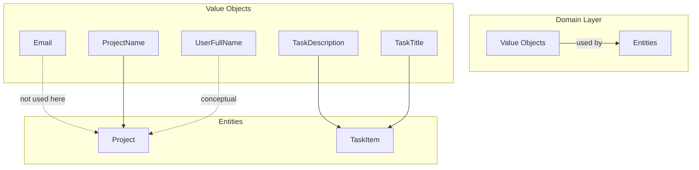
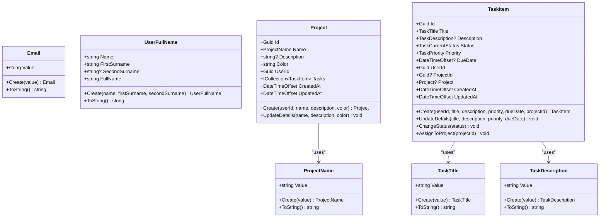
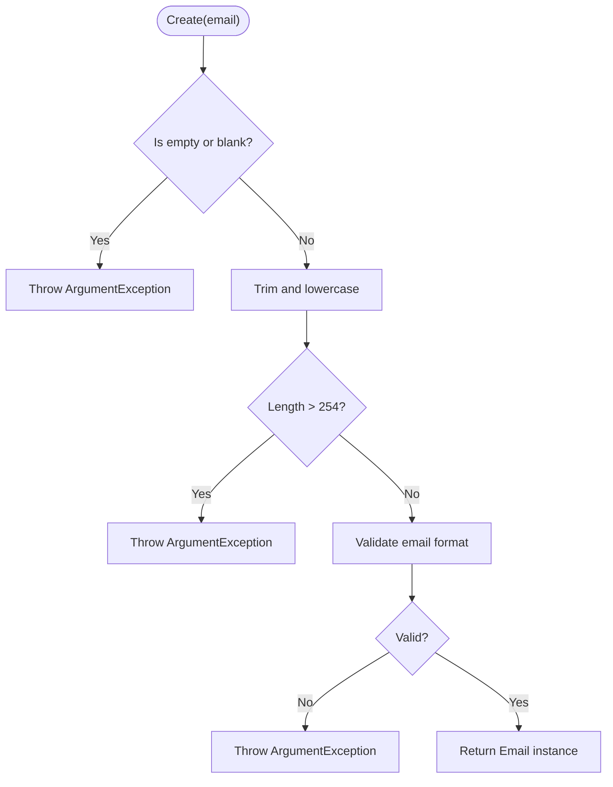
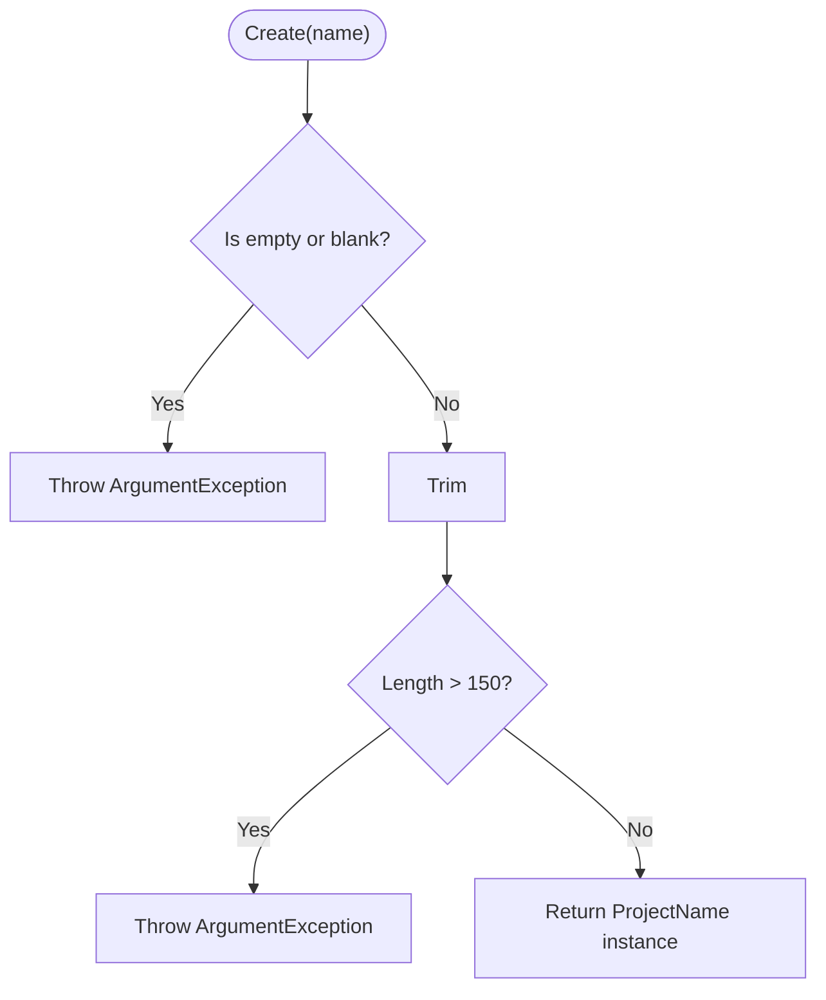
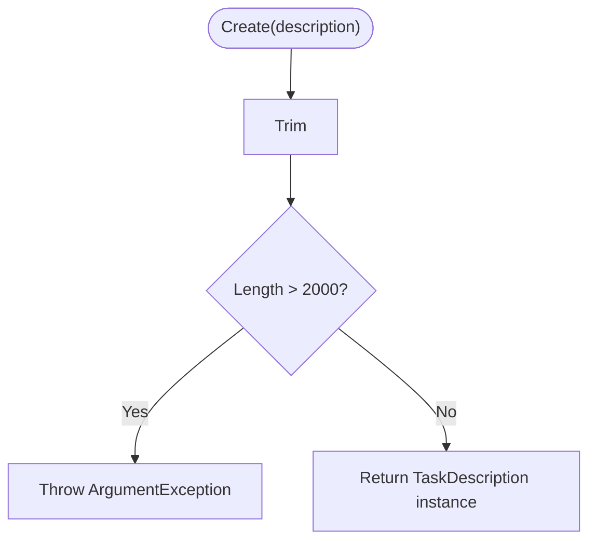
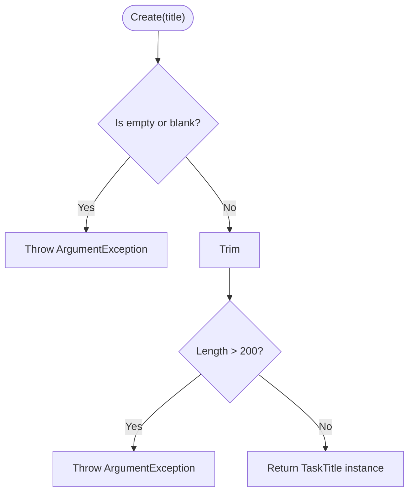
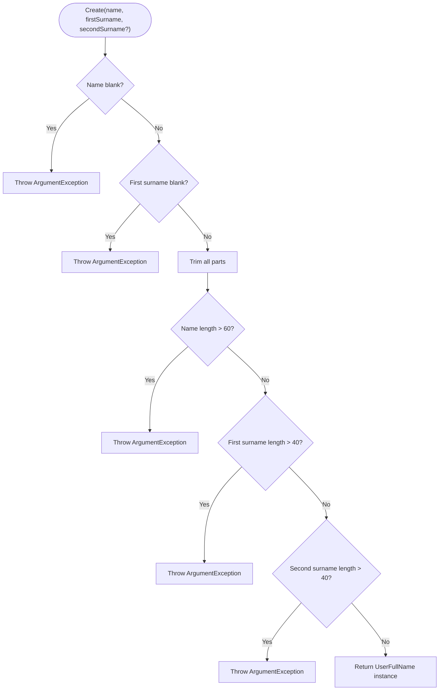

# Value Objects

<cite>
**Referenced Files in This Document**
- [Email.cs](file://Services/Services.Domain/ValueObjects/Email.cs)
- [ProjectName.cs](file://Services/Services.Domain/ValueObjects/ProjectName.cs)
- [TaskDescription.cs](file://Services/Services.Domain/ValueObjects/TaskDescription.cs)
- [TaskTitle.cs](file://Services/Services.Domain/ValueObjects/TaskTitle.cs)
- [UserFullName.cs](file://Services/Services.Domain/ValueObjects/UserFullName.cs)
- [Project.cs](file://Services/Services.Domain/Entities/Project.cs)
- [TaskItem.cs](file://Services/Services.Domain/Entities/TaskItem.cs)
</cite>

## Table of Contents
1. [Introduction](#introduction)
2. [Project Structure](#project-structure)
3. [Core Components](#core-components)
4. [Architecture Overview](#architecture-overview)
5. [Detailed Component Analysis](#detailed-component-analysis)
6. [Dependency Analysis](#dependency-analysis)
7. [Performance Considerations](#performance-considerations)
8. [Troubleshooting Guide](#troubleshooting-guide)
9. [Conclusion](#conclusion)

## Introduction
This document explains the value objects implemented for TaskFlow’s domain layer, following Domain-Driven Design principles. Value objects are immutable types that encapsulate domain concepts and their validation rules. They ensure data integrity by enforcing business constraints at creation time and exposing only safe, normalized values to the rest of the system.

Key characteristics:
- Immutability: once created, a value object cannot be changed; updates return new instances or throw validation errors.
- Encapsulation: all validation and normalization logic is centralized inside each value object.
- Strong typing: domain-specific types (e.g., Email, ProjectName) replace primitive strings, preventing misuse.
- Validation upfront: invalid input is rejected early with clear error messages.

## Project Structure
The value objects live under the domain layer and are consumed by domain entities. The relevant files are:
- Value objects: Email, ProjectName, TaskDescription, TaskTitle, UserFullName
- Entities using value objects: Project uses ProjectName; TaskItem uses TaskTitle and TaskDescription



**Diagram sources**
- [Email.cs:1-49](file://Services/Services.Domain/ValueObjects/Email.cs#L1-L49)
- [ProjectName.cs:1-37](file://Services/Services.Domain/ValueObjects/ProjectName.cs#L1-L37)
- [TaskDescription.cs:1-30](file://Services/Services.Domain/ValueObjects/TaskDescription.cs#L1-L30)
- [TaskTitle.cs:1-36](file://Services/Services.Domain/ValueObjects/TaskTitle.cs#L1-L36)
- [UserFullName.cs:1-66](file://Services/Services.Domain/ValueObjects/UserFullName.cs#L1-L66)
- [Project.cs:1-121](file://Services/Services.Domain/Entities/Project.cs#L1-L121)
- [TaskItem.cs:1-128](file://Services/Services.Domain/Entities/TaskItem.cs#L1-L128)

**Section sources**
- [Email.cs:1-49](file://Services/Services.Domain/ValueObjects/Email.cs#L1-L49)
- [ProjectName.cs:1-37](file://Services/Services.Domain/ValueObjects/ProjectName.cs#L1-L37)
- [TaskDescription.cs:1-30](file://Services/Services.Domain/ValueObjects/TaskDescription.cs#L1-L30)
- [TaskTitle.cs:1-36](file://Services/Services.Domain/ValueObjects/TaskTitle.cs#L1-L36)
- [UserFullName.cs:1-66](file://Services/Services.Domain/ValueObjects/UserFullName.cs#L1-L66)
- [Project.cs:1-121](file://Services/Services.Domain/Entities/Project.cs#L1-L121)
- [TaskItem.cs:1-128](file://Services/Services.Domain/Entities/TaskItem.cs#L1-L128)

## Core Components
This section summarizes each value object, its validation rules, normalization behavior, and how it integrates with domain entities.

- Email
  - Purpose: Represents an email address with strict format validation.
  - Normalization: Trims whitespace and lowercases the value.
  - Constraints:
    - Must not be null or blank.
    - Maximum length: 254 characters.
    - Valid email format enforced via framework email parsing.
  - Error handling: Throws argument exceptions for empty input, exceeding max length, or invalid format.
  - Integration: Not directly used by the shown entities, but available for user-related features.

- ProjectName
  - Purpose: Represents a project name with length constraints.
  - Normalization: Trims whitespace.
  - Constraints:
    - Must not be null or blank.
    - Maximum length: 150 characters.
  - Error handling: Throws argument exceptions for empty input or exceeding max length.
  - Integration: Used by Project entity as the project’s Name property.

- TaskDescription
  - Purpose: Represents task description content with length constraints.
  - Normalization: Trims whitespace.
  - Constraints:
    - Maximum length: 2000 characters.
  - Error handling: Throws argument exception when exceeding max length.
  - Integration: Optional field on TaskItem.

- TaskTitle
  - Purpose: Represents a task title with naming conventions and length constraints.
  - Normalization: Trims whitespace.
  - Constraints:
    - Must not be null or blank.
    - Maximum length: 200 characters.
  - Error handling: Throws argument exceptions for empty input or exceeding max length.
  - Integration: Required field on TaskItem.

- UserFullName
  - Purpose: Represents a user’s full name composed of given name and one or two surnames.
  - Normalization: Trims whitespace for all parts.
  - Constraints:
    - Given name and first surname must not be null or blank.
    - Length limits:
      - Given name: up to 60 characters (40 * 1.5).
      - First surname: up to 40 characters.
      - Second surname (optional): up to 40 characters.
  - Computed property: FullName concatenates parts appropriately.
  - Error handling: Throws argument exceptions for missing required parts or exceeding length limits.
  - Integration: Conceptually represents user identity; not currently referenced by the shown entities.

**Section sources**
- [Email.cs:5-49](file://Services/Services.Domain/ValueObjects/Email.cs#L5-L49)
- [ProjectName.cs:3-36](file://Services/Services.Domain/ValueObjects/ProjectName.cs#L3-L36)
- [TaskDescription.cs:3-29](file://Services/Services.Domain/ValueObjects/TaskDescription.cs#L3-L29)
- [TaskTitle.cs:3-36](file://Services/Services.Domain/ValueObjects/TaskTitle.cs#L3-L36)
- [UserFullName.cs:3-65](file://Services/Services.Domain/ValueObjects/UserFullName.cs#L3-L65)
- [Project.cs:5-121](file://Services/Services.Domain/Entities/Project.cs#L5-L121)
- [TaskItem.cs:6-128](file://Services/Services.Domain/Entities/TaskItem.cs#L6-L128)

## Architecture Overview
Value objects encapsulate domain logic and maintain data integrity through immutability. Entities depend on these strongly-typed value objects rather than raw strings, ensuring that any instance entering the domain is valid by construction.



**Diagram sources**
- [Email.cs:5-49](file://Services/Services.Domain/ValueObjects/Email.cs#L5-L49)
- [ProjectName.cs:3-36](file://Services/Services.Domain/ValueObjects/ProjectName.cs#L3-L36)
- [TaskDescription.cs:3-29](file://Services/Services.Domain/ValueObjects/TaskDescription.cs#L3-L29)
- [TaskTitle.cs:3-36](file://Services/Services.Domain/ValueObjects/TaskTitle.cs#L3-L36)
- [UserFullName.cs:3-65](file://Services/Services.Domain/ValueObjects/UserFullName.cs#L3-L65)
- [Project.cs:5-121](file://Services/Services.Domain/Entities/Project.cs#L5-L121)
- [TaskItem.cs:6-128](file://Services/Services.Domain/Entities/TaskItem.cs#L6-L128)

## Detailed Component Analysis

### Email
- Validation flow:
  - Rejects null or blank input.
  - Normalizes by trimming and lowercasing.
  - Enforces maximum length of 254 characters.
  - Validates email format using framework email parsing.
- Error handling:
  - Throws argument exceptions for empty input, exceeding max length, or invalid format.
- Usage example:
  - Create a valid email: call Create with a properly formatted email string.
  - Handle invalid cases: catch argument exceptions for user feedback.



**Diagram sources**
- [Email.cs:14-46](file://Services/Services.Domain/ValueObjects/Email.cs#L14-L46)

**Section sources**
- [Email.cs:5-49](file://Services/Services.Domain/ValueObjects/Email.cs#L5-L49)

### ProjectName
- Validation flow:
  - Rejects null or blank input.
  - Normalizes by trimming whitespace.
  - Enforces maximum length of 150 characters.
- Error handling:
  - Throws argument exceptions for empty input or exceeding max length.
- Integration:
  - Project.Name holds a ProjectName instance, ensuring project names are always valid.



**Diagram sources**
- [ProjectName.cs:14-33](file://Services/Services.Domain/ValueObjects/ProjectName.cs#L14-L33)

**Section sources**
- [ProjectName.cs:3-36](file://Services/Services.Domain/ValueObjects/ProjectName.cs#L3-L36)
- [Project.cs:5-121](file://Services/Services.Domain/Entities/Project.cs#L5-L121)

### TaskDescription
- Validation flow:
  - Normalizes by trimming whitespace.
  - Enforces maximum length of 2000 characters.
- Error handling:
  - Throws argument exception when exceeding max length.
- Integration:
  - TaskItem.Description is optional and typed as TaskDescription?, allowing null or a validated description.



**Diagram sources**
- [TaskDescription.cs:14-26](file://Services/Services.Domain/ValueObjects/TaskDescription.cs#L14-L26)

**Section sources**
- [TaskDescription.cs:3-29](file://Services/Services.Domain/ValueObjects/TaskDescription.cs#L3-L29)
- [TaskItem.cs:6-128](file://Services/Services.Domain/Entities/TaskItem.cs#L6-L128)

### TaskTitle
- Validation flow:
  - Rejects null or blank input.
  - Normalizes by trimming whitespace.
  - Enforces maximum length of 200 characters.
- Error handling:
  - Throws argument exceptions for empty input or exceeding max length.
- Integration:
  - TaskItem.Title is required and typed as TaskTitle, ensuring every task has a valid title.



**Diagram sources**
- [TaskTitle.cs:14-33](file://Services/Services.Domain/ValueObjects/TaskTitle.cs#L14-L33)

**Section sources**
- [TaskTitle.cs:3-36](file://Services/Services.Domain/ValueObjects/TaskTitle.cs#L3-L36)
- [TaskItem.cs:6-128](file://Services/Services.Domain/Entities/TaskItem.cs#L6-L128)

### UserFullName
- Validation flow:
  - Requires non-blank given name and first surname.
  - Normalizes by trimming whitespace for all parts.
  - Enforces length limits:
    - Given name: up to 60 characters.
    - First surname: up to 40 characters.
    - Second surname (optional): up to 40 characters.
- Computed property:
  - FullName returns concatenated name with appropriate spacing.
- Error handling:
  - Throws argument exceptions for missing required parts or exceeding length limits.
- Integration:
  - Conceptually models user identity; not currently referenced by the shown entities.



**Diagram sources**
- [UserFullName.cs:23-62](file://Services/Services.Domain/ValueObjects/UserFullName.cs#L23-L62)

**Section sources**
- [UserFullName.cs:3-65](file://Services/Services.Domain/ValueObjects/UserFullName.cs#L3-L65)

## Dependency Analysis
- Direct dependencies:
  - Project depends on ProjectName.
  - TaskItem depends on TaskTitle and TaskDescription.
- Indirect dependencies:
  - Email and UserFullName are available for future domain extensions involving users or authentication.

```mermaid
graph LR
ProjectName --> Project
TaskTitle --> TaskItem
TaskDescription --> TaskItem
Email -. . .
UserFullName -. . .
```

**Diagram sources**
- [ProjectName.cs:3-36](file://Services/Services.Domain/ValueObjects/ProjectName.cs#L3-L36)
- [TaskTitle.cs:3-36](file://Services/Services.Domain/ValueObjects/TaskTitle.cs#L3-L36)
- [TaskDescription.cs:3-29](file://Services/Services.Domain/ValueObjects/TaskDescription.cs#L3-L29)
- [Project.cs:5-121](file://Services/Services.Domain/Entities/Project.cs#L5-L121)
- [TaskItem.cs:6-128](file://Services/Services.Domain/Entities/TaskItem.cs#L6-L128)

**Section sources**
- [Project.cs:5-121](file://Services/Services.Domain/Entities/Project.cs#L5-L121)
- [TaskItem.cs:6-128](file://Services/Services.Domain/Entities/TaskItem.cs#L6-L128)

## Performance Considerations
- Validation overhead:
  - All validations occur at creation time, which is acceptable for small payloads typical of value objects.
- String operations:
  - Trimming and lowercasing are lightweight; however, avoid repeated conversions by normalizing once during creation.
- Memory usage:
  - Immutability ensures stable references and simplifies caching strategies if needed.

[No sources needed since this section provides general guidance]

## Troubleshooting Guide
Common issues and resolutions:
- Invalid email format:
  - Ensure the email is trimmed and lowercased before validation.
  - Verify the email does not exceed 254 characters.
  - Catch argument exceptions and present user-friendly messages.
- Exceeding length limits:
  - For ProjectName, TaskTitle, TaskDescription, and UserFullName fields, validate lengths before creating value objects.
  - Use the provided constants (e.g., MaxLength) to align UI constraints with domain rules.
- Missing required parts:
  - For UserFullName, ensure both given name and first surname are provided and non-blank.
- Integration errors:
  - When updating entities, pass newly created value objects rather than mutating existing ones.
  - For TaskItem.UpdateDetails and Project.UpdateDetails, ensure all parameters are valid value objects.

**Section sources**
- [Email.cs:14-46](file://Services/Services.Domain/ValueObjects/Email.cs#L14-L46)
- [ProjectName.cs:14-33](file://Services/Services.Domain/ValueObjects/ProjectName.cs#L14-L33)
- [TaskDescription.cs:14-26](file://Services/Services.Domain/ValueObjects/TaskDescription.cs#L14-L26)
- [TaskTitle.cs:14-33](file://Services/Services.Domain/ValueObjects/TaskTitle.cs#L14-L33)
- [UserFullName.cs:23-62](file://Services/Services.Domain/ValueObjects/UserFullName.cs#L23-L62)
- [Project.cs:66-78](file://Services/Services.Domain/Entities/Project.cs#L66-L78)
- [TaskItem.cs:80-101](file://Services/Services.Domain/Entities/TaskItem.cs#L80-L101)

## Conclusion
TaskFlow’s value objects enforce domain rules at the boundaries of the domain model, ensuring that only valid, normalized data enters the system. By using immutable, strongly-typed value objects like Email, ProjectName, TaskDescription, TaskTitle, and UserFullName, the application maintains data integrity, reduces bugs, and clarifies business intent. Entities such as Project and TaskItem compose these value objects to represent complex domain concepts safely and consistently.

[No sources needed since this section summarizes without analyzing specific files]