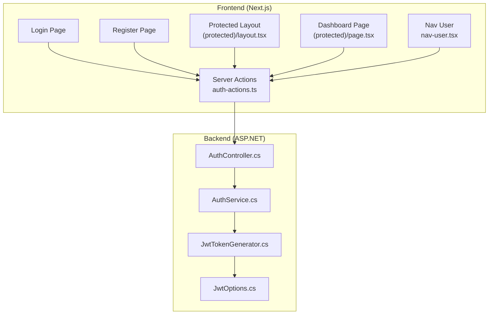
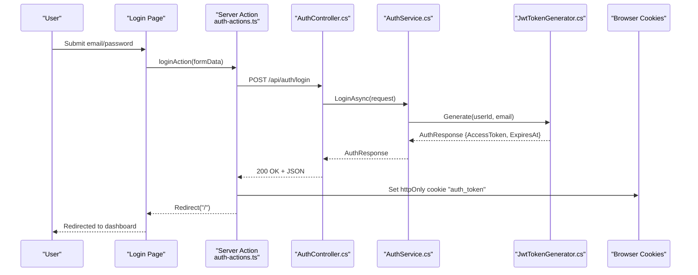
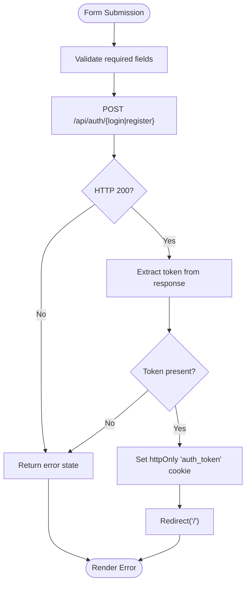
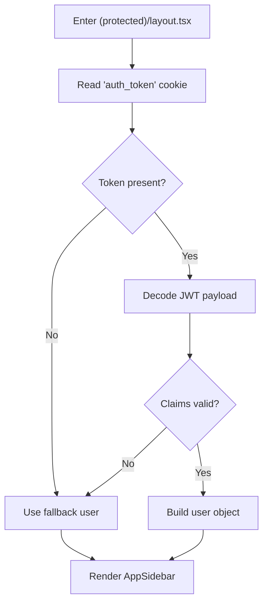
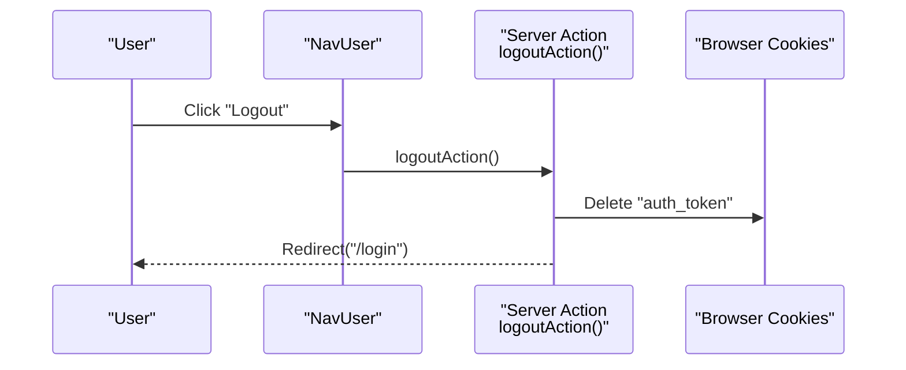
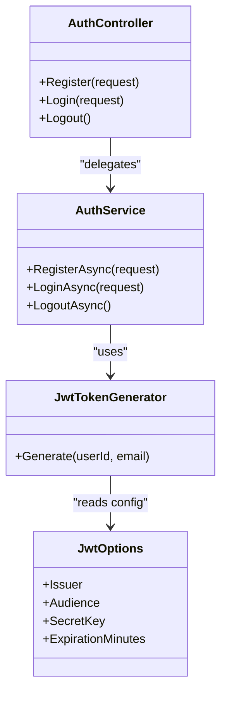
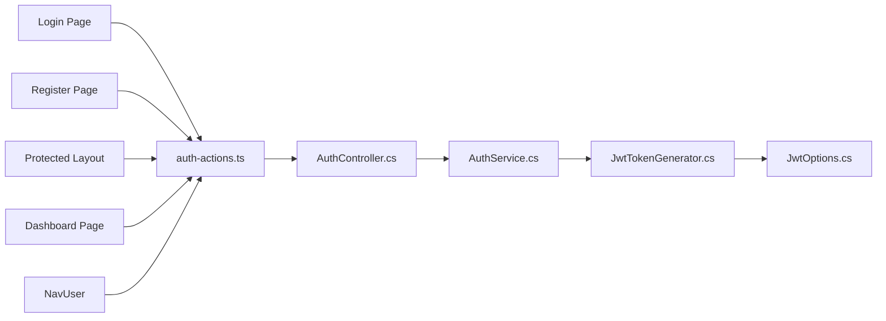

# Authentication Flow and Client-Side Security

<cite>
**Referenced Files in This Document**
- [auth-actions.ts](file://Apps/Web/src/actions/auth-actions.ts)
- [login page.tsx](file://Apps/Web/src/app/(auth)/login/page.tsx)
- [register page.tsx](file://Apps/Web/src/app/(auth)/register/page.tsx)
- [protected layout.tsx](file://Apps/Web/src/app/(protected)/layout.tsx)
- [protected dashboard page.tsx](file://Apps/Web/src/app/(protected)/page.tsx)
- [root layout.tsx](file://Apps/Web/src/app/layout.tsx)
- [nav-user.tsx](file://Apps/Web/src/components/nav-user.tsx)
- [AuthController.cs](file://Services/Services.Api/Controllers/AuthController.cs)
- [AuthService.cs](file://Services/Services.Infrastructure/Identity/AuthService.cs)
- [JwtTokenGenerator.cs](file://Services/Services.Infrastructure/Identity/JwtTokenGenerator.cs)
- [JwtOptions.cs](file://Services/Services.Infrastructure/Identity/JwtOptions.cs)
- [AuthResponse.cs](file://Services/Services.Application/DTOs/Auth/AuthResponse.cs)
</cite>

## Table of Contents
1. [Introduction](#introduction)
2. [Project Structure](#project-structure)
3. [Core Components](#core-components)
4. [Architecture Overview](#architecture-overview)
5. [Detailed Component Analysis](#detailed-component-analysis)
6. [Dependency Analysis](#dependency-analysis)
7. [Performance Considerations](#performance-considerations)
8. [Troubleshooting Guide](#troubleshooting-guide)
9. [Conclusion](#conclusion)

## Introduction
This document explains the client-side authentication flow and security implementation for the TaskFlow web application. It covers how login and registration work, how JWT tokens are handled and stored via HTTP-only cookies, how protected routes are guarded, and how user state is managed across components. It also includes security best practices for token storage, XSS prevention, and sensitive data handling, as well as logout behavior and guidance on token refresh strategies.

## Project Structure
The authentication logic spans both the Next.js frontend and the ASP.NET backend:
- Frontend server actions handle form submissions, call the API, set secure cookies, and redirect users.
- Frontend pages render login and registration forms with validation and error display.
- A protected layout reads the auth cookie to build a sidebar and protect routes.
- Backend controllers expose register, login, and logout endpoints and issue JWTs.

**Diagram sources**
- [auth-actions.ts:21-43](file://Apps/Web/src/actions/auth-actions.ts#L21-L43)
- [login page.tsx:21-118](file://Apps/Web/src/app/(auth)/login/page.tsx#L21-L118)
- [register page.tsx:21-139](file://Apps/Web/src/app/(auth)/register/page.tsx#L21-L139)
- [protected layout.tsx:7-26](file://Apps/Web/src/app/(protected)/layout.tsx#L7-L26)
- [protected dashboard page.tsx:13-76](file://Apps/Web/src/app/(protected)/page.tsx#L13-L76)
- [nav-user.tsx:28-108](file://Apps/Web/src/components/nav-user.tsx#L28-L108)
- [AuthController.cs:9-76](file://Services/Services.Api/Controllers/AuthController.cs#L9-L76)
- [AuthService.cs:8-90](file://Services/Services.Infrastructure/Identity/AuthService.cs#L8-L90)
- [JwtTokenGenerator.cs:9-48](file://Services/Services.Infrastructure/Identity/JwtTokenGenerator.cs#L9-L48)
- [JwtOptions.cs:3-13](file://Services/Services.Infrastructure/Identity/JwtOptions.cs#L3-L13)

**Section sources**
- [auth-actions.ts:1-210](file://Apps/Web/src/actions/auth-actions.ts#L1-L210)
- [login page.tsx:1-119](file://Apps/Web/src/app/(auth)/login/page.tsx#L1-L119)
- [register page.tsx:1-140](file://Apps/Web/src/app/(auth)/register/page.tsx#L1-L140)
- [protected layout.tsx:1-49](file://Apps/Web/src/app/(protected)/layout.tsx#L1-L49)
- [protected dashboard page.tsx:1-77](file://Apps/Web/src/app/(protected)/page.tsx#L1-L77)
- [nav-user.tsx:1-109](file://Apps/Web/src/components/nav-user.tsx#L1-L109)
- [AuthController.cs:1-77](file://Services/Services.Api/Controllers/AuthController.cs#L1-L77)
- [AuthService.cs:1-91](file://Services/Services.Infrastructure/Identity/AuthService.cs#L1-L91)
- [JwtTokenGenerator.cs:1-49](file://Services/Services.Infrastructure/Identity/JwtTokenGenerator.cs#L1-L49)
- [JwtOptions.cs:1-14](file://Services/Services.Infrastructure/Identity/JwtOptions.cs#L1-L14)

## Core Components
- Server actions for authentication:
  - Build API URLs, send login/register requests, parse responses, set secure cookies, and redirect.
  - Provide logout and token retrieval helpers.
- Login and registration pages:
  - Render forms using React Server Actions, show errors, and disable controls during submission.
- Protected layout:
  - Reads the auth cookie, decodes the JWT payload to extract email/name, and renders the authenticated sidebar.
- Dashboard page:
  - Loads user-specific data after successful authentication.
- Nav user component:
  - Displays user info and triggers logout via server action.
- Backend auth controller and service:
  - Expose register/login/logout endpoints, validate inputs, manage identity, and generate JWTs.

**Section sources**
- [auth-actions.ts:21-43](file://Apps/Web/src/actions/auth-actions.ts#L21-L43)
- [auth-actions.ts:45-116](file://Apps/Web/src/actions/auth-actions.ts#L45-L116)
- [auth-actions.ts:118-198](file://Apps/Web/src/actions/auth-actions.ts#L118-L198)
- [auth-actions.ts:200-209](file://Apps/Web/src/actions/auth-actions.ts#L200-L209)
- [login page.tsx:21-118](file://Apps/Web/src/app/(auth)/login/page.tsx#L21-L118)
- [register page.tsx:21-139](file://Apps/Web/src/app/(auth)/register/page.tsx#L21-L139)
- [protected layout.tsx:7-26](file://Apps/Web/src/app/(protected)/layout.tsx#L7-L26)
- [protected dashboard page.tsx:13-76](file://Apps/Web/src/app/(protected)/page.tsx#L13-L76)
- [nav-user.tsx:28-108](file://Apps/Web/src/components/nav-user.tsx#L28-L108)
- [AuthController.cs:14-76](file://Services/Services.Api/Controllers/AuthController.cs#L14-L76)
- [AuthService.cs:13-90](file://Services/Services.Infrastructure/Identity/AuthService.cs#L13-L90)
- [JwtTokenGenerator.cs:13-48](file://Services/Services.Infrastructure/Identity/JwtTokenGenerator.cs#L13-L48)

## Architecture Overview
The authentication flow uses server-side actions to keep secrets off the browser. Tokens are issued by the backend and stored in HTTP-only cookies. Protected routes read the cookie server-side to determine access.

**Diagram sources**
- [login page.tsx:40-111](file://Apps/Web/src/app/(auth)/login/page.tsx#L40-L111)
- [auth-actions.ts:45-116](file://Apps/Web/src/actions/auth-actions.ts#L45-L116)
- [AuthController.cs:35-62](file://Services/Services.Api/Controllers/AuthController.cs#L35-L62)
- [AuthService.cs:58-84](file://Services/Services.Infrastructure/Identity/AuthService.cs#L58-L84)
- [JwtTokenGenerator.cs:13-48](file://Services/Services.Infrastructure/Identity/JwtTokenGenerator.cs#L13-L48)

## Detailed Component Analysis

### Authentication Server Actions
Responsibilities:
- Construct API base URL and endpoint paths.
- Send login/register requests with JSON payloads.
- Parse flexible response fields for token and expiration.
- Set secure, httpOnly cookies with appropriate SameSite and path attributes.
- Redirect to root on success.
- Provide logout and token getter helpers.

Security notes:
- Token is stored only in an httpOnly cookie; it is not exposed to JavaScript except through the helper used server-side.
- Secure flag is enabled in production; SameSite is lax to allow top-level navigations.
- Development allows self-signed certificates for local API calls.

**Diagram sources**
- [auth-actions.ts:21-43](file://Apps/Web/src/actions/auth-actions.ts#L21-L43)
- [auth-actions.ts:45-116](file://Apps/Web/src/actions/auth-actions.ts#L45-L116)
- [auth-actions.ts:118-198](file://Apps/Web/src/actions/auth-actions.ts#L118-L198)

**Section sources**
- [auth-actions.ts:21-43](file://Apps/Web/src/actions/auth-actions.ts#L21-L43)
- [auth-actions.ts:45-116](file://Apps/Web/src/actions/auth-actions.ts#L45-L116)
- [auth-actions.ts:118-198](file://Apps/Web/src/actions/auth-actions.ts#L118-L198)
- [auth-actions.ts:200-209](file://Apps/Web/src/actions/auth-actions.ts#L200-L209)

### Login Page
- Uses React Server Actions to submit credentials.
- Shows global error messages returned by the server action.
- Disables inputs and submit button while pending.
- Provides links to registration and social sign-in buttons (not implemented).

Validation:
- HTML5 required attributes ensure basic input presence.
- Server action validates non-empty email and password.

**Section sources**
- [login page.tsx:21-118](file://Apps/Web/src/app/(auth)/login/page.tsx#L21-L118)
- [auth-actions.ts:45-116](file://Apps/Web/src/actions/auth-actions.ts#L45-L116)

### Registration Page
- Combines client-side password confirmation check with server-side validation.
- Displays combined error message from client or server.
- Similar UI structure to login with additional confirm-password field.

Validation:
- Client checks that password and confirm-password match before submitting.
- Server action ensures required fields and matches passwords.

**Section sources**
- [register page.tsx:21-139](file://Apps/Web/src/app/(auth)/register/page.tsx#L21-L139)
- [auth-actions.ts:118-198](file://Apps/Web/src/actions/auth-actions.ts#L118-L198)

### Protected Route Guard and Sidebar
- The protected layout reads the auth cookie server-side.
- If a token exists, it decodes the JWT payload to extract email and name for the sidebar.
- If no token or decoding fails, it falls back to a generic user label.

Note:
- There is no explicit route guard that blocks unauthenticated navigation at the layout level; access control relies on the presence of the cookie when rendering protected content.

**Diagram sources**
- [protected layout.tsx:7-26](file://Apps/Web/src/app/(protected)/layout.tsx#L7-L26)

**Section sources**
- [protected layout.tsx:7-26](file://Apps/Web/src/app/(protected)/layout.tsx#L7-L26)

### Dashboard Page
- Fetches tasks and projects after authentication.
- Handles loading and error states.
- Relies on the protected layout to ensure the user is logged in.

**Section sources**
- [protected dashboard page.tsx:13-76](file://Apps/Web/src/app/(protected)/page.tsx#L13-L76)

### Logout Functionality
- The nav user component triggers a server action to delete the auth cookie and redirect to login.
- The server action deletes the cookie and performs a server-side redirect.

**Diagram sources**
- [nav-user.tsx:99-102](file://Apps/Web/src/components/nav-user.tsx#L99-L102)
- [auth-actions.ts:200-204](file://Apps/Web/src/actions/auth-actions.ts#L200-L204)

**Section sources**
- [nav-user.tsx:99-102](file://Apps/Web/src/components/nav-user.tsx#L99-L102)
- [auth-actions.ts:200-204](file://Apps/Web/src/actions/auth-actions.ts#L200-L204)

### Backend Authentication
- AuthController exposes register, login, and logout endpoints.
- AuthService validates inputs, manages Identity, and returns JWTs.
- JwtTokenGenerator creates signed JWTs with issuer, audience, claims, and expiration.

**Diagram sources**
- [AuthController.cs:9-76](file://Services/Services.Api/Controllers/AuthController.cs#L9-L76)
- [AuthService.cs:8-90](file://Services/Services.Infrastructure/Identity/AuthService.cs#L8-L90)
- [JwtTokenGenerator.cs:9-48](file://Services/Services.Infrastructure/Identity/JwtTokenGenerator.cs#L9-L48)
- [JwtOptions.cs:3-13](file://Services/Services.Infrastructure/Identity/JwtOptions.cs#L3-L13)

**Section sources**
- [AuthController.cs:14-76](file://Services/Services.Api/Controllers/AuthController.cs#L14-L76)
- [AuthService.cs:13-90](file://Services/Services.Infrastructure/Identity/AuthService.cs#L13-L90)
- [JwtTokenGenerator.cs:13-48](file://Services/Services.Infrastructure/Identity/JwtTokenGenerator.cs#L13-L48)
- [JwtOptions.cs:3-13](file://Services/Services.Infrastructure/Identity/JwtOptions.cs#L3-L13)
- [AuthResponse.cs:3-5](file://Services/Services.Application/DTOs/Auth/AuthResponse.cs#L3-L5)

## Dependency Analysis
- Frontend server actions depend on Next.js headers for cookie management and on environment variables for API base URL.
- Protected layout depends on the presence of the auth cookie to render authenticated UI.
- Backend controller depends on application services and infrastructure for identity and token generation.

**Diagram sources**
- [auth-actions.ts:21-43](file://Apps/Web/src/actions/auth-actions.ts#L21-L43)
- [login page.tsx:21-118](file://Apps/Web/src/app/(auth)/login/page.tsx#L21-L118)
- [register page.tsx:21-139](file://Apps/Web/src/app/(auth)/register/page.tsx#L21-L139)
- [protected layout.tsx:7-26](file://Apps/Web/src/app/(protected)/layout.tsx#L7-L26)
- [protected dashboard page.tsx:13-76](file://Apps/Web/src/app/(protected)/page.tsx#L13-L76)
- [nav-user.tsx:28-108](file://Apps/Web/src/components/nav-user.tsx#L28-L108)
- [AuthController.cs:9-76](file://Services/Services.Api/Controllers/AuthController.cs#L9-L76)
- [AuthService.cs:8-90](file://Services/Services.Infrastructure/Identity/AuthService.cs#L8-L90)
- [JwtTokenGenerator.cs:9-48](file://Services/Services.Infrastructure/Identity/JwtTokenGenerator.cs#L9-L48)
- [JwtOptions.cs:3-13](file://Services/Services.Infrastructure/Identity/JwtOptions.cs#L3-L13)

**Section sources**
- [auth-actions.ts:1-210](file://Apps/Web/src/actions/auth-actions.ts#L1-L210)
- [AuthController.cs:1-77](file://Services/Services.Api/Controllers/AuthController.cs#L1-L77)
- [AuthService.cs:1-91](file://Services/Services.Infrastructure/Identity/AuthService.cs#L1-L91)
- [JwtTokenGenerator.cs:1-49](file://Services/Services.Infrastructure/Identity/JwtTokenGenerator.cs#L1-L49)
- [JwtOptions.cs:1-14](file://Services/Services.Infrastructure/Identity/JwtOptions.cs#L1-L14)

## Performance Considerations
- Use server actions to avoid exposing secrets and to minimize client-side complexity.
- Keep JWT payloads minimal; only include necessary claims.
- Avoid unnecessary re-renders by keeping UI state minimal and relying on server-rendered layouts where possible.
- For high traffic, consider caching static assets and minimizing network calls on initial load.

[No sources needed since this section provides general guidance]

## Troubleshooting Guide
Common issues and resolutions:
- Invalid credentials:
  - Backend returns 401 Unauthorized; frontend shows a user-friendly error.
- Missing or malformed token:
  - Ensure the backend returns a valid AccessToken and ExpiresAt.
  - Verify the frontend extracts the token correctly from the response.
- Cookie not set:
  - Confirm that the server sets the cookie with httpOnly, secure (in production), sameSite=lax, and path="/".
  - Check CORS and HTTPS requirements in production.
- Decoding JWT in protected layout fails:
  - Ensure the token payload is valid base64url and contains expected claims.
  - Handle decode errors gracefully and fall back to anonymous UI if needed.
- Logout does not work:
  - Verify the server action deletes the auth_token cookie and redirects to login.

**Section sources**
- [auth-actions.ts:83-108](file://Apps/Web/src/actions/auth-actions.ts#L83-L108)
- [auth-actions.ts:164-190](file://Apps/Web/src/actions/auth-actions.ts#L164-L190)
- [auth-actions.ts:200-209](file://Apps/Web/src/actions/auth-actions.ts#L200-L209)
- [protected layout.tsx:12-22](file://Apps/Web/src/app/(protected)/layout.tsx#L12-L22)

## Conclusion
The application implements a secure, server-driven authentication flow using HTTP-only cookies and signed JWTs. Login and registration use React Server Actions to keep secrets off the browser, and protected layouts read the cookie server-side to render authenticated UI. Logout clears the cookie and redirects to login. To further harden security, ensure strict CSP, sanitize any displayed claims, and implement token refresh mechanisms on the server side when needed.

[No sources needed since this section summarizes without analyzing specific files]