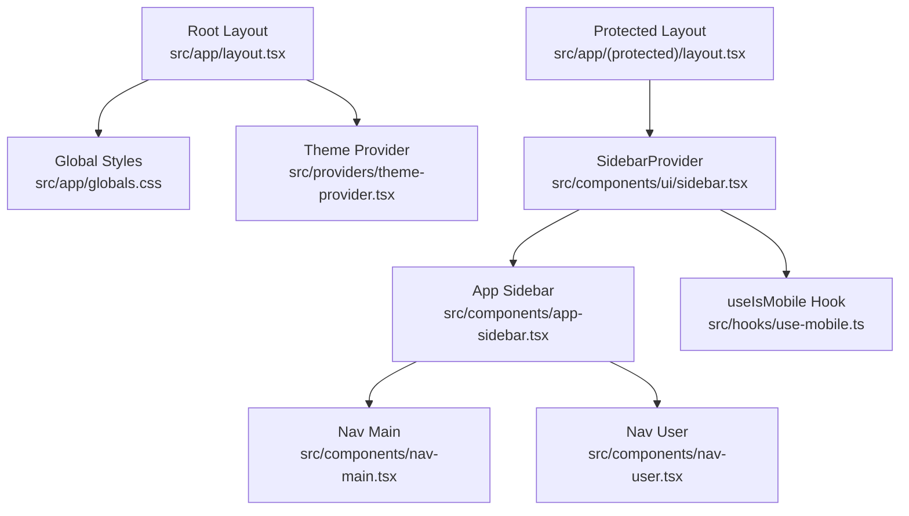
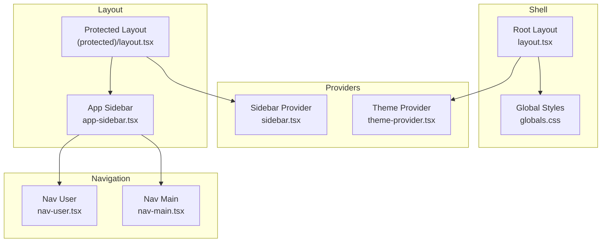
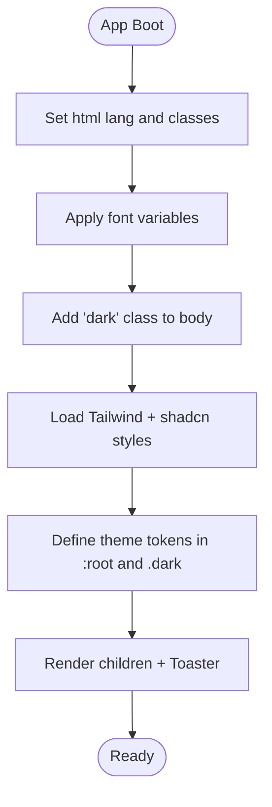
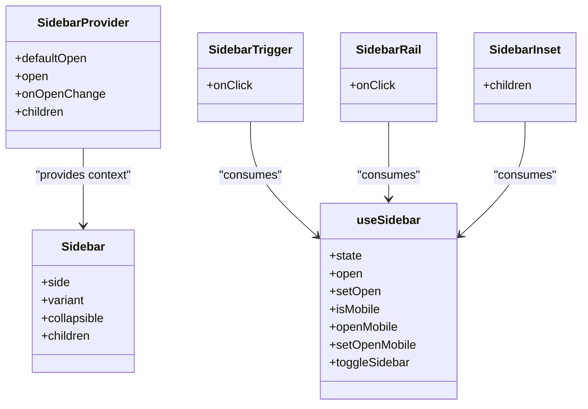
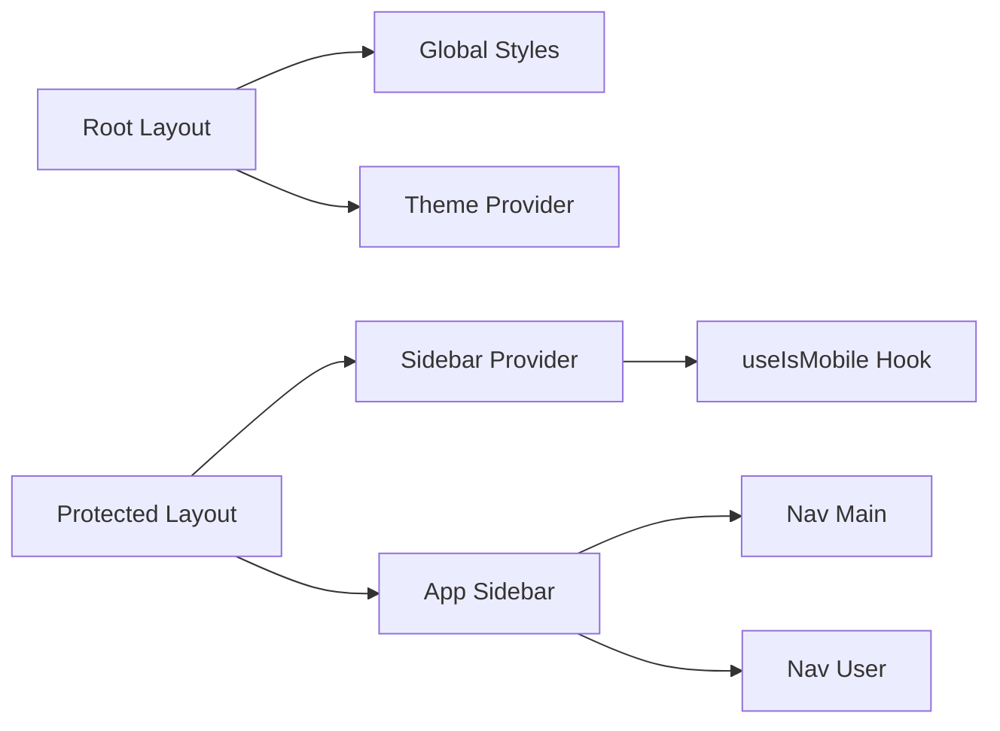

# Component Hierarchy and Design System

<cite>
**Referenced Files in This Document**
- [layout.tsx](file://Apps/Web/src/app/layout.tsx)
- [globals.css](file://Apps/Web/src/app/globals.css)
- [theme-provider.tsx](file://Apps/Web/src/providers/theme-provider.tsx)
- [sidebar.tsx](file://Apps/Web/src/components/ui/sidebar.tsx)
- [app-sidebar.tsx](file://Apps/Web/src/components/app-sidebar.tsx)
- [nav-main.tsx](file://Apps/Web/src/components/nav-main.tsx)
- [nav-user.tsx](file://Apps/Web/src/components/nav-user.tsx)
- [protected-layout.tsx](file://Apps/Web/src/app/(protected)/layout.tsx)
- [use-mobile.ts](file://Apps/Web/src/hooks/use-mobile.ts)
</cite>

## Table of Contents
1. [Introduction](#introduction)
2. [Project Structure](#project-structure)
3. [Core Components](#core-components)
4. [Architecture Overview](#architecture-overview)
5. [Detailed Component Analysis](#detailed-component-analysis)
6. [Dependency Analysis](#dependency-analysis)
7. [Performance Considerations](#performance-considerations)
8. [Troubleshooting Guide](#troubleshooting-guide)
9. [Conclusion](#conclusion)
10. [Appendices](#appendices)

## Introduction
This document explains the component hierarchy and design system used in the web application. It focuses on the main layout components (app sidebar, navigation), theme provider setup, styling with Tailwind CSS, responsive behavior, and guidelines for creating new components while maintaining consistency, accessibility, and internationalization support.

## Project Structure
The frontend is a Next.js app using a feature-based folder structure under src:
- App shell and global styles are defined at the root of src/app.
- UI primitives and shared components live under src/components/ui.
- Layout and navigation components live under src/components.
- Providers wrap the app to supply context (e.g., theme).
- Hooks encapsulate reusable logic (e.g., mobile breakpoint detection).



**Diagram sources**
- [layout.tsx:24-44](file://Apps/Web/src/app/layout.tsx#L24-L44)
- [globals.css:1-58](file://Apps/Web/src/app/globals.css#L1-L58)
- [theme-provider.tsx:1-9](file://Apps/Web/src/providers/theme-provider.tsx#L1-L9)
- [protected-layout.tsx:28-47](file://Apps/Web/src/app/(protected)/layout.tsx#L28-L47)
- [sidebar.tsx:53-143](file://Apps/Web/src/components/ui/sidebar.tsx#L53-L143)
- [app-sidebar.tsx:51-79](file://Apps/Web/src/components/app-sidebar.tsx#L51-L79)
- [nav-main.tsx:18-68](file://Apps/Web/src/components/nav-main.tsx#L18-L68)
- [nav-user.tsx:28-108](file://Apps/Web/src/components/nav-user.tsx#L28-L108)
- [use-mobile.ts:5-19](file://Apps/Web/src/hooks/use-mobile.ts#L5-L19)

**Section sources**
- [layout.tsx:1-44](file://Apps/Web/src/app/layout.tsx#L1-L44)
- [globals.css:1-158](file://Apps/Web/src/app/globals.css#L1-L158)
- [theme-provider.tsx:1-9](file://Apps/Web/src/providers/theme-provider.tsx#L1-L9)
- [protected-layout.tsx:1-49](file://Apps/Web/src/app/(protected)/layout.tsx#L1-L49)
- [sidebar.tsx:1-694](file://Apps/Web/src/components/ui/sidebar.tsx#L1-L694)
- [app-sidebar.tsx:1-80](file://Apps/Web/src/components/app-sidebar.tsx#L1-L80)
- [nav-main.tsx:1-69](file://Apps/Web/src/components/nav-main.tsx#L1-L69)
- [nav-user.tsx:1-109](file://Apps/Web/src/components/nav-user.tsx#L1-L109)
- [use-mobile.ts:1-20](file://Apps/Web/src/hooks/use-mobile.ts#L1-L20)

## Core Components
- Root layout sets up fonts, metadata, language, and dark mode class on the body.
- Global CSS defines Tailwind imports, custom dark variant, theme tokens, and base layer styles.
- Theme provider wraps the app with next-themes to manage light/dark themes.
- Protected layout provides the sidebar context and renders the app sidebar plus content area.
- App sidebar composes header, navigation menu, user menu, and rail.
- Nav main renders collapsible menu items with optional submenus.
- Nav user renders user avatar, dropdown menu, and logout action.
- Sidebar primitive implements responsive offcanvas/desktop behaviors, keyboard shortcuts, and state persistence via cookies.

Key responsibilities:
- Styling and theming: globals.css and theme-provider.tsx.
- Layout orchestration: protected-layout.tsx and app-sidebar.tsx.
- Navigation composition: nav-main.tsx and nav-user.tsx.
- Responsive behavior: use-mobile.ts and sidebar.tsx.

**Section sources**
- [layout.tsx:19-44](file://Apps/Web/src/app/layout.tsx#L19-L44)
- [globals.css:1-58](file://Apps/Web/src/app/globals.css#L1-L58)
- [theme-provider.tsx:1-9](file://Apps/Web/src/providers/theme-provider.tsx#L1-L9)
- [protected-layout.tsx:28-47](file://Apps/Web/src/app/(protected)/layout.tsx#L28-L47)
- [app-sidebar.tsx:51-79](file://Apps/Web/src/components/app-sidebar.tsx#L51-L79)
- [nav-main.tsx:18-68](file://Apps/Web/src/components/nav-main.tsx#L18-L68)
- [nav-user.tsx:28-108](file://Apps/Web/src/components/nav-user.tsx#L28-L108)
- [sidebar.tsx:53-143](file://Apps/Web/src/components/ui/sidebar.tsx#L53-L143)

## Architecture Overview
The application uses a layered architecture:
- Shell layer: root layout and global styles.
- Provider layer: theme provider and sidebar provider.
- Layout layer: protected layout composing sidebar and content.
- Feature layers: pages and domain-specific sections.



**Diagram sources**
- [layout.tsx:24-44](file://Apps/Web/src/app/layout.tsx#L24-L44)
- [globals.css:1-58](file://Apps/Web/src/app/globals.css#L1-L58)
- [theme-provider.tsx:1-9](file://Apps/Web/src/providers/theme-provider.tsx#L1-L9)
- [protected-layout.tsx:28-47](file://Apps/Web/src/app/(protected)/layout.tsx#L28-L47)
- [sidebar.tsx:53-143](file://Apps/Web/src/components/ui/sidebar.tsx#L53-L143)
- [app-sidebar.tsx:51-79](file://Apps/Web/src/components/app-sidebar.tsx#L51-L79)
- [nav-main.tsx:18-68](file://Apps/Web/src/components/nav-main.tsx#L18-L68)
- [nav-user.tsx:28-108](file://Apps/Web/src/components/nav-user.tsx#L28-L108)

## Detailed Component Analysis

### Root Layout and Theming
- Sets HTML lang, applies font variables, and adds the dark class to the body.
- Injects Toaster globally for notifications.
- Metadata includes title and description.

Styling approach:
- Tailwind CSS imported via @import.
- Custom dark variant defined for scoped styling.
- Theme tokens mapped to CSS variables for consistent theming across components.



**Diagram sources**
- [layout.tsx:24-44](file://Apps/Web/src/app/layout.tsx#L24-L44)
- [globals.css:1-58](file://Apps/Web/src/app/globals.css#L1-L58)
- [globals.css:60-145](file://Apps/Web/src/app/globals.css#L60-L145)

**Section sources**
- [layout.tsx:19-44](file://Apps/Web/src/app/layout.tsx#L19-L44)
- [globals.css:1-58](file://Apps/Web/src/app/globals.css#L1-L58)
- [globals.css:60-145](file://Apps/Web/src/app/globals.css#L60-L145)

### Theme Provider Setup
- Wraps the app with next-themes to enable theme toggling.
- Passes through all props to the underlying provider.

Usage guidance:
- Wrap the entire app tree with ThemeProvider to ensure theme state is available everywhere.
- Configure default theme and storage strategy as needed in the provider props.

**Section sources**
- [theme-provider.tsx:1-9](file://Apps/Web/src/providers/theme-provider.tsx#L1-L9)

### Sidebar System and Protected Layout
- Protected layout creates SidebarProvider and renders AppSidebar alongside content.
- SidebarProvider manages open/collapsed state, mobile vs desktop rendering, keyboard shortcut, and cookie persistence.
- Sidebar supports variants (sidebar, floating, inset) and collapsible modes (offcanvas, icon, none).

```mermaid
sequenceDiagram
participant Router as "Next Router"
participant Protected as "Protected Layout"
participant Provider as "SidebarProvider"
participant Sidebar as "Sidebar"
participant Content as "Content Area"
Router->>Protected : Navigate to /my-tasks
Protected->>Provider : Initialize context
Provider->>Provider : Read cookie & set initial state
Provider-->>Protected : Provide state and toggle methods
Protected->>Sidebar : Render AppSidebar
Protected->>Content : Render page content
Note over Provider,Sidebar : Mobile -> Sheet; Desktop -> Fixed panel
```

**Diagram sources**
- [protected-layout.tsx:28-47](file://Apps/Web/src/app/(protected)/layout.tsx#L28-L47)
- [sidebar.tsx:53-143](file://Apps/Web/src/components/ui/sidebar.tsx#L53-L143)
- [sidebar.tsx:146-246](file://Apps/Web/src/components/ui/sidebar.tsx#L146-L246)

**Section sources**
- [protected-layout.tsx:1-49](file://Apps/Web/src/app/(protected)/layout.tsx#L1-L49)
- [sidebar.tsx:25-51](file://Apps/Web/src/components/ui/sidebar.tsx#L25-L51)
- [sidebar.tsx:53-143](file://Apps/Web/src/components/ui/sidebar.tsx#L53-L143)
- [sidebar.tsx:146-246](file://Apps/Web/src/components/ui/sidebar.tsx#L146-L246)

### App Sidebar Composition
- Composes SidebarHeader, SidebarContent, SidebarFooter, and SidebarRail.
- Renders brand logo and title in header.
- Delegates navigation to NavMain and user actions to NavUser.

Prop interface highlights:
- Accepts standard Sidebar props and a user object with name and email.

Accessibility notes:
- Uses semantic elements and aria attributes from underlying primitives.
- Provides screen-reader-only labels where necessary.

**Section sources**
- [app-sidebar.tsx:1-80](file://Apps/Web/src/components/app-sidebar.tsx#L1-L80)

### Navigation: NavMain
- Renders a list of top-level items with optional submenus.
- Supports icons, active states, tooltips, and collapsible groups.

Prop interface highlights:
- items array with title, url, optional icon, isActive flag, and nested items.

Responsive behavior:
- Collapsible triggers rotate when expanded.
- Submenus render within SidebarMenuSub.

**Section sources**
- [nav-main.tsx:1-69](file://Apps/Web/src/components/nav-main.tsx#L1-L69)

### Navigation: NavUser
- Displays user avatar with initials derived from name.
- Shows a dropdown with account and notification options.
- Integrates with an auth action for logout.

Responsive behavior:
- Dropdown side adapts based on isMobile from useSidebar.

Accessibility notes:
- Uses Avatar and Dropdown primitives that handle focus management and roles.

**Section sources**
- [nav-user.tsx:1-109](file://Apps/Web/src/components/nav-user.tsx#L1-L109)

### Sidebar Primitive API
Key exported components and hooks:
- SidebarProvider: Context provider managing state and environment.
- Sidebar: Main container supporting variants and collapsible modes.
- SidebarTrigger: Button to toggle sidebar visibility.
- SidebarRail: Draggable/resizable rail for collapsing/expanding.
- SidebarInset: Content wrapper adapting to sidebar state.
- SidebarHeader/Footer/Content/Group/Menus/Submenus: Structural building blocks.
- useSidebar: Hook to access sidebar state and actions.

State and interactions:
- Persists open state via cookie.
- Keyboard shortcut (meta/ctrl + b) toggles sidebar.
- On mobile, renders as a sheet overlay.



**Diagram sources**
- [sidebar.tsx:53-143](file://Apps/Web/src/components/ui/sidebar.tsx#L53-L143)
- [sidebar.tsx:146-246](file://Apps/Web/src/components/ui/sidebar.tsx#L146-L246)
- [sidebar.tsx:248-293](file://Apps/Web/src/components/ui/sidebar.tsx#L248-L293)
- [sidebar.tsx:295-306](file://Apps/Web/src/components/ui/sidebar.tsx#L295-L306)
- [sidebar.tsx:44-51](file://Apps/Web/src/components/ui/sidebar.tsx#L44-L51)

**Section sources**
- [sidebar.tsx:1-694](file://Apps/Web/src/components/ui/sidebar.tsx#L1-L694)

### Responsive Design Patterns
- Mobile breakpoint hook: useIsMobile returns boolean based on window width.
- Sidebar switches between offcanvas sheet on mobile and fixed panel on desktop.
- Tailwind utilities and CSS variables drive responsive spacing and sizing.

Guidelines:
- Prefer using useIsMobile or useSidebar.isMobile for conditional rendering.
- Use Tailwind breakpoints consistently across components.

**Section sources**
- [use-mobile.ts:1-20](file://Apps/Web/src/hooks/use-mobile.ts#L1-L20)
- [sidebar.tsx:176-200](file://Apps/Web/src/components/ui/sidebar.tsx#L176-L200)
- [sidebar.tsx:202-246](file://Apps/Web/src/components/ui/sidebar.tsx#L202-L246)

### Styling Approach with Tailwind CSS
- Imports Tailwind and shadcn styles at the top of globals.css.
- Defines a custom dark variant for scoped styling.
- Maps theme tokens to CSS variables for colors, radii, and typography.
- Base layer applies consistent defaults for borders, outlines, and typography.

Best practices:
- Use theme tokens (e.g., bg-background, text-foreground) instead of hard-coded colors.
- Extend tokens in :root and .dark for consistent light/dark palettes.

**Section sources**
- [globals.css:1-58](file://Apps/Web/src/app/globals.css#L1-L58)
- [globals.css:60-145](file://Apps/Web/src/app/globals.css#L60-L145)
- [globals.css:147-158](file://Apps/Web/src/app/globals.css#L147-L158)

### Component Composition Patterns and Prop Interfaces
Patterns observed:
- Composition over inheritance: complex layouts built by combining small primitives (SidebarHeader, SidebarContent, etc.).
- Props-driven behavior: components accept configuration via props (e.g., collapsible, variant, size).
- Context-driven state: shared state exposed via providers and consumed via hooks (useSidebar).

Recommended prop interface guidelines:
- Keep props minimal and explicit; prefer typed interfaces.
- Use union types for constrained values (e.g., sizes, variants).
- Provide sensible defaults and allow overrides.

Examples in codebase:
- NavMain items interface defines structured navigation data.
- AppSidebar accepts user object and standard Sidebar props.
- SidebarMenuButton supports variant and size variants.

**Section sources**
- [nav-main.tsx:18-31](file://Apps/Web/src/components/nav-main.tsx#L18-L31)
- [app-sidebar.tsx:51-54](file://Apps/Web/src/components/app-sidebar.tsx#L51-L54)
- [sidebar.tsx:458-478](file://Apps/Web/src/components/ui/sidebar.tsx#L458-L478)

### Accessibility Compliance
- Semantic HTML elements used throughout (button, a, ul, li).
- Screen-reader-only text provided where icons lack visible labels.
- Focus management handled by primitives (Dropdown, Tooltip, Sheet).
- Keyboard shortcuts implemented for sidebar toggle.

Recommendations:
- Ensure all interactive elements have accessible names.
- Test with keyboard navigation and screen readers.
- Maintain contrast ratios using theme tokens.

**Section sources**
- [sidebar.tsx:94-104](file://Apps/Web/src/components/ui/sidebar.tsx#L94-L104)
- [sidebar.tsx:248-267](file://Apps/Web/src/components/ui/sidebar.tsx#L248-L267)
- [nav-user.tsx:48-104](file://Apps/Web/src/components/nav-user.tsx#L48-L104)

### Internationalization Support
- Root layout sets lang="es_MX".
- UI strings currently in Spanish; consider extracting to i18n resources.

Guidelines:
- Centralize locale strings and switch dynamically based on user preference.
- Update html lang attribute when switching locales.

**Section sources**
- [layout.tsx:24-44](file://Apps/Web/src/app/layout.tsx#L24-L44)

### Component Testing Strategies
- Unit test pure presentational components with React Testing Library.
- Mock providers (ThemeProvider, SidebarProvider) to isolate tests.
- Assert accessibility attributes and keyboard interactions.
- Snapshot tests for stable UI structures; avoid brittle snapshots for dynamic content.

[No sources needed since this section provides general guidance]

## Dependency Analysis
High-level dependencies:
- Root layout depends on global styles and theme provider.
- Protected layout depends on SidebarProvider and AppSidebar.
- AppSidebar depends on NavMain and NavUser.
- Sidebar primitive depends on useIsMobile hook and other UI primitives.



**Diagram sources**
- [layout.tsx:24-44](file://Apps/Web/src/app/layout.tsx#L24-L44)
- [globals.css:1-58](file://Apps/Web/src/app/globals.css#L1-L58)
- [theme-provider.tsx:1-9](file://Apps/Web/src/providers/theme-provider.tsx#L1-L9)
- [protected-layout.tsx:28-47](file://Apps/Web/src/app/(protected)/layout.tsx#L28-L47)
- [app-sidebar.tsx:51-79](file://Apps/Web/src/components/app-sidebar.tsx#L51-L79)
- [nav-main.tsx:18-68](file://Apps/Web/src/components/nav-main.tsx#L18-L68)
- [nav-user.tsx:28-108](file://Apps/Web/src/components/nav-user.tsx#L28-L108)
- [use-mobile.ts:5-19](file://Apps/Web/src/hooks/use-mobile.ts#L5-L19)

**Section sources**
- [layout.tsx:24-44](file://Apps/Web/src/app/layout.tsx#L24-L44)
- [protected-layout.tsx:28-47](file://Apps/Web/src/app/(protected)/layout.tsx#L28-L47)
- [app-sidebar.tsx:51-79](file://Apps/Web/src/components/app-sidebar.tsx#L51-L79)
- [sidebar.tsx:53-143](file://Apps/Web/src/components/ui/sidebar.tsx#L53-L143)
- [use-mobile.ts:5-19](file://Apps/Web/src/hooks/use-mobile.ts#L5-L19)

## Performance Considerations
- Avoid unnecessary re-renders by memoizing expensive computations in components.
- Use Suspense boundaries around async data fetching to improve perceived performance.
- Leverage Tailwind’s utility-first approach to minimize CSS bundle size.
- Prefer client-side interactivity only where needed; keep server components for static rendering.

[No sources needed since this section provides general guidance]

## Troubleshooting Guide
Common issues and resolutions:
- Sidebar not responding to toggle:
  - Ensure SidebarProvider wraps the sidebar and content.
  - Verify cookie permissions and browser settings.
- Theme not applying:
  - Confirm ThemeProvider wraps the app tree.
  - Check that the dark class is applied to the root element.
- Mobile sidebar not appearing:
  - Validate useIsMobile hook and media query breakpoint.
  - Ensure Sheet primitives are correctly configured.

**Section sources**
- [sidebar.tsx:82-84](file://Apps/Web/src/components/ui/sidebar.tsx#L82-L84)
- [sidebar.tsx:94-104](file://Apps/Web/src/components/ui/sidebar.tsx#L94-L104)
- [theme-provider.tsx:1-9](file://Apps/Web/src/providers/theme-provider.tsx#L1-L9)
- [use-mobile.ts:5-19](file://Apps/Web/src/hooks/use-mobile.ts#L5-L19)

## Conclusion
The application’s design system centers on a robust sidebar system, consistent theming via Tailwind CSS and CSS variables, and clear component composition patterns. By following the outlined guidelines for props, accessibility, responsiveness, and testing, teams can extend the system confidently while maintaining visual and behavioral consistency.

[No sources needed since this section summarizes without analyzing specific files]

## Appendices

### Guidelines for Creating New Components
- Follow composition patterns: break down complex UI into small, reusable pieces.
- Define explicit prop interfaces with TypeScript types.
- Use theme tokens for colors and spacing to maintain consistency.
- Implement accessibility features: roles, labels, keyboard support.
- Write tests covering interactions and accessibility.

[No sources needed since this section provides general guidance]