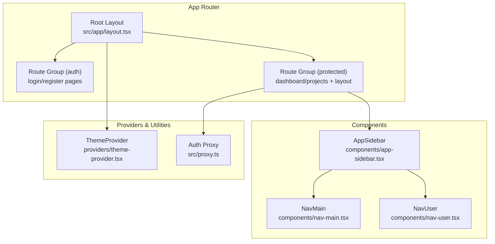
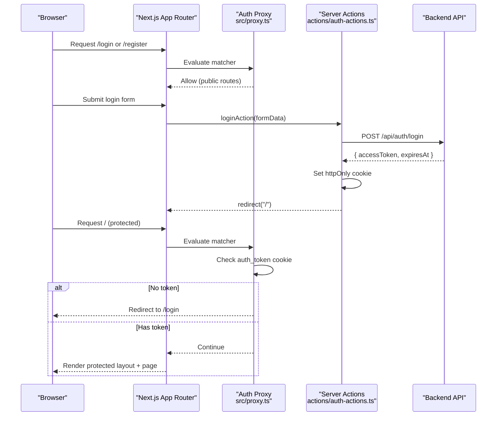
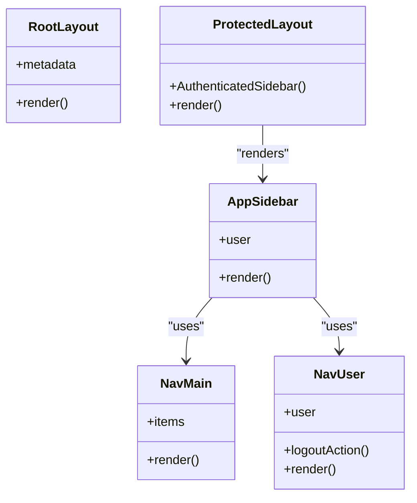
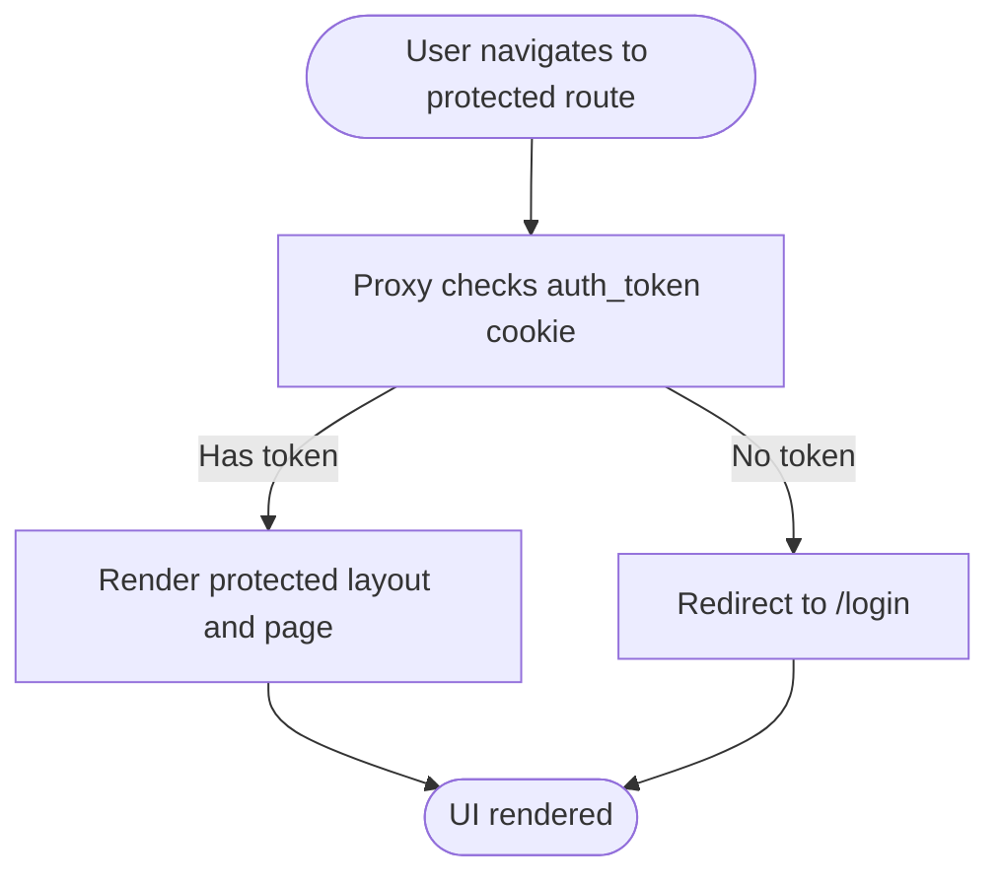
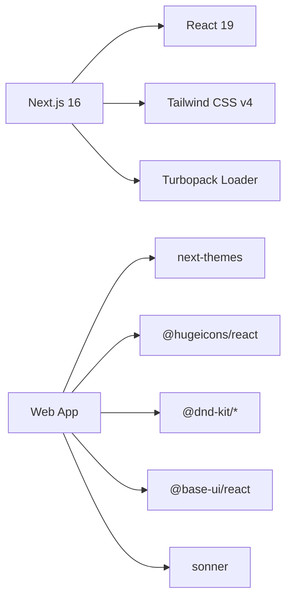

# Frontend Architecture

<cite>
**Referenced Files in This Document**
- [package.json](file://Apps/Web/package.json)
- [next.config.ts](file://Apps/Web/next.config.ts)
- [layout.tsx (root)](file://Apps/Web/src/app/layout.tsx)
- [theme-provider.tsx](file://Apps/Web/src/providers/theme-provider.tsx)
- [proxy.ts](file://Apps/Web/src/proxy.ts)
- [layout.tsx (protected)](file://Apps/Web/src/app/(protected)/layout.tsx)
- [page.tsx (dashboard)](file://Apps/Web/src/app/(protected)/page.tsx)
- [page.tsx (projects)](file://Apps/Web/src/app/(protected)/projects/page.tsx)
- [login page.tsx](file://Apps/Web/src/app/(auth)/login/page.tsx)
- [register page.tsx](file://Apps/Web/src/app/(auth)/register/page.tsx)
- [auth-actions.ts](file://Apps/Web/src/actions/auth-actions.ts)
- [app-sidebar.tsx](file://Apps/Web/src/components/app-sidebar.tsx)
- [nav-main.tsx](file://Apps/Web/src/components/nav-main.tsx)
- [nav-user.tsx](file://Apps/Web/src/components/nav-user.tsx)
</cite>

## Table of Contents
1. [Introduction](#introduction)
2. [Project Structure](#project-structure)
3. [Core Components](#core-components)
4. [Architecture Overview](#architecture-overview)
5. [Detailed Component Analysis](#detailed-component-analysis)
6. [Dependency Analysis](#dependency-analysis)
7. [Performance Considerations](#performance-considerations)
8. [Troubleshooting Guide](#troubleshooting-guide)
9. [Conclusion](#conclusion)

## Introduction
This document describes the frontend architecture of the Next.js application, focusing on App Router organization, server vs client components strategy, routing structure, component hierarchy, state management patterns, API communication, authentication flow, proxy configuration, theme provider setup, responsive design, build and optimization settings, accessibility, performance, and browser compatibility.

## Project Structure
The application uses the Next.js App Router with route groups for authentication and protected areas:
- Root layout sets global metadata, fonts, and toasts.
- Route groups:
  - (auth): public login and register pages.
  - (protected): authenticated dashboard and project management pages with a sidebar layout.
- Shared UI components are organized under components/ui and feature-specific folders.
- Providers include a theme provider wrapper around next-themes.
- A middleware-like proxy enforces authentication checks based on cookies.

**Diagram sources**
- [layout.tsx (root):1-45](file://Apps/Web/src/app/layout.tsx#L1-L45)
- [layout.tsx (protected):1-49](file://Apps/Web/src/app/(protected)/layout.tsx#L1-L49)
- [app-sidebar.tsx:1-80](file://Apps/Web/src/components/app-sidebar.tsx#L1-L80)
- [nav-main.tsx:1-69](file://Apps/Web/src/components/nav-main.tsx#L1-L69)
- [nav-user.tsx:1-109](file://Apps/Web/src/components/nav-user.tsx#L1-L109)
- [theme-provider.tsx:1-9](file://Apps/Web/src/providers/theme-provider.tsx#L1-L9)
- [proxy.ts:1-42](file://Apps/Web/src/proxy.ts#L1-L42)

**Section sources**
- [layout.tsx (root):1-45](file://Apps/Web/src/app/layout.tsx#L1-L45)
- [layout.tsx (protected):1-49](file://Apps/Web/src/app/(protected)/layout.tsx#L1-L49)
- [app-sidebar.tsx:1-80](file://Apps/Web/src/components/app-sidebar.tsx#L1-L80)
- [nav-main.tsx:1-69](file://Apps/Web/src/components/nav-main.tsx#L1-L69)
- [nav-user.tsx:1-109](file://Apps/Web/src/components/nav-user.tsx#L1-L109)
- [theme-provider.tsx:1-9](file://Apps/Web/src/providers/theme-provider.tsx#L1-L9)
- [proxy.ts:1-42](file://Apps/Web/src/proxy.ts#L1-L42)

## Core Components
- Root layout:
  - Sets language, font variables, global classes, and renders Toaster.
- Protected layout:
  - Wraps content with SidebarProvider and SidebarInset.
  - Reads auth token from cookies and decodes user info to render AppSidebar.
- AppSidebar:
  - Renders navigation items and user menu.
- Navigation components:
  - NavMain renders collapsible menu entries.
  - NavUser renders avatar, dropdown, and logout action.
- Theme provider:
  - Client-side wrapper around next-themes.

Key responsibilities:
- Global shell and theming via root layout and theme provider.
- Authentication-aware sidebar via protected layout.
- Navigation and user actions via sidebar components.

**Section sources**
- [layout.tsx (root):1-45](file://Apps/Web/src/app/layout.tsx#L1-L45)
- [layout.tsx (protected):1-49](file://Apps/Web/src/app/(protected)/layout.tsx#L1-L49)
- [app-sidebar.tsx:1-80](file://Apps/Web/src/components/app-sidebar.tsx#L1-L80)
- [nav-main.tsx:1-69](file://Apps/Web/src/components/nav-main.tsx#L1-L69)
- [nav-user.tsx:1-109](file://Apps/Web/src/components/nav-user.tsx#L1-L109)
- [theme-provider.tsx:1-9](file://Apps/Web/src/providers/theme-provider.tsx#L1-L9)

## Architecture Overview
The app follows a layered approach:
- Routing layer: App Router with route groups for auth and protected routes.
- Server-side logic: Server Actions handle authentication and cookie management.
- Client-side UI: Pages and components manage local state and fetch data via API helpers.
- Middleware-like proxy: Enforces access control based on cookies.

**Diagram sources**
- [proxy.ts:1-42](file://Apps/Web/src/proxy.ts#L1-L42)
- [auth-actions.ts:1-210](file://Apps/Web/src/actions/auth-actions.ts#L1-L210)
- [layout.tsx (protected):1-49](file://Apps/Web/src/app/(protected)/layout.tsx#L1-L49)

## Detailed Component Analysis

### App Router and Routing Organization
- Route groups:
  - (auth): login and register pages.
  - (protected): dashboard and projects pages with shared layout.
- Dynamic routes:
  - Projects detail route exists under (protected)/projects/[projectSlug]/page.tsx.
- API route:
  - Catch-all route at api/[...path]/route.ts is present for potential proxying or API aggregation.

Routing behavior:
- Public routes (/login, /register) are accessible without a token.
- Protected routes require a valid auth_token cookie; otherwise, users are redirected to /login.

**Section sources**
- [login page.tsx:1-119](file://Apps/Web/src/app/(auth)/login/page.tsx#L1-L119)
- [register page.tsx:1-140](file://Apps/Web/src/app/(auth)/register/page.tsx#L1-L140)
- [page.tsx (dashboard):1-77](file://Apps/Web/src/app/(protected)/page.tsx#L1-L77)
- [page.tsx (projects):1-108](file://Apps/Web/src/app/(protected)/projects/page.tsx#L1-L108)
- [proxy.ts:1-42](file://Apps/Web/src/proxy.ts#L1-L42)

### Server Components vs Client Components Strategy
- Server components:
  - Root layout and protected layout read cookies and perform server-side operations.
  - Server Actions encapsulate authentication flows and cookie handling.
- Client components:
  - Login and register pages use "use client" to integrate forms with React state and server actions.
  - Dashboard and projects pages are client components that fetch data and manage UI state.
  - Sidebar and navigation components are client components for interactivity.

Guidelines reflected in code:
- Use "use client" only where interactivity or browser APIs are required.
- Keep data fetching and sensitive logic in server components or server actions.

**Section sources**
- [layout.tsx (root):1-45](file://Apps/Web/src/app/layout.tsx#L1-L45)
- [layout.tsx (protected):1-49](file://Apps/Web/src/app/(protected)/layout.tsx#L1-L49)
- [login page.tsx:1-119](file://Apps/Web/src/app/(auth)/login/page.tsx#L1-L119)
- [register page.tsx:1-140](file://Apps/Web/src/app/(auth)/register/page.tsx#L1-L140)
- [page.tsx (dashboard):1-77](file://Apps/Web/src/app/(protected)/page.tsx#L1-L77)
- [page.tsx (projects):1-108](file://Apps/Web/src/app/(protected)/projects/page.tsx#L1-L108)
- [app-sidebar.tsx:1-80](file://Apps/Web/src/components/app-sidebar.tsx#L1-L80)
- [nav-main.tsx:1-69](file://Apps/Web/src/components/nav-main.tsx#L1-L69)
- [nav-user.tsx:1-109](file://Apps/Web/src/components/nav-user.tsx#L1-L109)
- [auth-actions.ts:1-210](file://Apps/Web/src/actions/auth-actions.ts#L1-L210)

### Component Hierarchy
- Root layout provides global HTML structure and Toaster.
- Protected layout wraps content with SidebarProvider and renders header and main area.
- AppSidebar composes NavMain and NavUser.
- NavMain renders collapsible navigation items.
- NavUser renders user avatar, dropdown, and logout action.

**Diagram sources**
- [layout.tsx (root):1-45](file://Apps/Web/src/app/layout.tsx#L1-L45)
- [layout.tsx (protected):1-49](file://Apps/Web/src/app/(protected)/layout.tsx#L1-L49)
- [app-sidebar.tsx:1-80](file://Apps/Web/src/components/app-sidebar.tsx#L1-L80)
- [nav-main.tsx:1-69](file://Apps/Web/src/components/nav-main.tsx#L1-L69)
- [nav-user.tsx:1-109](file://Apps/Web/src/components/nav-user.tsx#L1-L109)

### State Management Approaches
- Local UI state:
  - Pages use useState for loading, error, and data lists.
  - Forms use useActionState to integrate with server actions.
- Data fetching:
  - Dashboard page fetches tasks and projects concurrently using Promise.all.
  - Projects page fetches project list and manages create/edit/delete states.
- Error handling:
  - ApiError type is used to normalize backend errors.
  - User-facing alerts display error messages.

Patterns:
- Prefer server actions for mutations and authentication.
- Use client-side state for UI feedback and optimistic updates where appropriate.

**Section sources**
- [page.tsx (dashboard):1-77](file://Apps/Web/src/app/(protected)/page.tsx#L1-L77)
- [page.tsx (projects):1-108](file://Apps/Web/src/app/(protected)/projects/page.tsx#L1-L108)
- [login page.tsx:1-119](file://Apps/Web/src/app/(auth)/login/page.tsx#L1-L119)
- [register page.tsx:1-140](file://Apps/Web/src/app/(auth)/register/page.tsx#L1-L140)

### API Communication Patterns
- Authentication:
  - Server Actions call backend endpoints for login and register.
  - Tokens are stored in httpOnly cookies set by server actions.
- Data APIs:
  - Client pages import API helpers (e.g., projectsApi, tasksApi) to fetch data.
  - Errors are normalized using ApiError.

Notes:
- The API base URL is configurable via environment variables in server actions.
- For development, TLS certificate validation can be relaxed locally.

**Section sources**
- [auth-actions.ts:1-210](file://Apps/Web/src/actions/auth-actions.ts#L1-L210)
- [page.tsx (dashboard):1-77](file://Apps/Web/src/app/(protected)/page.tsx#L1-L77)
- [page.tsx (projects):1-108](file://Apps/Web/src/app/(protected)/projects/page.tsx#L1-L108)

### Authentication Flow on the Client Side
- Login/Register:
  - Client forms submit to server actions.
  - On success, server actions set cookies and redirect to /.
- Access Control:
  - Proxy checks for auth_token cookie on protected routes.
  - Unauthenticated requests are redirected to /login.
  - Authenticated users attempting /login or /register are redirected to /.

**Diagram sources**
- [proxy.ts:1-42](file://Apps/Web/src/proxy.ts#L1-L42)
- [auth-actions.ts:1-210](file://Apps/Web/src/actions/auth-actions.ts#L1-L210)

### Proxy Configuration for API Calls
- The proxy enforces route-level authentication:
  - Public routes: /login, /register.
  - Protected routes: everything else requires a valid auth_token cookie.
- Matcher excludes API routes, static assets, images, and common file extensions.

Configuration highlights:
- Uses NextResponse.redirect for access control.
- Allows continuation for valid requests.

**Section sources**
- [proxy.ts:1-42](file://Apps/Web/src/proxy.ts#L1-L42)

### Theme Provider Setup
- ThemeProvider wraps children with next-themes.
- It is a client component due to theme switching requirements.

Usage:
- Wrap the app tree with ThemeProvider to enable dark/light themes.

**Section sources**
- [theme-provider.tsx:1-9](file://Apps/Web/src/providers/theme-provider.tsx#L1-L9)

### Responsive Design Patterns
- Tailwind CSS utilities are used throughout for responsive layouts.
- Container queries (@container) are applied in main sections.
- Sidebar and navigation adapt to mobile via provided UI primitives.

Examples:
- Main content uses @container/main for container-based responsiveness.
- Sidebar components provide mobile-aware behaviors.

**Section sources**
- [page.tsx (dashboard):1-77](file://Apps/Web/src/app/(protected)/page.tsx#L1-L77)
- [page.tsx (projects):1-108](file://Apps/Web/src/app/(protected)/projects/page.tsx#L1-L108)
- [app-sidebar.tsx:1-80](file://Apps/Web/src/components/app-sidebar.tsx#L1-L80)
- [nav-user.tsx:1-109](file://Apps/Web/src/components/nav-user.tsx#L1-L109)

## Dependency Analysis
High-level dependencies:
- Next.js framework and Turbopack integration.
- React 19 and DOM runtime.
- UI libraries: Base UI, Hugeicons, shadcn primitives.
- Theming: next-themes.
- Drag-and-drop: dnd-kit.
- Date handling: date-fns, react-day-picker.
- Notifications: sonner (Toaster).

Build and tooling:
- pnpm package manager.
- oxlint and oxfmt for linting and formatting.
- Tailwind CSS v4 with Turbopack loader.

**Diagram sources**
- [package.json:1-45](file://Apps/Web/package.json#L1-L45)
- [next.config.ts:1-18](file://Apps/Web/next.config.ts#L1-L18)

**Section sources**
- [package.json:1-45](file://Apps/Web/package.json#L1-L45)
- [next.config.ts:1-18](file://Apps/Web/next.config.ts#L1-L18)

## Performance Considerations
- Build optimizations:
  - cacheComponents enabled for component caching.
  - partialPrefetching enabled for improved navigation performance.
  - Turbopack configured with Tailwind CSS loader for faster builds.
- Runtime considerations:
  - Avoid unnecessary client components; keep heavy logic server-side.
  - Use Suspense for async UI parts (e.g., sidebar user info).
  - Minimize re-renders by keeping state close to where it’s used.

Recommendations:
- Leverage server components for data-heavy rendering.
- Use client components only for interactivity.
- Optimize images and fonts; preload critical resources.

**Section sources**
- [next.config.ts:1-18](file://Apps/Web/next.config.ts#L1-L18)
- [layout.tsx (protected):1-49](file://Apps/Web/src/app/(protected)/layout.tsx#L1-L49)

## Troubleshooting Guide
Common issues and resolutions:
- Authentication failures:
  - Verify server action responses and token presence in cookies.
  - Ensure backend returns expected fields (accessToken/token/jwt).
- CORS/TLS in development:
  - Local dev may require disabling TLS verification for self-signed certificates.
- Access denied on protected routes:
  - Confirm auth_token cookie is set after login/register.
  - Check proxy matcher and route group boundaries.

Debugging tips:
- Inspect network requests to backend API endpoints.
- Validate cookie attributes (httpOnly, secure, sameSite, path, expires).
- Review error messages returned by server actions and UI alerts.

**Section sources**
- [auth-actions.ts:1-210](file://Apps/Web/src/actions/auth-actions.ts#L1-L210)
- [proxy.ts:1-42](file://Apps/Web/src/proxy.ts#L1-L42)

## Conclusion
The application leverages Next.js App Router with clear separation between public and protected routes, server actions for authentication, and client components for interactive UI. The architecture emphasizes security through httpOnly cookies, route-level access control, and minimal client-side state. Build optimizations and modern tooling support fast development and production performance. Accessibility and responsive design are integrated via UI primitives and Tailwind utilities.