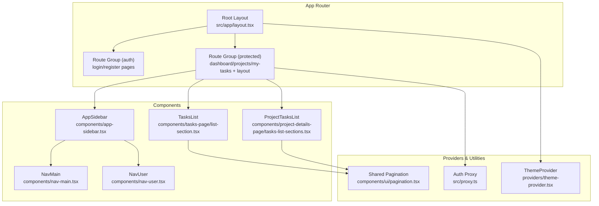
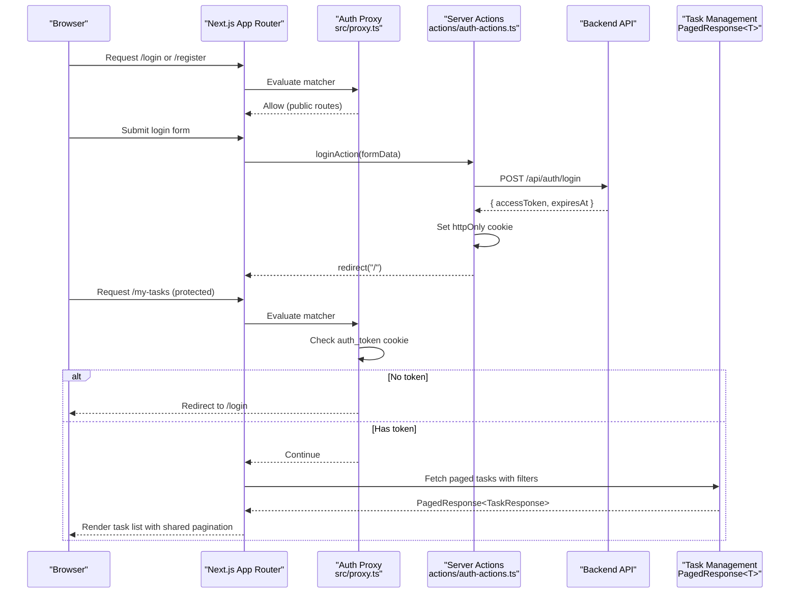
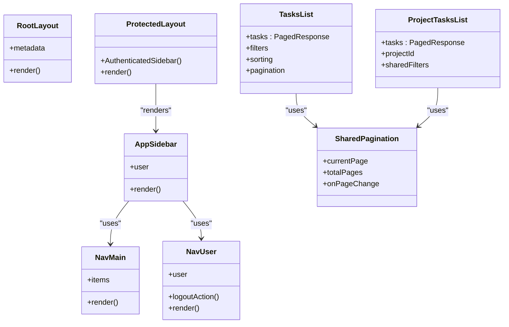
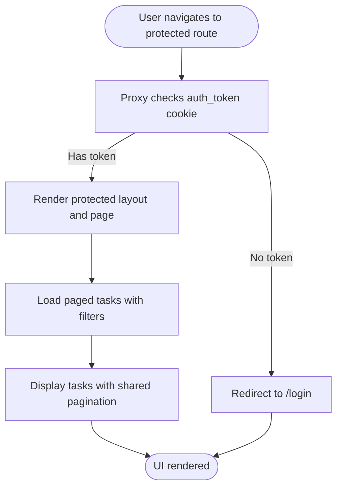
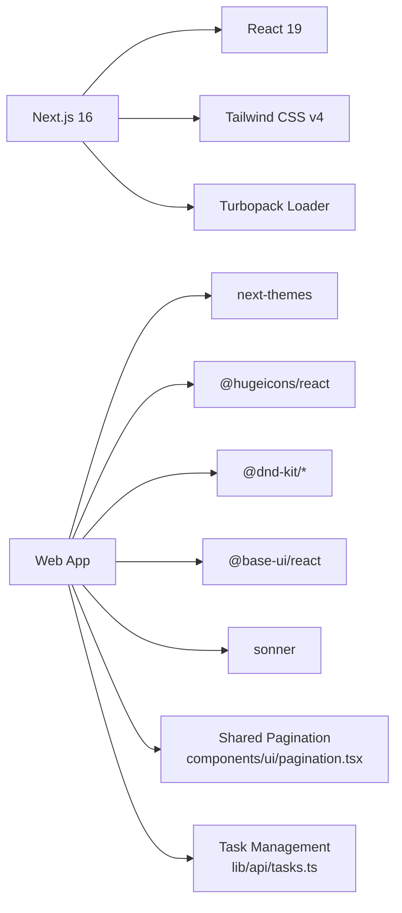

# Frontend Architecture

<cite>
**Referenced Files in This Document**
- [package.json](file://Apps/Web/package.json)
- [next.config.ts](file://Apps/Web/next.config.ts)
- [layout.tsx (root)](file://Apps/Web/src/app/layout.tsx)
- [theme-provider.tsx](file://Apps/Web/src/providers/theme-provider.tsx)
- [proxy.ts](file://Apps/Web/src/proxy.ts)
- [layout.tsx (protected)](file://Apps/Web/src/app/(protected)/layout.tsx)
- [page.tsx (dashboard)](file://Apps/Web/src/app/(protected)/page.tsx)
- [page.tsx (projects)](file://Apps/Web/src/app/(protected)/projects/page.tsx)
- [login page.tsx](file://Apps/Web/src/app/(auth)/login/page.tsx)
- [register page.tsx](file://Apps/Web/src/app/(auth)/register/page.tsx)
- [auth-actions.ts](file://Apps/Web/src/actions/auth-actions.ts)
- [app-sidebar.tsx](file://Apps/Web/src/components/app-sidebar.tsx)
- [nav-main.tsx](file://Apps/Web/src/components/nav-main.tsx)
- [nav-user.tsx](file://Apps/Web/src/components/nav-user.tsx)
- [my-tasks page.tsx](file://Apps/Web/src/app/(protected)/my-tasks/page.tsx)
- [tasks list-section.tsx](file://Apps/Web/src/components/tasks-page/list-section.tsx)
- [project tasks-list-sections.tsx](file://Apps/Web/src/components/project-details-page/tasks-list-sections.tsx)
- [project details page.tsx](file://Apps/Web/src/app/(protected)/projects/[projectSlug]/page.tsx)
- [pagination.tsx](file://Apps/Web/src/components/ui/pagination.tsx)
- [helper.ts](file://Apps/Web/src/lib/api/helper.ts)
- [tasks.ts](file://Apps/Web/src/lib/api/tasks.ts)
</cite>

## Update Summary
**Changes Made**
- Updated pagination implementation to use shared UI primitives instead of custom components
- Enhanced error handling throughout task management workflow with proper ApiError handling
- Improved TypeScript type safety with PagedResponse interfaces for consistent data structures
- Updated navigation system to reflect new task management capabilities and project-specific task views
- Added comprehensive task filtering, sorting, and pagination functionality across all task views

## Table of Contents
1. [Introduction](#introduction)
2. [Project Structure](#project-structure)
3. [Core Components](#core-components)
4. [Architecture Overview](#architecture-overview)
5. [Detailed Component Analysis](#detailed-component-analysis)
6. [Dependency Analysis](#dependency-analysis)
7. [Performance Considerations](#performance-considerations)
8. [Troubleshooting Guide](#troubleshooting-guide)
9. [Conclusion](#conclusion)

## Introduction
This document describes the frontend architecture of the Next.js application, focusing on App Router organization, server vs client components strategy, routing structure, component hierarchy, state management patterns, API communication, authentication flow, proxy configuration, theme provider setup, responsive design, build and optimization settings, accessibility, performance, and browser compatibility. The application now features enhanced task management capabilities with improved pagination, error handling, and TypeScript type safety.

## Project Structure
The application uses the Next.js App Router with route groups for authentication and protected areas:
- Root layout sets global metadata, fonts, and toasts.
- Route groups:
  - (auth): public login and register pages.
  - (protected): authenticated dashboard, projects, and my-tasks pages with a sidebar layout.
- Shared UI components are organized under components/ui and feature-specific folders.
- Providers include a theme provider wrapper around next-themes.
- A middleware-like proxy enforces authentication checks based on cookies.

**Diagram sources**
- [layout.tsx (root):1-45](file://Apps/Web/src/app/layout.tsx#L1-L45)
- [layout.tsx (protected):1-49](file://Apps/Web/src/app/(protected)/layout.tsx#L1-L49)
- [app-sidebar.tsx:1-80](file://Apps/Web/src/components/app-sidebar.tsx#L1-L80)
- [nav-main.tsx:1-69](file://Apps/Web/src/components/nav-main.tsx#L1-L69)
- [nav-user.tsx:1-109](file://Apps/Web/src/components/nav-user.tsx#L1-L109)
- [tasks list-section.tsx:1-550](file://Apps/Web/src/components/tasks-page/list-section.tsx#L1-L550)
- [project tasks-list-sections.tsx:1-253](file://Apps/Web/src/components/project-details-page/tasks-list-sections.tsx#L1-L253)
- [pagination.tsx:1-131](file://Apps/Web/src/components/ui/pagination.tsx#L1-L131)
- [theme-provider.tsx:1-9](file://Apps/Web/src/providers/theme-provider.tsx#L1-L9)
- [proxy.ts:1-42](file://Apps/Web/src/proxy.ts#L1-L42)

**Section sources**
- [layout.tsx (root):1-45](file://Apps/Web/src/app/layout.tsx#L1-L45)
- [layout.tsx (protected):1-49](file://Apps/Web/src/app/(protected)/layout.tsx#L1-L49)
- [app-sidebar.tsx:1-80](file://Apps/Web/src/components/app-sidebar.tsx#L1-L80)
- [nav-main.tsx:1-69](file://Apps/Web/src/components/nav-main.tsx#L1-L69)
- [nav-user.tsx:1-109](file://Apps/Web/src/components/nav-user.tsx#L1-L109)
- [theme-provider.tsx:1-9](file://Apps/Web/src/providers/theme-provider.tsx#L1-L9)
- [proxy.ts:1-42](file://Apps/Web/src/proxy.ts#L1-L42)

## Core Components
- Root layout:
  - Sets language, font variables, global classes, and renders Toaster.
- Protected layout:
  - Wraps content with SidebarProvider and SidebarInset.
  - Reads auth token from cookies and decodes user info to render AppSidebar.
- AppSidebar:
  - Renders navigation items and user menu.
- Navigation components:
  - NavMain renders collapsible menu entries.
  - NavUser renders avatar, dropdown, and logout action.
- Task management components:
  - TasksList provides comprehensive task listing with filtering, sorting, and pagination.
  - ProjectTasksList offers project-specific task management with shared functionality.
  - Both components use shared UI primitives for consistent pagination experience.
- Theme provider:
  - Client-side wrapper around next-themes.

Key responsibilities:
- Global shell and theming via root layout and theme provider.
- Authentication-aware sidebar via protected layout.
- Navigation and user actions via sidebar components.
- Comprehensive task management with advanced filtering and pagination.

**Section sources**
- [layout.tsx (root):1-45](file://Apps/Web/src/app/layout.tsx#L1-L45)
- [layout.tsx (protected):1-49](file://Apps/Web/src/app/(protected)/layout.tsx#L1-L49)
- [app-sidebar.tsx:1-80](file://Apps/Web/src/components/app-sidebar.tsx#L1-L80)
- [nav-main.tsx:1-69](file://Apps/Web/src/components/nav-main.tsx#L1-L69)
- [nav-user.tsx:1-109](file://Apps/Web/src/components/nav-user.tsx#L1-L109)
- [tasks list-section.tsx:1-550](file://Apps/Web/src/components/tasks-page/list-section.tsx#L1-L550)
- [project tasks-list-sections.tsx:1-253](file://Apps/Web/src/components/project-details-page/tasks-list-sections.tsx#L1-L253)
- [theme-provider.tsx:1-9](file://Apps/Web/src/providers/theme-provider.tsx#L1-L9)

## Architecture Overview
The app follows a layered approach:
- Routing layer: App Router with route groups for auth and protected routes.
- Server-side logic: Server Actions handle authentication and cookie management.
- Client-side UI: Pages and components manage local state and fetch data via API helpers.
- Middleware-like proxy: Enforces access control based on cookies.
- Enhanced task management: Consistent pagination, filtering, and error handling across all task views.

**Diagram sources**
- [proxy.ts:1-42](file://Apps/Web/src/proxy.ts#L1-L42)
- [auth-actions.ts:1-210](file://Apps/Web/src/actions/auth-actions.ts#L1-L210)
- [layout.tsx (protected):1-49](file://Apps/Web/src/app/(protected)/layout.tsx#L1-L49)
- [my-tasks page.tsx:47-81](file://Apps/Web/src/app/(protected)/my-tasks/page.tsx#L47-L81)
- [helper.ts:1-67](file://Apps/Web/src/lib/api/helper.ts#L1-L67)

## Detailed Component Analysis

### App Router and Routing Organization
- Route groups:
  - (auth): login and register pages.
  - (protected): dashboard, projects, and my-tasks pages with shared layout.
- Dynamic routes:
  - Projects detail route exists under (protected)/projects/[projectSlug]/page.tsx.
  - My-tasks route provides comprehensive task management at (protected)/my-tasks/page.tsx.
- API route:
  - Catch-all route at api/[...path]/route.ts is present for potential proxying or API aggregation.

Routing behavior:
- Public routes (/login, /register) are accessible without a token.
- Protected routes require a valid auth_token cookie; otherwise, users are redirected to /login.
- Enhanced task management routes support advanced filtering and pagination.

**Section sources**
- [login page.tsx:1-119](file://Apps/Web/src/app/(auth)/login/page.tsx#L1-L119)
- [register page.tsx:1-140](file://Apps/Web/src/app/(auth)/register/page.tsx#L1-L140)
- [page.tsx (dashboard):1-77](file://Apps/Web/src/app/(protected)/page.tsx#L1-L77)
- [page.tsx (projects):1-108](file://Apps/Web/src/app/(protected)/projects/page.tsx#L1-L108)
- [my-tasks page.tsx:1-204](file://Apps/Web/src/app/(protected)/my-tasks/page.tsx#L1-L204)
- [project details page.tsx:1-327](file://Apps/Web/src/app/(protected)/projects/[projectSlug]/page.tsx#L1-L327)
- [proxy.ts:1-42](file://Apps/Web/src/proxy.ts#L1-L42)

### Server Components vs Client Components Strategy
- Server components:
  - Root layout and protected layout read cookies and perform server-side operations.
  - Server Actions encapsulate authentication flows and cookie handling.
- Client components:
  - Login and register pages use "use client" to integrate forms with React state and server actions.
  - Dashboard, projects, and my-tasks pages are client components that fetch data and manage UI state.
  - Sidebar and navigation components are client components for interactivity.
  - Task management components leverage shared UI primitives for consistent pagination.

Guidelines reflected in code:
- Use "use client" only where interactivity or browser APIs are required.
- Keep data fetching and sensitive logic in server components or server actions.
- Leverage shared UI components for consistent user experience.

**Section sources**
- [layout.tsx (root):1-45](file://Apps/Web/src/app/layout.tsx#L1-L45)
- [layout.tsx (protected):1-49](file://Apps/Web/src/app/(protected)/layout.tsx#L1-L49)
- [login page.tsx:1-119](file://Apps/Web/src/app/(auth)/login/page.tsx#L1-L119)
- [register page.tsx:1-140](file://Apps/Web/src/app/(auth)/register/page.tsx#L1-L140)
- [page.tsx (dashboard):1-77](file://Apps/Web/src/app/(protected)/page.tsx#L1-L77)
- [page.tsx (projects):1-108](file://Apps/Web/src/app/(protected)/projects/page.tsx#L1-L108)
- [my-tasks page.tsx:1-204](file://Apps/Web/src/app/(protected)/my-tasks/page.tsx#L1-L204)
- [project details page.tsx:1-327](file://Apps/Web/src/app/(protected)/projects/[projectSlug]/page.tsx#L1-L327)
- [app-sidebar.tsx:1-80](file://Apps/Web/src/components/app-sidebar.tsx#L1-L80)
- [nav-main.tsx:1-69](file://Apps/Web/src/components/nav-main.tsx#L1-L69)
- [nav-user.tsx:1-109](file://Apps/Web/src/components/nav-user.tsx#L1-L109)
- [auth-actions.ts:1-210](file://Apps/Web/src/actions/auth-actions.ts#L1-L210)

### Component Hierarchy
- Root layout provides global HTML structure and Toaster.
- Protected layout wraps content with SidebarProvider and renders header and main area.
- AppSidebar composes NavMain and NavUser.
- NavMain renders collapsible navigation items.
- NavUser renders user avatar, dropdown, and logout action.
- Task management hierarchy:
  - Page components manage state and API calls.
  - List components provide table rendering and user interactions.
  - Shared pagination components ensure consistent UX.

**Diagram sources**
- [layout.tsx (root):1-45](file://Apps/Web/src/app/layout.tsx#L1-L45)
- [layout.tsx (protected):1-49](file://Apps/Web/src/app/(protected)/layout.tsx#L1-L49)
- [app-sidebar.tsx:1-80](file://Apps/Web/src/components/app-sidebar.tsx#L1-L80)
- [nav-main.tsx:1-69](file://Apps/Web/src/components/nav-main.tsx#L1-L69)
- [nav-user.tsx:1-109](file://Apps/Web/src/components/nav-user.tsx#L1-L109)
- [tasks list-section.tsx:81-276](file://Apps/Web/src/components/tasks-page/list-section.tsx#L81-L276)
- [project tasks-list-sections.tsx:57-253](file://Apps/Web/src/components/project-details-page/tasks-list-sections.tsx#L57-L253)
- [pagination.tsx:1-131](file://Apps/Web/src/components/ui/pagination.tsx#L1-L131)

### State Management Approaches
- Local UI state:
  - Pages use useState for loading, error, and data lists.
  - Forms use useActionState to integrate with server actions.
- Data fetching:
  - Dashboard page fetches tasks and projects concurrently using Promise.all.
  - Projects page fetches project list and manages create/edit/delete states.
  - My-tasks page implements comprehensive task filtering, sorting, and pagination.
- Error handling:
  - ApiError type is used to normalize backend errors.
  - User-facing alerts display error messages with proper context.
- Enhanced task management:
  - Consistent PagedResponse interface ensures type safety across all task views.
  - Shared query parameters enable consistent filtering and sorting behavior.

Patterns:
- Prefer server actions for mutations and authentication.
- Use client-side state for UI feedback and optimistic updates where appropriate.
- Leverage shared components for consistent user experience.

**Section sources**
- [page.tsx (dashboard):1-77](file://Apps/Web/src/app/(protected)/page.tsx#L1-L77)
- [page.tsx (projects):1-108](file://Apps/Web/src/app/(protected)/projects/page.tsx#L1-L108)
- [my-tasks page.tsx:47-130](file://Apps/Web/src/app/(protected)/my-tasks/page.tsx#L47-L130)
- [project details page.tsx:62-172](file://Apps/Web/src/app/(protected)/projects/[projectSlug]/page.tsx#L62-L172)
- [login page.tsx:1-119](file://Apps/Web/src/app/(auth)/login/page.tsx#L1-L119)
- [register page.tsx:1-140](file://Apps/Web/src/app/(auth)/register/page.tsx#L1-L140)

### API Communication Patterns
- Authentication:
  - Server Actions call backend endpoints for login and register.
  - Tokens are stored in httpOnly cookies set by server actions.
- Data APIs:
  - Client pages import API helpers (e.g., projectsApi, tasksApi) to fetch data.
  - Errors are normalized using ApiError.
  - PagedResponse interface ensures consistent data structure for paginated results.
- Enhanced task management:
  - Tasks API supports advanced filtering, sorting, and pagination parameters.
  - Consistent error handling across all task operations.

Notes:
- The API base URL is configurable via environment variables in server actions.
- For development, TLS certificate validation can be relaxed locally.
- Type-safe API responses with proper TypeScript interfaces.

**Section sources**
- [auth-actions.ts:1-210](file://Apps/Web/src/actions/auth-actions.ts#L1-L210)
- [page.tsx (dashboard):1-77](file://Apps/Web/src/app/(protected)/page.tsx#L1-L77)
- [page.tsx (projects):1-108](file://Apps/Web/src/app/(protected)/projects/page.tsx#L1-L108)
- [my-tasks page.tsx:72-81](file://Apps/Web/src/app/(protected)/my-tasks/page.tsx#L72-L81)
- [helper.ts:1-67](file://Apps/Web/src/lib/api/helper.ts#L1-L67)
- [tasks.ts:1-99](file://Apps/Web/src/lib/api/tasks.ts#L1-L99)

### Authentication Flow on the Client Side
- Login/Register:
  - Client forms submit to server actions.
  - On success, server actions set cookies and redirect to /.
- Access Control:
  - Proxy checks for auth_token cookie on protected routes.
  - Unauthenticated requests are redirected to /login.
  - Authenticated users attempting /login or /register are redirected to /.

**Diagram sources**
- [proxy.ts:1-42](file://Apps/Web/src/proxy.ts#L1-L42)
- [auth-actions.ts:1-210](file://Apps/Web/src/actions/auth-actions.ts#L1-L210)
- [my-tasks page.tsx:68-81](file://Apps/Web/src/app/(protected)/my-tasks/page.tsx#L68-L81)

### Proxy Configuration for API Calls
- The proxy enforces route-level authentication:
  - Public routes: /login, /register.
  - Protected routes: everything else requires a valid auth_token cookie.
- Matcher excludes API routes, static assets, images, and common file extensions.

Configuration highlights:
- Uses NextResponse.redirect for access control.
- Allows continuation for valid requests.

**Section sources**
- [proxy.ts:1-42](file://Apps/Web/src/proxy.ts#L1-L42)

### Theme Provider Setup
- ThemeProvider wraps children with next-themes.
- It is a client component due to theme switching requirements.

Usage:
- Wrap the app tree with ThemeProvider to enable dark/light themes.

**Section sources**
- [theme-provider.tsx:1-9](file://Apps/Web/src/providers/theme-provider.tsx#L1-L9)

### Responsive Design Patterns
- Tailwind CSS utilities are used throughout for responsive layouts.
- Container queries (@container) are applied in main sections.
- Sidebar and navigation adapt to mobile via provided UI primitives.
- Task management components maintain consistency across different screen sizes.

Examples:
- Main content uses @container/main for container-based responsiveness.
- Sidebar components provide mobile-aware behaviors.
- Task tables and pagination adapt to various viewport sizes.

**Section sources**
- [page.tsx (dashboard):1-77](file://Apps/Web/src/app/(protected)/page.tsx#L1-L77)
- [page.tsx (projects):1-108](file://Apps/Web/src/app/(protected)/projects/page.tsx#L1-L108)
- [my-tasks page.tsx:132-204](file://Apps/Web/src/app/(protected)/my-tasks/page.tsx#L132-L204)
- [project details page.tsx:209-327](file://Apps/Web/src/app/(protected)/projects/[projectSlug]/page.tsx#L209-L327)
- [app-sidebar.tsx:1-80](file://Apps/Web/src/components/app-sidebar.tsx#L1-L80)
- [nav-user.tsx:1-109](file://Apps/Web/src/components/nav-user.tsx#L1-L109)

### Enhanced Task Management Features
- **Shared UI Primitives**: Migration from custom pagination components to shared UI primitives ensures consistent user experience across all task views.
- **Advanced Filtering**: Task lists support filtering by status, priority, search terms, and sorting options.
- **Type-Safe Pagination**: PagedResponse interface provides consistent typing for paginated data across the application.
- **Improved Error Handling**: Comprehensive error handling with proper ApiError integration and user-friendly error messages.
- **Consistent Query Management**: Shared query parameter handling enables consistent filtering and sorting behavior.

Key improvements:
- Unified pagination component reduces code duplication and improves maintainability.
- Enhanced TypeScript types prevent runtime errors and improve developer experience.
- Better error handling provides clear feedback to users when operations fail.

**Section sources**
- [tasks list-section.tsx:457-550](file://Apps/Web/src/components/tasks-page/list-section.tsx#L457-L550)
- [project tasks-list-sections.tsx:46-253](file://Apps/Web/src/components/project-details-page/tasks-list-sections.tsx#L46-L253)
- [pagination.tsx:1-131](file://Apps/Web/src/components/ui/pagination.tsx#L1-L131)
- [helper.ts:1-67](file://Apps/Web/src/lib/api/helper.ts#L1-L67)

## Dependency Analysis
High-level dependencies:
- Next.js framework and Turbopack integration.
- React 19 and DOM runtime.
- UI libraries: Base UI, Hugeicons, shadcn primitives.
- Theming: next-themes.
- Drag-and-drop: dnd-kit.
- Date handling: date-fns, react-day-picker.
- Notifications: sonner (Toaster).

Build and tooling:
- pnpm package manager.
- oxlint and oxfmt for linting and formatting.
- Tailwind CSS v4 with Turbopack loader.

**Diagram sources**
- [package.json:1-45](file://Apps/Web/package.json#L1-L45)
- [next.config.ts:1-18](file://Apps/Web/next.config.ts#L1-L18)
- [pagination.tsx:1-131](file://Apps/Web/src/components/ui/pagination.tsx#L1-L131)
- [tasks.ts:1-99](file://Apps/Web/src/lib/api/tasks.ts#L1-L99)

**Section sources**
- [package.json:1-45](file://Apps/Web/package.json#L1-L45)
- [next.config.ts:1-18](file://Apps/Web/next.config.ts#L1-L18)

## Performance Considerations
- Build optimizations:
  - cacheComponents enabled for component caching.
  - partialPrefetching enabled for improved navigation performance.
  - Turbopack configured with Tailwind CSS loader for faster builds.
- Runtime considerations:
  - Avoid unnecessary client components; keep heavy logic server-side.
  - Use Suspense for async UI parts (e.g., sidebar user info).
  - Minimize re-renders by keeping state close to where it's used.
- Task management optimizations:
  - Shared pagination components reduce bundle size through code reuse.
  - Efficient filtering and sorting with proper memoization.
  - Optimistic updates for better perceived performance.

Recommendations:
- Leverage server components for data-heavy rendering.
- Use client components only for interactivity.
- Optimize images and fonts; preload critical resources.
- Utilize shared components to minimize code duplication.

**Section sources**
- [next.config.ts:1-18](file://Apps/Web/next.config.ts#L1-L18)
- [layout.tsx (protected):1-49](file://Apps/Web/src/app/(protected)/layout.tsx#L1-L49)
- [tasks list-section.tsx:1-550](file://Apps/Web/src/components/tasks-page/list-section.tsx#L1-L550)

## Troubleshooting Guide
Common issues and resolutions:
- Authentication failures:
  - Verify server action responses and token presence in cookies.
  - Ensure backend returns expected fields (accessToken/token/jwt).
- CORS/TLS in development:
  - Local dev may require disabling TLS verification for self-signed certificates.
- Access denied on protected routes:
  - Confirm auth_token cookie is set after login/register.
  - Check proxy matcher and route group boundaries.
- Task management issues:
  - Verify PagedResponse structure matches expected TypeScript interface.
  - Check API error handling for proper ApiError propagation.
  - Ensure pagination props are correctly passed to shared components.

Debugging tips:
- Inspect network requests to backend API endpoints.
- Validate cookie attributes (httpOnly, secure, sameSite, path, expires).
- Review error messages returned by server actions and UI alerts.
- Check console for TypeScript compilation errors related to PagedResponse usage.

**Section sources**
- [auth-actions.ts:1-210](file://Apps/Web/src/actions/auth-actions.ts#L1-L210)
- [proxy.ts:1-42](file://Apps/Web/src/proxy.ts#L1-L42)
- [helper.ts:1-67](file://Apps/Web/src/lib/api/helper.ts#L1-L67)
- [tasks list-section.tsx:121-156](file://Apps/Web/src/components/tasks-page/list-section.tsx#L121-L156)

## Conclusion
The application leverages Next.js App Router with clear separation between public and protected routes, server actions for authentication, and client components for interactive UI. The architecture emphasizes security through httpOnly cookies, route-level access control, and minimal client-side state. Recent enhancements include migration to shared UI primitives for pagination, improved error handling throughout the task management workflow, enhanced TypeScript type safety with PagedResponse interfaces, and comprehensive task filtering and sorting capabilities. Build optimizations and modern tooling support fast development and production performance. Accessibility and responsive design are integrated via UI primitives and Tailwind utilities. The unified task management system provides consistent user experience across all task views while maintaining type safety and robust error handling.