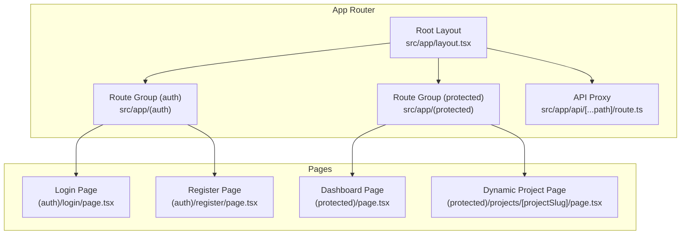
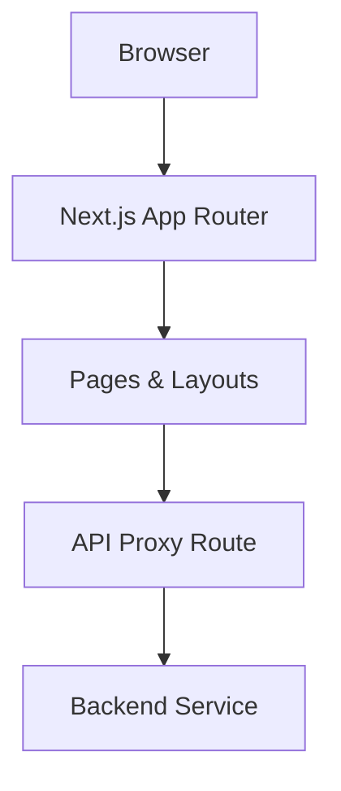
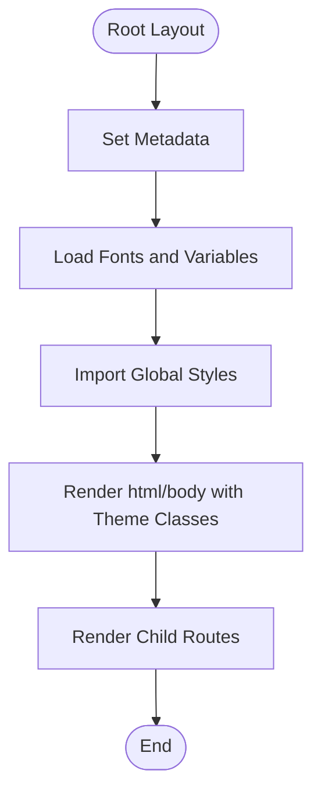
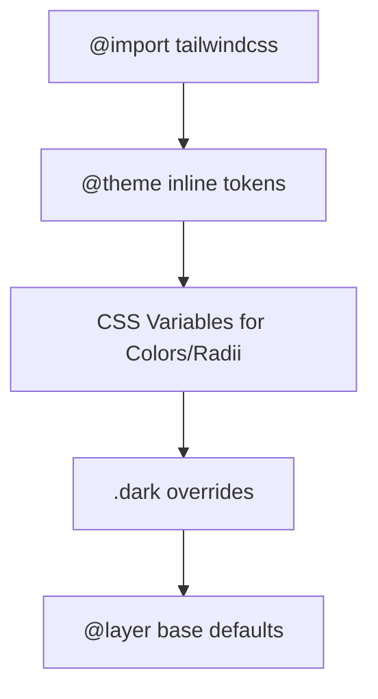
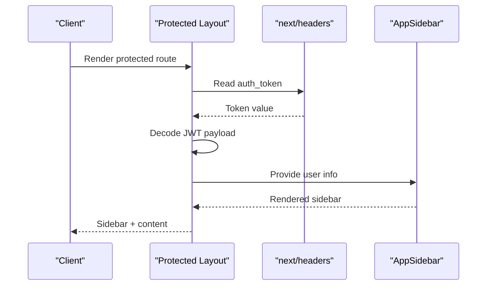
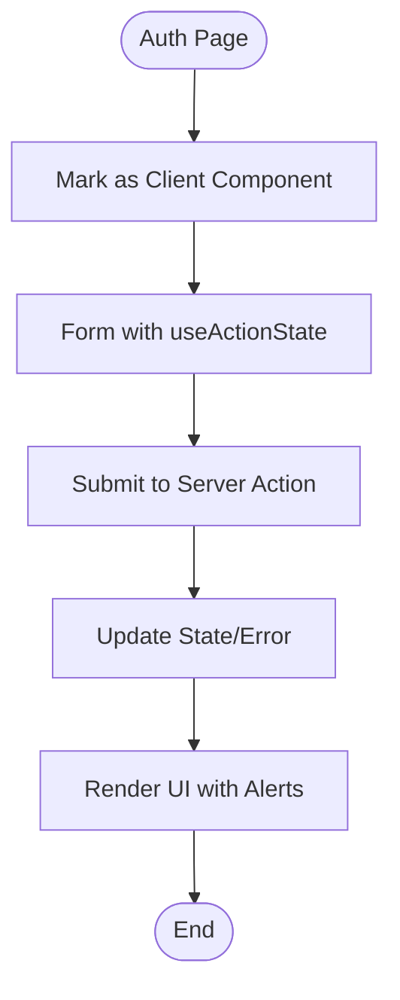
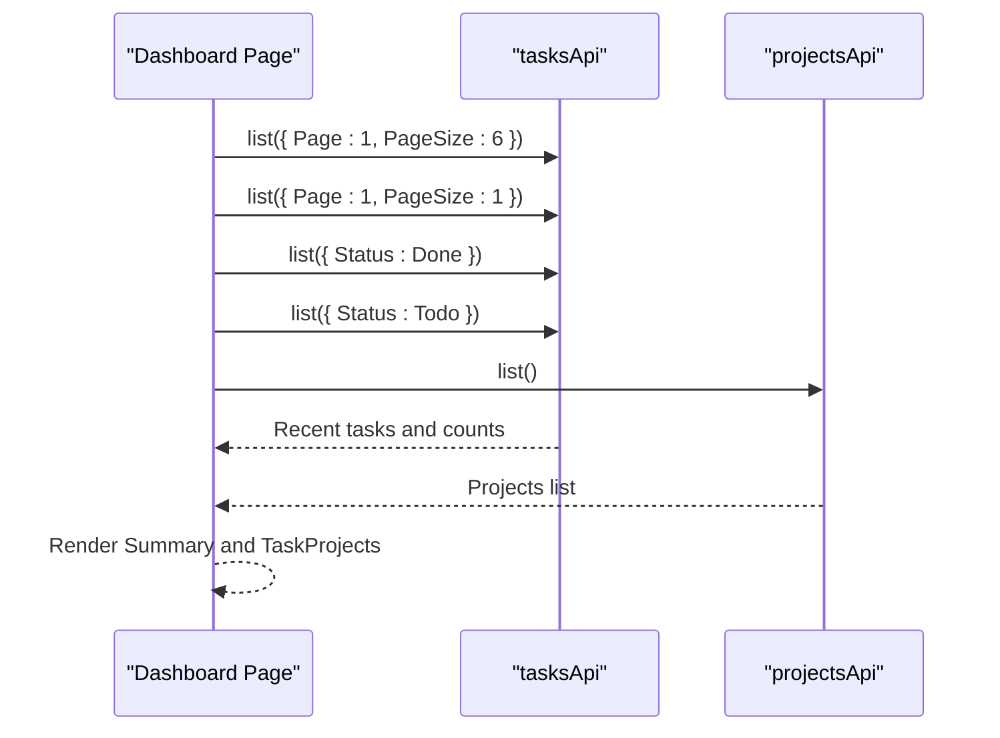
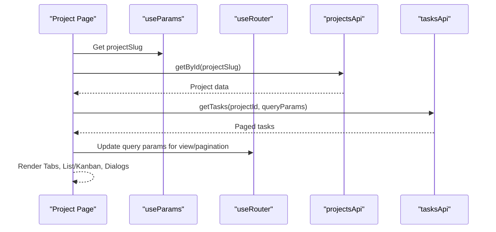
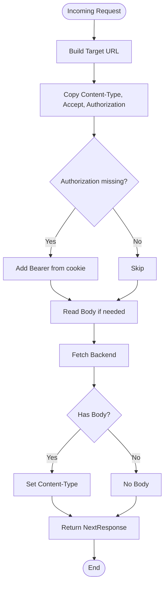
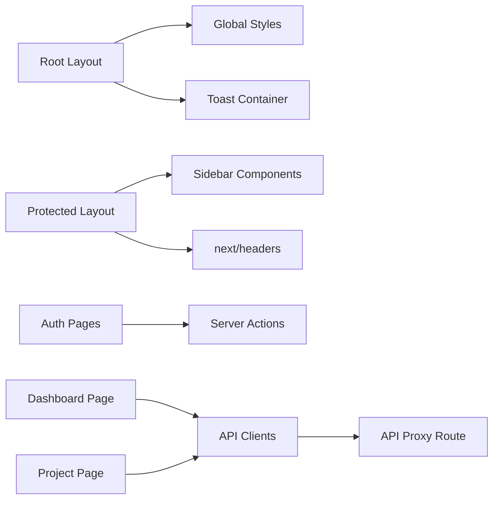

# Next.js Application Structure

<cite>
**Referenced Files in This Document**
- [next.config.ts](file://Apps/Web/next.config.ts)
- [layout.tsx](file://Apps/Web/src/app/layout.tsx)
- [globals.css](file://Apps/Web/src/app/globals.css)
- [protected layout.tsx](file://Apps/Web/src/app/(protected)/layout.tsx)
- [auth login page.tsx](file://Apps/Web/src/app/(auth)/login/page.tsx)
- [auth register page.tsx](file://Apps/Web/src/app/(auth)/register/page.tsx)
- [protected dashboard page.tsx](file://Apps/Web/src/app/(protected)/page.tsx)
- [dynamic project page.tsx](file://Apps/Web/src/app/(protected)/projects/[projectSlug]/page.tsx)
- [API proxy route.ts](file://Apps/Web/src/app/api/[...path]/route.ts)
- [package.json](file://Apps/Web/package.json)
</cite>

## Table of Contents
1. [Introduction](#introduction)
2. [Project Structure](#project-structure)
3. [Core Components](#core-components)
4. [Architecture Overview](#architecture-overview)
5. [Detailed Component Analysis](#detailed-component-analysis)
6. [Dependency Analysis](#dependency-analysis)
7. [Performance Considerations](#performance-considerations)
8. [Troubleshooting Guide](#troubleshooting-guide)
9. [Conclusion](#conclusion)

## Introduction
This document explains the Next.js application structure for the TaskFlow web app. It covers the App Router organization, route groups, server vs client component strategy, layout hierarchy, root layout configuration, global styles and metadata, routing patterns including dynamic routes and API proxying, build configuration with Tailwind CSS, and performance and SEO considerations.

## Project Structure
The frontend is located under Apps/Web and uses the Next.js App Router:

- src/app contains the application shell, layouts, pages, and API routes.
- Route groups (auth) and (protected) organize authentication-related pages and authenticated features without affecting URLs.
- Dynamic routes are implemented using folder parameters like [projectSlug].
- API proxying is centralized under api/[...path] to forward requests to a backend service.

**Diagram sources**
- [layout.tsx:1-45](file://Apps/Web/src/app/layout.tsx#L1-L45)
- [protected layout.tsx:1-49](file://Apps/Web/src/app/(protected)/layout.tsx#L1-L49)
- [auth login page.tsx:1-119](file://Apps/Web/src/app/(auth)/login/page.tsx#L1-L119)
- [auth register page.tsx:1-140](file://Apps/Web/src/app/(auth)/register/page.tsx#L1-L140)
- [protected dashboard page.tsx:1-77](file://Apps/Web/src/app/(protected)/page.tsx#L1-L77)
- [dynamic project page.tsx:1-327](file://Apps/Web/src/app/(protected)/projects/[projectSlug]/page.tsx#L1-L327)
- [API proxy route.ts:1-77](file://Apps/Web/src/app/api/[...path]/route.ts#L1-L77)

**Section sources**
- [layout.tsx:1-45](file://Apps/Web/src/app/layout.tsx#L1-L45)
- [protected layout.tsx:1-49](file://Apps/Web/src/app/(protected)/layout.tsx#L1-L49)
- [auth login page.tsx:1-119](file://Apps/Web/src/app/(auth)/login/page.tsx#L1-L119)
- [auth register page.tsx:1-140](file://Apps/Web/src/app/(auth)/register/page.tsx#L1-L140)
- [protected dashboard page.tsx:1-77](file://Apps/Web/src/app/(protected)/page.tsx#L1-L77)
- [dynamic project page.tsx:1-327](file://Apps/Web/src/app/(protected)/projects/[projectSlug]/page.tsx#L1-L327)
- [API proxy route.ts:1-77](file://Apps/Web/src/app/api/[...path]/route.ts#L1-L77)

## Core Components
- Root layout defines global HTML structure, fonts, metadata, and theme class.
- Global styles import Tailwind CSS and define design tokens for light and dark themes.
- Protected layout provides an authenticated sidebar and header shell around protected routes.
- Authentication pages are client components that integrate form actions for login and registration.
- The dashboard page fetches tasks and projects on the client and renders summary and lists.
- The dynamic project page manages project details, task views, and CRUD operations via API calls.
- The API proxy route forwards requests to the backend service, attaching authorization headers from cookies when present.

**Section sources**
- [layout.tsx:1-45](file://Apps/Web/src/app/layout.tsx#L1-L45)
- [globals.css:1-158](file://Apps/Web/src/app/globals.css#L1-L158)
- [protected layout.tsx:1-49](file://Apps/Web/src/app/(protected)/layout.tsx#L1-L49)
- [auth login page.tsx:1-119](file://Apps/Web/src/app/(auth)/login/page.tsx#L1-L119)
- [auth register page.tsx:1-140](file://Apps/Web/src/app/(auth)/register/page.tsx#L1-L140)
- [protected dashboard page.tsx:1-77](file://Apps/Web/src/app/(protected)/page.tsx#L1-L77)
- [dynamic project page.tsx:1-327](file://Apps/Web/src/app/(protected)/projects/[projectSlug]/page.tsx#L1-L327)
- [API proxy route.ts:1-77](file://Apps/Web/src/app/api/[...path]/route.ts#L1-L77)

## Architecture Overview
The application follows a layered approach:
- Presentation layer: React components and Next.js pages.
- Routing layer: App Router with route groups and dynamic segments.
- Data layer: Client-side API clients calling the Next.js API proxy, which forwards to the backend service.

[No sources needed since this diagram shows conceptual workflow, not actual code structure]

## Detailed Component Analysis

### Root Layout and Metadata
- Defines global metadata such as title and description.
- Configures Google fonts and applies font variables to the html element.
- Imports global CSS and includes a toast container.
- Sets language and base classes for theming and accessibility.

**Diagram sources**
- [layout.tsx:1-45](file://Apps/Web/src/app/layout.tsx#L1-L45)

**Section sources**
- [layout.tsx:1-45](file://Apps/Web/src/app/layout.tsx#L1-L45)

### Global Styles and Tailwind CSS Integration
- Imports Tailwind CSS and animation utilities.
- Declares custom variants and theme tokens for colors, radii, and typography.
- Provides light and dark color palettes via CSS variables.
- Applies base styles for borders, body background, and default font.

**Diagram sources**
- [globals.css:1-158](file://Apps/Web/src/app/globals.css#L1-L158)

**Section sources**
- [globals.css:1-158](file://Apps/Web/src/app/globals.css#L1-L158)

### Protected Layout and Sidebar Shell
- Wraps protected routes with a sidebar provider and inset content area.
- Reads the auth token cookie on the server and decodes claims to display user info.
- Uses Suspense to handle asynchronous data fetching for the sidebar.
- Renders a header with a sidebar trigger and separator.

**Diagram sources**
- [protected layout.tsx:1-49](file://Apps/Web/src/app/(protected)/layout.tsx#L1-L49)

**Section sources**
- [protected layout.tsx:1-49](file://Apps/Web/src/app/(protected)/layout.tsx#L1-L49)

### Authentication Pages Strategy
- Both login and register pages are client components marked with "use client".
- They use React Server Actions through useActionState to submit forms.
- They render UI cards, input fields, and social login buttons.
- Error states are displayed via alert elements and action state.

**Diagram sources**
- [auth login page.tsx:1-119](file://Apps/Web/src/app/(auth)/login/page.tsx#L1-L119)
- [auth register page.tsx:1-140](file://Apps/Web/src/app/(auth)/register/page.tsx#L1-L140)

**Section sources**
- [auth login page.tsx:1-119](file://Apps/Web/src/app/(auth)/login/page.tsx#L1-L119)
- [auth register page.tsx:1-140](file://Apps/Web/src/app/(auth)/register/page.tsx#L1-L140)

### Protected Dashboard Page
- Client component that fetches recent tasks, counts, and projects concurrently.
- Displays summary and task/project sections with loading and error states.
- Uses a custom ApiError type to surface meaningful messages.

**Diagram sources**
- [protected dashboard page.tsx:1-77](file://Apps/Web/src/app/(protected)/page.tsx#L1-L77)

**Section sources**
- [protected dashboard page.tsx:1-77](file://Apps/Web/src/app/(protected)/page.tsx#L1-L77)

### Dynamic Project Page
- Client component wrapped in Suspense to isolate streaming boundaries.
- Reads URL params and search query to manage view mode and pagination.
- Fetches project details and paginated tasks; updates local state on mutations.
- Provides edit/delete dialogs and task creation/editing flows.

**Diagram sources**
- [dynamic project page.tsx:1-327](file://Apps/Web/src/app/(protected)/projects/[projectSlug]/page.tsx#L1-L327)

**Section sources**
- [dynamic project page.tsx:1-327](file://Apps/Web/src/app/(protected)/projects/[projectSlug]/page.tsx#L1-L327)

### API Proxy Route
- Proxies all HTTP methods to the backend service based on env variable or default URL.
- Forwards Authorization header from request or cookie, preserving content-type and accept headers.
- Handles null-body responses and returns appropriate status codes and headers.
- Logs errors and returns a generic server error response.

**Diagram sources**
- [API proxy route.ts:1-77](file://Apps/Web/src/app/api/[...path]/route.ts#L1-L77)

**Section sources**
- [API proxy route.ts:1-77](file://Apps/Web/src/app/api/[...path]/route.ts#L1-L77)

## Dependency Analysis
- The root layout depends on global CSS and UI toast component.
- Protected layout depends on sidebar components and next/headers for cookies.
- Authentication pages depend on server actions and UI primitives.
- Dashboard and project pages depend on API clients and UI components.
- API proxy route depends on environment variables and Next.js runtime APIs.

**Diagram sources**
- [layout.tsx:1-45](file://Apps/Web/src/app/layout.tsx#L1-L45)
- [globals.css:1-158](file://Apps/Web/src/app/globals.css#L1-L158)
- [protected layout.tsx:1-49](file://Apps/Web/src/app/(protected)/layout.tsx#L1-L49)
- [auth login page.tsx:1-119](file://Apps/Web/src/app/(auth)/login/page.tsx#L1-L119)
- [auth register page.tsx:1-140](file://Apps/Web/src/app/(auth)/register/page.tsx#L1-L140)
- [protected dashboard page.tsx:1-77](file://Apps/Web/src/app/(protected)/page.tsx#L1-L77)
- [dynamic project page.tsx:1-327](file://Apps/Web/src/app/(protected)/projects/[projectSlug]/page.tsx#L1-L327)
- [API proxy route.ts:1-77](file://Apps/Web/src/app/api/[...path]/route.ts#L1-L77)

**Section sources**
- [layout.tsx:1-45](file://Apps/Web/src/app/layout.tsx#L1-L45)
- [globals.css:1-158](file://Apps/Web/src/app/globals.css#L1-L158)
- [protected layout.tsx:1-49](file://Apps/Web/src/app/(protected)/layout.tsx#L1-L49)
- [auth login page.tsx:1-119](file://Apps/Web/src/app/(auth)/login/page.tsx#L1-L119)
- [auth register page.tsx:1-140](file://Apps/Web/src/app/(auth)/register/page.tsx#L1-L140)
- [protected dashboard page.tsx:1-77](file://Apps/Web/src/app/(protected)/page.tsx#L1-L77)
- [dynamic project page.tsx:1-327](file://Apps/Web/src/app/(protected)/projects/[projectSlug]/page.tsx#L1-L327)
- [API proxy route.ts:1-77](file://Apps/Web/src/app/api/[...path]/route.ts#L1-L77)

## Performance Considerations
- Build configuration enables component caching and partial prefetching to improve navigation and rendering performance.
- Turbopack integration is configured for CSS processing via @tailwindcss/turbopack, accelerating development builds.
- Tailwind CSS v4 is used with PostCSS-based pipeline; ensure PostCSS configuration exists at the project root for optimal processing.
- Client components are used where interactivity is required; keep server components for static or data-heavy rendering to reduce bundle size.
- Image optimization: configure next/image domains and sizes in next.config.ts when integrating images to leverage automatic optimization and responsive delivery.
- Static generation strategies: prefer server components and server actions for data fetching; use generateStaticParams for known dynamic routes to pre-render pages at build time.

**Section sources**
- [next.config.ts:1-18](file://Apps/Web/next.config.ts#L1-L18)
- [package.json:1-45](file://Apps/Web/package.json#L1-L45)

## Troubleshooting Guide
- API proxy errors: check console logs for proxy errors and verify the backend URL and CORS settings. Ensure the Authorization header is correctly forwarded from cookies.
- Authentication flow: confirm that the auth_token cookie is set after login and that the protected layout can decode it. Validate that server actions return proper error states.
- Styling issues: verify Tailwind imports and theme tokens in globals.css. Ensure the dark class is applied on the html element for dark mode.
- Hydration warnings: review suppressHydrationWarning usage and ensure consistent rendering between server and client.

**Section sources**
- [API proxy route.ts:1-77](file://Apps/Web/src/app/api/[...path]/route.ts#L1-L77)
- [protected layout.tsx:1-49](file://Apps/Web/src/app/(protected)/layout.tsx#L1-L49)
- [auth login page.tsx:1-119](file://Apps/Web/src/app/(auth)/login/page.tsx#L1-L119)
- [auth register page.tsx:1-140](file://Apps/Web/src/app/(auth)/register/page.tsx#L1-L140)
- [globals.css:1-158](file://Apps/Web/src/app/globals.css#L1-L158)

## Conclusion
The TaskFlow Next.js application leverages the App Router with clear route groups, a robust root layout, and a protected layout providing an authenticated sidebar. Client components handle interactive features while server components and server actions support efficient data handling. The API proxy centralizes backend communication, and Tailwind CSS v4 with Turbopack accelerates styling workflows. For production readiness, consider adding image optimization, static generation for known routes, and comprehensive SEO metadata across pages.