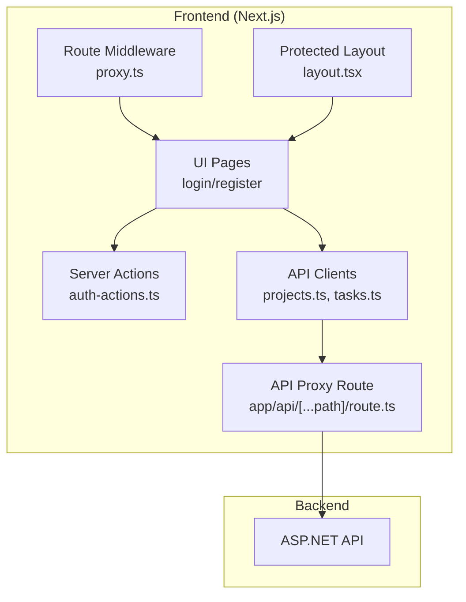
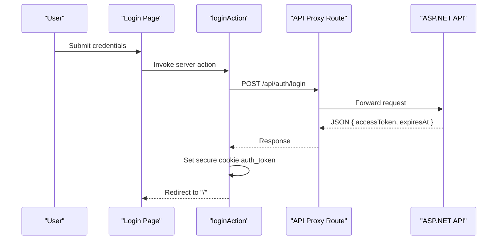
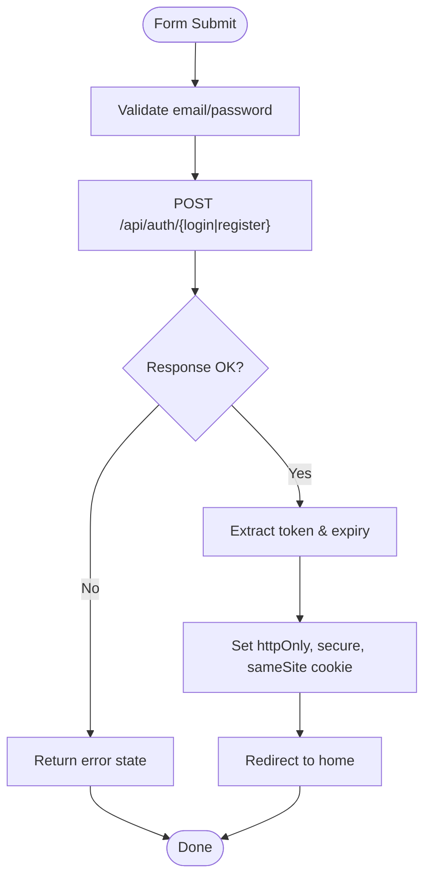
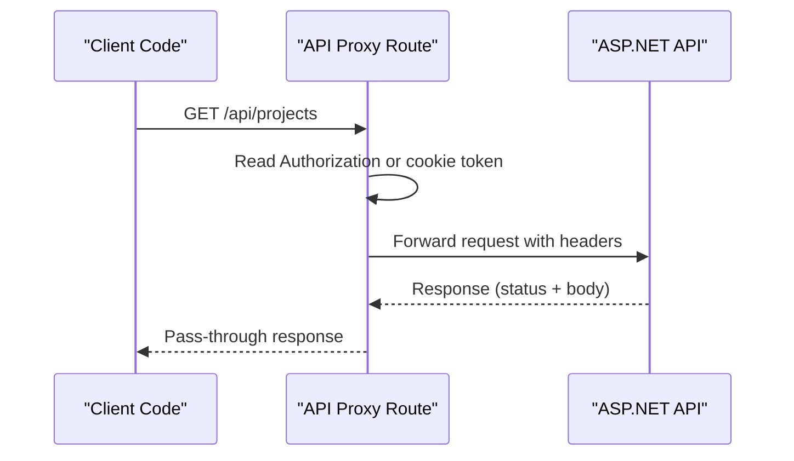
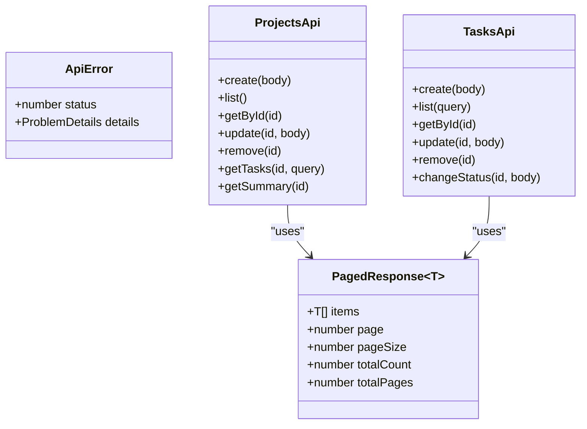
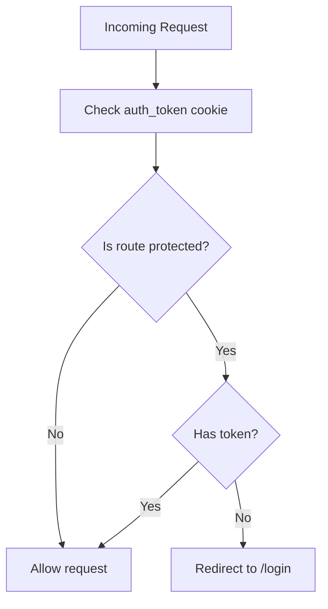
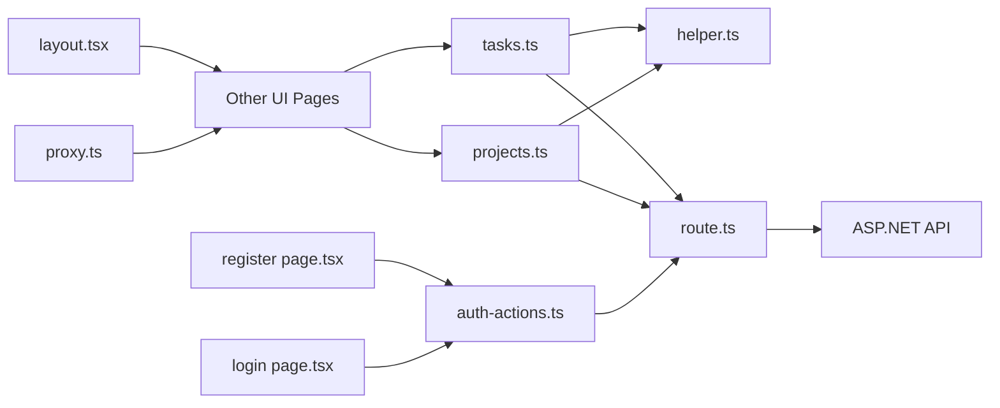

# State Management and API Communication

<cite>
**Referenced Files in This Document**
- [proxy.ts](file://Apps/Web/src/proxy.ts)
- [auth-actions.ts](file://Apps/Web/src/actions/auth-actions.ts)
- [route.ts](file://Apps/Web/src/app/api/[...path]/route.ts)
- [helper.ts](file://Apps/Web/src/lib/api/helper.ts)
- [projects.ts](file://Apps/Web/src/lib/api/projects.ts)
- [tasks.ts](file://Apps/Web/src/lib/api/tasks.ts)
- [layout.tsx](file://Apps/Web/src/app/(protected)/layout.tsx)
- [login page.tsx](file://Apps/Web/src/app/(auth)/login/page.tsx)
- [register page.tsx](file://Apps/Web/src/app/(auth)/register/page.tsx)
- [next.config.ts](file://Apps/Web/next.config.ts)
</cite>

## Table of Contents
1. [Introduction](#introduction)
2. [Project Structure](#project-structure)
3. [Core Components](#core-components)
4. [Architecture Overview](#architecture-overview)
5. [Detailed Component Analysis](#detailed-component-analysis)
6. [Dependency Analysis](#dependency-analysis)
7. [Performance Considerations](#performance-considerations)
8. [Troubleshooting Guide](#troubleshooting-guide)
9. [Conclusion](#conclusion)

## Introduction
This document explains the frontend state management and API communication patterns for the TaskFlow web application. It covers:
- Proxy configuration for API calls via Next.js API routes
- Authentication actions implementation using server actions
- Client-side data access patterns through typed API clients
- Request/response handling, error management, and security considerations
- Guidelines for consistent API communication across components

## Project Structure
The frontend is a Next.js application with:
- Server actions for authentication flows
- A generic API proxy route that forwards requests to the backend
- Typed API client modules for projects and tasks
- Route-level middleware for protecting routes based on cookies
- Protected layout that reads token claims to render user context

**Diagram sources**
- [auth-actions.ts:21-43](file://Apps/Web/src/actions/auth-actions.ts#L21-L43)
- [route.ts:7-31](file://Apps/Web/src/app/api/[...path]/route.ts#L7-L31)
- [projects.ts:58-108](file://Apps/Web/src/lib/api/projects.ts#L58-L108)
- [tasks.ts:88-131](file://Apps/Web/src/lib/api/tasks.ts#L88-L131)
- [proxy.ts:6-26](file://Apps/Web/src/proxy.ts#L6-L26)
- [layout.tsx:7-25](file://Apps/Web/src/app/(protected)/layout.tsx#L7-L25)

**Section sources**
- [proxy.ts:6-26](file://Apps/Web/src/proxy.ts#L6-L26)
- [auth-actions.ts:21-43](file://Apps/Web/src/actions/auth-actions.ts#L21-L43)
- [route.ts:7-31](file://Apps/Web/src/app/api/[...path]/route.ts#L7-L31)
- [projects.ts:58-108](file://Apps/Web/src/lib/api/projects.ts#L58-L108)
- [tasks.ts:88-131](file://Apps/Web/src/lib/api/tasks.ts#L88-L131)
- [layout.tsx:7-25](file://Apps/Web/src/app/(protected)/layout.tsx#L7-L25)

## Core Components
- Authentication server actions: handle login/signup, set secure cookies, and redirect.
- API proxy route: forwards authenticated requests to the backend, injecting Authorization headers from cookies when needed.
- API client helpers: typed fetch wrapper with standardized error handling and PagedResponse support.
- Domain API clients: projects and tasks modules encapsulating endpoints and types.
- Route middleware: protects routes by checking auth_token cookie presence.
- Protected layout: decodes JWT payload to display user info in the sidebar.

**Section sources**
- [auth-actions.ts:21-43](file://Apps/Web/src/actions/auth-actions.ts#L21-L43)
- [route.ts:18-31](file://Apps/Web/src/app/api/[...path]/route.ts#L18-L31)
- [helper.ts:28-66](file://Apps/Web/src/lib/api/helper.ts#L28-L66)
- [projects.ts:58-108](file://Apps/Web/src/lib/api/projects.ts#L58-L108)
- [tasks.ts:88-131](file://Apps/Web/src/lib/api/tasks.ts#L88-L131)
- [proxy.ts:6-26](file://Apps/Web/src/proxy.ts#L6-L26)
- [layout.tsx:7-25](file://Apps/Web/src/app/(protected)/layout.tsx#L7-L25)

## Architecture Overview
The frontend uses a layered approach:
- UI pages trigger server actions or call typed API clients.
- Server actions perform authentication and manage cookies.
- API clients use a shared helper to make requests via the Next.js API proxy.
- The API proxy forwards requests to the backend, attaching Bearer tokens from cookies.
- Route middleware enforces authentication at the route level.

**Diagram sources**
- [login page.tsx:21-23](file://Apps/Web/src/app/(auth)/login/page.tsx#L21-L23)
- [auth-actions.ts:45-116](file://Apps/Web/src/actions/auth-actions.ts#L45-L116)
- [route.ts:9-69](file://Apps/Web/src/app/api/[...path]/route.ts#L9-L69)

## Detailed Component Analysis

### Authentication Flow and Cookie Management
- Server actions validate inputs, call the backend, parse tokens, and set httpOnly, secure (in production), sameSite cookies.
- Login and signup actions normalize multiple possible token field names and expiration fields.
- Logout clears the cookie and redirects to login.
- getAuthToken provides a utility to read the current token from cookies.

**Diagram sources**
- [auth-actions.ts:45-116](file://Apps/Web/src/actions/auth-actions.ts#L45-L116)
- [auth-actions.ts:118-198](file://Apps/Web/src/actions/auth-actions.ts#L118-L198)
- [auth-actions.ts:200-209](file://Apps/Web/src/actions/auth-actions.ts#L200-L209)

**Section sources**
- [auth-actions.ts:21-43](file://Apps/Web/src/actions/auth-actions.ts#L21-L43)
- [auth-actions.ts:45-116](file://Apps/Web/src/actions/auth-actions.ts#L45-L116)
- [auth-actions.ts:118-198](file://Apps/Web/src/actions/auth-actions.ts#L118-L198)
- [auth-actions.ts:200-209](file://Apps/Web/src/actions/auth-actions.ts#L200-L209)

### API Proxy Route Pattern
- The catch-all route proxies all HTTP methods to the backend.
- It forwards content-type, accept, and authorization headers.
- If no Authorization header is present, it injects Bearer token from the auth_token cookie.
- It handles null-body responses and returns appropriate status codes and content-types.

**Diagram sources**
- [route.ts:9-69](file://Apps/Web/src/app/api/[...path]/route.ts#L9-L69)

**Section sources**
- [route.ts:7-31](file://Apps/Web/src/app/api/[...path]/route.ts#L7-L31)
- [route.ts:36-69](file://Apps/Web/src/app/api/[...path]/route.ts#L36-L69)

### Client-Side API Clients and Error Handling
- apiFetch sets Accept and Content-Type headers, disables caching, and throws ApiError with details for non-OK responses.
- PagedResponse<T> standardizes pagination payloads.
- projectsApi and tasksApi provide strongly-typed methods for each endpoint, including query parameter building.

**Diagram sources**
- [helper.ts:1-66](file://Apps/Web/src/lib/api/helper.ts#L1-L66)
- [projects.ts:10-108](file://Apps/Web/src/lib/api/projects.ts#L10-L108)
- [tasks.ts:10-131](file://Apps/Web/src/lib/api/tasks.ts#L10-L131)

**Section sources**
- [helper.ts:1-66](file://Apps/Web/src/lib/api/helper.ts#L1-L66)
- [projects.ts:58-108](file://Apps/Web/src/lib/api/projects.ts#L58-L108)
- [tasks.ts:88-131](file://Apps/Web/src/lib/api/tasks.ts#L88-L131)

### Route Protection and Protected Layout
- Route middleware checks for auth_token cookie and redirects unauthenticated users away from protected routes; also prevents already-authenticated users from accessing login/register.
- Protected layout reads the token cookie and decodes the base64url payload to extract email/name for the sidebar.

**Diagram sources**
- [proxy.ts:6-26](file://Apps/Web/src/proxy.ts#L6-L26)

**Section sources**
- [proxy.ts:6-26](file://Apps/Web/src/proxy.ts#L6-L26)
- [layout.tsx:7-25](file://Apps/Web/src/app/(protected)/layout.tsx#L7-L25)

### Data Fetching Patterns and Caching Strategy
- All client-side API calls go through apiFetch with cache: "no-store", ensuring fresh data per request.
- Pagination is handled via PagedResponse and query parameters in both tasks and projects clients.
- No explicit client-side caching layer is implemented; consider adding React Query or SWR for caching and background updates if needed.

**Section sources**
- [helper.ts:28-66](file://Apps/Web/src/lib/api/helper.ts#L28-L66)
- [projects.ts:87-107](file://Apps/Web/src/lib/api/projects.ts#L87-L107)
- [tasks.ts:94-107](file://Apps/Web/src/lib/api/tasks.ts#L94-L107)

### Real-Time Updates
- There are no real-time mechanisms (e.g., WebSockets or SSE) in the current frontend code.
- For real-time task/project updates, consider integrating WebSockets or Server-Sent Events and updating local state accordingly.

[No sources needed since this section does not analyze specific files]

## Dependency Analysis
The following diagram shows how components depend on each other for API communication and authentication.

**Diagram sources**
- [login page.tsx:21-23](file://Apps/Web/src/app/(auth)/login/page.tsx#L21-L23)
- [register page.tsx:21-24](file://Apps/Web/src/app/(auth)/register/page.tsx#L21-L24)
- [auth-actions.ts:45-116](file://Apps/Web/src/actions/auth-actions.ts#L45-L116)
- [projects.ts:58-108](file://Apps/Web/src/lib/api/projects.ts#L58-L108)
- [tasks.ts:88-131](file://Apps/Web/src/lib/api/tasks.ts#L88-L131)
- [helper.ts:28-66](file://Apps/Web/src/lib/api/helper.ts#L28-L66)
- [route.ts:9-69](file://Apps/Web/src/app/api/[...path]/route.ts#L9-L69)
- [proxy.ts:6-26](file://Apps/Web/src/proxy.ts#L6-L26)
- [layout.tsx:7-25](file://Apps/Web/src/app/(protected)/layout.tsx#L7-L25)

**Section sources**
- [auth-actions.ts:45-116](file://Apps/Web/src/actions/auth-actions.ts#L45-L116)
- [projects.ts:58-108](file://Apps/Web/src/lib/api/projects.ts#L58-L108)
- [tasks.ts:88-131](file://Apps/Web/src/lib/api/tasks.ts#L88-L131)
- [helper.ts:28-66](file://Apps/Web/src/lib/api/helper.ts#L28-L66)
- [route.ts:9-69](file://Apps/Web/src/app/api/[...path]/route.ts#L9-L69)
- [proxy.ts:6-26](file://Apps/Web/src/proxy.ts#L6-L26)
- [layout.tsx:7-25](file://Apps/Web/src/app/(protected)/layout.tsx#L7-L25)

## Performance Considerations
- apiFetch disables browser caching with cache: "no-store". This ensures freshness but may increase network load.
- Consider introducing a client-side cache (React Query/SWR) to reduce redundant requests and enable optimistic updates.
- The Next.js config enables component caching and partial prefetching, which can improve rendering performance.

**Section sources**
- [helper.ts:35-39](file://Apps/Web/src/lib/api/helper.ts#L35-L39)
- [next.config.ts:3-15](file://Apps/Web/next.config.ts#L3-L15)

## Troubleshooting Guide
Common issues and resolutions:
- CORS errors: Ensure the backend allows the frontend origin and necessary headers/methods. The proxy forwards headers but cannot bypass CORS policy enforced by the backend.
- Token not sent: Verify that the auth_token cookie is present and accessible. The proxy injects Authorization only when the cookie exists.
- Invalid token or expired session: The backend will return an error; ensure logout clears stale cookies and redirects appropriately.
- Development TLS warnings: In development, self-signed certificates are allowed by setting NODE_TLS_REJECT_UNAUTHORIZED.

**Section sources**
- [route.ts:18-31](file://Apps/Web/src/app/api/[...path]/route.ts#L18-L31)
- [auth-actions.ts:6-9](file://Apps/Web/src/actions/auth-actions.ts#L6-L9)
- [auth-actions.ts:200-209](file://Apps/Web/src/actions/auth-actions.ts#L200-L209)

## Conclusion
The frontend implements a clear separation between UI, server actions, and typed API clients, with a robust proxy route handling authentication and forwarding requests. Security is enforced via httpOnly cookies and route-level protection. Consistent API patterns are provided through helper utilities and domain-specific clients. To scale further, introduce client-side caching and real-time capabilities while maintaining the established patterns.