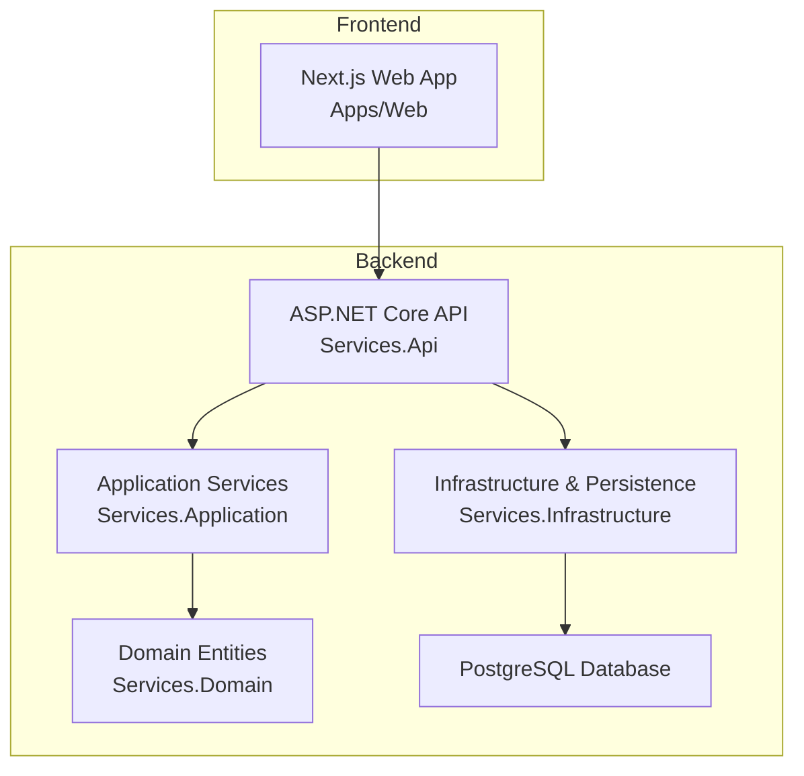
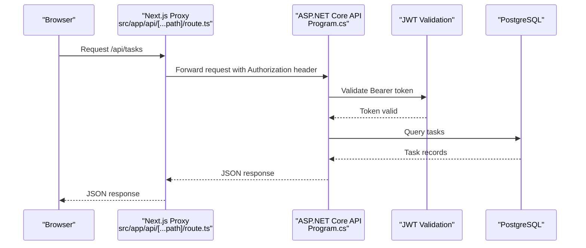

# Getting Started

<cite>
**Referenced Files in This Document**
- [README.md](file://README.md)
- [Apps/Web/README.md](file://Apps/Web/README.md)
- [Services/README.md](file://Services/README.md)
- [package.json](file://Apps/Web/package.json)
- [next.config.ts](file://Apps/Web/next.config.ts)
- [Program.cs](file://Services/Services.Api/Program.cs)
- [AppDbContext.cs](file://Services/Services.Infrastructure/Persistence/AppDbContext.cs)
- [JwtOptions.cs](file://Services/Services.Infrastructure/Identity/JwtOptions.cs)
- [appsettings.Example.json](file://Services/Services.Api/appsettings.Example.json)
</cite>

## Table of Contents
1. [Introduction](#introduction)
2. [Project Structure](#project-structure)
3. [Core Components](#core-components)
4. [Architecture Overview](#architecture-overview)
5. [Prerequisites](#prerequisites)
6. [Installation and Setup](#installation-and-setup)
7. [Environment Configuration](#environment-configuration)
8. [Database Setup](#database-setup)
9. [Running the Application](#running-the-application)
10. [Verification](#verification)
11. [Troubleshooting](#troubleshooting)
12. [Conclusion](#conclusion)

## Introduction
TaskFlow is a full-stack task and project management application with a Next.js frontend and an ASP.NET Core backend. It provides user authentication, project management, and task tracking features. The system uses PostgreSQL for data storage and JWT-based authentication to secure API access.

Key capabilities include:
- User registration and login using email and password.
- Creating, reading, updating, deleting, and duplicating tasks.
- Managing projects and viewing project summaries.
- Searching, filtering, sorting, and paginating tasks.
- A dashboard and dedicated pages for tasks and projects.

The repository includes both the web application and the API service, along with configuration examples and documentation for local development.

**Section sources**
- [README.md:1-11](file://README.md#L1-L11)
- [Services/README.md:1-11](file://Services/README.md#L1-L11)

## Project Structure
The repository is organized into two main parts:
- `Services/`: ASP.NET Core API solution containing controllers, application services, domain entities, infrastructure, and database migrations.
- `Apps/Web/`: Next.js 16 web application providing the user interface and consuming the API.

**Diagram sources**
- [README.md:13-28](file://README.md#L13-L28)
- [Services/README.md:5-11](file://Services/README.md#L5-L11)

**Section sources**
- [README.md:13-28](file://README.md#L13-L28)
- [Services/README.md:5-11](file://Services/README.md#L5-L11)

## Core Components
- Frontend (Next.js 16): Provides routes for login, register, dashboard, my-tasks, projects, and project details. It communicates with the API through a proxy route and stores the JWT in an HttpOnly cookie.
- Backend (ASP.NET Core 10): Exposes REST endpoints for authentication, tasks, and projects. Uses Entity Framework Core with PostgreSQL and validates JWT tokens.
- Authentication: Uses ASP.NET Core Identity and JWT. Registration and login return an access token and expiration time. Protected endpoints require a Bearer token.
- Data Layer: Entity Framework Core models for users, tasks, and projects are configured in the context and persisted to PostgreSQL.

**Section sources**
- [Apps/Web/README.md:5-14](file://Apps/Web/README.md#L5-L14)
- [Apps/Web/README.md:39-44](file://Apps/Web/README.md#L39-L44)
- [Services/README.md:57-94](file://Services/README.md#L57-L94)
- [AppDbContext.cs:10-23](file://Services/Services.Infrastructure/Persistence/AppDbContext.cs#L10-L23)

## Architecture Overview
The frontend runs on Next.js and proxies requests to the backend API. The backend configures OpenAPI and Scalar in development, applies authentication and authorization middleware, and maps controllers. The database layer uses EF Core with configurations for tasks and projects.

**Diagram sources**
- [Apps/Web/README.md:39-44](file://Apps/Web/README.md#L39-L44)
- [Program.cs:20-37](file://Services/Services.Api/Program.cs#L20-L37)

## Prerequisites
Before starting, ensure you have the following installed:
- .NET 10 SDK
- PostgreSQL server accessible locally or remotely
- Node.js compatible with Next.js 16 (minimum version 20.9.0)
- pnpm package manager (the web project declares pnpm@12.21.0)

For the backend, also install the EF Core CLI tool if it is not already available globally.

**Section sources**
- [README.md:30-35](file://README.md#L30-L35)
- [Services/README.md:13-21](file://Services/README.md#L13-L21)
- [Apps/Web/README.md:15-18](file://Apps/Web/README.md#L15-L18)
- [package.json:43-43](file://Apps/Web/package.json#L43-L43)

## Installation and Setup
Follow these steps to set up TaskFlow locally:

1. Clone the repository and navigate to the root directory.
2. Install backend dependencies and restore the solution.
3. Configure environment variables and secrets for the API.
4. Set up the PostgreSQL database and apply migrations.
5. Start the API server.
6. Install frontend dependencies and start the Next.js development server.

Commands overview:
- Restore and build the backend solution.
- Apply EF Core migrations.
- Run the API with the HTTPS launch profile.
- Install and run the web app with pnpm.

**Section sources**
- [README.md:36-75](file://README.md#L36-L75)
- [Services/README.md:37-53](file://Services/README.md#L37-L53)
- [Apps/Web/README.md:20-35](file://Apps/Web/README.md#L20-L35)

## Environment Configuration
Configure the API securely before running it:

- Use User Secrets for development values such as connection strings and JWT settings.
- Replace placeholders with your actual PostgreSQL credentials and a Base64-encoded secret key of at least 32 bytes.
- Optionally configure environment variables with double underscores for nested keys.
- Do not commit real secrets; use the example file only as a template.

Example configuration structure:
- ConnectionStrings:DefaultConnection
- Jwt:Issuer
- Jwt:Audience
- Jwt:SecretKey
- Jwt:ExpirationMinutes

The example file shows the expected shape but is not loaded automatically.

**Section sources**
- [README.md:38-50](file://README.md#L38-L50)
- [Services/README.md:23-35](file://Services/README.md#L23-L35)
- [appsettings.Example.json:9-16](file://Services/Services.Api/appsettings.Example.json#L9-L16)
- [JwtOptions.cs:3-13](file://Services/Services.Infrastructure/Identity/JwtOptions.cs#L3-L13)

## Database Setup
Ensure PostgreSQL is running and accessible. Create a database named `TaskFlow` (or adjust the connection string accordingly). Make sure the configured user has permissions to create and update database objects via EF Core migrations.

Apply migrations from the solution root:
- Restore the solution.
- Update the database using the Infrastructure project and the Api startup project.
- Specify the Development environment when applying migrations.

After migrations succeed, the schema for users, tasks, and projects will be created.

**Section sources**
- [README.md:52-60](file://README.md#L52-L60)
- [Services/README.md:37-45](file://Services/README.md#L37-L45)
- [AppDbContext.cs:10-23](file://Services/Services.Infrastructure/Persistence/AppDbContext.cs#L10-L23)

## Running the Application
Start the backend and frontend in separate terminal sessions:

Backend:
- Restore dependencies.
- Apply migrations.
- Run the API with the HTTPS launch profile.

Frontend:
- Install dependencies with pnpm.
- Start the development server.
- Access the web app at the default URL.

If the API address differs from the default, configure the frontend environment variable `API_BASE_URL` to point to the correct base path including `/api`.

**Section sources**
- [README.md:52-75](file://README.md#L52-L75)
- [Services/README.md:37-47](file://Services/README.md#L37-L47)
- [Apps/Web/README.md:20-37](file://Apps/Web/README.md#L20-L37)

## Verification
Verify that both layers are working correctly:

- Build the backend solution to confirm compilation succeeds.
- Check the API documentation endpoints in development:
  - Scalar UI at `/scalar/v1`
  - OpenAPI JSON at `/openapi/v1.json`
- Test authentication by registering or logging in and confirming that protected endpoints require a Bearer token.
- Confirm the frontend loads and can call the API through the proxy route.

Note: There are no test projects configured in the solution, and the web app does not currently include a test script.

**Section sources**
- [README.md:77-79](file://README.md#L77-L79)
- [Services/README.md:47-55](file://Services/README.md#L47-L55)
- [Program.cs:23-28](file://Services/Services.Api/Program.cs#L23-L28)

## Troubleshooting
Common setup issues and resolutions:

- Missing EF Core CLI tool:
  - Install the global tool matching the current packages.
  - Ensure it is available in PATH.

- Incorrect or missing secrets:
  - Verify User Secrets contain valid connection strings and JWT settings.
  - Ensure the JWT secret is Base64-encoded and at least 32 bytes.
  - Confirm issuer, audience, and expiration minutes are set appropriately.

- Database connectivity problems:
  - Confirm PostgreSQL is running and reachable.
  - Validate username, password, host, port, and database name in the connection string.
  - Ensure the user has permission to create or update the database.

- Frontend cannot reach the API:
  - Set `API_BASE_URL` to the correct API base path including `/api`.
  - Restart the Next.js dev server after changing environment variables.
  - In development, TLS verification may be disabled for local certificates; do not disable TLS validation in production.

- Authentication failures:
  - Ensure the token is present in the Authorization header for protected endpoints.
  - Remember that logout does not revoke issued JWTs; they remain valid until expiration.

**Section sources**
- [Services/README.md:13-21](file://Services/README.md#L13-L21)
- [Services/README.md:23-35](file://Services/README.md#L23-L35)
- [README.md:73-75](file://README.md#L73-L75)
- [Apps/Web/README.md:29-37](file://Apps/Web/README.md#L29-L37)
- [Services/README.md:57-61](file://Services/README.md#L57-L61)

## Conclusion
You now have the prerequisites, installation steps, environment configuration, database setup, and verification procedures needed to run TaskFlow locally. Use the provided commands to restore dependencies, apply migrations, and start both the API and the web application. Refer to the troubleshooting section if you encounter common issues during setup.