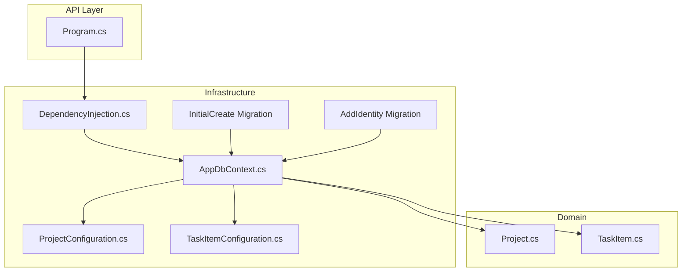
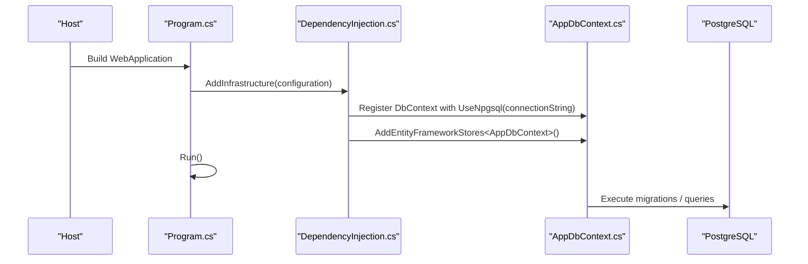
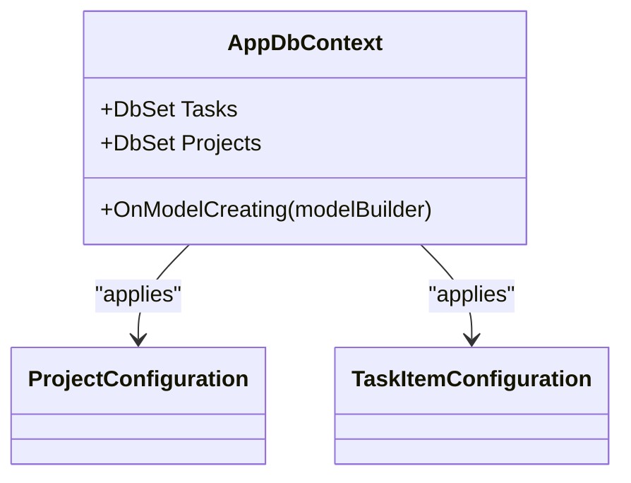
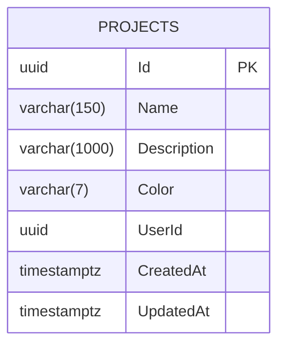
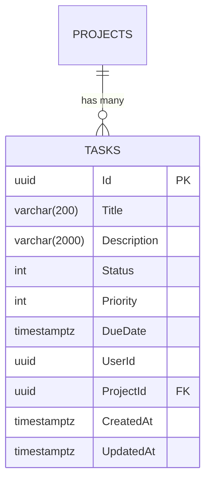
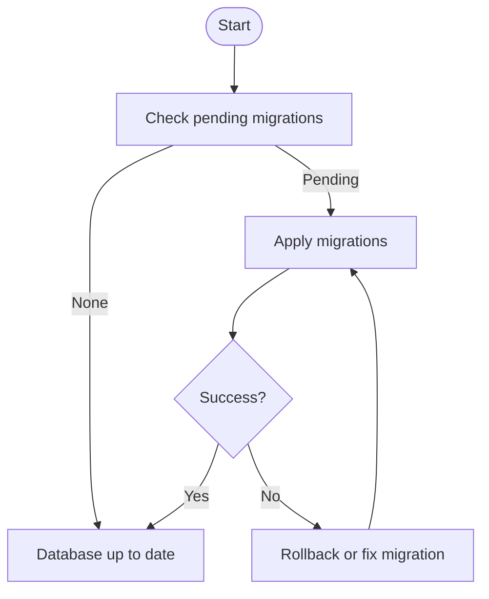
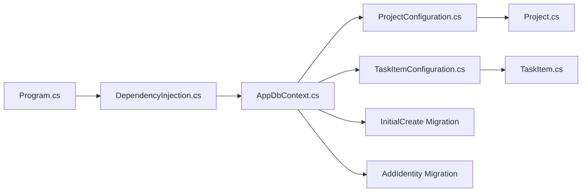

# Database Persistence

<cite>
**Referenced Files in This Document**
- [AppDbContext.cs](file://Services/Services.Infrastructure/Persistence/AppDbContext.cs)
- [ProjectConfiguration.cs](file://Services/Services.Infrastructure/Persistence/Configurations/ProjectConfiguration.cs)
- [TaskItemConfiguration.cs](file://Services/Services.Infrastructure/Persistence/Configurations/TaskItemConfiguration.cs)
- [Project.cs](file://Services/Services.Domain/Entities/Project.cs)
- [TaskItem.cs](file://Services/Services.Domain/Entities/TaskItem.cs)
- [DependencyInjection.cs](file://Services/Services.Infrastructure/DependencyInjection.cs)
- [Program.cs](file://Services/Services.Api/Program.cs)
- [appsettings.Example.json](file://Services/Services.Api/appsettings.Example.json)
- [20261013023021_InitialCreate.cs](file://Services/Services.Infrastructure/Persistence/Migrations/20261013023021_InitialCreate.cs)
- [20261013031549_AddIdentity.cs](file://Services/Services.Infrastructure/Persistence/Migrations/20261013031549_AddIdentity.cs)
</cite>

## Table of Contents
1. [Introduction](#introduction)
2. [Project Structure](#project-structure)
3. [Core Components](#core-components)
4. [Architecture Overview](#architecture-overview)
5. [Detailed Component Analysis](#detailed-component-analysis)
6. [Dependency Analysis](#dependency-analysis)
7. [Performance Considerations](#performance-considerations)
8. [Troubleshooting Guide](#troubleshooting-guide)
9. [Conclusion](#conclusion)

## Introduction
This document explains the database persistence layer built with Entity Framework Core for the TaskFlow service. It covers AppDbContext configuration, entity mappings for Project and TaskItem, migrations including Identity integration, indexing strategy, query optimization techniques, connection pooling, transaction management, error handling patterns, and examples of complex queries, bulk operations, and data seeding approaches.

## Project Structure
The persistence implementation is located under Services.Infrastructure, with domain entities defined in Services.Domain. The API entry point wires infrastructure services, including EF Core, via Program.cs.

**Diagram sources**
- [Program.cs:1-38](file://Services/Services.Api/Program.cs#L1-L38)
- [DependencyInjection.cs:17-29](file://Services/Services.Infrastructure/DependencyInjection.cs#L17-L29)
- [AppDbContext.cs:10-23](file://Services/Services.Infrastructure/Persistence/AppDbContext.cs#L10-L23)
- [ProjectConfiguration.cs:7-43](file://Services/Services.Infrastructure/Persistence/Configurations/ProjectConfiguration.cs#L7-L43)
- [TaskItemConfiguration.cs:8-70](file://Services/Services.Infrastructure/Persistence/Configurations/TaskItemConfiguration.cs#L8-L70)
- [20261013023021_InitialCreate.cs:12-76](file://Services/Services.Infrastructure/Persistence/Migrations/20261013023021_InitialCreate.cs#L12-L76)
- [20261013031549_AddIdentity.cs:13-196](file://Services/Services.Infrastructure/Persistence/Migrations/20261013031549_AddIdentity.cs#L13-L196)

**Section sources**
- [Program.cs:1-38](file://Services/Services.Api/Program.cs#L1-L38)
- [DependencyInjection.cs:17-29](file://Services/Services.Infrastructure/DependencyInjection.cs#L17-L29)

## Core Components
- AppDbContext: Central EF Core context that extends IdentityDbContext and registers entity configurations.
- ProjectConfiguration and TaskItemConfiguration: Fluent API mappings defining table names, column constraints, conversions, relationships, and indexes.
- Domain Entities: Project and TaskItem define business rules, value objects, and relationships.
- DependencyInjection: Registers AppDbContext with Npgsql provider and configures Identity stores.
- Migrations: Initial schema and Identity tables are versioned as migrations.

Key responsibilities:
- Configure database provider and options.
- Map domain models to relational schema.
- Enforce constraints and relationships.
- Provide a consistent context for repository and service layers.

**Section sources**
- [AppDbContext.cs:10-23](file://Services/Services.Infrastructure/Persistence/AppDbContext.cs#L10-L23)
- [ProjectConfiguration.cs:10-43](file://Services/Services.Infrastructure/Persistence/Configurations/ProjectConfiguration.cs#L10-L43)
- [TaskItemConfiguration.cs:11-70](file://Services/Services.Infrastructure/Persistence/Configurations/TaskItemConfiguration.cs#L11-L70)
- [DependencyInjection.cs:23-29](file://Services/Services.Infrastructure/DependencyInjection.cs#L23-L29)

## Architecture Overview
The application uses ASP.NET Core dependency injection to register AppDbContext with PostgreSQL (Npgsql). Identity is integrated into the same context, sharing the database. Migrations manage schema evolution.

**Diagram sources**
- [Program.cs:6-11](file://Services/Services.Api/Program.cs#L6-L11)
- [DependencyInjection.cs:23-48](file://Services/Services.Infrastructure/DependencyInjection.cs#L23-L48)
- [AppDbContext.cs:10-23](file://Services/Services.Infrastructure/Persistence/AppDbContext.cs#L10-L23)

## Detailed Component Analysis

### AppDbContext Configuration
- Inherits from IdentityDbContext<ApplicationUser, IdentityRole<Guid>, Guid>.
- Exposes DbSet properties for Tasks and Projects.
- Applies entity configurations in OnModelCreating.
- Integrates Identity stores through AddEntityFrameworkStores<AppDbContext>().

Connection string and provider:
- Connection string key: DefaultConnection.
- Provider: Npgsql (PostgreSQL).
- Example connection string format is provided in appsettings.

Context options:
- No additional global options are configured beyond provider selection.
- Identity options (password policy, lockout, email confirmation) are configured alongside DbContext registration.

**Diagram sources**
- [AppDbContext.cs:10-23](file://Services/Services.Infrastructure/Persistence/AppDbContext.cs#L10-L23)
- [ProjectConfiguration.cs:7-43](file://Services/Services.Infrastructure/Persistence/Configurations/ProjectConfiguration.cs#L7-L43)
- [TaskItemConfiguration.cs:8-70](file://Services/Services.Infrastructure/Persistence/Configurations/TaskItemConfiguration.cs#L8-L70)

**Section sources**
- [AppDbContext.cs:10-23](file://Services/Services.Infrastructure/Persistence/AppDbContext.cs#L10-L23)
- [DependencyInjection.cs:23-48](file://Services/Services.Infrastructure/DependencyInjection.cs#L23-L48)
- [appsettings.Example.json:9-11](file://Services/Services.Api/appsettings.Example.json#L9-L11)

### Entity Configurations: Project
Table mapping:
- Table name: Projects.
- Primary key: Id (Guid), ValueGeneratedNever.
- Columns:
  - Name: mapped from ProjectName value object; max length enforced; required.
  - Description: optional, max length 1000.
  - Color: required, max length 7.
  - UserId: required.
  - CreatedAt, UpdatedAt: required timestamps.
- Indexes:
  - IX_Projects_UserId on UserId.

Relationships:
- One-to-many with TaskItem via Project.Tasks.

Constraints:
- Required fields enforced at model level.
- MaxLength constraints applied to Name, Description, Color.

**Diagram sources**
- [ProjectConfiguration.cs:10-43](file://Services/Services.Infrastructure/Persistence/Configurations/ProjectConfiguration.cs#L10-L43)
- [20261013023021_InitialCreate.cs:14-29](file://Services/Services.Infrastructure/Persistence/Migrations/20261013023021_InitialCreate.cs#L14-L29)

**Section sources**
- [ProjectConfiguration.cs:10-43](file://Services/Services.Infrastructure/Persistence/Configurations/ProjectConfiguration.cs#L10-L43)
- [Project.cs:5-23](file://Services/Services.Domain/Entities/Project.cs#L5-L23)

### Entity Configurations: TaskItem
Table mapping:
- Table name: Tasks.
- Primary key: Id (Guid), ValueGeneratedNever.
- Complex property Title mapped to column Title; max length enforced; required.
- Columns:
  - Description: optional, max length 2000.
  - Status: enum stored as integer; required.
  - Priority: enum stored as integer; required.
  - DueDate: nullable timestamp.
  - UserId: required.
  - ProjectId: nullable foreign key.
  - CreatedAt, UpdatedAt: required timestamps.
- Indexes:
  - IX_Tasks_UserId on UserId.
  - IX_Tasks_UserId_Status composite index on (UserId, Status).

Relationships:
- Optional many-to-one to Project via ProjectId.
- Delete behavior: SetNull when referenced Project is deleted.

**Diagram sources**
- [TaskItemConfiguration.cs:11-70](file://Services/Services.Infrastructure/Persistence/Configurations/TaskItemConfiguration.cs#L11-L70)
- [20261013023021_InitialCreate.cs:31-55](file://Services/Services.Infrastructure/Persistence/Migrations/20261013023021_InitialCreate.cs#L31-L55)

**Section sources**
- [TaskItemConfiguration.cs:11-70](file://Services/Services.Infrastructure/Persistence/Configurations/TaskItemConfiguration.cs#L11-L70)
- [TaskItem.cs:6-20](file://Services/Services.Domain/Entities/TaskItem.cs#L6-L20)

### Relationships and Constraints Summary
- Project.Id -> TaskItem.ProjectId (optional FK).
- Delete behavior: SetNull ensures tasks remain when their project is removed.
- Required fields: UserId on both entities; Name, Color on Project; Title, Status, Priority on TaskItem.
- Composite index on TaskItem(UserId, Status) optimizes common user-scoped task queries.

**Section sources**
- [TaskItemConfiguration.cs:66-69](file://Services/Services.Infrastructure/Persistence/Configurations/TaskItemConfiguration.cs#L66-L69)
- [20261013023021_InitialCreate.cs:49-55](file://Services/Services.Infrastructure/Persistence/Migrations/20261013023021_InitialCreate.cs#L49-L55)

### Migrations Management
- InitialCreate: Creates Projects and Tasks tables, primary keys, foreign key, and indexes.
- AddIdentity: Adds ASP.NET Identity tables (Users, Roles, Claims, Logins, Tokens) and related indexes.

Version control strategy:
- Migrations are committed as code files under Persistence/Migrations.
- Apply migrations using standard EF Core tooling against the configured PostgreSQL database.
- Keep migration order deterministic; avoid manual edits to existing migrations once applied.

**Diagram sources**
- [20261013023021_InitialCreate.cs:12-76](file://Services/Services.Infrastructure/Persistence/Migrations/20261013023021_InitialCreate.cs#L12-L76)
- [20261013031549_AddIdentity.cs:13-196](file://Services/Services.Infrastructure/Persistence/Migrations/20261013031549_AddIdentity.cs#L13-L196)

**Section sources**
- [20261013023021_InitialCreate.cs:12-76](file://Services/Services.Infrastructure/Persistence/Migrations/20261013023021_InitialCreate.cs#L12-L76)
- [20261013031549_AddIdentity.cs:13-196](file://Services/Services.Infrastructure/Persistence/Migrations/20261013031549_AddIdentity.cs#L13-L196)

### Query Optimization and Indexing Strategy
Indexes present:
- IX_Projects_UserId: Optimizes lookups by owner.
- IX_Tasks_UserId: Optimizes per-user task queries.
- IX_Tasks_UserId_Status: Optimizes filtering tasks by user and status.

Recommended query patterns:
- Filter by UserId and Status to leverage composite index.
- Include Project only when needed to reduce payload size.
- Use projection (select specific fields) for list endpoints.

Query example references:
- Filtering tasks by user and status: see TaskItemConfiguration composite index usage.
- Fetching projects by owner: see ProjectConfiguration index on UserId.

**Section sources**
- [TaskItemConfiguration.cs:59-64](file://Services/Services.Infrastructure/Persistence/Configurations/TaskItemConfiguration.cs#L59-L64)
- [ProjectConfiguration.cs:42-42](file://Services/Services.Infrastructure/Persistence/Configurations/ProjectConfiguration.cs#L42-L42)
- [20261013023021_InitialCreate.cs:57-75](file://Services/Services.Infrastructure/Persistence/Migrations/20261013023021_InitialCreate.cs#L57-L75)

### Connection Pooling and Provider
- Provider: Npgsql for PostgreSQL.
- Connection pooling: Enabled by default in EF Core with Npgsql; managed by the underlying ADO.NET provider.
- Connection string: Provided via configuration under ConnectionStrings.DefaultConnection.

Operational notes:
- Ensure connection strings are environment-specific and securely managed.
- Monitor connection pool metrics if high concurrency is expected.

**Section sources**
- [DependencyInjection.cs:23-29](file://Services/Services.Infrastructure/DependencyInjection.cs#L23-L29)
- [appsettings.Example.json:9-11](file://Services/Services.Api/appsettings.Example.json#L9-L11)

### Transaction Management
- Transactions should wrap multiple writes within a single request to ensure consistency.
- Use EF Core’s database.BeginTransactionAsync() around unit-of-work operations.
- Commit on success; rollback on exceptions.

Example pattern reference:
- Wrap repository calls that modify multiple entities in a transaction scope.

**Section sources**
- [AppDbContext.cs:10-23](file://Services/Services.Infrastructure/Persistence/AppDbContext.cs#L10-L23)

### Error Handling Patterns
- Validation errors in domain entities (e.g., invalid color, missing title) throw argument exceptions.
- Configuration validation throws InvalidOperationException when required settings are missing or malformed.
- For database-level errors (constraints, deadlocks), catch DbUpdateException and map to appropriate HTTP responses.

Recommendations:
- Surface user-friendly messages while logging detailed diagnostics.
- Implement global exception middleware to standardize error responses.

**Section sources**
- [Project.cs:99-119](file://Services/Services.Domain/Entities/Project.cs#L99-L119)
- [TaskItem.cs:62-78](file://Services/Services.Domain/Entities/TaskItem.cs#L62-L78)
- [DependencyInjection.cs:23-29](file://Services/Services.Infrastructure/DependencyInjection.cs#L23-L29)

### Examples: Complex Queries, Bulk Operations, Data Seeding

Complex queries
- List tasks by user and status:
  - Use Where(t => t.UserId == userId && t.Status == status) to leverage composite index.
- Get project with tasks:
  - Include(p => p.Tasks) only when necessary; otherwise use separate queries to avoid N+1.

Bulk operations
- Insert multiple tasks efficiently:
  - Use AddRange(tasks) followed by SaveChangesAsync().
- Update statuses in batches:
  - Load entities, update in memory, then SaveChangesAsync().

Data seeding
- Seed initial roles and users during startup or via a dedicated seed method invoked after migrations.
- Seed sample projects/tasks for development environments only.

Reference points:
- TaskItemConfiguration composite index supports efficient filtered queries.
- ProjectConfiguration index supports owner-based queries.

**Section sources**
- [TaskItemConfiguration.cs:59-64](file://Services/Services.Infrastructure/Persistence/Configurations/TaskItemConfiguration.cs#L59-L64)
- [ProjectConfiguration.cs:42-42](file://Services/Services.Infrastructure/Persistence/Configurations/ProjectConfiguration.cs#L42-L42)

## Dependency Analysis
The following diagram shows how components depend on each other for persistence.

**Diagram sources**
- [Program.cs:6-11](file://Services/Services.Api/Program.cs#L6-L11)
- [DependencyInjection.cs:23-48](file://Services/Services.Infrastructure/DependencyInjection.cs#L23-L48)
- [AppDbContext.cs:10-23](file://Services/Services.Infrastructure/Persistence/AppDbContext.cs#L10-L23)
- [ProjectConfiguration.cs:7-43](file://Services/Services.Infrastructure/Persistence/Configurations/ProjectConfiguration.cs#L7-L43)
- [TaskItemConfiguration.cs:8-70](file://Services/Services.Infrastructure/Persistence/Configurations/TaskItemConfiguration.cs#L8-L70)
- [20261013023021_InitialCreate.cs:12-76](file://Services/Services.Infrastructure/Persistence/Migrations/20261013023021_InitialCreate.cs#L12-L76)
- [20261013031549_AddIdentity.cs:13-196](file://Services/Services.Infrastructure/Persistence/Migrations/20261013031549_AddIdentity.cs#L13-L196)

**Section sources**
- [Program.cs:6-11](file://Services/Services.Api/Program.cs#L6-L11)
- [DependencyInjection.cs:23-48](file://Services/Services.Infrastructure/DependencyInjection.cs#L23-L48)

## Performance Considerations
- Indexing:
  - Rely on existing indexes for UserId and composite (UserId, Status).
  - Avoid over-indexing; add indexes only where query patterns justify them.
- Eager vs Lazy Loading:
  - Prefer explicit Include for necessary relationships to prevent N+1 queries.
- Projection:
  - Select only required fields for list endpoints to reduce network overhead.
- Pagination:
  - Use Skip/Take for large result sets.
- Caching:
  - Consider caching read-heavy aggregates (e.g., project summaries) at the application layer.
- Connection Pooling:
  - Tune pool sizes based on workload; monitor Npgsql connection pool metrics.
- Batch Writes:
  - Use AddRange and SaveChangesAsync for bulk inserts/updates.

[No sources needed since this section provides general guidance]

## Troubleshooting Guide
Common issues and resolutions:
- Missing connection string:
  - Ensure DefaultConnection exists in configuration.
- Invalid JWT configuration:
  - Validate Issuer, Audience, SecretKey, and ExpirationMinutes.
- Migration conflicts:
  - If local database state differs from migrations, apply or roll back migrations accordingly.
- Constraint violations:
  - Validate inputs before saving; handle DbUpdateException gracefully.

Relevant configuration and validation points:
- Connection string requirement and provider setup.
- JWT configuration validation and error handling.
- Migration scripts for schema and Identity tables.

**Section sources**
- [DependencyInjection.cs:23-29](file://Services/Services.Infrastructure/DependencyInjection.cs#L23-L29)
- [DependencyInjection.cs:50-82](file://Services/Services.Infrastructure/DependencyInjection.cs#L50-L82)
- [20261013023021_InitialCreate.cs:12-76](file://Services/Services.Infrastructure/Persistence/Migrations/20261013023021_InitialCreate.cs#L12-L76)
- [20261013031549_AddIdentity.cs:13-196](file://Services/Services.Infrastructure/Persistence/Migrations/20261013031549_AddIdentity.cs#L13-L196)

## Conclusion
The persistence layer leverages EF Core with PostgreSQL, integrating Identity into the same context. Project and TaskItem entities are strongly modeled with clear constraints, relationships, and indexes. Migrations provide a controlled evolution path for the schema. Following the recommended query patterns, indexing strategy, and operational practices will help maintain performance and reliability as the system scales.

[No sources needed since this section summarizes without analyzing specific files]