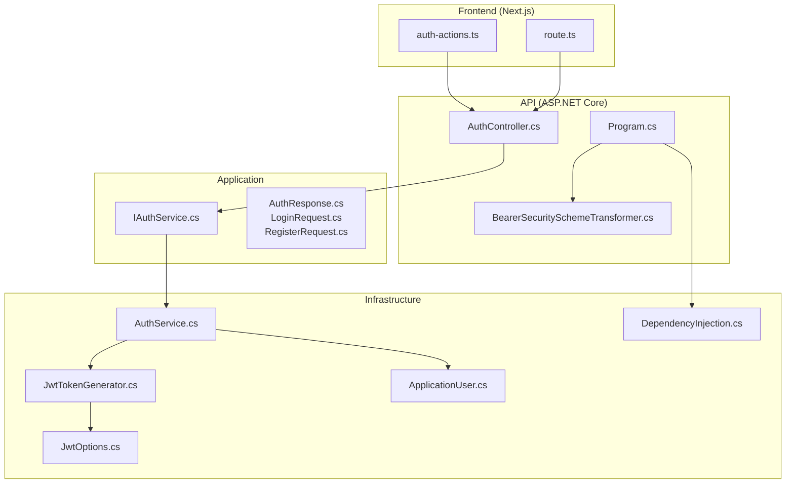
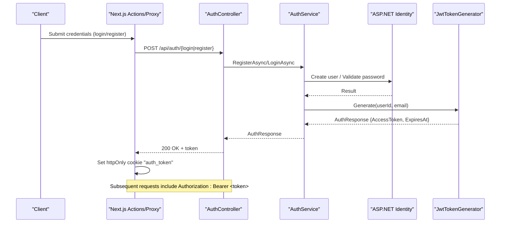
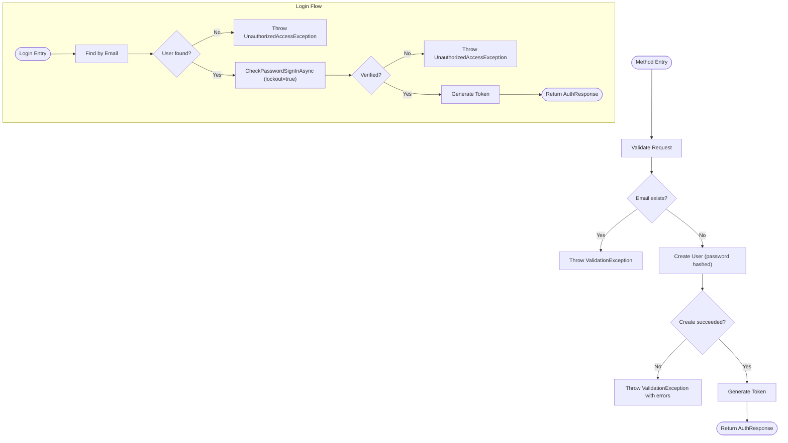
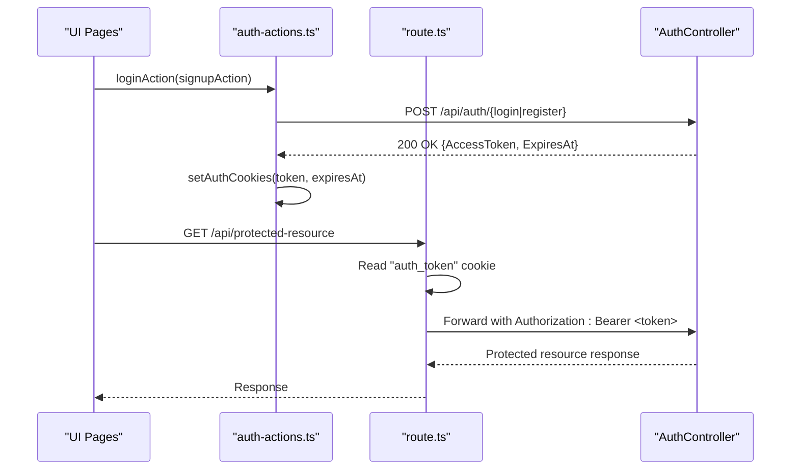
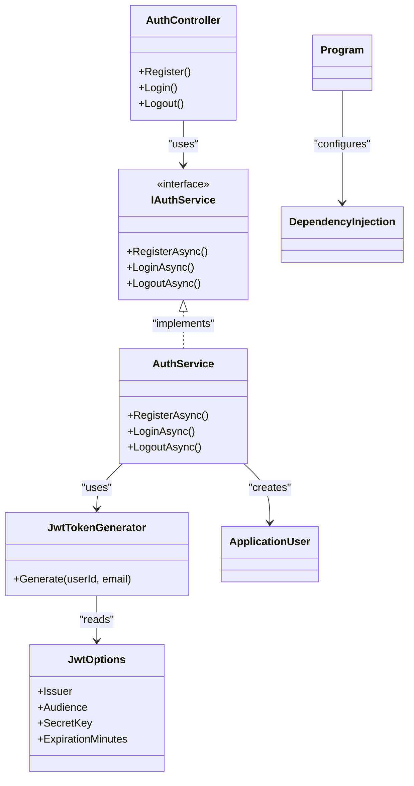

# Identity Management

<cite>
**Referenced Files in This Document**
- [AuthService.cs](file://Services/Services.Infrastructure/Identity/AuthService.cs)
- [JwtTokenGenerator.cs](file://Services/Services.Infrastructure/Identity/JwtTokenGenerator.cs)
- [JwtOptions.cs](file://Services/Services.Infrastructure/Identity/JwtOptions.cs)
- [ApplicationUser.cs](file://Services/Services.Infrastructure/Identity/ApplicationUser.cs)
- [AuthController.cs](file://Services/Services.Api/Controllers/AuthController.cs)
- [IAuthService.cs](file://Services/Application/Interfaces/Services/IAuthService.cs)
- [AuthResponse.cs](file://Services/Application/DTOs/Auth/AuthResponse.cs)
- [LoginRequest.cs](file://Services/Application/DTOs/Auth/LoginRequest.cs)
- [RegisterRequest.cs](file://Services/Application/DTOs/Auth/RegisterRequest.cs)
- [DependencyInjection.cs](file://Services/Services.Infrastructure/DependencyInjection.cs)
- [Program.cs](file://Services/Services.Api/Program.cs)
- [BearerSecuritySchemeTransformer.cs](file://Services/Services.Api/OpenApi/BearerSecuritySchemeTransformer.cs)
- [auth-actions.ts](file://Apps/Web/src/actions/auth-actions.ts)
- [route.ts](file://Apps/Web/src/app/api/[...path]/route.ts)
</cite>

## Table of Contents
1. Introduction
2. Project Structure
3. Core Components
4. Architecture Overview
5. Detailed Component Analysis
6. Dependency Analysis
7. Performance Considerations
8. Troubleshooting Guide
9. Conclusion
10. Appendices

## Introduction
This document explains the identity management and JWT authentication implementation across the backend API and Next.js frontend. It covers user registration, login, token generation and validation, cookie-based session handling on the client, and security best practices including password hashing, role-based authorization readiness, and token refresh strategies.

## Project Structure
The identity system spans three layers:
- API layer (Controllers): HTTP endpoints for auth operations.
- Application layer (Interfaces and DTOs): Service contracts and request/response models.
- Infrastructure layer (Identity): ASP.NET Identity integration, JWT configuration, token generation, and DI wiring.
- Frontend (Next.js): Server actions to call the API and manage cookies; a proxy route to forward authenticated requests.



**Diagram sources**
- [AuthController.cs:1-77](file://Services/Services.Api/Controllers/AuthController.cs#L1-L77)
- [Program.cs:1-38](file://Services/Services.Api/Program.cs#L1-L38)
- [BearerSecuritySchemeTransformer.cs:1-56](file://Services/Services.Api/OpenApi/BearerSecuritySchemeTransformer.cs#L1-L56)
- [IAuthService.cs:1-17](file://Services/Application/Interfaces/Services/IAuthService.cs#L1-L17)
- [AuthService.cs:1-91](file://Services/Services.Infrastructure/Identity/AuthService.cs#L1-L91)
- [JwtTokenGenerator.cs:1-49](file://Services/Services.Infrastructure/Identity/JwtTokenGenerator.cs#L1-L49)
- [JwtOptions.cs:1-14](file://Services/Services.Infrastructure/Identity/JwtOptions.cs#L1-L14)
- [ApplicationUser.cs:1-7](file://Services/Services.Infrastructure/Identity/ApplicationUser.cs#L1-L7)
- [auth-actions.ts:1-210](file://Apps/Web/src/actions/auth-actions.ts#L1-L210)
- [route.ts:1-77](file://Apps/Web/src/app/api/[...path]/route.ts#L1-L77)

**Section sources**
- [AuthController.cs:1-77](file://Services/Services.Api/Controllers/AuthController.cs#L1-L77)
- [Program.cs:1-38](file://Services/Services.Api/Program.cs#L1-L38)
- [DependencyInjection.cs:1-128](file://Services/Services.Infrastructure/DependencyInjection.cs#L1-L128)

## Core Components
- AuthService: Orchestrates user registration and login using ASP.NET Identity and returns JWT tokens via JwtTokenGenerator.
- JwtTokenGenerator: Creates signed JWTs with issuer, audience, claims, and expiration based on JwtOptions.
- JwtOptions: Configuration model for JWT settings (issuer, audience, secret key, expiration).
- ApplicationUser: Entity extending IdentityUser<Guid> for ASP.NET Identity.
- AuthController: Exposes HTTP endpoints for register, login, logout.
- IAuthService and DTOs: Define service contract and data transfer objects.
- DependencyInjection: Configures Identity, JWT Bearer authentication, and services.
- Frontend auth-actions.ts and route.ts: Manage cookies and forward authenticated requests.

**Section sources**
- [AuthService.cs:1-91](file://Services/Services.Infrastructure/Identity/AuthService.cs#L1-L91)
- [JwtTokenGenerator.cs:1-49](file://Services/Services.Infrastructure/Identity/JwtTokenGenerator.cs#L1-L49)
- [JwtOptions.cs:1-14](file://Services/Services.Infrastructure/Identity/JwtOptions.cs#L1-L14)
- [ApplicationUser.cs:1-7](file://Services/Services.Infrastructure/Identity/ApplicationUser.cs#L1-L7)
- [AuthController.cs:1-77](file://Services/Services.Api/Controllers/AuthController.cs#L1-L77)
- [IAuthService.cs:1-17](file://Services/Application/Interfaces/Services/IAuthService.cs#L1-L17)
- [AuthResponse.cs:1-5](file://Services/Application/DTOs/Auth/AuthResponse.cs#L1-L5)
- [LoginRequest.cs:1-5](file://Services/Application/DTOs/Auth/LoginRequest.cs#L1-L5)
- [RegisterRequest.cs:1-5](file://Services/Application/DTOs/Auth/RegisterRequest.cs#L1-L5)
- [DependencyInjection.cs:1-128](file://Services/Services.Infrastructure/DependencyInjection.cs#L1-L128)
- [auth-actions.ts:1-210](file://Apps/Web/src/actions/auth-actions.ts#L1-L210)
- [route.ts:1-77](file://Apps/Web/src/app/api/[...path]/route.ts#L1-L77)

## Architecture Overview
The authentication flow uses JWT bearer tokens. The API validates incoming tokens using configured parameters (issuer, audience, signing key, lifetime). The frontend stores the access token in an httpOnly cookie and forwards it as Authorization header through a proxy route.



**Diagram sources**
- [AuthController.cs:14-76](file://Services/Services.Api/Controllers/AuthController.cs#L14-L76)
- [AuthService.cs:13-85](file://Services/Services.Infrastructure/Identity/AuthService.cs#L13-L85)
- [JwtTokenGenerator.cs:13-48](file://Services/Services.Infrastructure/Identity/JwtTokenGenerator.cs#L13-L48)
- [auth-actions.ts:45-116](file://Apps/Web/src/actions/auth-actions.ts#L45-L116)
- [route.ts:23-31](file://Apps/Web/src/app/api/[...path]/route.ts#L23-L31)

## Detailed Component Analysis

### AuthService
Responsibilities:
- Validates input and ensures uniqueness of email during registration.
- Creates users via UserManager and hashes passwords using ASP.NET Identity’s configured password hasher.
- Authenticates users via SignInManager with lockout support.
- Delegates token creation to JwtTokenGenerator.

Key methods:
- RegisterAsync: Validates inputs, checks duplicate email, creates user, returns token.
- LoginAsync: Finds user by email, verifies password with lockout enabled, returns token.
- LogoutAsync: Signs out via SignInManager.

Error handling:
- Throws ValidationException for invalid or duplicate inputs.
- Throws UnauthorizedAccessException for invalid credentials.



**Diagram sources**
- [AuthService.cs:13-85](file://Services/Services.Infrastructure/Identity/AuthService.cs#L13-L85)

**Section sources**
- [AuthService.cs:1-91](file://Services/Services.Infrastructure/Identity/AuthService.cs#L1-L91)

### JwtTokenGenerator
Responsibilities:
- Builds a symmetric HMAC-SHA256 token using a Base64-encoded secret key from JwtOptions.
- Sets standard claims: sub (userId), email, jti (unique token id).
- Applies issuer, audience, notBefore, expires, and signing credentials.
- Returns AccessToken and ExpiresAt.

Security measures:
- Enforces minimum key length (>= 32 bytes).
- Uses UTC timestamps for notBefore and expires.
- Uses JTI to uniquely identify tokens.

```mermaid
flowchart TD
GStart([Generate(userId,email)]) --> DecodeKey["Decode SecretKey (Base64)"]
DecodeKey --> KeyLen{"Length >= 32?"}
KeyLen --> |No| GErr["Throw InvalidOperationException"]
KeyLen --> |Yes| Now["Compute now and expiresAt"]
Now --> Claims["Build claims: sub, email, jti"]
Claims --> Creds["Create SigningCredentials (HMAC-SHA256)"]
Creds --> Token["Create JwtSecurityToken"]
Token --> Write["WriteToken -> string"]
Write --> GEnd([Return AuthResponse])
```

**Diagram sources**
- [JwtTokenGenerator.cs:13-48](file://Services/Services.Infrastructure/Identity/JwtTokenGenerator.cs#L13-L48)

**Section sources**
- [JwtTokenGenerator.cs:1-49](file://Services/Services.Infrastructure/Identity/JwtTokenGenerator.cs#L1-L49)

### JwtOptions
Configuration fields:
- Issuer: Expected issuer claim value.
- Audience: Expected audience claim value.
- SecretKey: Base64-encoded symmetric key used for signing tokens.
- ExpirationMinutes: Token lifetime in minutes.

Validation:
- Startup validates presence and correctness of all required fields and enforces minimum key size.

**Section sources**
- [JwtOptions.cs:1-14](file://Services/Services.Infrastructure/Identity/JwtOptions.cs#L1-L14)
- [DependencyInjection.cs:50-82](file://Services/Services.Infrastructure/DependencyInjection.cs#L50-L82)

### ApplicationUser
- Extends IdentityUser<Guid>, enabling GUID primary keys for users.
- Persists via ASP.NET Identity EF Core stores.

**Section sources**
- [ApplicationUser.cs:1-7](file://Services/Services.Infrastructure/Identity/ApplicationUser.cs#L1-L7)

### AuthController
Endpoints:
- POST /api/auth/register: Accepts RegisterRequest, returns AuthResponse or validation error.
- POST /api/auth/login: Accepts LoginRequest, returns AuthResponse or unauthorized error.
- POST /api/auth/logout: Requires authorization, signs out, returns success message.

Error mapping:
- ValidationException -> 400 Bad Request.
- UnauthorizedAccessException -> 401 Unauthorized.

**Section sources**
- [AuthController.cs:1-77](file://Services/Services.Api/Controllers/AuthController.cs#L1-L77)

### Frontend Authentication and Cookie Management
- auth-actions.ts:
  - loginAction/signupAction call backend endpoints and set httpOnly cookie "auth_token".
  - Handles server-side redirects after successful authentication.
  - Provides getAuthToken helper to read the cookie.
- route.ts:
  - Proxy route forwards client requests to the API.
  - If Authorization header is missing, reads "auth_token" from cookies and attaches Bearer token.



**Diagram sources**
- [auth-actions.ts:45-116](file://Apps/Web/src/actions/auth-actions.ts#L45-L116)
- [auth-actions.ts:118-198](file://Apps/Web/src/actions/auth-actions.ts#L118-L198)
- [route.ts:23-31](file://Apps/Web/src/app/api/[...path]/route.ts#L23-L31)

**Section sources**
- [auth-actions.ts:1-210](file://Apps/Web/src/actions/auth-actions.ts#L1-L210)
- [route.ts:1-77](file://Apps/Web/src/app/api/[...path]/route.ts#L1-L77)

## Dependency Analysis
- Controllers depend on IAuthService.
- AuthService depends on UserManager, SignInManager, and JwtTokenGenerator.
- JwtTokenGenerator depends on JwtOptions.
- DependencyInjection wires Identity, JWT Bearer, and services.
- Program configures middleware pipeline and OpenAPI security scheme.



**Diagram sources**
- [AuthController.cs:1-77](file://Services/Services.Api/Controllers/AuthController.cs#L1-L77)
- [IAuthService.cs:1-17](file://Services/Application/Interfaces/Services/IAuthService.cs#L1-L17)
- [AuthService.cs:1-91](file://Services/Services.Infrastructure/Identity/AuthService.cs#L1-L91)
- [JwtTokenGenerator.cs:1-49](file://Services/Services.Infrastructure/Identity/JwtTokenGenerator.cs#L1-L49)
- [JwtOptions.cs:1-14](file://Services/Services.Infrastructure/Identity/JwtOptions.cs#L1-L14)
- [ApplicationUser.cs:1-7](file://Services/Services.Infrastructure/Identity/ApplicationUser.cs#L1-L7)
- [DependencyInjection.cs:1-128](file://Services/Services.Infrastructure/DependencyInjection.cs#L1-L128)
- [Program.cs:1-38](file://Services/Services.Api/Program.cs#L1-L38)

**Section sources**
- [DependencyInjection.cs:31-120](file://Services/Services.Infrastructure/DependencyInjection.cs#L31-L120)
- [Program.cs:20-35](file://Services/Services.Api/Program.cs#L20-L35)

## Performance Considerations
- Token generation is lightweight but should be invoked only on successful authentication flows.
- Use short-lived access tokens and implement refresh strategies to reduce exposure window.
- Avoid logging sensitive claims or tokens.
- Ensure database queries for user lookup are efficient (email index is provided by Identity).

[No sources needed since this section provides general guidance]

## Troubleshooting Guide
Common issues and resolutions:
- Invalid or missing JWT configuration:
  - Symptom: Startup throws configuration exceptions.
  - Resolution: Ensure Jwt.Issuer, Jwt.Audience, Jwt.SecretKey (Base64, >= 32 bytes), and Jwt.ExpirationMinutes are set correctly.
- Wrong secret key format:
  - Symptom: Format exception when decoding SecretKey.
  - Resolution: Provide a valid Base64-encoded key.
- Token validation failures:
  - Symptom: 401 Unauthorized on protected endpoints.
  - Resolution: Verify issuer, audience, and signing key match between generator and validator; ensure clock skew is acceptable.
- Duplicate email registration:
  - Symptom: Validation error on register.
  - Resolution: Ensure unique emails; handle conflict in UI.
- Incorrect credentials:
  - Symptom: 401 Unauthorized on login.
  - Resolution: Check credentials; account may be locked due to failed attempts.

**Section sources**
- [DependencyInjection.cs:50-82](file://Services/Services.Infrastructure/DependencyInjection.cs#L50-L82)
- [AuthService.cs:17-55](file://Services/Services.Infrastructure/Identity/AuthService.cs#L17-L55)
- [AuthService.cs:62-85](file://Services/Services.Infrastructure/Identity/AuthService.cs#L62-L85)
- [AuthController.cs:29-61](file://Services/Services.Api/Controllers/AuthController.cs#L29-L61)

## Conclusion
The identity system leverages ASP.NET Identity for user management and JWT Bearer for stateless authentication. AuthService orchestrates registration and login, while JwtTokenGenerator produces secure tokens configured via JwtOptions. The frontend manages tokens via httpOnly cookies and forwards them through a proxy route. For production, enforce strong secrets, short token lifetimes, HTTPS-only cookies, and consider adding refresh tokens and role-based authorization policies.

[No sources needed since this section summarizes without analyzing specific files]

## Appendices

### Security Best Practices
- Password hashing: Handled by ASP.NET Identity; configure complexity and lockout policies.
- Role-based authorization: Ready to extend with Identity roles and policies; apply [Authorize(Roles = "...")] on controllers/actions.
- Token refresh strategy: Implement a refresh endpoint that issues new access tokens using a long-lived refresh token stored securely; rotate refresh tokens and invalidate on logout.
- Cookie security: Keep httpOnly, secure (in production), sameSite=lax/strict, and appropriate expiry aligned with token lifetime.
- OpenAPI documentation: Bearer security scheme is automatically added for protected endpoints.

**Section sources**
- [DependencyInjection.cs:31-48](file://Services/Services.Infrastructure/DependencyInjection.cs#L31-L48)
- [BearerSecuritySchemeTransformer.cs:1-56](file://Services/Services.Api/OpenApi/BearerSecuritySchemeTransformer.cs#L1-L56)
- [auth-actions.ts:28-43](file://Apps/Web/src/actions/auth-actions.ts#L28-L43)