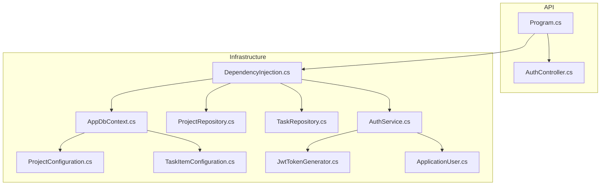
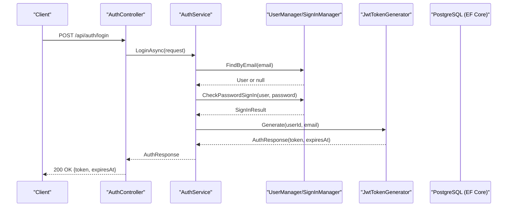
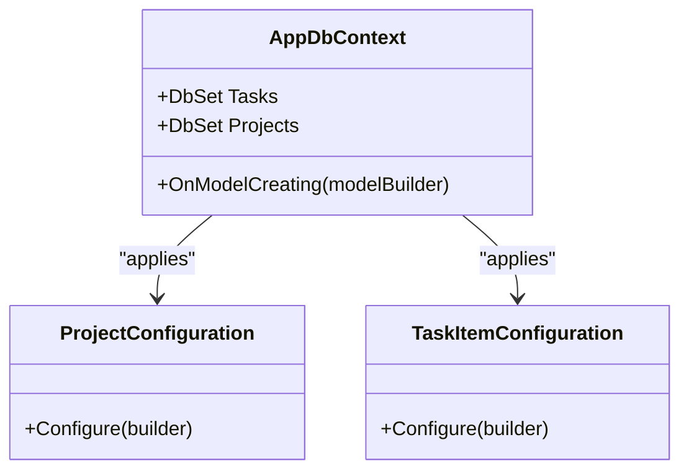
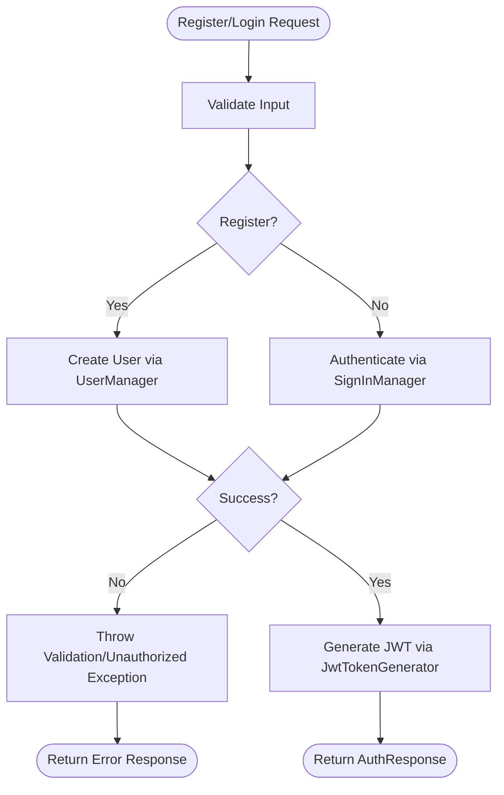
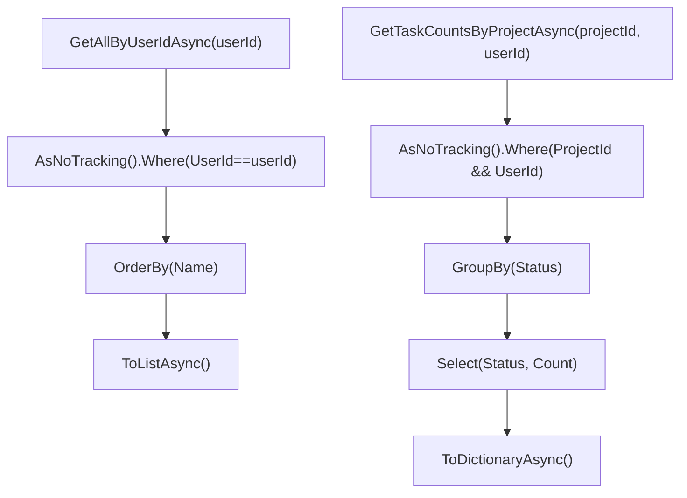
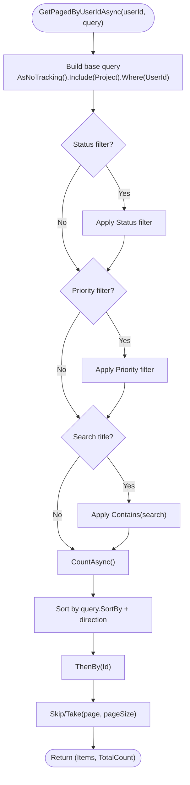
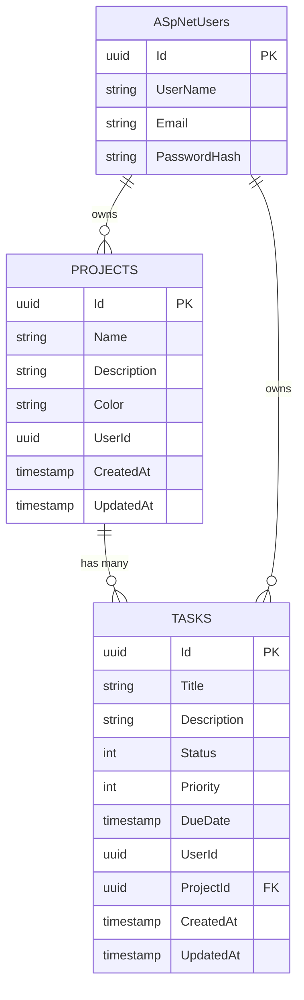
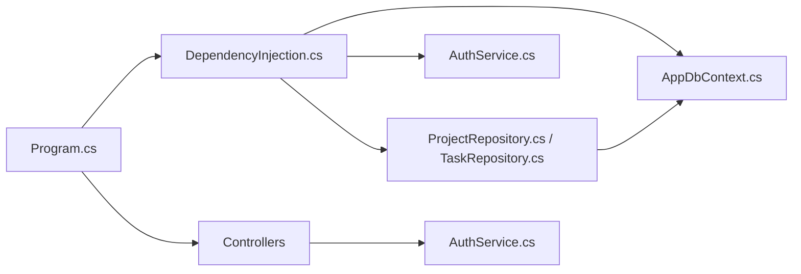

# Infrastructure Layer

<cite>
**Referenced Files in This Document**
- [Program.cs](file://Services/Services.Api/Program.cs)
- [DependencyInjection.cs](file://Services/Services.Infrastructure/DependencyInjection.cs)
- [AppDbContext.cs](file://Services/Services.Infrastructure/Persistence/AppDbContext.cs)
- [ProjectConfiguration.cs](file://Services/Services.Infrastructure/Persistence/Configurations/ProjectConfiguration.cs)
- [TaskItemConfiguration.cs](file://Services/Services.Infrastructure/Persistence/Configurations/TaskItemConfiguration.cs)
- [20261013023021_InitialCreate.cs](file://Services/Services.Infrastructure/Persistence/Migrations/20261013023021_InitialCreate.cs)
- [20261013031549_AddIdentity.cs](file://Services/Services.Infrastructure/Persistence/Migrations/20261013031549_AddIdentity.cs)
- [ProjectRepository.cs](file://Services/Services.Infrastructure/Repositories/ProjectRepository.cs)
- [TaskRepository.cs](file://Services/Services.Infrastructure/Repositories/TaskRepository.cs)
- [AuthService.cs](file://Services/Services.Infrastructure/Identity/AuthService.cs)
- [JwtTokenGenerator.cs](file://Services/Services.Infrastructure/Identity/JwtTokenGenerator.cs)
- [ApplicationUser.cs](file://Services/Services.Infrastructure/Identity/ApplicationUser.cs)
- [AuthController.cs](file://Services/Services.Api/Controllers/AuthController.cs)
- [Project.cs](file://Services/Services.Domain/Entities/Project.cs)
- [TaskItem.cs](file://Services/Services.Domain/Entities/TaskItem.cs)
</cite>

## Table of Contents
1. [Introduction](#introduction)
2. [Project Structure](#project-structure)
3. [Core Components](#core-components)
4. [Architecture Overview](#architecture-overview)
5. [Detailed Component Analysis](#detailed-component-analysis)
6. [Dependency Analysis](#dependency-analysis)
7. [Performance Considerations](#performance-considerations)
8. [Troubleshooting Guide](#troubleshooting-guide)
9. [Conclusion](#conclusion)

## Introduction
This document describes the infrastructure layer for the application, focusing on database persistence with Entity Framework Core, identity management and JWT-based authentication, and repository implementations for Projects and Tasks. It covers configuration, entity mappings, migrations, connection management, indexing strategies, security considerations, and performance optimizations.

## Project Structure
The infrastructure is implemented across the API and Infrastructure layers:
- API layer registers middleware, OpenAPI, and maps controllers.
- Infrastructure layer configures EF Core, Identity, JWT, dependency injection, repositories, and identity services.

**Diagram sources**
- [Program.cs:6-37](file://Services/Services.Api/Program.cs#L6-L37)
- [DependencyInjection.cs:19-126](file://Services/Services.Infrastructure/DependencyInjection.cs#L19-L126)
- [AppDbContext.cs:10-23](file://Services/Services.Infrastructure/Persistence/AppDbContext.cs#L10-L23)
- [ProjectConfiguration.cs:7-43](file://Services/Services.Infrastructure/Persistence/Configurations/ProjectConfiguration.cs#L7-L43)
- [TaskItemConfiguration.cs:8-70](file://Services/Services.Infrastructure/Persistence/Configurations/TaskItemConfiguration.cs#L8-L70)
- [ProjectRepository.cs:9-97](file://Services/Services.Infrastructure/Repositories/ProjectRepository.cs#L9-L97)
- [TaskRepository.cs:9-239](file://Services/Services.Infrastructure/Repositories/TaskRepository.cs#L9-L239)
- [AuthService.cs:8-91](file://Services/Services.Infrastructure/Identity/AuthService.cs#L8-L91)
- [JwtTokenGenerator.cs:9-49](file://Services/Services.Infrastructure/Identity/JwtTokenGenerator.cs#L9-L49)
- [ApplicationUser.cs:5-7](file://Services/Services.Infrastructure/Identity/ApplicationUser.cs#L5-L7)

**Section sources**
- [Program.cs:6-37](file://Services/Services.Api/Program.cs#L6-L37)
- [DependencyInjection.cs:19-126](file://Services/Services.Infrastructure/DependencyInjection.cs#L19-L126)

## Core Components
- Database persistence: AppDbContext extends IdentityDbContext, exposes DbSet for domain entities, and applies EF Core configurations.
- Identity management: ApplicationUser integrates with ASP.NET Core Identity; AuthService orchestrates registration, login, logout; JwtTokenGenerator issues signed JWTs.
- Repositories: ProjectRepository and TaskRepository implement CRUD and query operations over EF Core with optimized queries and pagination.

Key responsibilities:
- AppDbContext: centralizes EF Core model configuration and integration with Identity stores.
- Configurations: enforce constraints, value conversions, relationships, and indexes.
- AuthService: validates inputs, interacts with UserManager/SignInManager, and returns JWT tokens.
- JwtTokenGenerator: builds and signs JWTs using configured issuer, audience, and secret key.
- ProjectRepository: manages project lifecycle and aggregates task counts by status.
- TaskRepository: provides rich filtering, sorting, and pagination for tasks.

**Section sources**
- [AppDbContext.cs:10-23](file://Services/Services.Infrastructure/Persistence/AppDbContext.cs#L10-L23)
- [ProjectConfiguration.cs:10-43](file://Services/Services.Infrastructure/Persistence/Configurations/ProjectConfiguration.cs#L10-L43)
- [TaskItemConfiguration.cs:11-70](file://Services/Services.Infrastructure/Persistence/Configurations/TaskItemConfiguration.cs#L11-L70)
- [AuthService.cs:8-91](file://Services/Services.Infrastructure/Identity/AuthService.cs#L8-L91)
- [JwtTokenGenerator.cs:9-49](file://Services/Services.Infrastructure/Identity/JwtTokenGenerator.cs#L9-L49)
- [ProjectRepository.cs:9-97](file://Services/Services.Infrastructure/Repositories/ProjectRepository.cs#L9-L97)
- [TaskRepository.cs:9-239](file://Services/Services.Infrastructure/Repositories/TaskRepository.cs#L9-L239)

## Architecture Overview
The system uses a layered architecture:
- Controllers receive HTTP requests and delegate to services.
- Services orchestrate business logic and call repositories.
- Repositories use EF Core via AppDbContext to interact with PostgreSQL.
- Identity and JWT provide authentication and authorization.

**Diagram sources**
- [AuthController.cs:35-62](file://Services/Services.Api/Controllers/AuthController.cs#L35-L62)
- [AuthService.cs:58-85](file://Services/Services.Infrastructure/Identity/AuthService.cs#L58-L85)
- [JwtTokenGenerator.cs:13-48](file://Services/Services.Infrastructure/Identity/JwtTokenGenerator.cs#L13-L48)

## Detailed Component Analysis

### Database Persistence (Entity Framework Core)
- AppDbContext extends IdentityDbContext and adds DbSets for TaskItem and Project.
- OnModelCreating applies entity configurations for Tasks and Projects.
- Connection string is provided via configuration and mapped to Npgsql provider.

Entity mappings and constraints:
- Project: table name, primary key, value conversion for Name, length constraints, required fields, index on UserId.
- TaskItem: table name, primary key, complex property mapping for Title, value conversions for Description, enum storage, optional DueDate, required UserId, optional ProjectId, timestamps, indexes on UserId and composite (UserId, Status), one-to-many relationship with Project (SetNull delete behavior).

Migrations:
- InitialCreate creates Projects and Tasks tables with primary keys, foreign keys, and indexes.
- AddIdentity creates ASP.NET Identity tables (Users, Roles, Claims, Logins, Tokens, etc.) and indexes.

Connection management:
- DbContext is registered with Npgsql using a connection string from configuration.
- Identity stores are backed by the same DbContext.

**Diagram sources**
- [AppDbContext.cs:10-23](file://Services/Services.Infrastructure/Persistence/AppDbContext.cs#L10-L23)
- [ProjectConfiguration.cs:10-43](file://Services/Services.Infrastructure/Persistence/Configurations/ProjectConfiguration.cs#L10-L43)
- [TaskItemConfiguration.cs:11-70](file://Services/Services.Infrastructure/Persistence/Configurations/TaskItemConfiguration.cs#L11-L70)

**Section sources**
- [AppDbContext.cs:10-23](file://Services/Services.Infrastructure/Persistence/AppDbContext.cs#L10-L23)
- [ProjectConfiguration.cs:10-43](file://Services/Services.Infrastructure/Persistence/Configurations/ProjectConfiguration.cs#L10-L43)
- [TaskItemConfiguration.cs:11-70](file://Services/Services.Infrastructure/Persistence/Configurations/TaskItemConfiguration.cs#L11-L70)
- [20261013023021_InitialCreate.cs:12-76](file://Services/Services.Infrastructure/Persistence/Migrations/20261013023021_InitialCreate.cs#L12-L76)
- [20261013031549_AddIdentity.cs:13-196](file://Services/Services.Infrastructure/Persistence/Migrations/20261013031549_AddIdentity.cs#L13-L196)
- [DependencyInjection.cs:23-48](file://Services/Services.Infrastructure/DependencyInjection.cs#L23-L48)

### Identity Management and Authentication
- ApplicationUser extends IdentityUser<Guid>.
- AuthService handles registration and login flows using UserManager and SignInManager, returning JWT tokens via JwtTokenGenerator.
- JwtTokenGenerator constructs signed JWTs with claims (sub, email, jti), issuer, audience, and expiration.
- DependencyInjection configures Identity stores, password policy, lockout, and JWT Bearer authentication with token validation parameters.

Security considerations:
- Password policy enforced via Identity options.
- Lockout configured for failed attempts.
- JWT secret key validated at startup (Base64 format, minimum 32 bytes).
- Token validation includes issuer, audience, signing key, lifetime, and clock skew.

**Diagram sources**
- [AuthService.cs:13-85](file://Services/Services.Infrastructure/Identity/AuthService.cs#L13-L85)
- [JwtTokenGenerator.cs:13-48](file://Services/Services.Infrastructure/Identity/JwtTokenGenerator.cs#L13-L48)
- [DependencyInjection.cs:31-48](file://Services/Services.Infrastructure/DependencyInjection.cs#L31-L48)
- [DependencyInjection.cs:50-112](file://Services/Services.Infrastructure/DependencyInjection.cs#L50-L112)

**Section sources**
- [ApplicationUser.cs:5-7](file://Services/Services.Infrastructure/Identity/ApplicationUser.cs#L5-L7)
- [AuthService.cs:8-91](file://Services/Services.Infrastructure/Identity/AuthService.cs#L8-L91)
- [JwtTokenGenerator.cs:9-49](file://Services/Services.Infrastructure/Identity/JwtTokenGenerator.cs#L9-L49)
- [DependencyInjection.cs:31-112](file://Services/Services.Infrastructure/DependencyInjection.cs#L31-L112)

### Repository Implementations

#### ProjectRepository
Responsibilities:
- Add, update, delete projects.
- Query projects by user ID with ordering.
- Get project by ID and ownership check.
- Check if project has tasks.
- Aggregate task counts by status per project.

Optimizations:
- AsNoTracking for read-only queries.
- Efficient AnyAsync checks.
- GroupBy server-side aggregation.

**Diagram sources**
- [ProjectRepository.cs:25-34](file://Services/Services.Infrastructure/Repositories/ProjectRepository.cs#L25-L34)
- [ProjectRepository.cs:76-96](file://Services/Services.Infrastructure/Repositories/ProjectRepository.cs#L76-L96)

**Section sources**
- [ProjectRepository.cs:9-97](file://Services/Services.Infrastructure/Repositories/ProjectRepository.cs#L9-L97)

#### TaskRepository
Responsibilities:
- Add, update, delete tasks.
- Load related Project after creation.
- Query tasks by user ID with Include(Project).
- Rich filtering by status, priority, search title.
- Dynamic sorting by title, due date, priority, status, or created date.
- Stable pagination with deterministic tie-breaker.

Optimizations:
- AsNoTracking for read paths.
- Single query composition before paging.
- Count before Skip/Take to compute total.
- Deterministic ThenBy(Id) for stable page order.

**Diagram sources**
- [TaskRepository.cs:82-157](file://Services/Services.Infrastructure/Repositories/TaskRepository.cs#L82-L157)

**Section sources**
- [TaskRepository.cs:9-239](file://Services/Services.Infrastructure/Repositories/TaskRepository.cs#L9-L239)

### Domain Entities and Relationships

**Diagram sources**
- [20261013023021_InitialCreate.cs:14-76](file://Services/Services.Infrastructure/Persistence/Migrations/20261013023021_InitialCreate.cs#L14-L76)
- [20261013031549_AddIdentity.cs:15-196](file://Services/Services.Infrastructure/Persistence/Migrations/20261013031549_AddIdentity.cs#L15-L196)
- [Project.cs:5-121](file://Services/Services.Domain/Entities/Project.cs#L5-L121)
- [TaskItem.cs:6-128](file://Services/Services.Domain/Entities/TaskItem.cs#L6-L128)

## Dependency Analysis
High-level dependencies:
- Program registers controllers, infrastructure, and application services.
- DependencyInjection wires EF Core, Identity, JWT, and repositories.
- Controllers depend on services; services depend on repositories; repositories depend on AppDbContext.

**Diagram sources**
- [Program.cs:6-37](file://Services/Services.Api/Program.cs#L6-L37)
- [DependencyInjection.cs:19-126](file://Services/Services.Infrastructure/DependencyInjection.cs#L19-L126)

**Section sources**
- [Program.cs:6-37](file://Services/Services.Api/Program.cs#L6-L37)
- [DependencyInjection.cs:19-126](file://Services/Services.Infrastructure/DependencyInjection.cs#L19-L126)

## Performance Considerations
- Use AsNoTracking for read-only queries to avoid change tracking overhead.
- Prefer AnyAsync for existence checks instead of loading full entities.
- Compose filters and sorting into a single IQueryable pipeline before paging.
- Ensure deterministic ordering with a unique column (e.g., Id) for stable pagination.
- Leverage indexes:
  - Projects.UserId
  - Tasks.UserId
  - Tasks.UserId + Status
  - Tasks.ProjectId (created by migration)
- Avoid unnecessary Includes when not needed; load related data explicitly where required.
- Keep DTO projections minimal to reduce payload size.

[No sources needed since this section provides general guidance]

## Troubleshooting Guide
Common issues and resolutions:
- Missing connection string: Ensure DefaultConnection is present in configuration; otherwise, an exception is thrown during service registration.
- Invalid JWT configuration: Verify Issuer, Audience, SecretKey (Base64, >= 32 bytes), and ExpirationMinutes are set correctly.
- Authentication failures: Confirm that UseAuthentication and UseAuthorization are applied in the request pipeline and that controller endpoints requiring authorization are protected.
- Migration errors: Apply migrations in the correct order; ensure database schema matches EF model snapshots.
- Identity store issues: Verify that Identity tables are created and that UserManager/SignInManager can access them through AppDbContext.

Operational checks:
- Validate that Program.cs enables HTTPS redirection, authentication, and authorization.
- Confirm that DependencyInjection registers all services and repositories.
- Review error responses from AuthController for validation and unauthorized exceptions.

**Section sources**
- [DependencyInjection.cs:23-29](file://Services/Services.Infrastructure/DependencyInjection.cs#L23-L29)
- [DependencyInjection.cs:50-82](file://Services/Services.Infrastructure/DependencyInjection.cs#L50-L82)
- [Program.cs:30-35](file://Services/Services.Api/Program.cs#L30-L35)
- [AuthController.cs:14-76](file://Services/Services.Api/Controllers/AuthController.cs#L14-L76)

## Conclusion
The infrastructure layer provides a robust foundation for persistence, identity, and data access:
- EF Core with Npgsql and Identity stores is configured centrally and consistently.
- JWT-based authentication is secured with strict validation and clear configuration requirements.
- Repository implementations encapsulate data access with efficient queries, proper indexing, and pagination.
- Migrations define the database schema and Identity tables, ensuring reproducible deployments.

[No sources needed since this section summarizes without analyzing specific files]