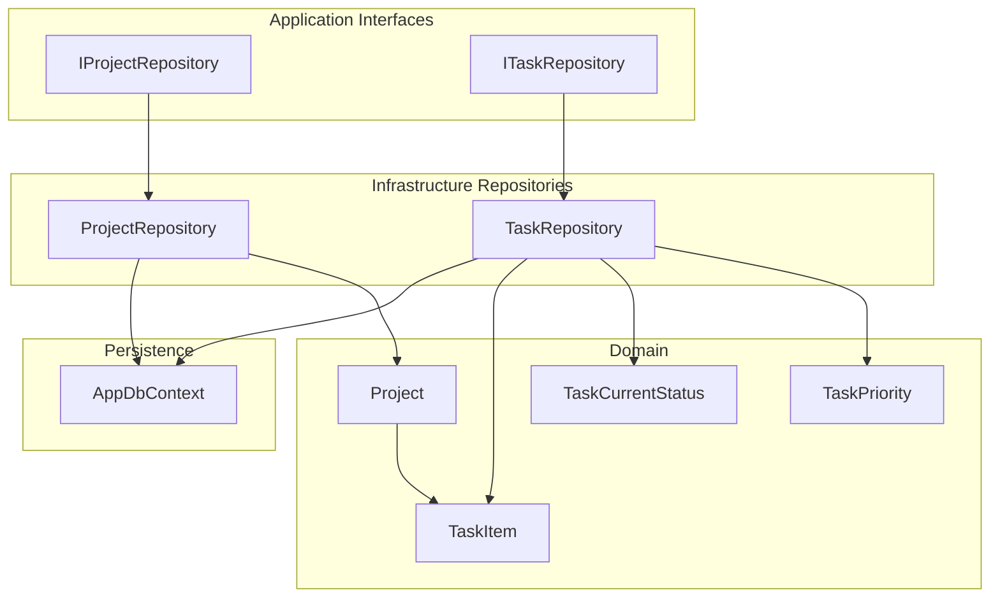
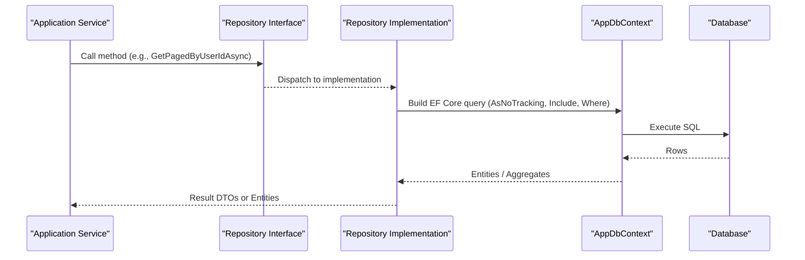
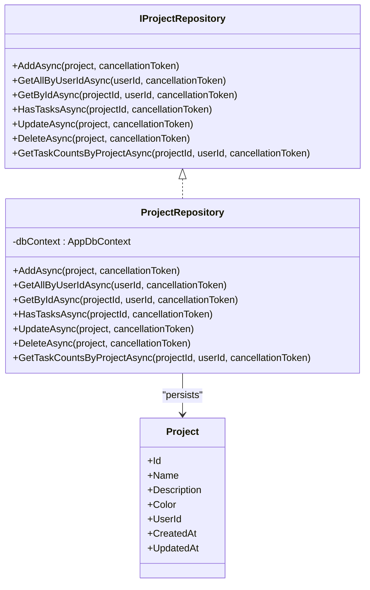
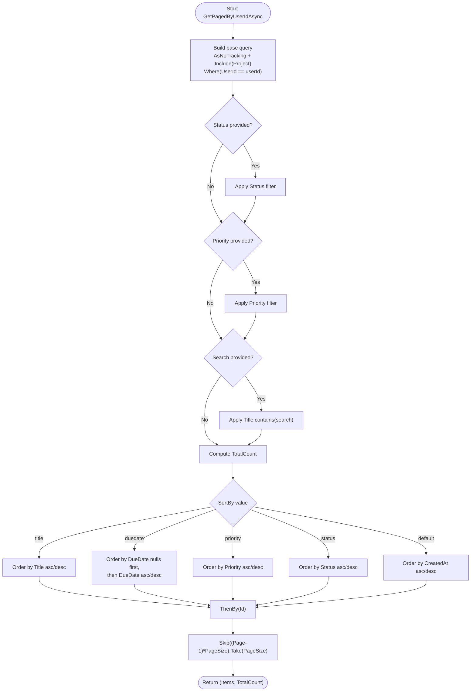
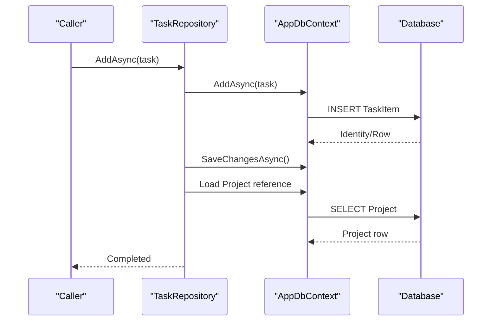
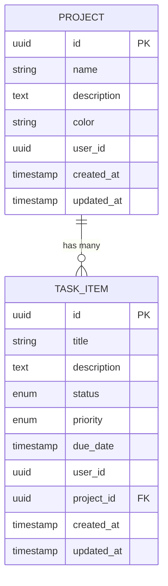
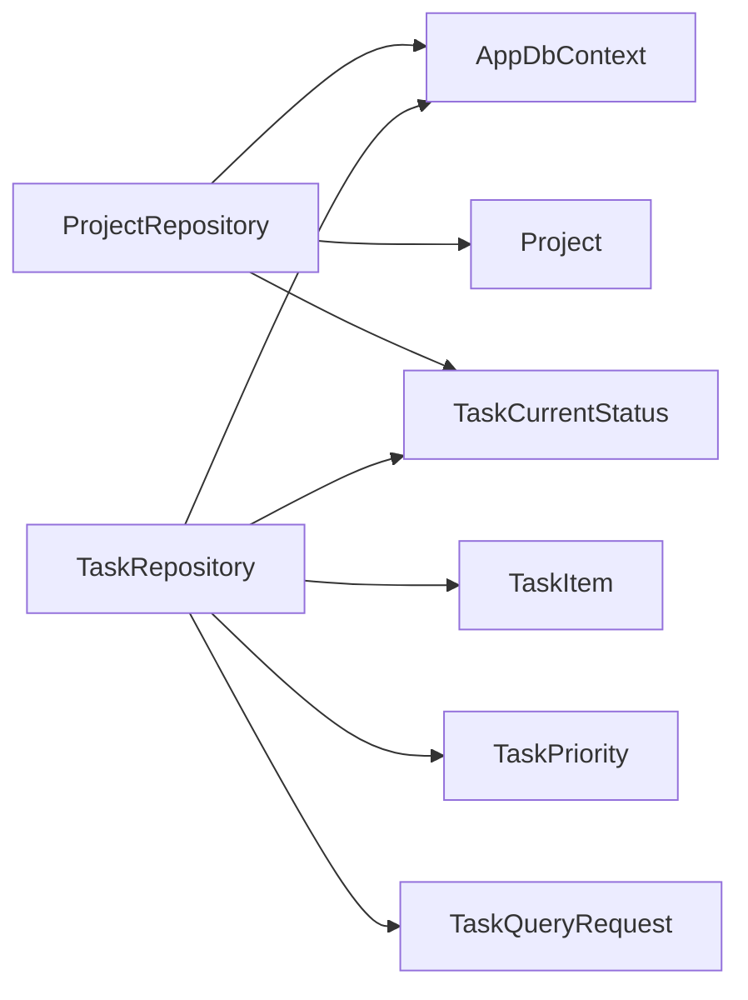

# Repository Implementations

<cite>
**Referenced Files in This Document**
- [ProjectRepository.cs](file://Services/Services.Infrastructure/Repositories/ProjectRepository.cs)
- [TaskRepository.cs](file://Services/Services.Infrastructure/Repositories/TaskRepository.cs)
- [IProjectRepository.cs](file://Services/Services.Application/Interfaces/Repositories/IProjectRepository.cs)
- [ITaskRepository.cs](file://Services/Services.Application/Interfaces/Repositories/ITaskRepository.cs)
- [Project.cs](file://Services/Services.Domain/Entities/Project.cs)
- [TaskItem.cs](file://Services/Services.Domain/Entities/TaskItem.cs)
- [AppDbContext.cs](file://Services/Services.Infrastructure/Persistence/AppDbContext.cs)
- [TaskQueryRequest.cs](file://Services/Services.Application/DTOs/Tasks/TaskQueryRequest.cs)
- [TaskCurrentStatus.cs](file://Services/Services.Domain/Enums/TaskCurrentStatus.cs)
- [TaskPriority.cs](file://Services/Services.Domain/Enums/TaskPriority.cs)
</cite>

## Table of Contents
1. [Introduction](#introduction)
2. [Project Structure](#project-structure)
3. [Core Components](#core-components)
4. [Architecture Overview](#architecture-overview)
5. [Detailed Component Analysis](#detailed-component-analysis)
6. [Dependency Analysis](#dependency-analysis)
7. [Performance Considerations](#performance-considerations)
8. [Troubleshooting Guide](#troubleshooting-guide)
9. [Conclusion](#conclusion)
10. [Appendices](#appendices)

## Introduction
This document explains the repository implementations that abstract data access for Projects and Tasks. It focuses on:
- ProjectRepository methods for CRUD, project search by user, relationship checks, and task counts per status.
- TaskRepository methods for lifecycle operations, status transitions via domain methods, filtering, sorting, and pagination.
- Query optimization techniques such as AsNoTracking, efficient joins via Include, grouped aggregations, and stable ordering with tiebreakers.
- Async/await patterns and cancellation token propagation.
- Error handling strategies at the domain and persistence layers.
- Examples of complex queries and joins between projects and tasks.
- Guidance on unit of work patterns, transaction management, and testing strategies.
- Best practices for extending repositories while maintaining data consistency.

## Project Structure
The repository layer is implemented under Services.Infrastructure.Repositories and depends on:
- Domain entities (Project, TaskItem) and enums (TaskCurrentStatus, TaskPriority).
- Application interfaces (IProjectRepository, ITaskRepository).
- Persistence context (AppDbContext) and EF Core query APIs.

**Diagram sources**
- [IProjectRepository.cs:6-37](file://Services/Services.Application/Interfaces/Repositories/IProjectRepository.cs#L6-L37)
- [ITaskRepository.cs:6-44](file://Services/Services.Application/Interfaces/Repositories/ITaskRepository.cs#L6-L44)
- [ProjectRepository.cs:9-97](file://Services/Services.Infrastructure/Repositories/ProjectRepository.cs#L9-L97)
- [TaskRepository.cs:9-239](file://Services/Services.Infrastructure/Repositories/TaskRepository.cs#L9-L239)
- [Project.cs:5-121](file://Services/Services.Domain/Entities/Project.cs#L5-L121)
- [TaskItem.cs:6-128](file://Services/Services.Domain/Entities/TaskItem.cs#L6-L128)
- [TaskCurrentStatus.cs:3-8](file://Services/Services.Domain/Enums/TaskCurrentStatus.cs#L3-L8)
- [TaskPriority.cs:3-9](file://Services/Services.Domain/Enums/TaskPriority.cs#L3-L9)
- [AppDbContext.cs:10-24](file://Services/Services.Infrastructure/Persistence/AppDbContext.cs#L10-L24)

**Section sources**
- [ProjectRepository.cs:9-97](file://Services/Services.Infrastructure/Repositories/ProjectRepository.cs#L9-L97)
- [TaskRepository.cs:9-239](file://Services/Services.Infrastructure/Repositories/TaskRepository.cs#L9-L239)
- [AppDbContext.cs:10-24](file://Services/Services.Infrastructure/Persistence/AppDbContext.cs#L10-L24)

## Core Components
- IProjectRepository defines asynchronous operations to add, update, delete, retrieve by ID, list by user, check if a project has tasks, and get task counts by status.
- ITaskRepository defines asynchronous operations to add, update, delete, retrieve by ID, list by user, verify project existence, and perform filtered, sorted, and paged queries by user or project.
- ProjectRepository implements IProjectRepository using EF Core against AppDbContext.
- TaskRepository implements ITaskRepository using EF Core against AppDbContext, including eager loading of related Project and advanced query composition.

Key responsibilities:
- Data access abstraction through strongly typed interfaces.
- Encapsulation of EF Core query patterns and optimizations.
- Enforcing user-scoped access control by UserId filters.
- Providing reusable query building blocks for filtering, sorting, and pagination.

**Section sources**
- [IProjectRepository.cs:6-37](file://Services/Services.Application/Interfaces/Repositories/IProjectRepository.cs#L6-L37)
- [ITaskRepository.cs:6-44](file://Services/Services.Application/Interfaces/Repositories/ITaskRepository.cs#L6-L44)
- [ProjectRepository.cs:9-97](file://Services/Services.Infrastructure/Repositories/ProjectRepository.cs#L9-L97)
- [TaskRepository.cs:9-239](file://Services/Services.Infrastructure/Repositories/TaskRepository.cs#L9-L239)

## Architecture Overview
The repository pattern separates business logic from data access. The application services call repository interfaces; infrastructure provides concrete implementations backed by EF Core.

**Diagram sources**
- [TaskRepository.cs:82-157](file://Services/Services.Infrastructure/Repositories/TaskRepository.cs#L82-L157)
- [AppDbContext.cs:10-24](file://Services/Services.Infrastructure/Persistence/AppDbContext.cs#L10-L24)

## Detailed Component Analysis

### ProjectRepository
Responsibilities:
- Add, update, delete projects.
- Retrieve projects by user ID.
- Check whether a project has associated tasks.
- Aggregate task counts by status for a given project and user.

Key behaviors:
- AddAsync inserts a project and persists changes.
- GetAllByUserIdAsync returns read-only lists without tracking for performance.
- GetByIdAsync enforces user ownership by filtering on UserId.
- HasTasksAsync uses AnyAsync for efficient existence checks.
- UpdateAsync relies on EF change tracking to persist updates.
- DeleteAsync removes the entity and persists changes.
- GetTaskCountsByProjectAsync groups tasks by status and converts to a dictionary.

Optimizations:
- AsNoTracking for read-only queries.
- Efficient AnyAsync for existence checks.
- GroupBy + Select projection executed server-side.

**Diagram sources**
- [IProjectRepository.cs:6-37](file://Services/Services.Application/Interfaces/Repositories/IProjectRepository.cs#L6-L37)
- [ProjectRepository.cs:9-97](file://Services/Services.Infrastructure/Repositories/ProjectRepository.cs#L9-L97)
- [Project.cs:5-121](file://Services/Services.Domain/Entities/Project.cs#L5-L121)

**Section sources**
- [ProjectRepository.cs:13-23](file://Services/Services.Infrastructure/Repositories/ProjectRepository.cs#L13-L23)
- [ProjectRepository.cs:25-34](file://Services/Services.Infrastructure/Repositories/ProjectRepository.cs#L25-L34)
- [ProjectRepository.cs:36-47](file://Services/Services.Infrastructure/Repositories/ProjectRepository.cs#L36-L47)
- [ProjectRepository.cs:49-58](file://Services/Services.Infrastructure/Repositories/ProjectRepository.cs#L49-L58)
- [ProjectRepository.cs:60-74](file://Services/Services.Infrastructure/Repositories/ProjectRepository.cs#L60-L74)
- [ProjectRepository.cs:76-96](file://Services/Services.Infrastructure/Repositories/ProjectRepository.cs#L76-L96)

### TaskRepository
Responsibilities:
- Lifecycle operations: create, update, delete, retrieve by ID, list by user.
- Verify project existence for a user before assignment.
- Provide filtered, sorted, and paged queries by user or project.

Lifecycle and status transitions:
- Create: AddAsync persists a new task and eagerly loads the related Project reference.
- Update: UpdateAsync persists changes tracked by EF Core.
- Delete: DeleteAsync removes the task and persists changes.
- Status transitions: Use domain method ChangeStatus on TaskItem to enforce valid states and update timestamps.

Filtering capabilities:
- Filter by Status and Priority when provided.
- Search by Title substring match.

Pagination support:
- Stable ordering with a final tiebreaker on Id.
- Skip/Take based on Page and PageSize.
- TotalCount computed before paging.

Complex queries and joins:
- Include(task => task.Project) performs an inner join to load related Project data efficiently.
- User-scoped queries ensure data isolation by UserId.

**Diagram sources**
- [TaskRepository.cs:82-157](file://Services/Services.Infrastructure/Repositories/TaskRepository.cs#L82-L157)
- [TaskQueryRequest.cs:5-20](file://Services/Services.Application/DTOs/Tasks/TaskQueryRequest.cs#L5-L20)

**Diagram sources**
- [TaskRepository.cs:13-23](file://Services/Services.Infrastructure/Repositories/TaskRepository.cs#L13-L23)
- [AppDbContext.cs:10-24](file://Services/Services.Infrastructure/Persistence/AppDbContext.cs#L10-L24)

**Section sources**
- [TaskRepository.cs:13-23](file://Services/Services.Infrastructure/Repositories/TaskRepository.cs#L13-L23)
- [TaskRepository.cs:25-37](file://Services/Services.Infrastructure/Repositories/TaskRepository.cs#L25-L37)
- [TaskRepository.cs:39-51](file://Services/Services.Infrastructure/Repositories/TaskRepository.cs#L39-L51)
- [TaskRepository.cs:53-67](file://Services/Services.Infrastructure/Repositories/TaskRepository.cs#L53-L67)
- [TaskRepository.cs:69-80](file://Services/Services.Infrastructure/Repositories/TaskRepository.cs#L69-L80)
- [TaskRepository.cs:82-157](file://Services/Services.Infrastructure/Repositories/TaskRepository.cs#L82-L157)
- [TaskRepository.cs:159-237](file://Services/Services.Infrastructure/Repositories/TaskRepository.cs#L159-L237)
- [TaskItem.cs:103-115](file://Services/Services.Domain/Entities/TaskItem.cs#L103-L115)

### Entity Models and Relationships
- Project has a collection of TaskItem instances.
- TaskItem references a Project and includes user scoping via UserId.
- Enums define allowed values for TaskCurrentStatus and TaskPriority.

**Diagram sources**
- [Project.cs:5-121](file://Services/Services.Domain/Entities/Project.cs#L5-L121)
- [TaskItem.cs:6-128](file://Services/Services.Domain/Entities/TaskItem.cs#L6-L128)

**Section sources**
- [Project.cs:5-121](file://Services/Services.Domain/Entities/Project.cs#L5-L121)
- [TaskItem.cs:6-128](file://Services/Services.Domain/Entities/TaskItem.cs#L6-L128)
- [TaskCurrentStatus.cs:3-8](file://Services/Services.Domain/Enums/TaskCurrentStatus.cs#L3-L8)
- [TaskPriority.cs:3-9](file://Services/Services.Domain/Enums/TaskPriority.cs#L3-L9)

## Dependency Analysis
- ProjectRepository depends on AppDbContext and domain types Project and TaskCurrentStatus.
- TaskRepository depends on AppDbContext, domain types TaskItem, enums TaskCurrentStatus and TaskPriority, and the TaskQueryRequest DTO.
- Both repositories are decoupled from controllers/services via interfaces, enabling testability and inversion of control.

**Diagram sources**
- [ProjectRepository.cs:9-97](file://Services/Services.Infrastructure/Repositories/ProjectRepository.cs#L9-L97)
- [TaskRepository.cs:9-239](file://Services/Services.Infrastructure/Repositories/TaskRepository.cs#L9-L239)
- [AppDbContext.cs:10-24](file://Services/Services.Infrastructure/Persistence/AppDbContext.cs#L10-L24)
- [TaskQueryRequest.cs:5-20](file://Services/Services.Application/DTOs/Tasks/TaskQueryRequest.cs#L5-L20)

**Section sources**
- [ProjectRepository.cs:9-97](file://Services/Services.Infrastructure/Repositories/ProjectRepository.cs#L9-L97)
- [TaskRepository.cs:9-239](file://Services/Services.Infrastructure/Repositories/TaskRepository.cs#L9-L239)
- [AppDbContext.cs:10-24](file://Services/Services.Infrastructure/Persistence/AppDbContext.cs#L10-L24)
- [TaskQueryRequest.cs:5-20](file://Services/Services.Application/DTOs/Tasks/TaskQueryRequest.cs#L5-L20)

## Performance Considerations
- Read-only queries use AsNoTracking to avoid change-tracking overhead.
- Eager loading via Include reduces N+1 queries when retrieving tasks with their projects.
- Existence checks use AnyAsync to minimize data transfer.
- GroupBy projections are executed server-side to aggregate task counts efficiently.
- Pagination uses Skip/Take with deterministic ordering and a final tiebreaker on Id to ensure stable results across pages.
- Cancellation tokens are propagated to all async EF calls to support responsive operations.

Recommendations:
- Prefer AsNoTracking for read-heavy endpoints.
- Keep Include selective to only necessary relationships.
- Validate and normalize inputs early to reduce unnecessary database work.
- Index frequently filtered columns (e.g., UserId, ProjectId, Status, Priority, DueDate) at the database level.

[No sources needed since this section provides general guidance]

## Troubleshooting Guide
Common issues and resolutions:
- Missing Project reference after creation: Ensure AddAsync loads the Project reference via Entry(...).Reference(...).LoadAsync.
- Unexpected empty search results: Confirm case-sensitivity and normalization of search strings; consider consistent ToLowerInvariant usage.
- Unstable pagination: Always apply a final ThenBy on Id to stabilize orderings.
- Unauthorized access: Ensure all queries include UserId filters to prevent cross-user data leakage.
- Validation errors: Domain constructors and methods throw exceptions for invalid inputs; handle these at service boundaries.

Error handling strategies:
- Domain validation throws ArgumentException or ArgumentOutOfRangeException for invalid inputs.
- Repository methods propagate exceptions from EF Core; wrap them in application-level error handling where appropriate.
- Use CancellationToken to abort long-running queries promptly.

**Section sources**
- [TaskRepository.cs:13-23](file://Services/Services.Infrastructure/Repositories/TaskRepository.cs#L13-L23)
- [TaskRepository.cs:108-116](file://Services/Services.Infrastructure/Repositories/TaskRepository.cs#L108-L116)
- [TaskRepository.cs:147-154](file://Services/Services.Infrastructure/Repositories/TaskRepository.cs#L147-L154)
- [Project.cs:35-49](file://Services/Services.Domain/Entities/Project.cs#L35-L49)
- [TaskItem.cs:35-52](file://Services/Services.Domain/Entities/TaskItem.cs#L35-L52)
- [TaskItem.cs:80-115](file://Services/Services.Domain/Entities/TaskItem.cs#L80-L115)

## Conclusion
The repository implementations provide a clean abstraction over EF Core for Project and Task data access. They emphasize:
- Strongly typed interfaces for testability.
- User-scoped queries for security.
- Optimized queries using AsNoTracking, Include, AnyAsync, and server-side aggregation.
- Robust pagination with stable ordering.
- Clear separation of concerns between domain validation and persistence.

Extending repositories should follow existing patterns:
- Add new methods to interfaces and implement them in repositories.
- Preserve user-scoped filters and validate inputs at the domain layer.
- Maintain async/await and cancellation token propagation.
- Keep queries efficient and avoid unnecessary data loading.

[No sources needed since this section summarizes without analyzing specific files]

## Appendices

### Unit of Work and Transaction Management
- AppDbContext acts as a unit of work; SaveChangesAsync commits multiple changes atomically within a single operation.
- For multi-step transactions involving multiple repositories, wrap operations in a database transaction at the service layer or configure scoped transactions around repository calls.
- Ensure each repository method participates in the same DbContext scope to maintain consistency.

[No sources needed since this section provides general guidance]

### Testing Strategies
- Mock AppDbContext or use an in-memory provider for integration tests.
- Test repository methods for:
  - Correctness of filters and joins.
  - Proper handling of missing entities.
  - Pagination stability and total counts.
  - Cancellation behavior.
- Assert domain invariants by validating that domain methods (e.g., ChangeStatus) are used appropriately.

[No sources needed since this section provides general guidance]