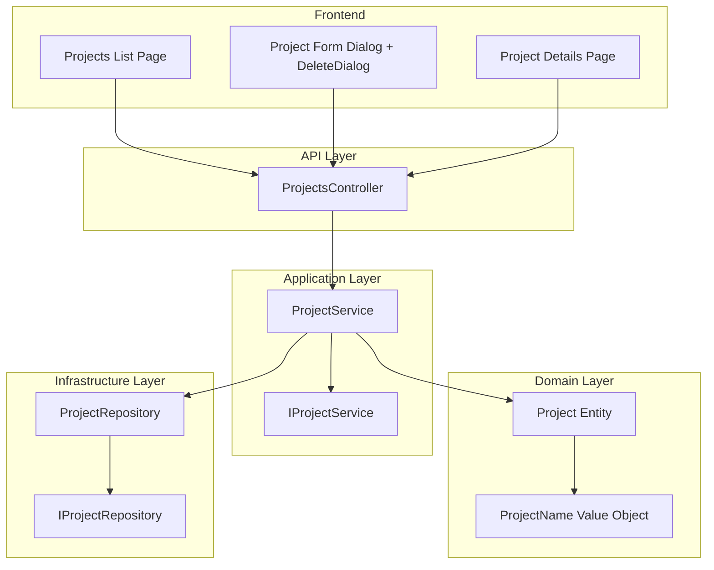
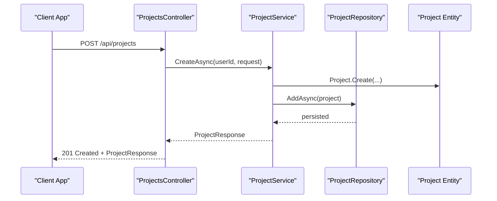
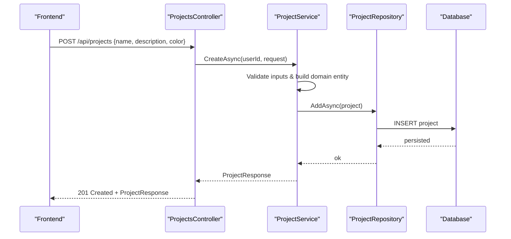
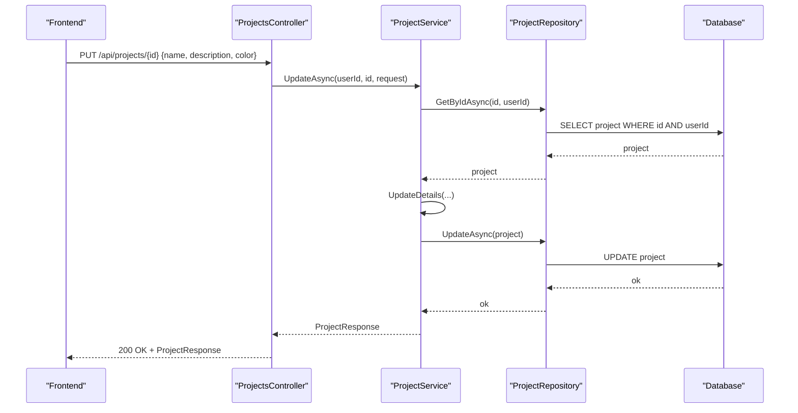
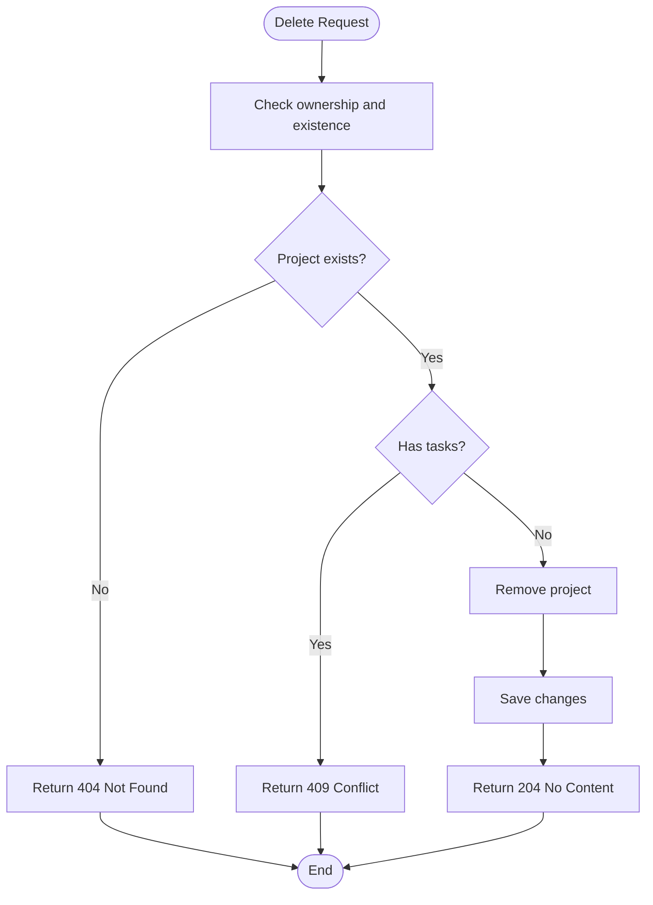
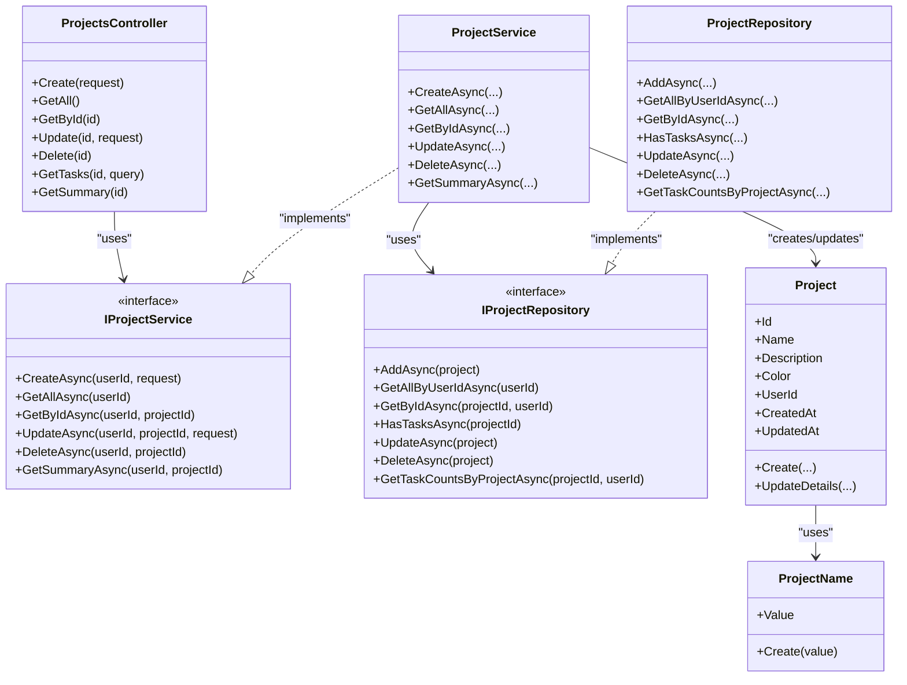

# Project CRUD Operations

<cite>
**Referenced Files in This Document**
- [ProjectsController.cs](file://Services/Services.Api/Controllers/ProjectsController.cs)
- [ProjectService.cs](file://Services/Services.Application/Services/ProjectService.cs)
- [IProjectService.cs](file://Services/Services.Application/Interfaces/Services/IProjectService.cs)
- [IProjectRepository.cs](file://Services/Services.Application/Interfaces/Repositories/IProjectRepository.cs)
- [ProjectRepository.cs](file://Services/Services.Infrastructure/Repositories/ProjectRepository.cs)
- [Project.cs](file://Services/Services.Domain/Entities/Project.cs)
- [ProjectName.cs](file://Services/Services.Domain/ValueObjects/ProjectName.cs)
- [CreateProjectRequest.cs](file://Services/Services.Application/DTOs/Projects/CreateProjectRequest.cs)
- [UpdateProjectRequest.cs](file://Services/Services.Application/DTOs/Projects/UpdateProjectRequest.cs)
- [ProjectResponse.cs](file://Services/Services.Application/DTOs/Projects/ProjectResponse.cs)
- [ProjectSummaryResponse.cs](file://Services/Services.Application/DTOs/Projects/ProjectSummaryResponse.cs)
- [page.tsx (Projects list)](file://Apps/Web/src/app/(protected)/projects/page.tsx)
- [project-form.tsx](file://Apps/Web/src/components/projects-page/project-form.tsx)
- [list-section.tsx](file://Apps/Web/src/components/projects-page/list-section.tsx)
- [page.tsx (Project details)](file://Apps/Web/src/app/(protected)/projects/[projectSlug]/page.tsx)
</cite>

## Update Summary
**Changes Made**
- Updated Frontend Integration Patterns section to reflect consolidated DeleteDialog component
- Modified project form dialog documentation to include DeleteDialog export
- Updated component architecture diagrams to show new DeleteDialog location
- Enhanced delete operation documentation with improved code organization

## Table of Contents
1. Introduction
2. Project Structure
3. Core Components
4. Architecture Overview
5. Detailed Component Analysis
6. Dependency Analysis
7. Performance Considerations
8. Troubleshooting Guide
9. Conclusion

## Introduction
This document explains the complete lifecycle of project management in TaskFlow, covering Create, Read, Update, and Delete operations. It documents the backend API endpoints, service logic, domain validation, repository interactions, and frontend integration patterns for each operation. The goal is to provide a clear, code-backed reference for developers integrating or extending project CRUD functionality.

## Project Structure
The project follows a layered architecture:
- API layer: ASP.NET Core controllers exposing REST endpoints.
- Application layer: Use cases and orchestration via services.
- Domain layer: Entities, value objects, and business rules.
- Infrastructure layer: Data persistence via repositories and EF Core.
- Frontend: Next.js client components calling the API.

**Diagram sources**
- [ProjectsController.cs:12-18](file://Services/Services.Api/Controllers/ProjectsController.cs#L12-L18)
- [ProjectService.cs:11-13](file://Services/Services.Application/Services/ProjectService.cs#L11-L13)
- [IProjectService.cs:5-36](file://Services/Services.Application/Interfaces/Services/IProjectService.cs#L5-L36)
- [ProjectRepository.cs:9-11](file://Services/Services.Infrastructure/Repositories/ProjectRepository.cs#L9-L11)
- [IProjectRepository.cs:6-37](file://Services/Services.Application/Interfaces/Repositories/IProjectRepository.cs#L6-L37)
- [Project.cs:5-23](file://Services/Services.Domain/Entities/Project.cs#L5-L23)
- [ProjectName.cs:3-37](file://Services/Services.Domain/ValueObjects/ProjectName.cs#L3-L37)

**Section sources**
- [ProjectsController.cs:12-18](file://Services/Services.Api/Controllers/ProjectsController.cs#L12-L18)
- [ProjectService.cs:11-13](file://Services/Services.Application/Services/ProjectService.cs#L11-L13)
- [ProjectRepository.cs:9-11](file://Services/Services.Infrastructure/Repositories/ProjectRepository.cs#L9-L11)
- [Project.cs:5-23](file://Services/Services.Domain/Entities/Project.cs#L5-L23)
- [ProjectName.cs:3-37](file://Services/Services.Domain/ValueObjects/ProjectName.cs#L3-L37)

## Core Components
- ProjectsController: Exposes REST endpoints for projects with authorization and error mapping.
- ProjectService: Implements business logic, validation, ownership checks, and maps to DTOs.
- Project entity and ProjectName value object: Enforce domain constraints such as name length, color format, and description limits.
- ProjectRepository: Persists data and provides queries including task existence and counts.
- DTOs: Request/response contracts for clients.

Key responsibilities:
- Controller handles HTTP concerns and translates exceptions to appropriate status codes.
- Service enforces business rules and coordinates repository calls.
- Repository abstracts database access and query composition.
- Domain ensures invariant integrity.

**Section sources**
- [ProjectsController.cs:20-157](file://Services/Services.Api/Controllers/ProjectsController.cs#L20-L157)
- [ProjectService.cs:15-127](file://Services/Services.Application/Services/ProjectService.cs#L15-L127)
- [Project.cs:51-78](file://Services/Services.Domain/Entities/Project.cs#L51-L78)
- [ProjectName.cs:14-33](file://Services/Services.Domain/ValueObjects/ProjectName.cs#L14-L33)
- [ProjectRepository.cs:13-96](file://Services/Services.Infrastructure/Repositories/ProjectRepository.cs#L13-L96)

## Architecture Overview
The request flow for project CRUD operations traverses the controller, service, repository, and domain layers. Validation occurs at multiple levels:
- Input validation in DTOs and domain value objects.
- Business rule enforcement in the service and entity.
- Ownership checks ensure users can only access their own projects.

**Diagram sources**
- [ProjectsController.cs:20-43](file://Services/Services.Api/Controllers/ProjectsController.cs#L20-L43)
- [ProjectService.cs:15-38](file://Services/Services.Application/Services/ProjectService.cs#L15-L38)
- [ProjectRepository.cs:13-23](file://Services/Services.Infrastructure/Repositories/ProjectRepository.cs#L13-L23)
- [Project.cs:51-64](file://Services/Services.Domain/Entities/Project.cs#L51-L64)

## Detailed Component Analysis

### API Endpoints: ProjectsController
Endpoints and behavior:
- POST /api/projects
  - Creates a new project for the authenticated user.
  - Returns 201 Created with ProjectResponse on success.
  - Returns 400 Bad Request on validation errors.
- GET /api/projects
  - Lists all projects owned by the authenticated user.
  - Returns 200 OK with array of ProjectResponse.
- GET /api/projects/{id}
  - Retrieves a specific project owned by the authenticated user.
  - Returns 200 OK with ProjectResponse.
  - Returns 404 Not Found if not found.
  - Returns 400 Bad Request on validation errors.
- PUT /api/projects/{id}
  - Updates project details owned by the authenticated user.
  - Returns 200 OK with updated ProjectResponse.
  - Returns 404 Not Found if not found.
  - Returns 400 Bad Request on validation errors.
- DELETE /api/projects/{id}
  - Deletes a project owned by the authenticated user.
  - Returns 204 No Content on success.
  - Returns 404 Not Found if not found.
  - Returns 400 Bad Request on validation errors.
  - Returns 409 Conflict if project has associated tasks.
- GET /api/projects/{id}/tasks
  - Retrieves tasks for a project with filtering and pagination via TaskQueryRequest.
  - Returns 200 OK with PagedResponse<TaskResponse>.
  - Returns 404 Not Found if project not found.
  - Returns 400 Bad Request on validation errors.
- GET /api/projects/{id}/summary
  - Returns project summary with task counts and progress percentage.
  - Returns 200 OK with ProjectSummaryResponse.
  - Returns 404 Not Found if project not found.
  - Returns 400 Bad Request on invalid arguments.

Authentication:
- All endpoints are protected; the controller extracts the current user ID from the JWT subject claim.

Error handling:
- ValidationException mapped to 400 Bad Request.
- KeyNotFoundException mapped to 404 Not Found.
- InvalidOperationException mapped to 409 Conflict (e.g., delete with tasks).

**Section sources**
- [ProjectsController.cs:20-157](file://Services/Services.Api/Controllers/ProjectsController.cs#L20-L157)
- [ProjectsController.cs:159-173](file://Services/Services.Api/Controllers/ProjectsController.cs#L159-L173)
- [ProjectsController.cs:175-197](file://Services/Services.Api/Controllers/ProjectsController.cs#L175-L197)

### Service Layer: ProjectService
Responsibilities:
- Validate inputs and identifiers.
- Enforce ownership by querying repository with both projectId and userId.
- Apply domain updates via entity methods.
- Prevent deletion when tasks exist.
- Map domain entities to DTO responses.

Method summaries:
- CreateAsync(userId, request): Validates, constructs domain entity, persists, returns ProjectResponse.
- GetAllAsync(userId): Returns all projects for the user.
- GetByIdAsync(userId, projectId): Returns a single project if owned by the user.
- UpdateAsync(userId, projectId, request): Loads owned project, updates via entity method, persists, returns ProjectResponse.
- DeleteAsync(userId, projectId): Checks for associated tasks; deletes if none; throws InvalidOperationException if tasks exist.
- GetSummaryAsync(userId, projectId): Computes task counts and progress percentage for the project.

Validation and business rules:
- User ID must be non-empty.
- Project ID must be non-empty.
- Name validated via ProjectName value object (non-empty, max length).
- Color validated via entity normalization (required, hex format).
- Description normalized and limited to 1000 characters.

Error handling:
- Throws ValidationException for invalid inputs.
- Throws KeyNotFoundException when project not found.
- Throws InvalidOperationException when deleting a project with tasks.

**Section sources**
- [ProjectService.cs:15-127](file://Services/Services.Application/Services/ProjectService.cs#L15-L127)
- [ProjectService.cs:129-167](file://Services/Services.Application/Services/ProjectService.cs#L129-L167)
- [ProjectService.cs:181-231](file://Services/Services.Application/Services/ProjectService.cs#L181-L231)

### Domain Model: Project and ProjectName
Project entity:
- Properties include Id, Name (value object), Description, Color, UserId, Tasks collection, timestamps.
- Factory method Create enforces required fields and sets defaults.
- UpdateDetails applies changes and updates timestamp.
- Normalization:
  - Description trimmed and limited to 1000 characters.
  - Color trimmed, required, validated against hex pattern, normalized to uppercase.

ProjectName value object:
- MaxLength constant enforced during creation.
- Trimmed and validated to prevent empty values.

Complexity considerations:
- Creation and update operations are O(1) relative to payload size.
- Validation is linear in string lengths.

**Section sources**
- [Project.cs:5-121](file://Services/Services.Domain/Entities/Project.cs#L5-L121)
- [ProjectName.cs:3-37](file://Services/Services.Domain/ValueObjects/ProjectName.cs#L3-L37)

### Repository Layer: ProjectRepository
Capabilities:
- AddAsync: Inserts a project and saves changes.
- GetAllByUserIdAsync: Reads projects for a user, ordered by name, without tracking.
- GetByIdAsync: Reads a project by id and owner id.
- HasTasksAsync: Checks if any tasks belong to a project.
- UpdateAsync: Persists changes to an existing project.
- DeleteAsync: Removes a project and saves changes.
- GetTaskCountsByProjectAsync: Groups tasks by status for a project and user to compute summary metrics.

Performance notes:
- AsNoTracking used for read-only queries to improve performance.
- Grouping and aggregation performed server-side.

**Section sources**
- [ProjectRepository.cs:13-96](file://Services/Services.Infrastructure/Repositories/ProjectRepository.cs#L13-L96)

### Data Models and Contracts
Requests:
- CreateProjectRequest: name (required), description (optional), color (default "#6366F1").
- UpdateProjectRequest: same shape as create.

Responses:
- ProjectResponse: id, name, description, color, createdAt, updatedAt.
- ProjectSummaryResponse: projectId, projectName, totalTasks, completedTasks, pendingTasks, progressPercentage.

Constraints:
- Name validated by domain value object (non-empty, max length).
- Color validated by entity (hex format, required).
- Description normalized and limited to 1000 characters.

**Section sources**
- [CreateProjectRequest.cs:3-7](file://Services/Services.Application/DTOs/Projects/CreateProjectRequest.cs#L3-L7)
- [UpdateProjectRequest.cs:3-7](file://Services/Services.Application/DTOs/Projects/UpdateProjectRequest.cs#L3-L7)
- [ProjectResponse.cs:3-10](file://Services/Services.Application/DTOs/Projects/ProjectResponse.cs#L3-L10)
- [ProjectSummaryResponse.cs:3-9](file://Services/Services.Application/DTOs/Projects/ProjectSummaryResponse.cs#L3-L9)

### Frontend Integration Patterns

#### Projects List Page
- Loads all projects on mount using projectsApi.list().
- Displays loading states, errors, and empty state.
- Opens ProjectFormDialog for create/edit.
- Calls projectsApi.remove() for deletion and updates local state.

User flows:
- Create: Click "Create project" -> open dialog -> submit -> refresh list.
- Edit: Open dialog with existing project -> submit -> update list item.
- Delete: Confirm via consolidated DeleteDialog -> remove -> optimistic UI update.

**Section sources**
- [page.tsx (Projects list):12-55](file://Apps/Web/src/app/(protected)/projects/page.tsx#L12-L55)
- [page.tsx (Projects list):57-107](file://Apps/Web/src/app/(protected)/projects/page.tsx#L57-L107)

#### Project Form Dialog and DeleteDialog
**Updated** The project form dialog now includes a consolidated DeleteDialog component for improved code organization.

- Handles both create and update based on presence of project prop.
- Submits either projectsApi.create() or projectsApi.update().
- Shows success/error toasts and closes dialog after submission.
- **New**: Exports DeleteDialog component for reuse across the application.

DeleteDialog component:
- Reusable confirmation dialog for project deletion.
- Integrated directly into project-form.tsx for better code organization.
- Provides consistent confirmation behavior across the application.
- Handles loading states and error scenarios.

Validation:
- HTML form requires name field.
- Backend validates additional constraints (name length, color format, description length).

**Section sources**
- [project-form.tsx:38-105](file://Apps/Web/src/components/projects-page/project-form.tsx#L38-L105)
- [project-form.tsx:107-179](file://Apps/Web/src/components/projects-page/project-form.tsx#L107-L179)
- [project-form.tsx:181-227](file://Apps/Web/src/components/projects-page/project-form.tsx#L181-L227)

#### Projects List Section
- Renders cards with actions: view, edit, delete.
- Uses DropdownMenu for actions.
- Integrates consolidated DeleteDialog for confirmation and deletion.

Optimistic updates:
- On successful delete, removes the project from local list immediately.

**Section sources**
- [list-section.tsx:26-65](file://Apps/Web/src/components/projects-page/list-section.tsx#L26-L65)
- [list-section.tsx:67-166](file://Apps/Web/src/components/projects-page/list-section.tsx#L67-L166)

#### Project Details Page
- Loads project by id and displays metadata.
- Provides edit and delete actions.
- Integrates task listing with filtering and pagination.
- **Updated**: Uses consolidated DeleteDialog component from project-form.tsx.

User flows:
- Edit project: opens ProjectFormDialog pre-filled with project data.
- Delete project: confirms via consolidated DeleteDialog, then navigates back.

**Section sources**
- [page.tsx (Project details):45-96](file://Apps/Web/src/app/(protected)/projects/[projectSlug]/page.tsx#L45-L96)
- [page.tsx (Project details):124-130](file://Apps/Web/src/app/(protected)/projects/[projectSlug]/page.tsx#L124-L130)
- [page.tsx (Project details):174-198](file://Apps/Web/src/app/(protected)/projects/[projectSlug]/page.tsx#L174-L198)
- [page.tsx (Project details):209-327](file://Apps/Web/src/app/(protected)/projects/[projectSlug]/page.tsx#L209-L327)

### Sequence Diagrams for CRUD Operations

#### Create Project Flow

**Diagram sources**
- [ProjectsController.cs:20-43](file://Services/Services.Api/Controllers/ProjectsController.cs#L20-L43)
- [ProjectService.cs:15-38](file://Services/Services.Application/Services/ProjectService.cs#L15-L38)
- [ProjectRepository.cs:13-23](file://Services/Services.Infrastructure/Repositories/ProjectRepository.cs#L13-L23)

#### Update Project Flow

**Diagram sources**
- [ProjectsController.cs:105-128](file://Services/Services.Api/Controllers/ProjectsController.cs#L105-L128)
- [ProjectService.cs:70-99](file://Services/Services.Application/Services/ProjectService.cs#L70-L99)
- [ProjectRepository.cs:36-47](file://Services/Services.Infrastructure/Repositories/ProjectRepository.cs#L36-L47)
- [ProjectRepository.cs:60-65](file://Services/Services.Infrastructure/Repositories/ProjectRepository.cs#L60-L65)

#### Delete Project Flow

**Diagram sources**
- [ProjectService.cs:101-127](file://Services/Services.Application/Services/ProjectService.cs#L101-L127)
- [ProjectRepository.cs:49-58](file://Services/Services.Infrastructure/Repositories/ProjectRepository.cs#L49-L58)
- [ProjectRepository.cs:67-74](file://Services/Services.Infrastructure/Repositories/ProjectRepository.cs#L67-L74)

## Dependency Analysis
Component relationships:
- ProjectsController depends on IProjectService and ITaskService.
- ProjectService implements IProjectService and depends on IProjectRepository.
- ProjectRepository implements IProjectRepository and uses EF Core context.
- Domain entities and value objects encapsulate business rules.

**Diagram sources**
- [ProjectsController.cs:12-18](file://Services/Services.Api/Controllers/ProjectsController.cs#L12-L18)
- [IProjectService.cs:5-36](file://Services/Services.Application/Interfaces/Services/IProjectService.cs#L5-L36)
- [ProjectService.cs:11-13](file://Services/Services.Application/Services/ProjectService.cs#L11-L13)
- [IProjectRepository.cs:6-37](file://Services/Services.Application/Interfaces/Repositories/IProjectRepository.cs#L6-L37)
- [ProjectRepository.cs:9-11](file://Services/Services.Infrastructure/Repositories/ProjectRepository.cs#L9-L11)
- [Project.cs:5-23](file://Services/Services.Domain/Entities/Project.cs#L5-L23)
- [ProjectName.cs:3-37](file://Services/Services.Domain/ValueObjects/ProjectName.cs#L3-L37)

**Section sources**
- [ProjectsController.cs:12-18](file://Services/Services.Api/Controllers/ProjectsController.cs#L12-L18)
- [IProjectService.cs:5-36](file://Services/Services.Application/Interfaces/Services/IProjectService.cs#L5-L36)
- [ProjectService.cs:11-13](file://Services/Services.Application/Services/ProjectService.cs#L11-L13)
- [IProjectRepository.cs:6-37](file://Services/Services.Application/Interfaces/Repositories/IProjectRepository.cs#L6-L37)
- [ProjectRepository.cs:9-11](file://Services/Services.Infrastructure/Repositories/ProjectRepository.cs#L9-L11)
- [Project.cs:5-23](file://Services/Services.Domain/Entities/Project.cs#L5-L23)
- [ProjectName.cs:3-37](file://Services/Services.Domain/ValueObjects/ProjectName.cs#L3-L37)

## Performance Considerations
- Read queries use AsNoTracking to avoid change tracking overhead.
- Ordering by name is applied server-side for consistent lists.
- Task counts computed via server-side grouping reduce payload size.
- Frontend uses optimistic updates for delete to improve perceived performance.
- Consolidated DeleteDialog reduces component duplication and improves maintainability.

## Troubleshooting Guide
Common issues and resolutions:
- Validation errors (400 Bad Request):
  - Ensure name is non-empty and within allowed length.
  - Ensure color is a valid hex string.
  - Ensure description does not exceed 1000 characters.
- Not found (404 Not Found):
  - Verify project exists and belongs to the authenticated user.
- Conflict (409 Conflict):
  - Cannot delete a project that has associated tasks; remove tasks first.
- Authentication issues:
  - Ensure JWT token includes the subject claim; controller extracts user ID from it.

Frontend error handling:
- Display toast messages for success and error outcomes.
- Show alerts for load-time errors and empty states.
- Consolidated DeleteDialog provides consistent error handling across the application.

**Section sources**
- [ProjectsController.cs:39-43](file://Services/Services.Api/Controllers/ProjectsController.cs#L39-L43)
- [ProjectsController.cs:68-76](file://Services/Services.Api/Controllers/ProjectsController.cs#L68-L76)
- [ProjectsController.cs:120-128](file://Services/Services.Api/Controllers/ProjectsController.cs#L120-L128)
- [ProjectsController.cs:145-157](file://Services/Services.Api/Controllers/ProjectsController.cs#L145-L157)
- [ProjectService.cs:145-167](file://Services/Services.Application/Services/ProjectService.cs#L145-L167)
- [ProjectService.cs:101-127](file://Services/Services.Application/Services/ProjectService.cs#L101-L127)

## Conclusion
The project CRUD system combines robust backend validation, clear separation of concerns across layers, and responsive frontend interactions. Controllers expose well-defined endpoints, services enforce business rules and ownership, repositories manage persistence efficiently, and domain models protect invariants. Frontend components integrate seamlessly, providing intuitive workflows for creating, reading, updating, and deleting projects while handling errors gracefully. The recent consolidation of the DeleteDialog component into the project-form.tsx file demonstrates improved code organization and maintainability, making the delete functionality more accessible and consistent across the application.