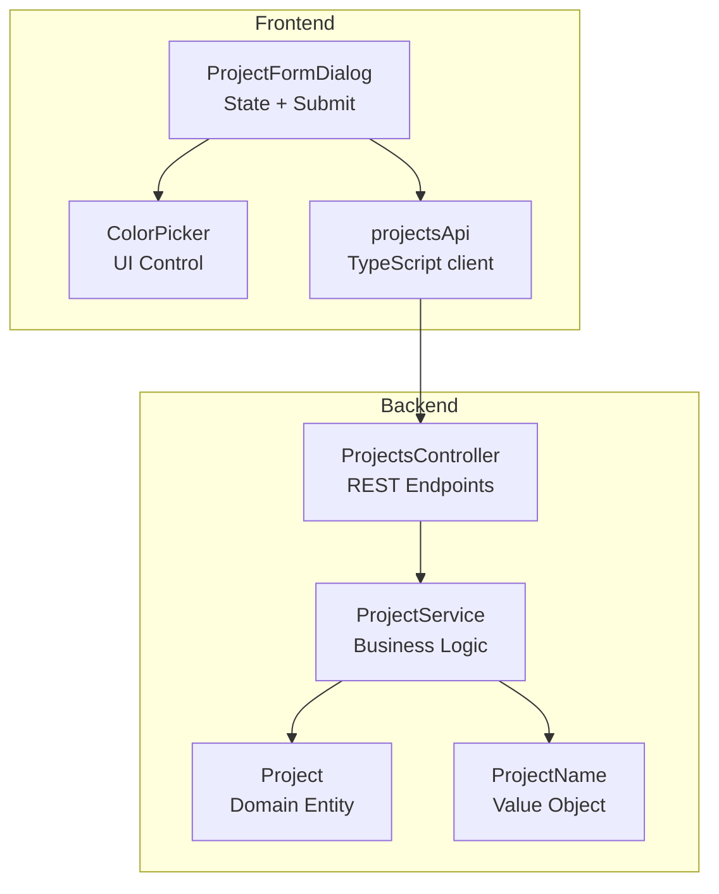
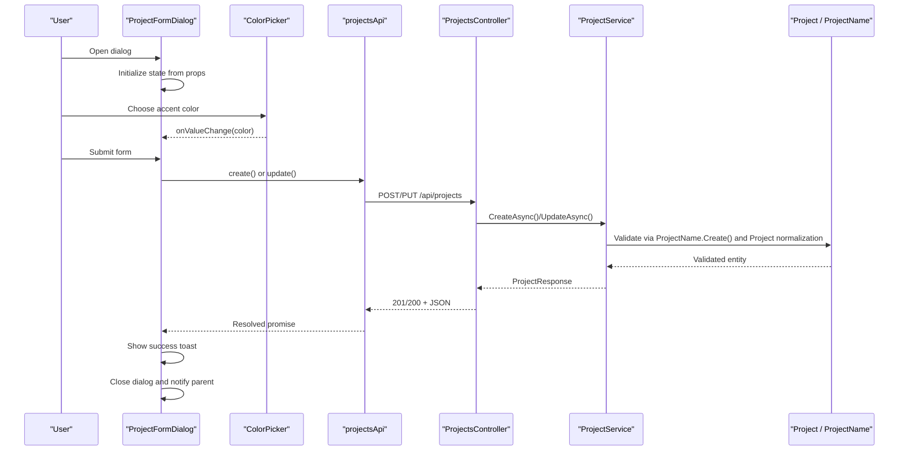
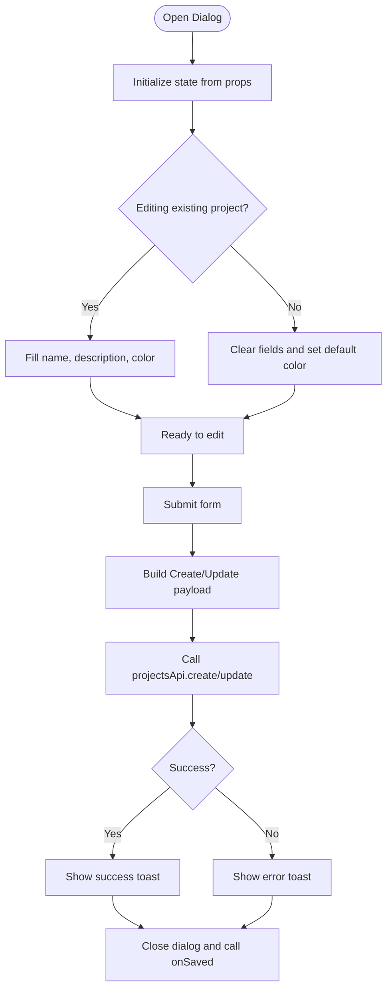
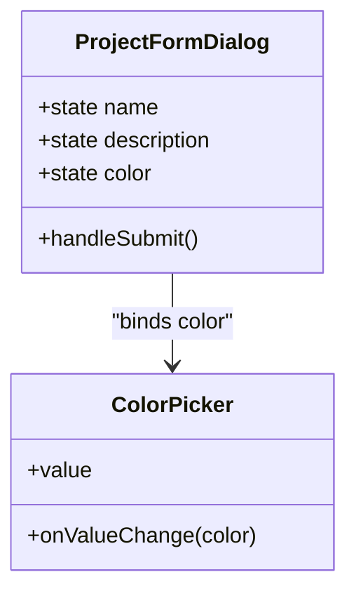
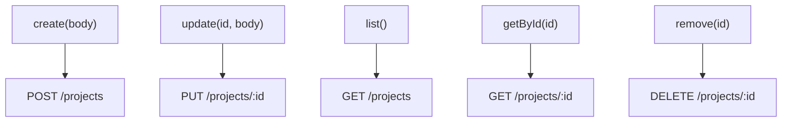
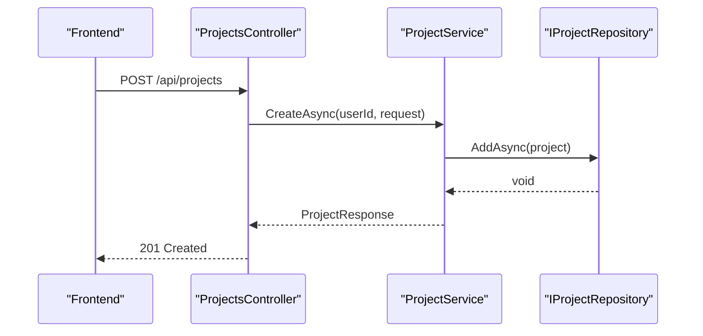
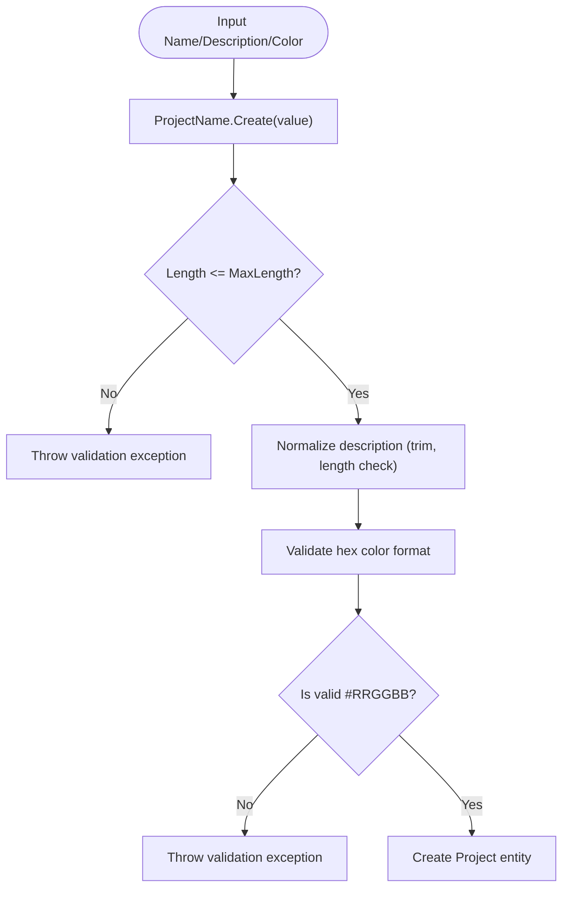
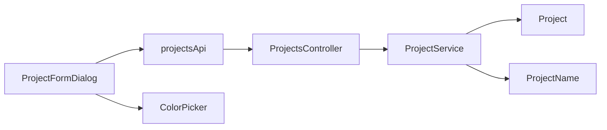

# Project Form and Validation

<cite>
**Referenced Files in This Document**
- [project-form.tsx](file://Apps/Web/src/components/projects-page/project-form.tsx)
- [projects.ts](file://Apps/Web/src/lib/api/projects.ts)
- [color-picker.tsx](file://Apps/Web/src/components/ui/color-picker.tsx)
- [CreateProjectRequest.cs](file://Services/Services.Application/DTOs/Projects/CreateProjectRequest.cs)
- [UpdateProjectRequest.cs](file://Services/Services.Application/DTOs/Projects/UpdateProjectRequest.cs)
- [ProjectService.cs](file://Services/Services.Application/Services/ProjectService.cs)
- [Project.cs](file://Services/Services.Domain/Entities/Project.cs)
- [ProjectName.cs](file://Services/Services.Domain/ValueObjects/ProjectName.cs)
- [ProjectsController.cs](file://Services/Services.Api/Controllers/ProjectsController.cs)
</cite>

## Table of Contents
1. [Introduction](#introduction)
2. [Project Structure](#project-structure)
3. [Core Components](#core-components)
4. [Architecture Overview](#architecture-overview)
5. [Detailed Component Analysis](#detailed-component-analysis)
6. [Dependency Analysis](#dependency-analysis)
7. [Performance Considerations](#performance-considerations)
8. [Troubleshooting Guide](#troubleshooting-guide)
9. [Conclusion](#conclusion)

## Introduction
This document explains the project form implementation and validation system across the React frontend and .NET backend. It covers:
- React component structure for creating and editing projects
- Client-side state management and user input handling
- Client-side validation rules and error display mechanisms
- Color picker functionality for project customization
- Server-side validation via DTOs and domain value objects
- End-to-end form submission workflows from UI to API

## Project Structure
The project form spans the following layers:
- Frontend (React): A dialog-based form that binds inputs, handles submit events, and calls the API layer.
- API Layer (.NET): Controllers expose REST endpoints for create/update operations.
- Application Layer (.NET): Services orchestrate business logic and validation using domain value objects.
- Domain Layer (.NET): Entities and value objects enforce business rules such as name length and color format.

**Diagram sources**
- [project-form.tsx:38-179](file://Apps/Web/src/components/projects-page/project-form.tsx#L38-L179)
- [projects.ts:58-108](file://Apps/Web/src/lib/api/projects.ts#L58-L108)
- [ProjectsController.cs:20-157](file://Services/Services.Api/Controllers/ProjectsController.cs#L20-L157)
- [ProjectService.cs:15-99](file://Services/Services.Application/Services/ProjectService.cs#L15-L99)
- [Project.cs:51-78](file://Services/Services.Domain/Entities/Project.cs#L51-L78)
- [ProjectName.cs:14-33](file://Services/Services.Domain/ValueObjects/ProjectName.cs#L14-L33)

**Section sources**
- [project-form.tsx:38-179](file://Apps/Web/src/components/projects-page/project-form.tsx#L38-L179)
- [projects.ts:58-108](file://Apps/Web/src/lib/api/projects.ts#L58-L108)
- [ProjectsController.cs:20-157](file://Services/Services.Api/Controllers/ProjectsController.cs#L20-L157)
- [ProjectService.cs:15-99](file://Services/Services.Application/Services/ProjectService.cs#L15-L99)
- [Project.cs:51-78](file://Services/Services.Domain/Entities/Project.cs#L51-L78)
- [ProjectName.cs:14-33](file://Services/Services.Domain/ValueObjects/ProjectName.cs#L14-L33)

## Core Components
- ProjectFormDialog: Manages local state for name, description, and color; handles open/close lifecycle; dispatches create or update requests; shows success/error toasts; disables controls while submitting.
- ColorPicker: Provides a rich color selection interface with multiple formats and accessibility labels.
- projectsApi: TypeScript client exposing typed methods for create, update, list, get, delete, tasks, and summary.
- ProjectsController: Exposes REST endpoints for project CRUD operations and maps exceptions to HTTP responses.
- ProjectService: Applies business rules by constructing domain entities/value objects and persisting changes.
- Project and ProjectName: Enforce domain constraints like required name, max length, and valid hex color.

Key responsibilities:
- Client-side binding and UX flow are handled in the React component.
- Server-side validation is enforced through DTOs and domain value objects.
- Error feedback is surfaced via toast notifications on the client and HTTP status codes on the server.

**Section sources**
- [project-form.tsx:38-179](file://Apps/Web/src/components/projects-page/project-form.tsx#L38-L179)
- [projects.ts:58-108](file://Apps/Web/src/lib/api/projects.ts#L58-L108)
- [ProjectsController.cs:20-157](file://Services/Services.Api/Controllers/ProjectsController.cs#L20-L157)
- [ProjectService.cs:15-99](file://Services/Services.Application/Services/ProjectService.cs#L15-L99)
- [Project.cs:51-78](file://Services/Services.Domain/Entities/Project.cs#L51-L78)
- [ProjectName.cs:14-33](file://Services/Services.Domain/ValueObjects/ProjectName.cs#L14-L33)

## Architecture Overview
End-to-end flow for creating or updating a project:

**Diagram sources**
- [project-form.tsx:70-105](file://Apps/Web/src/components/projects-page/project-form.tsx#L70-L105)
- [projects.ts:58-80](file://Apps/Web/src/lib/api/projects.ts#L58-L80)
- [ProjectsController.cs:20-43](file://Services/Services.Api/Controllers/ProjectsController.cs#L20-L43)
- [ProjectService.cs:15-38](file://Services/Services.Application/Services/ProjectService.cs#L15-L38)
- [Project.cs:51-78](file://Services/Services.Domain/Entities/Project.cs#L51-L78)
- [ProjectName.cs:14-33](file://Services/Services.Domain/ValueObjects/ProjectName.cs#L14-L33)

## Detailed Component Analysis

### ProjectFormDialog (React)
Responsibilities:
- Controlled fields for name, description, and color
- Lifecycle synchronization when dialog opens/closes
- Submit handler that builds request payload and calls API
- Success and error feedback via toast
- Disabled states during submission

Client-side validation:
- HTML5 required attribute on name field
- No explicit custom validation rules beyond browser defaults
- Color is bound to ColorPicker and sent as-is

Error handling:
- Catches ApiError from the API client and displays an error toast
- Always closes the dialog after submit attempt

Accessibility:
- Uses Dialog and Field components with proper labels and htmlFor attributes
- Disables interactive elements while submitting

**Diagram sources**
- [project-form.tsx:56-68](file://Apps/Web/src/components/projects-page/project-form.tsx#L56-L68)
- [project-form.tsx:70-105](file://Apps/Web/src/components/projects-page/project-form.tsx#L70-L105)
- [project-form.tsx:120-154](file://Apps/Web/src/components/projects-page/project-form.tsx#L120-L154)

**Section sources**
- [project-form.tsx:38-179](file://Apps/Web/src/components/projects-page/project-form.tsx#L38-L179)

### ColorPicker Integration
- The form uses a controlled pattern where the selected color updates local state via onValueChange.
- The color picker supports multiple formats and provides accessible labels for screen readers.
- Default color is applied when creating a new project.

**Diagram sources**
- [project-form.tsx:146-153](file://Apps/Web/src/components/projects-page/project-form.tsx#L146-L153)
- [color-picker.tsx:53-118](file://Apps/Web/src/components/ui/color-picker.tsx#L53-L118)

**Section sources**
- [project-form.tsx:146-153](file://Apps/Web/src/components/projects-page/project-form.tsx#L146-L153)
- [color-picker.tsx:53-118](file://Apps/Web/src/components/ui/color-picker.tsx#L53-L118)

### API Client (projectsApi)
- Typed interfaces mirror backend DTOs for type safety.
- Methods encapsulate HTTP verbs and URL patterns.
- Errors are propagated via ApiError for consistent handling.

**Diagram sources**
- [projects.ts:58-108](file://Apps/Web/src/lib/api/projects.ts#L58-L108)

**Section sources**
- [projects.ts:10-29](file://Apps/Web/src/lib/api/projects.ts#L10-L29)
- [projects.ts:58-108](file://Apps/Web/src/lib/api/projects.ts#L58-L108)

### Backend: Controller and Service
- ProjectsController exposes REST endpoints and maps exceptions to appropriate HTTP statuses.
- ProjectService validates identifiers, constructs domain models, and persists changes.
- Validation errors are returned as BadRequest with a message.

**Diagram sources**
- [ProjectsController.cs:20-43](file://Services/Services.Api/Controllers/ProjectsController.cs#L20-L43)
- [ProjectService.cs:15-38](file://Services/Services.Application/Services/ProjectService.cs#L15-L38)

**Section sources**
- [ProjectsController.cs:20-157](file://Services/Services.Api/Controllers/ProjectsController.cs#L20-L157)
- [ProjectService.cs:15-99](file://Services/Services.Application/Services/ProjectService.cs#L15-L99)

### Domain Validation: Project and ProjectName
- ProjectName enforces non-empty, trimmed values and maximum length.
- Project normalizes description and color, enforcing a strict hex color format.

**Diagram sources**
- [ProjectName.cs:14-33](file://Services/Services.Domain/ValueObjects/ProjectName.cs#L14-L33)
- [Project.cs:80-120](file://Services/Services.Domain/Entities/Project.cs#L80-L120)

**Section sources**
- [ProjectName.cs:14-33](file://Services/Services.Domain/ValueObjects/ProjectName.cs#L14-L33)
- [Project.cs:80-120](file://Services/Services.Domain/Entities/Project.cs#L80-L120)

## Dependency Analysis
- ProjectFormDialog depends on:
  - projectsApi for network operations
  - ColorPicker for color selection
  - UI primitives (Dialog, Input, Textarea, Button, Spinner, Toast)
- projectsApi depends on helper utilities for fetch and error handling.
- ProjectsController depends on ProjectService and TaskService.
- ProjectService depends on IProjectRepository and domain types.
- Project and ProjectName are pure domain types with no external dependencies.

**Diagram sources**
- [project-form.tsx:38-179](file://Apps/Web/src/components/projects-page/project-form.tsx#L38-L179)
- [projects.ts:58-108](file://Apps/Web/src/lib/api/projects.ts#L58-L108)
- [ProjectsController.cs:20-157](file://Services/Services.Api/Controllers/ProjectsController.cs#L20-L157)
- [ProjectService.cs:15-99](file://Services/Services.Application/Services/ProjectService.cs#L15-L99)
- [Project.cs:51-78](file://Services/Services.Domain/Entities/Project.cs#L51-L78)
- [ProjectName.cs:14-33](file://Services/Services.Domain/ValueObjects/ProjectName.cs#L14-L33)

**Section sources**
- [project-form.tsx:38-179](file://Apps/Web/src/components/projects-page/project-form.tsx#L38-L179)
- [projects.ts:58-108](file://Apps/Web/src/lib/api/projects.ts#L58-L108)
- [ProjectsController.cs:20-157](file://Services/Services.Api/Controllers/ProjectsController.cs#L20-L157)
- [ProjectService.cs:15-99](file://Services/Services.Application/Services/ProjectService.cs#L15-L99)
- [Project.cs:51-78](file://Services/Services.Domain/Entities/Project.cs#L51-L78)
- [ProjectName.cs:14-33](file://Services/Services.Domain/ValueObjects/ProjectName.cs#L14-L33)

## Performance Considerations
- Client-side:
  - Minimal re-renders due to controlled state updates.
  - Debouncing could be added if real-time validation becomes expensive.
- Server-side:
  - Validation occurs early in domain construction, failing fast before persistence.
  - Repository calls are awaited only once per operation.

[No sources needed since this section provides general guidance]

## Troubleshooting Guide
Common issues and resolutions:
- Name empty or too long:
  - Cause: ProjectName validation fails.
  - Resolution: Ensure name is non-empty and within the allowed length.
- Invalid color format:
  - Cause: Project color normalization rejects non-hex strings.
  - Resolution: Use a valid hex color string (e.g., #6366F1).
- Network/API errors:
  - Cause: ApiError thrown by the client when the server returns an error response.
  - Resolution: Inspect toast messages and server error payloads; verify authentication and permissions.

Relevant behaviors:
- Client catches ApiError and shows an error toast.
- Server returns BadRequest for ValidationException and NotFound for missing resources.

**Section sources**
- [project-form.tsx:94-104](file://Apps/Web/src/components/projects-page/project-form.tsx#L94-L104)
- [ProjectsController.cs:39-43](file://Services/Services.Api/Controllers/ProjectsController.cs#L39-L43)
- [ProjectsController.cs:120-127](file://Services/Services.Api/Controllers/ProjectsController.cs#L120-L127)
- [ProjectService.cs:145-167](file://Services/Services.Application/Services/ProjectService.cs#L145-L167)
- [Project.cs:99-120](file://Services/Services.Domain/Entities/Project.cs#L99-L120)
- [ProjectName.cs:14-33](file://Services/Services.Domain/ValueObjects/ProjectName.cs#L14-L33)

## Conclusion
The project form integrates a React-controlled UI with robust server-side validation. Client-side interactions are straightforward, relying on HTML5 validation and a powerful color picker. Server-side enforcement ensures data integrity through domain value objects and entity normalization. Together, these layers provide a reliable, accessible, and maintainable form experience.

[No sources needed since this section summarizes without analyzing specific files]