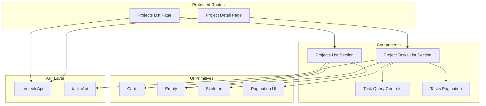
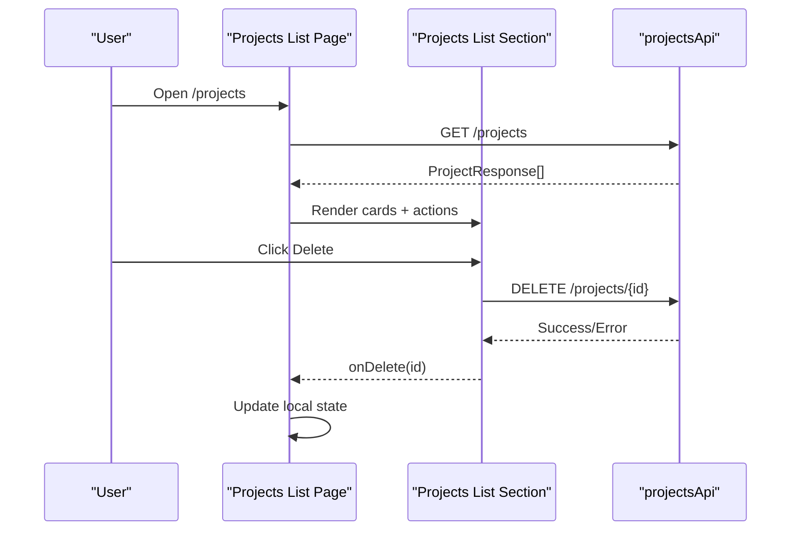
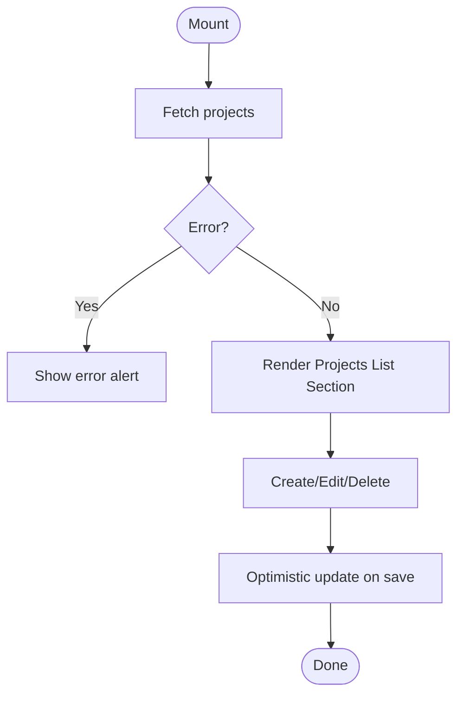
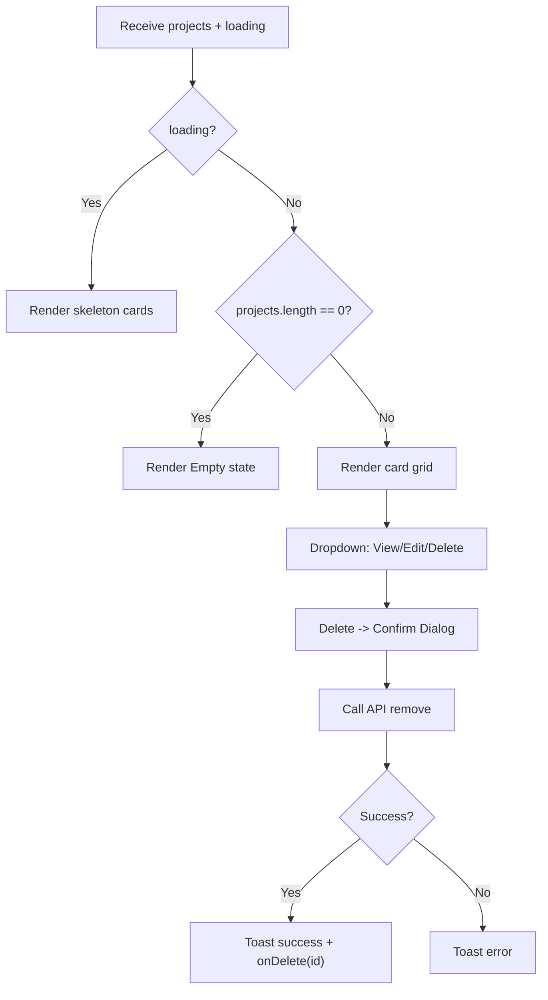
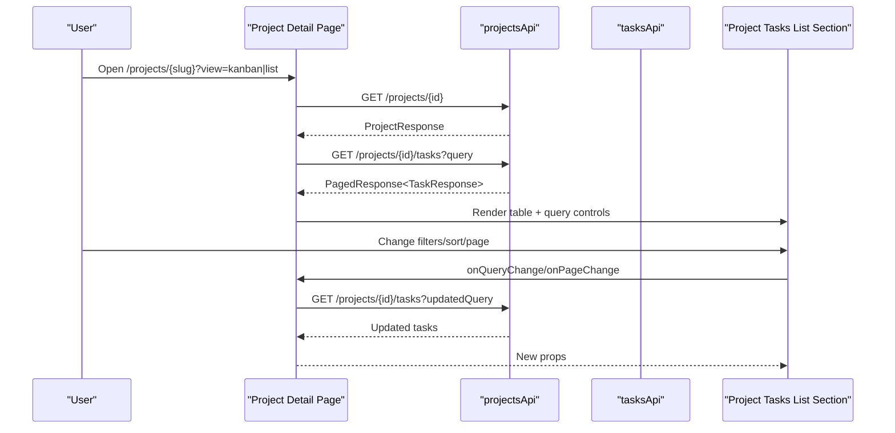
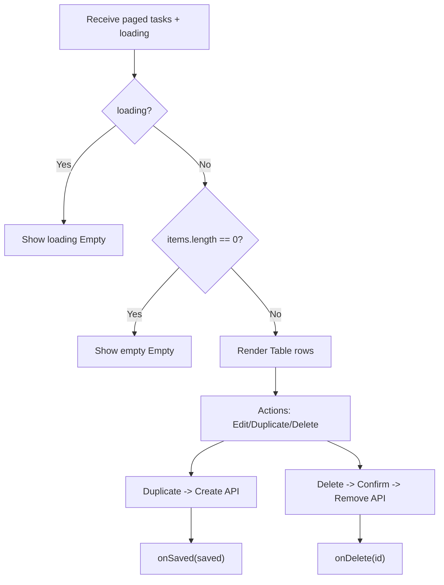
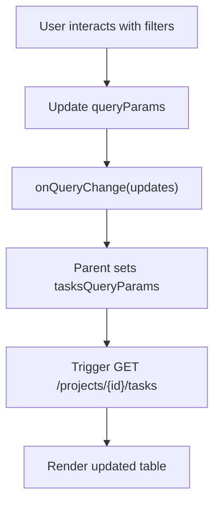
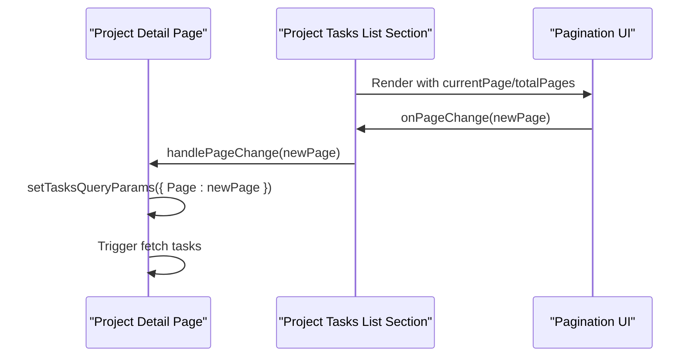
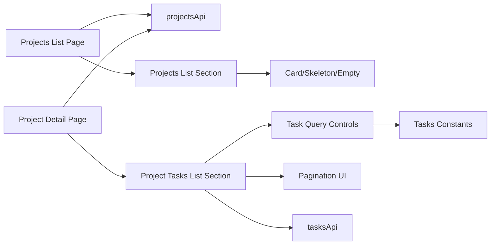

# Project List and Display

<cite>
**Referenced Files in This Document**
- [page.tsx](file://Apps/Web/src/app/(protected)/projects/page.tsx)
- [list-section.tsx](file://Apps/Web/src/components/projects-page/list-section.tsx)
- [project-detail page.tsx](file://Apps/Web/src/app/(protected)/projects/[projectSlug]/page.tsx)
- [tasks-list-sections.tsx](file://Apps/Web/src/components/project-details-page/tasks-list-sections.tsx)
- [tasks list section.tsx](file://Apps/Web/src/components/tasks-page/list-section.tsx)
- [pagination.tsx](file://Apps/Web/src/components/ui/pagination.tsx)
- [empty.tsx](file://Apps/Web/src/components/ui/empty.tsx)
- [skeleton.tsx](file://Apps/Web/src/components/ui/skeleton.tsx)
- [card.tsx](file://Apps/Web/src/components/ui/card.tsx)
- [projects API](file://Apps/Web/src/lib/api/projects.ts)
- [tasks API](file://Apps/Web/src/lib/api/tasks.ts)
- [tasks constants](file://Apps/Web/src/lib/util-constants/tasks-constants.ts)
</cite>

## Table of Contents
1. [Introduction](#introduction)
2. [Project Structure](#project-structure)
3. [Core Components](#core-components)
4. [Architecture Overview](#architecture-overview)
5. [Detailed Component Analysis](#detailed-component-analysis)
6. [Dependency Analysis](#dependency-analysis)
7. [Performance Considerations](#performance-considerations)
8. [Troubleshooting Guide](#troubleshooting-guide)
9. [Conclusion](#conclusion)

## Introduction
This document explains the project list view and display components, including how projects are rendered, how tasks are filtered, sorted, and paginated within a project detail page, and how interactive elements (edit, delete, duplicate, navigation) work. It also covers responsive design patterns, loading and empty states, and performance considerations for large datasets.

## Project Structure
The relevant UI is implemented as Next.js client components under the protected routes:
- Projects list page renders a header, create/edit dialog, and a card grid of projects.
- Project detail page loads project info, provides tabs for Kanban/List views, and renders a task table with filtering, sorting, and pagination.
- Shared UI primitives include cards, skeletons, empty states, and pagination.

**Diagram sources**
- [page.tsx:1-108](file://Apps/Web/src/app/(protected)/projects/page.tsx#L1-L108)
- [list-section.tsx:1-166](file://Apps/Web/src/components/projects-page/list-section.tsx#L1-L166)
- [project-detail page.tsx:1-327](file://Apps/Web/src/app/(protected)/projects/[projectSlug]/page.tsx#L1-L327)
- [tasks-list-sections.tsx:1-253](file://Apps/Web/src/components/project-details-page/tasks-list-sections.tsx#L1-L253)
- [tasks list section.tsx:280-549](file://Apps/Web/src/components/tasks-page/list-section.tsx#L280-L549)
- [pagination.tsx:1-131](file://Apps/Web/src/components/ui/pagination.tsx#L1-L131)
- [empty.tsx:1-104](file://Apps/Web/src/components/ui/empty.tsx#L1-L104)
- [skeleton.tsx:1-14](file://Apps/Web/src/components/ui/skeleton.tsx#L1-L14)
- [card.tsx:1-88](file://Apps/Web/src/components/ui/card.tsx#L1-L88)
- [projects API:58-108](file://Apps/Web/src/lib/api/projects.ts#L58-L108)
- [tasks API:88-131](file://Apps/Web/src/lib/api/tasks.ts#L88-L131)

**Section sources**
- [page.tsx:1-108](file://Apps/Web/src/app/(protected)/projects/page.tsx#L1-L108)
- [list-section.tsx:1-166](file://Apps/Web/src/components/projects-page/list-section.tsx#L1-L166)
- [project-detail page.tsx:1-327](file://Apps/Web/src/app/(protected)/projects/[projectSlug]/page.tsx#L1-L327)
- [tasks-list-sections.tsx:1-253](file://Apps/Web/src/components/project-details-page/tasks-list-sections.tsx#L1-L253)
- [tasks list section.tsx:280-549](file://Apps/Web/src/components/tasks-page/list-section.tsx#L280-L549)
- [pagination.tsx:1-131](file://Apps/Web/src/components/ui/pagination.tsx#L1-L131)
- [empty.tsx:1-104](file://Apps/Web/src/components/ui/empty.tsx#L1-L104)
- [skeleton.tsx:1-14](file://Apps/Web/src/components/ui/skeleton.tsx#L1-L14)
- [card.tsx:1-88](file://Apps/Web/src/components/ui/card.tsx#L1-L88)
- [projects API:58-108](file://Apps/Web/src/lib/api/projects.ts#L58-L108)
- [tasks API:88-131](file://Apps/Web/src/lib/api/tasks.ts#L88-L131)

## Core Components
- Projects List Page: Loads all projects, shows error state, opens create/edit dialogs, and delegates rendering to the Projects List Section.
- Projects List Section: Renders a responsive card grid with actions (view, edit, delete), handles delete confirmation, and displays empty/loading states.
- Project Detail Page: Loads a single project, manages view mode (kanban/list), and renders the Project Tasks List Section with query controls and pagination.
- Project Tasks List Section: Displays a table of tasks with status/priority badges, supports duplicate/delete, and integrates with shared Task Query controls and pagination.
- Task Query Controls: Provide search input (debounced), status filter, priority filter, sort field selection, and sort direction toggle.
- Pagination: Reusable pagination UI used by task lists; the project detail page drives page changes via props.

**Section sources**
- [page.tsx:1-108](file://Apps/Web/src/app/(protected)/projects/page.tsx#L1-L108)
- [list-section.tsx:1-166](file://Apps/Web/src/components/projects-page/list-section.tsx#L1-L166)
- [project-detail page.tsx:1-327](file://Apps/Web/src/app/(protected)/projects/[projectSlug]/page.tsx#L1-L327)
- [tasks-list-sections.tsx:1-253](file://Apps/Web/src/components/project-details-page/tasks-list-sections.tsx#L1-L253)
- [tasks list section.tsx:280-549](file://Apps/Web/src/components/tasks-page/list-section.tsx#L280-L549)

## Architecture Overview
The data flow uses typed API clients that wrap HTTP calls and return strongly-typed responses. The pages manage local state for loading, errors, and UI interactions, while components remain presentational and receive callbacks for user actions.

**Diagram sources**
- [page.tsx:20-55](file://Apps/Web/src/app/(protected)/projects/page.tsx#L20-L55)
- [list-section.tsx:40-65](file://Apps/Web/src/components/projects-page/list-section.tsx#L40-L65)
- [projects API:58-85](file://Apps/Web/src/lib/api/projects.ts#L58-L85)

## Detailed Component Analysis

### Projects List Page
Responsibilities:
- Fetches the full list of projects on mount.
- Manages form dialog state for creating/editing projects.
- Updates local project array on save or delete.
- Delegates rendering to Projects List Section.

Key behaviors:
- Loading and error states are handled before rendering the list.
- Create/Edit open a dialog pre-filled when editing.
- On successful save, the list is updated optimistically.

**Diagram sources**
- [page.tsx:20-55](file://Apps/Web/src/app/(protected)/projects/page.tsx#L20-L55)
- [page.tsx:57-108](file://Apps/Web/src/app/(protected)/projects/page.tsx#L57-L108)

**Section sources**
- [page.tsx:1-108](file://Apps/Web/src/app/(protected)/projects/page.tsx#L1-L108)

### Projects List Section
Rendering logic:
- If no projects and not loading, show an Empty state with guidance.
- While loading, render skeleton placeholders for cards.
- Otherwise, render a responsive grid of project cards with color top borders.

Interactive elements:
- Dropdown menu per card: View project, Edit, Delete.
- Delete triggers a confirmation dialog and calls the API; success updates the list via callback.

Visual indicators:
- Each card uses the project’s color as a top border accent.
- Status messages use toast notifications for success/error.

**Diagram sources**
- [list-section.tsx:67-166](file://Apps/Web/src/components/projects-page/list-section.tsx#L67-L166)

**Section sources**
- [list-section.tsx:1-166](file://Apps/Web/src/components/projects-page/list-section.tsx#L1-L166)
- [card.tsx:1-88](file://Apps/Web/src/components/ui/card.tsx#L1-L88)
- [empty.tsx:1-104](file://Apps/Web/src/components/ui/empty.tsx#L1-L104)
- [skeleton.tsx:1-14](file://Apps/Web/src/components/ui/skeleton.tsx#L1-L14)

### Project Detail Page
Responsibilities:
- Loads project details by slug.
- Maintains view mode (kanban/list) from URL query parameter.
- Loads tasks for the project with pagination and filters.
- Provides actions to edit project, delete project, and create tasks.
- Renders Project Tasks List Section with query and pagination hooks.

Navigation patterns:
- View mode is persisted in the URL query string and toggled via Tabs.
- Deleting a project navigates back after confirmation.

**Diagram sources**
- [project-detail page.tsx:45-115](file://Apps/Web/src/app/(protected)/projects/[projectSlug]/page.tsx#L45-L115)
- [project-detail page.tsx:117-172](file://Apps/Web/src/app/(protected)/projects/[projectSlug]/page.tsx#L117-L172)
- [project-detail page.tsx:297-321](file://Apps/Web/src/app/(protected)/projects/[projectSlug]/page.tsx#L297-L321)
- [projects API:87-102](file://Apps/Web/src/lib/api/projects.ts#L87-L102)

**Section sources**
- [project-detail page.tsx:1-327](file://Apps/Web/src/app/(protected)/projects/[projectSlug]/page.tsx#L1-L327)

### Project Tasks List Section
Rendering logic:
- Shows Empty state when no tasks and not loading.
- Shows a spinner-based Empty state while loading.
- Renders a table with columns: title, project badge (with color dot), status badge, priority badge, due date, and actions.

Interactions:
- Duplicate task creates a new task with a copied title suffix.
- Delete triggers confirmation dialog and removes locally on success.
- Integrates with shared Task Query controls and pagination.

**Diagram sources**
- [tasks-list-sections.tsx:134-253](file://Apps/Web/src/components/project-details-page/tasks-list-sections.tsx#L134-L253)

**Section sources**
- [tasks-list-sections.tsx:1-253](file://Apps/Web/src/components/project-details-page/tasks-list-sections.tsx#L1-L253)

### Task Query Controls (Filtering and Sorting)
Capabilities:
- Search: Debounced text search resets to page 1 on change.
- Status filter: Select dropdown maps to backend enum values.
- Priority filter: Select dropdown maps to backend enum values.
- Sort field: Select dropdown maps to allowed sort fields.
- Sort direction: Toggle between ascending/descending.

Data mapping:
- Labels and styles for status and priority are centralized in constants.
- Allowed sort fields are defined in the tasks API types.

**Diagram sources**
- [tasks list section.tsx:280-455](file://Apps/Web/src/components/tasks-page/list-section.tsx#L280-L455)
- [tasks constants:1-37](file://Apps/Web/src/lib/util-constants/tasks-constants.ts#L1-L37)
- [tasks API:74-82](file://Apps/Web/src/lib/api/tasks.ts#L74-L82)

**Section sources**
- [tasks list section.tsx:280-455](file://Apps/Web/src/components/tasks-page/list-section.tsx#L280-L455)
- [tasks constants:1-37](file://Apps/Web/src/lib/util-constants/tasks-constants.ts#L1-L37)
- [tasks API:74-82](file://Apps/Web/src/lib/api/tasks.ts#L74-L82)

### Pagination Implementation
- The project detail page maintains current page and total pages in local state and passes handlers to the task list section.
- The task list section composes reusable pagination UI components to render previous/next, ellipsis, and numbered links.
- Page changes trigger a server request with updated query parameters.

**Diagram sources**
- [project-detail page.tsx:169-172](file://Apps/Web/src/app/(protected)/projects/[projectSlug]/page.tsx#L169-L172)
- [tasks-list-sections.tsx:247-248](file://Apps/Web/src/components/project-details-page/tasks-list-sections.tsx#L247-L248)
- [pagination.tsx:1-131](file://Apps/Web/src/components/ui/pagination.tsx#L1-L131)

**Section sources**
- [project-detail page.tsx:169-172](file://Apps/Web/src/app/(protected)/projects/[projectSlug]/page.tsx#L169-L172)
- [tasks-list-sections.tsx:247-248](file://Apps/Web/src/components/project-details-page/tasks-list-sections.tsx#L247-L248)
- [pagination.tsx:1-131](file://Apps/Web/src/components/ui/pagination.tsx#L1-L131)

## Dependency Analysis
- Pages depend on API clients for data operations and pass callbacks to presentational components.
- Presentational components rely on shared UI primitives for consistent styling and accessibility.
- Constants centralize labels and styles for status, priority, and sort fields.

**Diagram sources**
- [page.tsx:1-108](file://Apps/Web/src/app/(protected)/projects/page.tsx#L1-L108)
- [list-section.tsx:1-166](file://Apps/Web/src/components/projects-page/list-section.tsx#L1-L166)
- [project-detail page.tsx:1-327](file://Apps/Web/src/app/(protected)/projects/[projectSlug]/page.tsx#L1-L327)
- [tasks-list-sections.tsx:1-253](file://Apps/Web/src/components/project-details-page/tasks-list-sections.tsx#L1-L253)
- [tasks list section.tsx:280-549](file://Apps/Web/src/components/tasks-page/list-section.tsx#L280-L549)
- [tasks constants:1-37](file://Apps/Web/src/lib/util-constants/tasks-constants.ts#L1-L37)
- [projects API:58-108](file://Apps/Web/src/lib/api/projects.ts#L58-L108)
- [tasks API:88-131](file://Apps/Web/src/lib/api/tasks.ts#L88-L131)

**Section sources**
- [page.tsx:1-108](file://Apps/Web/src/app/(protected)/projects/page.tsx#L1-L108)
- [list-section.tsx:1-166](file://Apps/Web/src/components/projects-page/list-section.tsx#L1-L166)
- [project-detail page.tsx:1-327](file://Apps/Web/src/app/(protected)/projects/[projectSlug]/page.tsx#L1-L327)
- [tasks-list-sections.tsx:1-253](file://Apps/Web/src/components/project-details-page/tasks-list-sections.tsx#L1-L253)
- [tasks list section.tsx:280-549](file://Apps/Web/src/components/tasks-page/list-section.tsx#L280-L549)
- [tasks constants:1-37](file://Apps/Web/src/lib/util-constants/tasks-constants.ts#L1-L37)
- [projects API:58-108](file://Apps/Web/src/lib/api/projects.ts#L58-L108)
- [tasks API:88-131](file://Apps/Web/src/lib/api/tasks.ts#L88-L131)

## Performance Considerations
- Server-side pagination: Use PageSize to limit payload size; ensure backend enforces reasonable defaults.
- Debounced search: Avoid excessive requests by debouncing search input.
- Optimistic updates: Update local state immediately on successful mutations to improve perceived performance.
- Skeleton loading: Provide lightweight placeholders instead of blocking the UI.
- Memoization: Consider memoizing derived lists and expensive computations if datasets grow significantly.
- Image/color assets: Keep project colors as inline styles to avoid heavy asset dependencies.

[No sources needed since this section provides general guidance]

## Troubleshooting Guide
Common issues and resolutions:
- API errors during load: Ensure ApiError handling surfaces descriptive messages and falls back to generic messages.
- Delete failures: Confirm that the delete dialog clears state and shows error toasts on failure.
- Pagination out of sync: Validate that page boundaries check against totalPages and prevent invalid transitions.
- Filter/sort not applied: Verify that queryParams are correctly mapped to query strings and reset to page 1 on filter changes.

**Section sources**
- [page.tsx:24-33](file://Apps/Web/src/app/(protected)/projects/page.tsx#L24-L33)
- [list-section.tsx:40-65](file://Apps/Web/src/components/projects-page/list-section.tsx#L40-L65)
- [project-detail page.tsx:169-172](file://Apps/Web/src/app/(protected)/projects/[projectSlug]/page.tsx#L169-L172)
- [tasks list section.tsx:293-300](file://Apps/Web/src/components/tasks-page/list-section.tsx#L293-L300)

## Conclusion
The project list and display components provide a clear, accessible interface for managing projects and viewing their tasks. The architecture separates concerns between pages, presentational components, and API clients, enabling maintainability and scalability. Filtering, sorting, and pagination are consistently implemented across task views, with robust loading and empty states enhancing user experience. For large datasets, leveraging server-side pagination, debounced search, and optimistic updates will further improve responsiveness.