# Project Management Feature

<cite>
**Referenced Files in This Document**
- [ProjectsController.cs](file://Services/Services.Api/Controllers/ProjectsController.cs)
- [ProjectService.cs](file://Services/Services.Application/Services/ProjectService.cs)
- [IProjectRepository.cs](file://Services/Services.Application/Interfaces/Repositories/IProjectRepository.cs)
- [ProjectRepository.cs](file://Services/Services.Infrastructure/Repositories/ProjectRepository.cs)
- [CreateProjectRequest.cs](file://Services/Services.Application/DTOs/Projects/CreateProjectRequest.cs)
- [UpdateProjectRequest.cs](file://Services/Services.Application/DTOs/Projects/UpdateProjectRequest.cs)
- [ProjectResponse.cs](file://Services/Services.Application/DTOs/Projects/ProjectResponse.cs)
- [ProjectSummaryResponse.cs](file://Services/Services.Application/DTOs/Projects/ProjectSummaryResponse.cs)
- [Project.cs](file://Services/Services.Domain/Entities/Project.cs)
- [ProjectConfiguration.cs](file://Services/Services.Infrastructure/Persistence/Configurations/ProjectConfiguration.cs)
- [projects page.tsx](file://Apps/Web/src/app/(protected)/projects/page.tsx)
- [project details page.tsx](file://Apps/Web/src/app/(protected)/projects/[projectSlug]/page.tsx)
- [list-section.tsx](file://Apps/Web/src/components/projects-page/list-section.tsx)
- [project-form.tsx](file://Apps/Web/src/components/projects-page/project-form.tsx)
</cite>

## Table of Contents
1. [Introduction](#introduction)
2. [Project Structure](#project-structure)
3. [Core Components](#core-components)
4. [Architecture Overview](#architecture-overview)
5. [Detailed Component Analysis](#detailed-component-analysis)
6. [Dependency Analysis](#dependency-analysis)
7. [Performance Considerations](#performance-considerations)
8. [Troubleshooting Guide](#troubleshooting-guide)
9. [Conclusion](#conclusion)

## Introduction
This document explains the project management feature end-to-end: how users create, edit, delete, and view projects; how the frontend forms validate input and handle colors; how the project list displays cards with actions; how backend services enforce validation and ownership; and how project summaries and progress are computed. It also shows integration points with task management for listing tasks within a project.

## Project Structure
The feature spans both frontend (Next.js app) and backend (.NET API). The key areas are:
- Frontend pages for listing projects and viewing a single project’s details
- A reusable project form dialog for creation and editing
- Backend controllers, application services, domain entities, DTOs, and repository implementations

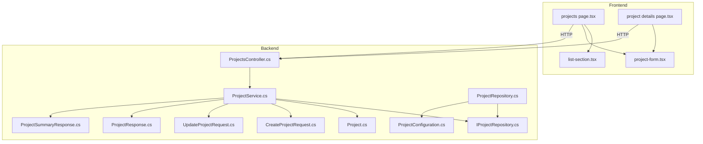

**Diagram sources**
- [projects page.tsx](file://Apps/Web/src/app/(protected)/projects/page.tsx)
- [project details page.tsx](file://Apps/Web/src/app/(protected)/projects/[projectSlug]/page.tsx)
- [project-form.tsx](file://Apps/Web/src/components/projects-page/project-form.tsx)
- [list-section.tsx](file://Apps/Web/src/components/projects-page/list-section.tsx)
- [ProjectsController.cs](file://Services/Services.Api/Controllers/ProjectsController.cs)
- [ProjectService.cs](file://Services/Services.Application/Services/ProjectService.cs)
- [IProjectRepository.cs](file://Services/Services.Application/Interfaces/Repositories/IProjectRepository.cs)
- [ProjectRepository.cs](file://Services/Services.Infrastructure/Repositories/ProjectRepository.cs)
- [Project.cs](file://Services/Services.Domain/Entities/Project.cs)
- [CreateProjectRequest.cs](file://Services/Services.Application/DTOs/Projects/CreateProjectRequest.cs)
- [UpdateProjectRequest.cs](file://Services/Services.Application/DTOs/Projects/UpdateProjectRequest.cs)
- [ProjectResponse.cs](file://Services/Services.Application/DTOs/Projects/ProjectResponse.cs)
- [ProjectSummaryResponse.cs](file://Services/Services.Application/DTOs/Projects/ProjectSummaryResponse.cs)
- [ProjectConfiguration.cs](file://Services/Services.Infrastructure/Persistence/Configurations/ProjectConfiguration.cs)

**Section sources**
- [projects page.tsx](file://Apps/Web/src/app/(protected)/projects/page.tsx)
- [project details page.tsx](file://Apps/Web/src/app/(protected)/projects/[projectSlug]/page.tsx)
- [ProjectsController.cs](file://Services/Services.Api/Controllers/ProjectsController.cs)

## Core Components
- ProjectsController exposes REST endpoints for creating, reading, updating, deleting projects, listing tasks per project, and retrieving project summary statistics.
- ProjectService implements business logic: validation, ownership checks, mapping to/from domain models and DTOs, and computing progress metrics.
- IProjectRepository defines persistence operations; ProjectRepository implements them using Entity Framework.
- Domain entity Project enforces value object rules for name, description length, and color format.
- DTOs define request/response contracts for API consumers.
- Frontend pages orchestrate user flows: list projects, open form dialogs, manage state, and call APIs.

**Section sources**
- [ProjectsController.cs](file://Services/Services.Api/Controllers/ProjectsController.cs)
- [ProjectService.cs](file://Services/Services.Application/Services/ProjectService.cs)
- [IProjectRepository.cs](file://Services/Services.Application/Interfaces/Repositories/IProjectRepository.cs)
- [ProjectRepository.cs](file://Services/Services.Infrastructure/Repositories/ProjectRepository.cs)
- [Project.cs](file://Services/Services.Domain/Entities/Project.cs)
- [CreateProjectRequest.cs](file://Services/Services.Application/DTOs/Projects/CreateProjectRequest.cs)
- [UpdateProjectRequest.cs](file://Services/Services.Application/DTOs/Projects/UpdateProjectRequest.cs)
- [ProjectResponse.cs](file://Services/Services.Application/DTOs/Projects/ProjectResponse.cs)
- [ProjectSummaryResponse.cs](file://Services/Services.Application/DTOs/Projects/ProjectSummaryResponse.cs)

## Architecture Overview
The feature follows a layered architecture:
- Presentation layer (frontend pages and components) calls HTTP endpoints.
- API layer (controller) validates inputs and delegates to service.
- Application layer (service) orchestrates use cases, enforces business rules, and maps data.
- Infrastructure layer (repository + EF configuration) persists data and computes aggregates.

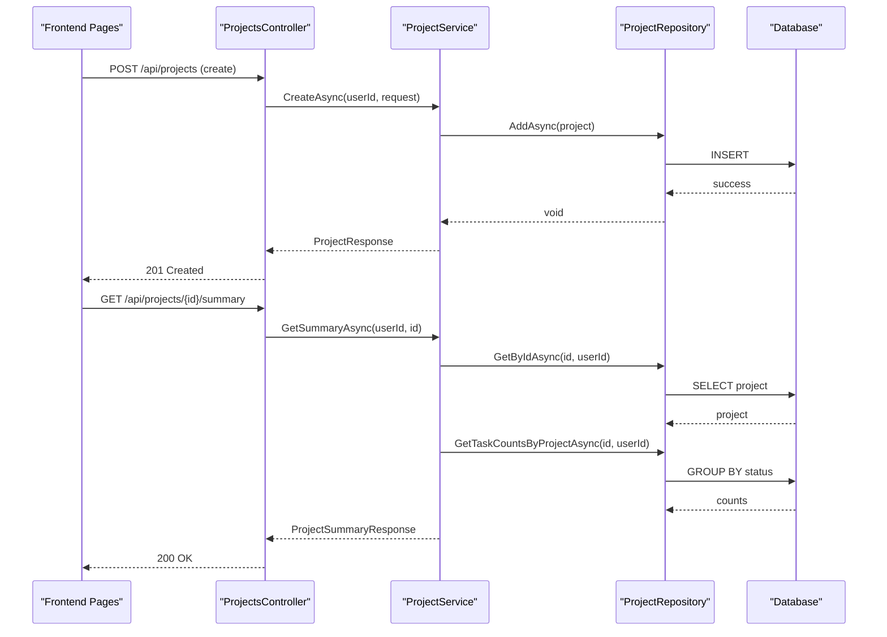

**Diagram sources**
- [ProjectsController.cs](file://Services/Services.Api/Controllers/ProjectsController.cs)
- [ProjectService.cs](file://Services/Services.Application/Services/ProjectService.cs)
- [IProjectRepository.cs](file://Services/Services.Application/Interfaces/Repositories/IProjectRepository.cs)
- [ProjectRepository.cs](file://Services/Services.Infrastructure/Repositories/ProjectRepository.cs)

## Detailed Component Analysis

### Project CRUD Operations

#### Create Project
- Frontend opens ProjectFormDialog, collects name, optional description, and color.
- On submit, it calls the create endpoint with a CreateProjectRequest payload.
- Controller extracts authenticated user ID and invokes ProjectService.CreateAsync.
- Service constructs a domain Project via ProjectName and Project.Create, then persists through repository.
- Response is mapped to ProjectResponse and returned.

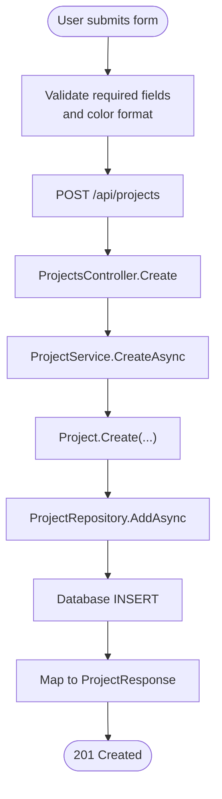

**Diagram sources**
- [project-form.tsx](file://Apps/Web/src/components/projects-page/project-form.tsx)
- [ProjectsController.cs](file://Services/Services.Api/Controllers/ProjectsController.cs)
- [ProjectService.cs](file://Services/Services.Application/Services/ProjectService.cs)
- [Project.cs](file://Services/Services.Domain/Entities/Project.cs)
- [ProjectRepository.cs](file://Services/Services.Infrastructure/Repositories/ProjectRepository.cs)

**Section sources**
- [project-form.tsx](file://Apps/Web/src/components/projects-page/project-form.tsx)
- [ProjectsController.cs](file://Services/Services.Api/Controllers/ProjectsController.cs)
- [ProjectService.cs](file://Services/Services.Application/Services/ProjectService.cs)
- [CreateProjectRequest.cs](file://Services/Services.Application/DTOs/Projects/CreateProjectRequest.cs)
- [ProjectResponse.cs](file://Services/Services.Application/DTOs/Projects/ProjectResponse.cs)

#### Read All Projects
- Frontend lists all projects by calling GET /api/projects.
- Service retrieves projects owned by the current user and returns a list of ProjectResponse.
- List section renders cards with color accents and action menus.

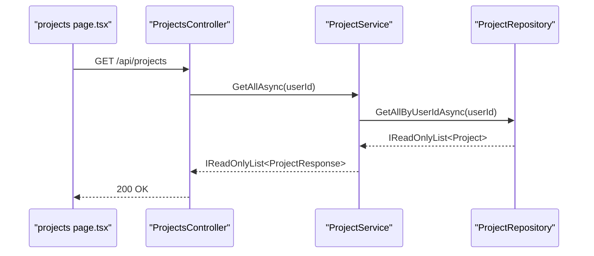

**Diagram sources**
- [projects page.tsx](file://Apps/Web/src/app/(protected)/projects/page.tsx)
- [ProjectsController.cs](file://Services/Services.Api/Controllers/ProjectsController.cs)
- [ProjectService.cs](file://Services/Services.Application/Services/ProjectService.cs)
- [ProjectRepository.cs](file://Services/Services.Infrastructure/Repositories/ProjectRepository.cs)

**Section sources**
- [projects page.tsx](file://Apps/Web/src/app/(protected)/projects/page.tsx)
- [list-section.tsx](file://Apps/Web/src/components/projects-page/list-section.tsx)
- [ProjectService.cs](file://Services/Services.Application/Services/ProjectService.cs)

#### Read Project Details
- Frontend navigates to /projects/{id} and loads project details.
- Controller calls ProjectService.GetByIdAsync to return a single ProjectResponse.
- The detail page shows project header with color accent, description, and actions to edit or delete.

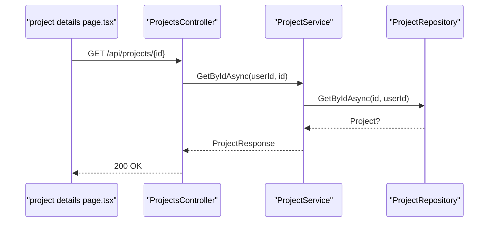

**Diagram sources**
- [project details page.tsx](file://Apps/Web/src/app/(protected)/projects/[projectSlug]/page.tsx)
- [ProjectsController.cs](file://Services/Services.Api/Controllers/ProjectsController.cs)
- [ProjectService.cs](file://Services/Services.Application/Services/ProjectService.cs)
- [ProjectRepository.cs](file://Services/Services.Infrastructure/Repositories/ProjectRepository.cs)

**Section sources**
- [project details page.tsx](file://Apps/Web/src/app/(protected)/projects/[projectSlug]/page.tsx)
- [ProjectsController.cs](file://Services/Services.Api/Controllers/ProjectsController.cs)

#### Update Project
- Frontend opens ProjectFormDialog pre-filled with existing project data.
- On save, it calls PUT /api/projects/{id} with an UpdateProjectRequest.
- Service validates ownership, updates domain model, and persists changes.

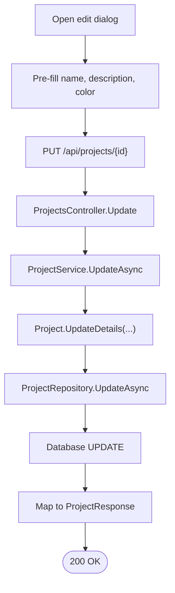

**Diagram sources**
- [project-form.tsx](file://Apps/Web/src/components/projects-page/project-form.tsx)
- [ProjectsController.cs](file://Services/Services.Api/Controllers/ProjectsController.cs)
- [ProjectService.cs](file://Services/Services.Application/Services/ProjectService.cs)
- [Project.cs](file://Services/Services.Domain/Entities/Project.cs)
- [ProjectRepository.cs](file://Services/Services.Infrastructure/Repositories/ProjectRepository.cs)

**Section sources**
- [project-form.tsx](file://Apps/Web/src/components/projects-page/project-form.tsx)
- [ProjectsController.cs](file://Services/Services.Api/Controllers/ProjectsController.cs)
- [ProjectService.cs](file://Services/Services.Application/Services/ProjectService.cs)
- [UpdateProjectRequest.cs](file://Services/Services.Application/DTOs/Projects/UpdateProjectRequest.cs)

#### Delete Project
- Frontend triggers a confirmation dialog before deletion.
- Controller calls ProjectService.DeleteAsync which checks if the project has associated tasks.
- If tasks exist, deletion is blocked; otherwise, the project is removed.

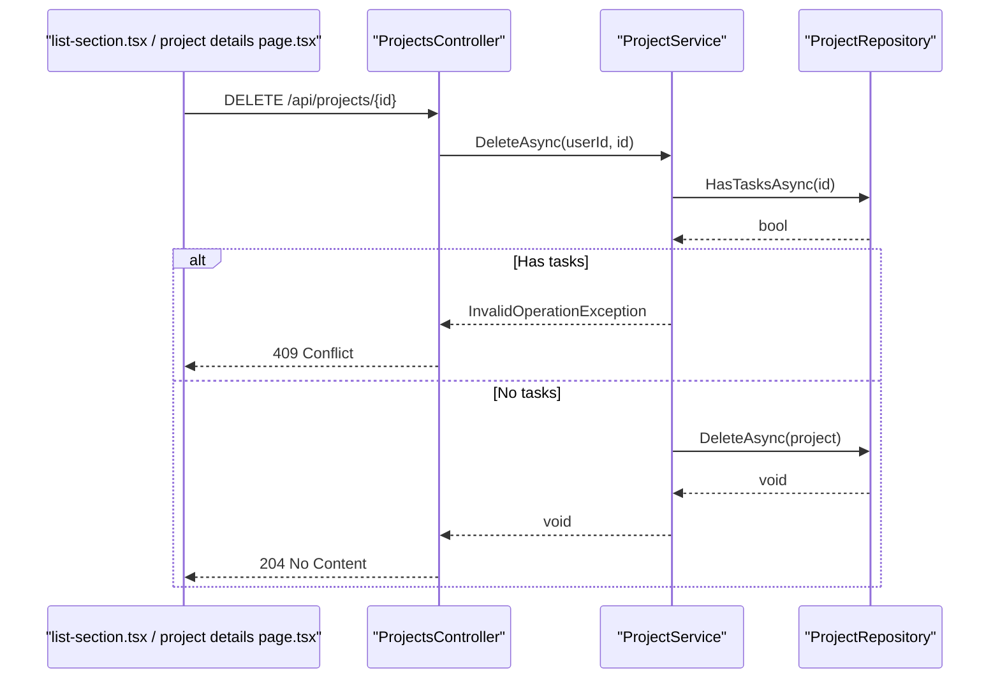

**Diagram sources**
- [list-section.tsx](file://Apps/Web/src/components/projects-page/list-section.tsx)
- [project details page.tsx](file://Apps/Web/src/app/(protected)/projects/[projectSlug]/page.tsx)
- [ProjectsController.cs](file://Services/Services.Api/Controllers/ProjectsController.cs)
- [ProjectService.cs](file://Services/Services.Application/Services/ProjectService.cs)
- [ProjectRepository.cs](file://Services/Services.Infrastructure/Repositories/ProjectRepository.cs)

**Section sources**
- [list-section.tsx](file://Apps/Web/src/components/projects-page/list-section.tsx)
- [project details page.tsx](file://Apps/Web/src/app/(protected)/projects/[projectSlug]/page.tsx)
- [ProjectsController.cs](file://Services/Services.Api/Controllers/ProjectsController.cs)
- [ProjectService.cs](file://Services/Services.Application/Services/ProjectService.cs)

### Project Form Implementation
- Fields: Name (required), Description (optional), Color (hex).
- Validation:
  - Frontend uses HTML required attribute for name and controlled state for other fields.
  - Backend enforces:
    - Name via ProjectName value object (length constraints configured in EF).
    - Description trimmed and limited to 1000 characters.
    - Color must be a valid hex string (#RRGGBB).
- User input handling:
  - Dialog resets on open/close.
  - Submit disables controls while saving and shows spinner.
  - Success/error toasts inform the user.

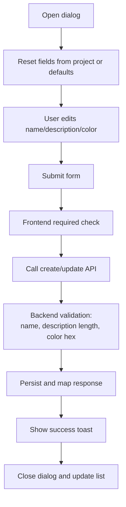

**Diagram sources**
- [project-form.tsx](file://Apps/Web/src/components/projects-page/project-form.tsx)
- [Project.cs](file://Services/Services.Domain/Entities/Project.cs)
- [ProjectConfiguration.cs](file://Services/Services.Infrastructure/Persistence/Configurations/ProjectConfiguration.cs)

**Section sources**
- [project-form.tsx](file://Apps/Web/src/components/projects-page/project-form.tsx)
- [Project.cs](file://Services/Services.Domain/Entities/Project.cs)
- [ProjectConfiguration.cs](file://Services/Services.Infrastructure/Persistence/Configurations/ProjectConfiguration.cs)

### Project List View
- Displays project cards with top border color reflecting project.color.
- Actions: View project details, Edit, Delete.
- Empty state when no projects exist.
- Sorting and filtering:
  - Backend sorts projects by name ascending.
  - Filtering by user ownership is enforced server-side.
  - Pagination is not implemented at the project list level.

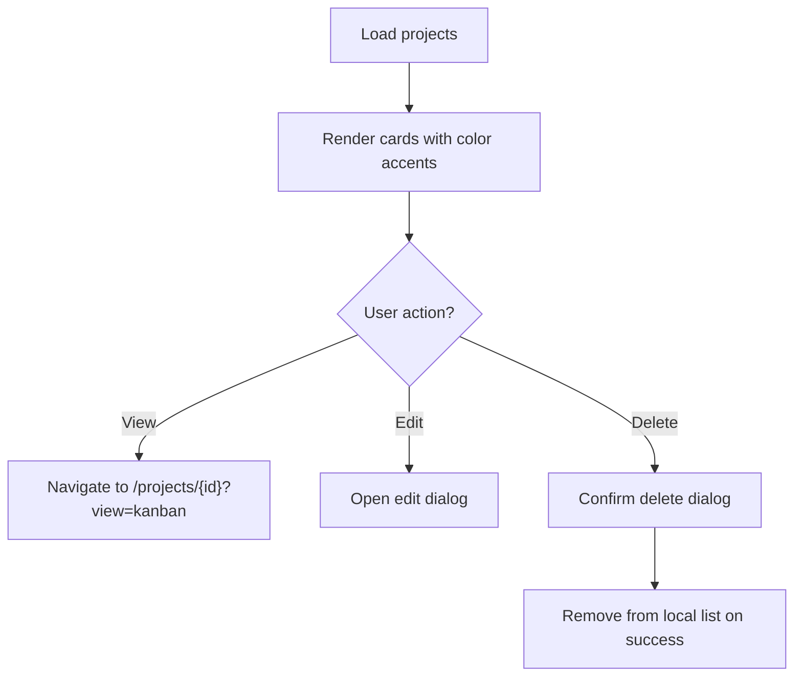

**Diagram sources**
- [list-section.tsx](file://Apps/Web/src/components/projects-page/list-section.tsx)
- [ProjectRepository.cs](file://Services/Services.Infrastructure/Repositories/ProjectRepository.cs)

**Section sources**
- [list-section.tsx](file://Apps/Web/src/components/projects-page/list-section.tsx)
- [ProjectRepository.cs](file://Services/Services.Infrastructure/Repositories/ProjectRepository.cs)

### Project Summary Statistics and Progress Tracking
- Endpoint GET /api/projects/{id}/summary returns:
  - ProjectId, ProjectName
  - TotalTasks, CompletedTasks, PendingTasks
  - ProgressPercentage (completed / total * 100, rounded to two decimals)
- Computation:
  - Fetch project and ensure ownership.
  - Aggregate task counts grouped by status.
  - Calculate pending = total - completed.
  - Compute percentage safely when total is zero.

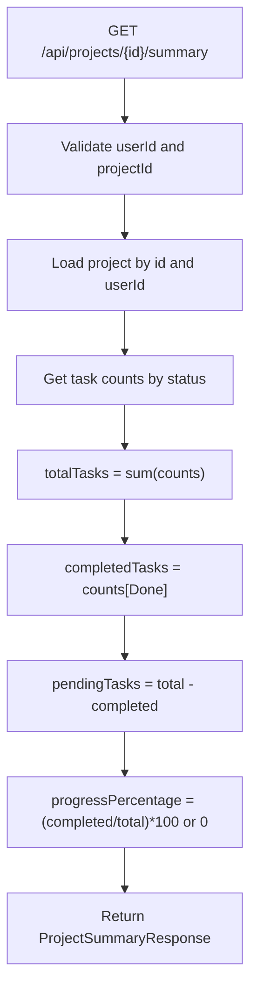

**Diagram sources**
- [ProjectsController.cs](file://Services/Services.Api/Controllers/ProjectsController.cs)
- [ProjectService.cs](file://Services/Services.Application/Services/ProjectService.cs)
- [ProjectRepository.cs](file://Services/Services.Infrastructure/Repositories/ProjectRepository.cs)

**Section sources**
- [ProjectsController.cs](file://Services/Services.Api/Controllers/ProjectsController.cs)
- [ProjectService.cs](file://Services/Services.Application/Services/ProjectService.cs)
- [ProjectSummaryResponse.cs](file://Services/Services.Application/DTOs/Projects/ProjectSummaryResponse.cs)

### Integration with Task Management
- Within a project detail page, tasks can be listed and managed:
  - GET /api/projects/{id}/tasks supports query parameters for status, priority, sorting, and pagination.
  - Frontend manages query params and page changes, updating the task list accordingly.
- This demonstrates tight integration between project and task features.

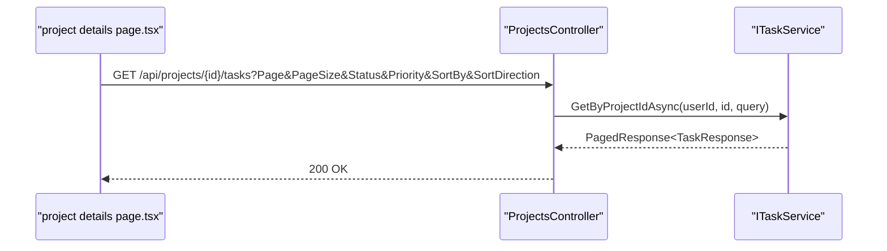

**Diagram sources**
- [project details page.tsx](file://Apps/Web/src/app/(protected)/projects/[projectSlug]/page.tsx)
- [ProjectsController.cs](file://Services/Services.Api/Controllers/ProjectsController.cs)

**Section sources**
- [project details page.tsx](file://Apps/Web/src/app/(protected)/projects/[projectSlug]/page.tsx)
- [ProjectsController.cs](file://Services/Services.Api/Controllers/ProjectsController.cs)

## Dependency Analysis
Key relationships:
- ProjectsController depends on IProjectService and ITaskService.
- ProjectService depends on IProjectRepository and domain types.
- ProjectRepository implements IProjectRepository and uses AppDbContext.
- Domain Project uses value objects and enforces validation rules.
- DTOs define clear boundaries between layers.

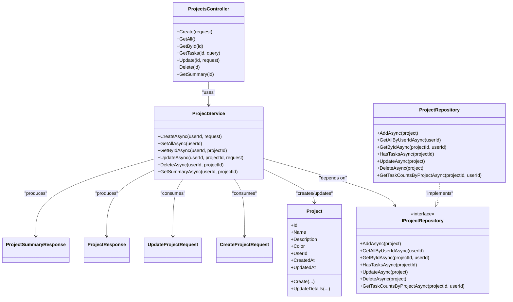

**Diagram sources**
- [ProjectsController.cs](file://Services/Services.Api/Controllers/ProjectsController.cs)
- [ProjectService.cs](file://Services/Services.Application/Services/ProjectService.cs)
- [IProjectRepository.cs](file://Services/Services.Application/Interfaces/Repositories/IProjectRepository.cs)
- [ProjectRepository.cs](file://Services/Services.Infrastructure/Repositories/ProjectRepository.cs)
- [Project.cs](file://Services/Services.Domain/Entities/Project.cs)
- [CreateProjectRequest.cs](file://Services/Services.Application/DTOs/Projects/CreateProjectRequest.cs)
- [UpdateProjectRequest.cs](file://Services/Services.Application/DTOs/Projects/UpdateProjectRequest.cs)
- [ProjectResponse.cs](file://Services/Services.Application/DTOs/Projects/ProjectResponse.cs)
- [ProjectSummaryResponse.cs](file://Services/Services.Application/DTOs/Projects/ProjectSummaryResponse.cs)

**Section sources**
- [ProjectsController.cs](file://Services/Services.Api/Controllers/ProjectsController.cs)
- [ProjectService.cs](file://Services/Services.Application/Services/ProjectService.cs)
- [IProjectRepository.cs](file://Services/Services.Application/Interfaces/Repositories/IProjectRepository.cs)
- [ProjectRepository.cs](file://Services/Services.Infrastructure/Repositories/ProjectRepository.cs)
- [Project.cs](file://Services/Services.Domain/Entities/Project.cs)

## Performance Considerations
- Use AsNoTracking for read-only queries to avoid tracking overhead.
- Group-by aggregation for task counts reduces client-side computation.
- Avoid unnecessary re-renders by updating only changed items in the task list.
- Keep color normalization and description trimming on the server to prevent invalid data.

[No sources needed since this section provides general guidance]

## Troubleshooting Guide
Common issues and resolutions:
- Validation errors:
  - Missing or empty name: handled by domain value object and EF constraints.
  - Description too long: domain throws exception when exceeding limit.
  - Invalid color format: domain rejects non-hex strings.
- Ownership errors:
  - Accessing another user’s project results in KeyNotFoundException.
- Deletion conflicts:
  - Deleting a project with tasks returns conflict due to business rule.

Operational tips:
- Check controller error mappings for BadRequest, NotFound, and Conflict responses.
- Inspect service exceptions for detailed messages.
- Verify repository queries for correct filters by userId.

**Section sources**
- [ProjectService.cs](file://Services/Services.Application/Services/ProjectService.cs)
- [ProjectsController.cs](file://Services/Services.Api/Controllers/ProjectsController.cs)
- [Project.cs](file://Services/Services.Domain/Entities/Project.cs)

## Conclusion
The project management feature provides a complete lifecycle for projects with robust validation, ownership enforcement, and clear separation of concerns across layers. The frontend offers intuitive forms and lists with visual indicators like color accents, while the backend ensures data integrity and computes meaningful progress metrics. Integration with task management enables cohesive workflows around projects and their tasks.