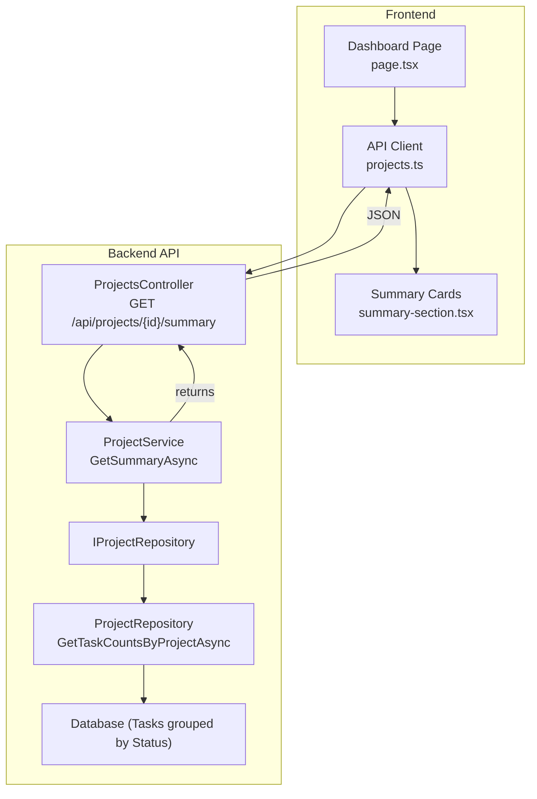
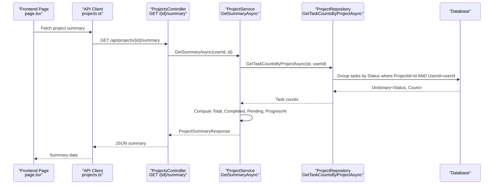
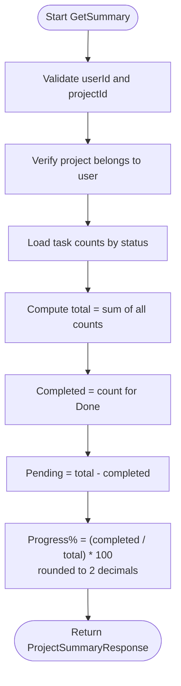
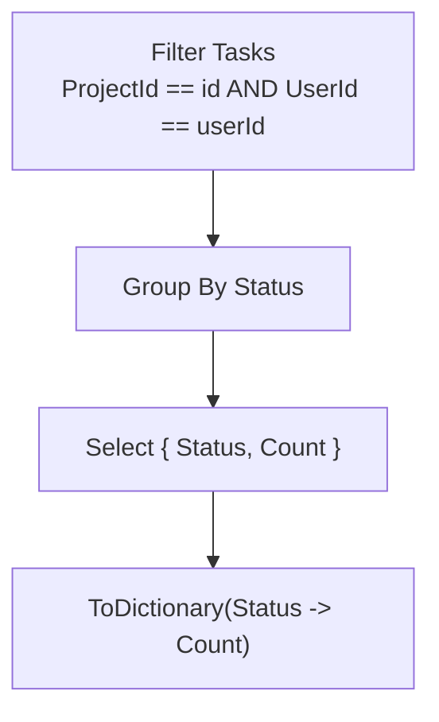
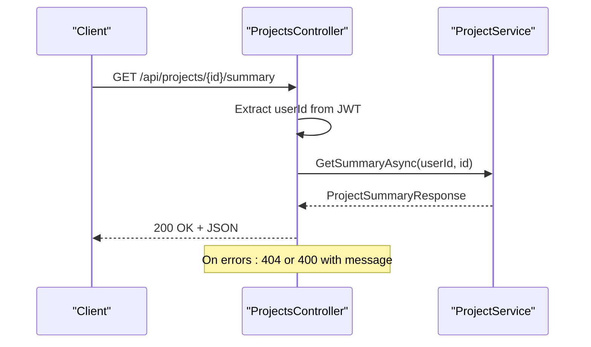
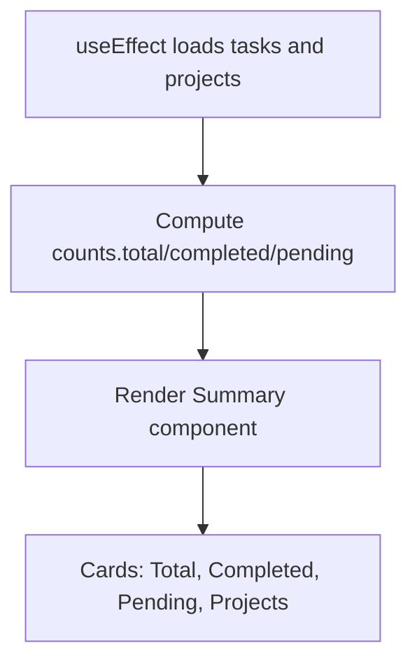
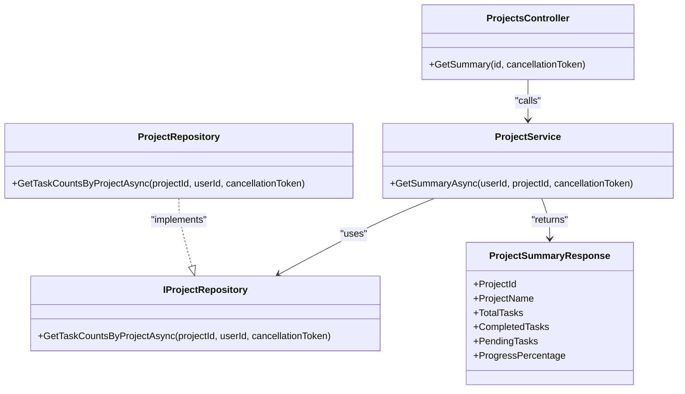

# Project Statistics and Summary

<cite>
**Referenced Files in This Document**
- [ProjectsController.cs](file://Services/Services.Api/Controllers/ProjectsController.cs)
- [ProjectService.cs](file://Services/Services.Application/Services/ProjectService.cs)
- [IProjectRepository.cs](file://Services/Services.Application/Interfaces/Repositories/IProjectRepository.cs)
- [ProjectRepository.cs](file://Services/Services.Infrastructure/Repositories/ProjectRepository.cs)
- [ProjectSummaryResponse.cs](file://Services/Services.Application/DTOs/Projects/ProjectSummaryResponse.cs)
- [page.tsx](file://Apps/Web/src/app/(protected)/page.tsx)
- [summary-section.tsx](file://Apps/Web/src/components/main-page/summary-section.tsx)
- [projects.ts](file://Apps/Web/src/lib/api/projects.ts)
</cite>

## Table of Contents
1. [Introduction](#introduction)
2. [Project Structure](#project-structure)
3. [Core Components](#core-components)
4. [Architecture Overview](#architecture-overview)
5. [Detailed Component Analysis](#detailed-component-analysis)
6. [Dependency Analysis](#dependency-analysis)
7. [Performance Considerations](#performance-considerations)
8. [Troubleshooting Guide](#troubleshooting-guide)
9. [Conclusion](#conclusion)

## Introduction
This document explains the project statistics and summary features across the backend API and frontend dashboard. It covers how metrics such as task completion rates, progress tracking, and activity summaries are calculated; how the summary API endpoints work; how data is aggregated from repositories to responses; and how the frontend visualizes these statistics. It also includes guidance for real-time updates, caching strategies, and customization options for different summary views.

## Project Structure
The statistics and summary feature spans:
- Backend API controller exposing a per-project summary endpoint
- Application service orchestrating validation, authorization scoping, and metric calculation
- Repository layer aggregating task counts by status
- DTO defining the summary response contract
- Frontend pages and components rendering dashboard cards and numbers

**Diagram sources**
- [ProjectsController.cs:175-197](file://Services/Services.Api/Controllers/ProjectsController.cs#L175-L197)
- [ProjectService.cs:181-231](file://Services/Services.Application/Services/ProjectService.cs#L181-L231)
- [IProjectRepository.cs:33-36](file://Services/Services.Application/Interfaces/Repositories/IProjectRepository.cs#L33-L36)
- [ProjectRepository.cs:76-96](file://Services/Services.Infrastructure/Repositories/ProjectRepository.cs#L76-L96)
- [page.tsx:20-52](file://Apps/Web/src/app/(protected)/page.tsx#L20-L52)
- [summary-section.tsx:20-82](file://Apps/Web/src/components/main-page/summary-section.tsx#L20-L82)
- [projects.ts:104-107](file://Apps/Web/src/lib/api/projects.ts#L104-L107)

**Section sources**
- [ProjectsController.cs:175-197](file://Services/Services.Api/Controllers/ProjectsController.cs#L175-L197)
- [ProjectService.cs:181-231](file://Services/Services.Application/Services/ProjectService.cs#L181-L231)
- [IProjectRepository.cs:33-36](file://Services/Services.Application/Interfaces/Repositories/IProjectRepository.cs#L33-L36)
- [ProjectRepository.cs:76-96](file://Services/Services.Infrastructure/Repositories/ProjectRepository.cs#L76-L96)
- [page.tsx:20-52](file://Apps/Web/src/app/(protected)/page.tsx#L20-L52)
- [summary-section.tsx:20-82](file://Apps/Web/src/components/main-page/summary-section.tsx#L20-L82)
- [projects.ts:104-107](file://Apps/Web/src/lib/api/projects.ts#L104-L107)

## Core Components
- Summary Response Contract
  - Defines fields for project identification, total tasks, completed tasks, pending tasks, and progress percentage.
- Projects Controller
  - Exposes GET /api/projects/{id}/summary with authentication and error handling.
- Project Service
  - Validates inputs, ensures user ownership, aggregates task counts, computes totals and progress percentage, and returns the summary DTO.
- Project Repository
  - Groups tasks by status for a given project and user, returning a dictionary of counts.
- Frontend Dashboard Page
  - Loads recent tasks, total/completed/pending counts, and projects list; renders the Summary component.
- Summary UI Component
  - Renders cards for total tasks, completed, pending, and projects count with icons and labels.

**Section sources**
- [ProjectSummaryResponse.cs:3-9](file://Services/Services.Application/DTOs/Projects/ProjectSummaryResponse.cs#L3-L9)
- [ProjectsController.cs:175-197](file://Services/Services.Api/Controllers/ProjectsController.cs#L175-L197)
- [ProjectService.cs:181-231](file://Services/Services.Application/Services/ProjectService.cs#L181-L231)
- [ProjectRepository.cs:76-96](file://Services/Services.Infrastructure/Repositories/ProjectRepository.cs#L76-L96)
- [page.tsx:20-52](file://Apps/Web/src/app/(protected)/page.tsx#L20-L52)
- [summary-section.tsx:20-82](file://Apps/Web/src/components/main-page/summary-section.tsx#L20-L82)

## Architecture Overview
The summary flow starts at the frontend dashboard page, which calls the API client to fetch project-level summary data. The controller authorizes the request, extracts the current user ID, and delegates to the application service. The service validates parameters, verifies project ownership, retrieves task counts grouped by status, calculates totals and progress percentage, and returns the summary DTO. The repository performs an efficient group-by aggregation over tasks filtered by project and user.

**Diagram sources**
- [ProjectsController.cs:175-197](file://Services/Services.Api/Controllers/ProjectsController.cs#L175-L197)
- [ProjectService.cs:181-231](file://Services/Services.Application/Services/ProjectService.cs#L181-L231)
- [ProjectRepository.cs:76-96](file://Services/Services.Infrastructure/Repositories/ProjectRepository.cs#L76-L96)
- [projects.ts:104-107](file://Apps/Web/src/lib/api/projects.ts#L104-L107)
- [page.tsx:20-52](file://Apps/Web/src/app/(protected)/page.tsx#L20-L52)

## Detailed Component Analysis

### Summary Calculation Logic
The summary calculation follows a clear pipeline:
- Validate user and project identifiers
- Verify project ownership
- Retrieve task counts grouped by status
- Compute total tasks as sum of all status counts
- Derive completed tasks from the Done status
- Calculate pending tasks as total minus completed
- Compute progress percentage as completed divided by total, rounded to two decimals

**Diagram sources**
- [ProjectService.cs:181-231](file://Services/Services.Application/Services/ProjectService.cs#L181-L231)

**Section sources**
- [ProjectService.cs:181-231](file://Services/Services.Application/Services/ProjectService.cs#L181-L231)

### Data Aggregation in Repository
The repository groups tasks by their current status for a specific project and user, returning a dictionary mapping each status to its count. This enables efficient computation of totals and completion metrics without loading full entities into memory.

**Diagram sources**
- [ProjectRepository.cs:76-96](file://Services/Services.Infrastructure/Repositories/ProjectRepository.cs#L76-L96)

**Section sources**
- [ProjectRepository.cs:76-96](file://Services/Services.Infrastructure/Repositories/ProjectRepository.cs#L76-L96)

### API Endpoint Definition
- Endpoint: GET /api/projects/{id}/summary
- Authentication: Required (JWT-based)
- Path Parameter: id (Guid)
- Success Response: ProjectSummaryResponse
- Error Responses:
  - 404 Not Found when project does not exist or does not belong to user
  - 400 Bad Request for invalid arguments

**Diagram sources**
- [ProjectsController.cs:175-197](file://Services/Services.Api/Controllers/ProjectsController.cs#L175-L197)
- [ProjectService.cs:181-231](file://Services/Services.Application/Services/ProjectService.cs#L181-L231)

**Section sources**
- [ProjectsController.cs:175-197](file://Services/Services.Api/Controllers/ProjectsController.cs#L175-L197)

### Frontend Visualization
- Dashboard Page
  - Loads multiple task lists to derive total, completed, and pending counts
  - Loads projects list to show project count
  - Passes computed counts and project count to the Summary component
- Summary Component
  - Renders four cards: Total tasks, Completed, Pending, Projects
  - Uses skeleton placeholders while loading
  - Displays numeric values with locale formatting

**Diagram sources**
- [page.tsx:20-52](file://Apps/Web/src/app/(protected)/page.tsx#L20-L52)
- [summary-section.tsx:20-82](file://Apps/Web/src/components/main-page/summary-section.tsx#L20-L82)

**Section sources**
- [page.tsx:20-52](file://Apps/Web/src/app/(protected)/page.tsx#L20-L52)
- [summary-section.tsx:20-82](file://Apps/Web/src/components/main-page/summary-section.tsx#L20-L82)

### Real-Time Updates Strategy
- Current behavior: Dashboard loads initial data on mount using parallel requests.
- Recommended approach for real-time updates:
  - Use polling intervals to refresh summary and counts periodically
  - Integrate WebSocket events for task/project changes to trigger immediate re-renders
  - Debounce rapid updates to avoid excessive network calls

[No sources needed since this section provides general guidance]

### Caching Strategies for Performance
- Server-side caching:
  - Cache task counts by project and user for a short TTL to reduce database load
  - Invalidate cache on task/project mutations
- Client-side caching:
  - Cache summary responses locally (e.g., in-memory or session storage)
  - Stale-while-revalidate pattern to improve perceived performance

[No sources needed since this section provides general guidance]

### Customization Options for Summary Views
- Add filters:
  - Time range (last 7 days, last month)
  - Priority breakdown
  - Assignee-specific metrics
- Additional metrics:
  - Overdue tasks
  - Average completion time
  - Sprint velocity
- Visual enhancements:
  - Progress bars or donut charts for completion percentage
  - Trend lines for weekly/monthly completion rates

[No sources needed since this section provides general guidance]

## Dependency Analysis
The following diagram shows key dependencies among controllers, services, repositories, and DTOs involved in the summary feature.

**Diagram sources**
- [ProjectsController.cs:175-197](file://Services/Services.Api/Controllers/ProjectsController.cs#L175-L197)
- [ProjectService.cs:181-231](file://Services/Services.Application/Services/ProjectService.cs#L181-L231)
- [IProjectRepository.cs:33-36](file://Services/Services.Application/Interfaces/Repositories/IProjectRepository.cs#L33-L36)
- [ProjectRepository.cs:76-96](file://Services/Services.Infrastructure/Repositories/ProjectRepository.cs#L76-L96)
- [ProjectSummaryResponse.cs:3-9](file://Services/Services.Application/DTOs/Projects/ProjectSummaryResponse.cs#L3-L9)

**Section sources**
- [ProjectsController.cs:175-197](file://Services/Services.Api/Controllers/ProjectsController.cs#L175-L197)
- [ProjectService.cs:181-231](file://Services/Services.Application/Services/ProjectService.cs#L181-L231)
- [IProjectRepository.cs:33-36](file://Services/Services.Application/Interfaces/Repositories/IProjectRepository.cs#L33-L36)
- [ProjectRepository.cs:76-96](file://Services/Services.Infrastructure/Repositories/ProjectRepository.cs#L76-L96)
- [ProjectSummaryResponse.cs:3-9](file://Services/Services.Application/DTOs/Projects/ProjectSummaryResponse.cs#L3-L9)

## Performance Considerations
- Database queries:
  - Use read-only projections and AsNoTracking for counting operations
  - Ensure indexes on ProjectId and UserId columns for fast filtering
- Computation:
  - Avoid loading full entities; aggregate counts at the database level
- Concurrency:
  - Support cancellation tokens for long-running queries
- Frontend:
  - Parallelize independent requests
  - Show skeletons during loading to improve UX

[No sources needed since this section provides general guidance]

## Troubleshooting Guide
Common issues and resolutions:
- 404 Not Found on summary endpoint
  - Cause: Project does not exist or does not belong to the authenticated user
  - Resolution: Verify project ID and user ownership; ensure correct JWT claims
- 400 Bad Request
  - Cause: Invalid userId or projectId passed to service
  - Resolution: Validate input parameters before calling the API
- Empty or zero progress
  - Cause: No tasks assigned to the project
  - Resolution: Confirm tasks exist; verify status grouping logic

**Section sources**
- [ProjectsController.cs:175-197](file://Services/Services.Api/Controllers/ProjectsController.cs#L175-L197)
- [ProjectService.cs:181-231](file://Services/Services.Application/Services/ProjectService.cs#L181-L231)

## Conclusion
The project statistics and summary feature provides a robust mechanism to compute and display task completion rates and progress percentages. The backend enforces ownership and efficiently aggregates task counts, while the frontend presents clear, accessible metrics through card-based visuals. With optional real-time updates, caching, and extensible metrics, the system can scale to support richer dashboards and more granular insights.