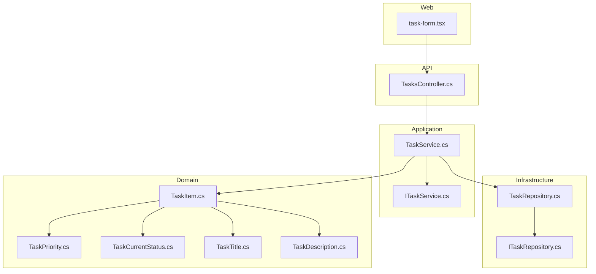
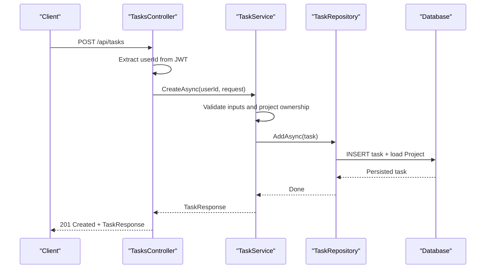
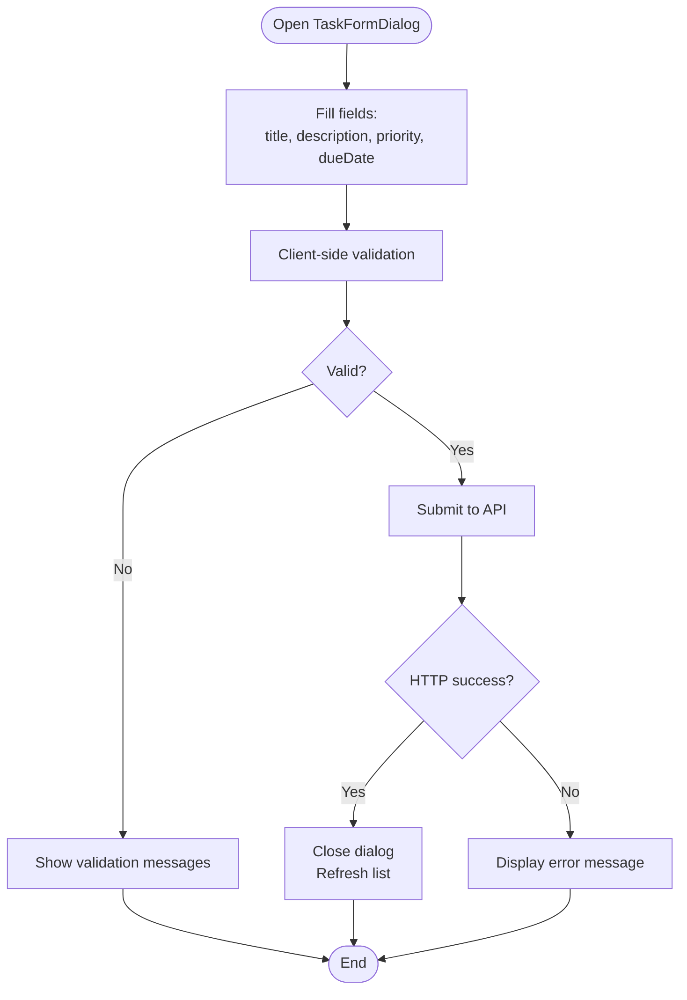
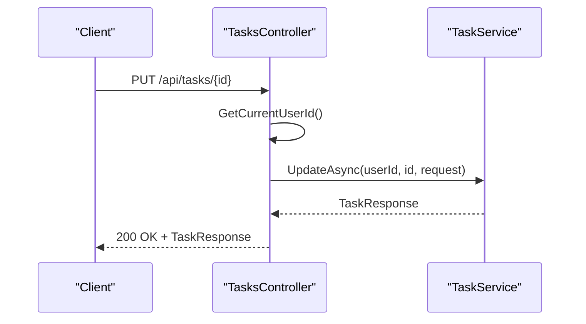
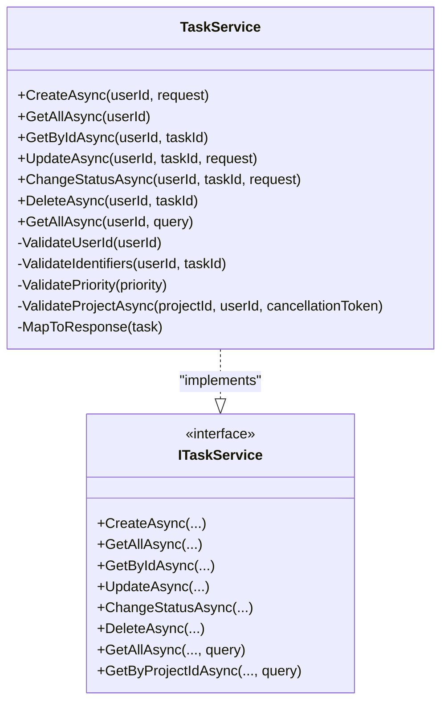
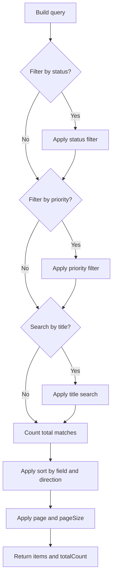
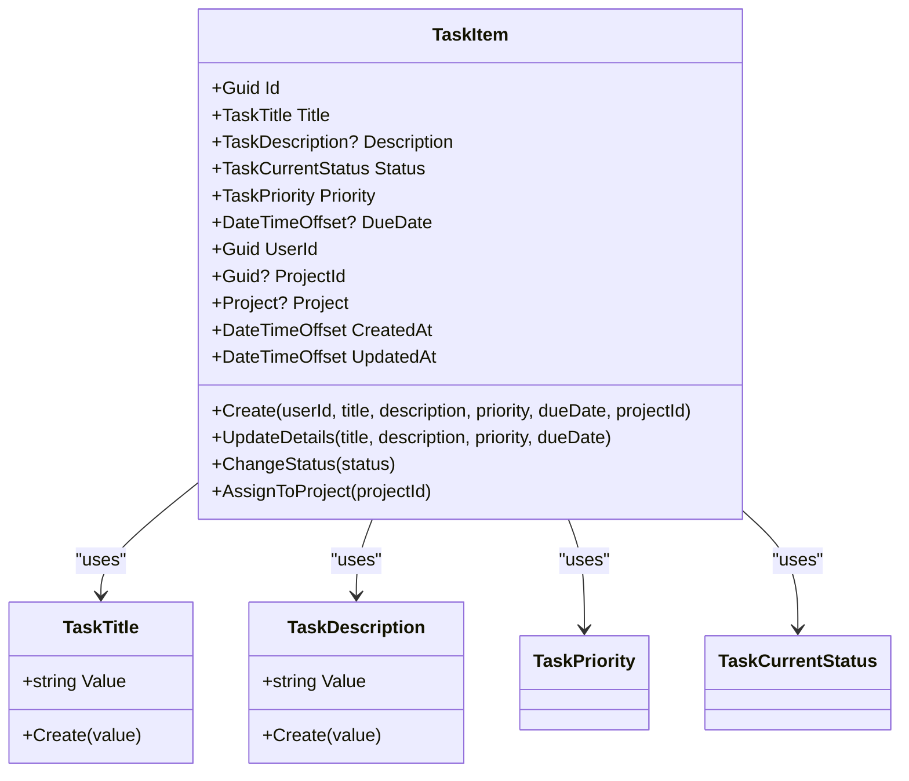
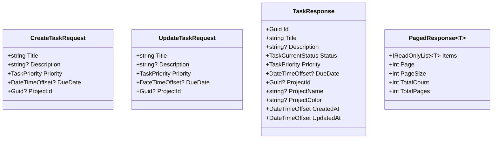
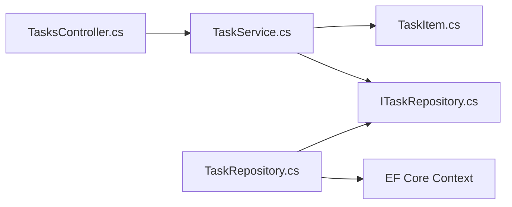

# Task CRUD Operations

<cite>
**Referenced Files in This Document**
- [TasksController.cs](file://Services/Services.Api/Controllers/TasksController.cs)
- [TaskService.cs](file://Services/Services.Application/Services/TaskService.cs)
- [ITaskService.cs](file://Services/Services.Application/Interfaces/Services/ITaskService.cs)
- [TaskRepository.cs](file://Services/Services.Infrastructure/Repositories/TaskRepository.cs)
- [ITaskRepository.cs](file://Services/Services.Application/Interfaces/Repositories/ITaskRepository.cs)
- [TaskItem.cs](file://Services/Services.Domain/Entities/TaskItem.cs)
- [TaskPriority.cs](file://Services/Services.Domain/Enums/TaskPriority.cs)
- [TaskCurrentStatus.cs](file://Services/Services.Domain/Enums/TaskCurrentStatus.cs)
- [CreateTaskRequest.cs](file://Services/Services.Application/DTOs/Tasks/CreateTaskRequest.cs)
- [UpdateTaskRequest.cs](file://Services/Services.Application/DTOs/Tasks/UpdateTaskRequest.cs)
- [TaskResponse.cs](file://Services/Services.Application/DTOs/Tasks/TaskResponse.cs)
- [PagedResponse.cs](file://Services/Services.Application/DTOs/PagedResponse.cs)
- [TaskTitle.cs](file://Services/Services.Domain/ValueObjects/TaskTitle.cs)
- [TaskDescription.cs](file://Services/Services.Domain/ValueObjects/TaskDescription.cs)
- [task-form.tsx](file://Apps/Web/src/components/tasks-page/task-form.tsx)
</cite>

## Table of Contents
1. [Introduction](#introduction)
2. [Project Structure](#project-structure)
3. [Core Components](#core-components)
4. [Architecture Overview](#architecture-overview)
5. [Detailed Component Analysis](#detailed-component-analysis)
6. [Dependency Analysis](#dependency-analysis)
7. [Performance Considerations](#performance-considerations)
8. [Troubleshooting Guide](#troubleshooting-guide)
9. [Conclusion](#conclusion)

## Introduction
This document explains the complete lifecycle of task CRUD operations across the frontend and backend. It covers:
- Frontend form handling via the TaskFormDialog component (title, description, priority, due date).
- Backend API endpoints for creating, reading, updating, and deleting tasks.
- Application service logic for validation, authorization checks, and business rules.
- Domain models and value objects that enforce data integrity.
- Data transfer objects (DTOs), pagination, and error handling patterns.
- Examples for different priorities, due date management, and bulk-like workflows.

## Project Structure
The task feature spans three layers:
- API layer: REST endpoints under TasksController.
- Application layer: TaskService orchestrates validation, domain calls, and mapping to DTOs.
- Infrastructure layer: TaskRepository implements persistence with EF Core.
- Domain layer: TaskItem entity and related enums/value objects define core business semantics.
- Web layer: A React-based form component drives user interactions.

**Diagram sources**
- [TasksController.cs:11-16](file://Services/Services.Api/Controllers/TasksController.cs#L11-L16)
- [TaskService.cs:12-14](file://Services/Services.Application/Services/TaskService.cs#L12-L14)
- [TaskRepository.cs:9-11](file://Services/Services.Infrastructure/Repositories/TaskRepository.cs#L9-L11)
- [TaskItem.cs:6-20](file://Services/Services.Domain/Entities/TaskItem.cs#L6-L20)
- [TaskPriority.cs:3-9](file://Services/Services.Domain/Enums/TaskPriority.cs#L3-L9)
- [TaskCurrentStatus.cs:3-8](file://Services/Services.Domain/Enums/TaskCurrentStatus.cs#L3-L8)
- [TaskTitle.cs:3-12](file://Services/Services.Domain/ValueObjects/TaskTitle.cs#L3-L12)
- [TaskDescription.cs:3-12](file://Services/Services.Domain/ValueObjects/TaskDescription.cs#L3-L12)
- [task-form.tsx](file://Apps/Web/src/components/tasks-page/task-form.tsx)

**Section sources**
- [TasksController.cs:11-16](file://Services/Services.Api/Controllers/TasksController.cs#L11-L16)
- [TaskService.cs:12-14](file://Services/Services.Application/Services/TaskService.cs#L12-L14)
- [TaskRepository.cs:9-11](file://Services/Services.Infrastructure/Repositories/TaskRepository.cs#L9-L11)
- [TaskItem.cs:6-20](file://Services/Services.Domain/Entities/TaskItem.cs#L6-L20)
- [TaskPriority.cs:3-9](file://Services/Services.Domain/Enums/TaskPriority.cs#L3-L9)
- [TaskCurrentStatus.cs:3-8](file://Services/Services.Domain/Enums/TaskCurrentStatus.cs#L3-L8)
- [TaskTitle.cs:3-12](file://Services/Services.Domain/ValueObjects/TaskTitle.cs#L3-L12)
- [TaskDescription.cs:3-12](file://Services/Services.Domain/ValueObjects/TaskDescription.cs#L3-L12)
- [task-form.tsx](file://Apps/Web/src/components/tasks-page/task-form.tsx)

## Core Components
- TasksController: Exposes REST endpoints for Create, Read (single and paged list), Update, Change Status, and Delete. Enforces authentication and maps exceptions to HTTP status codes.
- TaskService: Implements business logic, validates inputs, ensures ownership, persists changes, and maps domain entities to DTOs.
- TaskRepository: Provides data access using EF Core, including filtering, sorting, pagination, and project existence checks.
- TaskItem: Domain entity encapsulating task state and behavior (creation, updates, status transitions).
- DTOs: CreateTaskRequest, UpdateTaskRequest, TaskResponse, PagedResponse define contract boundaries between layers.
- Value Objects: TaskTitle and TaskDescription enforce length and normalization rules.
- Enums: TaskPriority and TaskCurrentStatus constrain allowed values.

**Section sources**
- [TasksController.cs:18-182](file://Services/Services.Api/Controllers/TasksController.cs#L18-L182)
- [TaskService.cs:16-410](file://Services/Services.Application/Services/TaskService.cs#L16-L410)
- [TaskRepository.cs:13-237](file://Services/Services.Infrastructure/Repositories/TaskRepository.cs#L13-L237)
- [TaskItem.cs:6-127](file://Services/Services.Domain/Entities/TaskItem.cs#L6-L127)
- [CreateTaskRequest.cs:5-10](file://Services/Services.Application/DTOs/Tasks/CreateTaskRequest.cs#L5-L10)
- [UpdateTaskRequest.cs:5-10](file://Services/Services.Application/DTOs/Tasks/UpdateTaskRequest.cs#L5-L10)
- [TaskResponse.cs:5-16](file://Services/Services.Application/DTOs/Tasks/TaskResponse.cs#L5-L16)
- [PagedResponse.cs:3-8](file://Services/Services.Application/DTOs/PagedResponse.cs#L3-L8)
- [TaskTitle.cs:3-36](file://Services/Services.Domain/ValueObjects/TaskTitle.cs#L3-L36)
- [TaskDescription.cs:3-30](file://Services/Services.Domain/ValueObjects/TaskDescription.cs#L3-L30)
- [TaskPriority.cs:3-9](file://Services/Services.Domain/Enums/TaskPriority.cs#L3-L9)
- [TaskCurrentStatus.cs:3-8](file://Services/Services.Domain/Enums/TaskCurrentStatus.cs#L3-L8)

## Architecture Overview
The request flow for task operations follows a layered pattern:
- Client invokes an endpoint on TasksController.
- Controller extracts the authenticated user ID and delegates to TaskService.
- TaskService validates input, enforces business rules, interacts with TaskRepository, and returns mapped DTOs.
- TaskRepository performs queries and mutations against the database.

**Diagram sources**
- [TasksController.cs:18-47](file://Services/Services.Api/Controllers/TasksController.cs#L18-L47)
- [TaskService.cs:16-48](file://Services/Services.Application/Services/TaskService.cs#L16-L48)
- [TaskRepository.cs:13-23](file://Services/Services.Infrastructure/Repositories/TaskRepository.cs#L13-L23)

## Detailed Component Analysis

### Task Form Dialog (Frontend)
Responsibilities:
- Collects title, description, priority, and due date.
- Performs client-side validation before submission.
- Submits data to the backend via API calls.
- Handles success and error feedback to the user.

Validation and field handling:
- Title: Required; enforced by backend value object.
- Description: Optional; validated by backend value object.
- Priority: Enumerated; must be one of Low, Medium, High, Urgent.
- Due Date: Optional datetime; passed through to backend.

Submission workflow:
- On submit, the component sends a POST request to create a task or PUT to update an existing task.
- On success, it closes the dialog and refreshes the task list.
- On error, it displays validation or server errors.

[No sources needed since this diagram shows conceptual workflow, not actual code structure]

**Section sources**
- [task-form.tsx](file://Apps/Web/src/components/tasks-page/task-form.tsx)

### Backend API: TasksController
Endpoints:
- POST /api/tasks: Create a new task.
- GET /api/tasks: Get all tasks (paged).
- GET /api/tasks/{id}: Get a single task.
- PUT /api/tasks/{id}: Update a task.
- PATCH /api/tasks/{id}/status: Change task status.
- DELETE /api/tasks/{id}: Delete a task.

Authentication and error handling:
- Requires authorization; extracts user ID from JWT claims.
- Returns NotFound for missing resources and BadRequest for validation errors.

**Diagram sources**
- [TasksController.cs:99-126](file://Services/Services.Api/Controllers/TasksController.cs#L99-L126)
- [TaskService.cs:80-119](file://Services/Services.Application/Services/TaskService.cs#L80-L119)

**Section sources**
- [TasksController.cs:18-182](file://Services/Services.Api/Controllers/TasksController.cs#L18-L182)

### Application Service: TaskService
Key methods:
- CreateAsync: Validates inputs, constructs domain entity, persists, and returns response.
- GetAllAsync: Retrieves all tasks for a user.
- GetByIdAsync: Fetches a single task owned by the user.
- UpdateAsync: Updates title, description, priority, due date, and project assignment.
- ChangeStatusAsync: Changes task status.
- DeleteAsync: Deletes a task owned by the user.
- GetAllAsync(paged): Paginated retrieval with filters and sorting.

Validation and business rules:
- Validates user and task identifiers.
- Ensures priority is valid.
- Validates project ownership when provided.
- Normalizes and validates query parameters for paging and sorting.

**Diagram sources**
- [TaskService.cs:12-410](file://Services/Services.Application/Services/TaskService.cs#L12-L410)
- [ITaskService.cs:6-49](file://Services/Services.Application/Interfaces/Services/ITaskService.cs#L6-L49)

**Section sources**
- [TaskService.cs:16-410](file://Services/Services.Application/Services/TaskService.cs#L16-L410)
- [ITaskService.cs:6-49](file://Services/Services.Application/Interfaces/Services/ITaskService.cs#L6-L49)

### Data Access: TaskRepository
Capabilities:
- Add, update, delete tasks.
- Retrieve tasks by user or project with filtering, sorting, and pagination.
- Check project ownership for authorization at the data layer.

Query features:
- Filters by status and priority.
- Search by title substring.
- Sortable by title, due date, priority, status, or created date.
- Stable pagination with tie-breaker on task ID.

**Diagram sources**
- [TaskRepository.cs:82-157](file://Services/Services.Infrastructure/Repositories/TaskRepository.cs#L82-L157)
- [TaskRepository.cs:159-237](file://Services/Services.Infrastructure/Repositories/TaskRepository.cs#L159-L237)

**Section sources**
- [TaskRepository.cs:13-237](file://Services/Services.Infrastructure/Repositories/TaskRepository.cs#L13-L237)
- [ITaskRepository.cs:6-44](file://Services/Services.Application/Interfaces/Repositories/ITaskRepository.cs#L6-L44)

### Domain Model: TaskItem
Behavior:
- Creation with required title, optional description, priority, due date, and project.
- Updating details while enforcing valid priority.
- Changing status with enum validation.
- Assigning to a project.
- Timestamps updated automatically on modifications.

**Diagram sources**
- [TaskItem.cs:6-127](file://Services/Services.Domain/Entities/TaskItem.cs#L6-L127)
- [TaskTitle.cs:3-36](file://Services/Services.Domain/ValueObjects/TaskTitle.cs#L3-L36)
- [TaskDescription.cs:3-30](file://Services/Services.Domain/ValueObjects/TaskDescription.cs#L3-L30)
- [TaskPriority.cs:3-9](file://Services/Services.Domain/Enums/TaskPriority.cs#L3-L9)
- [TaskCurrentStatus.cs:3-8](file://Services/Services.Domain/Enums/TaskCurrentStatus.cs#L3-L8)

**Section sources**
- [TaskItem.cs:6-127](file://Services/Services.Domain/Entities/TaskItem.cs#L6-L127)

### DTOs and Contracts
- CreateTaskRequest: Defines required title, optional description, priority, due date, and optional project ID.
- UpdateTaskRequest: Same shape as CreateTaskRequest for updates.
- TaskResponse: Includes task metadata, project info, and timestamps.
- PagedResponse: Wraps paginated results with totals.

**Diagram sources**
- [CreateTaskRequest.cs:5-10](file://Services/Services.Application/DTOs/Tasks/CreateTaskRequest.cs#L5-L10)
- [UpdateTaskRequest.cs:5-10](file://Services/Services.Application/DTOs/Tasks/UpdateTaskRequest.cs#L5-L10)
- [TaskResponse.cs:5-16](file://Services/Services.Application/DTOs/Tasks/TaskResponse.cs#L5-L16)
- [PagedResponse.cs:3-8](file://Services/Services.Application/DTOs/PagedResponse.cs#L3-L8)

**Section sources**
- [CreateTaskRequest.cs:5-10](file://Services/Services.Application/DTOs/Tasks/CreateTaskRequest.cs#L5-L10)
- [UpdateTaskRequest.cs:5-10](file://Services/Services.Application/DTOs/Tasks/UpdateTaskRequest.cs#L5-L10)
- [TaskResponse.cs:5-16](file://Services/Services.Application/DTOs/Tasks/TaskResponse.cs#L5-L16)
- [PagedResponse.cs:3-8](file://Services/Services.Application/DTOs/PagedResponse.cs#L3-L8)

## Dependency Analysis
Layer dependencies:
- API depends on Application services.
- Application depends on Domain entities and interfaces.
- Infrastructure implements repository interfaces and depends on persistence context.

**Diagram sources**
- [TasksController.cs:11-16](file://Services/Services.Api/Controllers/TasksController.cs#L11-L16)
- [TaskService.cs:12-14](file://Services/Services.Application/Services/TaskService.cs#L12-L14)
- [TaskRepository.cs:9-11](file://Services/Services.Infrastructure/Repositories/TaskRepository.cs#L9-L11)
- [ITaskRepository.cs:6-44](file://Services/Services.Application/Interfaces/Repositories/ITaskRepository.cs#L6-L44)

**Section sources**
- [TasksController.cs:11-16](file://Services/Services.Api/Controllers/TasksController.cs#L11-L16)
- [TaskService.cs:12-14](file://Services/Services.Application/Services/TaskService.cs#L12-L14)
- [TaskRepository.cs:9-11](file://Services/Services.Infrastructure/Repositories/TaskRepository.cs#L9-L11)
- [ITaskRepository.cs:6-44](file://Services/Services.Application/Interfaces/Repositories/ITaskRepository.cs#L6-L44)

## Performance Considerations
- Use paged queries for large lists to reduce payload size and improve UI responsiveness.
- Leverage AsNoTracking for read-only queries to avoid change tracking overhead.
- Include only necessary relationships (e.g., Project) to minimize N+1 issues.
- Normalize and validate query parameters server-side to prevent expensive invalid searches.
- Prefer stable sorting with tie-breakers to ensure consistent pagination.

[No sources needed since this section provides general guidance]

## Troubleshooting Guide
Common errors and resolutions:
- Invalid user or task identifier: Ensure GUIDs are non-empty and correctly formatted.
- Invalid priority: Only Low, Medium, High, Urgent are accepted.
- Invalid status: Only Todo, InProgress, Done are accepted.
- Project not found or not owned: Verify the project exists and belongs to the authenticated user.
- Query parameter validation failures: Ensure page >= 1, pageSize between 1 and 100, search length <= 200, sortBy in allowed set, and sortDirection asc/desc.
- Authentication issues: Confirm JWT token includes the expected subject claim.

Where these validations occur:
- Service-level validation for IDs, priority, and project ownership.
- Repository-level query normalization and filtering.
- Controller-level exception mapping to HTTP status codes.

**Section sources**
- [TaskService.cs:285-393](file://Services/Services.Application/Services/TaskService.cs#L285-L393)
- [TaskRepository.cs:82-237](file://Services/Services.Infrastructure/Repositories/TaskRepository.cs#L82-L237)
- [TasksController.cs:18-182](file://Services/Services.Api/Controllers/TasksController.cs#L18-L182)

## Conclusion
The task CRUD system combines a clear frontend form with a robust backend pipeline:
- The TaskFormDialog collects and validates user input.
- The controller exposes well-defined endpoints with proper authorization and error handling.
- The service enforces business rules, validates inputs, and coordinates persistence.
- The repository provides efficient, filtered, and paginated data access.
- Domain models and value objects ensure data integrity throughout the lifecycle.

This design supports flexible task creation, precise updates, safe deletions, and scalable querying, enabling reliable task management across applications.