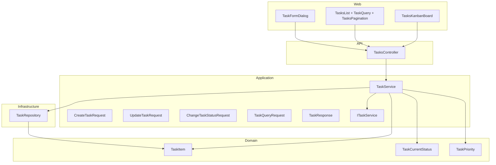
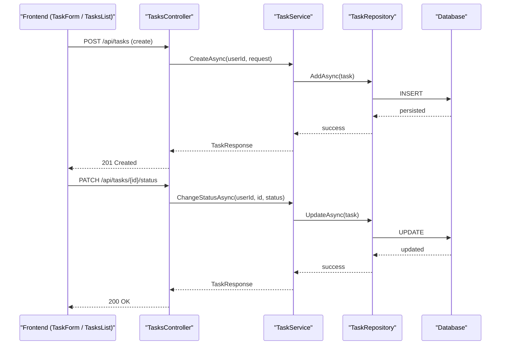
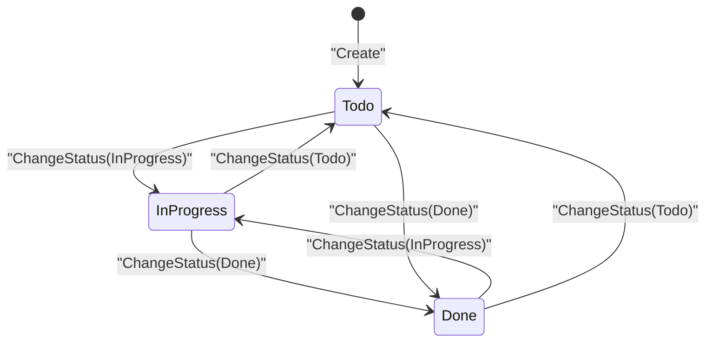
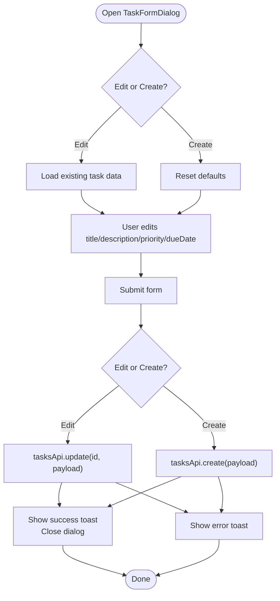
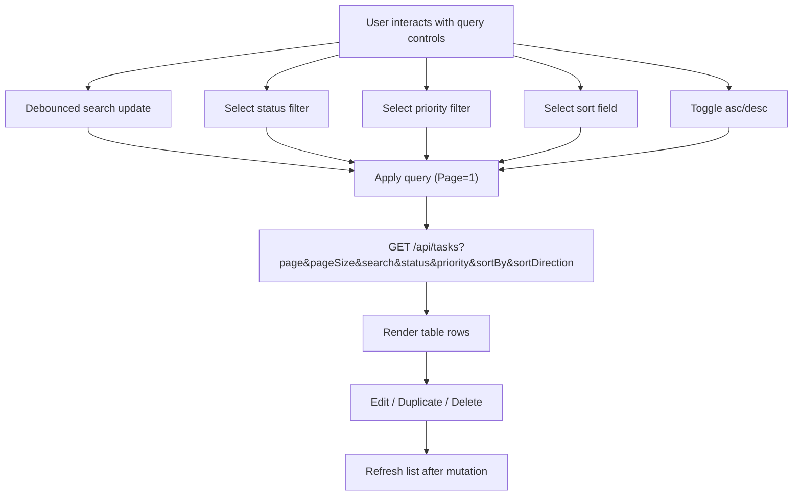
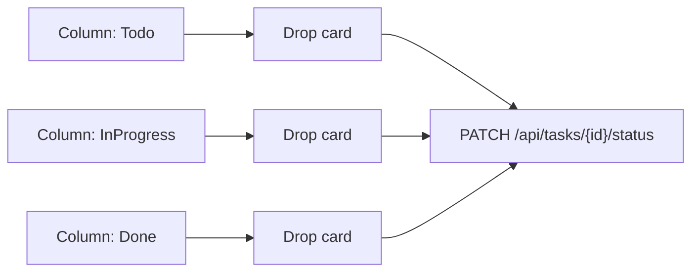
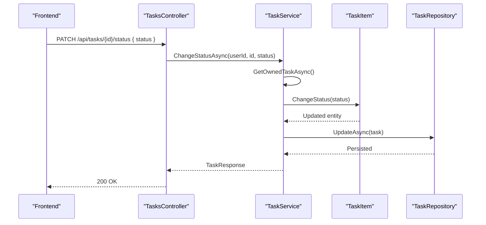
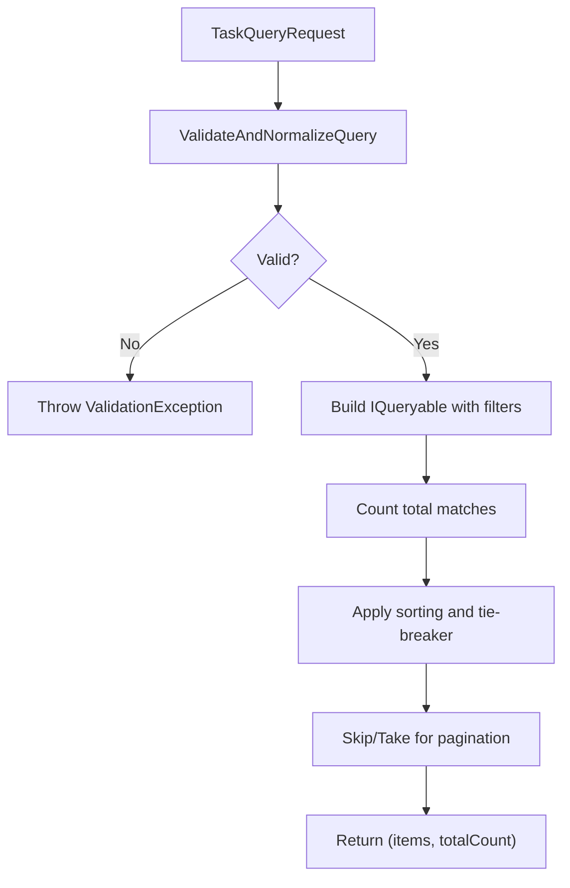
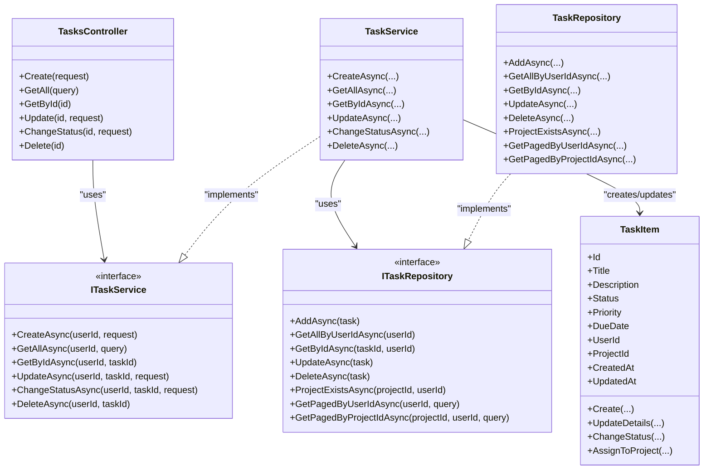

# Task Management Feature

<cite>
**Referenced Files in This Document**
- [TaskItem.cs](file://Services/Services.Domain/Entities/TaskItem.cs)
- [TaskCurrentStatus.cs](file://Services/Services.Domain/Enums/TaskCurrentStatus.cs)
- [TaskPriority.cs](file://Services/Services.Domain/Enums/TaskPriority.cs)
- [CreateTaskRequest.cs](file://Services/Services.Application/DTOs/Tasks/CreateTaskRequest.cs)
- [UpdateTaskRequest.cs](file://Services/Services.Application/DTOs/Tasks/UpdateTaskRequest.cs)
- [ChangeTaskStatusRequest.cs](file://Services/Services.Application/DTOs/Tasks/ChangeTaskStatusRequest.cs)
- [TaskQueryRequest.cs](file://Services/Services.Application/DTOs/Tasks/TaskQueryRequest.cs)
- [TaskResponse.cs](file://Services/Services.Application/DTOs/Tasks/TaskResponse.cs)
- [TasksController.cs](file://Services/Services.Api/Controllers/TasksController.cs)
- [TaskService.cs](file://Services/Services.Application/Services/TaskService.cs)
- [ITaskService.cs](file://Services/Services.Application/Interfaces/Services/ITaskService.cs)
- [TaskRepository.cs](file://Services/Services.Infrastructure/Repositories/TaskRepository.cs)
- [task-form.tsx](file://Apps/Web/src/components/tasks-page/task-form.tsx)
- [list-section.tsx](file://Apps/Web/src/components/tasks-page/list-section.tsx)
- [kanban-section.tsx](file://Apps/Web/src/components/tasks-page/kanban-section.tsx)
</cite>

## Table of Contents
1. [Introduction](#introduction)
2. [Project Structure](#project-structure)
3. [Core Components](#core-components)
4. [Architecture Overview](#architecture-overview)
5. [Detailed Component Analysis](#detailed-component-analysis)
6. [Dependency Analysis](#dependency-analysis)
7. [Performance Considerations](#performance-considerations)
8. [Troubleshooting Guide](#troubleshooting-guide)
9. [Conclusion](#conclusion)

## Introduction
This document explains the task management feature end-to-end, covering domain modeling, API design, service logic, repository queries, and frontend components. It details the task lifecycle from creation to completion (Todo → InProgress → Done), the task form with priority levels, due dates, and description handling, list view with search/filter/sort/pagination, and the Kanban board placeholder. It also documents status change operations, bulk actions support patterns, and guidance for real-time updates.

## Project Structure
The task feature spans three layers:
- Domain layer defines entities, enums, and value objects.
- Application layer provides DTOs, services, and interfaces.
- Infrastructure layer implements repositories and persistence.
- Web layer includes React components for forms, list view, and a Kanban placeholder.

**Diagram sources**
- [TaskItem.cs:6-128](file://Services/Services.Domain/Entities/TaskItem.cs#L6-L128)
- [TaskCurrentStatus.cs:3-8](file://Services/Services.Domain/Enums/TaskCurrentStatus.cs#L3-L8)
- [TaskPriority.cs:3-9](file://Services/Services.Domain/Enums/TaskPriority.cs#L3-L9)
- [CreateTaskRequest.cs:5-10](file://Services/Services.Application/DTOs/Tasks/CreateTaskRequest.cs#L5-L10)
- [UpdateTaskRequest.cs:5-10](file://Services/Services.Application/DTOs/Tasks/UpdateTaskRequest.cs#L5-L10)
- [ChangeTaskStatusRequest.cs:5-6](file://Services/Services.Application/DTOs/Tasks/ChangeTaskStatusRequest.cs#L5-L6)
- [TaskQueryRequest.cs:5-20](file://Services/Services.Application/DTOs/Tasks/TaskQueryRequest.cs#L5-L20)
- [TaskResponse.cs:5-16](file://Services/Services.Application/DTOs/Tasks/TaskResponse.cs#L5-L16)
- [TaskService.cs:12-412](file://Services/Services.Application/Services/TaskService.cs#L12-L412)
- [ITaskService.cs:6-49](file://Services/Services.Application/Interfaces/Services/ITaskService.cs#L6-L49)
- [TaskRepository.cs:9-239](file://Services/Services.Infrastructure/Repositories/TaskRepository.cs#L9-L239)
- [TasksController.cs:11-199](file://Services/Services.Api/Controllers/TasksController.cs#L11-L199)
- [task-form.tsx:60-286](file://Apps/Web/src/components/tasks-page/task-form.tsx#L60-L286)
- [list-section.tsx:81-549](file://Apps/Web/src/components/tasks-page/list-section.tsx#L81-L549)
- [kanban-section.tsx:1-4](file://Apps/Web/src/components/tasks-page/kanban-section.tsx#L1-L4)

**Section sources**
- [TaskItem.cs:6-128](file://Services/Services.Domain/Entities/TaskItem.cs#L6-L128)
- [TaskService.cs:12-412](file://Services/Services.Application/Services/TaskService.cs#L12-L412)
- [TaskRepository.cs:9-239](file://Services/Services.Infrastructure/Repositories/TaskRepository.cs#L9-L239)
- [TasksController.cs:11-199](file://Services/Services.Api/Controllers/TasksController.cs#L11-L199)
- [task-form.tsx:60-286](file://Apps/Web/src/components/tasks-page/task-form.tsx#L60-L286)
- [list-section.tsx:81-549](file://Apps/Web/src/components/tasks-page/list-section.tsx#L81-L549)
- [kanban-section.tsx:1-4](file://Apps/Web/src/components/tasks-page/kanban-section.tsx#L1-L4)

## Core Components
- Domain model: TaskItem encapsulates title, description, status, priority, due date, user/project ownership, and timestamps. It enforces validation on creation and updates and exposes ChangeStatus and AssignToProject.
- Enums: TaskCurrentStatus (Todo, InProgress, Done) and TaskPriority (Low, Medium, High, Urgent).
- DTOs: CreateTaskRequest, UpdateTaskRequest, ChangeTaskStatusRequest, TaskQueryRequest, TaskResponse.
- Service: TaskService orchestrates validation, project existence checks, entity mutations, mapping to responses, and pagination.
- Repository: TaskRepository implements filtering by status/priority/search, sorting by multiple fields, stable ordering, and pagination.
- Controller: TasksController exposes REST endpoints for CRUD, status changes, and paged listing.
- Frontend: TaskFormDialog handles create/update; TasksList provides search, filter, sort, pagination, duplicate, delete; TasksKanbanBoard is a placeholder for future drag-and-drop.

**Section sources**
- [TaskItem.cs:6-128](file://Services/Services.Domain/Entities/TaskItem.cs#L6-L128)
- [TaskCurrentStatus.cs:3-8](file://Services/Services.Domain/Enums/TaskCurrentStatus.cs#L3-L8)
- [TaskPriority.cs:3-9](file://Services/Services.Domain/Enums/TaskPriority.cs#L3-L9)
- [CreateTaskRequest.cs:5-10](file://Services/Services.Application/DTOs/Tasks/CreateTaskRequest.cs#L5-L10)
- [UpdateTaskRequest.cs:5-10](file://Services/Services.Application/DTOs/Tasks/UpdateTaskRequest.cs#L5-L10)
- [ChangeTaskStatusRequest.cs:5-6](file://Services/Services.Application/DTOs/Tasks/ChangeTaskStatusRequest.cs#L5-L6)
- [TaskQueryRequest.cs:5-20](file://Services/Services.Application/DTOs/Tasks/TaskQueryRequest.cs#L5-L20)
- [TaskResponse.cs:5-16](file://Services/Services.Application/DTOs/Tasks/TaskResponse.cs#L5-L16)
- [TaskService.cs:12-412](file://Services/Services.Application/Services/TaskService.cs#L12-L412)
- [TaskRepository.cs:9-239](file://Services/Services.Infrastructure/Repositories/TaskRepository.cs#L9-L239)
- [TasksController.cs:11-199](file://Services/Services.Api/Controllers/TasksController.cs#L11-L199)
- [task-form.tsx:60-286](file://Apps/Web/src/components/tasks-page/task-form.tsx#L60-L286)
- [list-section.tsx:81-549](file://Apps/Web/src/components/tasks-page/list-section.tsx#L81-L549)

## Architecture Overview
The task feature follows a layered architecture:
- Web components call the API via HTTP.
- API controller validates requests and delegates to the service.
- Service performs business rules, maps to domain entities, and persists via repository.
- Repository composes EF queries with filtering, sorting, and pagination.

**Diagram sources**
- [TasksController.cs:18-47](file://Services/Services.Api/Controllers/TasksController.cs#L18-L47)
- [TasksController.cs:128-155](file://Services/Services.Api/Controllers/TasksController.cs#L128-L155)
- [TaskService.cs:16-48](file://Services/Services.Application/Services/TaskService.cs#L16-L48)
- [TaskService.cs:121-142](file://Services/Services.Application/Services/TaskService.cs#L121-L142)
- [TaskRepository.cs:13-23](file://Services/Services.Infrastructure/Repositories/TaskRepository.cs#L13-L23)
- [TaskRepository.cs:53-58](file://Services/Services.Infrastructure/Repositories/TaskRepository.cs#L53-L58)

## Detailed Component Analysis

### Task Lifecycle and Status Transitions
- Creation: TaskItem.Create sets initial status to Todo and records timestamps.
- Updates: UpdateDetails modifies title, description, priority, due date, and updates timestamp.
- Status transitions: ChangeStatus enforces valid enum values and updates timestamp. Allowed states are Todo, InProgress, Done.
- Assignment: AssignToProject links a task to a project and updates timestamp.

**Diagram sources**
- [TaskItem.cs:54-78](file://Services/Services.Domain/Entities/TaskItem.cs#L54-L78)
- [TaskItem.cs:103-115](file://Services/Services.Domain/Entities/TaskItem.cs#L103-L115)
- [TaskCurrentStatus.cs:3-8](file://Services/Services.Domain/Enums/TaskCurrentStatus.cs#L3-L8)

**Section sources**
- [TaskItem.cs:54-78](file://Services/Services.Domain/Entities/TaskItem.cs#L54-L78)
- [TaskItem.cs:80-101](file://Services/Services.Domain/Entities/TaskItem.cs#L80-L101)
- [TaskItem.cs:103-115](file://Services/Services.Domain/Entities/TaskItem.cs#L103-L115)
- [TaskItem.cs:117-122](file://Services/Services.Domain/Entities/TaskItem.cs#L117-L122)
- [TaskCurrentStatus.cs:3-8](file://Services/Services.Domain/Enums/TaskCurrentStatus.cs#L3-L8)

### Task Form Implementation
- Fields: Title (required), Description (optional), Priority (select), DueDate (calendar popover), ProjectId (reserved for future integration).
- Behavior: Supports both create and edit modes; uses tasksApi.create or tasksApi.update; shows success/error toasts; disables controls while submitting.
- Validation: Client-side required field; server-side validations enforced by service and domain.

**Diagram sources**
- [task-form.tsx:60-286](file://Apps/Web/src/components/tasks-page/task-form.tsx#L60-L286)

**Section sources**
- [task-form.tsx:60-286](file://Apps/Web/src/components/tasks-page/task-form.tsx#L60-L286)

### List View: Search, Filtering, Sorting, Pagination
- Search: Debounced text input filters by title substring.
- Filters: Status and Priority dropdowns allow narrowing results.
- Sorting: SortBy selection supports createdAt, title, dueDate, priority, status; SortDirection toggle asc/desc.
- Pagination: Server-side pagination with page navigation and ellipsis for large page counts.
- Actions: Edit, Duplicate, Delete per row; Delete confirmation dialog.

**Diagram sources**
- [list-section.tsx:280-454](file://Apps/Web/src/components/tasks-page/list-section.tsx#L280-L454)
- [list-section.tsx:457-549](file://Apps/Web/src/components/tasks-page/list-section.tsx#L457-L549)
- [TaskService.cs:160-187](file://Services/Services.Application/Services/TaskService.cs#L160-L187)
- [TaskRepository.cs:82-157](file://Services/Services.Infrastructure/Repositories/TaskRepository.cs#L82-L157)

**Section sources**
- [list-section.tsx:81-549](file://Apps/Web/src/components/tasks-page/list-section.tsx#L81-L549)

### Kanban Board View
- Placeholder component exists; intended for drag-and-drop between columns representing statuses (Todo, InProgress, Done).
- Future implementation should:
  - Render columns per status.
  - Support drag-and-drop to update status via PATCH /api/tasks/{id}/status.
  - Provide optimistic UI updates and rollback on failure.
  - Integrate with real-time updates (see Real-time Updates section).

**Diagram sources**
- [kanban-section.tsx:1-4](file://Apps/Web/src/components/tasks-page/kanban-section.tsx#L1-L4)
- [TasksController.cs:128-155](file://Services/Services.Api/Controllers/TasksController.cs#L128-L155)

**Section sources**
- [kanban-section.tsx:1-4](file://Apps/Web/src/components/tasks-page/kanban-section.tsx#L1-L4)

### Task Status Change Operations
- Endpoint: PATCH /api/tasks/{id}/status with body containing new status.
- Service flow: Validates identifiers, loads owned task, calls ChangeStatus, persists, returns updated response.
- Domain enforcement: Only valid enum values allowed; timestamp updated.

**Diagram sources**
- [TasksController.cs:128-155](file://Services/Services.Api/Controllers/TasksController.cs#L128-L155)
- [TaskService.cs:121-142](file://Services/Services.Application/Services/TaskService.cs#L121-L142)
- [TaskItem.cs:103-115](file://Services/Services.Domain/Entities/TaskItem.cs#L103-L115)
- [TaskRepository.cs:53-58](file://Services/Services.Infrastructure/Repositories/TaskRepository.cs#L53-L58)

**Section sources**
- [TasksController.cs:128-155](file://Services/Services.Api/Controllers/TasksController.cs#L128-L155)
- [TaskService.cs:121-142](file://Services/Services.Application/Services/TaskService.cs#L121-L142)
- [TaskItem.cs:103-115](file://Services/Services.Domain/Entities/TaskItem.cs#L103-L115)

### Advanced Features: Search, Filtering, Sorting, Pagination
- Query normalization: Enforces page >= 1, pageSize in [1,100], search length <= 200, valid status/priority enums, allowed sortBy fields, and sortDirection must be asc/desc.
- Filtering: By status and priority; search matches title substring.
- Sorting: By createdAt, title, dueDate, priority, status; null due dates handled appropriately.
- Pagination: Stable ordering using Id as tie-breaker; returns total count and computed totalPages.

**Diagram sources**
- [TaskService.cs:318-393](file://Services/Services.Application/Services/TaskService.cs#L318-L393)
- [TaskRepository.cs:82-157](file://Services/Services.Infrastructure/Repositories/TaskRepository.cs#L82-L157)

**Section sources**
- [TaskService.cs:160-187](file://Services/Services.Application/Services/TaskService.cs#L160-L187)
- [TaskService.cs:318-393](file://Services/Services.Application/Services/TaskService.cs#L318-L393)
- [TaskRepository.cs:82-157](file://Services/Services.Infrastructure/Repositories/TaskRepository.cs#L82-L157)

### Bulk Actions
- Current implementation supports single-task operations (edit, duplicate, delete).
- For bulk actions (e.g., multi-select and batch status change):
  - Extend frontend to collect selected IDs.
  - Implement backend endpoint(s) for batch status update or deletion.
  - Ensure authorization and ownership checks per item.
  - Return aggregated results and handle partial failures.

[No sources needed since this section provides general guidance]

### Real-time Updates
- Not implemented in the analyzed codebase.
- Recommended approaches:
  - Use Server-Sent Events (SSE) or WebSockets to push task updates to clients.
  - On successful mutations, invalidate or refetch affected lists.
  - For Kanban, apply optimistic updates and revert on error.
  - Consider broadcasting events scoped by userId and projectId.

[No sources needed since this section provides general guidance]

### Examples: Task Assignment, Deadline Management, Progress Tracking
- Task assignment:
  - Create or update tasks with optional ProjectId; service validates project ownership.
  - Response includes projectName and projectColor for display.
- Deadline management:
  - Set dueDate in form; displayed with localized formatting; sorting handles null due dates.
- Progress tracking:
  - Track status transitions via PATCH endpoint; reflect changes in list/Kanban views.

**Section sources**
- [TaskService.cs:250-274](file://Services/Services.Application/Services/TaskService.cs#L250-L274)
- [TaskResponse.cs:5-16](file://Services/Services.Application/DTOs/Tasks/TaskResponse.cs#L5-L16)
- [task-form.tsx:239-260](file://Apps/Web/src/components/tasks-page/task-form.tsx#L239-L260)
- [list-section.tsx:72-79](file://Apps/Web/src/components/tasks-page/list-section.tsx#L72-L79)

## Dependency Analysis
Key dependencies and relationships:
- TasksController depends on ITaskService for all operations.
- TaskService depends on ITaskRepository and domain models/enums.
- TaskRepository depends on AppDbContext and EF Core for querying.
- Frontend components depend on API contracts and shared UI primitives.

**Diagram sources**
- [TasksController.cs:11-199](file://Services/Services.Api/Controllers/TasksController.cs#L11-L199)
- [ITaskService.cs:6-49](file://Services/Services.Application/Interfaces/Services/ITaskService.cs#L6-L49)
- [TaskService.cs:12-412](file://Services/Services.Application/Services/TaskService.cs#L12-L412)
- [TaskRepository.cs:9-239](file://Services/Services.Infrastructure/Repositories/TaskRepository.cs#L9-L239)
- [TaskItem.cs:6-128](file://Services/Services.Domain/Entities/TaskItem.cs#L6-L128)

**Section sources**
- [TasksController.cs:11-199](file://Services/Services.Api/Controllers/TasksController.cs#L11-L199)
- [ITaskService.cs:6-49](file://Services/Services.Application/Interfaces/Services/ITaskService.cs#L6-L49)
- [TaskService.cs:12-412](file://Services/Services.Application/Services/TaskService.cs#L12-L412)
- [TaskRepository.cs:9-239](file://Services/Services.Infrastructure/Repositories/TaskRepository.cs#L9-L239)
- [TaskItem.cs:6-128](file://Services/Services.Domain/Entities/TaskItem.cs#L6-L128)

## Performance Considerations
- Use server-side pagination to limit payload size and improve rendering performance.
- Leverage AsNoTracking for read-only queries to reduce change tracker overhead.
- Include only necessary related data (Project) to avoid N+1 issues.
- Normalize and validate queries to prevent expensive or invalid operations.
- Debounce search inputs on the client to reduce network churn.
- Consider indexing frequently filtered/sorted columns (title, status, priority, dueDate, createdAt) at the database level.

[No sources needed since this section provides general guidance]

## Troubleshooting Guide
Common issues and resolutions:
- Invalid status or priority:
  - Ensure enum values match defined constants; service throws ValidationException on invalid inputs.
- Project not found or unauthorized:
  - Verify project belongs to the authenticated user; service validates project existence before create/update.
- Pagination errors:
  - Ensure page >= 1 and pageSize within [1,100]; service normalizes and validates these parameters.
- Sorting errors:
  - Use allowed sortBy fields (createdAt, title, dueDate, priority, status) and valid sortDirection (asc/desc).
- Search length exceeded:
  - Keep search string <= 200 characters; otherwise, validation fails.

**Section sources**
- [TaskService.cs:307-393](file://Services/Services.Application/Services/TaskService.cs#L307-L393)
- [TaskService.cs:250-274](file://Services/Services.Application/Services/TaskService.cs#L250-L274)

## Conclusion
The task management feature provides a robust foundation for creating, updating, and transitioning tasks through well-defined domain rules and validated API endpoints. The list view offers comprehensive search, filtering, sorting, and pagination capabilities. The Kanban board is currently a placeholder but can be extended with drag-and-drop and real-time updates. Following the recommended practices for validation, performance, and UX will ensure a smooth and scalable experience.

[No sources needed since this section summarizes without analyzing specific files]