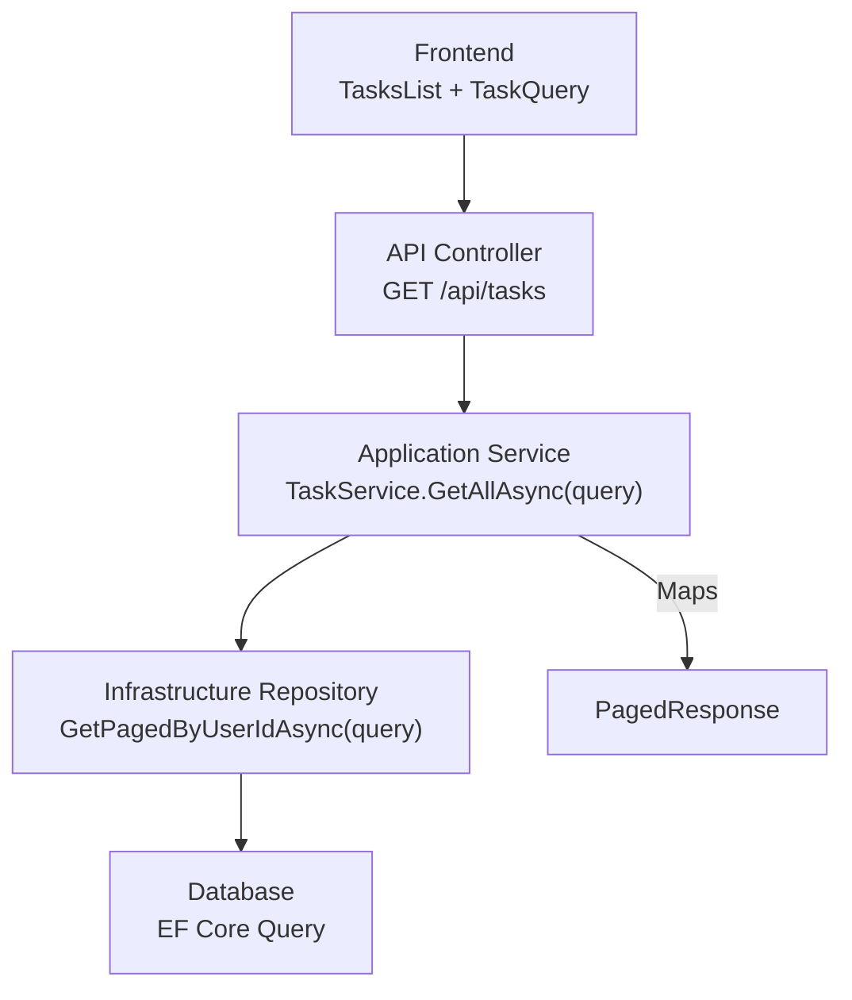
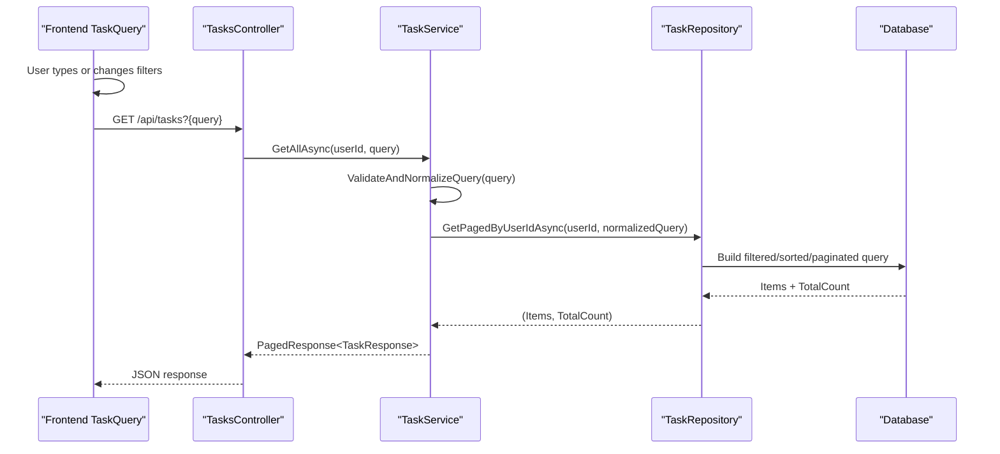
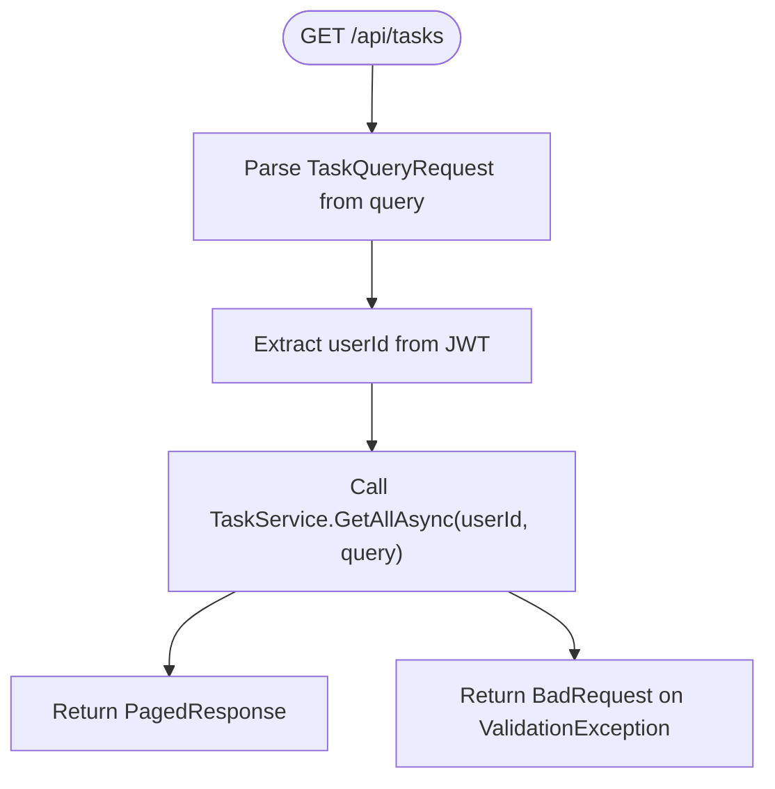
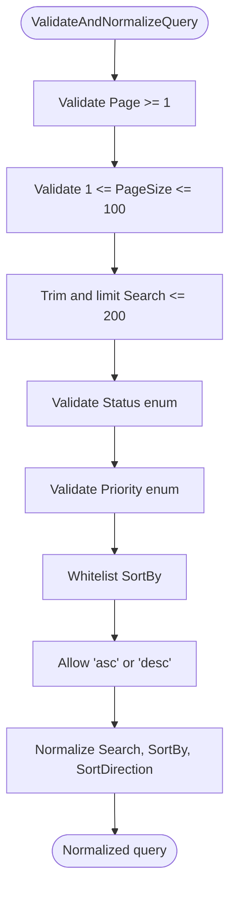
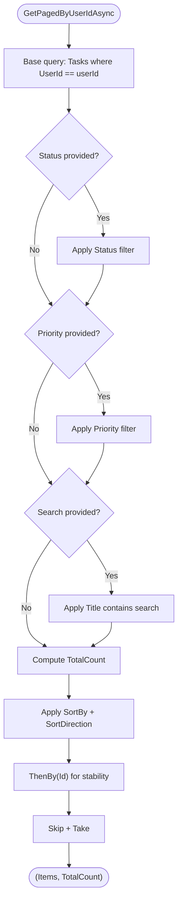
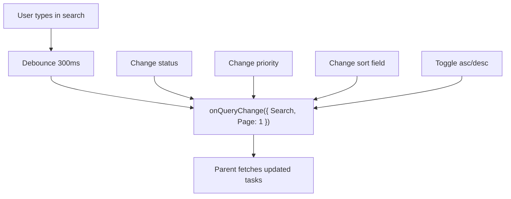
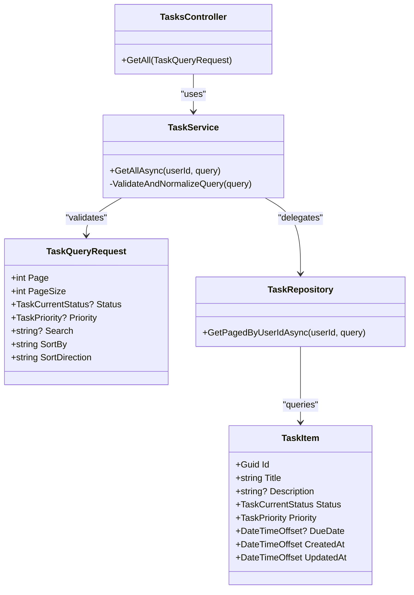

# Task Search and Filtering

<cite>
**Referenced Files in This Document**
- [TaskQueryRequest.cs](file://Services/Services.Application/DTOs/Tasks/TaskQueryRequest.cs)
- [TasksController.cs](file://Services/Services.Api/Controllers/TasksController.cs)
- [TaskService.cs](file://Services/Services.Application/Services/TaskService.cs)
- [TaskRepository.cs](file://Services/Services.Infrastructure/Repositories/TaskRepository.cs)
- [TaskItem.cs](file://Services/Services.Domain/Entities/TaskItem.cs)
- [TaskCurrentStatus.cs](file://Services/Services.Domain/Enums/TaskCurrentStatus.cs)
- [TaskPriority.cs](file://Services/Services.Domain/Enums/TaskPriority.cs)
- [list-section.tsx](file://Apps/Web/src/components/tasks-page/list-section.tsx)
</cite>

## Table of Contents
1. [Introduction](#introduction)
2. [Project Structure](#project-structure)
3. [Core Components](#core-components)
4. [Architecture Overview](#architecture-overview)
5. [Detailed Component Analysis](#detailed-component-analysis)
6. [Dependency Analysis](#dependency-analysis)
7. [Performance Considerations](#performance-considerations)
8. [Troubleshooting Guide](#troubleshooting-guide)
9. [Conclusion](#conclusion)

## Introduction
This document explains the task search and filtering capabilities across the full stack: frontend UI, API controller, application service, repository, and domain models. It covers text search, status and priority filters, sorting options, pagination, query validation, and performance considerations. It also provides guidance for extending the system to support saved filters and more complex queries.

## Project Structure
The task search feature spans multiple layers:
- Frontend: a React component that renders filters, handles real-time search with debouncing, and manages pagination state.
- API: an ASP.NET Core controller exposing a GET endpoint that accepts a query DTO.
- Application Service: validates and normalizes the query, delegates to the repository, and returns a paged response.
- Repository: builds an EF Core query with filters, ordering, and pagination.
- Domain: defines entities and enums used by the query.

**Diagram sources**
- [list-section.tsx:81-99](file://Apps/Web/src/components/tasks-page/list-section.tsx#L81-L99)
- [TasksController.cs:49-70](file://Services/Services.Api/Controllers/TasksController.cs#L49-L70)
- [TaskService.cs:160-187](file://Services/Services.Application/Services/TaskService.cs#L160-L187)
- [TaskRepository.cs:82-157](file://Services/Services.Infrastructure/Repositories/TaskRepository.cs#L82-L157)

**Section sources**
- [list-section.tsx:81-99](file://Apps/Web/src/components/tasks-page/list-section.tsx#L81-L99)
- [TasksController.cs:49-70](file://Services/Services.Api/Controllers/TasksController.cs#L49-L70)
- [TaskService.cs:160-187](file://Services/Services.Application/Services/TaskService.cs#L160-L187)
- [TaskRepository.cs:82-157](file://Services/Services.Infrastructure/Repositories/TaskRepository.cs#L82-L157)

## Core Components
- TaskQueryRequest DTO: defines page, page size, status, priority, search text, sort field, and sort direction.
- TasksController: exposes GET /api/tasks accepting TaskQueryRequest and returning PagedResponse<TaskResponse>.
- TaskService: validates and normalizes the query, computes total pages, maps results to responses.
- TaskRepository: implements server-side filtering (status, priority, title), ordering, stable pagination, and count.
- Frontend TaskQuery: provides search input, status/priority selects, sort-by select, asc/desc toggle, and debounced updates.

Key responsibilities:
- Validation and normalization occur in the service layer to ensure safe and consistent queries.
- Filtering is performed on the server using EF Core to avoid transferring large datasets.
- Pagination is enforced at the repository level with deterministic tie-breaking.

**Section sources**
- [TaskQueryRequest.cs:5-20](file://Services/Services.Application/DTOs/Tasks/TaskQueryRequest.cs#L5-L20)
- [TasksController.cs:49-70](file://Services/Services.Api/Controllers/TasksController.cs#L49-L70)
- [TaskService.cs:318-393](file://Services/Services.Application/Services/TaskService.cs#L318-L393)
- [TaskRepository.cs:82-157](file://Services/Services.Infrastructure/Repositories/TaskRepository.cs#L82-L157)
- [list-section.tsx:280-455](file://Apps/Web/src/components/tasks-page/list-section.tsx#L280-L455)

## Architecture Overview
The end-to-end flow for searching and filtering tasks:

**Diagram sources**
- [TasksController.cs:49-70](file://Services/Services.Api/Controllers/TasksController.cs#L49-L70)
- [TaskService.cs:160-187](file://Services/Services.Application/Services/TaskService.cs#L160-L187)
- [TaskRepository.cs:82-157](file://Services/Services.Infrastructure/Repositories/TaskRepository.cs#L82-L157)

## Detailed Component Analysis

### TaskQueryRequest DTO
Defines the contract for advanced search and pagination:
- Page: current page number (default 1).
- PageSize: items per page (default 10).
- Status: optional filter by task status enum.
- Priority: optional filter by task priority enum.
- Search: optional text to match against task titles.
- SortBy: allowed fields include createdat, title, duedate, priority, status.
- SortDirection: asc or desc.

Validation and normalization rules are enforced in the service layer to prevent invalid inputs and unsafe sort fields.

**Section sources**
- [TaskQueryRequest.cs:5-20](file://Services/Services.Application/DTOs/Tasks/TaskQueryRequest.cs#L5-L20)
- [TaskService.cs:318-393](file://Services/Services.Application/Services/TaskService.cs#L318-L393)

### Backend Query Implementation

#### Controller Layer
- Endpoint: GET /api/tasks
- Accepts TaskQueryRequest via query string parameters.
- Extracts authenticated user ID and calls TaskService.GetAllAsync.
- Returns PagedResponse<TaskResponse> or error responses for validation issues.

**Diagram sources**
- [TasksController.cs:49-70](file://Services/Services.Api/Controllers/TasksController.cs#L49-L70)

**Section sources**
- [TasksController.cs:49-70](file://Services/Services.Api/Controllers/TasksController.cs#L49-L70)

#### Application Service Layer
- Validates and normalizes the query:
  - Enforces page >= 1.
  - Enforces 1 <= pageSize <= 100.
  - Limits search length to 200 characters.
  - Validates status and priority enums.
  - Whitelists allowed sort fields and directions.
- Computes totalPages based on totalCount and pageSize.
- Maps domain entities to response DTOs.

**Diagram sources**
- [TaskService.cs:318-393](file://Services/Services.Application/Services/TaskService.cs#L318-L393)

**Section sources**
- [TaskService.cs:160-187](file://Services/Services.Application/Services/TaskService.cs#L160-L187)
- [TaskService.cs:318-393](file://Services/Services.Application/Services/TaskService.cs#L318-L393)

#### Repository Layer
- Filters by:
  - UserId (always applied).
  - Status (optional).
  - Priority (optional).
  - Title contains search text (case-insensitive when applicable).
- Orders by:
  - title, duedate, priority, status, or default createdat.
  - Ascending or descending based on SortDirection.
- Ensures stable pagination by adding a final tie-breaker on Id.
- Calculates totalCount before applying Skip/Take.

**Diagram sources**
- [TaskRepository.cs:82-157](file://Services/Services.Infrastructure/Repositories/TaskRepository.cs#L82-L157)

**Section sources**
- [TaskRepository.cs:82-157](file://Services/Services.Infrastructure/Repositories/TaskRepository.cs#L82-L157)

### Frontend Filter UI Components
The list view includes:
- Search input with debounced updates (300 ms) and Enter key trigger.
- Status dropdown mapping to numeric enum values.
- Priority dropdown mapping to numeric enum values.
- Sort-by dropdown with labels mapped from constants.
- Ascending/descending toggle button.
- Pagination controls with ellipsis logic for large page sets.

Real-time behavior:
- Debounce prevents excessive requests while typing.
- Changing any filter resets Page to 1 to show first page results.
- The component emits partial query updates via onQueryChange.

**Diagram sources**
- [list-section.tsx:287-304](file://Apps/Web/src/components/tasks-page/list-section.tsx#L287-L304)
- [list-section.tsx:315-452](file://Apps/Web/src/components/tasks-page/list-section.tsx#L315-L452)

**Section sources**
- [list-section.tsx:280-455](file://Apps/Web/src/components/tasks-page/list-section.tsx#L280-L455)

### Data Models and Enums
- TaskItem entity includes properties used by filtering and sorting: Title, Description, Status, Priority, DueDate, CreatedAt, UpdatedAt, ProjectId, and Project reference.
- TaskCurrentStatus enumerates Todo, InProgress, Done.
- TaskPriority enumerates Low, Medium, High, Urgent.

These models underpin the filtering and sorting logic in the repository and the display in the frontend.

**Section sources**
- [TaskItem.cs:6-21](file://Services/Services.Domain/Entities/TaskItem.cs#L6-L21)
- [TaskCurrentStatus.cs:3-8](file://Services/Services.Domain/Enums/TaskCurrentStatus.cs#L3-L8)
- [TaskPriority.cs:3-9](file://Services/Services.Domain/Enums/TaskPriority.cs#L3-L9)

## Dependency Analysis
The following diagram shows how components depend on each other for task search and filtering:

**Diagram sources**
- [TaskQueryRequest.cs:5-20](file://Services/Services.Application/DTOs/Tasks/TaskQueryRequest.cs#L5-L20)
- [TasksController.cs:49-70](file://Services/Services.Api/Controllers/TasksController.cs#L49-L70)
- [TaskService.cs:160-187](file://Services/Services.Application/Services/TaskService.cs#L160-L187)
- [TaskRepository.cs:82-157](file://Services/Services.Infrastructure/Repositories/TaskRepository.cs#L82-L157)
- [TaskItem.cs:6-21](file://Services/Services.Domain/Entities/TaskItem.cs#L6-L21)

**Section sources**
- [TaskQueryRequest.cs:5-20](file://Services/Services.Application/DTOs/Tasks/TaskQueryRequest.cs#L5-L20)
- [TasksController.cs:49-70](file://Services/Services.Api/Controllers/TasksController.cs#L49-L70)
- [TaskService.cs:160-187](file://Services/Services.Application/Services/TaskService.cs#L160-L187)
- [TaskRepository.cs:82-157](file://Services/Services.Infrastructure/Repositories/TaskRepository.cs#L82-L157)
- [TaskItem.cs:6-21](file://Services/Services.Domain/Entities/TaskItem.cs#L6-L21)

## Performance Considerations
- Server-side filtering and pagination:
  - All filters (status, priority, title) are applied in the database via EF Core to minimize data transfer.
  - totalCount is computed before pagination to provide accurate paging metadata.
- Stable ordering:
  - A final ThenBy on Id ensures deterministic pagination even when other sort keys collide.
- Query normalization:
  - Sorting fields and directions are whitelisted to prevent injection and misuse.
  - Search length is limited to reduce expensive LIKE operations.
- Frontend optimization:
  - Debounced search reduces request frequency during typing.
  - Resetting Page to 1 on filter changes avoids stale pagination states.

Recommendations:
- Add database indexes on frequently filtered columns (e.g., UserId, Status, Priority, Title) to improve query performance.
- Consider full-text search if description search becomes required.
- Cache frequent aggregate counts (e.g., total matching tasks) if needed.

[No sources needed since this section provides general guidance]

## Troubleshooting Guide
Common issues and resolutions:
- Invalid page or page size:
  - Ensure Page >= 1 and 1 <= PageSize <= 100.
- Invalid status or priority:
  - Use valid enum values defined in TaskCurrentStatus and TaskPriority.
- Invalid sort field or direction:
  - Allowed fields: createdat, title, duedate, priority, status.
  - Direction must be asc or desc.
- Search too long:
  - Keep Search within 200 characters after trimming.
- No results:
  - Verify filters; empty results may indicate no matching tasks for the given criteria.

Error handling:
- The controller returns BadRequest for validation exceptions thrown by the service.
- The service throws ValidationException for invalid query parameters.

**Section sources**
- [TaskService.cs:318-393](file://Services/Services.Application/Services/TaskService.cs#L318-L393)
- [TasksController.cs:66-69](file://Services/Services.Api/Controllers/TasksController.cs#L66-L69)

## Conclusion
The task search and filtering system combines a robust backend pipeline with a responsive frontend. The service layer enforces strict validation and normalization, while the repository performs efficient server-side filtering, ordering, and pagination. The frontend offers intuitive controls with debounced updates and clear pagination. To extend functionality, consider adding description search, saved filters, and additional sort fields, ensuring all new features follow the established validation and performance patterns.

[No sources needed since this section summarizes without analyzing specific files]