# Task Status Management

<cite>
**Referenced Files in This Document**
- [TaskCurrentStatus.cs](file://Services/Services.Domain/Enums/TaskCurrentStatus.cs)
- [TaskPriority.cs](file://Services/Services.Domain/Enums/TaskPriority.cs)
- [TaskItem.cs](file://Services/Services.Domain/Entities/TaskItem.cs)
- [ChangeTaskStatusRequest.cs](file://Services/Services.Application/DTOs/Tasks/ChangeTaskStatusRequest.cs)
- [TaskService.cs](file://Services/Services.Application/Services/TaskService.cs)
- [TasksController.cs](file://Services/Services.Api/Controllers/TasksController.cs)
- [list-section.tsx](file://Apps/Web/src/components/tasks-page/list-section.tsx)
- [task-form.tsx](file://Apps/Web/src/components/tasks-page/task-form.tsx)
- [kanban-section.tsx](file://Apps/Web/src/components/tasks-page/kanban-section.tsx)
</cite>

## Table of Contents
1. [Introduction](#introduction)
2. [Project Structure](#project-structure)
3. [Core Components](#core-components)
4. [Architecture Overview](#architecture-overview)
5. [Detailed Component Analysis](#detailed-component-analysis)
6. [Dependency Analysis](#dependency-analysis)
7. [Performance Considerations](#performance-considerations)
8. [Troubleshooting Guide](#troubleshooting-guide)
9. [Conclusion](#conclusion)
10. [Appendices](#appendices)

## Introduction
This document explains the task status management system, focusing on how task statuses are modeled, validated, and updated across the API and UI layers. It covers:
- The TaskCurrentStatus enum values and their business meaning
- Status transition rules and validation constraints
- The ChangeTaskStatusRequest DTO and related API endpoints
- UI components for viewing and updating task status
- Guidance for implementing custom transitions and integrating with project workflows

## Project Structure
The task status feature spans three layers:
- Domain layer defines the status enum and entity behavior
- Application layer orchestrates validation and persistence
- API layer exposes HTTP endpoints
- Web UI renders lists, filters, and forms that interact with the API

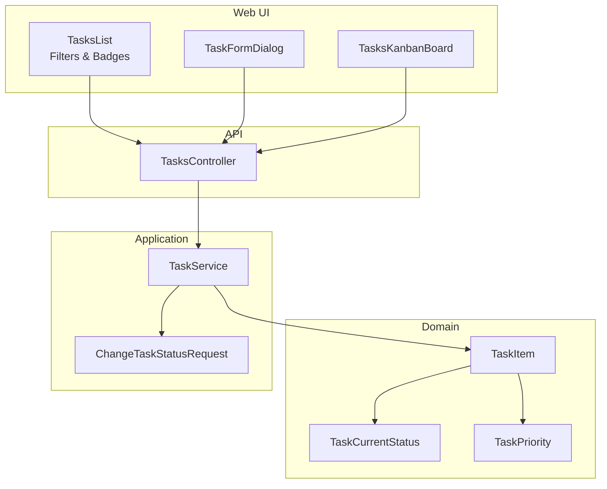

**Diagram sources**
- [TaskCurrentStatus.cs:3-8](file://Services/Services.Domain/Enums/TaskCurrentStatus.cs#L3-L8)
- [TaskItem.cs:6-21](file://Services/Services.Domain/Entities/TaskItem.cs#L6-L21)
- [TaskPriority.cs:3-9](file://Services/Services.Domain/Enums/TaskPriority.cs#L3-L9)
- [ChangeTaskStatusRequest.cs:5-6](file://Services/Services.Application/DTOs/Tasks/ChangeTaskStatusRequest.cs#L5-L6)
- [TaskService.cs:12-14](file://Services/Services.Application/Services/TaskService.cs#L12-L14)
- [TasksController.cs:11-16](file://Services/Services.Api/Controllers/TasksController.cs#L11-L16)
- [list-section.tsx:81-99](file://Apps/Web/src/components/tasks-page/list-section.tsx#L81-L99)
- [task-form.tsx:60-70](file://Apps/Web/src/components/tasks-page/task-form.tsx#L60-L70)
- [kanban-section.tsx:1-4](file://Apps/Web/src/components/tasks-page/kanban-section.tsx#L1-L4)

**Section sources**
- [TaskCurrentStatus.cs:1-9](file://Services/Services.Domain/Enums/TaskCurrentStatus.cs#L1-L9)
- [TaskItem.cs:1-128](file://Services/Services.Domain/Entities/TaskItem.cs#L1-L128)
- [ChangeTaskStatusRequest.cs:1-6](file://Services/Services.Application/DTOs/Tasks/ChangeTaskStatusRequest.cs#L1-L6)
- [TaskService.cs:1-412](file://Services/Services.Application/Services/TaskService.cs#L1-L412)
- [TasksController.cs:1-199](file://Services/Services.Api/Controllers/TasksController.cs#L1-L199)
- [list-section.tsx:1-550](file://Apps/Web/src/components/tasks-page/list-section.tsx#L1-L550)
- [task-form.tsx:1-334](file://Apps/Web/src/components/tasks-page/task-form.tsx#L1-L334)
- [kanban-section.tsx:1-4](file://Apps/Web/src/components/tasks-page/kanban-section.tsx#L1-L4)

## Core Components
- TaskCurrentStatus: Defines the allowed task states (Todo, InProgress, Done).
- TaskItem: Domain entity that owns the current status and updates timestamps when changed.
- ChangeTaskStatusRequest: DTO carrying the requested new status for a task.
- TaskService: Validates ownership and persists status changes via repository.
- TasksController: Exposes PATCH /api/tasks/{id}/status to change status.
- UI Components: List view displays status badges; form handles creation/editing; Kanban board is a placeholder for future drag-and-drop status updates.

**Section sources**
- [TaskCurrentStatus.cs:3-8](file://Services/Services.Domain/Enums/TaskCurrentStatus.cs#L3-L8)
- [TaskItem.cs:11-12](file://Services/Services.Domain/Entities/TaskItem.cs#L11-L12)
- [ChangeTaskStatusRequest.cs:5-6](file://Services/Services.Application/DTOs/Tasks/ChangeTaskStatusRequest.cs#L5-L6)
- [TaskService.cs:121-142](file://Services/Services.Application/Services/TaskService.cs#L121-L142)
- [TasksController.cs:128-155](file://Services/Services.Api/Controllers/TasksController.cs#L128-L155)
- [list-section.tsx:222-228](file://Apps/Web/src/components/tasks-page/list-section.tsx#L222-L228)

## Architecture Overview
The status update flow follows a layered approach:
- Client calls PATCH /api/tasks/{id}/status with a ChangeTaskStatusRequest.
- Controller validates authentication and delegates to TaskService.
- Service validates identifiers, loads the owned task, applies the status change, and persists it.
- Entity enforces basic validity checks and updates timestamps.

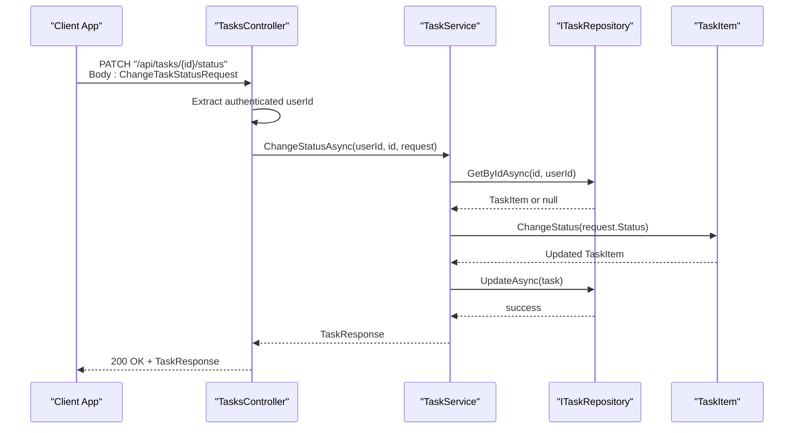

**Diagram sources**
- [TasksController.cs:128-155](file://Services/Services.Api/Controllers/TasksController.cs#L128-L155)
- [TaskService.cs:121-142](file://Services/Services.Application/Services/TaskService.cs#L121-L142)
- [TaskItem.cs:103-115](file://Services/Services.Domain/Entities/TaskItem.cs#L103-L115)

## Detailed Component Analysis

### TaskCurrentStatus Enum
- Values: Todo, InProgress, Done.
- Purpose: Centralizes valid task states across domain, application, and UI layers.
- Validation: Used by service and query normalization to ensure only defined statuses are accepted.

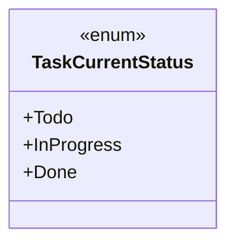

**Diagram sources**
- [TaskCurrentStatus.cs:3-8](file://Services/Services.Domain/Enums/TaskCurrentStatus.cs#L3-L8)

**Section sources**
- [TaskCurrentStatus.cs:1-9](file://Services/Services.Domain/Enums/TaskCurrentStatus.cs#L1-L9)

### TaskItem Entity and Status Behavior
- Status field holds the current state.
- ChangeStatus method validates the provided status and updates the timestamp.
- New tasks default to Todo.

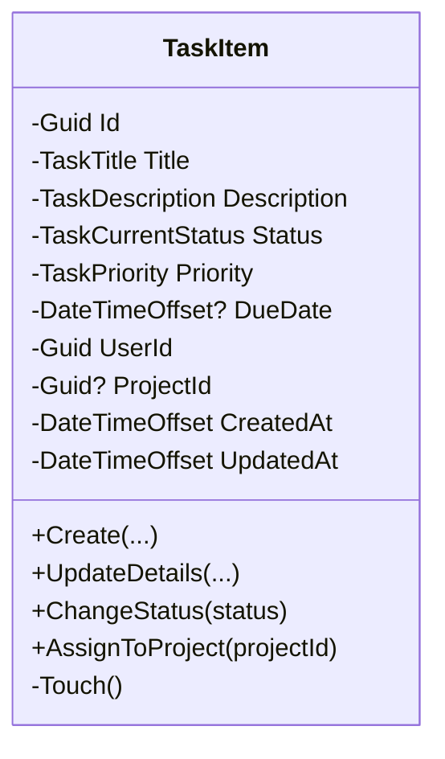

**Diagram sources**
- [TaskItem.cs:6-21](file://Services/Services.Domain/Entities/TaskItem.cs#L6-L21)
- [TaskItem.cs:54-78](file://Services/Services.Domain/Entities/TaskItem.cs#L54-L78)
- [TaskItem.cs:80-101](file://Services/Services.Domain/Entities/TaskItem.cs#L80-L101)
- [TaskItem.cs:103-115](file://Services/Services.Domain/Entities/TaskItem.cs#L103-L115)
- [TaskItem.cs:117-122](file://Services/Services.Domain/Entities/TaskItem.cs#L117-L122)
- [TaskItem.cs:124-127](file://Services/Services.Domain/Entities/TaskItem.cs#L124-L127)

**Section sources**
- [TaskItem.cs:1-128](file://Services/Services.Domain/Entities/TaskItem.cs#L1-L128)

### ChangeTaskStatusRequest DTO
- Carries the target status for a task update.
- Uses TaskCurrentStatus type to enforce valid values at the boundary.

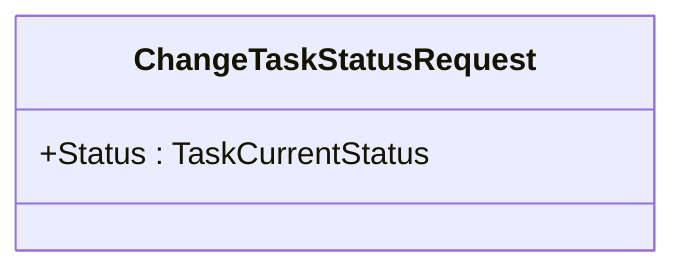

**Diagram sources**
- [ChangeTaskStatusRequest.cs:5-6](file://Services/Services.Application/DTOs/Tasks/ChangeTaskStatusRequest.cs#L5-L6)

**Section sources**
- [ChangeTaskStatusRequest.cs:1-6](file://Services/Services.Application/DTOs/Tasks/ChangeTaskStatusRequest.cs#L1-L6)

### TaskService Status Change Logic
- Validates user and task identifiers.
- Ensures the task belongs to the authenticated user.
- Applies the requested status and persists changes.

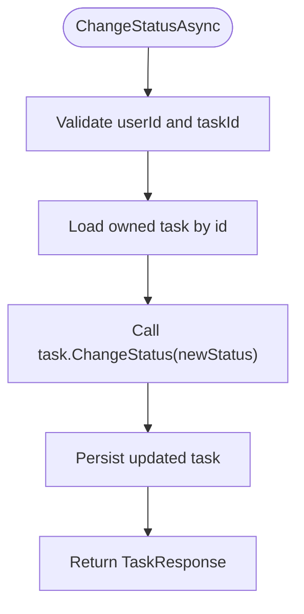

**Diagram sources**
- [TaskService.cs:121-142](file://Services/Services.Application/Services/TaskService.cs#L121-L142)
- [TaskService.cs:234-248](file://Services/Services.Application/Services/TaskService.cs#L234-L248)

**Section sources**
- [TaskService.cs:121-142](file://Services/Services.Application/Services/TaskService.cs#L121-L142)
- [TaskService.cs:234-248](file://Services/Services.Application/Services/TaskService.cs#L234-L248)

### API Endpoint: Change Task Status
- Method: PATCH
- Route: /api/tasks/{id}/status
- Request Body: ChangeTaskStatusRequest
- Responses:
  - 200 OK with updated TaskResponse
  - 404 Not Found if task does not exist
  - 400 Bad Request for invalid input

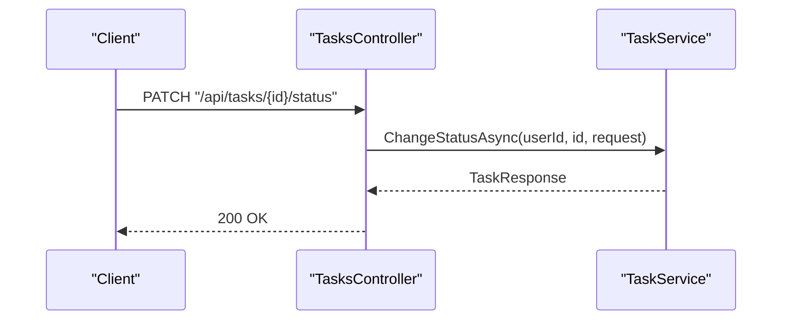

**Diagram sources**
- [TasksController.cs:128-155](file://Services/Services.Api/Controllers/TasksController.cs#L128-L155)
- [TaskService.cs:121-142](file://Services/Services.Application/Services/TaskService.cs#L121-L142)

**Section sources**
- [TasksController.cs:128-155](file://Services/Services.Api/Controllers/TasksController.cs#L128-L155)

### UI Components for Status Updates and Visual Indicators
- TasksList:
  - Displays status using a Badge component mapped from statusLabels and styled via statusStyles.
  - Provides a filter dropdown to list tasks by status.
- TaskFormDialog:
  - Handles creation and editing of tasks; does not directly change status but integrates with the same data model.
- TasksKanbanBoard:
  - Placeholder component for future drag-and-drop status transitions.

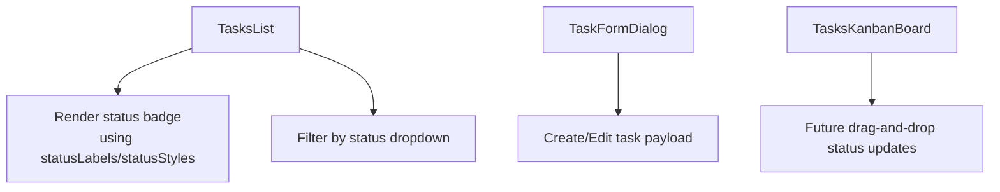

**Diagram sources**
- [list-section.tsx:222-228](file://Apps/Web/src/components/tasks-page/list-section.tsx#L222-L228)
- [list-section.tsx:340-370](file://Apps/Web/src/components/tasks-page/list-section.tsx#L340-L370)
- [task-form.tsx:60-70](file://Apps/Web/src/components/tasks-page/task-form.tsx#L60-L70)
- [kanban-section.tsx:1-4](file://Apps/Web/src/components/tasks-page/kanban-section.tsx#L1-L4)

**Section sources**
- [list-section.tsx:81-99](file://Apps/Web/src/components/tasks-page/list-section.tsx#L81-L99)
- [list-section.tsx:222-228](file://Apps/Web/src/components/tasks-page/list-section.tsx#L222-L228)
- [list-section.tsx:340-370](file://Apps/Web/src/components/tasks-page/list-section.tsx#L340-L370)
- [task-form.tsx:60-70](file://Apps/Web/src/components/tasks-page/task-form.tsx#L60-L70)
- [kanban-section.tsx:1-4](file://Apps/Web/src/components/tasks-page/kanban-section.tsx#L1-L4)

### Status Transition Rules and Validation
- Allowed values: Todo, InProgress, Done.
- Current implementation accepts any valid enum value without enforcing specific transition order.
- Validation occurs at multiple layers:
  - API controller validates authentication and routes requests.
  - Service validates identifiers and ensures task ownership.
  - Entity validates the enum value before applying the change.

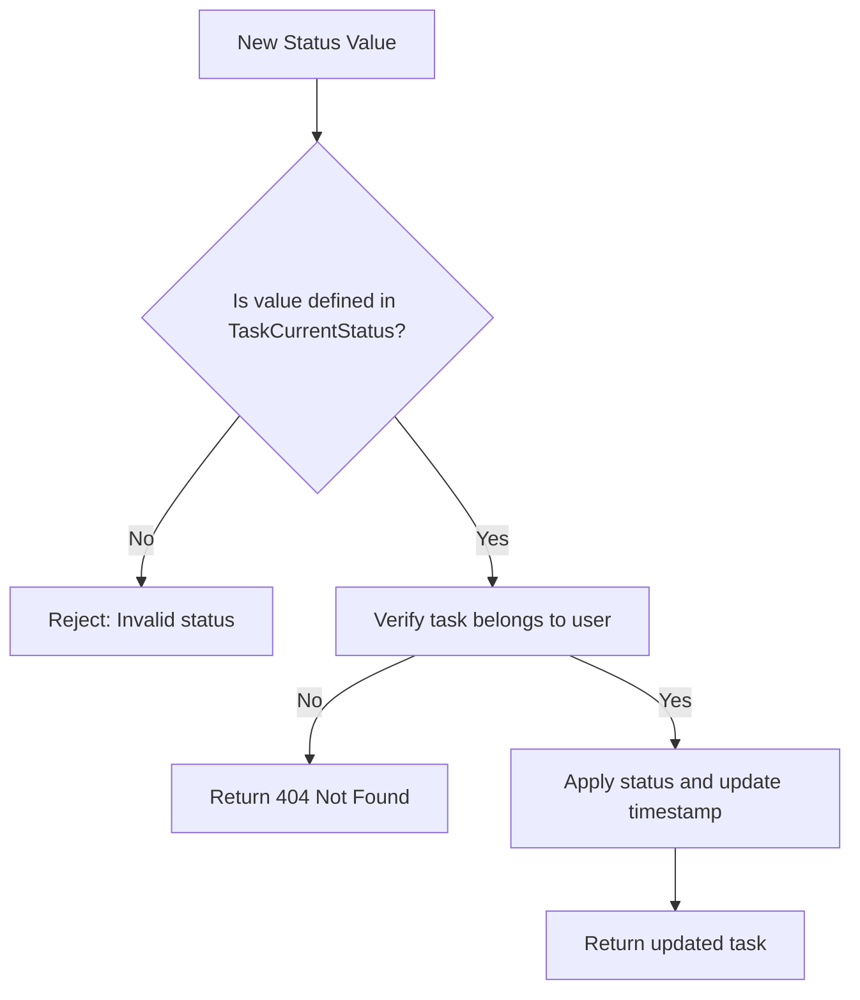

**Diagram sources**
- [TaskService.cs:121-142](file://Services/Services.Application/Services/TaskService.cs#L121-L142)
- [TaskService.cs:234-248](file://Services/Services.Application/Services/TaskService.cs#L234-L248)
- [TaskItem.cs:103-115](file://Services/Services.Domain/Entities/TaskItem.cs#L103-L115)

**Section sources**
- [TaskService.cs:121-142](file://Services/Services.Application/Services/TaskService.cs#L121-L142)
- [TaskItem.cs:103-115](file://Services/Services.Domain/Entities/TaskItem.cs#L103-L115)

### Implementing Custom Status Transitions
To introduce stricter transition rules (for example, disallowing direct moves from Todo to Done):
- Add a dedicated method in TaskItem (e.g., CanTransitionTo) to encapsulate business rules.
- Call this method from TaskService.ChangeStatusAsync before persisting.
- Throw a validation exception when the transition is not allowed.
- Surface meaningful error messages to the client.

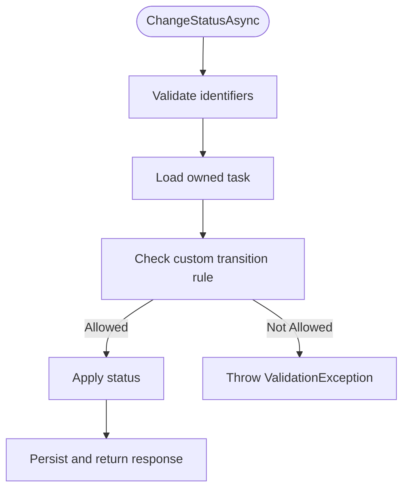

[No sources needed since this section provides conceptual guidance]

### Integrating With Project Workflows
- Use the existing status enum and endpoint to integrate with external automation:
  - Trigger status changes based on CI/CD pipeline results.
  - Sync status with external tools via webhooks calling PATCH /api/tasks/{id}/status.
- Extend TaskService to emit domain events after successful status changes for downstream processing.

[No sources needed since this section provides conceptual guidance]

## Dependency Analysis
The following diagram shows key dependencies between components involved in status management.

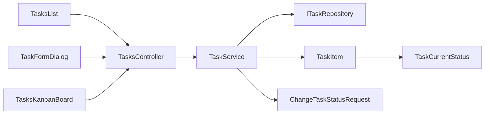

**Diagram sources**
- [TasksController.cs:11-16](file://Services/Services.Api/Controllers/TasksController.cs#L11-L16)
- [TaskService.cs:12-14](file://Services/Services.Application/Services/TaskService.cs#L12-L14)
- [TaskItem.cs:6-21](file://Services/Services.Domain/Entities/TaskItem.cs#L6-L21)
- [TaskCurrentStatus.cs:3-8](file://Services/Services.Domain/Enums/TaskCurrentStatus.cs#L3-L8)
- [ChangeTaskStatusRequest.cs:5-6](file://Services/Services.Application/DTOs/Tasks/ChangeTaskStatusRequest.cs#L5-L6)
- [list-section.tsx:81-99](file://Apps/Web/src/components/tasks-page/list-section.tsx#L81-L99)
- [task-form.tsx:60-70](file://Apps/Web/src/components/tasks-page/task-form.tsx#L60-L70)
- [kanban-section.tsx:1-4](file://Apps/Web/src/components/tasks-page/kanban-section.tsx#L1-L4)

**Section sources**
- [TasksController.cs:11-16](file://Services/Services.Api/Controllers/TasksController.cs#L11-L16)
- [TaskService.cs:12-14](file://Services/Services.Application/Services/TaskService.cs#L12-L14)
- [TaskItem.cs:6-21](file://Services/Services.Domain/Entities/TaskItem.cs#L6-L21)
- [TaskCurrentStatus.cs:3-8](file://Services/Services.Domain/Enums/TaskCurrentStatus.cs#L3-L8)
- [ChangeTaskStatusRequest.cs:5-6](file://Services/Services.Application/DTOs/Tasks/ChangeTaskStatusRequest.cs#L5-L6)
- [list-section.tsx:81-99](file://Apps/Web/src/components/tasks-page/list-section.tsx#L81-L99)
- [task-form.tsx:60-70](file://Apps/Web/src/components/tasks-page/task-form.tsx#L60-L70)
- [kanban-section.tsx:1-4](file://Apps/Web/src/components/tasks-page/kanban-section.tsx#L1-L4)

## Performance Considerations
- Status changes are lightweight operations involving a single entity update.
- Ensure indexes on task identifiers and user associations to optimize lookups.
- Avoid unnecessary re-renders in the UI by batching status updates where possible.

[No sources needed since this section provides general guidance]

## Troubleshooting Guide
Common issues and resolutions:
- Invalid status value:
  - Cause: Passing an undefined or unsupported status.
  - Resolution: Use only Todo, InProgress, or Done.
- Unauthorized access:
  - Cause: Missing or invalid authentication token.
  - Resolution: Ensure the request includes a valid bearer token.
- Task not found:
  - Cause: Incorrect task ID or lack of ownership.
  - Resolution: Verify the task exists and belongs to the authenticated user.
- Query validation errors:
  - Cause: Invalid status/priority in queries or out-of-range pagination parameters.
  - Resolution: Adjust query parameters to supported values and ranges.

**Section sources**
- [TasksController.cs:128-155](file://Services/Services.Api/Controllers/TasksController.cs#L128-L155)
- [TaskService.cs:234-248](file://Services/Services.Application/Services/TaskService.cs#L234-L248)
- [TaskService.cs:318-393](file://Services/Services.Application/Services/TaskService.cs#L318-L393)

## Conclusion
The task status management system centers around a simple, well-defined enum and a clear API contract. While the current implementation allows any valid status without enforcing strict transition rules, it provides a solid foundation for adding workflow-specific validations and automations. The UI components already render and filter by status, and the Kanban board can be extended to support interactive status transitions.

[No sources needed since this section summarizes without analyzing specific files]

## Appendices

### API Reference: Change Task Status
- Endpoint: PATCH /api/tasks/{id}/status
- Authentication: Required
- Request body: ChangeTaskStatusRequest
- Response: TaskResponse
- Error responses:
  - 404 Not Found: Task does not exist
  - 400 Bad Request: Invalid input

**Section sources**
- [TasksController.cs:128-155](file://Services/Services.Api/Controllers/TasksController.cs#L128-L155)
- [ChangeTaskStatusRequest.cs:5-6](file://Services/Services.Application/DTOs/Tasks/ChangeTaskStatusRequest.cs#L5-L6)